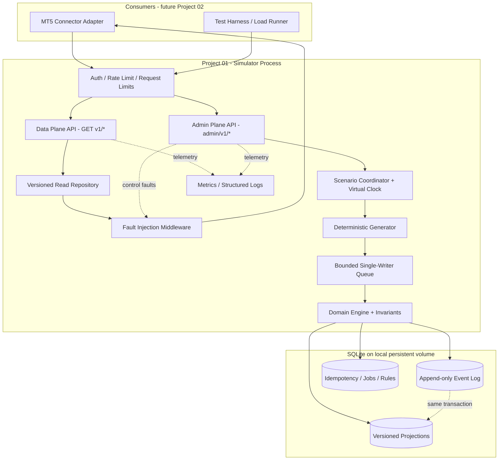
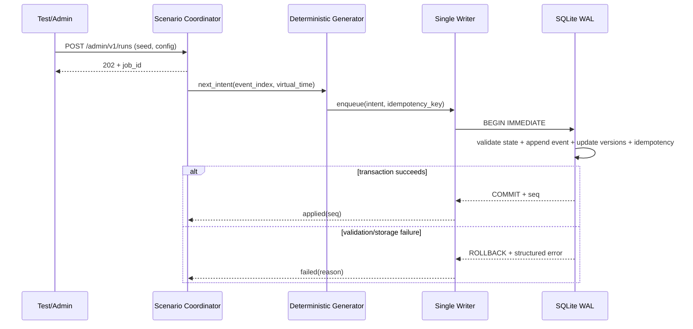
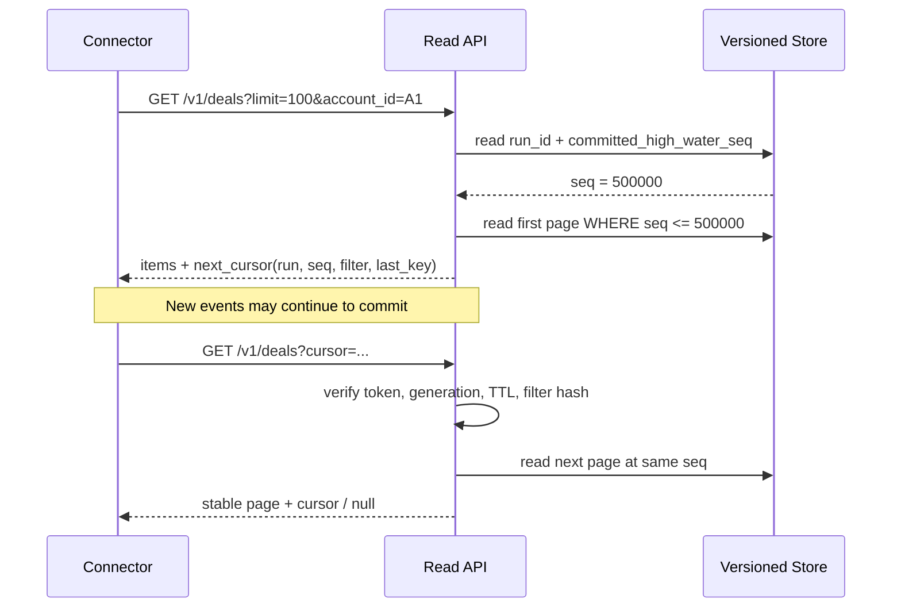
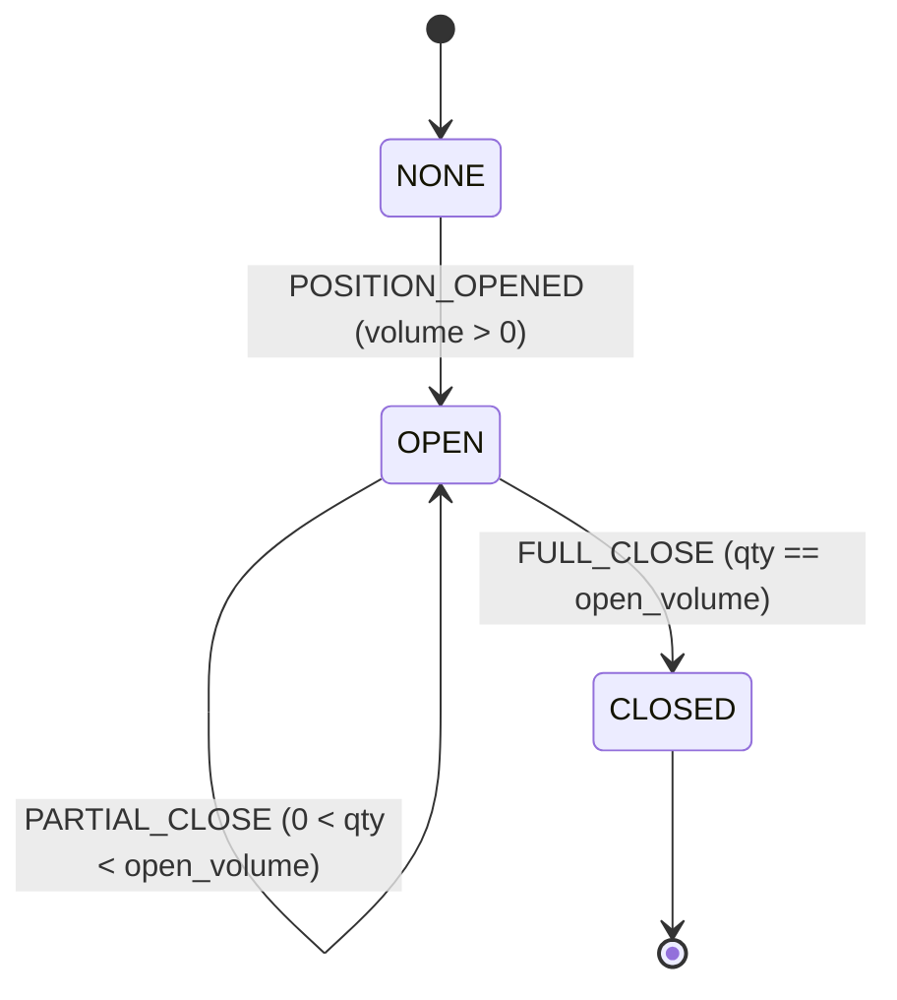

# Project 01 — MT5 Broker Simulator

**System Design, Threat/Fault Model & “What-if” Test Plan**  
**Phiên bản:** 1.0  
**Cập nhật:** 2026-10-30  
**Trạng thái:** Thiết kế đề xuất (chưa triển khai hoặc benchmark)  
**Ngôn ngữ:** Tiếng Việt; thuật ngữ kỹ thuật, tên API và dữ liệu dùng tiếng Anh.

> **Phạm vi nguồn:** Đây là mini-project **01 — MT5 Broker Simulator** được đề xuất để tái dựng dự án lớn “Broker Risk Reporting and MT5 Integration”. CV gốc đề cập MT5 Manager API, account/position/deal synchronization, recovery, asyncio, reporting, PostgreSQL, Kafka và ClickHouse, **không nói rằng tác giả CV từng xây dựng Simulator này**. Tất cả lựa chọn kiến trúc dưới đây là thiết kế học tập/kiểm thử mới, không phải mô tả kiến trúc của công ty cũ.
>
> **Cam kết kiểm chứng:** Các con số về throughput, latency, RAM, thời gian recovery ở tài liệu này là **ngưỡng mục tiêu cần đo** (provisional acceptance targets), không phải kết quả đã đạt được.

---

## 0. Executive summary

Xây dựng một **nguồn dữ liệu broker giả lập có trạng thái**, có thể mô phỏng các chức năng đọc dữ liệu từ MT5 Manager API cho các mini-project tiếp theo:

1. Sinh **Account, Position, Deal**, sự kiện giá và giao dịch bằng **seed** cố định để kết quả lặp lại được.
2. Hỗ trợ **initial sync**, **incremental sync**, phân trang theo snapshot và đọc dữ liệu ổn định dưới cạnh tranh.
3. Có dữ liệu **đúng về mặt nghiệp vụ** ở chế độ chuẩn, nhưng có thể chủ động tạo **response lỗi, timeout, dữ liệu thiếu, trùng, sai thứ tự** để thử độ bền của connector.
4. Đảm bảo **không mất dữ liệu đã commit**, **không tạo giao dịch trùng khi retry**, và **không cấp dữ liệu tự mâu thuẫn** ở chế độ chuẩn.
5. Có bài test định lượng chứng minh hệ thống chạy được dưới tải đã định, phục hồi sau crash và **từ chối có kiểm soát** nếu quá giới hạn.

**Quyết định chủ đạo:** Modular monolith, 1 writer, Python 3.12 + FastAPI + Pydantic v2, SQLite ở chế độ WAL cho nguồn dữ liệu giả lập (không dùng PostgreSQL trong Project 01 để tránh chồng lấn Project 03). REST là **test contract mô phỏng**, **không** phải bản sao wire protocol/SDK của MT5 Manager API thật. Adapter ở Project 02 sẽ che đi sự khác biệt này.

### Definition of “chịu nổi”

Hệ thống được xem là **chịu nổi một tình huống** nếu đáp ứng ít nhất một trong hai kết cục hợp lệ:

- **Thành công chính xác:** trả dữ liệu đúng, đảm bảo invariant và đáp ứng latency/throughput mục tiêu; hoặc
- **Thất bại có kiểm soát:** trả lỗi có cấu trúc, giới hạn thời gian/tài nguyên, không làm hỏng dữ liệu đã commit, có thể retry/recover, có metric và log giải thích nguyên nhân.

**Không** coi một hệ thống “chịu nổi” chỉ vì HTTP còn trả `200`; dữ liệu sai âm thầm là lỗi nghiêm trọng hơn lỗi `503` rõ ràng.

---

## 1. Requirements và non-goals

### 1.1 Functional requirements (FR)

| ID | Yêu cầu | Priority | Cách nghiệm thu |
|---|---|---|---|
| FR-01 | Sinh được Account, Position, Deal với dữ liệu giả lập có quy tắc | P0 | Seed 42 → 1.000 account, 100.000 deal hợp lệ; invariant pass |
| FR-02 | Đọc và lọc Account/Position/Deal theo ID, account, symbol, thời gian | P0 | API contract + integration tests |
| FR-03 | Phân trang lớn và đọc snapshot ổn định khi dữ liệu tiếp tục thay đổi | P0 | Không thiếu/trùng bản ghi giữa các trang của cùng snapshot |
| FR-04 | Đồng hồ ảo, seed và thứ tự event tái tạo được | P0 | Hai lần chạy cùng cấu hình → cùng canonical state hash |
| FR-05 | Giả lập cập nhật giá, mở vị thế, đóng một phần/toàn phần | P0 | Kiểm tra chuyển trạng thái và tiền chính xác |
| FR-06 | Mô phỏng timeout, HTTP 5xx, latency, thiếu/trùng/sai thứ tự dữ liệu | P0 | Fault rule có xác suất/số lần xác định và kiểm tra được |
| FR-07 | Reset/chạy lại scenario, quản lý job chạy dài | P0 | Không race reset vs generation, có status job |
| FR-08 | Chịu restart/crash và không mất các event đã commit | P0 | Test kill process + replay/check DB |
| FR-09 | Giới hạn request, queue, page size, generation size | P0 | Load quá ngưỡng → 429/503/422, không OOM |
| FR-10 | Có metrics, structured logs, health/readiness | P0 | Lỗi được truy vết theo run/event/request ID |
| FR-11 | Cho phép sự cố dữ liệu bất thường có kiểm soát để thử downstream | P1 | Connector phát hiện hoặc xử lý đúng anomaly |
| FR-12 | Export dataset và manifest phục vụ reproducibility | P1 | Import/đọc lại có thể kiểm hash |

### 1.2 Non-functional requirements (NFR)

- **Correctness:** Event log và projection phải commit cùng transaction; trạng thái chuẩn không có orphan records.
- **Determinism:** Kết quả phụ thuộc vào `seed + scenario_spec + generator_version`, **không** phụ thuộc thứ tự request đọc hoặc lịch chạy thread.
- **Availability:** Với lỗi có chủ đích, hệ thống báo lỗi đúng contract; ngoài các lỗi đó, không sập vì một request dữ liệu xấu.
- **Bounded resource:** Giới hạn page size, request bytes, pending event queue, concurrent requests, active jobs, snapshot retention.
- **Observability:** Có correlation IDs, metrics theo lỗi và fault rules; không ghi bí mật/token vào log.
- **Security:** Chỉ dùng dữ liệu tổng hợp; control plane riêng, có xác thực và mặc định bind loopback.
- **Portability:** Local/Docker trên Linux; Python 3.12 là baseline, kiểm thử tương thích phiên bản khác khi mở rộng.

### 1.3 Không nằm trong Project 01

- Không implement **giao thức nhị phân thật** hoặc đầy đủ hành vi của **MT5 Manager API**.
- Không kết nối tài khoản broker thật, không gửi lệnh mua/bán hoặc xử lý tiền thật.
- Không làm engine báo cáo exposure/P&L tổng hợp cho broker; đó là Project 05–06. Project 01 chỉ duy trì dữ liệu cơ bản nhất quán để phục vụ thử nghiệm.
- Không vận hành đa broker/đa vùng (multi-region) hoặc HA production ngay từ MVP.
- Không mô phỏng toàn bộ MT5 hedging/netting, corporate actions, mọi loại symbol, margin và swap phức tạp trong MVP.
- Không tuyên bố số liệu latency hoặc throughput của CV là kết quả của mini-project.

### 1.4 Giả định phải khóa trước khi code

| Giả định | Quyết định MVP | Hệ quả |
|---|---|---|
| Quy mô mặc định | 1.000 accounts, 10.000 vị thế tối đa, 100.000 deals | Đủ cho thử nghiệm đồng bộ ban đầu |
| Chế độ position | **Netting đơn giản** theo `account_id + symbol` | Hedging nhiều ticket cùng symbol là extension |
| Đồng tiền | Account USD; symbols EURUSD, GBPUSD, AUDUSD | P&L quote USD, chưa cần quy đổi chéo |
| Contract size | 100.000 đơn vị base / 1 lot (cấu hình cho mỗi symbol) | Dùng để tính P&L ví dụ, không áp dụng cho mọi loại sản phẩm |
| Precision | Giá: 5 chữ số thập phân theo symbol; lots: bước 0.01; tiền: USD 2 số thập phân | Dùng `Decimal`, validate tick/step |
| Thời gian | UTC, ISO 8601; virtual clock kiểm soát bởi engine | Không phụ thuộc wall clock cho nghiệp vụ |
| Nguồn truth | Event log + versioned projections trong SQLite | Hỗ trợ đọc `as_of_seq` thật sự |
| Một instance | 1 process ghi và 1 active scenario/run | Không bật nhiều Uvicorn workers cho MVP |
| Dữ liệu nhạy cảm | Không có; chỉ synthetic IDs | Không copy dữ liệu broker thật |

---

## 2. Kiến trúc tổng thể



**Hai mặt phẳng tách biệt:**

- **Data plane:** endpoints cho downstream đọc account/position/deal. Không được phép reset hay tiêm lỗi.
- **Control plane:** chọn seed/scenario, chạy generator, reset, cấu hình fault, xem trạng thái. Chỉ dành cho operator/test runner có token admin.

### 2.1 Thành phần và trách nhiệm

| Thành phần | Chức năng | Quy tắc an toàn |
|---|---|---|
| Scenario Coordinator | Serial hóa start/reset/stop/advance-clock | 1 active run; lock/FSM cho mọi transition |
| Generator | Sinh event có thứ tự, deterministic theo seed | Không chia sẻ RNG mutable giữa threads |
| Domain Engine | Áp dụng OPEN/CLOSE/PRICE_TICK, validate invariant | Transaction thất bại → rollback hoàn toàn |
| Single Writer | Gom batch và giới hạn hàng chờ | Queue đầy → 429/503, không tăng RAM vô hạn |
| Event Store | Append immutable event records | `UNIQUE(run_id, seq)`; commit cùng projection |
| Projection Store | Versioned Account/Position/Mark + immutable Deal | `as_of_seq` phải đọc được quá khứ hợp lệ |
| Read Repository | Filter, snapshot, keyset cursor | Không OFFSET sâu; không đọc nửa transaction |
| Fault Engine | Lỗi transport/response theo luật định sẵn | Không thay canonical truth trừ scenario được khai báo rõ |
| Observability | Logs, metrics, readiness, traces optional | Có run_id, seq, request_id; không lộ token |

### 2.2 Luồng sinh một event



**Transaction boundary:** Việc append `event_log`, thêm `deals`, đóng phiên bản projection cũ/mở bản mới và ghi `idempotency_key` phải nằm **cùng transaction**. Không gửi thành công trước khi commit.

### 2.3 Luồng đọc snapshot nhiều trang



**Điểm dễ làm sai:** Chỉ gắn `WHERE updated_seq <= snapshot_seq` lên bảng lưu **trạng thái hiện tại** là **không đủ**. Khi một record bị sửa sau snapshot, phiên bản cũ biến mất. Phải lưu lịch sử phiên bản (hoặc một immutable snapshot thực sự). Thiết kế này chọn **versioned projections**.

---

## 3. Domain model và tính đúng đắn

### 3.1 Data model

| Entity | Trường tối thiểu | Constraints |
|---|---|---|
| `Run` | `run_id`, `generation`, `seed`, `scenario_hash`, `generator_version`, `status`, `committed_seq`, `virtual_time` | Một active run, FSM trạng thái hợp lệ |
| `AccountVersion` | `account_id`, `currency`, `balance`, `credit`, `valid_from_seq`, `valid_to_seq` | USD balance Decimal, version interval không overlap |
| `PositionVersion` | `position_id`, `account_id`, `symbol`, `side`, `volume_lots`, `open_price`, `status`, `valid_from_seq`, `valid_to_seq` | Volume >=0; OPEN phải >0; account tồn tại |
| `Deal` | `deal_id`, `position_id`, `account_id`, `symbol`, `entry`, `side`, `volume_lots`, `price`, `realized_pnl_gross`, `commission`, `swap`, `executed_at`, `source_seq` | Immutable; unique theo `(run_id, deal_id)` |
| `MarkVersion` | `symbol`, `bid`, `ask`, `market_time`, `valid_from_seq`, `valid_to_seq` | Bid >0, ask >= bid ở chế độ chuẩn |
| `Event` | `run_id`, `seq`, `event_id`, `event_type`, `payload_json`, `virtual_time`, `created_at` | Append-only; seq tăng liên tục trên commit |
| `FaultRule` | `rule_id`, `run_id`, `phase`, `scope`, `mode`, `probability`, `limit`, `enabled` | Có max latency, max matches, audit log |
| `Job` | `job_id`, `run_id`, `status`, `processed`, `target`, `error_code`, `started_at`, `finished_at` | Status transition hợp lệ |
| `IdempotencyRecord` | `run_id`, `idempotency_key`, `request_hash`, `result_seq` | Cùng key khác payload → 409 |

`valid_from_seq <= snapshot_seq < valid_to_seq` (nếu `valid_to_seq` NULL thì là vô hạn). Khoảng hiệu lực nửa mở `[from, to)` tránh double-visible ở điểm giao phiên bản.

### 3.2 Domain event types

- `ACCOUNT_CREATED` / `ACCOUNT_ADJUSTED` (adjustment chỉ bởi admin scenario, lưu lý do rõ).
- `POSITION_OPENED`, `POSITION_INCREASED`, `POSITION_PARTIALLY_CLOSED`, `POSITION_CLOSED`.
- `MARK_PRICE_UPDATED`.
- `SCENARIO_STARTED`, `SCENARIO_STOPPED` có thể lưu metadata job riêng; không cần đánh đồng với giao dịch.

**Nguyên tắc:** Deal là bản ghi kết quả execution, không phải order. Project 01 **không** cung cấp OMS/order state machine. Mỗi event giao dịch tạo tối đa một Deal trong mô hình tối giản. `source_seq` là sequence **do simulator tự định nghĩa để kiểm thử**, không khẳng định MT5 Manager API thật có trường/semantics tương đương.

### 3.3 Vòng đời vị thế (MVP netting)



**Các quy tắc bắt buộc:**

1. Không tạo Deal tham chiếu `account_id`/`position_id` không tồn tại.
2. Không close quá `open_volume`; không cho volume âm, NaN, infinity hoặc step sai.
3. Không dùng `float` để lưu giá/tiền/lot; API trả `Decimal` dưới dạng **JSON string**.
4. Event update position, deal và account balance phải commit nguyên tử.
5. Tăng volume cùng chiều: giá mở bình quân được tính theo weighted average có quy tắc rounding rõ; thay đổi hướng ngược chiều qua lệnh reversal chưa nằm trong MVP.
6. Dữ liệu chuẩn: mark `bid <= ask`; BUY unrealized dùng bid đóng vị thế, SELL dùng ask đóng vị thế; snapshot phải cùng thời điểm logic.
7. Giá/thời gian nhảy ngược chỉ xuất hiện khi bật fault/test case có tên, không lẫn vào chế độ chuẩn.

### 3.4 Kế toán mẫu, explicit và có thể test

Chỉ hỗ trợ account USD và instrument quote USD trong MVP:

```text
contract_units = volume_lots * contract_size
BUY gross_PnL  = (close_price - open_price) * contract_units
SELL gross_PnL = (open_price - close_price) * contract_units
balance_delta_on_deal = realized_pnl_gross + commission + swap
balance = initial_balance + SUM(balance_delta_on_deal) + SUM(explicit_adjustments)
equity = balance + SUM(unrealized_pnl_on_open_positions)
```

- `commission` và `swap` là các **signed amounts**: phí thường âm, hoàn phí có thể dương nếu scenario có khai báo.
- `realized_pnl_gross` bằng 0 khi mở; được tính cho lượng đóng khi close.
- Quantization theo đồng tiền sau từng deal (`USD 0.01`, chế độ rounding được chốt trong config); phép tính trung gian giữ precision cao.
- `equity` là trường derived, không có nghĩa simulator đã làm margin model đầy đủ.
- Dưới `price_tick`, position P&L được tính theo mark bid/ask trong cùng snapshot logic. Không dùng mark thuộc snapshot mới cho position thuộc snapshot cũ.

**Test vector tối thiểu:**

| Bước | Hành động | Expected |
|---|---|---|
| 0 | Account USD ban đầu | Balance `10000.00` |
| 1 | OPEN BUY `0.50` lot EURUSD @ `1.10000`; commission `-2.50` | Balance `9997.50`; open volume `0.50` |
| 2 | Mark bid `1.10200` | Unrealized P&L `+100.00`; Equity `10097.50` |
| 3 | CLOSE `0.20` lot @ `1.10300`; commission `-1.00`, swap `-0.50` | Realized gross `+60.00`; balance `10056.00`; remaining `0.30` |
| 4 | Mark bid `1.10300` | Unrealized `+90.00`; equity `10146.00` |

*Với test vector trên, event đóng vị thế được cho phép sử dụng giá đã chỉ định; test ở trạng thái mô phỏng, không mô phỏng bid/ask execution/market impact thực tế.*

### 3.5 Invariants phải chạy cả trong test và diagnostic

| ID | Invariant | Oracle |
|---|---|---|
| INV-01 | `event_log.seq` liên tục từ 1..committed_seq trong từng run | `COUNT(*)=MAX(seq)` và không duplicate; không có rollback gap |
| INV-02 | Deal ID không trùng trong một run | Unique index + query duplicate |
| INV-03 | Deal luôn tham chiếu account/position hợp lệ | Foreign keys + consistency query |
| INV-04 | Không có 2 version đang hiệu lực cho cùng key ở cùng seq | Kiểm tra overlap intervals |
| INV-05 | Position OPEN có volume >0, CLOSED có volume =0 | State validator |
| INV-06 | Không đóng nhiều hơn volume có sẵn | Domain engine reject, không có partial commit |
| INV-07 | Balance tính lại từ Deal + adjustments phải khớp đến cent | Recompute bằng Decimal |
| INV-08 | Exposure hoặc unrealized derived dùng đúng mark/snapshot | Compare calculation oracle |
| INV-09 | Cùng seed/spec/version → cùng canonical content hash | Replay A/B so sánh hash |
| INV-10 | Mỗi trang snapshot không chứa record ngoài snapshot seq | Verify all returned source_seq/versions |
| INV-11 | Toàn bộ trang của snapshot: không mất, không trùng record | So sánh tập IDs với query oracle as-of |
| INV-12 | Fault chỉ trên response không sửa truth store | Hash truth trước/sau fault không đổi |
| INV-13 | Admin event retry cùng key không thêm Deal/event thứ hai | Event count và seq không tăng lần 2 |
| INV-14 | Job terminal không còn ghi event mới | Freeze committed_seq sau terminal |
| INV-15 | Reset không trộn run_id/generation cũ với mới | Kiểm từng response cùng run identity |
| INV-16 | Tại mọi thời điểm CPU/RAM/queue có giới hạn thực thi | Load/soak metrics + resource limits |

**Phân biệt quan trọng:** Khi bật **anomaly fault** như missing deal, invalid currency, duplicate ID trong **response**, các invariant DB bên trên vẫn phải pass. Test downstream sẽ có oracle riêng: *client có phát hiện/đối soát được dữ liệu bất thường không?*

---

## 4. Storage design và consistency

### 4.1 SQLite MVP

```text
runs(run_id PK, generation, seed, spec_hash, generator_version, status,
     committed_seq, virtual_time, created_at)
event_log(run_id, seq, event_id, event_type, payload_json, virtual_time,
          PRIMARY KEY(run_id, seq), UNIQUE(run_id,event_id))
account_versions(run_id, account_id, valid_from_seq, valid_to_seq,
                 balance_dec, credit_dec, currency, ...)
position_versions(run_id, position_id, account_id, symbol, valid_from_seq,
                  valid_to_seq, volume_dec, open_price_dec, side, status, ...)
mark_versions(run_id, symbol, valid_from_seq, valid_to_seq, bid_dec, ask_dec, ...)
deals(run_id, deal_id, source_seq, position_id, account_id,
      executed_at, symbol, qty_dec, price_dec, gross_pnl_dec, ...)
idempotency_records(run_id, key, request_hash, result_seq, response_json, ...)
fault_rules(rule_id, run_id, scope_json, mode, config_json, enabled, ...)
jobs(job_id, run_id, status, progress_count, error_code, ...)
```

**Indexes dự kiến:**

- `deals(run_id, account_id, source_seq, deal_id)` cho incremental sync theo account;
- `deals(run_id, source_seq, deal_id)` cho global pagination;
- `position_versions(run_id, account_id, valid_from_seq, valid_to_seq)`;
- `account_versions(run_id, account_id, valid_from_seq, valid_to_seq)`;
- `mark_versions(run_id, symbol, valid_from_seq, valid_to_seq)`.

Có thể cần thêm filtered/covering indexes sau khi benchmark bằng `EXPLAIN QUERY PLAN`; không tạo tất cả chỉ vì phỏng đoán. Nhiều indexes làm chậm writer, tăng dung lượng đĩa.

**Cấu hình đề xuất:** SQLite WAL; `PRAGMA foreign_keys=ON`; `busy_timeout` hữu hạn; đánh giá `synchronous=FULL` nếu yêu cầu chống mất dữ liệu qua power failure. Chạy thử crash test thay vì coi cấu hình này là bảo chứng tuyệt đối. Chỉ **một** SQLite writer tại một thời điểm và **một** process giữ Coordinator, không dùng N workers ngẫu nhiên trên cùng run.

### 4.2 Phân trang và snapshot

**Mặc định:** `limit=100`, max `500`, **keyset pagination** thay vì deep OFFSET. Snapshot tạo tại `committed_seq=S` và không đổi đến hết các trang. Với bảng `deals` immutable, lấy `source_seq <= S`. Với `account_versions`/`position_versions`, lấy version có hiệu lực tại `S`.

**Cursor (opaque, signed):**

```json
{
  "run_id": "run_0001",
  "generation": 7,
  "entity": "deals",
  "snapshot_seq": 100500,
  "filter_digest": "sha256:...",
  "last_key": [90010, "D-0090010"],
  "expires_at": "2026-10-30T05:45:00Z"
}
```

Dữ liệu trên là **payload minh họa**; token công khai phải có HMAC/signature và được base64url-encode; không được tin payload mà client tự sửa. `filter_digest` bao gồm account/symbol/time/limit/sort. Signing key phải lưu bền trong cấu hình (không sinh lại ngẫu nhiên mỗi restart); hỗ trợ `key_id` và rotate key có overlap ít nhất bằng TTL. Nếu token hết hạn, run bị reset hoặc snapshot history bị GC, trả `410 SNAPSHOT_EXPIRED` và yêu cầu initial sync mới. Cursor khác filter → `400 INVALID_CURSOR`.

**Retention:** TTL 15 phút, tối đa 100 snapshot cursor đang được theo dõi; không purge lịch sử version còn được bảo vệ bởi snapshot hợp lệ. Nếu bộ nhớ/đĩa khan hiếm, ngăn **snapshot mới** với lỗi rõ ràng, không âm thầm cắt bớt snapshot đang hợp lệ. Nếu cần giải phóng khẩn cấp, đánh dấu/expire các snapshot trước và để client nhận `410` thay vì trả dữ liệu sai.

### 4.3 Recovery và reset

- Mỗi write là một SQLite transaction gồm: validate → event log → versioned projection → committed_seq → idempotency record.
- Sau crash, mở DB, chạy `PRAGMA integrity_check` khi được yêu cầu (không nhất thiết mỗi startup nếu gây chậm), đọc `committed_seq`, so sánh event log, chạy lightweight invariants.
- Nếu phát hiện projection thiếu/không khớp event log, **không** báo healthy: chuyển `READ_ONLY_REPAIR_REQUIRED`, cho operator rebuild projection từ event log vào bảng tạm rồi atomic swap trong transaction sau khi validate hash.
- `reset` là thay `active_run_id` theo generation mới, không xóa dữ liệu active run giữa một request; request đã gắn run_id cũ có thể hoàn tất và **phải trả đúng run_id cũ**. Request cursor mới ở run cũ sau reset trả `410`.
- Dọn run cũ theo retention policy sau khi hoàn tất request và hết window đã tuyên bố; không sử dụng `DELETE *` trên run đang có request.
- `stop` phải drain queue có deadline hoặc trả “draining”; `kill -9` phải recovery qua WAL.

### 4.4 Determinism: tránh bẫy random

- Một seed chung không đủ nếu generator dùng thread đồng thời hoặc thay đổi thứ tự gọi RNG.
- Đề xuất dùng **counter-based derivation**: lấy giá trị giả ngẫu nhiên từ `SHA-256(seed | scenario_digest | event_index | purpose)` rồi map về miền giá trị, kết hợp một thuật toán sampling cố định (và versioned). Tất cả lựa chọn loại event, account, symbol, volume, price đều dựa vào index/purpose rõ ràng.
- Log `generator_version`, schema version, tick/rounding rules, timezone, scenario hash. Canonical JSON: sort keys, decimal string normalized, UTC normalized; state hash **loại bỏ** run ID, thời gian chạy thực, job ID.
- Cùng seed **khác** `generator_version` không bắt buộc cùng dữ liệu; việc đổi thuật toán phải là breaking change được version hóa.
- Request/concurrency/read/fault probability không được làm thay đổi truth generation, trừ khi bài test chủ đích mô phỏng upstream source mutations.

### 4.5 Isolation model

MVP chạy **một active run** với giới hạn **một generator job**. Các request dữ liệu có thể đồng thời đọc các committed versions, nhưng tất cả event writes qua single-writer queue. Các admin transition (`RESET`, `START`, `STOP`, `ADVANCE_CLOCK`) được serialize với một global coordinator lock. Không mở rộng multi-process trước khi có bài toán throughput thật sự.

---

## 5. API contracts

### 5.1 Data plane — chỉ đọc

| Method & route | Mục đích | Query chính |
|---|---|---|
| `GET /v1/meta` | Capabilities, active run, committed_seq, clock | Không cần filter |
| `GET /v1/accounts` | Liệt kê accounts | `cursor`, `limit` |
| `GET /v1/accounts/{account_id}` | Đọc một account tại snapshot | `as_of_seq` tùy chọn |
| `GET /v1/positions` | Vị thế hiện tại/lịch sử | `account_id`, `symbol`, `status`, `cursor`, `limit` |
| `GET /v1/deals` | Deals, incremental sync | `account_id`, `symbol`, `from_time`, `to_time`, `after_seq`, `cursor`, `limit` |
| `GET /v1/marks` | Giá thị trường do simulator sinh | `symbols`, `cursor`, `limit` |
| `GET /health/live` | Process còn sống | Lightweight, không truy vấn nặng |
| `GET /health/ready` | Có thể phục vụ consistent reads | Kiểm trạng thái DB, run, critical health |

**Không** cho mix `cursor` với filter mới/`after_seq` khác. `after_seq` chỉ dùng để tạo **initial cursor** của incremental sync. Tính inclusive/exclusive phải được định nghĩa rõ: `after_seq` là **exclusive** (`source_seq > after_seq`). Nếu cùng seq có nhiều records, tie-break `(source_seq, deal_id)`; ở MVP, mỗi deal có `source_seq` độc nhất do event tạo deal.

**Ví dụ request/response:**

```http
GET /v1/deals?account_id=A-0001&after_seq=125&limit=2
Authorization: Bearer <data-plane-token>
```

```json
{
  "run_id": "run_0001",
  "generation": 7,
  "snapshot_seq": 130,
  "items": [
    {
      "deal_id": "D-00126",
      "source_seq": 126,
      "account_id": "A-0001",
      "position_id": "P-0009",
      "symbol": "EURUSD",
      "entry": "IN",
      "side": "BUY",
      "volume_lots": "0.50",
      "price": "1.10000",
      "realized_pnl_gross": "0.00",
      "commission": "-2.50",
      "swap": "0.00",
      "executed_at": "2026-10-30T05:00:00Z"
    }
  ],
  "next_cursor": null
}
```

Response luôn có `run_id`, `generation`, `snapshot_seq`, `items`, `next_cursor` để downstream phát hiện nhầm run và paginate đúng. `next_cursor=null` nghĩa là hết trang của **snapshot hiện tại**, không có nghĩa tương lai không sinh thêm deal.

### 5.2 Admin/control plane

| Method & route | Ý nghĩa | Điểm an toàn |
|---|---|---|
| `POST /admin/v1/runs` | Tạo và start run theo `scenario_spec` | 202 + job_id; `Idempotency-Key` bắt buộc |
| `GET /admin/v1/runs/current` | Xem active run, seed, committed_seq | Không lộ secrets |
| `POST /admin/v1/runs/{id}/stop` | Dừng generator | Có drain policy |
| `POST /admin/v1/runs/{id}/advance` | Tiến virtual clock / sinh N events | Không cho vượt max batch; idempotency key |
| `POST /admin/v1/runs/{id}/events` | Tiêm một domain event có cấu trúc để chạy golden/crash tests | Chỉ admin, validate state; `Idempotency-Key` bắt buộc; **không phải** API đặt lệnh thật |
| `POST /admin/v1/runs/{id}/reset` | Tạo generation mới/đổi active run | Có auth, audit, ETag/generation guard |
| `GET /admin/v1/jobs/{id}` | Trạng thái job | `pending/running/succeeded/failed/cancelled` |
| `POST /admin/v1/faults` | Khai báo lỗi có chủ đích | TTL + limit + max delay + scope bắt buộc |
| `DELETE /admin/v1/faults/{id}` | Tắt lỗi | Idempotent |
| `GET /admin/v1/diagnostics/invariants` | Kiểm tra invariants | Chạy async job nếu kiểm full dataset |
| `GET /admin/v1/metrics` | Prometheus metrics (nếu bật) | Chỉ internal |

**Ví dụ tạo scenario:**

```http
POST /admin/v1/runs
Authorization: Bearer <admin-token>
Idempotency-Key: create-run-seed42-v1
Content-Type: application/json
```

```json
{
  "scenario_name": "baseline-100k",
  "seed": 42,
  "generator_version": "1.0",
  "start_virtual_time": "2026-10-30T00:00:00Z",
  "account_count": 1000,
  "deal_count": 100000,
  "max_open_positions": 10000,
  "symbols": ["EURUSD", "GBPUSD", "AUDUSD"],
  "initial_balance_usd": "10000.00",
  "execution_mode": "bulk_generate",
  "fault_profile": "none"
}
```

```json
{
  "job_id": "job-abc",
  "run_id": "run_0001",
  "status": "pending",
  "status_url": "/admin/v1/jobs/job-abc"
}
```

API **không** đồng bộ tạo xong 100.000 deal trong cùng một HTTP request; dùng background job **bên trong service runtime** (đây là hành vi phần mềm do chúng ta sẽ triển khai, không phải công việc nền của trợ lý).

### 5.3 Error contract

```json
{
  "error": {
    "code": "SNAPSHOT_EXPIRED",
    "message": "Cursor is no longer valid for the active run",
    "retryable": false,
    "request_id": "req-123",
    "run_id": "run_0001",
    "details": {}
  }
}
```

| HTTP | Error code ví dụ | Ý nghĩa / client action |
|---|---|---|
| 400 | `INVALID_CURSOR`, `INVALID_FILTER` | Sửa request; không retry mù |
| 401/403 | `UNAUTHORIZED`, `FORBIDDEN` | Cấp đúng token/role |
| 404 | `NOT_FOUND` | ID không tồn tại trong snapshot |
| 409 | `RUN_CONFLICT`, `IDEMPOTENCY_CONFLICT` | Đọc trạng thái/generation rồi quyết định lại |
| 410 | `SNAPSHOT_EXPIRED`, `RUN_REPLACED` | Bắt đầu snapshot mới/re-sync |
| 413 | `PAYLOAD_TOO_LARGE` | Giảm kích thước payload |
| 422 | `VALIDATION_FAILED` | Sửa field/syntax |
| 429 | `RATE_LIMITED`, `TOO_MANY_JOBS` | Backoff; có thể kèm `Retry-After` |
| 500 | `INTERNAL_ERROR` | Bug không dự kiến; log + alert |
| 503 | `SERVICE_NOT_READY`, `WRITER_OVERLOADED` | Backoff; không assume đã ghi khi response mất |
| 504 | `SIMULATED_UPSTREAM_TIMEOUT` | Fault chủ động; connector retry với timeout budget |

**Lưu ý:** Fault injection ở `response.corrupt_json` cố tình *không theo* error contract — đó chính là đối tượng để downstream test. Mọi lỗi nội bộ ngoài fault mode phải cố gắng dùng structured error. Khi bị ngắt kết nối TCP, đương nhiên không thể đảm bảo trả JSON lỗi.

### 5.4 API versioning và compatibility

- Prefix `/v1`, OpenAPI schema lưu vào repo, contract tests chạy trong CI.
- Thêm field optional là backward-compatible nếu consumer bỏ qua field chưa biết; đổi ý nghĩa field hoặc loại bỏ field là breaking.
- Decimal luôn là **string**, thời gian UTC RFC 3339, ID string, list key order không có ý nghĩa.
- Pydantic strict validation cho các loại cần đúng nghiêm ngặt; tự validate Decimal không chấp nhận NaN/Infinity. Không dựa vào coercion mặc định ở ranh giới tài chính.
- JSON response mặc định chỉ chứa dữ liệu synthetic; log nên mask token, authorization headers.

---
## 6. Fault-injection design: có thể tái hiện, an toàn và dễ kiểm chứng

### 6.1 Four fault layers

| Layer | Mục đích | Ví dụ | Cách kiểm tra |
|---|---|---|---|
| F1 — Transport/network | Kiểm tra connector khi đường truyền hỏng | timeout, reset connection, slow bandwidth, half-open | Toxiproxy/network harness hoặc proxy container; không giả vờ HTTP `503` là TCP reset |
| F2 — HTTP/serialization | Kiểm tra retry/parsing và error handling | 429/500/503/504, malformed JSON, content-type sai, incomplete body | Response middleware, contract tests |
| F3 — Data visibility | Kiểm tra sync/reconciliation khi payload sai/thiếu | drop item, duplicate item, stale snapshot, reorder, inconsistent field | Fault engine sửa **bản sao response**, không sửa canonical DB |
| F4 — Source/storage/runtime | Kiểm tra tính bền và khả năng phục hồi của chính simulator | kill process, disk full, SQLite busy, corrupt DB copy, OOM kill | Docker/OS fault harness, restart rồi verify invariants |

**Điểm bất biến:** F2/F3 không được làm sai dữ liệu truth. F4 có thể làm service tạm không phục vụ được nhưng không được tự động “sửa” bằng cách nuốt mất dữ liệu. Một số F1 cần proxy/container thật để mô phỏng; chỉ dùng middleware thì không giả lập đúng TCP-level fault.

### 6.2 FaultRule schema (đề xuất)

```json
{
  "rule_id": "fault-drop-deal-0001",
  "enabled": true,
  "run_id": "run_0001",
  "layer": "response",
  "scope": {
    "method": "GET",
    "path": "/v1/deals",
    "account_id": "A-0001"
  },
  "trigger": {
    "kind": "nth_matching_request",
    "n": 3,
    "max_activations": 1,
    "ttl_seconds": 600
  },
  "action": {
    "mode": "drop_one_item",
    "parameters": {"selection": "last"}
  }
}
```

**Supported modes cho MVP** (ưu tiên triển khai theo thứ tự):

1. `http_error(status)` cho 429/500/503/504; có optional `Retry-After`.
2. `delay_before_response(ms)` có giới hạn, không dùng blocking `sleep()` trong async handler.
3. `drop_one_item`, `duplicate_one_item`, `shuffle_items` trong cùng page.
4. `omit_field`, `replace_field_value`, `malformed_json`, `wrong_content_type`.
5. `stale_snapshot` (trả dữ liệu/metadata từ bản snapshot cũ có kiểm soát).
6. `truncate_response` và `reset_connection` qua proxy/harness riêng.
7. `readonly_storage`, `disk_full`, `process_kill`, `db_lock_contention` qua test container (không cố mô phỏng bằng fake response).

### 6.3 Fault activation và điều kiện an toàn

- Các rule được đánh giá theo **priority + rule_id** đã cố định; cho MVP chỉ cho **một fault biến đổi body** mỗi request, tránh trạng thái không định nghĩa.
- Tỷ lệ xác suất nếu dùng `probability` phải xuất phát từ hash deterministic của `(seed, rule_id, matching_request_index)`; ghi nhận `activated=true/false` trong audit metrics.
- **Tuyệt đối** không áp fault trên `/health/live` và endpoints khẩn cấp vô hiệu hóa fault nếu không có mode explicit.
- `max_activations`, `ttl_seconds`, `max_delay_ms`, `max_response_bytes` là bắt buộc cho fault nguy hiểm; operator có nút/endpoint tắt toàn bộ rules.
- Lỗi như response body sai là **chủ đích** và chỉ ghi vào `fault_injections_total`; không tính vào baseline bug rate. Báo cáo benchmark phải tách traffic sạch và traffic có fault.
- Nếu inject `lost_ack_after_commit` ở admin write, DB đã commit nhưng client nhận disconnect; gửi lại **cùng Idempotency-Key** phải trả kết quả cũ, không tạo event thứ hai.
- Với **data corruption scenario**, mặc định corrupt bản sao JSON trả ra. Nếu muốn mô phỏng upstream nguồn thật đã sai, tạo *isolated test run* riêng và đánh dấu `unsafe_source_anomaly=true`; không âm thầm vi phạm canonical invariant trong run bình thường.

### 6.4 Các nhóm fault mà middleware không thể mô phỏng chính xác

- TCP half-open, gói tin bị rớt/đảo ở lớp mạng, DNS failure, thay đổi MTU, TLS renegotiation: cần network proxy hoặc OS-level test.
- Disk full, `fsync` lỗi, permission và container OOM: cần môi trường filesystem/container có giới hạn hoặc monkeypatch storage layer cho unit tests; integration/chaos test vẫn cần chạy với lỗi thật.
- Hardware power loss: `kill -9` **không đồng nghĩa** mất điện; không tuyên bố power-loss durability nếu chưa có test/hạ tầng phù hợp.
- Truy cập concurrent qua **nhiều** Uvicorn worker không được hỗ trợ trong MVP; phải từ chối startup hoặc cấu hình single worker, thay vì chỉ hy vọng SQLite serialization đủ.

---

## 7. What-if matrix — failure mode, stress, security, recovery

### Cách đọc

- **P0:** Bắt buộc pass trước khi coi MVP hoàn thành; **P1:** bắt buộc trước khi tích hợp toàn hệ thống; **P2:** mở rộng nâng cao.
- **PASS:** Oracle quan sát được qua HTTP response, DB query, canonical digest, logs và metrics. Một tình huống dẫn đến `429/503/410` vẫn PASS nếu đó là hành vi đã khai báo, không silent corruption/OOM.
- `N/A` ở cột test không có nghĩa được bỏ qua; nơi chưa có fault-injection thực tế phải ghi **NOT TESTED**, không tuyên bố hệ thống chịu được.

### A. Configuration, generation và determinism

| ID | Pri | What if / cách kích hoạt | PASS / cách kiểm chứng |
|---|---|---|---|
| WF-001 | P0 | Chạy 2 lần cùng seed, config, generator_version | Canonical state hash, toàn bộ deal IDs và amounts giống hệt |
| WF-002 | P0 | Đổi seed nhưng giữ config | Hash khác, mọi invariant vẫn pass |
| WF-003 | P0 | Gửi cùng `POST /runs` 2 lần với cùng Idempotency-Key | Chỉ 1 job/run, response trỏ cùng job |
| WF-004 | P0 | Cùng idempotency key nhưng payload khác | `409 IDEMPOTENCY_CONFLICT`, DB không thay đổi |
| WF-005 | P0 | `account_count=0`, `deal_count=0` | Hỗ trợ scenario rỗng hợp lệ, GET trả `items=[]` |
| WF-006 | P0 | Số lượng âm, vượt MAX, `null` hoặc string thay số nguyên | `422`, không tạo job |
| WF-007 | P0 | Symbol không hỗ trợ hoặc cấu hình tick size sai | `422` với field lỗi rõ ràng |
| WF-008 | P0 | Đồng thời 2 user `start/reset` | Coordinator serialize; chỉ một active generation; conflict rõ |
| WF-009 | P0 | Cùng seed nhưng có nhiều GET đồng thời | Truth hash không đổi; thứ tự tạo event không phụ thuộc GET |
| WF-010 | P1 | Thay phiên bản Python/runtime | Cùng generator_version vẫn pass golden fixtures hoặc ghi rõ breaking/version change |
| WF-011 | P1 | Job bị cancel giữa batch | Không còn write sau terminal; `processed` phản ánh committed events |
| WF-012 | P1 | Generator thất bại ở event thứ N | Job failed; event 1..N-1 vẫn nhất quán, không có half event N |

### B. Account / Position / Deal và tính toán tiền

| ID | Pri | What if / cách kích hoạt | PASS / cách kiểm chứng |
|---|---|---|---|
| WF-013 | P0 | Mở Position với account không tồn tại | Reject nguyên transaction, không orphan |
| WF-014 | P0 | Deal ID trùng | Unique constraint hoặc idempotent replay; không sinh deal trùng |
| WF-015 | P0 | Close position không tồn tại/đã đóng | Reject domain error, seq không nhảy |
| WF-016 | P0 | Close volume lớn hơn remaining volume | Reject, remaining volume và balance không đổi |
| WF-017 | P0 | Partial close chính xác và full close sau đó | Volumes tổng = volume mở, cuối cùng status CLOSED, balance khớp |
| WF-018 | P0 | Mở hoặc đóng `0`, volume âm, step `0.001` trong config step `0.01` | `422` hoặc domain reject, không commit |
| WF-019 | P0 | Giá `0`, âm, NaN, Infinity, số quá nhiều digits | Reject, không lưu numeric không hữu hạn |
| WF-020 | P0 | Decimal `0.1+0.2`, very small commission/rounding | Golden Decimal oracle bằng string, không sai cent |
| WF-021 | P0 | BUY mark giá giảm và SELL mark giá tăng | P&L mang dấu âm đúng, dùng bid/ask hợp lệ |
| WF-022 | P0 | Commission/swap âm, bằng 0, dương được phép theo scenario | Balance delta = realized + commission + swap đúng |
| WF-023 | P0 | Open và close nhiều lần trên cùng account | Replay từ Deals cho balance khớp projection |
| WF-024 | P0 | Event PRICE_TICK khi không có positions | Marks cập nhật; không tạo deal/balance side effects |
| WF-025 | P0 | Hai concurrent event close cùng position | Serialize; một thành công, một reject hoặc áp tuần tự không over-close |
| WF-026 | P1 | Giá tăng/giảm cực lớn, balance về âm | Không overflow/NaN; xử lý theo quy tắc cho phép balance âm, báo rõ |
| WF-027 | P1 | Position increase cùng chiều | Weighted open price và volume đúng, rounding đúng |
| WF-028 | P1 | Reversal BUY→SELL hoặc hedging multiple tickets | MVP trả `UNSUPPORTED_OPERATION`; không tạo trạng thái nửa vời |
| WF-029 | P1 | Symbol cần FX conversion (USDJPY, EURGBP) | Bị từ chối ở MVP hoặc plugin quy đổi versioned; không tự tính sai như USD quote |
| WF-030 | P1 | Mark stale hoặc timestamp quá cũ | Metadata đánh dấu `stale=true`; downstream biết độ mới |
| WF-031 | P2 | Nhiều loại account currency/currency precision | Contract mở rộng, golden tests cho từng currency |

### C. Pagination, snapshot và incremental sync

| ID | Pri | What if / cách kích hoạt | PASS / cách kiểm chứng |
|---|---|---|---|
| WF-032 | P0 | Thêm 10.000 deals trong lúc client đọc 100 trang | Cùng snapshot trả mỗi Deal đúng 1 lần, không lẫn deal mới |
| WF-033 | P0 | Position bị update sau page 1 | Các page còn lại theo đúng phiên bản `snapshot_seq`, không mất record |
| WF-034 | P0 | Client retry cùng cursor 3 lần | Cùng page content/hash nếu fault disabled |
| WF-035 | P0 | Cursor bị đổi 1 byte hoặc signature sai | `400 INVALID_CURSOR`, không tin dữ liệu token |
| WF-036 | P0 | Filter khác sau page 1 (account/symbol/time/limit) | `400 INVALID_CURSOR`, không đổi semantics |
| WF-037 | P0 | Cursor hết TTL | `410 SNAPSHOT_EXPIRED`, buộc re-sync |
| WF-038 | P0 | Reset khi cursor cũ còn tồn tại | Old cursor trả `410 RUN_REPLACED`; request cũ in-flight không trộn data |
| WF-039 | P0 | Không có Deal trong khoảng thời gian | `200`, empty list, `next_cursor=null` |
| WF-040 | P0 | `limit=1`, `limit=500`, `limit=501` | 1/500 pass; 501 bị `422` |
| WF-041 | P0 | Timestamp boundary chính xác bằng `from_time/to_time` | Quy ước `[from, to)` được test; không double count qua ngày |
| WF-042 | P0 | Incremental `after_seq` trùng seq cuối đã xử lý | Exclusive >; không xử lý Deal cũ lần hai |
| WF-043 | P1 | Active snapshots vượt 100 | Không OOM; reject snapshot mới rõ ràng, snapshot cũ không âm thầm sai |
| WF-044 | P1 | GC history trong lúc cursor hợp lệ | History vẫn còn hoặc snapshot chủ động expire trước với `410` |
| WF-045 | P1 | Deep pagination của 1.000.000 deals | Keyset và index giữ latency trong target; không scan OFFSET sâu |
| WF-046 | P1 | Clock skew khiến event timestamp sai thứ tự | Vẫn paginate theo `(source_seq, deal_id)` nhất quán, timestamp filter theo contract |
| WF-047 | P2 | Client gửi cursor của môi trường/run khác | Fail closed `400/410`, không rò dữ liệu khác run |

### D. Concurrency, race và lifecycle

| ID | Pri | What if / cách kích hoạt | PASS / cách kiểm chứng |
|---|---|---|---|
| WF-048 | P0 | 100 GET đồng thời trong khi writer chạy | No deadlock, no half-commit reads, latency/queue đo được |
| WF-049 | P0 | `reset` và `start` cùng lúc | Chỉ một transition thành công theo FSM; state hợp lệ |
| WF-050 | P0 | `stop` đến khi queue còn 5.000 events | Drain hoặc cancel theo contract; reported `processed` chính xác |
| WF-051 | P0 | Hai event cùng idempotency key chạy đồng thời | Exactly one committed effect; còn lại trả existing result/conflict |
| WF-052 | P0 | Client disconnect trước khi request xử lý xong | Request cleanup, permit/slot được giải phóng; không leak |
| WF-053 | P0 | Response mất sau **commit**, client retry | Idempotency record trả cùng result, không duplicate |
| WF-054 | P0 | Response mất **trước commit**, client retry | Retry có thể commit một lần; không có ghost event |
| WF-055 | P0 | Cancellation trong transaction | Rollback hoặc commit nguyên tử; invariant pass |
| WF-056 | P1 | Health request khi mọi data slots đã đầy | `/health/live` vẫn phản hồi trong budget riêng hoặc báo bounded failure |
| WF-057 | P1 | Fault rules đang thay đổi giữa request | Snapshot rule set ở start request; request có audit được rule dùng |
| WF-058 | P1 | Client quá chậm giữ kết nối hàng phút | Deadline/bounded concurrency; không giữ DB lock vô hạn |
| WF-059 | P2 | Virtual time advance và `reset` race | Coordinator serializes; không event nào vào sai generation |

### E. Transport, API và payload faults

| ID | Pri | What if / cách kích hoạt | PASS / cách kiểm chứng |
|---|---|---|---|
| WF-060 | P0 | Fault `500` tại GET /deals request thứ 3 | Exactly request #3 trả 500, có fault metric, các request khác không bị ảnh hưởng |
| WF-061 | P0 | Fault `503` + `Retry-After` | Header hợp lệ; downstream có thể backoff; service truth không đổi |
| WF-062 | P0 | Inject delay 10 s, client timeout 2 s | Connector timeout; simulator không giữ permit/worker sau cleanup quá budget |
| WF-063 | P0 | Duplicate item cùng Deal ID trong response | Downstream idempotency phát hiện; canonical DB hash không đổi |
| WF-064 | P0 | Drop một Deal khỏi page nhưng giữ HTTP 200 | Test downstream mismatch/reconciliation; metric ghi fault, DB vẫn đúng |
| WF-065 | P0 | Shuffle items trong một page | Downstream không phụ thuộc order nếu contract fault; canonical hash không đổi |
| WF-066 | P0 | JSON thiếu `deal_id` hoặc `volume_lots` | Pydantic/connector reject, không ghi dữ liệu bẩn |
| WF-067 | P0 | String Decimal là `NaN` / `1e9999` / `abc` | Downstream validation reject; không OOM/parser crash |
| WF-068 | P0 | HTTP 200 nhưng malformed/truncated JSON | Parser error phân loại đúng; retry có giới hạn |
| WF-069 | P0 | HTTP body lớn bất thường | Response/request size cap; không gây OOM |
| WF-070 | P1 | TCP connection reset / half-open giữa response | Proxy fault; connector không treo mãi, timeouts hoạt động |
| WF-071 | P1 | DNS error / connection refused | External harness; retry/backoff bounded, test ghi rõ source unavailable |
| WF-072 | P1 | Stale snapshot response sau reconnect | Client phát hiện generation/seq/timestamp cũ hoặc reconciliation khôi phục |
| WF-073 | P1 | Wrong content-type, HTTP redirect vòng lặp | Client fail safely, không vô hạn redirects |
| WF-074 | P1 | `429` storm 1 phút | Backoff có jitter phía consumer; simulator không mất ổn định khi recover |
| WF-075 | P2 | Response encode UTF-8 lỗi/Unicode bất thường | Không crash; field string bị validate hoặc escape đúng |

### F. Persistence, crash và recovery

| ID | Pri | What if / cách kích hoạt | PASS / cách kiểm chứng |
|---|---|---|---|
| WF-076 | P0 | `kill -9` trước transaction commit | Không có event/Deal nửa chừng sau restart |
| WF-077 | P0 | `kill -9` sau commit nhưng trước response | Event còn nguyên; retry cùng key không duplicate |
| WF-078 | P0 | Restart process 10 lần liên tiếp | `committed_seq` không lùi, truth digest không đổi |
| WF-079 | P0 | SQLite busy/lock contention | Timeout hữu hạn, không deadlock; backoff/reject, không mất committed event |
| WF-080 | P0 | Disk full trong lúc ghi batch | Transaction lỗi có kiểm soát; ready=false, không tăng queue vô hạn |
| WF-081 | P0 | Volume mount read-only / permission denied | Không đánh dấu job succeeded; báo storage error rõ |
| WF-082 | P0 | File DB bị corrupt (trên **copy** môi trường test) | Fail closed/readiness=false; không tự bỏ qua dữ liệu hỏng |
| WF-083 | P1 | Projection khác event log do test deliberately tamper | Invariant job phát hiện; rebuild từ event log rồi compare hash |
| WF-084 | P1 | WAL tăng quá lớn / checkpoint bị block | Alert về disk/WAL; bound snapshots, xử lý checkpoint, không OOM |
| WF-085 | P1 | Restart lúc cleanup old run | Không xóa active run hoặc phá snapshot còn valid |
| WF-086 | P1 | Bị lỗi clock system/wall-clock nhảy lùi | Domain virtual time không tự nhảy lùi; TTL dùng monotonic semantics trong process |
| WF-087 | P2 | Host thực sự mất điện | Chỉ tuyên bố pass khi chạy power-loss durability test phù hợp; `kill -9` không đủ |

### G. Performance, backpressure và tài nguyên

| ID | Pri | What if / cách kích hoạt | PASS / cách kiểm chứng |
|---|---|---|---|
| WF-088 | P0 | 100.000 deals + 1.000 accounts baseline | Generate thành công; invariants/hash pass; đo time/RSS/disk |
| WF-089 | P0 | 100 req/s, 32 concurrent GET với page=100 | Đạt provisional p95 target hoặc ghi FAIL với profiling, không 5xx bất ngờ |
| WF-090 | P0 | Queue pending events đạt max 10.000 | Reject/backpressure sớm, RSS không tăng không giới hạn |
| WF-091 | P0 | Client gửi `limit=100000000` hoặc payload 100 MB | Reject 422/413 trước khi allocate nặng |
| WF-092 | P0 | 200 request đọc chậm cùng lúc | Capped concurrency; không lock DB vô hạn; graceful 429/503 |
| WF-093 | P0 | 1 worker/generator chậm 20 s | Readiness/metrics phản ánh queue lag; không làm block event loop HTTP |
| WF-094 | P1 | 1.000.000 deals stress | Không corrupt; đánh giá disk/index/p95; không được khẳng định đạt target nếu chưa chạy |
| WF-095 | P1 | Soak 1 giờ, sinh event liên tục | RSS và FD không tăng tuyến tính theo thời gian; không leak sockets/tasks |
| WF-096 | P1 | 500 req/s + 500 concurrent clients vượt capacity | Được degrade bằng 429/503, recover trong budget sau giảm tải |
| WF-097 | P1 | Vùng dữ liệu “hot” một account chiếm 80% deals | p95 và writer lag được đo; không starve các accounts khác |
| WF-098 | P1 | Filter time range quá rộng, page nhỏ | Keyset + indexes; kiểm `EXPLAIN QUERY PLAN`, bounded DB work |
| WF-099 | P1 | Lượng fault rules tăng tới cấu hình max | Lookup hiệu quả, reject vượt max; không O(N) toàn bộ không kiểm soát |
| WF-100 | P2 | Trộn tải read/write/admin 8 giờ | Theo dõi saturation, WAL growth, p99, timeouts và recovery |

### H. Security, isolation và abuse

| ID | Pri | What if / cách kích hoạt | PASS / cách kiểm chứng |
|---|---|---|---|
| WF-101 | P0 | Data-plane token gọi `POST /admin/v1/runs` | `403`; không thay active run |
| WF-102 | P0 | Không có token hoặc token sai | `401`; không lộ chi tiết token |
| WF-103 | P0 | JSON chứa SQL injection payload hoặc crafted ID | Parameterized SQL, validation; không thay schema/dữ liệu |
| WF-104 | P0 | Cursor bị sửa `run_id`, filter hoặc signature | `400/410`, không vượt isolation |
| WF-105 | P0 | Admin reset không có generation guard | Reject `409`; chống stale operator reset nhầm run |
| WF-106 | P0 | Request 1.000 faults gây delay nhiều giờ | Giới hạn rules/TTL/max_delay; không khóa service vô hạn |
| WF-107 | P1 | Token nằm trong query string/header và server log | Log redaction; token không xuất hiện trong metrics/traces |
| WF-108 | P1 | Deploy mặc định bind `0.0.0.0` public không auth | Config validation fail hoặc admin chỉ loopback + auth bắt buộc |
| WF-109 | P1 | Response liên quan run khác / stale cached response | Response run_id/generation bắt buộc, cache-control phù hợp |
| WF-110 | P1 | Malicious JSON cực sâu/lặp hoặc Unicode không hợp lệ | Parser/depth/size giới hạn, trả 4xx, không crash |
| WF-111 | P2 | Hệ thống lưu PII thật ngoài ý muốn | Data-policy test/scan fixtures; synthetic only, không có MT5 credential |

### I. Observability và correctness of testing

| ID | Pri | What if / cách kích hoạt | PASS / cách kiểm chứng |
|---|---|---|---|
| WF-112 | P0 | Một fault được kích hoạt thành công | `fault_injections_total` tăng đúng, log có `rule_id` và `request_id` |
| WF-113 | P0 | Fault disabled nhưng baseline xuất hiện 5xx | Error-rate metric báo lỗi thật; không ghi nhầm do fault |
| WF-114 | P0 | Test assertion lỗi khi API vẫn 200 | CI thất bại theo business invariant, không chỉ assert status code |
| WF-115 | P0 | Run benchmark nhưng thiếu hardware/config/seed | Benchmark bị đánh dấu `INVALID_RESULT`, không công bố pass |
| WF-116 | P1 | Metrics exporter không hoạt động | Service health policy được định nghĩa, logs còn hữu ích; không silent telemetry loss |
| WF-117 | P1 | Thời gian host lệch nhiều giây | Log có timestamp UTC + monotonic durations, trace ordering theo seq |
| WF-118 | P1 | Test flaky do thời gian ngủ `sleep` | Fake/virtual clock; test deterministic, không dựa race may rủi |
| WF-119 | P2 | Fault injection bị tắt nhầm khi chạy chaos test | Test xác thực activation count trước khi kết luận chịu lỗi |

### J. Deployment, operations và compatibility

| ID | Pri | What if / cách kích hoạt | PASS / cách kiểm chứng |
|---|---|---|---|
| WF-120 | P0 | Start container với 4 Uvicorn workers | Config fail-fast do MVP chỉ hỗ trợ single process |
| WF-121 | P0 | Container restart, persistent volume còn nguyên | Event log/run metadata còn nguyên; readiness ổn sau validate |
| WF-122 | P0 | Config env thiếu admin secret ở chế độ không loopback | Startup fail closed, không exposed control plane |
| WF-123 | P1 | Schema migration lỗi giữa chừng | Transactional migration/backup; startup không dùng nửa schema |
| WF-124 | P1 | SIGTERM khi đang generate | Quiesce, drain deadline, job status chính xác hoặc resume sau restart |
| WF-125 | P1 | Container được cấp RAM rất ít | Không OOM im lặng; test resource cap/scale giảm hoặc reject |
| WF-126 | P1 | Client dùng API v1 khi chuẩn bị v2 | Contract tests, versioned endpoints; không đổi nghĩa field v1 |
| WF-127 | P2 | Chạy trên host filesystem chậm / network filesystem | Benchmark riêng và chặn cấu hình filesystem không được bảo đảm |

**Tổng cộng: 127 what-if cases** (**77 P0, 41 P1, 9 P2**), bao trùm cả lỗi nghiệp vụ, API, đồng thời, dữ liệu, hạ tầng, an ninh, vận hành, độ lặp lại và tính chính xác của phép kiểm thử. Đây là **ma trận kiểm thử hệ thống có cấu trúc**, không phải tuyên bố rằng mọi kiểu sự cố ngoài đời đều đã được liệt kê hoặc đã pass.

---
## 8. Resilience patterns: hệ thống sẽ ứng xử thế nào khi gặp lỗi?

| Risk | Phòng ngừa | Lúc lỗi xảy ra | Sau lỗi |
|---|---|---|---|
| DB lock / writer quá tải | Single writer + batch + bounded queue + index | Reject sớm bằng 429/503 có request_id | Backoff và theo dõi queue drain; verify seq liên tục |
| Crash giữa transaction | Atomic DB transaction, WAL | Process down; không gửi success giả | Restart, kiểm committed_seq, reconcile replay |
| Response bị mất sau commit | Idempotency record cùng transaction | Client không biết outcome | Retry cùng key → trả outcome cũ |
| Dữ liệu payload sai | Pydantic strict, domain invariants, schema version | Reject 4xx hoặc test deliberately inject corrupt response | Connector quarantine, log error, re-sync |
| Read consistency khi writer cập nhật | Versioned projection + snapshot_seq | Các page vẫn đọc cùng lịch sử | Cursor TTL và GC bảo vệ history |
| Reset giữa phiên đọc | Run generation + signed cursor | Old cursor 410, in-flight gắn run cũ | Consumer start new sync; không trộn generations |
| Fault injection gây cascading effects | Rule TTL, giới hạn activation/delay, control token | Fallback/bypass emergency; metric fault | Disable rule, xác minh canonical truth digest |
| Disk full | Monitor disk + write admission limits | Job failed / ready=false; reject writes | Giải phóng dung lượng, integrity check, resume với same idempotency |
| Container OOM / memory leak | Bounded queue/response/pages, streaming batch | OS kill có thể xảy ra ở stress chưa đủ capacity | Restart, reclaim, metric reveal và optimize before scale |
| Sự kiện giá quá cũ | `market_time`, `stale` flag | Không trình bày P&L là realtime khi stale | Mark update hoặc downstream tạm dừng cập nhật risk |
| Request flood / abusive client | Auth, request size, rate limit, concurrent limit | 429/413/401, không allocate vô hạn | Khi giảm tải, hệ thống recover không cần manual repair |
| Sai logic tiền | Decimal + golden test + recompute oracle | Fail unit/integration/CI; không ship | Fix logic, update generator_version nếu dữ liệu đổi |

**Phân biệt server và downstream:** Simulator không tự chứng minh Connector của Project 02 “sống sót” trước mọi fault. Project 01 chỉ đảm bảo (a) tiêm lỗi đúng như cấu hình và (b) simulator tự không hỏng truth. Khi Project 02 tồn tại, kết quả retry/reconciliation của **Connector** mới là tiêu chí end-to-end. Các bảng WF-060..075 mô tả expected outcome cho cả hai mức và phải báo cáo tách biệt.

---

## 9. Capacity model, load profiles, SLO và ngưỡng an toàn

### 9.1 Môi trường tham chiếu đề xuất

> **Tất cả số sau là cấu hình và ngưỡng dự kiến. Chưa có kết quả chạy thực tế.**

- Host test: Linux x86-64, **4 vCPU**, **8 GiB RAM**, local SSD, ít nhất **20 GiB** dung lượng trống; cố định Docker CPU/memory limits khi chạy benchmark.
- Runtime: Python **3.12**, một Uvicorn worker, một writer, FastAPI, Pydantic v2, SQLite WAL trên local persistent volume.
- Dataset A (MVP): 1.000 accounts, tối đa 10.000 open positions, 100.000 deals; 3 symbols.
- Dataset B (stress): 2.000 accounts, tối đa 30.000 open positions, 1.000.000 deals; chạy P1 sau khi MVP đạt.
- Query mix baseline: 60% `GET /deals` (page=100), 20% `/positions`, 15% `/accounts`, 5% `/meta`.
- Ở bài read+write: song song mô phỏng 50–100 deal events/s, giá có cập nhật; giữ `seed + event schedule` cố định.

### 9.2 Provisional service-level targets

| Metric | Mục tiêu MVP cần đo | Trường hợp kiểm thử |
|---|---|---|
| Dataset bootstrap | 100.000 deals sinh xong trong <= 5 phút | Bulk generate, 4 vCPU, SSD, seed 42 |
| Read throughput | >= 100 req/s thành công | 32 concurrent, 10 phút, fault OFF |
| Read p95 | <= 300 ms | `GET /deals` page 100 + query mix |
| Read p99 | <= 1.000 ms | Cùng benchmark |
| Unexpected 5xx | 0 trong baseline 10 phút | Không tính intentionally injected errors |
| RSS process | <= 1,5 GiB | Dataset A + 32 concurrent baseline |
| Queue | Không vượt 10.000 pending events | Chạy burst, verify reject-on-full |
| Page response size | Mặc định 100, hard max 500 | No unbounded `all records` endpoint |
| Restart readiness | <= 30 giây sau restart bình thường | Dataset A, không chạy full rebuild |
| Snapshot TTL | 15 phút | Reset/expire trả 410 đúng contract |
| Clean recovery | 100% invariants sau 10 lần kill/restart | Crash trước/sau commit |
| Overload behavior | Không silent data corruption/OOM | 500 req/s + 500 concurrent, overload 2 phút, recovery 1 phút sau giảm tải (mục tiêu) |

**Lưu ý về target:** Đo trước khi tối ưu; nếu không đạt thì ghi **FAIL**, đừng âm thầm giảm lưu lượng/kích thước dữ liệu rồi tuyên bố PASS. Khi điều chỉnh target, tăng `benchmark_spec_version` và lưu lý do. Kết quả không so sánh được nếu đổi hardware, dataset, query mix hoặc schema mà không ghi nhận.

### 9.3 Backpressure settings ban đầu

| Knob | Đề xuất | Khi đạt giới hạn |
|---|---|---|
| `MAX_PAGE_SIZE` | 500 | 422 |
| `DEFAULT_PAGE_SIZE` | 100 | Áp dụng mặc định |
| `MAX_REQUEST_BODY` | 256 KiB với admin JSON | 413 |
| `MAX_PENDING_EVENTS` | 10.000 | 429/503 theo nguồn yêu cầu |
| `MAX_ACTIVE_GENERATORS` | 1 | 409 hoặc 429 |
| `MAX_DATA_REQUESTS_IN_FLIGHT` | 128 | 429/503 |
| `MAX_ACTIVE_SNAPSHOTS` | 100 | Reject snapshot mới, không phá snapshot cũ |
| `SNAPSHOT_TTL_SEC` | 900 | 410 |
| `MAX_FAULT_DELAY_MS` | 30.000 | 422 config vượt giới hạn |
| `MAX_FAULT_RULES` | 100 | 422/429 |
| `MAX_DEALS_PER_RUN_MVP` | 1.000.000 | 422, P1 có thể nâng sau benchmark |

**Không cho generator tạo danh sách 1.000.000 Deal object trong RAM trước khi ghi.** Sinh theo batch, check backpressure trước khi thêm. Cân nhắc batch 100–1.000 intents sau khi đo; mỗi event vẫn có seq và idempotency riêng. Commit batch phải rõ contract: nếu một event fail, hoặc rollback toàn batch hoặc isolate từng event và báo kết quả tương ứng; **không** báo toàn bộ batch succeeded khi chỉ một phần đã commit.

### 9.4 Benchmark methodology để tránh số “đẹp nhưng sai”

1. Ghi `git_sha`, Python/FastAPI/SQLite version, host CPU/RAM, Docker limits, dataset hash và schema version.
2. Tách **warmup 2 phút**, **measurement 10 phút**; cold-start được đo thành bài riêng.
3. Client load generator ở máy/container khác hoặc đủ headroom; đo `client-side latency`, không chỉ server handler time.
4. Báo p50/p95/p99, throughput, achieved concurrency, 2xx/4xx/5xx, timeouts, RSS peak, disk I/O, queue lag, CPU saturation.
5. Kiểm output correctness trong/ sau load (sampled responses + full invariant sweep).
6. Không dùng result khi client load generator CPU pegged, dataset sai, lỗi inject không được ghi, hoặc rate-limited traffic bị tính như successful throughput.
7. Chạy ít nhất 3 lần với cùng điều kiện; báo median và phân tán thay vì chỉ lần tốt nhất.
8. Sau overload, đo **recovery time** kể từ khi giảm load cho tới lúc p95 và error rate quay về baseline trong một cửa sổ ổn định được định nghĩa (ví dụ 30 giây).

### 9.5 Capacity và điểm nghẽn dự đoán

| Điểm nghẽn có khả năng xuất hiện | Dấu hiệu | Hướng xử lý sau profiling |
|---|---|---|
| SQLite single writer | Queue lag + SQLITE_BUSY + write p95 tăng | Batch, reduce indexes, short tx, queue admission |
| Long-lived snapshots/WAL checkpoint | WAL size tăng, disk pressure | TTL/GC, tránh long read transaction, checkpoint metrics |
| Deep range scans | Read p99 tăng theo dataset | Keyset, covering index, `EXPLAIN QUERY PLAN` |
| JSON serialization | CPU tăng theo page size | Paginate, optimize serializer, response bytes cap |
| `Decimal` và versioned projection | CPU/storage tăng theo số updates | Tránh recompute toàn run mỗi request; precompute hợp lệ theo seq |
| Event loop blocking | Read/health cùng chậm khi SQLite truy vấn | Offload sync SQLite calls vào thread worker; đo event-loop lag |
| Single-thread generator | Bulk generation chậm | Batch, profile, không đánh đổi determinism và correctness |
| Fault engine nhiều rules | Latency tăng tuyến tính với rules | Index scope, giới hạn số rules, precompile matcher |

**Scaling path có điều kiện:** Chỉ cân nhắc Postgres hoặc multi-process sau khi đo và vượt giới hạn hợp lý của SQLite, và khi chấp nhận phức tạp thêm. Project 01 ưu tiên **correctness và khả năng tái lập** hơn production-scale HA.

---

## 10. Testing strategy và automation

### 10.1 Test pyramid

| Tầng | Công cụ đề xuất | Nội dung | Khi chạy |
|---|---|---|---|
| Unit | pytest | Domain transitions, Decimal, rounding, cursor signing, validation, RNG | Mỗi commit |
| Property-based / model-based | Hypothesis + pure reference model | 1.000 chuỗi open/increase/close/price, kiểm invariants | Mỗi PR hoặc nightly |
| API contract | FastAPI TestClient, HTTPX | Routes, headers, error models, filter and pagination | Mỗi commit |
| Storage integration | Temporary SQLite DB + restart subprocess | Transaction, versioned reads, idempotency, uniqueness | Mỗi PR |
| Fault-injection integration | Fault rules + Toxiproxy cho network | Timeout, malformed body, data anomaly, retries | Mỗi PR / nightly |
| Crash & storage chaos | Docker + kill -9 + volume quota | Crash, disk full, DB busy, restart, WAL | Nightly |
| Performance | k6 hoặc Locust + psutil/Prometheus | Throughput, p95/p99, RSS, backpressure | Trước release; có light smoke mỗi PR |
| Security | pytest negative tests, static scanners | Auth separation, injection, request limits | Mỗi PR |

Dùng `TestClient` cho synchronous HTTP tests; `httpx.AsyncClient` với ASGI transport khi cần async test cùng database async. Dependency overrides cho test isolation. Test luôn dùng fixtures ephemeral, không ghi vào database cá nhân ngoài sandbox.

### 10.2 Golden fixtures bắt buộc

Tạo tối thiểu 8 scenario fixtures và lưu expected output/hash:

| Fixture | Dataset | Kết quả expected |
|---|---|---|
| `empty` | 0 accounts, 0 deals | Rỗng; 200; không lỗi |
| `single-account-open-close` | 1 account, BUY open, tick, partial close, full close | Balance, realized/unrealized khớp golden vector |
| `sell-profit-loss` | 1 account, 2 SELL trades | P&L dấu đúng, commissions đúng |
| `paging-10k` | 10k deals, 1k updates | Không trùng/thiếu across pages |
| `bulk-100k-seed42` | 1k accounts, 100k deals | Canonical hash có golden value sau khi triển khai |
| `disconnect-after-page3` | 100 deals, fault tại request 3 | Trigger đúng một lần, recovery từ cursor/seek |
| `reset-while-reading` | Reader nhiều trang + reset | Không trộn run ID, old cursor 410 |
| `duplicate-deal-response` | Repeat một Deal chỉ ở response | DB truth hash ổn; downstream phát hiện duplicate |

**Không điền một giá trị SHA-256 giả.** Golden hash chỉ được ghi sau khi implementation đầu tiên pass và được freeze cùng `generator_version`; mọi thay đổi hash sau đó phải review.

### 10.3 Property-based test oracle

Tham khảo chiến lược sinh event (pseudo-code, **chưa phải mã nguồn chạy trực tiếp**):

```python
state = ReferenceBrokerModel(currency="USD")
for event in generated_events(seed=seed, max_events=1000):
    previous = state.snapshot()
    try:
        expected = state.apply(event)
        actual = simulator.apply(event, idempotency_key=event.event_id)
        assert normalize(actual) == normalize(expected)
    except DomainValidationError:
        assert simulator.canonical_state() == normalize(previous)

    assert_all_invariants(simulator)

assert replay_same_seed_and_version_has_same_hash()
```

Đặc biệt kiểm thử **metamorphic properties**:

- Replay cùng input event stream → cùng content hash.
- Read page 100 vs page 1 rồi ghép trang → cùng danh sách records tại cùng snapshot.
- Inject lỗi body rồi tắt fault → canonical truth hash không đổi.
- Bất kỳ event bị reject → state và seq không đổi.
- Retry cùng idempotency key → không tăng event count.
- Tổng close volumes không vượt tổng open/increase volumes hợp lệ.
- Account balance từ projection = reference calculation từ Deal ledger, không phụ thuộc read page order.
- Reset run mới không thay đổi digest của archived old run.

### 10.4 Integration test sequences (Given/When/Then)

#### IT-01 — Lost ACK after commit (WF-053, WF-077)

```text
GIVEN run R có committed_seq=100, event E chưa có trong DB
WHEN gửi E với Idempotency-Key=K
 AND test proxy cắt response sau khi storage xác nhận COMMIT
 AND client retry E với cùng K
THEN event E chỉ tồn tại đúng 1 lần
 AND committed_seq tăng đúng 1
 AND cả hai attempts có cùng logical outcome/result_seq
 AND INV-01, INV-02, INV-13 đều PASS
```

#### IT-02 — Writer chạy song song với 100-page scan (WF-032, WF-033)

```text
GIVEN 10.000 deals và 500 positions ở committed_seq=S
WHEN reader mở snapshot và đọc trang 1
 AND writer ghi thêm 2.000 deals, update positions
 AND reader tiếp tục hết cursor
THEN reader thấy chính xác data as-of S
 AND không duplicate/missing IDs; không thấy records > S
 AND query snapshot mới thấy data mới
```

#### IT-03 — Crash boundary (WF-076, WF-077)

```text
GIVEN writer được bật failpoint JUST_BEFORE_COMMIT / JUST_AFTER_COMMIT
WHEN kill -9 process tại từng failpoint (trong subprocess)
 AND restart server với persistent volume
THEN BEFORE: event không xuất hiện, seq không tăng
 AND AFTER: event xuất hiện đúng một lần, seq tăng một
 AND không projection nào ở trạng thái half-written
```

> Để test chính xác crash boundary, cần failpoint/barrier trong process và subprocess monitor; `sleep(0.5)` rồi kill ngẫu nhiên **không chứng minh** đã crash ở đúng điểm.

#### IT-04 — Disk full (WF-080)

```text
GIVEN SQLite volume bị giới hạn dung lượng
WHEN generator commit đến lúc filesystem trả ENOSPC
THEN job FAILED / PAUSED theo hợp đồng; ready=false
 AND không tiếp tục nhận vô hạn writes/queue
WHEN giải phóng dung lượng và restart/resume
THEN recovered truth thỏa toàn bộ invariants
```

#### IT-05 — Malformed Deal response (WF-066..069)

```text
GIVEN canonical DB bình thường, fault "omit_field(deal_id)" bật đúng 1 lần
WHEN GET /v1/deals
THEN payload lỗi đúng vị trí rule dự kiến
 AND metric fault_injections_total tăng 1
 AND canonical DB hash trước/sau giống hệt
WHEN tắt fault, GET lại
THEN payload đúng schema
```

#### IT-06 — Concurrent reset and snapshot read (WF-038, WF-049)

```text
GIVEN GET page1 trả run_id=R1, generation=G1
WHEN concurrent RESET tạo R2/G2
THEN request page2 bằng cursor cũ nhận 410
 AND request đã bắt đầu đọc ở R1 có thể kết thúc với R1 (không lẫn R2)
 AND request mới từ đầu nhận R2/G2
```

### 10.5 Test runs theo lịch

| Suite | Triggers | Estimated scope (không phải dự báo thời gian chạy) | Gate |
|---|---|---|---|
| `unit-smoke` | Mỗi commit | 100% unit, deterministic, schema | Block merge nếu fail |
| `p0-integration` | Mỗi PR | Tất cả WF-P0 có thể tự động hóa trong process | Block merge |
| `p0-chaos` | Nightly/pre-release | Crash, disk fault, concurrent reset, overload | Block release nếu fail |
| `p1-integration` | Nightly | P1 data anomalies, cursor GC, network proxy | Block integration với Project 02 |
| `baseline-benchmark` | Pre-release | 100k deals, 10 phút read/write, correctness | Block release nếu không đạt target đã chốt |
| `stress-soak` | Pre-release/nightly | 1M deals, 1h soak, overload | Track P1; không tự động công bố PASS |

### 10.6 Evidence artifacts sau mỗi test run

```text
artifacts/<run_id>/
├── manifest.json              # git_sha, hardware, scenario hash, versions
├── scenario.json              # cấu hình nguồn được redacted
├── fault_rules.json           # danh sách lỗi đã bật và activation counts
├── invariant_results.json     # PASS/FAIL của INV-01..16
├── what_if_results.json       # WF-ID, status, reason, evidence path
├── load_summary.json          # achieved RPS, errors, p50/p95/p99, RSS
├── metrics.prom               # metrics snapshot
├── logs.jsonl                 # structured logs, secrets redacted
└── canonical_state.sha256     # truth digest đã normalize
```

**Mỗi WF case có ba trạng thái:** `PASS` / `FAIL` / `NOT_TESTED`. `NOT_TESTED` **không** được tính là pass. Báo cáo cần tách `simulator_health`, `fault_trigger_correctness`, `downstream_recovery` và `performance_target` để tránh gộp sai kết quả.

---

## 11. Observability và incident response

### 11.1 Metrics đề xuất

```text
sim_http_requests_total{route,status,plane}
sim_http_duration_seconds{route,method}
sim_requests_in_flight{plane}
sim_writer_queue_depth
sim_writer_commit_total{event_type}
sim_writer_commit_duration_seconds
sim_last_committed_seq{run_id}
sim_generation_job_processed_total{status}
sim_generation_job_duration_seconds
sim_fault_activations_total{rule_id,mode}
sim_fault_errors_total{mode}
sim_snapshot_active_count
sim_snapshot_expired_total{reason}
sim_sqlite_busy_total
sim_sqlite_wal_bytes
sim_db_file_bytes
sim_invariant_failures_total{invariant_id}
sim_recovery_required
process_resident_memory_bytes
```

Không tạo high-cardinality metric label bằng account_id, request_id, deal_id; các ID đó thuộc structured logs/traces.

### 11.2 Log format

```json
{
  "timestamp": "2026-10-30T05:10:00Z",
  "level": "WARN",
  "component": "fault_engine",
  "request_id": "req-123",
  "run_id": "run_0001",
  "generation": 7,
  "route": "/v1/deals",
  "rule_id": "fault-drop-deal-0001",
  "action": "drop_one_item",
  "activated": true,
  "duration_ms": 6.2
}
```

### 11.3 Alert / manual recovery playbook

- **Queue >80% trong 60 s:** giảm tốc generator/requests, nhìn commit duration và DB lock contention.
- **Disk/WAL quá ngưỡng:** ngừng tạo dữ liệu mới, xem long readers và snapshot retention, checkpoint có kiểm soát.
- **`sim_invariant_failures_total` tăng:** đánh dấu readiness false/repair required, đóng write plane, giữ logs và DB snapshot để điều tra; **không** tự xóa dữ liệu lỗi.
- **5xx ngoài fault profile tăng:** disable fault injection để phân biệt lỗi thật, thu request IDs và stack traces redacted.
- **Corrupt DB:** sao lưu file/WAL hiện tại để forensic, không chạy `REPLACE` tùy tiện; rebuild projection từ immutable log nếu log còn integrity và verified.
- **OOM kill:** giảm input budget, kiểm tra queue/page/snapshot leaks, đo RSS, không chỉ tăng RAM rồi bỏ qua root cause.

---

## 12. Repository layout, modules và migration path

```text
mt5-broker-simulator/
├── README.md
├── pyproject.toml
├── .env.example                    # chỉ placeholders, không chứa credentials
├── Makefile
├── Dockerfile
├── docker-compose.yml
├── docs/
│   └── SYSTEM_DESIGN.md            # nội dung tài liệu này
├── src/simulator/
│   ├── main.py                     # FastAPI app + lifespan
│   ├── settings.py                 # typed settings, fail-fast checks
│   ├── api/
│   │   ├── data.py                 # GET /v1/*
│   │   ├── admin.py                # /admin/v1/*
│   │   ├── health.py
│   │   └── schemas.py              # Pydantic models + error contract
│   ├── domain/
│   │   ├── models.py               # Account/Position/Deal/Mark
│   │   ├── engine.py               # event state machine
│   │   ├── accounting.py           # Decimal rules
│   │   └── invariants.py
│   ├── generation/
│   │   ├── coordinator.py
│   │   ├── generator.py
│   │   ├── deterministic_prng.py
│   │   └── virtual_clock.py
│   ├── persistence/
│   │   ├── connection.py
│   │   ├── writer.py               # dedicated writer / bounded queue
│   │   ├── read_repository.py      # as-of seq, keyset
│   │   ├── event_store.py
│   │   └── migrations/
│   ├── faults/
│   │   ├── matcher.py
│   │   ├── middleware.py
│   │   └── rules.py
│   ├── security/
│   │   ├── auth.py
│   │   └── rate_limit.py
│   ├── observability/
│   │   ├── metrics.py
│   │   └── logging.py
│   └── cli.py
├── scenarios/
│   ├── baseline_100k.json
│   ├── empty.json
│   ├── partial_close.json
│   └── bad_payload_fault.json
├── tests/
│   ├── unit/
│   ├── contract/
│   ├── integration/
│   ├── chaos/
│   ├── property/
│   └── performance/
└── scripts/
    ├── verify_invariants.py
    ├── collect_evidence.py
    └── run_benchmark.sh
```

### 12.1 Technical ADRs (Architecture Decision Records)

| ADR | Quyết định | Vì sao | Khi nào thay đổi |
|---|---|---|---|
| ADR-001 | REST contract thay cho Manager SDK thật | Không cần broker credential/Windows SDK; dễ tự động hóa | Khi Project 02 có adapter cho SDK thật |
| ADR-002 | SQLite WAL + versioned projections | Ít hạ tầng, atomic state, repeatable scenarios | Khi benchmark chỉ ra cần Postgres/multiple services |
| ADR-003 | Single writer / one active run | Dễ giữ seq, state deterministic, transaction boundary | Khi có test chứng minh scale cần parallel writes |
| ADR-004 | Synthetic data + virtual clock + deterministic hash | Reproduce bugs, không chạm data nhạy cảm | Giữ nguyên kể cả khi thêm MT5 adapter |
| ADR-005 | Decimal strings trong JSON | Tránh binary float trong kế toán | Không đổi cho v1 |
| ADR-006 | Fault injection ngoài canonical truth | Test client lỗi mà không làm hỏng oracle | Chỉ tách sandbox nguồn bất thường riêng |
| ADR-007 | Cursor theo snapshot_seq có TTL | Không thiếu/trùng record trên scan đồng thời | Khi có CDC/event subscription contract riêng |

### 12.2 Roadmap implementation dưới dạng tickets

| Ticket | Nội dung | Dependency | Done when |
|---|---|---|---|
| T01 | Repo skeleton, FastAPI, config, roles/token, health | — | CI chạy, auth boundary pass |
| T02 | Domain Pydantic schemas + Decimal rules + golden test | T01 | INV-02/03/05/06/07 pass |
| T03 | SQLite migrations, event log, versioned projections | T02 | Atomic commit/rollback + integration tests |
| T04 | Single writer + idempotency + bounded queue | T03 | WF-051/053/055/090 pass |
| T05 | Virtual clock + deterministic generator | T04 | Seed 42 lặp lại cùng canonical hash |
| T06 | Data plane + keyset snapshot cursor | T03, T05 | WF-032..042 pass |
| T07 | Admin plane + jobs + reset/stop FSM | T04, T05 | WF-003/008/049/050 pass |
| T08 | Response fault engine + guarded rule API | T06, T07 | WF-060..069 và INV-12 pass |
| T09 | Metrics/logging + invariant diagnostic job | T03..T08 | WF-112..115 pass |
| T10 | Docker, SIGTERM/crash/storage tests, benchmark | T01..T09 | Release Gate G0/G1 pass |
| T11 | Network proxy chaos + one-million deal stress | T10 | P1 integration + performance reports |

**Thứ tự làm tối ưu:** T01 → T02 → T03 → T04 → T05; sau đó T06 và T07, rồi T08 → T09 → T10. T11 chỉ làm sau khi có MVP nhất quán. Không cần dựng Kafka/ClickHouse ngay ở Project 01.

### 12.3 CLI/workflow dự kiến (chưa có mã thực thi)

Các lệnh sau là **giao diện mong muốn sau khi code T01–T10**, **không phải lệnh hiện đã chạy được**:

```bash
# 1) Khởi động ứng dụng trong Docker
make up

# 2) Seed dataset baseline
python -m simulator.cli generate --scenario scenarios/baseline_100k.json

# 3) Kiểm tra đúng dữ liệu
python scripts/verify_invariants.py --run current

# 4) Chạy automated tests
pytest tests/unit tests/contract tests/integration -q

# 5) Chạy chaos tests trong Docker environment
pytest tests/chaos -q

# 6) Chạy benchmark đã định nghĩa môi trường
bash scripts/run_benchmark.sh --profile baseline-100k

# 7) Xuất evidence/report
python scripts/collect_evidence.py --run current --output artifacts/
```

---

## 13. Release gates — khi nào được công nhận mini-project hoàn thành?

### G0 — Data correctness (bắt buộc)

- [ ] Các FR-P0 đã được implement, contract tests pass.
- [ ] `INV-01..INV-15` đều pass trên dataset A.
- [ ] Cùng seed+spec+version chạy 2 lần tạo cùng canonical digest.
- [ ] Golden Decimal vector (open/tick/partial/full close) pass không sai 0.01 USD.
- [ ] Retry cùng idempotency key và crash trước/sau commit không tạo duplicate.
- [ ] Pagination trên snapshot đang thay đổi không thiếu/trùng record.

### G1 — Fault containment, safety và recovery (bắt buộc)

- [ ] Tất cả WF-P0 có test và **PASS**; không có `NOT_TESTED` trong P0.
- [ ] Disk full, SQLite busy, process kill, invalid payload, flood và reset race đều có evidence.
- [ ] Fault response không làm thay canonical digest.
- [ ] Không lộ admin endpoint, token, logs hay dữ liệu nhạy cảm.
- [ ] Khi quá tải, service reject/recover có kiểm soát, không mất state đã commit.
- [ ] Có documented runbook cho repair/restart/disable faults.

### G2 — Performance & handoff (bắt buộc trước khi dùng với Project 02)

- [ ] Baseline 100k đạt mục tiêu SLO đã chốt và lưu kết quả benchmark reproducible.
- [ ] Có OpenAPI contract, fixtures, scenario files, issue list và integration test guide.
- [ ] Project 02 dùng `MT5Client` adapter đọc được Account/Position/Deal và phát hiện `run_id/generation` thay đổi.
- [ ] P1 liên quan network và data-anomaly đã chạy với Connector thật (sau khi Project 02 được triển khai); nếu chưa, báo **NOT TESTED** chứ không claim end-to-end reliability.

### G3 — Nâng cao (tùy chọn)

- [ ] 1M deals stress và 1h/8h soak có report đầy đủ.
- [ ] Hỗ trợ nhiều account currencies và FX conversion có test oracle.
- [ ] Hedging mode, complex position accounting, market-state anomalies được tách thành capability version riêng.

### Final scorecard template

| Dimension | Current | Gate |
|---|---|---|
| Design reviewed | `NOT REVIEWED` | — |
| FR-P0 implemented | `0 / TBD` | G0 |
| INV-P0 passing | `0 / 15` | G0 |
| WF-P0 passing | `0 / 77` | G1 |
| Baseline p95 measured | `NOT RUN` | G2 |
| Baseline throughput measured | `NOT RUN` | G2 |
| Crash recovery evidence | `NOT RUN` | G1 |
| Connector end-to-end resilience | `NOT TESTED` | G2/P1 |

Không điền PASS sẵn. Khi thực thi, máy CI cập nhật scorecard từ `what_if_results.json` và `invariant_results.json`, không chỉnh tay để che lỗi.

---

## 14. Các rủi ro thiết kế còn mở (design review checklist)

| Risk / open question | Quyết định tạm | Test/điều kiện đóng |
|---|---|---|
| Versioned accounts/positions làm DB phình theo updates | Chấp nhận ở 100k deals; measure before optimize | WF-094/098 và disk-size breakdown |
| `source_seq` do simulator tạo có khác thực tế Manager API? | Chấp nhận như test aid; adapter Project 02 định nghĩa checkpoint riêng | So sánh contract khi có quyền truy cập SDK thực |
| SQLite WAL dưới read transaction dài | Chỉ mở short-lived DB connections per request/page; không giữ cursor trong transaction | WF-084, WAL metrics |
| Async API nhưng SQLite sync I/O | Offload SQLite DB access sang dedicated worker/thread pool; không blocking loop | Event-loop lag under WF-048/093 |
| `Decimal` precision/currency rules khác broker thực | Khoá MVP USD + USD-quoted symbols; test vector có version | Mở rộng Project 05 với domain spec riêng |
| Crash recovery vs process-level consistency | Event log atomic + rebuild projection if needed | Failpoints before/after commit + replay digest |
| `cursor` expiration sau restart có chịu clock skew? | Persist expires_at UTC + verify run generation; monotonic deadline trong process, bound acceptable skew | WF-037/086 |
| Read throughput khi vừa write vừa inject delay | Fault middleware dùng async delay; request slots/time budget | WF-062/089/093 |
| Bật fault khiến `/health` báo lỗi giả | Control plane/health được miễn fault mặc định | WF-112/113 và fault-safety test |
| Không có real MT5 source | Simulator là synthetic test double; tuyệt đối không claim wire-compatibility | Project 02 implementation + adapter contract tests |

---

## 15. Tài liệu kỹ thuật tham khảo

Các nguồn dưới đây hỗ trợ **cách sử dụng thư viện và semantics chuẩn**; chúng **không** chứng minh hệ thống đề xuất đã chạy hay đạt SLA.

1. FastAPI — Testing: <https://fastapi.tiangolo.com/tutorial/testing/>
2. FastAPI — Async Tests: <https://fastapi.tiangolo.com/advanced/async-tests/>
3. Pydantic — Strict Mode: <https://pydantic.dev/docs/validation/latest/concepts/strict_mode/>
4. Python — `decimal`: <https://docs.python.org/3/library/decimal.html>
5. Python — `random` reproducibility notes: <https://docs.python.org/3/library/random.html#notes-on-reproducibility>
6. SQLite — Write-Ahead Logging: <https://www.sqlite.org/wal.html>
7. SQLite — PRAGMA reference: <https://www.sqlite.org/pragma.html>
8. RFC 9110 — HTTP Semantics / `Retry-After`: <https://www.rfc-editor.org/rfc/rfc9110.html>
9. RFC 6585 — `429 Too Many Requests`: <https://www.rfc-editor.org/rfc/rfc6585>

---

## 16. Kết luận và thứ tự thực hiện

**Không xây “API trả dữ liệu giả” đơn thuần.** Dự án này chỉ có giá trị thực chiến khi simulator vừa có **truth data đáng tin**, vừa có khả năng tạo lỗi tái lập được và có **oracle** để biết phần mềm downstream thực sự xử lý đúng hay không.

Lộ trình ngắn nhất có ý nghĩa:

1. Tạo **domain model + golden Decimal tests**.
2. Thêm **SQLite transaction + event log + versioned projection + idempotency**.
3. Xây **deterministic generator + virtual clock** sinh 1.000 accounts / 100.000 deals.
4. Triển khai **GET data plane + snapshot/cursor** và kiểm concurrent writes.
5. Thêm **admin scenarios + fault injection** (response-level trước, transport-level sau).
6. Chạy **127 what-if cases** theo mức P0→P1→P2, ghi evidence và benchmark.
7. Chỉ khi G0/G1/G2 đạt mới sử dụng làm **test double cho Project 02 — MT5 Integration Connector**.

**Định nghĩa kết quả:** Một báo cáo `PASS` cần có input/seed, environment, expected outcome, actual outcome, artifact evidence và câu trả lời rõ hệ thống **thành công chính xác** hay **từ chối có kiểm soát**. Tính đáng tin của thiết kế đến từ kết quả kiểm thử, không đến từ số lượng test cases trong tài liệu.
