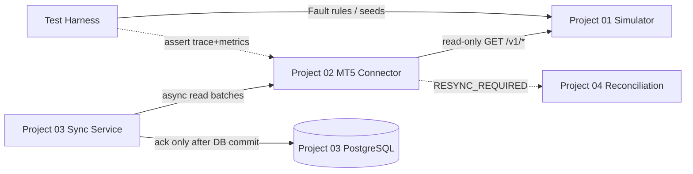
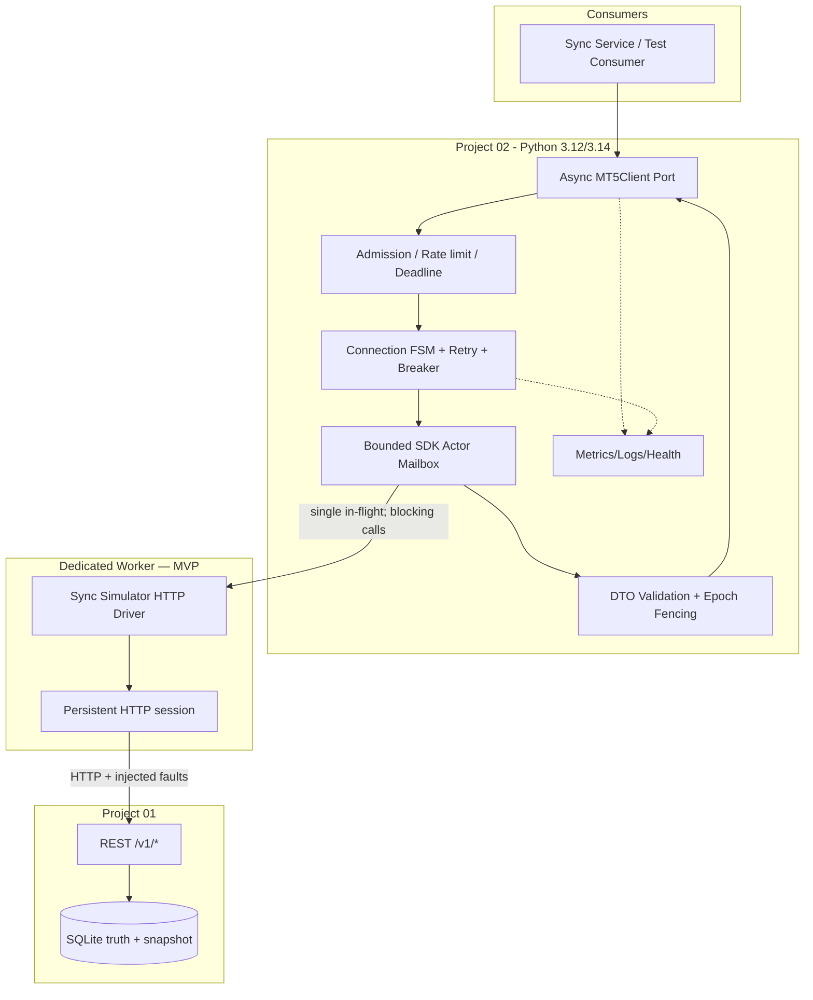
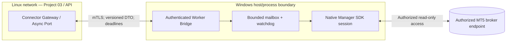
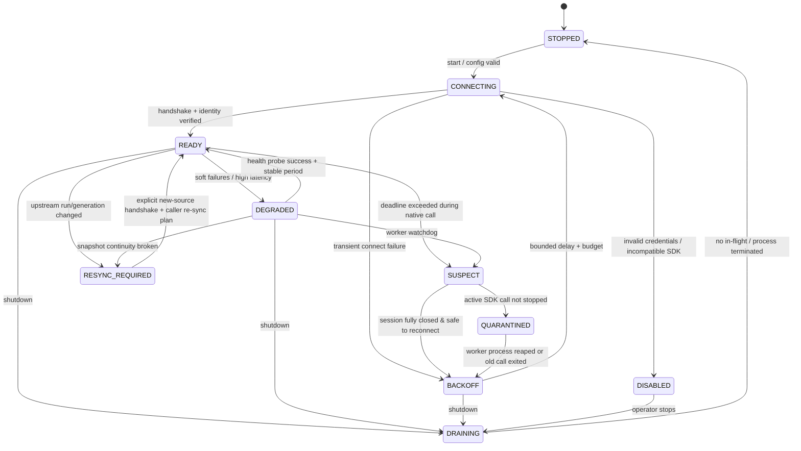
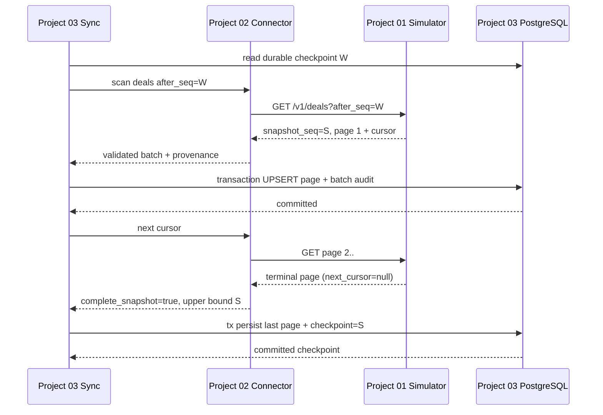

# Project 02 — MT5 Integration Connector

**System Design, Failure Model, “What-if” Test Matrix & Verification Plan**  
**Phiên bản:** 1.0  
**Ngày cập nhật:** 2026-10-30  
**Trạng thái:** **Thiết kế đề xuất; chưa triển khai, chưa chạy benchmark, chưa xác minh với một broker MT5 thật**  
**Ngôn ngữ:** Tiếng Việt; giữ thuật ngữ, API, tên trường kỹ thuật bằng tiếng Anh.

> **Nguồn và ranh giới:** Đây là mini-project **02/09** trong lộ trình tái dựng *Broker Risk Reporting and MT5 Integration*. CV chỉ xác nhận các nhiệm vụ: tích hợp **MT5 Manager API** để đồng bộ account/position/deal, **cách ly các blocking SDK calls khỏi asyncio event loop**, và **reconciliation từ snapshots sau disconnect**. CV không cung cấp sơ đồ kiến trúc, quy tắc thread-safety, thông số SDK hay thiết kế API. Tài liệu này là **một kiến trúc mới có thể thực thi và kiểm thử**, không được nhận là kiến trúc thực tế tại Larion.
>
> **Liên kết với Project 01:** Hợp đồng test double ở tài liệu `Project_01_MT5_Broker_Simulator_System_Design.md` là điểm tích hợp tham chiếu, đặc biệt `/v1/meta`, `/v1/accounts`, `/v1/positions`, `/v1/deals`, `run_id`, `generation`, `snapshot_seq`, `next_cursor`, `after_seq`, `410 SNAPSHOT_EXPIRED`, fault injection. **Các trường trên là semantics do simulator định nghĩa, không mặc nhiên là tính năng của MT5 Manager API thực.**
>
> **Lưu ý kiểm thử:** “Chịu nổi” nghĩa là **trả đúng** hoặc **từ chối có kiểm soát**, không mất dấu lỗi, không phát dữ liệu sai âm thầm, RAM/thread/queue có giới hạn và luôn có khả năng xác định cần resync. Số liệu SLO trong tài liệu đều là **mục tiêu thử nghiệm**, không phải số đã đo.

---

## 0. Executive summary

### 0.1 Vấn đề cần giải quyết

MT5 Manager API/SDK (khi thực sự có quyền truy cập) có thể chứa các lời gọi blocking, thời gian xử lý khó dự đoán, timeout, trạng thái kết nối phức tạp, các lỗi native và khác biệt kiểu dữ liệu. Đưa lời gọi đó trực tiếp vào `async def` khiến toàn bộ event loop có thể bị chặn. Bọc bằng `asyncio.wait_for()` hoặc `asyncio.to_thread()` **không có nghĩa thread/native call đang chạy sẽ bị ngắt khi client hủy yêu cầu**.

Connector phải **bảo vệ phần còn lại của hệ thống** bằng kiến trúc: contract ổn định → admission có giới hạn → dedicated worker → driver riêng → validation/result fencing → batch cho sync service.

### 0.2 Quyết định chủ đạo

1. **Ports & adapters:** `MT5Client` là async interface do ta kiểm soát; driver bên dưới có thể là `SimulatorDriver` hoặc `ManagerSDKDriver`.
2. **Hai chế độ thực thi:** MVP chạy Linux với **simulator HTTP qua một synchronous driver trong dedicated worker** để kiểm chứng khả năng cách ly blocking; một **async HTTP transport** chỉ là nhánh đối chứng/extension. SDK native thật (nếu tiếp cận được) sử dụng **worker process riêng trên Windows** khi xác nhận library/ABI phù hợp.
3. **Conservative concurrency:** Một session SDK chỉ **một lời gọi in-flight** cho đến khi có bằng chứng nhà cung cấp hỗ trợ thread-safe concurrent calls. Không chuyển handle native qua các thread.
4. **Deadlines và backpressure có hiệu lực ngay từ admission:** Hàng đợi hữu hạn; không cấp vô hạn thread hoặc tạo hàng trăm pending futures.
5. **Timeout không làm mất kiểm soát:** Lời gọi chưa kết thúc vẫn chiếm slot; đánh dấu session `SUSPECT`, quarantine kết quả trả muộn; process watchdog có thể terminate worker nếu dùng process isolation.
6. **Đúng trước nhanh:** Đọc snapshot và phân trang có xác minh provenance, cursor, run/generation; checksum/duplicate detection theo key. Connector **không tự “sửa” dữ liệu tài chính**.
7. **Checkpoint thuộc Project 03**, sau khi dữ liệu đã được persist và ack. Connector trả *candidate metadata* nhưng không tự ghi nhận đã đồng bộ.
8. **No trading:** Connector MVP **read-only**; không có API gửi lệnh hoặc tác động đến tài khoản broker thật.

### 0.3 Điều kiện “chịu nổi”

| Kết quả | Được coi PASS nếu | Được coi FAIL nếu |
|---|---|---|
| Correct success | Trả đúng dữ liệu đã validate, đúng source identity/snapshot, trong ngân sách đã định | Trả 200 với thiếu/trùng/sai mà không phát hiện |
| Controlled failure | Lỗi phân loại, bounded deadline, không leak tài nguyên, có hướng recovery | Chờ vô hạn, unbounded queue, log có secrets |
| Crash/restart | Process/worker trở lại ready theo cơ chế được kiểm chứng, không dùng kết quả cũ | Reuse handle/epoch cũ, race state, báo ready giả |
| Resync | Phát cờ `RESYNC_REQUIRED` cùng lý do, không advance checkpoint âm thầm | Nhảy watermark qua dữ liệu chưa đọc/commit |

---

## 1. Requirements, ranh giới, giả định

### 1.1 Functional requirements

| ID | Requirement | Priority | Acceptance evidence |
|---|---|---|---|
| FR-01 | Đọc Account, Position, Deal từ Project 01 qua async `MT5Client` | P0 | Contract test + golden fixtures |
| FR-02 | Thay được simulator bằng driver SDK mà không đổi domain port | P0 | Adapter conformance suite |
| FR-03 | SDK/blocking I/O **không block asyncio event loop** | P0 | Event-loop heartbeat under long SDK call |
| FR-04 | Connection/session FSM với reconnect và degraded states | P0 | Inject offline/online, verify transitions |
| FR-05 | Bounded queue, one in-flight per SDK session | P0 | Burst overload; thread/queue bound |
| FR-06 | Total deadline bao gồm queue + connect + I/O + parse + retries | P0 | Fake clock/fault test |
| FR-07 | Retry có class, budget, backoff jitter; 429/Retry-After có cap | P0 | Exact attempt count & delay tests |
| FR-08 | Quyết định rõ cancellation vs native call đang chạy | P0 | Cancel mid-call; late result discarded |
| FR-09 | Snapshot paging đúng theo Project 01 contract | P0 | Concurrent writer + 100-page scan |
| FR-10 | Phát hiện run/generation reset hoặc cursor 410 | P0 | No mixed epochs, `RESYNC_REQUIRED` |
| FR-11 | Strict validation cho IDs, time, Decimal, pagination ordering | P0 | Poison payload suite |
| FR-12 | Lỗi phân loại typed; downstream có thể ra quyết định | P0 | Error-mapping tests |
| FR-13 | Metrics/log/tracing; liveness/readiness trung thực | P0 | Dashboard, fault-labelled traces |
| FR-14 | Hỗ trợ auth, secret isolation và least privilege | P0 | No secret leak, bad token tests |
| FR-15 | Handoff batch và `checkpoint_candidate` mà không commit checkpoint | P0 | Crash/ack contract test |
| FR-16 | Graceful drain và forced worker recycle khi cần | P1 | SIGTERM + hung worker exercise |
| FR-17 | Windows native worker adapter/bridge khi có MT5 Manager SDK | P1 | Real SDK contract tests, quyền truy cập hợp lệ |
| FR-18 | Fairness và per-source limits khi mở nhiều nguồn | P2 | Multi-tenant contention suite |

### 1.2 Non-functional requirements

- **Correctness:** Không trộn records giữa `run_id`/`generation`; không đổi đơn vị/precision tùy tiện; không chuyển dữ liệu “có vẻ hợp lý” nhưng không validate sang downstream.
- **Latency:** Deadline tính từ lúc nhận request; page size và response bytes có cap; không mặc nhiên giữ trọn deadline cho SDK sau khi request đã chờ queue.
- **Resource safety:** Cấp phát hữu hạn `queue`, workers, concurrent scans, decoded records, per-page bytes, retry attempts, request lifetime.
- **Resilience:** Tách lỗi transient vs permanent vs data-quality vs source-reset. Chỉ retry request đọc (read-only) khi còn budget, không retry vô hạn.
- **Security:** Chỉ kết nối các host/endpoint được phép; data-plane read-only; secret không nằm trong URL/log/exception; TLS nếu đi qua mạng.
- **Observability:** Trace `request_id`, `operation`, `attempt`, `worker_epoch`, `source_generation`, `snapshot_seq`, outcome; không log PII/credentials.
- **Portability:** Linux MVP bằng simulator; native Manager SDK là **biến thể Windows cần kiểm chứng bằng package và quyền truy cập**, không giả định `pip install` là đủ để chạy trên Linux.

### 1.3 Ngoài phạm vi Project 02

- Không triển khai sync storage/UPSERT/PostgreSQL (Project 03).
- Không tự làm snapshot reconciliation algorithm và source-of-truth repair (Project 04), nhưng phải **phát tín hiệu** cho Project 04 khi phát hiện cần đối soát.
- Không tính exposure/P&L hoặc sửa số tiền (Project 05).
- Không build Kafka, ClickHouse (Project 07–08).
- Không gửi lệnh trade, không gọi admin write của broker thật; không quản lý tiền thật.
- Không khẳng định native Manager SDK tự hỗ trợ `cursor`, `source_seq`, `run_id`, atomic snapshot hoặc chính sách retry như simulator.
- Không bảo đảm exactly-once end-to-end: thuộc hợp đồng transaction + dedup của Project 03.

### 1.4 Giả định cần khóa trước khi code

| ID | Giả định MVP | Khi sai phải làm gì |
|---|---|---|
| AS-01 | Project 01 expose `/v1/*` theo contract phiên bản 1 | Contract test fail-fast và version pin |
| AS-02 | Mỗi page trả `run_id`, `generation`, `snapshot_seq`, `items`, `next_cursor` | Mismatch → `SOURCE_CONTRACT_ERROR`, không đoán |
| AS-03 | `after_seq` exclusive; `source_seq` của **Deal** tăng theo event source | Không “tự chế” quy tắc tương đương cho Manager API thật |
| AS-04 | Page max 500; response có giới hạn kích thước | Validate và reject response vượt cap trước khi deserialize |
| AS-05 | Một session native không assumed thread-safe | Serial actor; mở concurrent only after vendor evidence + tests |
| AS-06 | Source role có quyền **read-only** để đọc thông tin cần thiết | Từ chối dùng credentials có đặc quyền cao quá mức cần thiết |
| AS-07 | Test sử dụng dữ liệu synthetic và simulator control API ngoài connector | Test harness riêng mới được inject faults |
| AS-08 | Project 02 không có DB durable | Consumer giữ checkpoint; restart connector đồng nghĩa mất in-memory scan |
| AS-09 | UTC RFC3339; Decimal truyền bằng JSON string trong simulator | Với SDK thật phải explicit mapping units/time precision |
| AS-10 | Windows native deployment là deployment option, không phải MVP | Validate wheel architecture/SDK license/ABI trước kết nối thật |

---

## 2. External reality check: MT5 Manager vs terminal Python API

**Cần phân biệt ba lớp:**

1. **Project 01 REST Simulator:** một mô hình test do ta thiết kế để sinh faults và đảm bảo snapshot; không mô phỏng đầy đủ giao thức Manager SDK.
2. **MetaTrader5 terminal Python integration:** tài liệu MQL5 mô tả kết nối qua **MetaTrader terminal**, có các hàm `initialize`, `account_info`, `positions_get`, `history_deals_get`... Đây **không đồng nghĩa** với Manager API dành cho broker.
3. **`mt5manager` (MetaQuotes) trên PyPI:** tại thời điểm kiểm tra 2026-10-30, trang phân phối công bố wheel **Windows x86-64** cho CPython 3.12/3.14 (cùng các phiên bản khác); package metadata **không tự chứng minh** thông tin về thread safety, tính năng snapshot, quyền kết nối hay khả năng dùng với bất kỳ broker nào. Cần có tài liệu SDK/chấp thuận/credentials phù hợp trước khi triển khai.

**Kết luận triển khai:** Không chạy native Manager Python wheel Windows trong Linux container rồi giả định sẽ hoạt động. MVP: Linux + simulator. Khi có SDK: cô lập Windows worker, thử SDK trên môi trường được phép, chỉ đưa normalized read-only DTO qua biên IPC bảo mật.

**Nguồn tham khảo chính thức:**
- MetaQuotes `mt5manager` distribution: <https://pypi.org/project/mt5manager/>
- MQL5 terminal Python integration: <https://www.mql5.com/en/docs/python_metatrader5>
- Python 3.12 asyncio task/cancellation/thread offload: <https://docs.python.org/3.12/library/asyncio-task.html>
- Python 3.12 `run_in_executor`: <https://docs.python.org/3.12/library/asyncio-eventloop.html#executing-code-in-thread-or-process-pools>

---

## 3. System architecture

### 3.1 Context diagram



**Ranh giới trách nhiệm:** Connector tạo/validate **read batches**; sync service sở hữu transactional persistence và durable checkpoint. Handoff bên trên chỉ diễn tả kiến trúc tương lai — Project 02 có thể test độc lập bằng fake downstream.

### 3.2 Container diagram — MVP với Project 01



**Lý do dùng sync HTTP driver ở MVP:** nó cố ý giả lập tính chất **blocking call**. Dùng `httpx.AsyncClient` trực tiếp không chứng minh bài học cốt lõi “SDK blocking được cô lập”. Một async transport native có thể là benchmark đối chứng, nhưng không thay thế bài test blocked SDK.

### 3.3 Native SDK deployment option (chưa nghiệm thu)



- Bridge cần identity tường minh, ACL source/broker, mTLS hoặc network security tương đương, rotate credentials, size cap, structured audit.
- Worker sống **trong process riêng**; hung native process có thể bị watchdog loại bỏ và dựng lại. **Không** hứa có thể giết một Python thread bị treo an toàn.
- Cần kiểm chứng transport timeout **ở từng chặng** gateway → bridge → SDK; chỉ timeout ở gateway không làm native call dừng.
- Nếu native library không hỗ trợ multiprocessing isolation/khởi tạo trong process con, dùng launcher process riêng trên host Windows sau test thực tế.
- Tất cả handle và callback native thuộc process/worker sở hữu. Không serialize pointer/handle qua IPC.

### 3.4 Modules và ownership

| Module | Owned state | Không được làm |
|---|---|---|
| `MT5Client` | Operation/request context | Chạm SDK trực tiếp từ async handler |
| `SessionSupervisor` | FSM, session generation, source identity | Tự đánh dấu READY khi chưa health handshake |
| `AdmissionController` | Limits, queue occupancy, caller deadline | Tạo unbounded tasks/executor jobs |
| `SDKActor` | FIFO/priority bounded mailbox, one active SDK call | Chạy 2 native calls cùng session khi chưa chứng minh thread-safe |
| `Driver` | HTTP client hoặc native session handles | Trả raw native objects ra tầng nghiệp vụ |
| `ContractValidator` | DTO policy, provenance, pagination invariants | Tự làm tròn Decimal cho “đẹp” |
| `RetryController` | Attempts, jitter, breaker state | Retry vô hạn hoặc retry invalid payload |
| `Telemetry` | Metrics, traces, health status | Log token, passwords, raw PII |
| `TestControl` | Harness gọi Project 01 `/admin/*` | Đi qua production data-plane port |

### 3.5 API boundary và threat zones

- **Consumer → Connector:** internal Python interface hoặc local RPC, callers được rate limit và có deadline.
- **Connector → Simulator:** outbound allowlist tới host/port riêng, bearer **data-plane** token; không nhận input URL tự do từ caller.
- **Test harness → Simulator admin:** tách mạng/token; không share admin credentials trong Connector.
- **Connector → MT5 real:** chỉ khi operator có quyền, ở host có thể chạy SDK, credential stored secret manager, RBAC read-only.
- **Observability:** metrics hạn chế cardinality; trace IDs ngẫu nhiên, không dùng account ID làm metric labels.

---

## 4. Data models và contract bên trong

### 4.1 Async port (pseudocode — thiết kế, chưa phải implementation)

```python
from typing import Protocol, AsyncIterator, Literal, Generic, TypeVar
from dataclasses import dataclass
from decimal import Decimal

T = TypeVar("T")

@dataclass(frozen=True)
class SourceIdentity:
    source_kind: Literal["simulator", "manager_sdk"]
    source_id: str           # configured logical broker/source
    run_id: str | None      # available in simulator
    generation: int | None  # available in simulator
    worker_epoch: int

@dataclass(frozen=True)
class Page(Generic[T]):
    identity: SourceIdentity
    snapshot_seq: int | None
    items: tuple[T, ...]
    next_cursor: str | None
    requested_after_seq: int | None
    observed_upper_bound: int | None

class MT5Client(Protocol):
    async def connect(self) -> SourceIdentity: ...
    async def get_accounts_page(self, *, cursor: str | None = None,
                                limit: int = 100) -> Page["AccountDTO"]: ...
    async def get_positions_page(self, *, cursor: str | None = None,
                                 limit: int = 100) -> Page["PositionDTO"]: ...
    async def get_deals_page(self, *, after_seq: int | None = None,
                             cursor: str | None = None,
                             limit: int = 100) -> Page["DealDTO"]: ...
    async def close(self) -> None: ...
```

**Ghi chú:** Signature với `cursor`/`after_seq` là **simulator-capable port**. Với real SDK, một driver có thể phải cung cấp adapter khác (time-range window + stable ID key, full snapshots, CDC nếu được hỗ trợ). **Không được fabricate `source_seq` hay `snapshot_seq` rồi tuyên bố end-to-end gap-free.** Có thể điều chỉnh port thành `ReadPlan`/capabilities và buộc consumer chọn strategy theo năng lực nguồn.

### 4.2 Capability handshake và source identity

```json
{
  "contract_version": "simulator-v1",
  "source_id": "broker-sim-01",
  "source_kind": "simulator",
  "run_id": "run_0001",
  "generation": 7,
  "committed_seq": 130,
  "supported_entities": ["accounts", "positions", "deals"],
  "capabilities": {
    "snapshot_cursor": true,
    "incremental_deals_after_seq": true,
    "stable_snapshot_across_entities": false,
    "max_page_size": 500
  }
}
```

**`capabilities` là schema chuẩn hóa ĐỀ XUẤT của Connector**, không khẳng định Project 01 `/v1/meta` trả nguyên JSON trên. Adapter phải map từ fields thực tế của Project 01 sang schema này sau khi contract test xác nhận; field không tồn tại thì coi `unknown/false`, không suy đoán `true`.

**Identity rules:** `source_id` là config ổn định; `run_id/generation` là synthetic identity do simulator quản lý; `worker_epoch` tăng **mỗi lần** spawn/reconnect session để fencing kết quả cũ. `worker_epoch` không đại diện cho DB generation.

### 4.3 Normalized DTOs

| DTO | Fields bắt buộc | Validation |
|---|---|---|
| `AccountDTO` | account_id, currency, balance, credit | Decimal finite, currency code đúng, ID nonblank |
| `PositionDTO` | position_id, account_id, symbol, side, volume_lots, open_price, status | volume > 0 nếu OPEN, price > 0, side enum |
| `DealDTO` | deal_id, source_seq (sim only), account_id, position_id, symbol, entry, side, volume_lots, price, realized_pnl_gross, commission, swap, executed_at | ID unique/page, amounts precise, UTC, time parse strict |
| `Provenance` | source_id, run_id?, generation?, snapshot_seq?, schema_version | Không trộn giữa pages |

- Tiền/price/volume từ simulator là **JSON string → `Decimal`**; reject JSON floats cho các financial fields (không “round” float về 2 chữ số).
- `executed_at`: parse RFC 3339 timezone-aware, normalize UTC, validate range; không dùng naive datetime và không lấy **receive time** làm **execution time**.
- Không log raw financial payload ở production; chỉ lưu hash, số lượng và validation reason.
- Với native SDK thực, tài liệu mapping phải ghi units, scale, signed fee, timezone, precision, hedging/netting, enum translations, API version, optional fields và test vectors. Không đoán.

### 4.4 Error taxonomy — typed, có recovery advice

```text
ConnectorError
 ├── AuthenticationError         # no automatic retry until config/secret fixed
 ├── PermissionDeniedError       # do not retry
 ├── ConfigurationError          # do not retry
 ├── IncompatibleSdkError        # do not retry / disable source
 ├── TransportError              # retry only inside budget
 ├── UpstreamUnavailableError    # retry / breaker
 ├── RateLimitedError            # honor bounded Retry-After
 ├── UpstreamTimeoutError        # can be ambiguous for active native call
 ├── DeadlineExceededError       # no more attempts
 ├── OverloadedError             # local fast fail
 ├── CircuitOpenError            # local fast fail
 ├── SourceContractError         # quarantine, do not silently normalize
 ├── DataIntegrityError          # quarantine / reconciliation
 ├── SnapshotExpiredError        # restart bounded scan from safe checkpoint
 ├── SourceEpochChangedError     # mandatory fresh scan/reconcile
 ├── ResyncRequiredError         # explicit handoff to Project 03/04
 └── ConnectorClosedError        # no new admissions
```

| Dimension | Có trong mỗi lỗi | Ví dụ |
|---|---|---|
| Machine-readable | `code`, `retryable`, `resync_required`, `safe_action` | `SOURCE_EPOCH_CHANGED` |
| Context | `source_id`, `operation`, `request_id`, `attempt`, `worker_epoch` | Epoch 11 |
| Metadata không nhạy cảm | `upstream_status`, `retry_after_s`, `latency_ms` | 429, 0.5s |
| Privacy | `cause` được sanitize | Không leak URL chứa token, password, response body |

**Không** chuyển `CancelledError` thành `UpstreamUnavailableError`; cancellation là tín hiệu lifecycle của caller. Tuy nhiên worker in-flight vẫn phải được **account** cho đến khi hoàn thành hoặc process chết thực sự.

---

## 5. Async isolation & worker execution model — phần khó nhất

### 5.1 Vì sao `asyncio.wait_for(to_thread(...))` là chưa đủ

```python
# ANTI-PATTERN về quản trị vòng đời (không dùng làm production implementation)
async def get_deals_bad():
    return await asyncio.wait_for(
        asyncio.to_thread(blocking_sdk_get_deals),
        timeout=1.0,
    )
```

Nếu 1 giây hết mà native function vẫn treo 2 phút, **thread vẫn có thể tiếp tục chạy**. Nếu mỗi request lại tạo `to_thread`, có thể bị đầy pool/queue, dùng session đồng thời sai cách, kết quả về quá hạn trộn vào trạng thái mới. Nếu native SDK kẹt vĩnh viễn, Python không có cách tổng quát, an toàn để dừng một thread bất kỳ.

### 5.2 State và immutable request envelope

```text
CallEnvelope {
    request_id: uuid
    source_id: str
    operation: enum
    created_monotonic: float
    absolute_deadline_monotonic: float
    worker_epoch_at_admission: int
    source_generation_at_admission: int | None
    cursor_or_read_plan: immutable
    attempt: int
    priority: high|normal (fixed classes, no priority inversion)
    bytes_budget: int
}
```

`deadline_remaining = absolute_deadline_monotonic - now_monotonic` được recompute **trước mỗi** retry, dispatch, decode. Dùng `time.monotonic()` cho duration; wall clock chỉ để log/timestamps nguồn. Không cho client tùy ý yêu cầu deadline vô hạn.

### 5.3 Actor loop / bounded mailbox

```mermaid
sequenceDiagram
    participant C as Async caller
    participant A as Admission + async gate
    participant Q as Bounded mailbox
    participant W as Dedicated sync worker
    participant D as Sync Driver / SDK
    participant V as Validation / Fence
    C->>A: request + absolute_deadline
    A->>A: validate source/session/limits
    alt queue full / breaker open
      A-->>C: OVERLOADED / CIRCUIT_OPEN (bounded)
    else admitted
      A->>Q: call envelope
      Q->>W: one call at a time
      W->>D: blocking read
      D-->>W: raw page
      W->>V: completion + epoch + request_id
      V->>V: fresh? deadline? schema? provenance?
      alt still valid
        V-->>C: validated Page
      else expired or wrong epoch
        V-->>C: typed error; discard raw result
      end
    end
```

**Invariants:**

- `workers_per_session=1` mặc định; queue size hữu hạn; `active_native_calls <= 1`.
- Worker ở trạng thái `RUNNING` không được xem là idle chỉ vì coroutine chờ đã timeout/hủy.
- Drop queued request nếu deadline hết **trước dispatch**. Lệnh đã dispatch không được tái sử dụng kết quả cho request khác.
- Completion chỉ accepted nếu `request_id`, `worker_epoch`, `source_generation`, `cursor/fingerprint` và deadline đều hợp lệ.
- Cơ chế callback sang event loop dùng phương thức thread-safe (`loop.call_soon_threadsafe`/IPC), không mutate `Future` trực tiếp từ thread khác.

### 5.4 Three-tier cancellation semantics

| Vị trí request khi bị cancel | Hành vi | Điều KHÔNG được làm |
|---|---|---|
| `QUEUED` | Remove/tombstone trước dispatch, giải phóng queue slot | Không chạy request đã hủy |
| `DISPATCHED` trên blocking thread | Caller nhận cancellation; worker **vẫn occupied**; đánh dấu result stale | Không đếm worker idle, không chạy native call khác trên session |
| `DISPATCHED` trên isolated process | Có thể request cooperative cancel; nếu vượt watchdog, terminate process + increment epoch | Không giả định `cancel()` đã kill call native |

**Quy tắc quarantine:** Khi in-flight call vượt *hard worker limit*, `SessionSupervisor` chuyển `SUSPECT` → `QUARANTINED`. Với thread mode, stop accepting new calls, đợi call thực sự exit hoặc **restart process chứa thread** theo orchestrator (không có hot-kill thread an toàn). Với process mode, supervisor có thể kill worker process, verify exit/reap, spawn epoch mới. `quarantined` có thể vẫn trả `/health/live=200` nhưng `/health/ready=503`.

### 5.5 Worker process vs thread: ADR

| Tiêu chí | Dedicated thread | Isolated process |
|---|---|---|
| MVP simulator local | Đơn giản, dễ debug, đủ để kiểm event-loop isolation | Có thể sau |
| Native SDK thread unsafe | Dùng one owned thread, có thể hợp lệ nếu SDK hỗ trợ | Process ownership thường tách rõ hơn; vẫn cần vendor verification |
| Hung native call | **Không thể kill thread an toàn** | Có thể terminate whole worker process |
| Crash in native extension | Có thể crash toàn service | Chỉ crash worker, nếu IPC/supervisor đúng |
| Serialize DTO | In-process | Phải copy/serialize, có overhead |
| Linux + Windows split | Không giải quyết ABI mismatch | Có thể chạy worker Windows riêng, gateway Linux |

**MVP:** dedicated thread + injected network timeouts hữu hạn để kiểm thử; **hard hang** là tình huống phải chuyển sang process isolation khi cần chứng minh worker tự phục hồi.

### 5.6 Liveness độc lập

Event-loop heartbeat chạy `await asyncio.sleep(0.05)` đo lag; đồng thời watchdog theo dõi `last_worker_progress_monotonic`, thời gian queue, in-flight age, breaker state. `/health/live` chỉ process + event loop; `/health/ready` yêu cầu admission enabled và source/session có khả năng phục vụ theo chế độ đã chọn. Không gọi blocking SDK ngay trong health handler.

---

## 6. Connection/session state machine



**Lưu ý mô hình:** Kết nối mạng “alive” không suy ra dữ liệu “fresh” hoặc “consistent”. `READY` chỉ nói connector có thể phục vụ **theo contract khả dụng**; downstream vẫn phải đối soát và có watermark riêng.

### 6.1 Reconnect rules

- Chỉ **một reconnect leader**/source. Concurrent requests join same reconnect future hoặc nhận `SOURCE_UNAVAILABLE` khi quá admission limit.
- `CONNECTING`: timeout có budget; verify SDK version/auth/permissions, source fingerprint, `run_id/generation` nếu simulator; wipe leaked session handles on failure.
- Các lỗi auth/perms/config → `DISABLED` cho đến khi config/secret đổi; không hammer upstream bằng retry.
- Transient errors → exponential backoff **full jitter**, max cap; gate toàn bộ bằng total deadline/breaker cooldown; không đồng bộ retry thẳng hàng sau upstream restart.
- Sau reconnect, **increment worker epoch**, hoàn tất handshake, **không tái dùng cursor cũ** khi identity/run không chứng minh còn hợp lệ.
- Circuit breaker là theo *source + error class*, không mở do một invalid user input; cần `half-open` giới hạn 1 probe.

### 6.2 Error-class / retry decision matrix

| Failure | Retry cùng operation? | Next action |
|---|---|---|
| DNS failure / TCP connect refused | Có nếu deadline còn | Backoff jitter + breaker |
| HTTP 408 / 502 / 503 / 504 | Có, bounded, read-only | Respect response budget |
| HTTP 429 | Có sau `Retry-After` cap; quá budget → fail | Rate limit accounting |
| HTTP 401 / 403 | **Không** vô hạn | Rotate/fix credential; disabled |
| HTTP 400 / 422 | Không | Caller/contract error |
| HTTP 410 `SNAPSHOT_EXPIRED` | Không retry cursor cũ | Start new scan từ **durable** safe watermark |
| Run/generation mismatch | Không tiếp tục scan | `RESYNC_REQUIRED`; quarantine partial scan |
| Malformed JSON / invalid Decimal / duplicate ID | **Không** blind retry | `SOURCE_CONTRACT_ERROR`, data quarantine |
| Native call hang | Không start second call same session | Quarantine/worker recycle |
| Response lost after successful read | Có thể reread idempotent page nếu cursor còn valid | No sink ack by connector |
| Process shutdown | Không retry trong dying instance | Drain/close; caller resubmit to new instance |

### 6.3 Retry budget, tránh “retry storm”

**Gợi ý cấu hình ban đầu** (cần đo và chỉnh): connect attempt max 3; page read attempts max 3 (bao gồm lần đầu); `base_backoff=100 ms`, `max_backoff=1 s`, total page deadline 3 s, per-call I/O timeout 1.5 s, queue-wait budget 0.5 s. Đây là các **ngưỡng đề xuất**, không áp đặt cho real MT5 latency (có thể cần cao hơn với batch lớn).

Bộ lập lịch phải loại bỏ retry nếu thời gian còn lại nhỏ hơn `minimum_attempt_budget`, không sleep vượt deadline và không permit retry kết quả invalid data. Retry-After được parse cẩn thận: seconds hoặc HTTP-date, cap configured maximum; thiếu/malformed => policy bounded fallback.

### 6.4 Secret rotation và source identity

- Credential rotate không nhất thiết làm source `generation` thay đổi; nhưng **worker epoch thay đổi** và các in-flight calls cũ bị cách ly.
- Credentials bị revoke thì state chuyển `DISABLED` và telemetry không chứa token.
- Config thay host/source/account access policy phải được coi là **source switch**, cần caller re-sync ngay cả khi SDK connection mới `READY`.
- Không dùng connection close của một session có handle shared cho các calls thuộc session khác.

---

## 7. Snapshot, pagination và checkpoint correctness

### 7.1 Project 01 simulator read contract — phải giữ nguyên

| Source operation | Simulator endpoint | Connector rule |
|---|---|---|
| Capabilities/fingerprint | `GET /v1/meta` | Map sang normalized identity/capabilities |
| Accounts | `GET /v1/accounts?cursor=&limit=` | Track run/generation/snapshot; validate IDs |
| Positions | `GET /v1/positions?cursor=&limit=` | Same page fingerprint; current state as-of seq |
| Deals | `GET /v1/deals?after_seq=...&limit=...` | `after_seq` **exclusive**; track ordering |
| Next page | `GET /v1/deals?cursor=...` | **Không** mix cursor với after_seq/new filter |
| Snapshot expired | HTTP `410 SNAPSHOT_EXPIRED` | Restart scan safely, never advance based on partial pages |
| Source reset | `run_id/generation` changes | `RESYNC_REQUIRED` |

**Không** cho phép scan một entity từ snapshot S ghép tự động với snapshot S+N của entity khác và tự nhận là atomic multi-entity snapshot. Nếu report yêu cầu đồng nhất account+positions+deals, Project 04 phải định nghĩa reconciliation cut/window và freshness policy riêng.

### 7.2 Page validation order

1. Verify transport framing/content-type/content-length/body bytes **before** full parse.
2. Parse JSON trong size limit, strict schema/version, reject NaN/Inf, invalid ISO8601, float financial fields.
3. Validate `run_id`, `generation`, `snapshot_seq` vs `ScanContext`; validate cursor change; prevent cursor cycle.
4. Validate items: unique IDs/page; fields; expected order where contract promises it; `after_seq < source_seq <= snapshot_seq` cho deal records ở **initial incremental page** và các trang tiếp; tie-break `source_seq, deal_id`.
5. Track duplicates **across pages** theo deal_id hoặc normalized stable key (trong scope scan). Với dataset lớn dùng bounded per-page/range + stable-order checks; nếu cần strict toàn scan, có thể lưu ID/hash ở sink/test oracle, hoặc bộ nhớ/temporary disk **có quota**.
6. Chỉ khi pass mới trả batch cho consumer; metadata `complete_snapshot` khi `next_cursor=null` và toàn bộ pages thành công.

**Cảnh báo:** *Deal source_seq không nhất thiết liên tục vì event seq có thể thuộc account/position/mark.* Gap trong `source_seq` **không đủ** kết luận mất Deal; kiểm tra order, bound, completeness của snapshot và tập IDs bằng oracle/test harness.

### 7.3 Correct checkpoint handoff — không mất Deal



**Quy tắc chính:**

- Project 02 **không** lưu durable watermark và **không** coi response từ upstream là downstream đã commit.
- Consumer **chỉ** commit checkpoint `snapshot_seq=S` sau khi **đã persist toàn bộ trang trong scan** và xác nhận không lỗi. Nếu crash trước commit, chạy lại với watermark cũ; UPSERT/idempotency ở Project 03 loại trùng.
- Sau khi scan hết `deals` **không filter**, có thể advance đến `snapshot_seq` ngay cả nếu Deal cuối có `source_seq < S`, vì phần events không tạo Deal không phải missing Deals. Điều này **chỉ** an toàn nếu source contract bảo đảm scan snapshot đầy đủ và thứ tự ổn định. Với filter (account/symbol/time), checkpoint phải **key theo bộ filter** hoặc dùng chiến lược khác đã chứng minh, không lấy watermark filter A bỏ qua data của B.
- Nếu một page lỗi, tất cả page đã persist có thể còn trong sink (at-least-once), **nhưng không** được commit checkpoint terminal; retry từ durable checkpoint và dedup.
- Với source thật không có stable snapshot/cursor, **không sử dụng logic trên như thể đã được bảo đảm**; phải dùng overlapping windows/IDs + reconciliation, hoặc yêu cầu nguồn hỗ trợ feature tương đương.

### 7.4 ScanContext và memory cap

```text
ScanContext {
  source_id, entity, normalized_filter_hash,
  source_run_id, source_generation, worker_epoch_at_start,
  requested_after_seq, snapshot_seq, cursor,
  last_key, pages_seen, items_seen, byte_count,
  seen_cursor_hashes_lru, deadline_monotonic,
  complete=false
}
```

- Max pages 2,500/scenario; max scan wall-time theo job budget, max cursor length, max JSON nesting, max records/page.
- Long scans 100k/1M: **không giữ toàn bộ raw records trong RAM**. Pages xử lý streaming theo batch; nếu strict global uniqueness cần evidence external store/test oracle.
- Nếu `snapshot_seq` của page N không bằng page 1, hoặc page N dùng run mới, **fail closed**; không tự ghép lại.
- Cursor hết hạn giữa scan: discard current scan **logic** và báo restart; dữ liệu page đã commit trong downstream phải dựa vào idempotency.

### 7.5 Real SDK không có stable cursor: fallback design (P1)

Các phương án **chỉ áp dụng sau khi xác minh SDK/nguồn thực tế hỗ trợ**:

1. Native SDK trả **immutable Deal IDs** trong khoảng thời gian: đọc overlapping time windows, dedup theo `(source_id, deal_id)`, track watermarks + late arrivals, periodic full reconciliation.
2. SDK trả snapshot theo request tại một thời điểm nhưng không có global transactional cut: snapshot account/position/deal riêng rẽ và gắn `observed_at`, chấp nhận *eventual consistency*, không claim atomic view.
3. SDK thiếu sorting/pagination ổn định: dùng bounded time/key partitions được đo, re-read overlap, reconciliation để bắt late/changed data. Nếu không đủ bảo đảm, đánh dấu `CAPABILITY_UNSUPPORTED` thay vì bịa ra consistent cursor.

---

## 8. Critical invariants and failure containment

| ID | Invariant/oracle | How to verify |
|---|---|---|
| INV-01 | Không có blocking SDK call trực tiếp trên event loop | Heartbeat p99 lag trong injected slow SDK |
| INV-02 | `active_native_calls_per_session <= 1` (MVP) | Instrument worker enter/exit counters |
| INV-03 | Pending queue, threads, processes, outstanding bytes luôn bounded | Stress + OS process metrics |
| INV-04 | Request quá hạn không được trả thành công muộn | Fake monotonic time + slow response test |
| INV-05 | Kết quả worker epoch cũ không vượt fencing | Inject reconnect during in-flight completion |
| INV-06 | Kết quả run/generation cũ không trộn scan mới | Simulator reset mid-scan |
| INV-07 | Page cursor/snapshot bất biến trong scan | 100-page scan + concurrent generator |
| INV-08 | Không bỏ sót/trùng Deal trong completed scan theo oracle | Compare IDs with simulator as-of snapshot |
| INV-09 | Không advance durable checkpoint trước downstream commit | Crash before/after DB commit orchestration |
| INV-10 | Invalid/poison financial payload không được phát thành valid DTO | Payload fuzz suite |
| INV-11 | Retry chỉ với nhóm lỗi cho phép, trong total budget | Mock transport attempt count + time |
| INV-12 | Auth/config/permanent failures không tạo retry storm | 401/403/misconfig injection |
| INV-13 | Readiness phản ánh trạng thái session; live không gọi SDK blocking | Kill/disconnect/hang suite |
| INV-14 | Khi shutdown, không còn new admissions; quét/leak checked | SIGTERM under load + process/thread inventory |
| INV-15 | Không log credentials, raw sensitive fields hay raw exception secret | Secret canary + log scanner |
| INV-16 | Token data-plane không gọi được Project 01 admin plane | Auth boundary E2E test |
| INV-17 | Cùng dataset/seed & faults → deterministic **semantic** test outcome | Two scenario runs / normalized evidence diff |
| INV-18 | Error classification đủ chính xác để downstream xử lý | Typed error contract suite |
| INV-19 | `source_seq` gap không tự động tạo false missing-Deal alert | Inject non-Deal events between Deals |
| INV-20 | `circuit_open`/overload reject fast; không enqueue ngầm | Overload meter + request timestamps |
| INV-21 | `source_id`/filter checkpoint isolation đúng | Multi-source/filter simulator tests |
| INV-22 | Không data loss khi toàn scan bị retry sau partial sink writes | Source oracle vs sink final DB audit (Project 03) |

---

## 9. Security, privacy, abuse, operational controls

### 9.1 Credential handling

- Không hardcode credentials vào config checked into git; dùng env injection/secret manager. File `.env.example` chỉ có placeholders.
- Không in `Authorization`, password, session cookie, MT5 manager credentials; sanitize exception `repr`, URL, payload, headers.
- Enforce outbound host/port allowlist; chống SSRF khi nhận `source_id` hoặc callback URL từ caller.
- Tách data-plane và test/admin-plane; fault injection chỉ chạy trong local/isolated test environment.
- Role privilege thấp nhất: **read-only** cho broker snapshot/deal queries; không expose write/trade APIs trong port.
- TLS verify được bật; không “fix” certificate bằng `verify=False`; pin hoặc custom CA theo chính sách triển khai.

### 9.2 Data protection

MVP chỉ dùng synthetic; nếu chạy với nguồn thật thì account/deal là dữ liệu nhạy cảm nghiệp vụ: tối thiểu hóa log, set retention, mã hóa in transit, access auditing, backup policy theo tổ chức. Không dùng broker thật trong public CI load/chaos testing.

### 9.3 Safe fault injection

Để test connector, test runner dùng **Project 01 control-plane** với token riêng; connector chỉ có **read token**. Các fault như `truncate_response`, TCP half-open, DNS/certificate failure phải dùng network/OS harness; HTTP `503` không thể đại diện đầy đủ cho TCP reset. Với Windows real worker, chaos chỉ trong sandbox/hệ thống được cấp quyền, không bắn lỗi vào broker production.

### 9.4 Abuse/threat boundaries

| Attack / misuse | Control | Evidence |
|---|---|---|
| Fake source URL → SSRF nội bộ | Fixed allowlist from config; no arbitrary URL | Fuzz URLs and DNS rebinding test |
| Token leak qua trace/log | Central redaction + canary scanner | Scan artifacts after faults |
| Malformed/zip-bomb response | Body size, decompression, nesting caps | Memory stable under payload bomb |
| Big page / infinite cursor | Hard limits, cursor cycle detection | Reject bounded |
| Retry amplification | Max attempts + global retry budget | Attempt counts bounded |
| Hostile caller starving sync | Bounded admission + per-client limits | Fairness load test |
| Unauthorized admin simulator call | Separate credentials/network | 403 even if connector compromised |
| Dependency compromised | Locked versions, audit, SBOM | CI dependency checks |

---

## 10. Observability, dashboards and incident playbooks

### 10.1 Metrics (minimum)

| Metric | Type | Tags hữu hạn / mục đích |
|---|---|---|
| `connector_requests_total` | Counter | operation, outcome, error_class |
| `connector_request_duration_seconds` | Histogram | operation, outcome; end-to-end budget |
| `connector_queue_wait_seconds` | Histogram | queue pressure |
| `connector_queue_depth` | Gauge | admission cap |
| `connector_sdk_call_duration_seconds` | Histogram | how long native work really occupies slot |
| `connector_sdk_active_calls` | Gauge | MUST <=1/session |
| `connector_worker_epoch` | Gauge | incarnation fence |
| `connector_event_loop_lag_seconds` | Histogram | blocking detection |
| `connector_retry_total` | Counter | error_class, attempt bucket |
| `connector_circuit_state` | Gauge | closed/open/half_open |
| `connector_reconnect_total` | Counter | reason; source label sanitized |
| `connector_snapshot_restart_total` | Counter | expired/changed/contract_error |
| `connector_validation_error_total` | Counter | schema_field class, no raw value |
| `connector_quarantine_total` | Counter | reason |
| `connector_response_bytes` | Histogram | memory guard |
| `connector_readiness` | Gauge | serving vs not_ready |
| `connector_inflight_oldest_age_seconds` | Gauge | hung-worker alert |

**Cardinality:** Không dùng `account_id`, `deal_id`, `request_id`, raw exception hoặc token làm Prometheus label. Ghi chúng (đã sanitize nếu cần) trong structured logs/traces với retention phù hợp.

### 10.2 Log schema và trace correlation

```json
{
  "ts": "2026-10-30T05:32:01.123Z",
  "level": "WARN",
  "service": "mt5-connector",
  "source_id": "broker-sim-01",
  "request_id": "req-007",
  "operation": "get_deals_page",
  "worker_epoch": 13,
  "source_generation": 7,
  "attempt": 2,
  "latency_ms": 1002,
  "queue_wait_ms": 17,
  "error_code": "UPSTREAM_TIMEOUT",
  "outcome": "quarantined",
  "retryable": false
}
```

### 10.3 Alerts (mục tiêu để thử, không phải SRE live thresholds)

- **CRIT:** stale worker in-flight > hard limit; same-session concurrent native call >1; source generation mixed; credentials logged; DTO validation bypass.
- **HIGH:** readiness false > 1 minute trong baseline; no successful page in expected polling window; repeated 410; retry storm; queue saturation >30s; event-loop lag p99 over target.
- **INFO:** credential rotate; simulator reset; intentional fault profile enabled. Fault-injection failure events phải có `test_run_id` để phân biệt outage thật.

### 10.4 Runbooks

| Symptom | Immediate action | Recovery validation |
|---|---|---|
| Upstream 401 | Disable automatic retries, inspect secret/role | Handshake `READY`, no secret in logs |
| Slow native call | Mark session suspect, stop admission, inspect call age | Process restart (nếu isolated) + new epoch |
| Source reset | Stop scan; raise `RESYNC_REQUIRED` to consumer | New initial scan + reconcile pass |
| High queue | Rate limit callers, reduce concurrency/page size | Queue drains, no memory growth |
| Invalid financial payload | Quarantine page; preserve sanitized evidence/hash | Golden oracle pass after source fixed |
| Snapshot 410 | Stop current scan; fresh snapshot from safe checkpoint | No gap in completed set IDs |
| SIGTERM during load | Enter DRAINING, bounded drain, close driver | No in-flight orphan/leaked worker |

---

## 11. Capacity, limits, SLO and benchmark methodology

### 11.1 Reference environment **đề xuất để benchmark**

| Item | Local test baseline |
|---|---|
| OS | Linux x86-64 for Connector/Simulator; Windows x86-64 separately for native SDK option |
| CPU/RAM | 8 vCPU, 16 GiB RAM (cấu hình test mục tiêu, không phải requirement tối thiểu) |
| Python | 3.12 baseline, 3.14 compatibility lane after dependency check |
| Dataset | 1,000 accounts, up to 10,000 positions, 100,000 deals (Project 01 seed 42) |
| Stress dataset | 1,000,000 deals (P1) |
| Page size | 100 default; 500 max |
| Worker | 1 SDK session / 1 active sync worker |
| Queue | 32 waiting calls/source (configurable) |
| Max concurrent long scans | 2/source MVP (subject to serialization) |
| Read total deadline | 3s/page local simulator (provisional) |
| Request body/response | 1 MiB/page provisional; measure actual 500-deal payload first |

### 11.2 Provisional acceptance targets (chưa đo)

| Metric | MVP target | Điều kiện/ghi chú |
|---|---|---|
| Event-loop lag p99 | <= 25 ms | While blocking driver sleeps 1s in worker; exclude CPU saturation |
| Worker active calls | <= 1 | Per SDK session ALWAYS |
| Queue depth | <= 32 | Không enqueue vượt cap |
| Queue overload reject | <= 100 ms | Measured at admission under burst |
| Normal page p95 | <= 500 ms | Local simulator, 100 items, no fault, warmed |
| Page error deadline | <= configured deadline + 100 ms | Caller visible; may continue as occupied native worker |
| CPU/RAM | No unbounded growth over 1h soak | Record RSS/slope, GC, queued objects |
| Clean 100k deal scan | Correct IDs, no duplicates/gaps vs snapshot oracle | Time measured, NOT hardcode unrelated SLA |
| Restore after 5s simulated outage | Return READY after source availability within bounded reconnect policy | Subject to configured backoff, record actual |
| Malformed page | 100% rejected; 0 invalid DTO emitted | Security/data correctness gate |
| Source reset | 100% detected; no cross-epoch records | Reset mid 100-page scan |

**Capacity reasoning:** Với **1** serial worker, throughput page bị giới hạn ít nhất bởi I/O latency: 
`page_ops/s <= 1 / mean_worker_occupancy_seconds` (chưa tính queue overhead). Nếu 1 page mất 0,2 s thì trần lý thuyết chỉ ~5 page/s, 100k deals / 500 ≈ 200 pages ≈ 40s **chưa tính retries/other calls**. Đây là phép tính năng lực lý thuyết, không phải kết quả benchmark. Cần đo throughput thực, CPU, memory, service rate và latency distribution trước khi mở concurrent sessions; chỉ mở thêm khi SDK/session contract cho phép.

**Little's Law:** `L = λW`. Khi arrival rate > service rate lâu dài, queue chắc chắn phải tăng đến cap; **trả 429/503 có kiểm soát là hành vi thiết kế đúng**, không coi “chịu được 1.000 concurrent clients” là có thể xử lý 1.000 native calls đồng thời.

### 11.3 Workload profiles

| Profile | Traffic | Faults | Evidence |
|---|---|---|---|
| B0 Contract | 1 read of each entity | None | JSON/DTO diff, provenance |
| B1 Normal | 10 clients, 100 items/page, 10 min | None | p50/p95/p99, queue, CPU/RSS |
| B2 Concurrent sync | 2 long scans, simulator continues updates | None | no mixed snapshots, no page loss |
| B3 Burst | 100 callers at once, worker=1, queue=32 | None | deterministic overload count, bounded RSS |
| B4 Slow upstream | 10 clients, 1s per SDK call | Delay fault | event-loop lag, queue, timeout handling |
| B5 Reconnect | Network down 10s then up | TCP/DNS/503 | state timeline, attempt budget |
| B6 Poison | Bad Decimal/duplicate/corrupt JSON | Data fault | 100% reject, no silent repair |
| B7 Soak | Continuous traffic for 1h/8h | Periodic fault | thread count, RSS slope, file handles |
| B8 Crash | Kill worker/connector mid-page | OS/process fault | fencing and safe restart |
| B9 Large | 1M deals / 500 pages | Optional 410 | bounded memory, dataset oracle |

### 11.4 Measurement discipline

- Đo từ **caller admission** đến response; tách queue-wait, SDK occupancy, parse/validation. Histogram với đủ sample và bucket phù hợp; p99 từ 100 requests là thiếu tin cậy.
- Phân tách baseline (no fault) và intentional chaos (with fault). Cùng seed/scenario/version/config/build để so sánh.
- Lưu CPU/RAM/OS/worker count, timestamp, run_id/generation, `git_sha`, Python version, SDK version (nếu có), load command, raw metrics.
- Dùng monotonic clocks cho durations, không dùng UTC clock để tính timeout.
- Failure-rate denominator: số **admitted** vs **rejected** vs **upstream attempts** khác nhau; báo cả ba.
- Không kết luận “thread mode chịu hard hang” nếu chưa có isolated process watchdog/kill test.

---

## 12. Fault model and reproducibility harness

### 12.1 Fault sources theo lớp

| Layer | Injection method | Có thể mô phỏng chính xác gì |
|---|---|---|
| L1 Project 01 app | `/admin/v1/faults`, scenario/virtual clock/reset | 429/5xx, delay, malformed JSON, stale/duplicate/missing record |
| L2 Network proxy | Toxiproxy/iptables/test network, container-only | TCP reset, half-open, DNS failure, latency/jitter/bandwidth |
| L3 Driver double | Controlled blocking fake / fake native handle | Hang, exception, wrong thread, nonthreadsafe access, callbacks |
| L4 Process/OS | Kill worker/container, throttle CPU/RAM, revoke permissions | Hard hang recovery, SIGTERM, OOM, process restart |
| L5 Downstream fake | Fake sink with commit/ack/crash injection | Checkpoint boundary, dedup after re-read |
| L6 Secret/identity harness | Expiring token, bad certificate, source change | Fail auth, secret rotation, TLS/endpoint validation |

**Safety:** Faults must be scoped by `test_run_id`, time-to-live and activation count; never point chaos harness at live broker. Always record expected fault actually activated; otherwise a “PASS” is meaningless.

### 12.2 Deterministic test recipe

```yaml
# EXAMPLE: specification for test runner to implement; not currently executable
scenario_id: WF2-I-05
simulator:
  seed: 42
  run_id: run_0001
  initial_accounts: 1000
  initial_deals: 100000
connector:
  worker_mode: thread
  max_queue: 32
  page_size: 100
  page_deadline_ms: 3000
injection:
  layer: simulator_http
  trigger: {operation: get_deals_page, nth_request: 7}
  action: {mode: http_error, status: 410, code: SNAPSHOT_EXPIRED}
assertions:
  - no_mixed_source_generation
  - no_checkpoint_advance
  - resync_required_or_safe_restart
  - event_loop_remains_responsive
  - resources_within_bounds
artifacts:
  - trace.jsonl
  - metrics.prom
  - scenario_manifest.json
  - oracle_diff.json
```

### 12.3 Global PASS/FAIL oracle applied to every case

- **Safety:** Không crash không kiểm soát, không deadlock event loop, queue/thread/file descriptors hữu hạn (trừ test chủ động kill process; khi đó supervisor restart đúng quy tắc).
- **Data:** Không phát invalid DTO hoặc dữ liệu sai epoch dưới nhãn `success`. Với test completed scan, IDs phải khớp oracle; nếu không thể khẳng định completeness, result là `RESYNC_REQUIRED`/failed scan, không phải success.
- **Time:** Response/error trong deadline được cấu hình (+ instrumentation allowance); native call quá hạn vẫn chiếm worker cho đến khi thật sự dừng; không “tàng hình”.
- **Recovery:** Khi fault hết và secret/config hợp lệ, có thể trở lại READY qua FSM; nếu không recover được tự động thì báo cần operator, không làm giả success.
- **Evidence:** Có fault activation record, seed, `test_run_id`, connector version, logs/metrics/error code, oracle và PASS/FAIL/NOT_TESTED. **Không pass** case mà fault chưa từng kích hoạt.

---

## 13. What-if matrix — hệ thống chịu đựng những kịch bản nào?

**Danh mục có 216 tình huống (P0: 130, P1: 67, P2: 19).** Đây là risk-based catalogue, không phải lời hứa đã xét mọi trạng thái có thể tồn tại. Trong hệ thống phân tán/native SDK luôn có *unknown unknowns*; cần dùng thêm model/property testing, fault combinations, runtime observation và kiểm chứng với SDK thật. Các scenario bên dưới đều là **test design**, chưa chạy.

**Cách đọc bảng:**

- **P0:** cổng chất lượng bắt buộc của MVP; nếu implementation phụ thuộc process isolation mà MVP thread-only không đáp ứng thì phải **ghi rõ NOT SUPPORTED** và không tuyên bố PASS.
- **P1:** kiểm thử trước khi mở rộng/triển khai real SDK; một số case cần môi trường Windows hoặc OS/network chaos.
- **P2:** hardening nâng cao.
- Mỗi case gồm **fault/what-if → phản ứng bắt buộc → oracle định lượng hoặc dấu hiệu quan sát**. Mọi case cũng phải thỏa **global oracle §12.3**.
- Ký hiệu `WF2-X-YY` cố định cho truy vết test/issue và CI evidence; không tái sử dụng ID khi sửa tài liệu.

### A. Cấu hình, startup, compatibility (12 cases)

| ID | Priority | What-if / fault injection | Expected system reaction | Oracle / PASS criteria |
|---|---|---|---|---|
| `WF2-A-01` | P0 | Thiếu `source_id` khi khởi động | Từ chối start trước khi tạo worker | Config validation fail; không tạo thread/session |
| `WF2-A-02` | P0 | Config page_size=0 hoặc >500 | Reject config, không tự bỏ qua cap | Exit code có reason; không request upstream |
| `WF2-A-03` | P0 | Queue size âm hoặc không giới hạn | Reject startup | Invariant INV-03 ngay từ init |
| `WF2-A-04` | P0 | Sai schema `contract_version` từ `/v1/meta` | Chuyển INCOMPATIBLE, không dùng dữ liệu | 0 valid DTO; typed error |
| `WF2-A-05` | P0 | Endpoint cấu hình trỏ sang `/admin/v1` | Block bởi allowlist/path policy | Không gửi admin token hay admin request |
| `WF2-A-06` | P0 | URL chưa có scheme hoặc scheme không được hỗ trợ | Config error trước network | No outbound connection |
| `WF2-A-07` | P0 | Thiếu bearer data-plane token | Không tiếp tục read requests mù | Auth/config failure, no retry storm |
| `WF2-A-08` | P1 | Config thay đổi giữa scan | Snapshot config tại scan start, yêu cầu restart scan có kiểm soát | No mixed filter/source |
| `WF2-A-09` | P1 | SDK version mới bỏ một field | Contract version mismatch/quarantine | Contract test fails; no silent default |
| `WF2-A-10` | P1 | Hệ thống chạy với timezone khác UTC | Normalize UTC, không đổi source timestamps | Golden timestamps identical |
| `WF2-A-11` | P2 | Config file bị thay giữa load | Atomic config snapshot hoặc reject | One coherent configuration fingerprint |
| `WF2-A-12` | P1 | Migrate Python 3.12 sang 3.14 | CI matrix kiểm native/typing/event-loop behavior | Adapter contract stable; incompat marked |

### B. Auth, session, credential lifecycle (12 cases)

| ID | Priority | What-if / fault injection | Expected system reaction | Oracle / PASS criteria |
|---|---|---|---|---|
| `WF2-B-01` | P0 | Token sai → 401 | Không retry 401 liên tiếp; mark DISABLED | <=1 further auth probe until config change |
| `WF2-B-02` | P0 | Token đúng nhưng thiếu permission → 403 | Fail closed và báo role thiếu | 0 invalid results; no retry storm |
| `WF2-B-03` | P0 | Token hết hạn giữa các pages | Stop scan; reauth theo policy; bảo vệ cursor/identity | No partially declared completed scan |
| `WF2-B-04` | P0 | Credential rotate trong native call | Fence old worker epoch; restart nếu cần | Old completion never accepted |
| `WF2-B-05` | P0 | Account/source identity khác sau login | Source switch cần explicit resync | No mixed accounts or checkpoint advancement |
| `WF2-B-06` | P0 | Secret xuất hiện trong HTTP exception chứa URL | Redact trước logging | Canary absent from logs/artifacts |
| `WF2-B-07` | P1 | Đồng thời 100 caller trigger reconnect | Single-flight reconnect | Exactly one leader, bounded waiters |
| `WF2-B-08` | P1 | Secret store unavailable lúc startup | Non-ready; không dùng cached secret không hợp lệ | Fail closed with alert |
| `WF2-B-09` | P1 | Secret revoked khi đã READY | Disable and clear session state | Readiness false; no authentication loop |
| `WF2-B-10` | P1 | Wrong clock khiến token bị từ chối | Detect auth/time evidence; no infinite retry | Bounded attempts, error actionable |
| `WF2-B-11` | P2 | Token rotation overlap 2 versions | Deterministic transition without leaking both | No credential mixing in logs |
| `WF2-B-12` | P1 | Operator vô tình cấp quyền write/trade | Config/RBAC reject extra permissions nếu kiểm chứng được | Read-only exposure; no write methods |

### C. DNS, TCP, TLS và network partitions (12 cases)

| ID | Priority | What-if / fault injection | Expected system reaction | Oracle / PASS criteria |
|---|---|---|---|---|
| `WF2-C-01` | P0 | DNS NXDOMAIN khi connect | Retry bounded rồi typed TransportError | Deadline honored, breaker opens |
| `WF2-C-02` | P0 | Connection refused | Retry với jitter; không CPU spin | Attempt count <= policy |
| `WF2-C-03` | P0 | SYN blackhole / connect timeout | Timeout theo network budget | Caller error bounded; queue stable |
| `WF2-C-04` | P0 | TCP reset giữa response | Reject page atomically | 0 partial DTO; safe reread |
| `WF2-C-05` | P0 | TCP half-open khiến blocking read treo | Watchdog + quarantine; no second same-session call | Active calls <=1; readiness false |
| `WF2-C-06` | P0 | TLS cert expired | Permanent TLS failure, no verify=False fallback | No insecure traffic |
| `WF2-C-07` | P0 | Hostname certificate mismatch | Fail closed | No data accepted |
| `WF2-C-08` | P1 | Network flaps up/down 20 lần | Backoff + breaker; no reconnect storm | Attempts/budget caps respected |
| `WF2-C-09` | P1 | Proxy trả response chậm từng byte | Read timeout/body deadline enforce | RSS bounded, no infinite read |
| `WF2-C-10` | P1 | Bandwidth giảm còn 10KB/s | Throughput degrades, deadline predictable | No memory runaway |
| `WF2-C-11` | P1 | DNS result đổi đến IP không allowlisted | Revalidate address before connect | SSRF blocked |
| `WF2-C-12` | P2 | MTU fragmentation / packet reorder | Transport handles or clean error | No malformed success, test network proxy |

### D. HTTP framing, errors, parsing (12 cases)

| ID | Priority | What-if / fault injection | Expected system reaction | Oracle / PASS criteria |
|---|---|---|---|---|
| `WF2-D-01` | P0 | HTTP 500 từ `/v1/deals` | Retry <=3 attempts if budget | Typed fail/success; no partial page emitted |
| `WF2-D-02` | P0 | HTTP 503 có `Retry-After: 999999` | Cap wait, fail if deadline exceeded | No sleep beyond deadline |
| `WF2-D-03` | P0 | HTTP 429 không Retry-After | Bounded fallback/backoff | Queue pressure not amplified |
| `WF2-D-04` | P0 | HTTP 410 snapshot expired | Không retry cursor cũ | Typed SnapshotExpired/ResyncRequired |
| `WF2-D-05` | P0 | HTTP 200 nhưng JSON bị truncate | Reject entire page | Zero DTO emitted |
| `WF2-D-06` | P0 | HTTP 200 trả HTML error page | Reject content-type/schema | SourceContractError |
| `WF2-D-07` | P0 | Response content-length quá giới hạn | Stop read before huge allocation | RSS below cap |
| `WF2-D-08` | P0 | JSON nested 10.000 levels | Parser depth/size bounded, reject | No stack crash / OOM |
| `WF2-D-09` | P0 | JSON có Duplicate field keys hoặc nonfinite values | Strict parse/reject ambiguous payload | No silently accepted invalid DTO |
| `WF2-D-10` | P1 | 204 No Content cho endpoint có required body | Contract error, no assume empty dataset | No checkpoint advance |
| `WF2-D-11` | P1 | HTTP 302 redirect sang host khác | Block redirect off allowlist | No credential exfiltration |
| `WF2-D-12` | P2 | gzip decompression bomb | Decompressed bytes cap | No OOM, typed error |

### E. Native Manager SDK, ABI, handle và data mapping (12 cases)

| ID | Priority | What-if / fault injection | Expected system reaction | Oracle / PASS criteria |
|---|---|---|---|---|
| `WF2-E-01` | P0 | Attempt import Windows wheel trên Linux | Fail config/deployment check | No claim native integration works |
| `WF2-E-02` | P0 | SDK method throws native exception | Worker catches where possible, normalized typed failure | Gateway alive unless native process crashed |
| `WF2-E-03` | P0 | SDK trả null pointer/bad object | Reject & protect boundary | No use-after-free in wrappers; test double |
| `WF2-E-04` | P0 | SDK call không return (infinite hang) | Process watchdog kill and replace for hard-hang mode | New epoch, no second old session call |
| `WF2-E-05` | P0 | SDK callback chạy sau logout | Callback fenced by epoch/session lifetime | No stale events mutate current state |
| `WF2-E-06` | P0 | SDK handle bị gọi từ thread khác | Enforce worker ownership | Test double asserts single thread |
| `WF2-E-07` | P0 | SDK trả số tài chính dưới dạng float | Explicit mapping policy or reject precision-sensitive values | No unapproved float-to-money conversion |
| `WF2-E-08` | P1 | SDK native struct layout ABI mismatch | Validate version/build before service ready | IncompatibleSdkError |
| `WF2-E-09` | P1 | SDK free/release object twice | Ownership wrapper prevents double close | Driver lifecycle tests |
| `WF2-E-10` | P1 | SDK emits non-UTF8 byte strings | Decode with documented encoding or quarantine | No silent replacement for keys |
| `WF2-E-11` | P1 | SDK allocates memory leaking on reconnect | Lifecycle/reconnect soak and process recycle | RSS slope/evidence threshold |
| `WF2-E-12` | P2 | Vendor changes enum codes/time units | Versioned mapper, fixture review | Contract tests flag breaking semantics |

### F. Asyncio isolation, worker, process & lifecycle (12 cases)

| ID | Priority | What-if / fault injection | Expected system reaction | Oracle / PASS criteria |
|---|---|---|---|---|
| `WF2-F-01` | P0 | Blocking SDK sleeps 5s | Event loop remains responsive | Lag p99 <=25ms under non-CPU saturation |
| `WF2-F-02` | P0 | 2 requests concurrently call non-threadsafe session | Serialize through actor | `active_sdk_calls<=1` |
| `WF2-F-03` | P0 | Caller deadline expires while thread still blocked | Caller errors, thread slot remains occupied | No new native call on same session |
| `WF2-F-04` | P0 | Hung worker returns after new epoch created | Discard stale result | `worker_epoch` fence enforced |
| `WF2-F-05` | P0 | Thread raises exception then stops | Supervisor records failure; fail pending calls | Queue drained with typed errors |
| `WF2-F-06` | P0 | Native process segfaults | Gateway survives and restarts only isolated process | Worker new PID/epoch; no mixed result |
| `WF2-F-07` | P0 | `loop.call_soon_threadsafe` after loop closed | Shutdown order prevents or catches safely | No leaked unhandled callback |
| `WF2-F-08` | P1 | Executor default pool used accidentally | Static/lint or test detect direct `to_thread` outside actor | No unbounded implicit workers |
| `WF2-F-09` | P1 | Worker completion races with cancellation | Exactly one terminal result per request | No `InvalidStateError`; counters balanced |
| `WF2-F-10` | P1 | Process kill fails due permissions | Stay QUARANTINED; operator action required | No falsely READY |
| `WF2-F-11` | P1 | IPC frame partially written on worker crash | Framed protocol reject + reconnect | No partial valid DTO |
| `WF2-F-12` | P2 | Windows worker reboot without gateway reboot | Supervisor reconnect + explicit identity check | No stale handle/session reuse |

### G. Concurrency, cancellation, fairness, race (12 cases)

| ID | Priority | What-if / fault injection | Expected system reaction | Oracle / PASS criteria |
|---|---|---|---|---|
| `WF2-G-01` | P0 | Cancel request while QUEUED | Tombstone/remove queued item | Never dispatch cancelled work |
| `WF2-G-02` | P0 | Cancel request while DISPATCHED | No stale success delivered, occupancy retained | Worker count unchanged till actual exit |
| `WF2-G-03` | P0 | Caller cancels 100 tasks in same ms | Bounded cancellation cleanup | Queue counters return 0, no orphan futures |
| `WF2-G-04` | P0 | Two connect calls at once | Single-flight connect | One authenticated SDK session |
| `WF2-G-05` | P0 | Connect races with close | FSM deterministic; no READY after CLOSED | Transition log accepted only valid edges |
| `WF2-G-06` | P0 | Close races with in-flight read | Enter DRAINING; deny new calls | No use-after-close / session access |
| `WF2-G-07` | P0 | Reconnect races with old page completion | Epoch fence, discard | Old data not delivered to new scan |
| `WF2-G-08` | P0 | Page cursor consumed by two scans | Independent ScanContext, immutable cursor/token | No cross-scan state mutation |
| `WF2-G-09` | P1 | High priority health probe starves reads | Weighted/fair scheduling with quota | Read progress under load |
| `WF2-G-10` | P1 | Two different sources share one worker accidentally | Per-source session ownership | Wrong source mixing test fails closed |
| `WF2-G-11` | P1 | asyncio task shielded and never awaited | Task registry + bounded shutdown | No orphan tasks on exit |
| `WF2-G-12` | P2 | External callback reentrant calls same SDK | Reject/requeue per vendor rules; no deadlock | Test-double reentrancy alarm |

### H. Deadlines, retries, circuit breaker (12 cases)

| ID | Priority | What-if / fault injection | Expected system reaction | Oracle / PASS criteria |
|---|---|---|---|---|
| `WF2-H-01` | P0 | Queue waits 2.9s of 3s deadline | Don't dispatch 1.5s SDK call | Fail fast within 3.1s |
| `WF2-H-02` | P0 | Upstream times out at 1.5s, still occupied | No parallel retry on same native session | Active calls <=1 |
| `WF2-H-03` | P0 | Retry attempt succeeds after caller deadline | Reject stale completion | No success after deadline |
| `WF2-H-04` | P0 | HTTP 503 for first 2 calls then 200 | <=3 attempts with jitter and correct final page | Counts and result accurate |
| `WF2-H-05` | P0 | Invalid Decimal persists across retries | No retry bad data | Exactly one read attempt, data quarantine |
| `WF2-H-06` | P0 | 401 repeated from 100 callers | Disable auth retries centrally | Attempts bounded by source |
| `WF2-H-07` | P0 | Circuit opens during queued calls | Fail pending calls with error, no silent hang | Queue drains, readiness consistent |
| `WF2-H-08` | P1 | Half-open breaker receives 50 callers | Admit one probe, fast-fail others | Exactly 1 probe |
| `WF2-H-09` | P1 | `Retry-After` HTTP date in the past | Treat as zero/controlled fallback | No negative sleep/clock bug |
| `WF2-H-10` | P1 | Monotonic deadline near wrap/clock jumps UTC | Monotonic timing correct | No immortal request |
| `WF2-H-11` | P1 | Recovery returns after max attempts used | New top-level operation can proceed with fresh budget | No global permanent disable from transient |
| `WF2-H-12` | P2 | All 100 clients retry synchronized | Full-jitter spreads attempts | Attempt histogram non-herding |

### I. Pagination, cursor, snapshot page semantics (12 cases)

| ID | Priority | What-if / fault injection | Expected system reaction | Oracle / PASS criteria |
|---|---|---|---|---|
| `WF2-I-01` | P0 | 100-page scan with concurrent writes | All pages same snapshot S | IDs match as-of S oracle |
| `WF2-I-02` | P0 | Repeated `next_cursor` creates loop | Detect cursor hash repeat | Fail bounded by max pages |
| `WF2-I-03` | P0 | Empty page with non-null cursor | Continue only if contract allows and progress proven | No infinite loop |
| `WF2-I-04` | P0 | Cursor changed via tampering | 400 → SourceContractError, no blind retry | No data accepted |
| `WF2-I-05` | P0 | Cursor used with extra `after_seq` | Connector never constructs illegal mix | Captured HTTP requests valid |
| `WF2-I-06` | P0 | Page 3 reports different snapshot_seq | Reject completed scan and signal resync | No mixed snapshot |
| `WF2-I-07` | P0 | Page 2 reports generation N+1 | Abort scan | No cross-generation DTOs emitted as completed scan |
| `WF2-I-08` | P0 | Last page has `next_cursor=null` with missing items | Compare golden oracle in integration | Missing IDs discovered |
| `WF2-I-09` | P1 | Out-of-order deal pages | Validate monotonic order, reject if promised | No false completed scan |
| `WF2-I-10` | P1 | Duplicate deal across pages | Dedup detection or sink oracle audit with quota | Complete scan never claims no duplicates incorrectly |
| `WF2-I-11` | P1 | Cursor TTL expires after long scan | Restart from durable safe checkpoint | No skipped Deal |
| `WF2-I-12` | P2 | Cursor signs with rotated HMAC key | Handle 410/new scan per contract | No bypass of signature checks |

### J. Source reset, cross-entity consistency, freshness (12 cases)

| ID | Priority | What-if / fault injection | Expected system reaction | Oracle / PASS criteria |
|---|---|---|---|---|
| `WF2-J-01` | P0 | Simulator reset while reading positions | Detect generation change | RESYNC_REQUIRED, no stale success |
| `WF2-J-02` | P0 | `/v1/meta` says source A, pages say source B | Quarantine/identity mismatch | No data from B delivered to A |
| `WF2-J-03` | P0 | Upstream run_id reused with new generation | Compare both fields | Reset still detected |
| `WF2-J-04` | P0 | Worker reconnects mid scan, same run but cursor valid | Decide via source guarantee; revalidate cursor/snapshot | No silent integrity change |
| `WF2-J-05` | P0 | Worker reconnects mid scan, run replaced | Restart/reconcile, not append pages | 0 mixed epochs |
| `WF2-J-06` | P0 | Only account snapshot newer than deal snapshot | Do not claim atomic broker-wide cut | Provenance separate; consistency warning |
| `WF2-J-07` | P0 | Source returns stale snapshot as fault | Detect mismatch where metadata promises freshness; otherwise mark freshness bound | Staleness metric/action |
| `WF2-J-08` | P1 | Mark price moves during account scan | No stitched snapshot false promise | Separate as_of values retained |
| `WF2-J-09` | P1 | Virtual clock jumps backward during run | Business timestamps preserved; source ordering verified | No timestamp-based drop |
| `WF2-J-10` | P1 | Source meta unavailable but page endpoint works | Fail handshake/limit operations to capability confidence | No invented capabilities |
| `WF2-J-11` | P1 | Reset occurs just after terminal page before checkpoint | Project 03 compares epoch at commit fence where possible | No silently accepted cross-run checkpoint |
| `WF2-J-12` | P2 | Disaster restores older source snapshot with same config | Fingerprint/reconciliation detects rollback by source identity/version | No checkpoint leap |

### K. Incremental scan, checkpoint and downstream ack (12 cases)

| ID | Priority | What-if / fault injection | Expected system reaction | Oracle / PASS criteria |
|---|---|---|---|---|
| `WF2-K-01` | P0 | Deal `source_seq` jumps 126→130 due non-Deal events | No false missing-Deal alert | Source oracle matches deal IDs |
| `WF2-K-02` | P0 | Downstream commits page but ACK lost | Re-read safely from old watermark | Sink has no duplicate key |
| `WF2-K-03` | P0 | Connector crashes after fetch before sink commit | Checkpoint unchanged | Next scan re-fetches missing records |
| `WF2-K-04` | P0 | Sink crashes after last page before checkpoint commit | Re-run from safe watermark | Final sink oracle matches source |
| `WF2-K-05` | P0 | Empty incremental scan snapshot S > checkpoint W | Advance to S only after full scan + sink ack | No skip across filter/cursor |
| `WF2-K-06` | P0 | Scan with account filter A attempts global checkpoint | Reject design or scope checkpoint to filter A | B account deals never skipped |
| `WF2-K-07` | P0 | Source returns deal with `source_seq <= after_seq` | Reject/flag contract violation | No silent checkpoint |
| `WF2-K-08` | P0 | Source returns future `source_seq > snapshot_seq` | Reject | No invalid future records |
| `WF2-K-09` | P1 | Same deal_id with changed payload unexpectedly | Trigger conflict/reconciliation, not blind overwrite | Audit conflict count |
| `WF2-K-10` | P1 | Deal arrives late with earlier business timestamp | Sequence-based scan still captures it | No time-filter loss (simulator mode) |
| `WF2-K-11` | P1 | Consumer slower than source scan | Backpressure through awaiting sink ACK | Queue/RSS bounded |
| `WF2-K-12` | P2 | Real SDK lacks source_seq | Use capability-specific overlapping windows + reconciliation | No claimed exactly-once cursor |

### L. Data validation & financial domain (12 cases)

| ID | Priority | What-if / fault injection | Expected system reaction | Oracle / PASS criteria |
|---|---|---|---|---|
| `WF2-L-01` | P0 | Price JSON `1.10000` as number not string | Strict reject financial float | No loss of precision accepted |
| `WF2-L-02` | P0 | Decimal NaN/Infinity in commission | Reject page | No invalid accounting DTO |
| `WF2-L-03` | P0 | Commission `-0.01` became `+0.01` unexpectedly | Golden fixture flags sign mismatch if source known | No silent sign flipping |
| `WF2-L-04` | P0 | Negative volume on OPEN position | Reject invalid DTO | No bad position passed downstream |
| `WF2-L-05` | P0 | Deal references nonexistent account/position | Integrity anomaly to Project 04 | No “normal” completed batch |
| `WF2-L-06` | P0 | Duplicate deal ID same page | Reject or verified conflict policy | No duplicate success |
| `WF2-L-07` | P0 | Blank account ID / symbol | Strict schema reject | No empty-key propagation |
| `WF2-L-08` | P0 | Naive or invalid timezone timestamp | Reject or explicit mapping per source capability | No naive datetime |
| `WF2-L-09` | P1 | Broker currency not USD | Preserve code and scale; don't assume USD | No hardcoded currency conversion |
| `WF2-L-10` | P1 | Large Decimal with excessive digits | Precision/length bounded while preserving valid values | No CPU/memory blowup |
| `WF2-L-11` | P1 | Position volume =0 status OPEN | Domain invariant reject | Validation error emitted |
| `WF2-L-12` | P2 | Hedging/netting semantics differ | Adapter explicit capability + fixture; do not merge tickets | No incorrect position coalescing |

### M. Capacity, overload and resource exhaustion (12 cases)

| ID | Priority | What-if / fault injection | Expected system reaction | Oracle / PASS criteria |
|---|---|---|---|---|
| `WF2-M-01` | P0 | 100 concurrent callers, worker=1, queue=32 | Reject overflow promptly | Queue<=32, active<=1, reject<=100ms |
| `WF2-M-02` | P0 | 10.000 incoming tasks/s | Admission cap protects memory/CPU | RSS and tasks bounded |
| `WF2-M-03` | P0 | Upstream indefinitely slow, callers keep arriving | Breaker/backpressure; no unbounded retries | Stable memory; live responsive |
| `WF2-M-04` | P0 | Response 20 MiB despite page cap | Abort before deserialize | RSS capped; error typed |
| `WF2-M-05` | P0 | Caller requests 1M records/page | Reject limit >500 before upstream | No network request |
| `WF2-M-06` | P0 | Leak thread per reconnect | Detect/reclaim lifecycle | Thread count returns baseline after cycles |
| `WF2-M-07` | P0 | File descriptors leaked by HTTP sessions | Explicit close + monitor | No monotonic FD growth |
| `WF2-M-08` | P1 | 1 million deals scan with tiny pages | Max page/time guards; report incomplete when cap hit | No false completed scan |
| `WF2-M-09` | P1 | 100k deals + frequent simulator writes | Snapshot stable and queue controlled | IDs oracle; p95 measured |
| `WF2-M-10` | P1 | Disk of artifact/log volume fills | Logging degrades safely/alerts, no secret leak | Connector doesn't silently corrupt DTO |
| `WF2-M-11` | P1 | CPU throttled to 0.5 core | Deadline and readiness degrade predictably | No stuck loop/unbounded queue |
| `WF2-M-12` | P2 | 8-hour soak with periodic hang/fault | Memory/threads/FD stable and restartable | Slope/report within declared tolerance |

### N. Security, secrets, untrusted upstream (12 cases)

| ID | Priority | What-if / fault injection | Expected system reaction | Oracle / PASS criteria |
|---|---|---|---|---|
| `WF2-N-01` | P0 | Caller supplies URL to internal cloud metadata service | Reject arbitrary source host | No outbound request |
| `WF2-N-02` | P0 | Admin token accidentally provided to connector | Privilege separation fails static check/secret test | Tests enforce data-plane-only token |
| `WF2-N-03` | P0 | Unauthorized caller invokes connector | Authenticate/authorize before SDK call | No upstream traffic |
| `WF2-N-04` | P0 | TLS verification disabled in config | Fail environment policy unless isolated local HTTP simulator | No insecure real-source connection |
| `WF2-N-05` | P0 | Data payload carries HTML/script/log escape | Treat as data, sanitize logs | No log injection or unsafe rendering |
| `WF2-N-06` | P0 | Request ID includes newline/control chars | Generate internal ID/normalize | Logs remain valid JSON |
| `WF2-N-07` | P0 | Secret rotates but old token remains in long-lived logs | Canary scanner & redaction | 0 secret occurrences |
| `WF2-N-08` | P1 | DNS rebinding after allowlist resolution | Validate post-resolution IP and TLS host | No SSRF bypass |
| `WF2-N-09` | P1 | Zipped response has compressed bomb | Enforce decompressed size limit | No OOM |
| `WF2-N-10` | P1 | Dependency pinned version has known CVE | CI scan and upgrade plan | Build gate when policy threshold hit |
| `WF2-N-11` | P1 | Cross-tenant source_id mixup | Per-source auth/access policy, fence DTO | No data from other tenant |
| `WF2-N-12` | P2 | Process memory dump contains credentials | Memory/host-level hardening, document residual risk | Controlled access and retention policy |

### O. Deployment, OS, Docker, Windows bridge (12 cases)

| ID | Priority | What-if / fault injection | Expected system reaction | Oracle / PASS criteria |
|---|---|---|---|---|
| `WF2-O-01` | P0 | Linux image tries native Windows SDK import | Fail startup before serving READY | No false success |
| `WF2-O-02` | P0 | Container receives SIGTERM mid blocked call | DRAINING + bounded timeout; worker exit/reap | No new admission; explicit status |
| `WF2-O-03` | P0 | Container restarts while pages in progress | No internal checkpoint false state | Consumer rescan from durable watermark |
| `WF2-O-04` | P0 | Wrong Docker network host mapping | Typed connect error and nonready | Operator diagnosis actionable |
| `WF2-O-05` | P0 | Service starts before simulator ready | Bounded reconnect startup | READY only after handshake |
| `WF2-O-06` | P0 | Broker worker restarted but gateway lives | IPC re-handshake; epoch increments | Old PID/results rejected |
| `WF2-O-07` | P0 | Gateway version incompatible with bridge version | Protocol handshake fail-closed | No partial schema decode |
| `WF2-O-08` | P1 | Windows time and Linux time differ by 5 min | Deadlines measured locally; timestamps normalized UTC | No negative timeout |
| `WF2-O-09` | P1 | Worker process lacks permissions/SDK DLL dependencies | Health says incompatible; audit event | No retry storm |
| `WF2-O-10` | P1 | Rotating certificates during long session | Reconnect with trust verification | No insecure fallback |
| `WF2-O-11` | P1 | Docker OOM kills gateway | Restart + safe consumer replay | No bad checkpoint after restart |
| `WF2-O-12` | P2 | Rolling update with 2 gateways shares one native session | Require session ownership lock/lease or single leader | No concurrent handle use |

### P. Observability, incident response and testing quality (12 cases)

| ID | Priority | What-if / fault injection | Expected system reaction | Oracle / PASS criteria |
|---|---|---|---|---|
| `WF2-P-01` | P0 | Upstream fails but `/health/ready` still 200 | Readiness reflects unavailability | Alert and endpoint show nonready |
| `WF2-P-02` | P0 | Blocking SDK freezes event-loop heartbeat | Detect test failure, never mark PASS | Lag exceeds target; FAIL |
| `WF2-P-03` | P0 | Intentional fault rule never activated | Test outcome NOT_TESTED/FAIL | Activation count >=1 to pass |
| `WF2-P-04` | P0 | p95 measured only on successful requests | Report rejected/errors and latency separately | No denominator concealment |
| `WF2-P-05` | P0 | Logs contain bearer token in stacktrace | Canary scan fails release gate | 0 secret in artifacts |
| `WF2-P-06` | P0 | Retry attempt count uninstrumented | Contract test fails observability gate | Metrics align trace count |
| `WF2-P-07` | P0 | No correlation from caller to worker attempt | Trace propagation required | Request/attempt/epoch present |
| `WF2-P-08` | P1 | Source reset alert floods 1000 times | Rate-limit alert while preserving count | Alert de-dup works |
| `WF2-P-09` | P1 | Metrics label uses deal_id causing cardinality explosion | Lint/metric inspection forbids | Label-count bounded |
| `WF2-P-10` | P1 | Incident runbook restarts only connector during native hang | Document thread-mode limitation and correct process recovery | Drill meets stated action |
| `WF2-P-11` | P1 | Benchmark executed under active fault but reported baseline | Manifest distinguishes mode | Report rejected if fault_profile missing |
| `WF2-P-12` | P2 | Test environment flaky random timing | Seeded scheduler/fault triggers + retries only on test infrastructure | Repeated outcomes reproducible |

### Q. Cross-project integration and consumer behavior (12 cases)

| ID | Priority | What-if / fault injection | Expected system reaction | Oracle / PASS criteria |
|---|---|---|---|---|
| `WF2-Q-01` | P0 | Project 03 consumer ACKs before Postgres commit | Contract integration test must fail | Checkpoint never advances on crash |
| `WF2-Q-02` | P0 | Consumer takes 60s to persist page | Connector applies producer backpressure | No unbounded next-page fetch |
| `WF2-Q-03` | P0 | Consumer requests next cursor after connector restart | Cursor is upstream opaque; validate run + freshness | Expired/unknown state handled safely |
| `WF2-Q-04` | P0 | Consumer treats `next_cursor=null` as no more future deals | Docs/contract test correct behavior | Next poll discovers newly committed deals |
| `WF2-Q-05` | P0 | Consumer assumes accounts+positions+deals atomic | Expose per-entity as_of and requirement for reconciliation | No misleading combined snapshot |
| `WF2-Q-06` | P0 | Connector returns partial batch then error | Page emission atomic within operation | No `success` with truncated items |
| `WF2-Q-07` | P0 | Consumer ignores RESYNC_REQUIRED | Stop integration test/release gate | Never mark sync healthy |
| `WF2-Q-08` | P1 | Project 04 reconciliation restarts while connector scanning | Freeze identity/bind scan or stop | No cross-run provenance |
| `WF2-Q-09` | P1 | Project 05 expects numeric USD amounts | Keep Decimal/currency fields explicit | Contract compiler/test rejects float coercion |
| `WF2-Q-10` | P1 | Parallel consumers read same cursor independently | Immutable read consistency; each ACK independent | No connector-level shared checkpoint |
| `WF2-Q-11` | P1 | Sync writes idempotently but duplicates still occur in analytics | Event ID/source key required downstream | E2E sink audit detects duplicates |
| `WF2-Q-12` | P2 | Future Kafka events require source time ordering | Distinguish event time vs ingestion time vs source sequence | Metadata not conflated |

### R. Unknown unknowns, combined faults and future SDK gaps (12 cases)

| ID | Priority | What-if / fault injection | Expected system reaction | Oracle / PASS criteria |
|---|---|---|---|---|
| `WF2-R-01` | P0 | Timeout + upstream reset + late worker completion cùng lúc | Old result fenced; new run triggers resync | 0 mixed data/epoch |
| `WF2-R-02` | P0 | 410 cursor expiry + consumer crash after page commit | Restart from durable checkpoint; dedup | Source oracle final IDs equal sink |
| `WF2-R-03` | P0 | Network partition + 100 callers + auth rotation | Bounded queue/retry; no secret leak | Service alive, readiness truthful |
| `WF2-R-04` | P0 | Worker hard hang + SIGTERM | Isolated process terminated/reaped; thread mode marked unsupported | No lying about recovery |
| `WF2-R-05` | P0 | Malformed financial data + HTTP 200 + retries configured | No retry invalid DTO; quarantine | No bad success/attempt storm |
| `WF2-R-06` | P0 | Reset just before final checkpoint commit | Epoch fence with source identity when available | No cross-run watermark success |
| `WF2-R-07` | P1 | Native SDK lacks stable snapshot or incremental IDs | Capability=false, fallback design required | No fake source_seq |
| `WF2-R-08` | P1 | Upstream delivers non-deterministic ordering across reads | Time-window overlap + reconciliation after verification | No gap-free claim without proof |
| `WF2-R-09` | P1 | Windows SDK callback reenters while worker process dies | IPC/protocol epoch & audit | No stale message accepted |
| `WF2-R-10` | P1 | Data spike + disk nearly full + slow logging | Backpressure and error evidence not lost silently | Memory/FD bounds, alert |
| `WF2-R-11` | P2 | Fault combination test set expands combinatorially | Pairwise+critical triple + random seeded campaigns | Coverage report with uncovered axes |
| `WF2-R-12` | P2 | Undocumented vendor behavior changes without version bump | Golden contract tests + staged canary stop rollout | No silent data drift |

### 13.1 Các chiều fault nên ghép với nhau — ngoài kiểm thử riêng từng case

| Axis | Các giá trị nên bao phủ |
|---|---|
| Source state | READY, DEGRADED, BACKOFF, SUSPECT, QUARANTINED, RESYNC_REQUIRED |
| Request lifecycle | QUEUED, DISPATCHED, COMPLETED, CANCELLED, TIMED_OUT |
| Worker mode | Thread/local sync driver, process-isolated fake native, Windows real SDK (khi có quyền) |
| Data size | 0 item, 1 item, 100, 500, 100k scan, 1M scan |
| Network | Clean, delayed, 429, 503, TCP reset, half-open, TLS failure |
| Data anomaly | None, duplicate, missing, stale, invalid amount, bad timestamp, invalid cursor |
| Consumer boundary | Before DB commit, after DB commit/before ack, after terminal page/before checkpoint |
| Source identity | Same epoch, worker replaced, run replaced, cross-source mismatch |
| Load | 1 caller, 10 callers, 100 burst, 10k task/s, slow sink |

**Chiến lược kết hợp:** Không chạy cartesian product toàn phần vì chi phí nổ tổ hợp; chạy mỗi P0 độc lập, **pairwise covering array** cho các trục chính, rồi chọn **critical triples**: (timeout + worker epoch + reset), (410 + sink crash + retry), (429 + burst + secret rotation), (malformed data + partial pagination + cursor expiry), (SIGTERM + hard hang + process kill). Sau đó chạy seeded random campaigns có lưu seed để tái lập.

### 13.2 Failure Mode and Effects Analysis (FMEA) — top risks

| Failure mode | Severity (1-5) | Likelihood (1-5, giả định) | Detection difficulty (1-5) | Risk priority (S×L×D) | Mitigation |
|---|---:|---:|---:|---:|---|
| Sai tiền/Decimal nhưng parse pass | 5 | 3 | 4 | 60 | Strict DTO, golden vectors, domain audit |
| Old worker result sau reconnect | 5 | 3 | 4 | 60 | Epoch fencing + session ownership |
| “Đã sync” khi chỉ fetch chưa DB commit | 5 | 3 | 4 | 60 | Durable checkpoint only Project 03 |
| Trộn snapshot sau source reset | 5 | 3 | 4 | 60 | run/generation check, explicit resync |
| Blocking thread tích tụ | 4 | 4 | 3 | 48 | Bounded actor; process hard-hang isolation |
| Retry storm gây upstream outage kéo dài | 4 | 4 | 3 | 48 | Budget, jitter, breaker, half-open probe |
| TLS/credential leak | 5 | 2 | 4 | 40 | Secret redaction, allowlist, least privilege |
| Queue quá tải và OOM | 4 | 4 | 2 | 32 | Admission cap, page/bytes cap |

**FMEA scores là giả định để sắp xếp test, không phải số liệu sự cố thực tế.** Cần hiệu chỉnh khi có telemetry/SDK thật.

---

## 14. Testing strategy và runnable acceptance design

### 14.1 Test pyramid và mức bằng chứng

| Level | Tool đề xuất | Đối tượng | Có thể khẳng định |
|---|---|---|---|
| Unit | `pytest`, `pytest-asyncio`, Hypothesis | deadline, FSM, error mapping, DTO validation, queues | Logic Python đúng trong phạm vi mock |
| Adapter contract | Stub/fake `SyncDriver`, Project 01 HTTP app | DTO, API, pagination, error codes | Tương thích simulator contract |
| Integration | Project 01 process + Project 02 service + proxy | Reconnect, cursor, race, timeout, bad JSON | Hành vi hai service trong test environment |
| Process chaos | Worker process fixture + kill/oom/throttle | Hung native process, fencing, supervisor | Isolated worker có thể restart và reject stale |
| End-to-end | Project 02 + fake Project 03 sink/Postgres | ACK after commit, replay/checkpoint | No skip within tested source contract |
| Real SDK conformance | Authorized Windows SDK + test broker | Native ABI, auth, callbacks, actual data contract | Chỉ sau khi có quyền + môi trường đúng |
| Load/soak | `locust`/`k6` (consumer), custom Python worker load | SLO, memory, CPU, rate limits | Khả năng trong môi trường cụ thể, không phải SLA chung |

**Không cộng dồn các mức bằng chứng:** 100 unit tests PASS không thay thế 1 kiểm thử crash native process, và HTTP simulator PASS không chứng minh Manager API thật có feature tương tự.

### 14.2 Golden test fixtures

| Fixture | Setup | Expected |
|---|---|---|
| F01 Minimal | 1 account, 1 open position, 1 deal | DTO fields match exactly; `Decimal` preserved |
| F02 Zero | Accounts but no deals after watermark W | Terminal page, no data loss, checkpoint candidate only |
| F03 Partial close | Project 01 seed+scenario open 0.50 BUY, close 0.20 | No money sign change; deal entry/volume preserved |
| F04 Missing seq | Deal source seq 100 and 104, other events between | No false gap alarm |
| F05 100 pages | 100k deals; page size 100; stable snapshot S | Count and IDs equal source oracle as-of S |
| F06 Reset | Reset run/generation after page 17 | Scan aborted with `RESYNC_REQUIRED` |
| F07 Poison money | Float/NaN/Inf/very large Decimal | No invalid valid DTO |
| F08 429 budget | 429 then 503 then 200 | Exactly bounded retry, final valid page |
| F09 Late SDK | Delayed in-flight call finishes after timeout+new epoch | Old completion not delivered |
| F10 Downstream crash | First N pages DB committed; consumer crashes before checkpoint | Rerun from W; final IDs equal source, no duplicates |
| F11 Broken connection | TCP reset during JSON body | Structured failure; 0 partial records emitted |
| F12 Real SDK mismatch | Unsupported Manager SDK version/enum | Capability unknown/fail-closed, not simulated pass |

### 14.3 Concrete integration test IT-01 — event loop không bị block

**Given:** Worker mode `thread`, FakeSyncDriver dùng **blocking** `time.sleep(5)` khi đọc trang; heartbeat interval 50ms, low CPU, heartbeat baseline thu trước khi inject.  
**When:** 1 caller đọc page; đồng thời 20 coroutines chạy heartbeat/tiny async tasks.  
**Then:** Caller có thể timeout theo total deadline nhưng actor vẫn coi native call in-flight đến lúc thực sự exit; heartbeat p99 target `<=25ms` trong môi trường baseline (đo sample đủ; nếu máy CI quá nhiễu thì ghi NOT_CONCLUSIVE); session không dispatch SDK call thứ hai.  
**Evidence:** trace timeline, histogram event loop lag, `active_calls` chart, task count.

### 14.4 IT-02 — timeout không phải native cancellation

**Given:** FakeSyncDriver call treo 10s (không cooperatively cancellable); page deadline 1s, queue=2.  
**When:** Gửi caller A, đợi 1s rồi gửi B/C/D.  
**Then:** A nhận `DEADLINE_EXCEEDED`; in-flight vẫn 1; B/C có thể chờ trong queue/bị từ chối theo policy, D bị fast-reject khi quá cap; **không** chạy hai calls trên session. Sau call kết thúc, kết quả A phải discarded. Nếu call never returns, thread mode ở `QUARANTINED`; muốn tự hồi phục phải chạy process mode và kill worker.  
**Evidence:** actor dispatch log, system thread list, time series active+queued, old request completion recorded as discarded.

### 14.5 IT-03 — reset trong lúc đọc 100 pages

**Given:** Project 01 seed 42, 100k deals, limit 100; capture first page `run_id=R`, `generation=G`, `snapshot_seq=S`.  
**When:** Sau page 17, `POST /admin/v1/runs/{id}/reset` bằng test harness (connector không có admin privilege).  
**Then:** Connector phát hiện page/metadata invalid hoặc cursor `410`, trả `SOURCE_EPOCH_CHANGED`/`RESYNC_REQUIRED`, không đánh dấu completed; Project 03 test sink không commit checkpoint terminal.  
**Evidence:** all received page provenance, terminal state, persisted watermark before/after.

### 14.6 IT-04 — lost ACK sau downstream DB commit

**Given:** Fake Project 03 sink có unique key `(source_id, deal_id)` và durable checkpoint W.  
**When:** Persist 10 pages thành công, cố tình drop ACK, crash consumer; restart re-fetch từ W.  
**Then:** Sink không có double-counting/deal duplicates và chỉ update checkpoint sau terminal scan commit. `source_seq` gaps do other events được cho phép.  
**Evidence:** SQL count vs golden source IDs, transaction audit, checkpoint history.

### 14.7 IT-05 — HTTP 503/429/throttle

**Given:** Fault rules ở Project 01 trả 503 n=1, 429 n=2 kèm `Retry-After`, rồi 200.  
**When:** Một page read với total deadline 3s.  
**Then:** Số attempts phù hợp budget, `Retry-After` capped; nếu total budget đủ thì trả đúng page, nếu không đủ thì trả bounded error — tuyệt đối không loop vô hạn.  
**Evidence:** exact attempt trace, simulated clock timeline, error outcome.

### 14.8 IT-06 — malformed financial response

**Given:** Simulator lần lượt trả: truncated JSON, duplicate `deal_id`, `commission=NaN`, `price` là JSON float thay vì string.  
**When:** Connector đọc page.  
**Then:** Từng lỗi dẫn tới `SOURCE_CONTRACT_ERROR` hoặc `DATA_INTEGRITY_ERROR`; không emit partially-valid page. Canonical truth ở Project 01 giữ nguyên.  
**Evidence:** Fault activation ID, DTO emission count=0, upstream canonical hash.

### 14.9 IT-07 — process hard hang và fencing

**Given:** Process worker với fake native call treo vô hạn, watchdog hard timeout, supervisor được phép terminate child.  
**When:** Gateway request A; watchdog timeout → kill+reap child → spawn worker epoch E+1, request B.  
**Then:** B đọc được từ epoch mới, A không được success, không orphan process, old IPC frames bị loại.  
**Evidence:** PID, epoch logs, process list và pending request outcomes. **Thread mode không thể chứng minh case này.**

### 14.10 IT-08 — rate limit/queue full trong burst

**Given:** 1 SDK actor worker, queue capacity 32, FakeSyncDriver 200ms/page.  
**When:** 100 callers đồng thời request 1 page.  
**Then:** `active_sdk_calls<=1`, `queue_depth<=32`, overload fast-reject, không spawn 100 worker threads, RSS không tăng vô hạn.  
**Evidence:** OS thread count, queue/reject histograms, latency.

### 14.11 IT-09 — secrets, unauthorized admin, SSRF

**Given:** Data token khác admin token; fake secret marker `SECRET_CANARY_123`; caller gửi source URL internal.  
**When:** Thử auth failure, TLS failure, logging exceptions và unauthorized operations.  
**Then:** Connector không gọi admin plane, không outbound tới arbitrary host, không có secret marker trong log/trace/report.  
**Evidence:** Safe network captures, log scanner và auth audit.

### 14.12 IT-10 — shutdown boundary

**Given:** Một in-flight native call, một queued call, SIGTERM tới connector.  
**When:** Shutdown đang diễn ra trong quá trình dispatch.  
**Then:** State DRAINING, deny new admission, in-flight hoàn thành hoặc báo interrupted theo deadline, process worker exit/reap, không mang handles cũ qua restart.  
**Evidence:** SIGTERM timeline, thread/PID/FD inventory, unchanged durable checkpoint.

### 14.13 Property-based tests (Hypothesis)

- Sinh valid/invalid `Decimal` với precision, scale, NaN/Infinity, ký tự locale: successful round-trip hoặc strict reject; không float coercion.
- Sinh FSM transitions `connect/read/timeout/reconnect/cancel/close`: không vào state không hợp lệ, `active<=1`.
- Sinh pages với `run_id/generation/snapshot_seq/cursor` thay đổi bất kỳ: chỉ completed khi đồng nhất identity và order.
- Sinh queue wait, total deadline, retry delay: không accepted result sau deadline; số retry luôn bounded.
- Sinh duplicate ID, đảo sort, missing fields, timezone sai: không pass page invalid.
- Sinh cancellation xen giữa mọi giai đoạn: không orphan futures, không premature release worker slot.
- Sinh reset tại mọi vị trí trong scan: detect abort hoặc bounded restart; không mixed epochs.

### 14.14 Mutation/negative tests

Cố tình phá code: bỏ `worker_epoch` check, cho queue unbounded, retry 401 liên tục, advance checkpoint khi mới fetch, cast Decimal sang float, bỏ snapshot validation. Tests cần chuyển từ PASS thành FAIL; nếu vẫn PASS thì test oracle chưa đủ tốt.

### 14.15 Result manifest và evidence schema

```json
{
  "test_case_id": "WF2-F-03",
  "priority": "P0",
  "status": "NOT_TESTED",
  "test_run_id": "example-run",
  "git_sha": "<sha>",
  "scenario_hash": "sha256:<hash>",
  "worker_mode": "thread",
  "fault_activation_count": 0,
  "expected_oracle": "no second native call while first is active",
  "actual_result": null,
  "evidence_paths": [],
  "reason_if_not_pass": "Design only; not executed"
}
```

Allowed statuses: `PASS`, `FAIL`, `NOT_TESTED`, `NOT_SUPPORTED`, `NOT_CONCLUSIVE`. Không mark PASS khi fault chưa kích hoạt, hoặc chỉ có thread mode mà test yêu cầu force-kill native process.

### 14.16 CI execution cadence khi có implementation

| Trigger | Suites | Gate |
|---|---|---|
| Every PR | Unit + async isolation fake + DTO + FSM + secret scanner | Required |
| Merge main | Project 01 integration, 100-page scan, reset, 410, 429, cancellation | Required |
| Nightly | 100k deals, network chaos, process kill, 1-hour soak | Release candidate |
| Weekly | 1M deals, 8-hour soak, pairwise faults | P1 hardening |
| Native SDK release | Authorized Windows SDK ABI/auth/read-only + native smoke | Mandatory for real-source usage |

---

## 15. Deep failure walkthroughs

### 15.1 Deadline exceeded nhưng native worker chưa dừng

```mermaid
sequenceDiagram
    participant C as Caller A
    participant G as Connector Async
    participant W as SDK Worker
    participant U as Upstream
    participant C2 as Caller B
    C->>G: Read page deadline 1s
    G->>W: Dispatch A epoch 8
    W->>U: Blocking SDK read
    Note over C,G: t=1s timeout
    G-->>C: DEADLINE_EXCEEDED
    C2->>G: Read B
    G-->>C2: QUEUED / OVERLOADED; native session busy
    Note over W,U: old call still running
    U-->>W: response A at t=5s
    W-->>G: completion A epoch 8
    G->>G: discard expired result; only now release worker
```

**Timeout của coroutine không tương đương terminate native call.** Nếu native call kẹt mãi, thread mode phải quarantine và yêu cầu restart process chứa thread; process-isolated mode cho phép watchdog terminate process nếu OS cho phép.

### 15.2 Partial sink writes + cursor 410

```text
W = durable checkpoint in Project 03
page1..page17 = consumer already committed rows
page18 = HTTP 410 SNAPSHOT_EXPIRED

INVALID: mark scan completed; checkpoint = old snapshot_seq S
VALID: scan incomplete; checkpoint remains W
       restart from W with fresh snapshot, UPSERT idempotently
       checkpoint S_new only after terminal page is committed
```

### 15.3 Cross-epoch contamination

```text
Project 01 old: run=R1, generation=7, snapshot=S
Project 01 new: run=R2, generation=8
Worker old epoch=11; worker new epoch=12

FORBIDDEN:
 - stale completion from epoch 11 becomes success for epoch 12
 - mixing pages across R1/R2
 - reusing cursor tied to generation 7 without proving validity

REQUIRED: typed RESYNC_REQUIRED, safe restart and reconciliation
```

### 15.4 Auth failure với 100 clients

```text
100 clients + bad Manager credentials
BAD: 100 * 3 auth attempts, all retry in lock-step, then loop
GOOD: a single-flight handshake identifies AUTH_FAILED / DISABLED;
      pending callers fail with typed error; no retry storm until change
```

### 15.5 Real SDK không có stable snapshot

Manager SDK thật **không được tự gán** các khái niệm `snapshot_seq`, `source_seq`, `run_id`, `cursor` của simulator. Capability không được xác minh thì đánh dấu `unknown/false`, không nhận “đã sync toàn bộ” dựa trên giả định. Khi thiếu native snapshot, lựa chọn overlapping time/key windows, stable IDs và periodic reconciliation phải được kiểm chứng riêng.

### 15.6 HTTP 200 nhưng dữ liệu sai nghiệp vụ

Dạng lỗi nguy hiểm là **HTTP 200 có schema hợp lệ** nhưng sai dấu commission, precision/price, thiếu Deal, account sai currency hoặc snapshot lỗi thời. DTO strict validation không thể tự chứng minh correctness nghiệp vụ; cần golden scenario Project 01, source oracle và reconciliation Project 04.

---
## 16. Implementation pseudocode — thiết kế, không phải code đã chạy

### 16.1 Dispatch pattern

```python
# PSEUDOCODE — real implementation must handle cancellation races and
# must preserve actor-side in-flight ownership after caller timeout.
async def execute_read(op, params, deadline):
    supervisor.ensure_compatible_and_ready()
    request = new_envelope(op, params, deadline, supervisor.worker_epoch)
    await admission.acquire_until(deadline)
    try:
        completion = await actor.dispatch_and_await(request, deadline)
        assert completion.request_id == request.request_id
        assert completion.worker_epoch == supervisor.worker_epoch
        assert completion.source_generation == request.source_generation
        assert monotonic() <= request.absolute_deadline_monotonic
        return validate_page(completion)
    except asyncio.CancelledError:
        actor.cancel_queued_or_tombstone_running(request)
        raise
    except DeadlineExceededError:
        actor.expire_waiter_without_assuming_native_cancel(request)
        supervisor.on_suspect_call(request)
        raise
    finally:
        admission.release_if_held(request)  # separate from native worker slot
```

**Quan trọng:** `admission` cho request có thể được giải phóng sau cancellation, nhưng **native active-call slot phải giữ** tới khi call thật kết thúc, hoặc isolated process bị kill/reap. Ví dụ trên chỉ mô tả state ownership, chưa đầy đủ các cơ chế callback, process IPC, audit và races.

### 16.2 Typed failure envelope

```json
{
  "source_id": "broker-sim-01",
  "operation": "get_deals_page",
  "error": {
    "code": "SOURCE_EPOCH_CHANGED",
    "category": "consistency",
    "retryable": false,
    "resync_required": true,
    "safe_action": "restart scan from durable checkpoint; reconcile source identity"
  },
  "request_id": "req-007",
  "worker_epoch": 13
}
```

### 16.3 Unit test skeleton

```python
# Illustrative pytest-style pseudocode; NOT directly runnable.
async def test_timeout_does_not_free_worker(fixture):
    fixture.driver.block_until_released()
    request_a = fixture.start_read(deadline_ms=100)
    await fixture.expect_error(request_a, "DEADLINE_EXCEEDED")
    assert fixture.metrics.active_native_calls == 1
    request_b = fixture.start_read(deadline_ms=100)
    await fixture.expect_error(request_b, "DEADLINE_EXCEEDED")
    assert fixture.driver.actual_call_count == 1
    fixture.driver.release_block()
    await fixture.wait_until_idle()
    assert fixture.metrics.active_native_calls == 0
    assert fixture.accepted_stale_responses == 0
```

### 16.4 Driver protocol

```python
class BlockingDriverProtocol(Protocol):
    def open(self) -> DriverIdentity: ...
    def fetch_accounts(self, read_plan) -> RawNativeBatch: ...
    def fetch_positions(self, read_plan) -> RawNativeBatch: ...
    def fetch_deals(self, read_plan) -> RawNativeBatch: ...
    def close(self) -> None: ...
```

Không coi các function names trên là tên các method có thật trong Manager SDK. Real driver cần map chính xác theo SDK docs đã được cấp quyền, kiểm tra version/units và trả `capabilities=false` nếu không có feature tương ứng.

---

## 17. Repository layout và configuration

```text
broker-risk-platform/
├── apps/
│   ├── mt5-simulator/                 # Project 01; separate service
│   └── mt5-connector/
│       ├── pyproject.toml
│       ├── README.md
│       ├── src/mt5_connector/
│       │   ├── app.py
│       │   ├── config.py
│       │   ├── ports.py
│       │   ├── dto.py
│       │   ├── errors.py
│       │   ├── capability.py
│       │   ├── connection_fsm.py
│       │   ├── admission.py
│       │   ├── deadline.py
│       │   ├── retry.py
│       │   ├── actor.py
│       │   ├── supervisor.py
│       │   ├── validation.py
│       │   ├── scan.py
│       │   ├── telemetry.py
│       │   └── drivers/
│       │       ├── simulator_sync_http.py
│       │       ├── simulator_async_http_optional.py
│       │       └── manager_sdk_windows.py
│       ├── windows_worker/           # Optional P1 native process bridge
│       │   ├── protocol.py
│       │   ├── launcher.py
│       │   └── watchdog.py
│       ├── scenarios/
│       │   ├── baseline_100k.yaml
│       │   ├── timeout_late_result.yaml
│       │   └── reset_mid_scan.yaml
│       ├── tests/
│       │   ├── unit/
│       │   ├── contract/
│       │   ├── integration/
│       │   ├── chaos/
│       │   ├── performance/
│       │   └── real_sdk_optional/
│       ├── scripts/
│       │   ├── run_whatif_suite.py
│       │   ├── run_benchmark.py
│       │   └── generate_scorecard.py
│       └── docs/
│           ├── adr/
│           ├── sdk_mapping.md
│           └── incident_runbook.md
├── packages/domain-models/
├── infrastructure/
│   ├── compose.simulator-connector.yaml
│   └── toxiproxy/
└── artifacts/<test_run_id>/
    ├── manifest.json
    ├── what_if_results.json
    ├── metrics.prom
    ├── trace.jsonl
    ├── oracle_diff.json
    └── scorecard.md
```

### 17.1 Baseline configuration **đề xuất** (không chứa secrets)

```yaml
connector:
  source_id: broker-sim-01
  source_kind: simulator
  driver: simulator_sync_http
  base_url: http://mt5-simulator:8000
  token_env: SIMULATOR_DATA_TOKEN  # injected securely
  session_workers: 1
  max_queue_pending: 32
  max_concurrent_scans: 2
  default_page_size: 100
  max_page_size: 500
  max_response_bytes: 1048576
  page_total_deadline_ms: 3000
  queue_wait_cap_ms: 500
  upstream_read_timeout_ms: 1500
  connect_timeout_ms: 500
  max_attempts_per_read: 3
  retry_base_backoff_ms: 100
  retry_max_backoff_ms: 1000
  breaker_failure_threshold: 5
  breaker_cooldown_ms: 10000
  hung_call_hard_limit_ms: 10000
  process_isolation: false    # cannot hard-kill a hung native thread
  enable_fault_injection_in_connector: false
```

**Ghi chú:** Cần đo payload thực trước khi ấn định cap 1 MiB/page; cấu hình là baseline lab, không phải cấu hình vận hành broker thật.

### 17.2 Developer commands — workflow dự kiến, chưa chạy được

```bash
make up-simulator
make up-connector
pytest apps/mt5-connector/tests/unit -q
pytest apps/mt5-connector/tests/contract -q
pytest apps/mt5-connector/tests/integration -q
pytest apps/mt5-connector/tests/chaos -q
python apps/mt5-connector/scripts/run_benchmark.py --profile B3
python apps/mt5-connector/scripts/generate_scorecard.py --from artifacts/
```

### 17.3 Contract handoff đến Project 03

- **Input:** `ReadPlan` theo entity/filter/cursor/after_seq với deadline và source capability.
- **Output:** `Page[T]` đã validate, source provenance, cursor, `complete_snapshot`, và **checkpoint candidate** (không phải durable checkpoint) hoặc typed error.
- **Guarantee trong simulator mode:** Không emit page invalid; completed scan chỉ khi snapshot/run/generation giữ nguyên; full scan đảm bảo với oracle đã thử.
- **Không guarantee:** Durable persistence, exactly-once effects ở sink, atomic snapshot xuyên entities, hoặc bất kỳ Manager SDK feature chưa xác minh nào.

---

## 18. Architecture Decision Records (ADRs)

| ADR | Decision | Why/tradeoff | Revisit when |
|---|---|---|---|
| ADR-201 | Async port + blocking driver | Consumer không phụ thuộc SDK | Real driver contract proved |
| ADR-202 | Dedicated actor one-session-one-active-call | Safe conservative thread ownership | Vendor thread-safety evidence |
| ADR-203 | Bounded queue + admission deadline | Predictable overload failure | Benchmarks justify change |
| ADR-204 | MVP thread, process worker for hard hangs | Separate teaching simplicity and hard recovery | Native SDK or P1 release |
| ADR-205 | Retry by error class, not invalid data | Correctness > fake availability | Reconciliation policies defined |
| ADR-206 | Worker epoch + source generation fences | Avoid stale results and mixed sources | Never remove without equivalent |
| ADR-207 | Connector does not own durable checkpoint | Avoid marking fetched as persisted | Project 03 transaction boundary |
| ADR-208 | Simulator snapshot contract explicit | Testable lossless pages in lab | Real MT5 capability differs |
| ADR-209 | No trading endpoint / read-only | Least privilege and scope | Separate authorized trading project |
| ADR-210 | Strict `Decimal`, explicit timezone | Avoid silent financial/time errors | Multi-currency domain expansion |
| ADR-211 | Reject unsupported SDK capability | No invented guarantees | Authorized real SDK evidence |
| ADR-212 | Separate test admin from data plane | Chaos can't touch real source | Retain production boundary |

---

## 19. Implementation roadmap — tickets và dependencies

| Ticket | Work item | Dependencies | Definition of Done |
|---|---|---|---|
| T201 | Repo, config, CI, auth, health | Project 01 OpenAPI | Startup and config tests pass |
| T202 | DTO/errors/Decimal/time strict parsing | T201 | Golden/poison tests pass |
| T203 | Simulator synchronous HTTP driver + capability mapper | T201, T202 | Project 01 contract pass |
| T204 | SDK actor, bounded queue, worker thread, cancel lifecycle | T203 | Async isolation and queue tests pass |
| T205 | Absolute deadlines, retry/backoff/breaker | T204 | Retry class and time bounds pass |
| T206 | Session FSM, single-flight connect, epoch fencing | T204, T205 | Reconnect/stale completion tests pass |
| T207 | Snapshot scan, pagination and cursor validator | T202, T206 | 100-page scan and 410/reset pass |
| T208 | Metrics, logs, redaction, readiness, runbooks | T204–T207 | Secret scan/telemetry pass |
| T209 | Project 01 fault harness, what-if runner, scorecard | T203–T208 | P0 inventory automated |
| T210 | Docker, network proxy, load/soak baseline | T209 | B0–B7 reproducible reports |
| T211 | Process supervisor with fake native hard hang | T204, T206 | Hard kill/reap/fencing test pass |
| T212 | Fake Project 03 sink/checkpoint integration | T207, T209 | Crash+ack+dedup oracle pass |
| T213 | Windows Manager SDK adapter + secure IPC (optional) | T211, SDK authorization | ABI/read-only SDK conformance pass |
| T214 | 1M deals/8h soak/combined faults | T210–T212 | P1 hardening evidence |

**Recommended order:** T201 → T202 → T203 → T204 → T205 → T206 → T207 → T208 → T209 → T210; parallel T211/T212 after stable foundation; T213 only with proper SDK access.

---
## 20. Release gates, coverage scorecard, PASS/FAIL thực tế

### G0 — MVP correctness & async isolation

- [ ] FR-P0 implemented và tested; unsupported critical feature phải nêu rõ, không tuyên bố MVP completed.
- [ ] `INV-01..INV-20` tested/pass trong phạm vi áp dụng; INV-21/22 có fake Project 03 sink.
- [ ] Blocking SDK không chạy trên event loop; lag benchmark có máy, cấu hình và evidence.
- [ ] `workers_per_session=1`, queue bounded, deadline không giải phóng active worker sai.
- [ ] Simulator `/v1/meta`, accounts/positions/deals, 410, malformed data và reset contracts pass.
- [ ] 100k-deal full snapshot scan khớp source oracle, không missing/duplicate (hoặc report FAIL).

### G1 — Resilience, recovery, security

- [ ] Mọi P0 what-if liên quan scope tuyên bố đã có evidence; `NOT_TESTED` và `NOT_SUPPORTED` không tính PASS.
- [ ] Late result, epoch mismatch, invalid Decimal/cursor/financial schema không thể emit success.
- [ ] 401/403, TLS failure, network partition, queue full, SIGTERM, slow sink, cursor 410, reset đều được thử.
- [ ] Muốn claim **automatic recovery from hard native hang** phải chạy **process isolated worker** và kiểm kill/reap/restart. Thread-only không được claim vậy.
- [ ] Secret canary không xuất hiện trong logs; outbound allowlist/TLS/data-admin separation pass.
- [ ] Readiness phản ánh source/worker thực; có runbooks được diễn tập.

### G2 — Handoff to Project 03

- [ ] Hợp đồng `ReadPlan/Page/SourceIdentity/TypedError` được version và contract test.
- [ ] Fake/real Project 03 sink chứng minh checkpoint chỉ commit sau khi terminal page persisted; crash trước checkpoint không skip Deal.
- [ ] Duplicate/missing/source reset/cursor TTL/slow downstream được test end-to-end.
- [ ] Benchmark B0–B7 lưu seed, version, machine, run/fault manifest và latency evidence.

### G3 — Real SDK and performance hardening (optional)

- [ ] SDK Windows ABI/package version, permissions/read-only authorized environment verified.
- [ ] Mapping/semantics of native SDK documented; no `UNKNOWN` for critical money/time/source identity contracts.
- [ ] Process watchdog hard hang recovery verified; high-load soak and fault-pairwise report complete.

### Initial scorecard — **DESIGN ONLY; chưa chạy test**

| Dimension | Current | Release target |
|---|---|---|
| Design | DRAFT v1.0 | Reviewed |
| P0 requirements | `NOT TESTED` | Implemented + tests PASS |
| Invariants | `0/22 demonstrated` | All applicable PASS |
| What-if P0 | `0/130` | All applicable PASS |
| What-if P1 | `0/67` | Before expanded release |
| What-if P2 | `0/19` | Optional |
| Event-loop lag p99 | `NOT MEASURED` | <=25ms lab target |
| Queue / memory / FD soak | `NOT MEASURED` | No unbounded growth |
| Authorized real Manager SDK | `NOT VERIFIED` | Vendor conformance |
| Checkpoint boundary | `NOT TESTED` | Source vs sink oracle PASS |

**Policy:** Không điền PASS thủ công. CI/runner sẽ sinh `what_if_results.json`, `scan_oracle.json`, `latency.json`, sau đó báo cáo. Test không kích hoạt fault phải `NOT_CONCLUSIVE`/`NOT_TESTED`, không tính PASS.

---

## 21. Open questions, residual risks and design review

| Question | Temporary policy | Resolution needed |
|---|---|---|
| SDK thật có thread-safe concurrent reads? | Assume **NO** | Vendor docs and concurrency test |
| SDK thật có `cursor/source_seq/snapshot`? | **UNKNOWN**; không fabricate | Real capability conformance |
| SDK có native timeout/cancellable call? | Assume hard hang possible | SDK-specific timeout test |
| Windows Manager wheel/ABI hỗ trợ target? | Linux simulator only until verified | Pin SDK and Windows test |
| Manager permissions có thể read-only đủ dữ liệu? | Least privilege | Broker/admin role audit |
| Money/timezone units từ SDK thật? | No unreviewed mapping | Golden SDK fixtures |
| Incremental sync nếu no `source_seq`? | Overlap+reconcile only if proven | Project 03/04 design with real data |
| 500 records có vượt max response size? | Benchmark payload | Revise response cap based on evidence |
| One SDK session có đủ throughput? | Start serial and measure | Stress profile + safe concurrency evidence |
| Auth/source generation có thể giả trùng? | External fingerprint+reconciliation | Production lifecycle review |
| Source outage dài ảnh hưởng freshness? | Report stale and unavailable; no silent advance | Define consumer SLO and alert |
| OS freeze beyond process watchdog? | External host/orchestrator monitors | Host chaos and recovery drills |
| Dữ liệu broker thật có được dùng test? | **No** in public CI | Organization authorization/security review |

### Giới hạn của yêu cầu “mọi what-if”

Không thể bảo đảm đã nghĩ ra **toàn bộ** tổ hợp lỗi, nhất là với native SDK đóng, unknown platform behavior, kernel/network/hardware faults và dữ liệu broker thực chưa được xác nhận. Danh mục là **coverage plan** có mục tiêu PASS/FAIL, không phải bằng chứng hệ thống chịu tải thực tế. Muốn tìm unknown unknowns phải dùng invariants, property/model-based tests, pairwise+critical-triple injections, soak, telemetry thực và incident postmortem feedback.

---

## 22. References

Các nguồn sau được dùng để kiểm tra semantics kỹ thuật/cấu hình nền tảng, **không** xác nhận code đã viết hay SLO đã đạt.

1. MetaQuotes Manager Python package, available wheels: <https://pypi.org/project/mt5manager/>
2. MQL5 terminal Python integration (khác Manager SDK): <https://www.mql5.com/en/docs/python_metatrader5>
3. Python 3.12 asyncio tasks, cancellation, `to_thread`: <https://docs.python.org/3.12/library/asyncio-task.html>
4. Python 3.12 event loop and executors: <https://docs.python.org/3.12/library/asyncio-eventloop.html>
5. Python 3.12 `concurrent.futures`: <https://docs.python.org/3.12/library/concurrent.futures.html>
6. Python 3.12 `decimal`: <https://docs.python.org/3.12/library/decimal.html>
7. HTTP semantics and Retry-After: <https://www.rfc-editor.org/rfc/rfc9110.html>
8. OpenTelemetry concepts: <https://opentelemetry.io/docs/concepts/>
9. FastAPI concurrency: <https://fastapi.tiangolo.com/async/>
10. Companion file: `Project_01_MT5_Broker_Simulator_System_Design.md`.

---

## 23. Kết luận và thứ tự thực hiện

1. Domain port, typed DTO, error classes, strict financial data validation.
2. Synchronous Simulator Driver, dedicated SDK Actor và bounded admission.
3. Deadline, cancellation-safe worker ownership, retry, circuit breaker, FSM, epochs.
4. Snapshot/cursor/read-plan validation, resync signalling, no premature checkpoint.
5. Metrics, logs/secret redaction, health, fault injection runner.
6. Chạy P0 what-if và benchmark có oracle, evidence và scorecard trước khi nhận “chịu nổi”.
7. Handoff đến Project 03 với commit/ack boundary; bổ sung process worker for hard native hangs.
8. Chỉ kết nối real Manager SDK khi có quyền, OS/ABI phù hợp, capabilities/mapping đã xác minh.

**Thành công không phải chỉ là giữ API trả 200 khi MT5 gặp sự cố. Thành công là không có silent data corruption, kiểm soát tài nguyên/timeout, phân biệt nguồn đã đổi trạng thái, phát tín hiệu cần resync chính xác và có bằng chứng PASS từ thử nghiệm tái lập được.**

