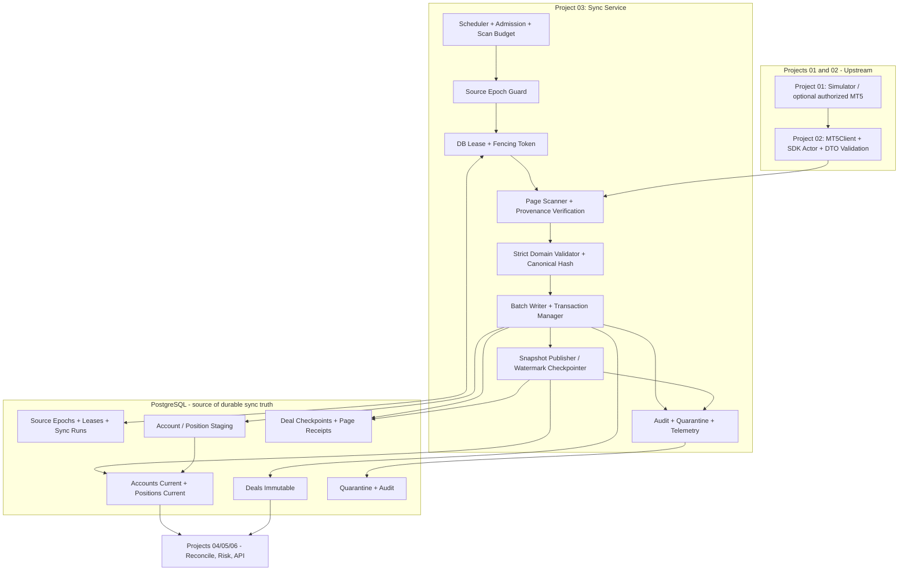
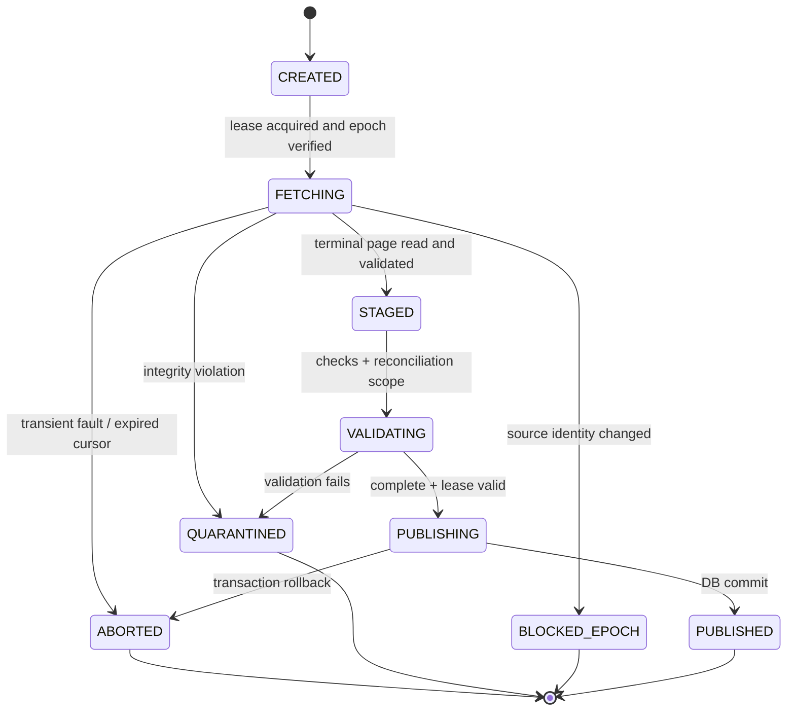
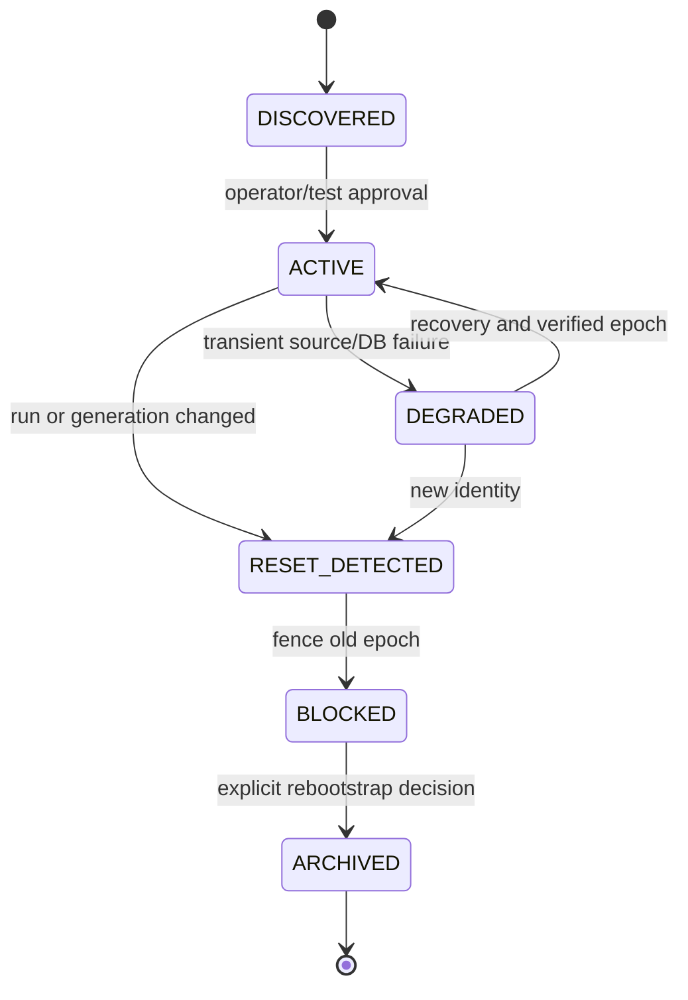
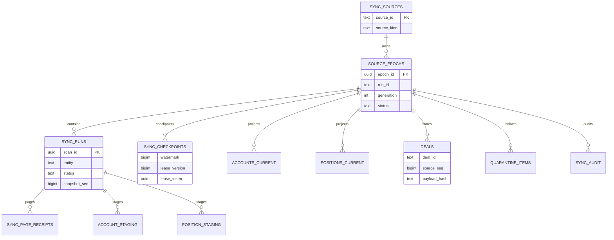
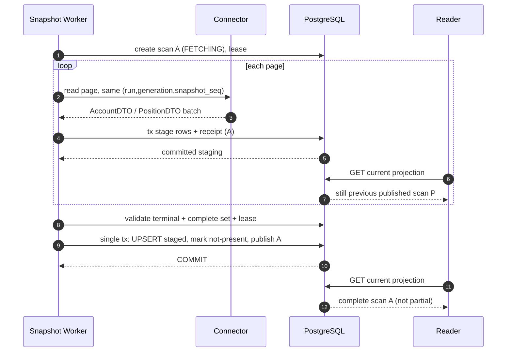

# Project 03 — Trading Data Synchronization

**System Design, Data-Consistency Proofs, Fault Model, “What-if” Matrix & Verification Plan**  
**Version:** 1.0  
**Updated:** 2026-10-30  
**Status:** **DESIGN ONLY — chưa triển khai, chưa chạy test/benchmark, chưa kết nối broker thật**  
**Language:** Tiếng Việt, giữ nguyên thuật ngữ kỹ thuật/API/SQL bằng tiếng Anh.

> **Bối cảnh CV:** Đây là mini-project **03/09** trong lộ trình tái dựng *Broker Risk Reporting and MT5 Integration*. CV mô tả việc tích hợp MT5 Manager API để sync **account/position/deal**, tách SDK blocking khỏi `asyncio`, và đối soát từ snapshots sau disconnect. Phần *Trading Data Synchronization* này là thiết kế học tập đề xuất để thực hành ingestion và PostgreSQL; **không** phải sơ đồ hay mã nguồn thực tế của Larion.
>
> **Tích hợp hai dự án trước:**
> - `Project_01_MT5_Broker_Simulator_System_Design.md`: `GET /v1/meta`, `/v1/accounts`, `/v1/positions`, `/v1/deals`; `run_id`, `generation`, `snapshot_seq`, `next_cursor`, Deal `source_seq`, `after_seq` **exclusive**, cursor TTL và lỗi `410 SNAPSHOT_EXPIRED`.
> - `Project_02_MT5_Integration_Connector_System_Design.md`: `MT5Client` + typed DTO/provenance, worker isolation, bounded admission, typed connector errors, batch streaming. **Connector không giữ checkpoint bền vững**; Project 03 sở hữu quyết định đã commit.
> - **Rất quan trọng:** `run_id`, `generation`, `source_seq` và stable snapshot pagination là *semantics của Simulator*, **không mặc nhiên có trong MT5 Manager SDK thật**. Chế độ SDK thật cần capability negotiation, mapping và chiến lược overlap/reconciliation khác, chưa thuộc MVP.
>
> **Ý nghĩa của “chịu nổi”:** hệ thống hoặc **đồng bộ đúng và có bằng chứng**, hoặc **dừng/từ chối có kiểm soát** với trạng thái chưa hoàn thành, không lặng lẽ bỏ mất dữ liệu, không công bố snapshot dở dang, không trộn source epoch và không làm tài nguyên tăng vô hạn. Các giới hạn/SLO là **mục tiêu thử nghiệm cần đo**, tuyệt đối không được ghi là kết quả đạt được.

---

## 0. Executive summary

### 0.1 Bài toán

Nguồn MT5 (qua Project 02) có thể mất kết nối, trả dữ liệu trùng, lỗi giữa các trang, reset `run_id/generation`, trả dữ liệu đến muộn, timeout khi DB vừa commit hoặc bắt đầu scan mới khi scan cũ chưa xong. Việc lấy được một trang dữ liệu **không có nghĩa** trang đó đã được lưu. Việc đã lưu 99/100 trang **không có nghĩa** an toàn để tăng high-water mark lên cuối snapshot.

**Chìa khóa thiết kế**: phân biệt *fetch*, *validate*, *persist*, *publish*, *checkpoint*; mỗi mốc có transaction và invariant rõ ràng.

### 0.2 Bảy quyết định chính

1. **Tách loại entity theo khả năng nguồn:** Deal immutable theo Simulator → **incremental replay + idempotent insert**. Account/Position mutable và không có feed biến đổi hoàn chỉnh → **full snapshot → durable staging → atomic publication**. Không giả lập CDC không tồn tại.
2. **Checkpoint tiến triển theo *complete unfiltered snapshot* của Deal**, chỉ sau khi tất cả page đã validate và commit. `snapshot_seq=S` là **upper-bound** theo event log, không phải Deal count/Deal ID.
3. **Atomic visibility cho mutable projections:** đọc Account/Position vào staging, kiểm tra completeness rồi cập nhật current projection và dấu `published_scan_id` **trong cùng transaction**; reader không bao giờ nhìn thấy tập row dở dang.
4. **Idempotency = identity + content integrity:** `(source_epoch_id, deal_id)` unique; duplicate **giống payload** là no-op, duplicate **khác payload** là conflict/quarantine. Không áp dụng last-write-wins cho tiền.
5. **Source epoch ≠ connector worker epoch:** `source_id` là cấu hình logic; simulator reset (`run_id/generation`) tạo epoch mới có kiểm soát. Reconnect/worker restart không tạo epoch mới.
6. **Lease và fencing ở điểm commit:** một scheduler điều phối mỗi `(source, entity, filter)`; database CAS + lease version chặn scanner lỗi thời công bố checkpoint/snapshot. Row locks + monotonic conditions là điểm quyết định, không dựa vào mutex trong process.
7. **Isolation trước availability:** nguồn lỗi/DB lỗi/đầy đĩa → giữ checkpoint cũ, báo `DEGRADED`/`RESYNC_REQUIRED`, giảm tốc hoặc ngừng fetch; không tự bù gap bằng giả định.

### 0.3 Correct vs controlled failure

| Case | PASS | FAIL |
|---|---|---|
| Success | Source oracle tại snapshot được đối chiếu, DB rows/financial strings đúng; checkpoint/snapshot publication hợp lệ | HTTP 200/worker green nhưng mất deal hoặc current data thiếu |
| Crash bất kỳ | Resume từ checkpoint an toàn, đọc lại và dedup; không có partial published snapshot | Bỏ qua record sau restart hoặc chuyển status thành COMPLETE giả |
| Duplicates | Cùng `(epoch, id, canonical payload)` → no-op; conflict → quarantine có log | Silent overwrite số tiền khác |
| Reset source | Dừng epoch cũ, phân loại `RESYNC_REQUIRED`, không trộn các IDs trùng giữa generation | Continuation đọc run mới bằng cursor/watermark cũ |
| Resource exhaustion | Queue/pool/staging bounded, fast-fail/retry có backoff, cảnh báo | OOM, giữ transaction hàng giờ, retry storm |

### 0.4 Phạm vi MVP và phạm vi nâng cao

- **MVP P0:** 1 simulator source; 1 connector; 1 sync worker; PostgreSQL; initial sync full Account/Position; Deal incremental; staging; durable checkpoint; controlled retry; deterministic fault injection; data audit; read-only status API hoặc CLI.
- **P1:** multi-source isolation, scheduled refresh, lease takeover, improved bulk loading, backfill, throttling, monitoring, CDC-like capability adapters nếu có nguồn thật được xác nhận.
- **P2:** sharding/partitioning/HA, workload isolation, advanced repair, multi-region disaster recovery (không giả định có thể dùng đúng semantics của Simulator).

---

## 1. Requirements, phạm vi và assumptions

### 1.1 Functional requirements

| ID | Requirement | Pri | Evidence / acceptance |
|---|---|---|---|
| FR-01 | Initial sync Account/Position/Deal từ Project 02 | P0 | Oracle record-set, no skip |
| FR-02 | Deal sync từ `after_seq=W` (**exclusive**) | P0 | `(source_seq, deal_id)` monotonic, terminal checkpoint |
| FR-03 | Full snapshots của mutable entities với staging | P0 | Không có publication trước terminal page |
| FR-04 | Durable checkpoint trong PostgreSQL | P0 | Crash 17 điểm trong pipeline, resume đúng |
| FR-05 | Persist idempotent theo source epoch và ID | P0 | Replay 3 lần, số deal/hash không đổi |
| FR-06 | Detect source reset, cursor expiry, mixed provenance | P0 | Không trộn `run_id/generation/snapshot_seq` |
| FR-07 | Strict financial precision + UTC time mapping | P0 | Golden vectors nguyên giá trị |
| FR-08 | Classify transient/permanent/data integrity failures | P0 | Typed errors + state transitions + alerts |
| FR-09 | Chặn concurrent publisher bằng lease fencing | P0 | Two-worker race và stale lease tests |
| FR-10 | Bounded memory/queue/DB pool/scan duration | P0 | Stress + OS/process instrumentation |
| FR-11 | DB migrations/test fixtures/rollback strategy | P0 | Fresh install + upgrades + rollback drill |
| FR-12 | Health metrics, lag/freshness, audit trail | P0 | Observable failure with correlation ID |
| FR-13 | Resync/backfill không gây skip/overwrite | P1 | Rebuild/side-by-side comparison |
| FR-14 | Multi-source namespacing và fairness | P1 | Duplicate IDs across sources isolated |
| FR-15 | Bulk COPY/temp staging thay batch insert nếu đo thấy cần | P1 | A/B benchmark + no behavioral regression |
| FR-16 | Real-SDK compatibility adapter | P2 | Chỉ sau source contract được xác nhận |

### 1.2 Non-functional requirements

- **RPO về logic:** 0 Deal bị bỏ qua **đối với các source snapshots đầy đủ được Simulator bảo đảm** và các transaction đã commit/durable trong PostgreSQL. Không tuyên bố chịu nổi phá hủy cả primary và backup hoặc storage không durable.
- **Durability assumptions:** PostgreSQL `fsync=on`, `synchronous_commit=on` theo cấu hình nghiệm thu, storage và backup được kiểm thử; không “đảm bảo tuyệt đối” trước mọi dạng mất điện/hỏng phần cứng.
- **Consistency:** Repeatable, atomic visible publish cho mỗi entity snapshot; **không claim cross-entity atomic snapshot** vì Project 01/02 không cam kết API global-cut giống nhau cho ba entity.
- **Availability:** An toàn dữ liệu được ưu tiên so với trạng thái READY. Có degraded/read-only semantics minh bạch.
- **Memory safety:** Không build toàn bộ 100k–1M records trong list Python; fetch→validate→bounded batch→commit.
- **Maintainability:** Tách domain/source DTO, sink ORM, scheduler, lease, audit, DB migrations; transaction boundaries ở một lớp duy nhất.
- **Privacy:** Test dùng synthetic data; production phải có RBAC, encryption, retention phù hợp và audit.

### 1.3 Out-of-scope

- Không phát lệnh buy/sell, không quản lý broker real funds.
- Không triển khai reconciliation algorithm đối chiếu cross-entity/historical corrections sâu (Project 04), nhưng Project 03 phải **báo lỗi và giữ evidence**.
- Không tính exposure/P&L (Project 05); lưu chính xác phí, P&L và các trường nguồn.
- Không xây Kafka outbox hay ClickHouse (Project 07–08).
- Không hứa exactly-once của MT5 network/source; thiết kế là **at-least-once fetch + durable dedup** trong phạm vi Simulator contract.
- Không tuyên bố `source_seq` liên tục cho Deal: các event khác cũng tiêu thụ sequence.

### 1.4 Assumptions cần khóa

| ID | Quyết định cho MVP | Nếu giả định sai |
|---|---|---|
| AS-01 | `source_id` cấu hình duy nhất, không lấy từ client input | Reject unknown/missing source ID |
| AS-02 | P01 `run_id + generation` định danh test source epoch | Stop/resync nếu thay đổi |
| AS-03 | Deal ID immutable, `source_seq` tăng theo thứ tự source | Quarantine contract violation; không âm thầm LWW |
| AS-04 | `after_seq` exclusive; endpoint unfiltered hỗ trợ snapshot đầy đủ | Không advance `W` nếu chỉ đọc filter |
| AS-05 | Account/Position API là state snapshot, không phải CDC | Full stage+publish; không giả tombstones |
| AS-06 | `next_cursor=null` chỉ hết trang trong snapshot S | Không coi là upstream không còn event tương lai |
| AS-07 | Page `run_id/generation/snapshot_seq` luôn nhất quán trong scan | Abort scan nếu mismatch |
| AS-08 | Decimal được parse từ JSON strings, UTC timestamps | Reject float/non-timezone-aware values |
| AS-09 | One active scan per source/entity/filter tại một thời điểm | DB lease; stale writers fenced |
| AS-10 | Postgres 17/18-compatible syntax, SQLAlchemy 2.x, Alembic | Pin exact versions in lockfile/CI |
| AS-11 | P01 giữ snapshot cursor ~15 phút, `limit<=500` | Scan duration cap; expired → restart |
| AS-12 | Current Position có thể **vắng mặt** trong snapshot nhưng không chắc đã CLOSED | Set `presence=ABSENT`, không tự set business `status=CLOSED` |
| AS-13 | `worker_epoch` chỉ thuộc Connector lifecycle | Không dùng làm database source epoch |
| AS-14 | Single machine/local Docker, synthetic data | Không tự suy ra production throughput/availability |

---

## 2. Interface contract với Project 01/02 — phải tương thích

### 2.1 Reference endpoints và semantics

| P01 simulated endpoint | Via P02 connector | Project 03 sử dụng |
|---|---|---|
| `GET /v1/meta` | `SourceIdentity`/capabilities | Check run/generation and source current committed seq |
| `GET /v1/accounts?limit=...` | `AccountDTO` pages | Full snapshot; stage and publish |
| `GET /v1/positions?limit=...` | `PositionDTO` pages | Full snapshot; stage and publish; query scope phải xác định |
| `GET /v1/deals?after_seq=W&limit=...` | `DealDTO` pages | Initial/incremental unfiltered; W exclusive |
| `GET /v1/deals?cursor=...` | Next page, same provenance | Scanner tiến đến `next_cursor=null` |
| HTTP `410` | `SnapshotExpiredError` | Abort current scan; retry **from durable W** |
| Reset run/generation | `SourceEpochChangedError`/`ResyncRequiredError` | Fence epoch old, block publication, operator/test-mediated rebootstrap |

**Không sửa contract của hai dự án trước một cách âm thầm.** Nếu cần `scan_id`, đó là ID nội bộ Project 03; nếu cần globally coordinated snapshot across entity types, phải mở design change cho Project 01/02 và bổ sung contract tests.

### 2.2 Proposed Project 03 consumer port (không khẳng định API P02 hiện tại đã có)

```python
from dataclasses import dataclass
from typing import AsyncIterator, Generic, Literal, Protocol, TypeVar

T = TypeVar("T")

@dataclass(frozen=True)
class PageEnvelope(Generic[T]):
    source_id: str
    run_id: str                 # simulator only
    generation: int            # simulator only
    snapshot_seq: int
    items: tuple[T, ...]
    next_cursor: str | None
    page_fingerprint: str      # canonical page hash, derived by sync layer
    scan_complete: bool       # true only when next_cursor is None

class SyncSource(Protocol):
    async def read_meta(self, source_id: str): ...
    async def iter_accounts(self, source_id: str) -> AsyncIterator[PageEnvelope]: ...
    async def iter_positions(self, source_id: str) -> AsyncIterator[PageEnvelope]: ...
    async def iter_deals(self, source_id: str, after_seq: int) -> AsyncIterator[PageEnvelope]: ...
```

- `page_fingerprint`/`scan_complete` được **Project 03 derive/validate** khi thích hợp, không bắt P02 phải có đúng hai trường.
- `AsyncIterator` chỉ fetch trang N+1 **sau khi** sink đã ACK commit của trang N; không prefetch hàng trăm pages.
- Error P02 phải được giữ taxonomy: `AuthenticationError`, `UpstreamTimeoutError`, `SnapshotExpiredError`, `SourceEpochChangedError`, `DataIntegrityError`, `OverloadedError`, v.v.
- Batch kết thúc với `next_cursor=null` chỉ hợp lệ nếu toàn bộ chain từ page đầu đã validate, không phát hiện vòng lặp cursor, run/generation thay đổi, và không có filter ngoài scope.

### 2.3 Canonical entity fields

| Entity | Key nội bộ | Fields materialized trong DB | Quy tắc |
|---|---|---|---|
| Account | `(source_epoch_id, account_id)` | `currency`, `balance`, `credit`, `source_payload_hash` | Current state mutable; đừng tự tính balance |
| Position | `(source_epoch_id, position_id)` | `account_id`, `symbol`, `side`, `volume_lots`, `open_price`, `source_status`, `presence` | Vắng mặt ≠ closed |
| Deal | `(source_epoch_id, deal_id)` | `source_seq`, `position_id`, `account_id`, `symbol`, `entry`, `side`, `volume_lots`, `price`, `realized_pnl_gross`, `commission`, `swap`, `executed_at`, `payload_hash` | Immutable trong simulator; conflict is incident |

`source_epoch_id` là UUID nội bộ cho `(source_id, run_id, generation)` của Simulator. `account_id/position_id/deal_id` luôn được giữ dưới dạng string để không mất leading zeros/định dạng của nguồn. Với real SDK, phải tạo `source_identity_mapping` riêng sau khi xác minh tính ổn định của IDs.

---

## 3. Kiến trúc tổng thể



### 3.1 Module ownership

| Module | Owns | Không được làm |
|---|---|---|
| `Scheduler` | cadence, concurrency slots, queue caps | Trigger unbounded parallel sync |
| `SourceEpochGuard` | runtime identity + epoch FSM | Continue with old W when run/generation changed |
| `LeaseCoordinator` | lease acquisition, heartbeat, fencing version | Infer ownership from process PID |
| `Scanner` | page iteration and terminal validation | Advance checkpoint directly |
| `Validator` | identity/schema/Decimal/time/sequence/hash | Round or silently coerce source money |
| `Sink` | DB transactions, UPSERT, staging and audit | Commit partial scan as complete |
| `Publisher` | publish atomic Account/Position snapshot, Deal W | Publish when lease or provenance invalid |
| `Quarantine` | bad input/conflicting immutable Deal, sanitized metadata | Store raw secrets or leak PII in logs |
| `Read Model` | last *published* snapshot and deal history | Claim cross-entity global atomicity |

### 3.2 Trust boundaries

1. Source P01/P02 is **untrusted for correctness** until validated; network failures/malicious response are simulated.
2. PostgreSQL is durable sink and only authority for `sync_checkpoint`, `published_scan_id`, scan status; Connector never commits checkpoint.
3. Project 03 does **not** receive Simulator admin token; fault injection is separate test harness bound to test network.
4. Only migration owner has DDL; app role gets DML minimum necessary. No dynamic SQL table/column names from request/user.
5. Operators can request resync via authenticated control path with audit trail; no general public endpoints to wipe DB.

### 3.3 State machines



For **Deal**, `STAGED` có nghĩa mọi page đã persist idempotently; `PUBLISHING` là checkpoint `W→S`. For **Account/Position**, `STAGED` là durable staged rows; `PUBLISHING` là promote current-state projection atomically.



**Readiness** chỉ có nghĩa là sync engine có thể làm việc an toàn; `source_degraded` phải được hiển thị riêng với liveness. Một lần sync thành công của Deal không có nghĩa snapshot Position cùng thời điểm cũng current.

---

## 4. Data consistency: Invariants có thể kiểm chứng

| ID | Invariant | Test oracle |
|---|---|---|
| INV-01 | Không có Deal `source_seq <= W` bị bỏ qua trong unfiltered complete snapshot cùng epoch | Oracle source Deal ID-set at S vs DB |
| INV-02 | `W_new >= W_old`, chỉ tăng khi terminal page đã validate và tất cả pages đã commit | Checkpoint history + receipts, crash injection |
| INV-03 | Không mix `run_id/generation/snapshot_seq` trong một scan | Distinct provenance count = 1 |
| INV-04 | Cùng Deal ID+epoch+payload → đúng một row | DB unique constraint + replay count |
| INV-05 | Cùng Deal ID+epoch nhưng payload khác → không overwrite | Compare row hashes; quarantine fixture |
| INV-06 | Không bao giờ công bố Account/Position từ scan chưa terminal | Published scan is COMPLETE iff promoted |
| INV-07 | Account/Position published projection là atomic set đối với một entity | Reader concurrent at promote sees old OR new, never hybrid |
| INV-08 | Không chuyển `ABSENT` thành `CLOSED` khi source không có tombstone | Unknown-state fixture |
| INV-09 | Stale scanner không thể publish dù đã fetch dữ liệu | Two-worker lease takeover |
| INV-10 | Source epoch change chặn mọi checkpoint của epoch cũ | Forced generation reset and stale worker |
| INV-11 | `source_seq` có gap hợp lệ nếu các event khác tồn tại | Deal seq [5, 9] no false missing-data error |
| INV-12 | Financial Decimal canonical value preserved, no binary float | Decimal vectors round-trip equality |
| INV-13 | UTC timestamp preserved; no implicit naive conversion | Timezone offsets, DST, leap day tests |
| INV-14 | No cross-source key collision | Same Deal ID from two sources → two isolated rows |
| INV-15 | All retry loops and buffers bounded | Fault storm with OS/metrics caps |
| INV-16 | A 200 status from connector is not proof of DB persistence | Inject DB rollback after connector response |
| INV-17 | `READ_COMMITTED` projections respect transaction atomicity, not multi-entity cross-cut | Concurrent read during publication |
| INV-18 | No source-global watermark from filtered subset | Filtered scan refusal test |
| INV-19 | A final empty Deal page can advance to S only if full unfiltered scan complete | Empty window test + bad filter fixture |
| INV-20 | After DB commit response is lost, retry doesn't duplicate and doesn't skip | Proxy drop COMMIT ACK + oracle |
| INV-21 | Unpublished staging cannot silently become active after process restart | Restart in FETCHING/STAGED |
| INV-22 | Alerts/metrics never substitute for invariants | Inject mismatched DB data; read status must DEGRADED |

### 4.1 Consistency level matrix

| Object | Source promise in Simulator | Guarantee within Project 03 | Not guaranteed |
|---|---|---|---|
| Deals | Immutable, ordered by `source_seq`, stable snapshot S | At-least-once fetch + durable unique dedup + full-scan W | Native SDK exactly-once, corrections semantics |
| Accounts | Versioned source snapshot, current records as-of S | Atomic publication **per Accounts snapshot** | Same S as Positions/Deals |
| Positions | Versioned source snapshot, current records as-of S | Atomic publication **per Positions snapshot** | Absence means CLOSED; same S as Accounts |
| Reporting | Reads DB committed rows | Includes `source_epoch`, `snapshot_seq`, `published_at` metadata | Instant cross-entity financial consistency |

---

## 5. Database design — PostgreSQL

### 5.1 Logical ERD



### 5.2 Tables và lifecycle

| Table | PK/unique | Purpose | Retention/edge |
|---|---|---|---|
| `sync_sources` | `source_id` | Config identity/flags | Không tái sử dụng id cho broker khác |
| `source_epochs` | UUID, unique `(source_id, run_id, generation)` | Isolate source reset | Archive old epochs; no cross-epoch merge |
| `sync_checkpoints` | `(epoch_id, entity, filter_hash)` | Durable Deal W, lease owner/version and last completed scan | Only `filter_hash=UNFILTERED` can drive global Deal W |
| `sync_runs` | `scan_id` | Immutable scan metadata/status and bounds | Keep metadata even if staged rows GC |
| `sync_page_receipts` | `(scan_id, page_index)` | Exactly which page was committed/validated | Hash change on retry = data integrity incident |
| `account_staging` | `(scan_id, account_id)` | Incomplete Account snapshots | GC only after terminal archive/abort |
| `position_staging` | `(scan_id, position_id)` | Incomplete Position snapshots | GC independently of active projection |
| `accounts_current` | `(epoch_id, account_id)` | Last published Account per epoch | `presence` and `published_scan_id` |
| `positions_current` | `(epoch_id, position_id)` | Last published Position per epoch | `ABSENT` does not assert CLOSED |
| `deals` | `(epoch_id, deal_id)` | Immutable Deal history | No blind overwrite |
| `quarantine_items` | UUID | Integrity errors/conflicts, redacted summary | TTL/review policy; preserve incident audit |
| `sync_audit` | UUID | Durable lifecycle/exception audit | Bounded retention + hashed metadata |

### 5.3 Reference DDL (rút gọn nhưng tương thích cú pháp PostgreSQL)

> SQL dưới đây là **blueprint**, không phải migration đã chạy. Columns/indexes/constraints phải được chuyển thành Alembic revisions và kiểm thử trên version DB pinned. Không copy nguyên vào production mà chưa chốt policy tenant/security/scale.

```sql
CREATE TABLE sync_sources (
    source_id       TEXT PRIMARY KEY,
    source_kind     TEXT NOT NULL CHECK (source_kind IN ('simulator','manager_sdk')),
    enabled         BOOLEAN NOT NULL DEFAULT TRUE,
    created_at      TIMESTAMPTZ NOT NULL DEFAULT now()
);

CREATE TABLE source_epochs (
    epoch_id        UUID PRIMARY KEY,
    source_id       TEXT NOT NULL REFERENCES sync_sources(source_id),
    run_id          TEXT NOT NULL,
    generation      BIGINT NOT NULL CHECK (generation >= 0),
    status          TEXT NOT NULL CHECK (status IN ('DISCOVERED','ACTIVE','DEGRADED','BLOCKED','ARCHIVED')),
    activated_at    TIMESTAMPTZ,
    created_at      TIMESTAMPTZ NOT NULL DEFAULT now(),
    UNIQUE (source_id, run_id, generation)
);

CREATE TABLE sync_checkpoints (
    epoch_id        UUID NOT NULL REFERENCES source_epochs(epoch_id),
    entity          TEXT NOT NULL CHECK (entity IN ('accounts','positions','deals')),
    filter_hash     TEXT NOT NULL,
    watermark       BIGINT NOT NULL DEFAULT 0 CHECK (watermark >= 0),
    published_scan_id UUID,
    lease_token     UUID,
    lease_version   BIGINT NOT NULL DEFAULT 0 CHECK (lease_version >= 0),
    lease_until     TIMESTAMPTZ,
    last_success_at TIMESTAMPTZ,
    updated_at      TIMESTAMPTZ NOT NULL DEFAULT now(),
    PRIMARY KEY (epoch_id, entity, filter_hash)
);

CREATE TABLE sync_runs (
    scan_id         UUID PRIMARY KEY,
    epoch_id        UUID NOT NULL REFERENCES source_epochs(epoch_id),
    entity          TEXT NOT NULL CHECK (entity IN ('accounts','positions','deals')),
    filter_hash     TEXT NOT NULL,
    start_watermark BIGINT,
    snapshot_seq    BIGINT CHECK (snapshot_seq >= 0),
    status          TEXT NOT NULL CHECK (status IN (
                        'CREATED','FETCHING','STAGED','VALIDATING','PUBLISHING',
                        'PUBLISHED','ABORTED','QUARANTINED','BLOCKED_EPOCH')),
    page_count      BIGINT NOT NULL DEFAULT 0 CHECK (page_count >= 0),
    record_count    BIGINT NOT NULL DEFAULT 0 CHECK (record_count >= 0),
    owner_lease_version BIGINT NOT NULL,
    started_at      TIMESTAMPTZ NOT NULL DEFAULT now(),
    ended_at        TIMESTAMPTZ,
    error_code      TEXT
);

CREATE TABLE sync_page_receipts (
    scan_id         UUID NOT NULL REFERENCES sync_runs(scan_id),
    page_index      INTEGER NOT NULL CHECK (page_index >= 0),
    item_count      INTEGER NOT NULL CHECK (item_count BETWEEN 0 AND 500),
    page_hash       CHAR(64) NOT NULL,
    is_terminal     BOOLEAN NOT NULL,
    committed_at    TIMESTAMPTZ NOT NULL DEFAULT now(),
    PRIMARY KEY (scan_id, page_index)
);

CREATE TABLE account_staging (
    scan_id         UUID NOT NULL REFERENCES sync_runs(scan_id),
    account_id      TEXT NOT NULL,
    currency        TEXT NOT NULL,
    balance         NUMERIC(38,12) NOT NULL,
    credit          NUMERIC(38,12) NOT NULL,
    payload_hash    CHAR(64) NOT NULL,
    PRIMARY KEY (scan_id, account_id)
);

CREATE TABLE position_staging (
    scan_id         UUID NOT NULL REFERENCES sync_runs(scan_id),
    position_id     TEXT NOT NULL,
    account_id      TEXT NOT NULL,
    symbol          TEXT NOT NULL,
    side            TEXT NOT NULL CHECK (side IN ('BUY','SELL')),
    volume_lots     NUMERIC(38,12) NOT NULL,
    open_price      NUMERIC(38,12) NOT NULL,
    source_status   TEXT NOT NULL,
    payload_hash    CHAR(64) NOT NULL,
    PRIMARY KEY (scan_id, position_id)
);

CREATE TABLE accounts_current (
    epoch_id        UUID NOT NULL REFERENCES source_epochs(epoch_id),
    account_id      TEXT NOT NULL,
    currency        TEXT NOT NULL,
    balance         NUMERIC(38,12) NOT NULL,
    credit          NUMERIC(38,12) NOT NULL,
    presence        TEXT NOT NULL CHECK (presence IN ('PRESENT','ABSENT')),
    published_scan_id UUID NOT NULL REFERENCES sync_runs(scan_id),
    payload_hash    CHAR(64) NOT NULL,
    PRIMARY KEY (epoch_id, account_id)
);

CREATE TABLE positions_current (
    epoch_id        UUID NOT NULL REFERENCES source_epochs(epoch_id),
    position_id     TEXT NOT NULL,
    account_id      TEXT NOT NULL,
    symbol          TEXT NOT NULL,
    side            TEXT NOT NULL CHECK (side IN ('BUY','SELL')),
    volume_lots     NUMERIC(38,12) NOT NULL,
    open_price      NUMERIC(38,12) NOT NULL,
    source_status   TEXT NOT NULL,
    presence        TEXT NOT NULL CHECK (presence IN ('PRESENT','ABSENT')),
    published_scan_id UUID NOT NULL REFERENCES sync_runs(scan_id),
    payload_hash    CHAR(64) NOT NULL,
    PRIMARY KEY (epoch_id, position_id)
);

CREATE TABLE deals (
    epoch_id        UUID NOT NULL REFERENCES source_epochs(epoch_id),
    deal_id         TEXT NOT NULL,
    source_seq      BIGINT NOT NULL CHECK (source_seq > 0),
    account_id      TEXT NOT NULL,
    position_id     TEXT,
    symbol          TEXT NOT NULL,
    entry_kind      TEXT NOT NULL,
    side            TEXT NOT NULL CHECK (side IN ('BUY','SELL')),
    volume_lots     NUMERIC(38,12) NOT NULL,
    price           NUMERIC(38,12) NOT NULL,
    realized_pnl_gross NUMERIC(38,12) NOT NULL,
    commission      NUMERIC(38,12) NOT NULL,
    swap            NUMERIC(38,12) NOT NULL,
    executed_at     TIMESTAMPTZ NOT NULL,
    payload_hash    CHAR(64) NOT NULL,
    first_scan_id   UUID NOT NULL REFERENCES sync_runs(scan_id),
    inserted_at     TIMESTAMPTZ NOT NULL DEFAULT now(),
    PRIMARY KEY (epoch_id, deal_id)
);

CREATE INDEX idx_deals_epoch_seq ON deals (epoch_id, source_seq, deal_id);
CREATE INDEX idx_deals_epoch_account_time ON deals (epoch_id, account_id, executed_at);
CREATE INDEX idx_positions_epoch_account ON positions_current (epoch_id, account_id);
CREATE INDEX idx_sync_runs_epoch_entity_time ON sync_runs (epoch_id, entity, started_at DESC);

CREATE TABLE quarantine_items (
    quarantine_id   UUID PRIMARY KEY,
    epoch_id        UUID NOT NULL REFERENCES source_epochs(epoch_id),
    scan_id         UUID REFERENCES sync_runs(scan_id),
    entity          TEXT NOT NULL,
    source_key_hash TEXT,
    reason_code     TEXT NOT NULL,
    safe_details    JSONB NOT NULL DEFAULT '{}'::jsonb,
    created_at      TIMESTAMPTZ NOT NULL DEFAULT now()
);

CREATE TABLE sync_audit (
    audit_id        UUID PRIMARY KEY,
    epoch_id        UUID NOT NULL REFERENCES source_epochs(epoch_id),
    scan_id         UUID REFERENCES sync_runs(scan_id),
    event_type      TEXT NOT NULL,
    reason_code     TEXT,
    safe_details    JSONB NOT NULL DEFAULT '{}'::jsonb,
    created_at      TIMESTAMPTZ NOT NULL DEFAULT now()
);
```

**Schema review cần làm trước migration:**

1. `NUMERIC(38,12)` là **policy MVP**, không phải universal MT5 precision; validator phải **reject** giá trị nhiều scale/precision hơn thay vì để PostgreSQL tự làm tròn.
2. Không đặt FK `deals.position_id → positions_current` vì Deal lịch sử có thể tham chiếu vị thế đã rời *current open positions*; tạo `unresolved_reference` audit nếu cần.
3. `source_epochs` dự kiến giữ `run_id/generation` non-null cho Simulator. Adapter real SDK sau này cần identity schema bổ sung, không điền bừa `run_id` giả.
4. Schema bên trên **chưa bao gồm** `GRANT`, RLS, partitioning, triggers bảo vệ immutable Deal; các hạng mục đó có ticket và kiểm thử riêng.
5. `source_seq>0` thuộc simulator current contract. Nếu nguồn thật dùng zero-based seq hoặc không có seq, cần model khác; không ép real SDK vào bảng này mà không có mapping đã xác nhận.
6. `sync_checkpoints.published_scan_id` FK có thể bổ sung bằng migration sau khi review dependency/circular references; publisher vẫn kiểm tra reference ở application + same-transaction.

---
## 6. Đồng bộ Deal: incremental replay, idempotency và checkpoint

### 6.1 Happy path / sequence diagram

```mermaid
sequenceDiagram
    autonumber
    participant J as Sync Job
    participant PG as PostgreSQL
    participant C as P02 Connector
    participant S as P01 Simulator
    J->>PG: acquire lease / read checkpoint W
    PG-->>J: epoch E, W, lease version L
    J->>C: scan deals after_seq=W, unfiltered
    C->>S: GET /v1/deals?after_seq=W&limit=500
    S-->>C: page 0, run R, generation G, snapshot S, cursor K
    C-->>J: validated PageEnvelope 0
    J->>PG: tx: fencing + insert/dedup + receipt 0
    PG-->>J: COMMIT ack
    J->>C: request next cursor K
    loop pages 1..N
        C->>S: GET /v1/deals?cursor=...
        S-->>C: page and next_cursor
        C-->>J: validated batch
        J->>PG: tx: fencing + insert/dedup + receipt
        PG-->>J: COMMIT ack
    end
    Note over J,PG: Terminal page has next_cursor=null
    J->>PG: tx: verify complete + lease + epoch + W_old; checkpoint=S
    PG-->>J: COMMIT; W_new=S; scan PUBLISHED
```

### 6.2 Chính xác checkpoint `W` có ý nghĩa gì?

Let `D(S)` là tập Deal do Simulator đã commit với `source_seq <= S` trong một source epoch, và `W` là event-watermark bền vững.

- Source scan `GET /v1/deals?after_seq=W` phải trả tất cả Deals có `W < source_seq <= S` nếu và **chỉ nếu** hoàn tất tất cả pages hợp lệ và unfiltered.
- Khi `S` > Deal cuối cùng, **được** đặt `W=S`: các event không tạo Deal cũng dùng `source_seq`, nên Deal sequence có gaps là bình thường.
- **Không** đặt `W = MAX(source_seq)` khi scan có filter theo `account_id`/`symbol`/`time`; filter riêng phải có checkpoint riêng và không được dùng để drive global dataset.
- **Không** tính `W` từ số Deal hoặc Deal ID; ID không đảm bảo thứ tự.
- **Không** advance `W` ngay sau page N khi `next_cursor` vẫn còn hoặc scan bị `410`, dù 99.9% page đã ghi thành công.
- Checkpoint được cập nhật **sau khi** persisted pages đã commit và toàn bộ scan đạt terminal; crash trước đó → replay từ W cũ, duplicate idempotent.
- Repeated scans with no new Deal vẫn có thể tăng `W` theo `snapshot_seq` mới nếu source chứng minh scan toàn bộ khoảng và không có lỗi.

### 6.3 Transaction boundary của một Deal page

**Precondition:** page `source_epoch`, `snapshot_seq`, order, IDs, amounts và `next_cursor` đã pass validation; `source_seq` nằm trong `(W,S]` cho Deal ở scan đó; không giữ DB transaction trong lúc gọi network.

```text
BEGIN TRANSACTION
  lock sync_checkpoint row FOR UPDATE;
  assert source_epoch.status == ACTIVE;
  assert lease_token/version match and lease_until > db_now;
  assert sync_run.status == FETCHING;
  assert scan.start_watermark == checkpoint.watermark;
  assert page_index == expected next (or exact same committed receipt on retry);
  for each normalized Deal:
      INSERT ... ON CONFLICT (epoch_id,deal_id) DO NOTHING;
      if conflict: compare canonical payload_hash AND immutable fields;
      if mismatch: RAISE DATA_INTEGRITY_CONFLICT (rollback whole page);
  INSERT sync_page_receipt(page_index, hash, count, is_terminal);
  UPDATE sync_run.page_count and record_count;
COMMIT
```

**Quan trọng:** Dùng `ON CONFLICT DO NOTHING` **không tự đủ**. Phải phân biệt *duplicate hợp lệ* với *same ID but money changed*. Không dùng `DO UPDATE SET amount = EXCLUDED.amount` để che một conflicting Deal.

**Batch input pre-dedup:** Nếu một batch có hai row cùng `(epoch, deal_id)`, reject hoặc collapse **chỉ nếu canonical payload giống nhau**; nếu khác nhau quarantine. PostgreSQL `ON CONFLICT DO UPDATE` có thể báo cardinality violation khi cùng statement đụng một existing row nhiều lần; không dựa vào DB lỗi này để xử lý nghiệp vụ.

### 6.4 Terminal checkpoint transaction

```text
BEGIN TRANSACTION
  SELECT checkpoint FOR UPDATE;
  ASSERT source_epoch ACTIVE, lease version/token valid, lease unexpired;
  ASSERT checkpoint.watermark == scan.start_watermark;      # CAS
  ASSERT scan entity == deals AND filter_hash == UNFILTERED;
  ASSERT scan snapshot_seq == S AND all pages 0..N validated and receipted;
  ASSERT exactly one terminal page with next_cursor == null;
  ASSERT no quarantine/conflicting deal in scan;
  UPDATE sync_checkpoints
      SET watermark = S, published_scan_id = scan_id, last_success_at = db_now
      WHERE watermark = W AND correct lease;
  UPDATE sync_runs SET status = PUBLISHED, ended_at = db_now;
  INSERT sync_audit(..., 'DEAL_CHECKPOINT_PUBLISHED', W, S, count, hashes);
COMMIT
```

`next_cursor=null` thuộc Simulator response, nhưng Project 03 phải giữ marker `is_terminal` sau khi validate; không tin status trong RAM khi DB vừa restart. Sau terminal, một transaction có thể đặt `sync_runs` thành `STAGED` rồi terminal transaction chuyển sang `PUBLISHED`, hoặc kết hợp atomic terminal receipt+checkpoint nếu phù hợp; **không có khoảng cho checkpoint đi trước Deal commit**.

### 6.5 Ambiguous COMMIT result

Nếu network rớt sau khi PostgreSQL commit nhưng trước khi Python nhận response, **không thể kết luận rollback**. Recovery:

1. Mở kết nối mới, đọc `sync_runs`, `sync_page_receipts`, `sync_checkpoints` từ DB.
2. Nếu page receipt tồn tại với **cùng** hash và scan vẫn own lease → idempotent ACK.
3. Nếu `W>=S` và `published_scan_id=scan_id` → đã publish; trả success idempotent.
4. Nếu result bất nhất/lease đã bị thay → không tự quyết; chuyển recovery/incident.
5. Nếu không có receipt, replay page/scan từ **durable** W. **Không** dựa vào log của worker đã mất.

### 6.6 Correctness argument — bằng chứng vừa đủ

Assumptions: source snapshot S complete và stable; page chain không bị bỏ; DB unique+transactions durable; mapper chính xác; epoch không đổi; terminal checkpoint chỉ sau all-page commits.

Induction: Trước scan, mọi Deal trong `(0,W]` đã persisted. Mỗi valid page trong `(W,S]` được inserted hoặc verified identical duplicate. Terminal chứng minh mọi page của snapshot đã đi qua validation và commit; vậy mọi Deal <=S persisted trước khi W chuyển S. Crash trước terminal giữ W cũ → replay; unique key chặn duplicates. **Giới hạn:** nếu source nằm ngoài assumptions, hoặc source cố tình bỏ Deal trong snapshot mà vẫn phát terminal giả, không có logic client nào có thể chứng minh completeness chỉ từ metadata đó; cần source oracle/reconciliation (Project 04).

---

## 7. Đồng bộ Account / Position: full snapshot và atomic publication

### 7.1 Lý do không dùng Deal strategy

Project 01 trả **current-state versions** cho Account/Position. Nó **không** cam kết `after_seq`/CDC log đủ để biết tất cả changes/deletes cho từng entity. Nếu chỉ UPSERT những record vừa đọc rồi coi đó là state đầy đủ, một account/position bị mất khỏi response do partial scan sẽ khiến state sai hoặc bị stale vô hạn.

**Giải pháp:** tạo `scan_id`; tất cả pages ghi vào staging, không đụng current published projection; chỉ sau terminal và preflight check mới promote đồng loạt.

### 7.2 Snapshot publication sequence



### 7.3 Publication transaction (Account example)

```sql
-- PSEUDOCODE FOR REVIEW, not copy-paste production migration
BEGIN;
-- 1) SELECT sync_checkpoints row FOR UPDATE; require active source/lease/version.
-- 2) verify scan.status=STAGED and all page receipts terminal; full unfiltered scope.

INSERT INTO accounts_current (
    epoch_id, account_id, currency, balance, credit,
    presence, published_scan_id, payload_hash
)
SELECT :epoch_id, s.account_id, s.currency, s.balance, s.credit,
       'PRESENT', :scan_id, s.payload_hash
FROM account_staging AS s WHERE s.scan_id = :scan_id
ORDER BY s.account_id
ON CONFLICT (epoch_id, account_id) DO UPDATE SET
    currency=EXCLUDED.currency, balance=EXCLUDED.balance,
    credit=EXCLUDED.credit, presence='PRESENT',
    published_scan_id=EXCLUDED.published_scan_id,
    payload_hash=EXCLUDED.payload_hash;

UPDATE accounts_current
   SET presence='ABSENT', published_scan_id=:scan_id
 WHERE epoch_id=:epoch_id AND published_scan_id <> :scan_id;

-- 3) publish sync_checkpoints.published_scan_id, run.status=PUBLISHED, audit
COMMIT;
```

- **Atomicity:** Reader `READ COMMITTED` không thấy một phần của transaction. Nhưng **hai truy vấn khác nhau** ở hai thời điểm khác nhau có thể thấy old và new snapshot; nếu reporting cần consistent read qua nhiều statements phải sử dụng transaction/isolation rõ (Project 05/06).
- **Locking:** Transaction promote có thể ảnh hưởng nhiều rows, tránh chạy nhiều publisher cùng epoch/entity; đo lock duration và deadlocks. Nếu scan lớn khiến one-transaction promote quá chậm, P1 dùng **immutable snapshot tables + single active pointer swap**, không chia promote thành nhiều transaction rồi báo atomic.
- **Anti-stale guard:** `published_scan_id`/monotonic logical scan version phải được kiểm tra dưới lock; scan kết thúc muộn không được ghi đè snapshot mới hơn. Mỗi entity chỉ có 1 active scan trong MVP.

### 7.4 Account/Position tombstone semantics

- `presence=PRESENT`: ID có trong **đầy đủ** published snapshot gần nhất.
- `presence=ABSENT`: ID đã thấy trước đó nhưng không có trong một **full verified** snapshot sau đó.
- `source_status=CLOSED`: chỉ đặt nếu source **thực sự báo CLOSED** theo contract; không suy từ `ABSENT`.
- Một Position cũ có Deal lịch sử hợp lệ; không hard-delete để giữ referential audit.
- Snapshot có filter (ví dụ `status=OPEN`) chỉ cho phép luận `ABSENT_FROM_OPEN_SET`, **không** thể suy `ABSENT_FROM_ALL_POSITIONS`. MVP yêu cầu unfiltered listing hoặc đúng declared scope; schema `presence` cần được mở rộng khi thử mode filtered.
- Reset source epoch giữ account/position của epoch cũ ở archive; không tự merge ID có thể reuse.

### 7.5 Mixed snapshot S across entities

Ví dụ: Account snapshot ở `S_a=1050`, Positions snapshot `S_p=1060`, Deal checkpoint `W_d=1070`. Đây **không** phải single consistent broker state tại S=1070. Project 03 lưu provenance riêng và expose:

```json
{
  "source_id": "sim_local",
  "epoch": "run_001:generation_3",
  "accounts": {"snapshot_seq": 1050, "published": true},
  "positions": {"snapshot_seq": 1060, "published": true},
  "deals": {"watermark_seq": 1070, "published": true},
  "cross_entity_consistent": false,
  "reconciliation_required": true
}
```

`cross_entity_consistent=true` **chỉ** sau khi có bằng chứng/contract mới (ví dụ global-cut source API hoặc được Project 04 xác nhận cut and consistency). Số liệu trên là minh họa, không phải nguồn thật.

---

## 8. Source identity, epochs, leases và concurrency

### 8.1 Các lớp identity cần phân biệt

| Layer | Identifier | Changes when | Must not change when |
|---|---|---|---|
| Config | `source_id` | broker/source logical reconfiguration có chủ đích | Request retry |
| P01 Source | `(run_id, generation)` | Simulator run/reset | Connector reconnect |
| P02 Worker | `worker_epoch` | Dedicated worker process/session rotate | P01 data generation unchanged |
| P03 Scan | `scan_id` | mỗi sync attempt/snapshot | Page N→N+1 |
| P03 Lease | `(lease_token, lease_version)` | takeover/acquisition | Heartbeat valid same owner |
| P03 Checkpoint | `(epoch_id, entity, filter_hash, W)` | Deal scan terminal commit | Page fetched but not committed |

### 8.2 Lease acquisition/heartbeat — SQL sketch

```sql
-- Require checkpoint row pre-created during source enrollment.
-- Run in a short transaction; lease ownership uses PostgreSQL clock.
UPDATE sync_checkpoints
   SET lease_token=:new_token,
       lease_version=lease_version+1,
       lease_until=clock_timestamp()+interval '30 seconds',
       updated_at=clock_timestamp()
 WHERE epoch_id=:epoch_id AND entity=:entity AND filter_hash=:scope
   AND (lease_until IS NULL OR lease_until <= clock_timestamp())
RETURNING lease_version, watermark;

-- Heartbeat (same owner); 0 rows = lease lost, stop publishing.
UPDATE sync_checkpoints
   SET lease_until=clock_timestamp()+interval '30 seconds',
       updated_at=clock_timestamp()
 WHERE epoch_id=:epoch_id AND entity=:entity AND filter_hash=:scope
   AND lease_token=:token AND lease_version=:version
   AND lease_until > clock_timestamp();
```

- Lease duration `30s` **thử nghiệm**, heartbeat `10s`, takeover sau expiration + jitter. Sử dụng **DB clock**, không dùng wall clock worker để quyết định lease.
- Một publisher transaction **`SELECT ... FOR UPDATE` row checkpoint** rồi kiểm token/version/expiry, source epoch và previous watermark. Update checkpoint/snapshot publication trong chính transaction đó.
- Khi worker bị pause quá thời gian lease, worker mới có thể takeover; old worker nếu resume **không còn quyền publish**. Deal page đã committed trước khi mất lease an toàn nhờ idempotency, nhưng old writer không được tự công bố snapshot/checkpoint.
- Lease alone không phải distributed consensus với upstream; phải kết hợp source epoch guard. Không dùng PostgreSQL session advisory lock trên connection pool như substitute lease mà không kiểm soát lifecycle; nếu dùng advisory lock, ưu tiên transaction-scoped cho thao tác ngắn.
- Tránh race reclaim: acquisition và terminal publication cùng serialize qua row lock; monotonic CAS chặn stale completion.

### 8.3 Source reset policy

1. `GET /v1/meta` hoặc page report `(run_id,generation)` mới ≠ current active source epoch.
2. Abort/quarantine scan đang chạy, release ownership/fence publication, đặt epoch `BLOCKED`/`RESET_DETECTED` trong audit.
3. Không tái sử dụng W cũ cho epoch mới. Không xóa lịch sử Deal cũ để “bắt đầu lại”.
4. Tạo new `source_epochs(epoch_id,source_id,run_id,generation)` dưới operator/test-harness approval; bootstrap từ W=0 và full snapshots.
5. Consumer future Project 05/06 phải lấy data theo **active epoch**, old epoch chỉ audit/archive, không aggregate chéo trừ khi explicitly requested.
6. Lưu cảnh báo rằng **không tồn tại transaction nguyên tử giữa HTTP nguồn và PostgreSQL**: source có thể reset một phần microsecond sau lần xác minh cuối cùng. Các bản publish vẫn được gắn epoch cũ đúng sự thật; lần phát hiện reset tiếp theo sẽ chặn epoch cũ. Không hứa global instantaneous switch.

### 8.4 Concurrency default

- Tối đa **1 scan in-flight/entity/source** cho P0; tối đa 2 entity scans một source ở P1 khi đã xác minh connector capacity và publication isolation.
- Mỗi active scanner giữ tối đa 1 page in memory + bounded DB transaction payload; làm `await persist_page()` trước `next(page)`.
- `AsyncSession`/connection phải **per task**, không chia một mutable session qua `asyncio.gather()`.
- Source scan concurrency bị giới hạn cả bởi Connector actor (P02) và Sink pool; scheduler phải tôn trọng bottleneck nhỏ nhất.
- `deals` insert conflict concurrent DB transaction có thể chờ unique index; batch cần deterministic key order để hạn chế deadlock; retry whole transaction on `40P01`/`40001` có budget.

---

## 9. Errors, retries và failure containment

### 9.1 Taxonomy và action table

| Error class | Action | Checkpoint effect | Alert |
|---|---|---|---|
| Transport timeout/temporary 5xx | Bounded retry with jitter; circuit breaker P02 | No advance | Warn if repeated |
| 429 / local overload | Respect bounded `Retry-After`, slow fetch | No advance | Rate/capacity metric |
| `SnapshotExpiredError(410)` | Abort scan, cleanup staging later, start fresh from durable W | No advance | Count expiration; tune scan budget |
| Source generation/run changed | Fence old epoch; explicit rebootstrap | No advance | Critical integrity |
| Unknown schema/capability | Stop/quarantine; no guessing | No advance | Critical contract |
| Invalid money/time/IDs | Quarantine sanitized metadata; fail scan | No advance | Critical integrity |
| Same Deal ID, different hash | Hold original and quarantine conflict | No advance | Critical money integrity |
| Unique/constraint violation | Inspect cause; expected replay is no-op, unexpected mismatch fail | No advance on failure | Error + audit |
| `40001` serialization / `40P01` deadlock | Retry **whole DB transaction** bounded | No advance until commit | Rising rate alerts |
| DB disconnect during COMMIT | Re-read durable state, idempotent recovery | Never assume commit/rollback | Recovery alert |
| DB out of space/too many connections | Stop reading, bounded backoff, degraded health | No advance | Operational critical |
| Lease lost | Stop old publisher and discard stale results | Old worker cannot advance | Lease takeover event |
| SIGTERM | Stop admission, drain in-flight DB tx with deadline, release lease | Committed-only progress | Shutdown audit |
| Cancelled scan | Rollback open tx, mark ABORTED if possible | No advance | Info/warn |

### 9.2 Retry policy

- **Upstream read retries** thuộc P02; Project 03 không đặt vòng retry ngoài một cách vô hạn tạo `attempts_P02 × attempts_P03` bùng nổ.
- Project 03 dùng **scan-level retry** 2 lần với exponential backoff+jitter trong budget (ví dụ max 3 scans/10 phút), luôn bắt đầu từ durable W sau 410/pagination failure.
- DB transaction retry tối đa 3 attempts cho SQLSTATE được whitelist (`40001`, `40P01`), và chỉ với transaction idempotent; 5xx/http/DB network không được map chung thành một generic retry.
- Same Deal key khác payload là **permanent until investigated**; không retry nóng.
- Trong prolonged outage, circuit open/fetch pause, alert staleness; không giữ backlog in memory. Job có trạng thái `DEGRADED`, `RETRY_SCHEDULED` và `last_error` sanitized.

### 9.3 Resource containment

- API source `page_size<=500`, max response bytes theo P02, max total scan pages/wall-time, max cursor length; thêm cap total raw decoded bytes/scenario.
- PostgreSQL pool mặc định ví dụ `pool_size=5`, `max_overflow=2`, `pool_timeout=5s`; actual config sau benchmark.
- Batch memory không vượt `500 rows + normalized DTOs + bounded logging context`; không cache toàn DB dataset.
- Staging disk quota + GC lịch trình chỉ xóa **ABORTED/PUBLISHED historical staging đã vượt retention**, không xóa active scan hoặc incident evidence.
- `statement_timeout=15s`, `lock_timeout=3s`, `idle_in_transaction_session_timeout=30s` thử nghiệm (cấu hình theo application role/session); transaction promote lớn cần benchmark/điều chỉnh chứ không lờ timeout.
- Readiness check không chạy heavy `COUNT(*)` trên bảng 1M rows mỗi giây.

---

## 10. Snapshot/Deal corner cases — deep walkthrough

### 10.1 Crash sau khi fetch, trước commit

`W=100`, source trả `S=120`, page Deal 101–105; process crash trước DB commit. Khi restart, checkpoint vẫn 100, page replay; không skip. **PASS:** Oracle thấy Deal 101–105 sau recovery và W chỉ tăng khi full scan finish.

### 10.2 Crash sau page COMMIT, trước nhận ACK

Deal 101–105 đã commit nhưng caller không biết; page receipt có hash. Restart từ W=100; `ON CONFLICT DO NOTHING` + equality check loại trùng. **PASS:** Count không tăng thêm vì replay, Deal payload không đổi, W tiến đến 120 sau terminal.

### 10.3 Process chết sau terminal page, trước checkpoint

Toàn bộ Deal <=120 đã persisted, W vẫn 100. Restart replay từ W=100; duplicate safe; cuối cùng W=120. **PASS:** Không có time window bỏ qua event.

### 10.4 Source reset sau page 3

Scan `(R1,G1,S1)` nhận page 1..3, sau đó source chuyển `(R2,G2)`, cursor cũ trả 410 hoặc page mới có provenance khác. Scan **ABORTED**, W R1 giữ nguyên. Operator/test workflow tạo new epoch cho R2 từ W=0. **PASS:** Không trộn Deal R1/R2 dù cùng `deal_id`.

### 10.5 Account page cuối mất kết nối

Accounts staging đã chứa 99/100 pages; terminal không được chứng minh. **Không công bố current accounts**, giữ old projection; partial staging GC sau. **PASS:** Reader luôn thấy full previous snapshot, không thấy 99% snapshot mới.

### 10.6 Position đóng sau snapshot

Position P có mặt ở snapshot S=200, đóng ở S=201. Đang publish S=200 thì source đã đổi; bản publish S=200 vẫn hợp lệ **as-of 200** và phải hiển thị `snapshot_seq=200`/freshness, không claim current tại wall-clock instant. Snapshot lần sau S=201 với P vắng mặt chỉ set `presence=ABSENT` trừ khi source trả terminal status CLOSED.

### 10.7 Deal sequence không contiguous

Deals at `source_seq={1001,1005,1010}`, events account/mark/position tại seq xen giữa. Scan complete ở S=1012 cho phép W=1012; **không** tạo fake Deal cho seq 1002–1004 hoặc raise gap error.

### 10.8 Immutable Deal bị đổi tiền cùng ID

DB giữ D1 commission `-2.50`. Source replay D1 commission `-25.00`. Recompute canonical hash khác → **quarantine/stop**, không `ON CONFLICT DO UPDATE` last-write-wins. **PASS:** D1 vẫn `-2.50`, incident và scan_id rõ ràng, W không tiến.

### 10.9 DB transaction commit rồi nguồn chậm

DB page transaction đã commit, nhưng Connector timeout khi fetch page tiếp. Scan aborted; W không đổi. Những Deal đã commit vẫn ở DB (harmless partial ingestion), nhưng **không** được gọi scan complete hoặc phục vụ số liệu như một coherent final cut.

### 10.10 Lease expired trong lúc commit

Old worker A giữ token L1, bị pause; B lấy L2. A resume và chạy terminal publish. `SELECT FOR UPDATE`/token/version guard phải trả zero valid owner → rollback; chỉ B có thể publish. **PASS:** Checkpoint xuất hiện tối đa một monotonic transition per verified scan và không có old-snapshot overwrite.

### 10.11 Transaction thứ hai gây conflict khi source row chưa có parent

Deal D có `position_id=P9`, nhưng P9 đã đóng và không nằm trong `positions_current`. Không được làm Deal insert thất bại vì FK current-position không tồn tại; lưu D, tạo `unresolved_reference` audit. Project 04 quyết định reconciliation sâu.

### 10.12 Two-entity non-atomic cut

Account snapshot S=30, Position S=31, Deal checkpoint S=40. Risk calculation phải nhận freshness/snapshot provenance, không coi đây là accounting balance chính xác tại S=40. Project 03 không tự trừ/ cộng tiền để “chỉnh” account theo Deal.

---

## 11. Security, isolation, privacy

1. **Least privilege:** separate migration role (`CREATE/ALTER`) và app role (`SELECT/INSERT/UPDATE` trên bảng đúng); source connector chỉ data-plane read access, not admin/trading permissions.
2. **Credentials:** environment secrets or secret manager, never in git/README/log/safe_details; rotate credentials under load without raw token persistence.
3. **Network:** DB private network, TLS where needed, allowlist host/port; do not build SQL from user-controlled identifier/`filter_hash` strings.
4. **Sensitive data:** Simulator synthetic only. Nếu sau này có account thực phải đánh giá encryption, at-rest backups, retention, least privilege và access audit; không publish raw customer data vào telemetry.
5. **Source/tenant isolation:** query and unique keys luôn gắn `source_epoch_id`; API reader require explicit authorized `source_id` and active epoch selection, no unscoped scans by default.
6. **Quarantine:** log `source_key_hash`/reason code/trace ID, not full raw payload. Điều tra payload cần secure evidence store có retention và access kiểm soát nếu được phép.
7. **Migrations:** do not run destructive migration/`DROP` in startup. CI verifies migration SQL, reversible strategy, backup restore and lock plan.
8. **Abuse controls:** resync control endpoint private/authenticated, rate limited, with reason/audit; can't accept arbitrarily large backfill from public request.
9. **Process security:** non-root container, read-only filesystem where possible, resource limits, locked dependency versions and vulnerability scanning.
10. **SQL injection:** use parameterized queries and allowlisted table names; never interpolate `account_id`, `source_id`, or `cursor` into SQL template.

---

## 12. Observability, freshness và incident playbooks

### 12.1 Metrics

| Metric | Type | Labels (low cardinality) | Meaning |
|---|---|---|---|
| `sync_scan_total` | counter | entity, outcome | Completed/aborted/quarantined scans |
| `sync_pages_committed_total` | counter | entity | Durable page transactions |
| `sync_deals_inserted_total` | counter | source_group | New distinct Deals |
| `sync_deals_duplicate_total` | counter | entity | Identical replays |
| `sync_data_integrity_conflicts_total` | counter | entity, reason_code | Immutable conflicts |
| `sync_checkpoint_source_seq` | gauge | source_id (bounded) | Event watermark for Deal |
| `sync_last_success_age_seconds` | gauge | source_id, entity | Time since last success |
| `sync_snapshot_seq` | gauge | source_id, entity | Last published source snapshot seq |
| `sync_scan_duration_seconds` | histogram | entity, outcome | Wall-time per scan |
| `sync_db_tx_duration_seconds` | histogram | operation | Page write/promotion latency |
| `sync_db_pool_in_use` | gauge | service | Pool pressure |
| `sync_lease_takeovers_total` | counter | entity | Leases stolen after expiry |
| `sync_staging_rows` | gauge | entity, state | Disk/cleanup pressure |
| `sync_scan_inflight` | gauge | entity | Should stay under cap |
| `sync_upstream_errors_total` | counter | error_code | Connector faults |
| `sync_queue_wait_seconds` | histogram | operation | Backpressure signal |

**Không dùng** `account_id`, `position_id`, `deal_id`, `scan_id`, SQL query text hoặc raw token làm Prometheus labels vì cardinality/PII. IDs chỉ là sanitized trace/log fields khi policy cho phép.

**Lưu ý freshness:** `upstream_committed_seq - deal_checkpoint` là **event sequence distance**, bao gồm nhiều non-Deal event; **không** phải số Deal mất hoặc bị chậm. Sử dụng `last_success_age_seconds` và `snapshot_lag` theo contract, không tự đặt nhãn “missing N deals”.

### 12.2 Logs/traces

```json
{
  "level": "WARN",
  "service": "trading-data-sync",
  "source_id": "sim_local",
  "source_epoch": "R3:G8",
  "entity": "deals",
  "scan_id": "<uuid>",
  "page_index": 17,
  "lease_version": 12,
  "error_code": "SNAPSHOT_EXPIRED",
  "checkpoint_before": 3400,
  "checkpoint_after": 3400,
  "retryable": true,
  "action": "RESTART_FROM_DURABLE_CHECKPOINT"
}
```

### 12.3 Incident playbooks

| Incident | First observation | Safe operator action | Forbidden shortcut |
|---|---|---|---|
| Source reset | `SOURCE_EPOCH_CHANGED`, run mismatch | Block epoch, archive, explicit rebootstrap | Manually reuse W across epoch |
| Deal hash conflict | `DATA_INTEGRITY_CONFLICT`, scan quarantined | Preserve DB row + sanitized evidence; review source mapping | Overwrite commission in DB |
| Snapshot timeout 410 | scan aborted, W unchanged | Retry fresh snapshot with tuned budget | Force mark scan COMPLETE |
| DB disk full | PG storage critical, writes fail | Pause fetch; expand disk safely; verify DB health | Set checkpoint manually to catch up |
| DB commit ambiguous | Connection lost at COMMIT | Read checkpoint/receipt; replay from W | Assume COMMIT succeeded/failed from log |
| Old snapshot overwrite | publisher order invariant alert | Freeze entity publish, compare scan IDs/lease history | Re-run competing writers without fencing |
| Partial mutable projection | Scan published but row-set hash mismatch | Disable affected read model, restore prior snapshot/repair with audit | Hide mismatch from consumers |
| Lag growing | last success age and backlog increase | Profile DB, source and scan time; scale **after** bounds verified | Unbounded parallel scans |

### 12.4 Health semantics

- `/health/live`: process/event loop alive, cheap response; liveness không phụ thuộc upstream availability.
- `/health/ready`: schema compatible, DB reachable for basic bounded probe, no global integrity block; `DEGRADED` when source down or last success too old; do not claim full sync when incomplete.
- `/sync/status` (private): per-source epoch, last published scan, W, last-success timestamp, reason_code, **freshness separately for accounts/positions/deals**.

---
## 13. What-if test matrix — bộ tình huống phần 1/2

**Cách đọc:** mỗi hàng nêu fault injection, hành vi mong đợi và **PASS oracle**; chưa có hàng nào được tuyên bố đã PASS. `P0` bắt buộc trước MVP, `P1` để hardening, `P2` tăng cường khi có môi trường. Mọi kiểm thử phải lưu test seed, epoch, scan id, DB assertions và logs redacted.

### A. Source contract, bootstrap & capabilities — 12 tình huống

| ID | Pri | What if / fault injection | Expected response | PASS oracle / evidence |
|---|---|---|---|---|
| WF3-001 | P0 | P02 trả meta không có `run_id` | Chặn bootstrap thay vì sinh identity giả | `SOURCE_CONTRACT_ERROR`, zero scan, W=0. |
| WF3-002 | P0 | P02 meta `generation=-1` | Reject invalid provenance | Không tạo `source_epochs`, audit reason đúng. |
| WF3-003 | P0 | Schema version lạ trên page đầu | Stop scan và yêu cầu mapping review | Chưa row nào published, scan QUARANTINED. |
| WF3-004 | P0 | Page có Decimal dưới dạng JSON float | Reject input, không float→Decimal ngầm | Golden vector không thay đổi, W đứng yên. |
| WF3-005 | P0 | Startup mới với source DB chưa đăng ký | Enrollment transaction tạo source/epoch/checkpoint W=0 | Một bộ rows duy nhất sau retry startup. |
| WF3-006 | P0 | Run lần đầu chỉ có 0 Deal | Hoàn thành valid empty scan và W=S | Receipt terminal; W đúng S, DB deals rỗng. |
| WF3-007 | P0 | Không có Account nào trong full snapshot | Publish empty set có điều kiện full-scope | Current accounts absent; audit snapshot 0 rows. |
| WF3-008 | P0 | Meta source kind là `manager_sdk` nhưng không có stable seq | Báo unsupported incremental mode P0 | Không gắn giả W, status CAPABILITY_UNSUPPORTED. |
| WF3-009 | P1 | Trường mới backward-compatible trong P02 DTO | Versioned mapper chỉ bỏ trường cho phép | Canonical hash ổn định theo version đã pin. |
| WF3-010 | P1 | Source config đổi page size từ 100 sang 500 | Scan mới với bounded limit hợp lệ | Tập ID cuối scan đúng oracle. |
| WF3-011 | P1 | Meta endpoint chậm riêng nhưng data plane chạy | Deadline/breaker áp dụng cho meta | Không giữ lease/tài nguyên vô hạn. |
| WF3-012 | P2 | Hai connector versions cùng lúc khi rolling deploy | Fail fast version incompatibility hoặc negotiated mapping | Canary tests không mix DTO contracts. |

### B. Source identity, epoch, generation, source reset — 12 tình huống

| ID | Pri | What if / fault injection | Expected response | PASS oracle / evidence |
|---|---|---|---|---|
| WF3-013 | P0 | `run_id` đổi giữa page 3 và 4 | Abort scan, block old epoch | Zero checkpoint advance, không mixed run. |
| WF3-014 | P0 | `generation` tăng nhưng `run_id` giữ nguyên | Treat as source epoch change | New epoch cần bootstrap, old rows archive. |
| WF3-015 | P0 | Source reset rồi Deal IDs tái sử dụng | Namespace bằng `epoch_id` | Cùng `deal_id` trong hai epoch là hai rows. |
| WF3-016 | P0 | Connector `worker_epoch` tăng sau reconnect | Giữ source epoch/W nếu run/generation không đổi | No unnecessary reset, watermark không lùi. |
| WF3-017 | P0 | Nguồn trả một page R1 sau handshake R2 | Reject stale worker result | Scan provenance mismatch, DB không nhận payload. |
| WF3-018 | P0 | Source epoch bị BLOCKED trong lúc page write | Transaction guard dừng ghi/publication | Page tx rollback, W không đổi. |
| WF3-019 | P0 | Source epoch bị BLOCKED ngay trước final CAS | Fencing chặn terminal publish | Checkpoint unchanged, audit blocked epoch. |
| WF3-020 | P0 | New source mang cùng `source_id` nhưng khác broker | Require explicit re-enrollment review | No silent merge/overwrite old epochs. |
| WF3-021 | P1 | Reset nguồn diễn ra sau lần verify cuối nhưng trước DB commit | Gắn published data vào epoch đã read và phát hiện reset ở poll tiếp | Không claim instant cross-system atomicity. |
| WF3-022 | P1 | Meta trả `run_id` hợp lệ nhưng generation giảm | Treat incompatible source history | Force operator review; no auto W rewind. |
| WF3-023 | P1 | Old archive epoch bị yêu cầu backfill | Read-only explicit archived scope hoặc reject | Không đổi active epoch pointer. |
| WF3-024 | P2 | Source identity fork trên hai upstream replicas | Quarantine split brain | Audit distinct fingerprints, active source blocked. |

### C. Deal incremental sequence, completeness & IDs — 12 tình huống

| ID | Pri | What if / fault injection | Expected response | PASS oracle / evidence |
|---|---|---|---|---|
| WF3-025 | P0 | Deal seq 100,104,107 có gaps do mark events | Không báo missing Deal vì gap hợp lệ | Oracle IDs đầy đủ, W=S sau terminal. |
| WF3-026 | P0 | Deal seq lùi trong một scan | Abort integrity error | Page sequence monotonic check fails. |
| WF3-027 | P0 | Deal có cùng `deal_id` hai lần trên hai pages, payload giống | Idempotent insert/noop | Một DB row, duplicate metric +1. |
| WF3-028 | P0 | Deal có cùng `deal_id` với commission khác | Quarantine conflict, stop scan | Original money unchanged, no W advance. |
| WF3-029 | P0 | Cùng seq nhưng ID khác dù contract nói unique per Deal event | Reject Simulator source contract | No advance; reason duplicate sequence. |
| WF3-030 | P0 | `after_seq=W` thực thi inclusive sai ở upstream | Duplicate W record bị phát hiện contract mismatch hoặc idempotent xử lý theo policy | Test no skip/unsafe checkpoint, error signal recorded. |
| WF3-031 | P0 | Deal đầu tiên mới có seq lớn hơn W rất nhiều | Chấp nhận nếu source snapshot complete | No artificial gap-error and oracle equality. |
| WF3-032 | P0 | Source trả Deal với `source_seq>S` | Abort because outside snapshot bound | Scan integrity error, W unchanged. |
| WF3-033 | P0 | `deal_id` rỗng / chỉ whitespace | Reject ID under normalization policy | No row or checkpoint. |
| WF3-034 | P1 | `deal_id='0001'` và `'1'` | Preserve distinct IDs as strings | Two rows; no integer coercion. |
| WF3-035 | P1 | Deal executed_at cũ nhưng source_seq mới | Accept sequence for incremental, not event-time sorting | Late timestamp Deal included. |
| WF3-036 | P2 | 1M Deal IDs ngẫu nhiên không monotonic | Sort by source_seq and keep string IDs | Exact set equality vs oracle. |

### D. Cursor, pagination & snapshot lifetime — 12 tình huống

| ID | Pri | What if / fault injection | Expected response | PASS oracle / evidence |
|---|---|---|---|---|
| WF3-037 | P0 | Page 1 of 200 rồi cursor hết hạn 410 | Abort and restart from durable W | No partial checkpoint; replay dedup. |
| WF3-038 | P0 | Page 7 mang `snapshot_seq` khác page 1 | Reject mixed snapshot | No publish, quarantine reason. |
| WF3-039 | P0 | Page N lặp lại `next_cursor` cũ | Detect cursor cycle | Bounded abort before infinite loop. |
| WF3-040 | P0 | Page 1 empty và `next_cursor=null` | Accept legitimate empty complete snapshot | Scan succeeds, W=S. |
| WF3-041 | P0 | Page empty nhưng `next_cursor` tiếp tục | Continue only inside bounded page limit and cursor validation | No false terminal, no loop. |
| WF3-042 | P0 | Page size 501 dù max 500 | Reject upstream contract | Invalid page never persisted. |
| WF3-043 | P0 | Page IDs trùng ngay trong một page | Detect duplicate; identical may be no-op only with explicit rule | No silent count inflation. |
| WF3-044 | P0 | Page N missing `next_cursor` field | Schema error, not assume terminal | W unchanged. |
| WF3-045 | P0 | Cursor của Account bị dùng cho Deal | P02 rejects / P03 checks entity provenance | No cross-entity data read. |
| WF3-046 | P1 | Cursor/filter changed midscan | Fail contract; restart fresh scan | Filter hash remains UNFILTERED for W. |
| WF3-047 | P1 | 200-page scan vượt TTL 15 phút | Abort safely and retry/tune budget | No W advance; no OOM. |
| WF3-048 | P2 | Cursor length 10MB or deep nesting | Reject before parse/full allocation | RSS within cap, no DB writes. |

### E. Batch COMMIT, receipts & checkpoint crash windows — 12 tình huống

| ID | Pri | What if / fault injection | Expected response | PASS oracle / evidence |
|---|---|---|---|---|
| WF3-049 | P0 | Crash before fetching first page | W unchanged; safe restart | No page receipt, next run starts W. |
| WF3-050 | P0 | Crash after fetch before validation | No DB row / W change | Count and checkpoint unchanged. |
| WF3-051 | P0 | Crash after validation before BEGIN | Replay from W | No false receipt published. |
| WF3-052 | P0 | Crash mid-page before COMMIT | PostgreSQL rollback page atomically | No half page visible, W unchanged. |
| WF3-053 | P0 | Crash after page COMMIT before ACK | Replay, compare identical hash | One row per Deal; receipt recognized. |
| WF3-054 | P0 | Crash after final Deal page before W update | Replay and dedup | All Deal IDs exactly once, W eventually S. |
| WF3-055 | P0 | Crash during final checkpoint COMMIT | Read-after-reconnect disambiguates | W equals old or new and both safe. |
| WF3-056 | P0 | Process logs success before DB COMMIT fails | Status derives from DB only | Never publish false success. |
| WF3-057 | P0 | Operator inserts W=S manually without receipts | Guard rejects missing proof | Controlled DB permissions / verification fail. |
| WF3-058 | P0 | Scanner only read filter account A, asks global W=S | Check `filter_hash=UNFILTERED` | Final transaction fails, W unchanged. |
| WF3-059 | P1 | Same scan page receipt replay different content hash | Raise conflict | Original receipt remains, audit incident. |
| WF3-060 | P2 | Crash between checkpoint UPDATE and scan status UPDATE in same tx | Atomic transaction survives or rolls back | No split state between W and PUBLISHED. |

### F. Account full snapshots & atomic publication — 12 tình huống

| ID | Pri | What if / fault injection | Expected response | PASS oracle / evidence |
|---|---|---|---|---|
| WF3-061 | P0 | Account page 99/100 fails | Staging may remain, current projection unchanged | Readers see previous complete snapshot. |
| WF3-062 | P0 | Account ID duplicates across pages with conflicting balance | Quarantine scan | No publication, originals intact. |
| WF3-063 | P0 | Account ID duplicates same canonical payload across pages | Reject or idempotent stage by declared policy | Deterministic count, anomaly metric. |
| WF3-064 | P0 | Account balance changes while scan running | Snapshot keeps original S version | DB current equals source oracle as-of S. |
| WF3-065 | P0 | One account missing from new complete snapshot | Mark `ABSENT` only upon verified full publication | Reader sees consistent transition at commit. |
| WF3-066 | P0 | Filtered Account scan accidentally marked full | Reject full-scope precondition | No absent flags updated. |
| WF3-067 | P0 | Promotion transaction crashes after 500 of 1000 rows | Whole promotion rolls back | Reader old OR new complete set. |
| WF3-068 | P0 | Older scan finishes after newer published scan | Anti-stale lease/scan guard rejects it | Current never rolls back to older S. |
| WF3-069 | P1 | New account has currency code invalid | Reject staging or quarantine | No partial publication. |
| WF3-070 | P1 | Account balance 0 or negative | Preserve value if domain contract allows | No invented validation/rounding. |
| WF3-071 | P1 | Staging cleanup starts during active scan | Retention guard protects active scan | Current and stage count correct. |
| WF3-072 | P2 | 100k accounts make promotion lock > budget | Move to immutable snapshot + pointer design after benchmark | No partial visible data during A/B test. |

### G. Position states, absence & referential boundaries — 12 tình huống

| ID | Pri | What if / fault injection | Expected response | PASS oracle / evidence |
|---|---|---|---|---|
| WF3-073 | P0 | Position disappears from current list after closing | Mark `ABSENT`, do not fabricate `CLOSED` | Business status unchanged absent evidence. |
| WF3-074 | P0 | Source explicitly returns `status=CLOSED` | Preserve CLOSED without conflating with absence | Row status equals source. |
| WF3-075 | P0 | Partial close changes volume/price in new snapshot | Publish version as-of new S | No mixed old volume/new price. |
| WF3-076 | P0 | Same position ID appears twice with conflicting volume | Reject complete snapshot | No publication, scan quarantined. |
| WF3-077 | P0 | Deal refers to position no longer current | Accept Deal, audit unresolved reference | No false FK rejection. |
| WF3-078 | P0 | Position references account not yet in Accounts snapshot | Store P with provenance, flag unresolved check | No hidden loss and no fabricated account. |
| WF3-079 | P0 | Position filter `status=OPEN` used instead of unfiltered | Refuse global absence inference | No mass absent update. |
| WF3-080 | P0 | Source position side is unknown enum | Reject normalized DTO | No implicit BUY fallback. |
| WF3-081 | P1 | One account has 10k positions | Bounded stages, indexed lookup | Memory/pool within cap and exact count. |
| WF3-082 | P1 | Position ID reused in newer source epoch | Namespace by epoch | No conflict with archived position. |
| WF3-083 | P1 | Position volume negative due to fault injection | Reject unless contract explicitly supports negative notation | No current publication. |
| WF3-084 | P2 | Hedging mode yields multiple tickets same symbol/account | Key by position ID, not account+symbol | Both positions preserved in fixture. |

### H. Money, decimal precision, time & canonical hash — 12 tình huống

| ID | Pri | What if / fault injection | Expected response | PASS oracle / evidence |
|---|---|---|---|---|
| WF3-085 | P0 | Deal commission `-0.01` | Preserve exact numeric sign/scale policy | Decimal equality with oracle. |
| WF3-086 | P0 | Input `0.1` JSON float not string | Reject before persistence | No binary-float derived values. |
| WF3-087 | P0 | Decimal NaN, +Inf, -Inf | Reject non-finite values | SQL and app constraints hold. |
| WF3-088 | P0 | Numeric value exceeds NUMERIC(38,12) | Reject upstream scale/range before SQL round/overflow | Quarantine, W unchanged. |
| WF3-089 | P0 | 13 fractional digits are supplied | Reject for MVP precision instead of PostgreSQL rounding | No value silently changed. |
| WF3-090 | P0 | UTC offset `+07:00` executable timestamp | Normalize UTC without shifting business instant | `executed_at` round-trip instant equal. |
| WF3-091 | P0 | Naive timestamp without timezone | Reject rather than assume server timezone | Reason INVALID_TIMESTAMP, W unchanged. |
| WF3-092 | P0 | Missing commission or swap required by DTO | Fail validation, no zero default | No financial field imputed. |
| WF3-093 | P1 | Negative realized P&L / negative swap allowed | Preserve contract signs exactly | Golden signed vectors pass. |
| WF3-094 | P1 | Huge timestamp year 9999 or outside policy | Reject with bounded parser | No DB overflow/resource spike. |
| WF3-095 | P1 | Two Decimal strings `1.0` and `1.00` | Canonicalize numerical equivalence under declared hash version | Same logical payload hash unless precision is semantically significant. |
| WF3-096 | P2 | DST transition in presentation local time | Keep UTC instant as source of truth | Fixture across DST matches source instant. |

### I. SQL constraints, immutability & idempotency — 12 tình huống

| ID | Pri | What if / fault injection | Expected response | PASS oracle / evidence |
|---|---|---|---|---|
| WF3-097 | P0 | Concurrent INSERT identical Deal from two jobs | Unique constraint + hash comparison | Exactly one row, no exception leak. |
| WF3-098 | P0 | Concurrent INSERT differing Deal payload | One wins, other quarantined | Original row preserved, final W blocked. |
| WF3-099 | P0 | Duplicate key twice within same SQL batch | Pre-dedup or reject before ON CONFLICT update | No 21000 cardinality surprise. |
| WF3-100 | P0 | Deal IDs containing quotes/Unicode | Parameterized SQL; preserve string ID | No SQL injection, retrieval exact. |
| WF3-101 | P0 | Trigger unexpectedly updates immutable Deal amount | Trigger disabled/rejected by migration policy | Stored hash validation catches mutation. |
| WF3-102 | P0 | Check constraint fails midway through batch | Rollback whole page | No half-page receipt. |
| WF3-103 | P0 | `payload_hash` differs but row selected concurrently | Row lock/unique index yields stable comparison | No blind overwrite. |
| WF3-104 | P0 | Application mistakenly calls DO UPDATE money field | Guard with tests/static SQL policy and reduced DB privilege | Mutation test detects violation. |
| WF3-105 | P1 | New non-null DB column deployed before app writes it | Expand/contract migration required | Compatibility test prevents production failure. |
| WF3-106 | P1 | Index creation concurrent with inserts triggers unique violation | Classify retryable only after cause review | No data loss or W advance on failed page. |
| WF3-107 | P1 | Correcting Deal genuinely required by vendor | Require versioned correction policy out of MVP | No ad hoc overwrite of historical row. |
| WF3-108 | P2 | Partitioning Deal history by time moves rows on update | Immutable rows avoid update partition-key issue | Partition rehearsal maintains unique semantics. |

### J. PostgreSQL availability, deadlocks & resource pressure — 12 tình huống

| ID | Pri | What if / fault injection | Expected response | PASS oracle / evidence |
|---|---|---|---|---|
| WF3-109 | P0 | PostgreSQL unavailable at startup | Service DEGRADED, no scan starts | W untouched, readiness false. |
| WF3-110 | P0 | DB connection dropped before page transaction | Retry allowed transaction only, no W movement | No unbounded connections. |
| WF3-111 | P0 | DB connection lost during COMMIT | Re-read receipt/checkpoint after reconnect | Idempotent disambiguation verified. |
| WF3-112 | P0 | Disk full during Deal batch write | Rollback, pause upstream, alert | No corrupt partial page/checkpoint. |
| WF3-113 | P0 | DB reports `too many connections` | Bounded pool waits then backoff | No task explosion/RSS leak. |
| WF3-114 | P0 | Deadlock SQLSTATE `40P01` | Retry whole transaction capped | No double insert, no W advance before success. |
| WF3-115 | P0 | Serialization failure SQLSTATE `40001` | Roll back/retry whole transaction | Exactly one logical commit. |
| WF3-116 | P0 | DB lock held longer than `lock_timeout` | Fail fast/degraded, preserve W | No indefinite waiter. |
| WF3-117 | P1 | Promoter occupies long transaction and stalls readers | Measure lock/tx duration, optimize/rollback | Reader latency budget not silently violated. |
| WF3-118 | P1 | Autovacuum and large staging tables cause I/O contention | Observe bloat/I/O, run cleanup windows | Soak benchmark tracks disk trends. |
| WF3-119 | P1 | Primary DB restarts during a snapshot publish | Transaction atomicity and retry/replay | Old OR new publication after recovery. |
| WF3-120 | P2 | Replication lag on read replica | Status reads use primary or report replica lag | Never infer checkpoint from stale replica. |
## 14. What-if test matrix — bộ tình huống phần 2/2

### K. Scheduler, leases, fencing & concurrent workers — 12 tình huống

| ID | Pri | What if / fault injection | Expected response | PASS oracle / evidence |
|---|---|---|---|---|
| WF3-121 | P0 | Workers A và B cùng acquire lease lúc lease trống | Một UPDATE thắng, một thất bại | Exactly one valid lease version. |
| WF3-122 | P0 | Worker A pause 40s, B takeover, A resume | A cannot checkpoint/publish | A fails stale token/version guard. |
| WF3-123 | P0 | A có expired lease nhưng staging writes chưa kết thúc | Abort old page transaction at fencing check | No new page receipts from A after takeover. |
| WF3-124 | P0 | Two snapshot publishers cùng epoch/entity | Row-locked lease serializes publication | Current remains one complete scan. |
| WF3-125 | P0 | Heartbeat bị network timeout nhưng lease thực tế vẫn còn | Re-read DB before ownership decision | No double active publisher. |
| WF3-126 | P0 | Lease clock của worker lệch 2 phút | DB clock makes decisions | Takeover timing independent of worker clock. |
| WF3-127 | P0 | Worker mất lease khi đang prefetch page | Drop pending result, do not publish | Zero stale terminal checkpoint. |
| WF3-128 | P0 | Two tasks share one SQLAlchemy AsyncSession | Architecture/test forbids shared mutable session | Concurrency test with separate sessions passes. |
| WF3-129 | P1 | Scanner A tiếp tục commit Deal pages sau source takeover | Gate commits on current token/version | Stale page rejected; replay by B dedup safe. |
| WF3-130 | P1 | Lease heartbeat storms while DB overloaded | Bounded heartbeat/backoff, no infinite retry | Pool usage capped. |
| WF3-131 | P1 | Multi-entity scans contend for P02 single SDK actor | Scheduler honors smallest upstream admission cap | No request-queue overrun. |
| WF3-132 | P2 | Network partition splits two service replicas | DB lease fencing remains authority | Only one publisher, stale replica degraded. |

### L. Connector/untrusted upstream transport & API faults — 12 tình huống

| ID | Pri | What if / fault injection | Expected response | PASS oracle / evidence |
|---|---|---|---|---|
| WF3-133 | P0 | Connector times out on Deal page 17 | Abort scan, retry from durable W on schedule | No W advance, retry budget respected. |
| WF3-134 | P0 | Connector returns `SourceEpochChangedError` | Block source epoch immediately | No new writes after guard. |
| WF3-135 | P0 | Connector returns `SnapshotExpiredError` | Abort and restart scan from durable W | Partial Deals dedup; mutable staging invisible. |
| WF3-136 | P0 | Connector returns 429 with Retry-After | Respect bounded backoff, no hot loop | Retry timestamps within policy. |
| WF3-137 | P0 | Connector returns 503 for 20 minutes | Degraded source, no unbounded in-memory queue | RSS and attempts bounded. |
| WF3-138 | P0 | Connector returns unauthorized 401 | Stop automatic retry until credentials fixed | No credential log, explicit blocked state. |
| WF3-139 | P0 | Connector returns permission denied 403 | No repeated permission probes | Terminal configuration error. |
| WF3-140 | P0 | Connector returns invalid JSON/DTO | Reject before writing | DB counts unchanged, reason visible. |
| WF3-141 | P1 | Source returns 200 empty page after deliberate fault despite existing Deals | Without independent oracle, record assumption limitation; use golden harness to detect | Test fails oracle equality, not counted PASS. |
| WF3-142 | P1 | Connector reports local queue full | Slow scheduler, do not fan out fetch tasks | Pending tasks stay under cap. |
| WF3-143 | P1 | Upstream request finishes after caller cancellation | Stale result cannot enter sink | No receipt from cancelled scan. |
| WF3-144 | P2 | TLS cert rotates during multi-page scan | Reconnect allowed only with same source identity and snapshot consistency | No mixed epoch or bypass of TLS. |

### M. Backpressure, memory, CPU, staging & retention — 12 tình huống

| ID | Pri | What if / fault injection | Expected response | PASS oracle / evidence |
|---|---|---|---|---|
| WF3-145 | P0 | 1M Deals and 500 rows/page | Stream batches; never buffer full dataset | RSS stable within configured bound. |
| WF3-146 | P0 | DB commits 10x slower than upstream reads | Stop requesting next page before ACK | Inflight page buffer <= cap. |
| WF3-147 | P0 | Source sends 50MB unexpected response | P02 response bytes cap rejects | No OOM, W unchanged. |
| WF3-148 | P0 | 1000 API requests accidentally trigger 1000 scans | Admission rejects or queues bounded jobs | Job count/memory stay bounded. |
| WF3-149 | P0 | Staging disk reaches configured quota | Pause new full snapshots, retain current projection | No partial publish or disk exhaustion cascade. |
| WF3-150 | P0 | Scan run exceeds global wall-time budget | Abort with recoverable status | No infinite leases/cursors. |
| WF3-151 | P0 | Quarantine flood from malformed Deal batch | Limit safe metadata volume and throttle | Quarantine disk bounded, incident visible. |
| WF3-152 | P0 | Repeated 410 causes hot retry loop | Scan retry budget + jitter opens breaker | Attempts max within window. |
| WF3-153 | P1 | Source contains giant 200KB account ID | Validate ID length before DB/log allocation | Reject; safe log size. |
| WF3-154 | P1 | 100k Account rows retained across 100 aborted scans | GC only safe terminal states with retention | Staging bounded after sweep, active protected. |
| WF3-155 | P1 | GC transaction competes with publisher | GC uses small bounded batches and status guards | No active-stage rows removed. |
| WF3-156 | P2 | CPU throttled to 0.25 core during load | Backpressure/deadline failure controlled | No silent integrity failure. |

### N. Crash, lifecycle, deployment, OS & shutdown — 12 tình huống

| ID | Pri | What if / fault injection | Expected response | PASS oracle / evidence |
|---|---|---|---|---|
| WF3-157 | P0 | SIGTERM immediately after source page receive | No late checkpoint; in-flight DB tx managed | Resume from W, exact oracle. |
| WF3-158 | P0 | SIGKILL during Account promotion transaction | PostgreSQL rollback-or-commit atomic | Reader old OR new set. |
| WF3-159 | P0 | SIGKILL during Deal insert transaction | DB page atomicity | No half receipt, W unchanged. |
| WF3-160 | P0 | Host power loss after COMMIT ack (durable configuration) | Recovery via WAL and stable checkpoint | Verify under test hardware assumptions. |
| WF3-161 | P0 | Container restart while lease still valid | Wait lease expiry or explicit safe release | No concurrent stale publish. |
| WF3-162 | P0 | Graceful shutdown exceeds drain deadline | Stop new admission, leave active tx safe to rollback | No forced checkpoint. |
| WF3-163 | P0 | Connector process restarts while P03 transaction live | Sink transaction only depends on validated local batch | No mixed current epoch. |
| WF3-164 | P0 | DB migrations not applied but worker starts | Readiness false and scanner disabled | No DML against incompatible schema. |
| WF3-165 | P1 | Docker Compose starts sync before DB ready | Startup retry with bounded backoff | No crash-loop storm, no W mutation. |
| WF3-166 | P1 | CPU/memory limit reduces batch throughput | Controlled slow/degraded, not data corruption | Resource metrics and oracle equality. |
| WF3-167 | P1 | App code rolling upgrade while old scan active | Drain/fence old version, schema compatibility check | No old scan overwriting new projection. |
| WF3-168 | P2 | OS file descriptor exhaustion | Admission/retry bounded; health and alert | No runaway open DB sockets/files. |

### O. Backfill, reprocessing, schema evolution & data retention — 12 tình huống

| ID | Pri | What if / fault injection | Expected response | PASS oracle / evidence |
|---|---|---|---|---|
| WF3-169 | P0 | Operator retries complete Deal scan from old W | Idempotent replay, no duplicate | Hash/count before and after equal. |
| WF3-170 | P0 | Backfill source epoch is archived | Explicit nonactive target scope only | Active checkpoint unchanged. |
| WF3-171 | P0 | Backfill with filter accidentally tries global W | Reject filter as global checkpoint input | W unchanged. |
| WF3-172 | P0 | Alembic auto-generated DROP COLUMN not reviewed | Pipeline blocks destructive migration | No deploy on unreviewed diff. |
| WF3-173 | P0 | Mapping release changes `Decimal` hash format | Versioned canonical hash migration/reconciliation | No false immutable conflict or silent acceptance. |
| WF3-174 | P0 | Cleanup deletes stage of ABORTED scan but scan still re-running | Retention/status lock denies deletion | Recovery remains deterministic. |
| WF3-175 | P1 | Need rebuild `accounts_current` from archived source snapshot | Publish via alternate stage and verify hash | Atomic swap/rollback, audit trail. |
| WF3-176 | P1 | Deal payload schema adds optional broker reference | Expand storage/mapping with backwards compatibility | Old and new fixtures round-trip. |
| WF3-177 | P1 | Index change during high-rate backfill | Benchmark locks and retries | No lost page or hidden unique exception. |
| WF3-178 | P1 | Time-partition delete hits historical Deal archive | Retention guard requires authorization and backup | No accidental active dataset deletion. |
| WF3-179 | P2 | PostgreSQL major upgrade changes query planner | Re-run EXPLAIN/benchmark/correctness suite | No SLO regression unexplained. |
| WF3-180 | P2 | Authorized real SDK lacks source_seq | No fake incremental semantics, design alternative separately | Capability gate prevents W-based sync. |

### P. Security, source separation & audit abuse — 12 tình huống

| ID | Pri | What if / fault injection | Expected response | PASS oracle / evidence |
|---|---|---|---|---|
| WF3-181 | P0 | SQL injection payload in `account_id` | Parameterized queries only | No SQL executed, ID preserved/rejected safely. |
| WF3-182 | P0 | Source A and B emit same Deal ID | Composite epoch key isolates them | Two rows, no cross-source overwrite. |
| WF3-183 | P0 | Caller requests inactive epoch without authorization | Deny or redact via RBAC | No old broker data leak. |
| WF3-184 | P0 | DB app role receives DROP TABLE attempt | Privilege denied, migration role separate | DDL fail and audit. |
| WF3-185 | P0 | Log exception contains password in DB DSN | Redaction before logging | Secret scanning finds zero credential strings. |
| WF3-186 | P0 | Test harness admin token accidentally passed to connector | Configuration validator rejects admin secret context | No control-plane credential in source worker. |
| WF3-187 | P0 | Fraudulent payload changes currency units but preserves numeric digits | Validate currency/mapping contract, quarantine unknown | No silent conversion/overstated balance. |
| WF3-188 | P0 | Operator calls destructive resync without approval | Require authenticated/authorized audit reason | Unauthorized request changes zero rows. |
| WF3-189 | P1 | Row-level data access without source_id filter | Query policy/test enforces scope | Property test cannot read other source epoch. |
| WF3-190 | P1 | Quarantine stores full raw account PII | Redaction/retention policy blocks or encrypts evidence | Audit verifies no raw payload leak. |
| WF3-191 | P1 | Dependency update introduces vulnerable DB client | SBOM/security scan gate | CI rejects known critical finding under policy. |
| WF3-192 | P2 | Malicious upstream crafts huge Unicode normalization collisions | Strict input canonicalization/versioning | No key collision/data loss. |

### Q. Metrics, auditability, alerting & readiness truth — 12 tình huống

| ID | Pri | What if / fault injection | Expected response | PASS oracle / evidence |
|---|---|---|---|---|
| WF3-193 | P0 | Deal scan failed but HTTP /health/live returns 200 | Liveness remains process-only; status DEGRADED | `/sync/status` shows last error/staleness. |
| WF3-194 | P0 | W remains unchanged for 2h | Freshness alert based on last success | Alert fires, not fake zero-lag. |
| WF3-195 | P0 | Sequence distance 1000 but only 1 Deal pending | Metric labeled event distance, not missing Deal count | Dashboard text accurate. |
| WF3-196 | P0 | Transaction COMMIT fails yet log prints SUCCESS | DB-derived status prevents false success | Audit no PUBLISHED without commit. |
| WF3-197 | P0 | Duplicate Deal same payload retried 50 times | Duplicate metric records replays | DB exact one row; metric >= replay count. |
| WF3-198 | P0 | Integrity conflict arises with sensitive account ID | Sanitized reason/hash in log | No raw account ID in metric labels. |
| WF3-199 | P0 | Source epoch reset detected | Critical event with old/new identities redacted appropriately | Audit and alert unique occurrence. |
| WF3-200 | P0 | Cursor expired 20 times | Metrics show scan duration and 410 counts | Diagnosis possible without payload logs. |
| WF3-201 | P1 | Trace ID reused/collides across concurrent scan | Generate safe unique trace context | Correlate page, scan and DB txn without leak. |
| WF3-202 | P1 | Metrics backend unavailable | Sync correctness unaffected, bounded telemetry buffers | No OOM or data loss. |
| WF3-203 | P1 | Audit store is down while source moves | Critical audit coupled to publication transaction must fail closed | No untracked critical checkpoint. |
| WF3-204 | P2 | Metric cardinality grows with deal_id | CI linter and load test catch regression | Distinct time-series count stays under limit. |

### R. Load, throughput, latency & capacity planning — 12 tình huống

| ID | Pri | What if / fault injection | Expected response | PASS oracle / evidence |
|---|---|---|---|---|
| WF3-205 | P0 | Initial sync 1k accounts, 10k positions, 100k deals | Complete with exact oracle on reference host | Counts, hashes, duration and RSS recorded. |
| WF3-206 | P0 | Incremental poll with zero new Deal | Minimal DB churn, safe W advance | Query count/CPU under budget and W valid. |
| WF3-207 | P0 | 100 concurrent readers during Account publish | No partial visible rows; measure latency | Old OR new set only, p95 recorded. |
| WF3-208 | P0 | 500-row Deal page has hot unique-key conflicts | Bounded transaction latency, dedup correct | p95 and conflict count measured. |
| WF3-209 | P0 | 10k Deal updates hit same Account ID | Insertion keyed Deal avoids account-row hotspot | No lock thrash beyond budget. |
| WF3-210 | P0 | 60-minute soak with repeated source outages | RSS/pool/staging trends bounded | No monotonic resource leak. |
| WF3-211 | P0 | Connector speed exceeds DB by 20x | Backpressure keeps pending fetch bounded | No memory queue growth. |
| WF3-212 | P1 | 1M Deal load from W=0 | Compare throughput and storage/indices | Baseline and bottlenecks documented. |
| WF3-213 | P1 | Two sources each 100k Deal poll simultaneously | Fair scheduler and source isolation | Neither source starved, W independent. |
| WF3-214 | P1 | Huge history query competes with ingestion | Index/read traffic test | Sync DB latency SLO & reader impact measured. |
| WF3-215 | P1 | Oversized batch 500 causes lock timeout; batch 100 succeeds | Adaptive configured batch size only after benchmark | Correctness oracle unchanged. |
| WF3-216 | P2 | 72h soak with random seed/fault combinations | No leaks/checkpoint regressions | Stable trend + reproducible failure seeds. |

### S. Cross-entity correctness & Project 04 handoff — 12 tình huống

| ID | Pri | What if / fault injection | Expected response | PASS oracle / evidence |
|---|---|---|---|---|
| WF3-217 | P0 | Account snapshot S=100, Position S=110, Deal W=130 | Report different cuts, not `cross_entity_consistent` | Status metadata exposes each source seq. |
| WF3-218 | P0 | Deal references not-present Position after close | Store deal and unresolved reference marker | No Deal drop or fake CLOSED. |
| WF3-219 | P0 | Position is present but Account snapshot older and lacks account | Mark unresolved to Project 04, no fabricated account | Audit reference count correct. |
| WF3-220 | P0 | Deal with commission contradicts Account balance estimate | Preserve source raw financial values | No automatic balance recalculation. |
| WF3-221 | P0 | One entity scan quarantined, others successful | Per-entity state independent; overall freshness degraded | No false all-green status. |
| WF3-222 | P0 | Project 04 asks re-read after disconnect | Expose persisted W and snapshot provenance | Deterministic rescan start from safe W. |
| WF3-223 | P0 | Changed Deal amount on source correction | Hold original and request explicit correction policy | No silent overwrite, reconciliation job created. |
| WF3-224 | P0 | Position missing in filtered status=OPEN list | Do not infer globally absent/closed | Scope-labelled presence semantics. |
| WF3-225 | P1 | Account source currency changes across snapshots | Publish source value but flag mapping/cross-currency risk | Project 05 receives correct provenance. |
| WF3-226 | P1 | Source is inconsistent at one snapshot boundary | Preserve each entity atomically, set `reconciliation_required` | No invented global cut. |
| WF3-227 | P1 | Project 05 reads while Deal W advances | Reader must use consistent DB transaction/version policy | Test avoids impossible hybrid financial claim. |
| WF3-228 | P2 | Independent multi-entity cut is required by product | Introduce explicit coordinated source contract or reconciliation snapshot | No flag consistent without proof. |

### T. Compound fault campaigns & critical triples — 12 tình huống

| ID | Pri | What if / fault injection | Expected response | PASS oracle / evidence |
|---|---|---|---|---|
| WF3-229 | P0 | Last Deal page COMMIT ack lost plus source cursor expires | Read DB receipt, restart from W, dedup | W at S only after new valid terminal. |
| WF3-230 | P0 | A loses lease during 410 retry, B starts new scan | A fenced; B restarts from durable W | One checkpoint owner; exact oracle. |
| WF3-231 | P0 | Source reset plus duplicate Deal ID plus old worker late result | Epoch fence and namespace isolation | No cross-generation hash conflict or overwrite. |
| WF3-232 | P0 | DB disk full while account scan reaches terminal | Keep prior published snapshot, stop fetch | No partial current update. |
| WF3-233 | P0 | Invalid Decimal in page 200 plus 199 committed Deal pages | Quarantine; W remains old, replay safe after repair | No skip and original money intact. |
| WF3-234 | P0 | SIGKILL during checkpoint update plus second worker takeover | DB transaction atomic, fencing monotonic | Old/new W safe, no regression. |
| WF3-235 | P0 | 20-minute upstream outage plus load spike 1000 sync jobs | Circuit/admission bounded | No OOM and W stable. |
| WF3-236 | P0 | Position full scan filtered accidentally plus source reset | Both guards fail closed | No absences marked, old epoch archived. |
| WF3-237 | P1 | Secret rotation while DB primary restarts and source 429 | Retry budgets independent and bounded | No secret leak, no retry storm. |
| WF3-238 | P1 | Concurrent migration + batch replay + old stale publisher | Schema compatibility + lease guard enforced | No wrong Deal counts or invalid checkpoint. |
| WF3-239 | P1 | Late historical Deal + timezone offset + equal Deal ID conflict | Sequence-driven scan and payload integrity catch | No event-time skip or money overwrite. |
| WF3-240 | P2 | Network partition + CPU starvation + storage latency spike | Backpressure, lease fencing, eventual controlled recovery | No unbounded resources; oracle after repair. |

### U. Test evidence, CI gates & operational-proof failures — 12 tình huống

| ID | Pri | What if / fault injection | Expected response | PASS oracle / evidence |
|---|---|---|---|---|
| WF3-241 | P0 | Test expects injected 410 but injector failed to trigger | Mark NOT_CONCLUSIVE rather than PASS | Fault counter zero yields failed campaign. |
| WF3-242 | P0 | Source fixture oracle unavailable | Mark NOT_TESTED, not successful completeness | CI blocks correctness gate. |
| WF3-243 | P0 | Test assertion only checks HTTP 200 | Reject insufficient oracle, require DB counts/hashes/W | Evidence schema validation fails. |
| WF3-244 | P0 | Test crashes process but restarts with empty DB | No claim recovery; require persistent volume | Harness verifies DB fingerprint retained. |
| WF3-245 | P0 | DB unique constraint accidentally removed in migration | Migration assertion and replay fail | CI blocks release. |
| WF3-246 | P0 | Source cursor TTL changes without contract version | Contract tests detect 410 timing/retry effect | P01/P02/P03 compatibility gate fails. |
| WF3-247 | P0 | Unit test mock doesn't reproduce DB rollback | Require real Postgres integration test | Release gate unfulfilled if skipped. |
| WF3-248 | P0 | Chaos test leaves fault rule enabled for next case | Harness cleanup verifies zero active rules | Next case isolated, seed reproducible. |
| WF3-249 | P1 | CI runs tests with random unrecorded seed | Always persist seed/scenario versions | Failed case replay byte-for-byte. |
| WF3-250 | P1 | Performance result only reports average latency | Require p50/p95/p99 + environment metadata | Report schema enforces latency distributions. |
| WF3-251 | P1 | Flaky case passes 1/10 runs and is marked stable | Repetition/quarantine policy flags instability | No green release on intermittent P0. |
| WF3-252 | P2 | Real-MT5 SDK test skipped due to missing authorization | Clearly mark SIMULATOR_ONLY | No production SDK compatibility claim. |
---

## 15. Test strategy — chứng minh thiết kế bằng evidence

### 15.1 Test pyramid

| Layer | Tool đề xuất | Test gì | Không đủ để kết luận gì |
|---|---|---|---|
| Pure unit | `pytest`, Hypothesis | Decimal, canonical hash, validation, source identity, retry policy | PostgreSQL transaction durability |
| SQL integration | PostgreSQL thật + `pytest-asyncio`, SQLAlchemy 2.x | Unique, rollback, receipt, UPSERT, lease CAS, migration | Source scan 410 / external timeout |
| P01 ↔ P02 ↔ P03 E2E | Process thật + Docker network | Snapshot paging, Deal W, retries, reset, staging publish | Real MT5 Manager SDK semantics |
| Crash/restart | SIGKILL container/process + persistent volume | Commit ambiguity, resume, leases, recover | Power-loss durability trên mọi hardware |
| Model/property-based | Hypothesis stateful testing | Tất cả action orders trong bounded model | Unknown behavior của nguồn đóng |
| Load/stress/soak | Custom generator / Locust / k6 + DB metrics | Throughput, contention, memory growth, fairness | Không phải benchmark CV hoặc production SLA |
| Security | Dependency scanners + RBAC tests + fuzz input | Injection, secret leak, source isolation | Không thay thế security audit độc lập |
| Real-SDK contract | Windows authorized manager SDK, broker test environment | ABI, real identity/units/snapshot capability | Không chạy được khi thiếu quyền hợp lệ |

**Rule:** Mock-only không được đánh dấu P0 crash/transaction test PASS. Một fault chưa thực sự kích hoạt → `NOT_CONCLUSIVE`. E2E simulator PASS chỉ chứng minh tính đúng **trong contract giả lập**, không chứng minh MT5 Manager thật có stable cursor/seq.

### 15.2 Golden datasets và oracle

| Fixture | Source setup | Expected invariant |
|---|---|---|
| G01-empty | 1 epoch, 0 Account/Position/Deal | Full snapshot valid, W=S for Deals, current empty |
| G02-minimum | 1 Account, 1 Position, 1 Deal | Exact field hashes and foreign-key audit valid |
| G03-seq-gaps | Deals at source_seq 2/8/12, non-Deal events in gaps | W can advance to terminal S; no fake missing Deal |
| G04-decimal | commission `-0.01`, price `1.00001`, volume `0.01` | `Decimal` round-trip exact; no float |
| G05-late-time | New Deal source_seq 105 with executed_at older than previous Deal | Included by event seq despite historical timestamp |
| G06-reset | R1/G1 and R2/G2 with same Deal IDs | Separate epoch namespaces |
| G07-position-close | Position appears S1 and absent S2; Deal remains | Position presence `ABSENT`, Deal preserved |
| G08-crash-commit | SIGKILL immediately before/after page commit | W never skips and duplicate count safe |
| G09-100-pages | 100k Deals, 100–500/page, writes concurrent with source reader | Set equality per completed snapshot |
| G10-conflict | Same Deal ID with different commission on replay | Quarantine, W unchanged, original preserved |
| G11-lease | Two workers, pause one until lease expiry | Only new token publishes |
| G12-mixed-cut | Accounts S=10, Positions S=12, Deals S=15 | `cross_entity_consistent=false` |
| G13-poisoned-money | Finite overflow, JSON float, NaN/Inf, excess scale | Reject before DB rounding |
| G14-partial-snapshot | 99/100 Account pages plus 410 | Old current snapshot remains |

**Oracle implementation:** Với Simulator, test harness phải dùng ground-truth *event log/versioned projection* hoặc export/manifest từ Project 01 ở chế độ test admin (nếu export chưa được implement, viết admin-only test query theo source data store). Không dùng **chính endpoint bị fault injection** làm oracle duy nhất, vì endpoint đó có thể cố tình thiếu/méo records.

### 15.3 SQL-level oracle examples

```sql
-- Data duplication detection:
SELECT epoch_id, deal_id, COUNT(*)
  FROM deals GROUP BY epoch_id, deal_id HAVING COUNT(*) > 1;
-- Always zero due to PK, but tests verify PK exists and conflicts are handled.

-- Incomplete scan must never be referenced by active publication:
SELECT c.epoch_id, c.entity, c.published_scan_id, r.status
  FROM sync_checkpoints AS c
  JOIN sync_runs AS r ON r.scan_id = c.published_scan_id
 WHERE r.status <> 'PUBLISHED';
-- Always zero (when published_scan_id is non-null).

-- Every published Deal watermark should be monotonic across audit transitions;
-- implement audit extraction/test to compare W_old and W_new per epoch.

-- Scan receipts cannot skip page_index from 0..max for a completed scan:
WITH sums AS (
 SELECT r.scan_id, COUNT(p.page_index) AS n,
        MIN(p.page_index) AS min_idx, MAX(p.page_index) AS max_idx,
        COUNT(*) FILTER (WHERE p.is_terminal) AS terminals
 FROM sync_runs AS r
 LEFT JOIN sync_page_receipts AS p ON p.scan_id = r.scan_id
 WHERE r.status='PUBLISHED'
 GROUP BY r.scan_id
)
SELECT * FROM sums
 WHERE (n>0 AND (min_idx<>0 OR max_idx<>n-1 OR terminals<>1))
    OR n=0;
-- Always zero for a published scan in MVP.
```

**Chú ý:** SQL dùng `LEFT JOIN` với `COUNT(*) FILTER` trong ví dụ trên có thể đếm *một* NULL-side row là terminal false (không ảnh hưởng count terminal), còn `COUNT(p.page_index)` cho n=0 đúng; hãy verify thực tế trong integration tests. `sync_runs` chỉ được PUBLISHED khi receipt chain hoàn chỉnh.

### 15.4 Stateful/model-based test

Abstract model state:

```text
Model {
  active_epoch_id
  checkpoint_W
  current_accounts_snapshot_id
  current_positions_snapshot_id
  persisted_deals: Map[(epoch_id, deal_id), canonical_hash]
  scans: Map[scan_id, status, page_receipts, snapshot_S]
  lease: (token, version, expires_at)
}
```

Random actions with deterministic seed:

```text
START_SCAN(entity)
FETCH_PAGE(valid | invalid | slow | repeated)
COMMIT_PAGE(commit | rollback | ambiguous_ACK)
RESET_SOURCE
EXPIRE_CURSOR
PAUSE_OR_KILL_WORKER
TAKEOVER_LEASE
PUBLISH_SNAPSHOT
PUBLISH_DEAL_CHECKPOINT
RESTART_SERVICE
ADVANCE_SIMULATOR_EVENTS
```

After **every transition**, assert no W regression, no partial published mutable snapshot, no same-ID amount overwrite, no stale lease owner publish, and no cross-epoch mixing. Save **minimal failing sequence** from shrinker (e.g., Hypothesis) and replay seed in CI.

### 15.5 Test harness YAML schema (ví dụ đề xuất, chưa có runner)

```yaml
case_id: WF3-053
seed: 42
source:
  type: simulator
  run_id: run_0001
  generation: 7
  accounts: 1000
  positions: 10000
  deals: 100000
sync:
  entity: deals
  checkpoint_before: 0
  page_size: 500
faults:
  - inject_at: after_db_commit_before_ack
    page_index: 17
    mode: drop_ack_and_restart_worker
assertions:
  - no_duplicate_deals
  - checkpoint_monotonic
  - source_oracle_set_equal_after_recovery
  - bounded_memory
  - commit_ack_fault_was_triggered
artifacts:
  save: [manifest.json, pg_assertions.json, traces.jsonl, metrics.json,
         fault_counters.json, checkpoint_history.json]
```

**Lưu ý:** `WF3-053` là test *Crash after page COMMIT before ACK* trong ma trận. YAML chỉ minh họa **schema của test runner**; case này **chưa triển khai/chưa chạy**. Khi implement phải enforce mapping case → injector → oracle bằng manifest versioned.

### 15.6 Test result format

```json
{
  "case_id": "WF3-053",
  "status": "NOT_TESTED",
  "injection_triggered": false,
  "assertions_executed": 0,
  "assertions_passed": 0,
  "seed": 42,
  "environment": {"postgres": "pinned-version", "git_sha": "unknown"},
  "artifacts": []
}
```

Possible statuses: `PASS`, `FAIL`, `NOT_TESTED`, `NOT_CONCLUSIVE`, `BLOCKED_ENVIRONMENT`. Only `PASS` means fault **triggered** and all specified oracles passed. `NOT_CONCLUSIVE` covers fault injector not hit, oracle absent, or test terminated before verification.

---

## 16. Capacity, SLO, scaling và benchmark methodology

### 16.1 Reference environment (đề xuất để tái lập)

| Component | Baseline test setup |
|---|---|
| Machine | 8 vCPU, 16 GiB RAM, SSD/NVMe, Linux x86-64 |
| PostgreSQL | Pinned major version (ví dụ 17), fsync on, durable volume |
| Python | 3.12 baseline; 3.14 CI matrix nếu dependencies hỗ trợ |
| Simulator | P01 seed/version pinned, source DB persistent |
| Connector | P02 worker serial actor; configured page limit 500 |
| Sink | P03 1 scan/entity/source, pool 5 + 2 overflow thử nghiệm |
| Network | Local Docker bridge for baseline; separate latency/proxy profiles |
| Metrics | PostgreSQL/OS counters and per-scan traces; warmup defined |

### 16.2 Provisional SLO — **mục tiêu chưa được kiểm chứng**

| Signal | MVP target đề xuất | Fail condition / notes |
|---|---|---|
| Correctness | 100% oracle equality sau complete scan | **Bất kỳ** skipped Deal/money mismatch là P0 FAIL |
| Checkpoint | 0 advance sau partial/invalid scan | Cannot treat partial as success |
| Snapshot visibility | 0 partial Account/Position publish | Reader sees old OR new entity snapshot |
| 100k Deal initial | ≤ 120 giây từ started→published ở reference host | Throughput ≥ 833 Deals/s; only trial |
| 1M Deal stretch | ≤ 10 phút nếu snapshot TTL/budget đủ | ≥ 1,667 Deals/s; **P1 target**, not CV metric |
| 500-row DB page write | p95 ≤ 300 ms under nominal load | Stopwatch includes DB COMMIT; not upstream latency |
| Process RSS | ≤ 512 MiB for sync worker on 100k fixture | Verify per-process; P02+PG separately |
| DB pool active | ≤ configured maximum 7 per P03 process | No leaked connections |
| Deal scan duration | `<` cursor TTL with ≥20% margin | If source TTL ~15m, prefer scan ≤12m |
| Crash recovery | ≤ 60s after restart excluding prolonged source/DB outage | Depends on lease expiry and availability |
| Multi-source fairness P1 | No starvation for 2 sources | Both advance eventually under planned rates |
| 1h soak | No sustained RSS/handle/staging growth after steady state | P0; 24–72h campaigns P1/P2 |

**Thông số CV không thuộc benchmark P03:** Con số **đối soát 1 triệu deals từ 18 xuống 4 phút** và **Exposure API p95 120ms @100 clients** là mô tả dự án lớn, không phải số P03 đã đạt. P03 đo *ingestion correctness/throughput*, các chỉ số đó thuộc Project 04/06 và chỉ có thể so sánh khi workload/machine tương đương.

### 16.3 Throughput math

With page size `B`, total Deal count `N`, DB commit p95 `T_db` and source fetch average `T_src`:

```text
pages = ceil(N / B)
optimistic_elapsed ≈ pages × (T_src + T_db + T_validate)
actual_elapsed   = optimistic_elapsed + retries + queue + promotion + startup + GC
```

For `N=100000`, `B=500` → `200` pages. If average source fetch 150ms, DB commit 200ms, validation 25ms → optimistic page loop ≈ `75s` before retries. These are **illustrative assumptions**, not measured latencies. Measure p50/p95/p99 per stage, source generation speed, DB WAL write/lock time, checkpoint duration, disk bytes/Deal and cursor expiration rate.

### 16.4 How to benchmark without cheating

1. Pin git SHA, scenario seed/hash, versions, machine/storage, DB `fsync/synchronous_commit`, Docker CPU/memory limits.
2. Generate fixture before timed scan; do not count upstream fixture creation as sink ingest unless explicitly stated.
3. Warm up environment consistently; run at least 5 repetitions, report median/p95 and variability.
4. Compare oracle Deal IDs and canonical payload hashes **after** the stopwatch; never measure speed by dropping validation.
5. Inject a separate 5% duplicate replay, 410 mid-scan, 100ms network latency, DB I/O slowdown.
6. Capture `EXPLAIN (ANALYZE, BUFFERS)` for hot queries and `pg_stat_statements` where available.
7. Record storage growth (tables, indexes, WAL) and resource pressure; faster due to `fsync=off` must be reported as **different durability mode**.
8. Never compare local P03 ingestion result directly to FX/CFD broker production numbers without equivalent workload/requirements.

### 16.5 Capacity responses

| Bottleneck | Identify via | Safer first mitigation | Dangerous shortcut |
|---|---|---|---|
| Source SDK actor | connector queue wait, per-call latency | Reduce unnecessary polling, optimize page size | Spawn unlimited SDK sessions |
| DB write I/O | WAL sync/pg_stat/checkpoint stalls | Batch size, indexes review, COPY staging P1 | Turn off durability to claim success |
| DB locks | lock wait/40P01 | Order writes, shorten tx, remove duplicate publishers | Increase retries without cap |
| Cursor TTL | 410 near terminal | Faster pages, smaller scope with **proven completeness** or adjust simulator TTL | Force checkpoint at partial page |
| RAM | RSS/GC/pending page count | One-page streaming + buffers cap | Cache all 1M Deal DTOs |
| Staging growth | storage by scan status | Safe GC of terminal/aborted runs | Delete active staging |
| Poor reader queries | query plan/latency | Add tested indexes/read replica with staleness policy | Reuse stale replica as checkpoint authority |

---

## 17. Fault composition: “mọi what-if” không thể chỉ là một danh sách

### 17.1 Systematic coverage dimensions

| Axis | Values used by campaign |
|---|---|
| Entity | accounts, positions, deals |
| Source state | ready, slow, 429, 5xx, reset, malformed |
| Cursor | initial, intermediate, terminal, expired, cycled |
| DB | healthy, slow COMMIT, deadlock, disconnected, disk-full |
| Worker | active, cancelled, paused, SIGTERM, SIGKILL, lease-lost |
| Data | empty, duplicate equal, duplicate conflicting, huge, invalid precision |
| Concurrency | 1, 2 conflicting publishers, source throttled, 100 readers |
| Time | now, after lease expiry, after cursor TTL, clock skew |
| Security | valid role, read-only role, unauthorized, wrong source |
| Release | old code/new schema, new code/old schema, pinned compatibles |

Full cartesian combinations explode. Use **each P0 standalone**, pairwise covering array across axes, then manually force critical triples listed below. Seeded fuzz/chaos campaigns find *unknown unknowns*, with all failed seeds preserved.

### 17.2 Mandatory critical triples

| Triple | Why it is high risk | Required oracle |
|---|---|---|
| Ambiguous COMMIT + 410 + restart | Dedup and cursor resume can cause skip | Exact Deal set and monotonic W |
| Lease expiry + old page response + new publisher | Stale writer can overwrite current | One valid owner, atomic visibility |
| Source reset + duplicate Deal ID + checkpoint replay | Cross-epoch mixing | Archived epochs isolated |
| Invalid money + terminal page + DB tx timeout | Accidental publish after validation failure | Original Deal + W protected |
| Account snapshot 99% + disk-full + source recovery | Partial promotion hazard | Reader sees previous snapshot until new full publish |
| 429 + backlog burst + memory cap | Retry storm / OOM | Bounded scans and queues |
| Migration + bulk replay + rolling restart | Schema drift under load | DB constraint/epoch invariants |
| Old account snapshot + new position snapshot + Deal late event | Fake financial coherence | Cross-entity flag remains false |

### 17.3 Kill points for deterministic crash tests

Define named barriers in test-build only (disable in production):

```text
K00_before_source_call
K01_after_source_response
K02_after_page_validate
K03_before_db_begin
K04_after_deal_insert_before_receipt
K05_after_receipt_before_commit
K06_after_commit_before_ack
K07_after_last_page_commit
K08_before_checkpoint_select_for_update
K09_after_checkpoint_update_before_commit
K10_after_checkpoint_commit_before_status_response
K11_before_snapshot_stage
K12_after_snapshot_stage_page
K13_before_snapshot_promote
K14_mid_snapshot_promote_transaction
K15_after_snapshot_commit_before_ack
K16_after_lease_expiry_before_old_worker_publish
```

At each point: persist DB volume, kill process, restart, assert oracle, compare audit/status and snapshot current row hash. A test must assert the barrier **was actually crossed**, not infer from a delayed log.

---

## 18. Implementation pseudocode — sketch, chưa phải executable production code

### 18.1 Job controller

```python
async def sync_deals(source_id: str, source: SyncSource, sink: SyncSink) -> None:
    """PSEUDOCODE: no retries, leases or cancellation machinery shown in full."""
    lease = await sink.acquire_lease(source_id, entity="deals", scope="UNFILTERED")
    try:
        epoch = await sink.verify_current_source_epoch(source_id, source)
        w = await sink.read_durable_watermark(epoch, entity="deals")
        scan = await sink.create_scan(epoch, "deals", start_watermark=w, lease=lease)

        terminal = False
        snapshot_s = None
        index = 0
        async for page in source.iter_deals(source_id, after_seq=w):
            # Check page provenance, snapshot consistency, ordering, money and ID schema.
            normalized = validate_deal_page(page, scan, checkpoint=w)
            snapshot_s = normalized.snapshot_seq
            await sink.persist_deal_page(lease, scan, index, normalized)
            terminal = normalized.next_cursor is None
            index += 1
            if terminal:
                break

        if not terminal or snapshot_s is None:
            raise IncompleteScanError("No terminal page from source")
        # Atomically check page receipts, lease, epoch, old W, then commit W=S.
        await sink.publish_deal_checkpoint(lease, scan, old_w=w, new_w=snapshot_s)
    except BaseException:
        # CancelledError inherits BaseException on modern Python; cleanup must re-raise.
        await sink.best_effort_abort_scan_if_owner(lease)
        raise
    finally:
        await sink.best_effort_release_lease(lease)
```

**Caveat:** `source.iter_deals` must not prefetch ahead of committed sink pages. Exception cleanup uses bounded/shielded lifecycle logic in real code; a broad `BaseException` catch must **always re-raise**. `terminal` is necessary but **not sufficient**: sink must prove complete page receipt chain and provenance at final transaction.

### 18.2 Deal page transaction using separate SQLAlchemy AsyncSession per task

```python
async def persist_page(scan, lease, page, session_factory):
    """PSEUDOCODE; uniqueness-compare and SQL statements shown conceptually."""
    async with session_factory() as session:       # never shared across tasks
        async with session.begin():
            checkpoint = await select_checkpoint_for_update(session, scan)
            require_active_epoch_and_valid_lease(checkpoint, scan, lease)
            require_unchanged_old_watermark(checkpoint, scan)
            verify_page_receipt_is_new_or_identical(session, scan, page)
            for deal in page.items:
                inserted = await insert_deal_on_conflict_do_nothing(session, scan, deal)
                if not inserted:
                    saved = await lock_and_get_existing_deal(session, scan, deal.deal_id)
                    if saved.canonical_hash != deal.canonical_hash:
                        raise ImmutableDealConflict(deal.deal_id)
            await store_receipt(session, scan, page)
            await update_scan_page_count(session, scan)
    # At this point page transaction COMMIT has returned normally.
```

**Design review:** production code needs a robust *already-committed identical receipt* branch before attempting to insert a receipt again, per-page content conflict detection, and state transitions under one transaction. If `ImmutableDealConflict` occurs, the data page transaction rolls back; quarantine can be written in a **separate bounded transaction** to preserve incident evidence even though bad page rolled back, without advancing checkpoint.

### 18.3 Atomic snapshot publication contract

```python
async def promote_entity_snapshot(epoch, scan, lease, session_factory):
    async with session_factory() as session:
        async with session.begin():
            cp = await select_checkpoint_for_update(session, epoch, scan.entity)
            await lock_source_epoch_for_share(session, epoch)
            require_active_epoch_and_valid_lease(cp, scan, lease)
            assert_scan_complete_and_unfiltered(scan)
            await verify_all_page_receipts(session, scan)
            await reject_older_scan_than_published(session, scan)
            await upsert_stage_rows_into_current(session, scan)       # ordered keys
            await mark_missing_rows_absent(session, scan)           # not CLOSED!
            await set_published_scan_and_audit(session, scan)
    # One COMMIT atomically publishes old-or-new projection, never hybrid.
```

### 18.4 Cancellation and restart rules

- A coroutine cancellation does not magically roll back an already committed page; durable receipts/checkpoint determine truth.
- Signal shutdown stops **new scans** first, then boundedly lets active DB transactions finish/rollback; never cancels a transaction then marks success from memory.
- `asyncio.wait_for()` around source HTTP/SDK call belongs to P02 and **does not necessarily stop native work**. P03 must discard late results if scan/lease/epoch no longer valid.
- Source reset/error interrupts current scan; no implicit `continue` on page N after switching epochs/cursors.

---

## 19. Repository structure, build, configuration và operations

### 19.1 Monorepo proposal (P01 and P02 stay independent)

```text
broker-risk-platform/
├── apps/
│   ├── mt5-simulator/                     # Project 01
│   ├── mt5-connector/                     # Project 02
│   └── trading-data-sync/                 # Project 03
│       ├── src/trading_sync/
│       │   ├── config.py
│       │   ├── domain/
│       │   │   ├── identifiers.py
│       │   │   ├── decimal_validation.py
│       │   │   ├── snapshots.py
│       │   │   └── canonical_hash.py
│       │   ├── application/
│       │   │   ├── coordinator.py
│       │   │   ├── sync_deals.py
│       │   │   ├── sync_accounts.py
│       │   │   ├── sync_positions.py
│       │   │   └── source_epoch_guard.py
│       │   ├── infrastructure/
│       │   │   ├── source_adapter.py
│       │   │   ├── db_models.py
│       │   │   ├── repository.py
│       │   │   ├── lease_repository.py
│       │   │   ├── publication.py
│       │   │   └── metrics.py
│       │   ├── cli.py
│       │   └── health.py
│       ├── migrations/
│       │   └── versions/
│       ├── tests/
│       │   ├── unit/
│       │   ├── integration_pg/
│       │   ├── e2e_p01_p02_p03/
│       │   ├── crash/
│       │   ├── property/
│       │   └── performance/
│       ├── pyproject.toml
│       └── README.md
├── infrastructure/
│   ├── docker-compose.yml
│   └── observability/
├── test-harness/
│   ├── faults/
│   ├── fixtures/
│   ├── oracle/
│   └── campaigns/
└── docs/
    ├── Project_01_MT5_Broker_Simulator_System_Design.md
    ├── Project_02_MT5_Integration_Connector_System_Design.md
    └── Project_03_Trading_Data_Synchronization_System_Design.md
```

### 19.2 Configuration example (illustrative)

```yaml
service:
  name: trading-data-sync
  env: local
  worker_concurrency: 1
  scan_queue_capacity: 8
source:
  source_id: sim_local
  kind: simulator
  connector_endpoint: http://mt5-connector:8080
  require_run_id_and_generation: true
  deals:
    after_seq_exclusive: true
    checkpoint_scope: UNFILTERED
    page_size: 500
  mutable_entities:
    full_snapshot_only: true
sync:
  scan_max_duration_seconds: 720
  max_pages_per_scan: 2500
  scan_retry_attempts: 2
  deal_batch_size: 500
  stable_snapshot_required: true
postgres:
  dsn_secret_env: SYNC_DATABASE_URL  # secret not shown
  pool_size: 5
  max_overflow: 2
  pool_timeout_seconds: 5
  statement_timeout_ms: 15000
  lock_timeout_ms: 3000
lease:
  ttl_seconds: 30
  heartbeat_seconds: 10
security:
  allow_admin_fault_api: false
telemetry:
  payload_logging: false
```

`max_pages_per_scan=2500` là cap an toàn sơ bộ; với 1M Deals và batch 500 cần 2000 pages, vẫn trong cap. Max wall time `720s` cho phép margin so với cursor TTL ~900s ở Project 01. Những giới hạn này phải được tune sau benchmark; metadata/page cap không đủ thay oracle completeness.

### 19.3 Operational commands (tên lệnh chỉ là blueprint)

```bash
# DESIGN-ONLY COMMANDS; implement them as CLI tasks in tickets below.
trading-sync migrate upgrade head
trading-sync source enroll --source-id sim_local
trading-sync source approve-epoch --source-id sim_local
trading-sync run --entity accounts --once
trading-sync run --entity positions --once
trading-sync run --entity deals --once
trading-sync status --source-id sim_local
trading-sync verify --source-id sim_local --oracle-manifest fixtures/seed42.json
pytest -m 'unit or integration' -q
pytest -m crash -q
```

**Admin safety:** CLI cần xác thực/authorization nếu dùng trên môi trường không còn local; không expose `approve-epoch` hoặc `DROP/RESET` trên public endpoint. Các command trên là **đề xuất cần implement**, không phải hiện đã chạy.

---

## 20. Architecture Decision Records (ADRs)

| ADR | Decision | Rationale | Trade-off / reevaluation trigger |
|---|---|---|---|
| 001 | PostgreSQL durable sink | Transaction, uniqueness, audit | Volume/sharding threshold proven by benchmark |
| 002 | Deal incremental only under Simulator seq contract | Safe complete W proof | Real SDK lacks monotonic event semantics |
| 003 | Full staging for Account/Position | No reliable state CDC | Source supplies authoritative changes+deletes feed |
| 004 | Publish mutable snapshot in one transaction | Atomic per-entity visibility | Publication too slow → immutable snapshots/pointer swap |
| 005 | No cross-entity atomicity claim | Separate source snapshot boundaries | Global cut protocol added and proven |
| 006 | Immutable Deal plus content equality | Money corrections must not be silent | Vendor-approved correction/version model |
| 007 | `source_epoch_id` isolates reset | IDs/watermark may be reused | Stable universal source transaction ID proven |
| 008 | Lease row + fencing token/version | Protect stale concurrent publisher | Distributed coordinator only if needed and proven |
| 009 | Page receipts + checkpoint after terminal | Crash safe replay | None unless transactional CDC alternative |
| 010 | Bounded queue, one-page streaming | OOM/backpressure protection | Measured need for limited prefetch |
| 011 | `Decimal` string and strict validation | Preserve financial values | New vendor units/scale documented |
| 012 | Quarantine on conflicting Deal | Avoid hidden money rewrite | Formal correction workflow with event versions |
| 013 | Separate app vs migration DB roles | Least privilege | Production security architecture review |
| 014 | No FK Deal→current Position | Closed/absent references are legitimate | Durable position-history dimension available |
| 015 | Per-entity freshness metadata | Mixed snapshot S common | Coordinated source or Project 04 verified reconciliation |

---

## 21. Implementation roadmap — actionable technical tickets

| Ticket | Dependency | Implementation work | Acceptance / deliverable |
|---|---|---|---|
| T01 | P01/P02 contract | Contract test + DTO mapper + capabilities | Golden DTO/epoch tests, no fake source seq |
| T02 | T01 | Domain IDs, Decimal & UTC validators, canonical hash | P0 precision/ID vector tests |
| T03 | T02 | Alembic schema, constraints/indexes, app roles | Fresh DB + rollback/drill + migration tests |
| T04 | T03 | Source enrollment & epoch FSM | Run/generation reset test, archive safety |
| T05 | T03/T04 | DB checkpoint+lease acquire/heartbeat/fencing | Two-worker takeover model test |
| T06 | T01/T05 | Deal scanner with unfiltered snapshots | Cursor/order/provenance tests |
| T07 | T02/T03/T06 | Deal transactional sink, hash compare, page receipts | Replay and crash-after-COMMIT tests |
| T08 | T05/T07 | Terminal checkpoint CAS + scan audit | 17 kill-point matrix, W monotonic |
| T09 | T01/T05 | Account full staging scanner | Partial page/410 keeps old projection |
| T10 | T09 | Account atomic publisher | Concurrent readers see old OR new |
| T11 | T09/T10 | Position staging and presence semantics | Absent≠closed, historical Deal stays |
| T12 | T04/T08/T10/T11 | Status API, freshness, structured metrics/alerts | Degraded states and audit verified |
| T13 | T08/T10/T11 | P01/P02/P03 E2E harness + source oracle | 100k Deal fixture exact-set equality |
| T14 | T13 | Fault-injection harness & 252 case registry | `what_if_results.json` with triggered evidence |
| T15 | T13/T14 | Load, crash, 1h soak, capacity docs | Reproducible benchmark manifest |
| T16 | T15 | Optimize slow path: COPY staging, indexes, batch size | A/B test, zero correctness regression |
| T17 | T12/T14 | Security hardening and CI gates | Secret scan/RBAC/source isolation pass |
| T18 | T01–T17 | Release readiness and runbook | P0 gates pass, residual risks recorded |

### 21.1 Four milestones

1. **M1 (T01–T05):** Data contract, schema, identity, lease fencing. Demonstrate DB-based ownership and validation.
2. **M2 (T06–T08):** Deal incremental ingestion end-to-end, replay, crash-safe W. **Không làm Account/Position trước khi Deal checkpoint correctness rõ** nếu muốn ưu tiên learning logic transaction.
3. **M3 (T09–T12):** Account/Position full snapshot → staging → atomic publish. Expose freshness and source mismatch.
4. **M4 (T13–T18):** Oracle/chaos runner, benchmark, security and release gates. Chỉ được tuyên bố “chịu tải” khi kết quả có evidence.

### 21.2 Definition of done cho mỗi ticket

- Design/implementation theo đã khóa contract; unit+integration phù hợp.
- Fault-specific oracle và negative path, đặc biệt không đánh dấu PASS nếu fault injector không chạy.
- Metrics + structured audit reason code và documentation/update ADR.
- Test commands reproducible, seed/config pinned; peer review SQL transactions/migrations.
- Non-goals rõ, không lồng các scope của Project 04–08 vào Project 03.

---

## 22. Release gates, coverage scorecard & residual risk

### 22.1 What-if count (design cases, not passed tests)

| Priority | Cases | Điều kiện gate |
|---|---:|---|
| P0 — bắt buộc | **169** | 169/169 PASS qua test môi trường phù hợp hoặc release BLOCKED; `NOT_CONCLUSIVE` không được tính |
| P1 — hardening | **61** | Phải triage rủi ro có owner, triển khai trước khi scale/SDK thật nếu liên quan |
| P2 — advanced | **22** | Track backlog, chạy trước khi áp dụng feature tương ứng |
| **Total** | **252** | 21 nhóm × 12 tình huống, **chưa chạy** |

**Quan trọng:** Một test row P0 chưa có injector/oracle implementation thì status là `NOT_TESTED` và **release gate chưa đạt**. P0 không được waive chỉ vì thời gian; muốn giảm scope MVP phải đưa hạng mục tương ứng thành out-of-scope có chứng cứ và công bố rủi ro rõ ràng, không biến nó thành PASS.

### 22.2 Non-negotiable P0 acceptance suite

| Gate | Required objective evidence |
|---|---|
| G1 Source contract | Project 01 + 02 conformance suite; snapshot provenance and page hash validation |
| G2 Data correctness | Oracle exact Deal ID/payload set, money/UTC vectors, current state as-of published S |
| G3 Checkpoint | Crash windows around commit and terminal: no skip, no regression |
| G4 Atomic snapshot | 100+ concurrent read iterations across publication old OR new entity state |
| G5 Epoch safety | Reset mid-scan, ID reuse, stale worker: zero cross-epoch contamination |
| G6 Concurrency | Two scanner lease takeover; only owner can publish; no stale overwrite |
| G7 DB resilience | COMMIT ACK lost, restart, deadlock, lock timeout, disk full with controlled outcome |
| G8 Bounded resources | 100k Deal fixture; memory/pool/queue/staging cap visible and respected |
| G9 Security | Redaction, least privilege, source isolation, unauthorized resync denied |
| G10 Reproducibility | Manifest with seed, versions, Docker config, result json, artifacts, fault-trigger proofs |

### 22.3 Failure Mode and Effects Analysis (FMEA) — ưu tiên thử

> Scores below are **subjective prioritization assumptions**, not empirical incident frequencies.

| Failure | Severity 1–5 | Likelihood 1–5 | Hard to detect 1–5 | RPN | Mitigation |
|---|---:|---:|---:|---:|---|
| Checkpoint S published after missing page | 5 | 3 | 5 | **75** | Terminal proof + receipts + oracle |
| Deal ID conflict silently overwrites money | 5 | 3 | 5 | **75** | Immutable hash + quarantine |
| Source reset mixes epochs | 5 | 3 | 4 | **60** | Epoch identity/fencing, new W=0 |
| Account/Position partial snapshot visible | 5 | 3 | 4 | **60** | Staging + atomic publication |
| Old scanner publishes after lease takeover | 5 | 3 | 4 | **60** | Token/version CAS under row lock |
| Precision silently rounded | 5 | 3 | 4 | **60** | Decimal & scale rejects |
| 410+retry storm saturates service | 4 | 4 | 3 | **48** | Scan budget + backoff + page TTL |
| DB disk full causes lost data | 5 | 2 | 3 | **30** | Stop fetch, no checkpoint, restore drill |
| Cross-entity snapshot assumed global | 5 | 3 | 4 | **60** | Provenance/freshness, Project 04 gate |

### 22.4 What remains genuinely unknown

- Native MT5 Manager SDK transaction/snapshot, cursor/page order, data correction, timestamp/Decimal unit, netting/hedging mapping; cannot infer from Simulator.
- PostgreSQL sync durability across actual cloud storage, network volumes, host failures and failovers; require specific deployment tests.
- Total disk/throughput/latency under user's host hardware, source rate and DB tuning.
- Malicious data that is syntactically valid but semantically falsely omitted by source; no client-side algorithm proves completeness absent trusted oracle or stronger upstream contract.
- Mixed state consistency of Account/Position/Deal across different snapshots until Project 04 reconciliation or a coordinated source read protocol exists.
- A finite list cannot cover **all possible combinations** of faults. 252 are a structured test plan, not a mathematical guarantee of fault tolerance.

---

## 23. Reference reading and source boundaries

These official docs support the **technical semantics** used in this proposal. They do not certify this design has been implemented or benchmarked.

1. PostgreSQL `INSERT ... ON CONFLICT`, deterministic UPSERT/cardinality restrictions: <https://www.postgresql.org/docs/18/sql-insert.html>
2. PostgreSQL Transaction Isolation, READ COMMITTED vs REPEATABLE READ vs SERIALIZABLE: <https://www.postgresql.org/docs/18/transaction-iso.html>
3. PostgreSQL Explicit Locking, row/advisory locks: <https://www.postgresql.org/docs/18/explicit-locking.html>
4. PostgreSQL Transactions: <https://www.postgresql.org/docs/18/tutorial-transactions.html>
5. PostgreSQL COPY command for bulk load: <https://www.postgresql.org/docs/18/sql-copy.html>
6. PostgreSQL Durability & WAL configuration: <https://www.postgresql.org/docs/18/wal-reliability.html>
7. SQLAlchemy 2.0 asyncio / `AsyncSession` per concurrent task: <https://docs.sqlalchemy.org/en/20/orm/extensions/asyncio.html>
8. SQLAlchemy Session concurrency FAQ: <https://docs.sqlalchemy.org/en/20/orm/session_basics.html>
9. Alembic autogenerate is a *candidate* migration; manually review: <https://alembic.sqlalchemy.org/en/latest/autogenerate.html>
10. Python `decimal`: <https://docs.python.org/3.12/library/decimal.html>
11. Python `asyncio` cancellation and task lifetime: <https://docs.python.org/3.12/library/asyncio-task.html>
12. Companion: `Project_01_MT5_Broker_Simulator_System_Design.md`.
13. Companion: `Project_02_MT5_Integration_Connector_System_Design.md`.

### Project handoff to 04/05/06

Output của Project 03 gồm `(source_id, epoch_id, entity, published_snapshot_seq / Deal W, published_at, consistency flags)` và PostgreSQL tables `accounts_current`, `positions_current`, `deals`, `sync_runs`, `sync_audit`, `quarantine_items`. Project 04 sẽ dùng các bằng chứng này để làm **snapshot reconciliation, recover sau disconnect, cross-entity reconciliation**. Project 05/06 chỉ nên tính/report rủi ro khi đã xác định freshness và semantics của input phù hợp; không nhầm `source_seq` với timestamp hay `ABSENT` với CLOSED.

---

## 24. Bắt đầu triển khai thực tế — thứ tự ít rủi ro nhất

1. **Freeze contracts:** review Project 01/02 response metadata; tạo 12 golden fixtures và mapper conformance tests.
2. **Khóa schema và quyền:** Alembic + PostgreSQL local; verify numeric precision, ID namespace, unique Deal constraints và `READ COMMITTED` publication.
3. **Deal first:** T04→T08; viết checkpoint CAS, receipt tests, 17 crash kill-points; chứng minh no skip trước khi tối ưu throughput.
4. **Mutable snapshot next:** T09→T11; dùng staging, full-scope checks, atomic publish, absent≠closed.
5. **Chaos/benchmark:** Chạy tất cả P0 đã implement qua E2E với seed, oracle từ Simulator, fail injection counters; đo CPU/RAM/WAL/latency.
6. **Release judgment:** Nếu một correctness gate P0 fail hoặc không có evidence, ghi `BLOCKED/NOT_TESTED`; không tuyên bố system production-ready.

**End of design.**
