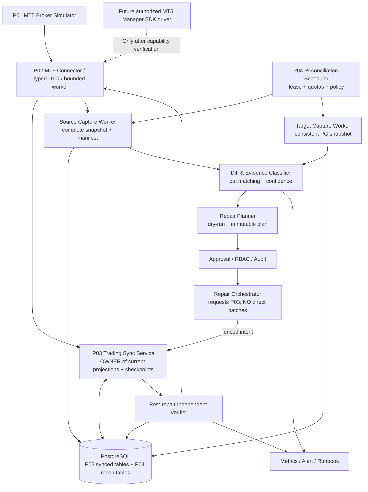
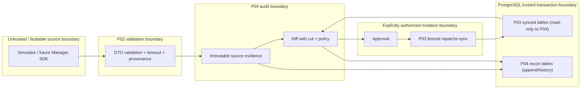
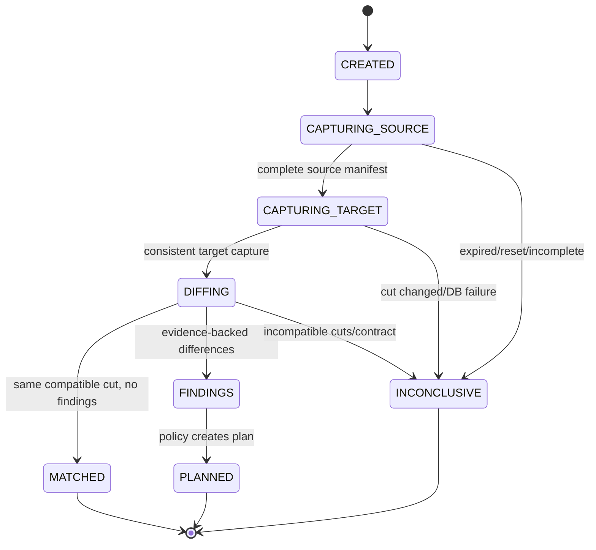
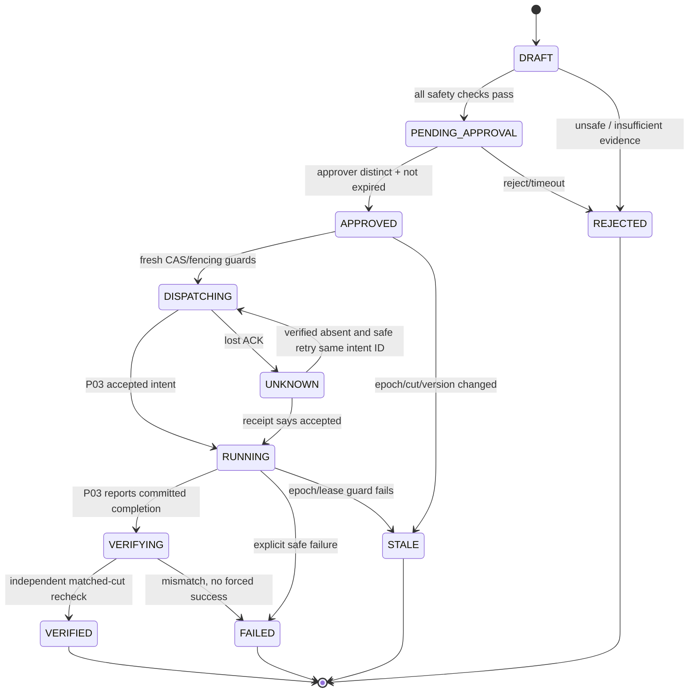
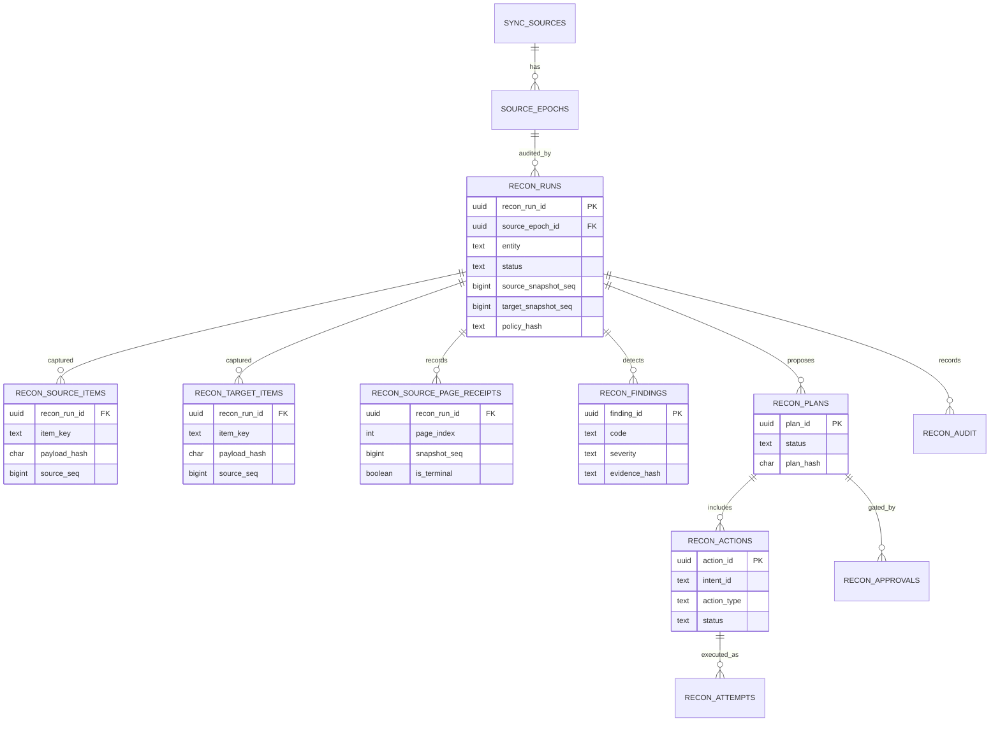
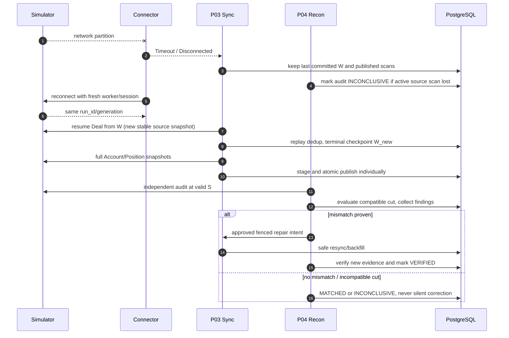

# Project 04 — Snapshot Reconciliation & Recovery

**System Design · Data Correctness · Recovery Protocol · What-if/Chaos Test Matrix**  
**Phiên bản:** 1.0 (bản thiết kế thực hành)  
**Ngày:** 2026-10-30  
**Trạng thái:** **ĐỀ XUẤT / CHƯA TRIỂN KHAI / CHƯA BENCHMARK**  
**Phạm vi:** Mini-project **04/09** thuộc lộ trình *Broker Risk Reporting and MT5 Integration*.

> **Ranh giới dữ liệu gốc:** CV chỉ mô tả việc tích hợp MT5 Manager API để đồng bộ account/position/deal, cách ly lời gọi blocking khỏi asyncio và **“reconciled from snapshots after disconnects”**; CV không cung cấp thuật toán đối soát, schema, thời gian hồi phục hay topology thật của công ty. Tài liệu này là **kiến trúc mới để học, xây và kiểm chứng**, không được tuyên bố là kiến trúc của Larion.
>
> **Phụ thuộc:** `Project_01_MT5_Broker_Simulator_System_Design.md`, `Project_02_MT5_Integration_Connector_System_Design.md`, `Project_03_Trading_Data_Synchronization_System_Design.md`. Những component/API mới được đề xuất ở đây **chưa tồn tại** cho đến khi được triển khai và thêm contract tests.
>
> **Định nghĩa “chịu nổi”:** Hoặc (a) chứng minh dữ liệu đúng trong **phạm vi và snapshot xác định**, hoặc (b) dừng an toàn, không làm dữ liệu xấu thêm, thông báo lý do, bảo tồn dấu vết và có cách khôi phục. Một job báo `SUCCESS` khi snapshot không hoàn chỉnh, hoặc tự ý chỉnh số tiền, là **FAIL dù ứng dụng vẫn sống**.
>
> **Không thể liệt kê tất cả trạng thái thế giới:** 312 tình huống what-if phía dưới là bộ kiểm thử có cấu trúc, **không phải chứng minh bao phủ mọi lỗi có thể có**. Pairwise, stateful fuzz, mutation, chaos nhiều lỗi đồng thời và kiểm thử thực nghiệm là phần bắt buộc để mở rộng vùng bao phủ.

---

## 0. Executive summary

### 0.1 Bài toán cần giải quyết

Project 03 có thể đồng bộ thành công nhiều trang nhưng dữ liệu đích vẫn cần **được kiểm tra độc lập**: Deal thiếu, Deal cùng ID khác số tiền, Account/Position cũ, thiếu liên kết, source reset, checkpoint sai, hoặc nguồn không còn cùng snapshot với DB. Quan trọng hơn, lỗi thường xảy ra đúng tại biên: sau COMMIT nhưng trước khi nhận ACK, giữa lần đối soát dài, lúc worker cũ sống lại sau lease takeover, hoặc khi source đổi generation.

Project 04 không phải một script `SELECT COUNT(*)` rồi `DELETE/INSERT`. Nó gồm **hai mặt tách biệt**:

1. **Reconciliation (read-only):** Thu thập bằng chứng nguồn/đích theo *epoch* và *snapshot cut*, phân loại chênh lệch cùng độ tin cậy, ghi durable findings và lập repair proposal.
2. **Recovery (controlled):** Chỉ phát hành intent được phép cho Project 03, có precondition / fencing / idempotency / audit, đợi đồng bộ hoặc backfill và **kiểm lại độc lập** trước khi đánh dấu `VERIFIED`.

### 0.2 Tám quyết định kiến trúc

1. **Safety before liveness:** Không tự overwrite `balance`, `P&L`, `commission`, `swap`; không hard-delete Deal; không suy Position `CLOSED` chỉ từ việc biến mất khỏi listing.
2. **Evidence before repair:** Mỗi finding có source/target version, `canonical_hash`, completeness proof, classification, confidence, run ID; finding thiếu chứng cứ không được thực thi sửa.
3. **Reconciliation ≠ sync:** Project 03 sở hữu `deals`, `accounts_current`, `positions_current`, checkpoint và publish; Project 04 sở hữu `recon_*` audit/plan, **không là writer thứ hai** cho bảng của Project 03.
4. **Snapshot alignment bắt buộc:** `S_source != S_target` với Account/Position chỉ đủ kết luận **khác thời điểm**, không đủ kết luận corrupt. Không tuyên bố cross-entity atomic cut khi Project 01/02 không cấp capability đó.
5. **Immutable Deal path:** Với Simulator, Deal được coi immutable trong một `source_epoch`; có thể so sánh tập Deal tại `S` với dữ liệu đích `source_seq <= S` **sau** khi checkpoint P03 `W >= S` và không có mutation ngoài protocol.
6. **Repair via fenced P03 orchestration:** Repair plan duyệt xong mới gửi `resync`/`backfill` có preconditions; worker mất lease/đổi source epoch phải bị chặn trước commit.
7. **Ambiguous response là UNKNOWN:** Crash sau DB commit nhưng trước ACK không được chạy lại patch mù; truy vấn intent/receipt bằng `idempotency_key` rồi mới quyết định.
8. **Fail closed under pressure:** Limit page, run duration, scan quota, concurrent jobs, storage, retry; nguồn lỗi/không đủ chứng cứ → `INCONCLUSIVE`/`BLOCKED` thay vì `MATCHED` giả.

### 0.3 Phạm vi triển khai theo ưu tiên

| Mức | Nội dung | Chưa làm |
|---|---|---|
| **P0 MVP** | Đối soát 1 Simulator source; 1 epoch; Deal full audit theo S; Account/Position snapshot compare khi matching cut; persisted findings; manual approval; request P03 re-sync; verified post-check; unit/integration/chaos | Real SDK, HA, automatic destructive repair |
| **P1** | Incremental audit, partitioned manifests, scalable rechecks, controlled Deal backfill qua P03, nhiều nguồn, dashboards, circuit breaker | Sửa historical conflict không qua con người |
| **P2** | Multi-region DR, property/model-based large state-space, live MT5 SDK capability adapter sau xác minh, distributed scaling | Cam kết exactly-once trên MT5 thực |

### 0.4 Những điều hệ thống **không** thể chứng minh

- Không chứng minh *global Account+Position+Deal snapshot* nếu upstream chỉ có 3 snapshot độc lập. Cần hợp đồng global-cut được kiểm thử hoặc giới hạn kết luận ở từng entity.
- Không khẳng định dữ liệu đích thiếu Deal khi source chưa được xác nhận là **đủ và toàn vẹn**; nguồn tự trả thiếu dữ liệu sẽ làm đối soát theo nguồn sai theo.
- Không xác nhận snapshot hiện tại của Source khớp `accounts_current` ở S cũ nếu source đã thay đổi. Đó là **freshness mismatch**, phải re-sync / lấy compatible cut rồi mới phân loại corruption.
- Không đảm bảo `RPO=0` khi cả nguồn và bản sao/trường bằng chứng đều bị mất, hoặc MT5 thực không cấp lịch sử để replay.
- Không tự gán nguồn có `source_seq`/`run_id/generation` cho **real Manager API**; đó là contract riêng của P01 simulator.

---

## 1. Requirements, guarantees, assumptions và non-goals

### 1.1 Functional requirements

| ID | Requirement | Pri | Acceptance evidence |
|---|---|---|---|
| FR04-01 | Đọc provenance/capabilities của P01 qua P02/P03 | P0 | Reject missing/changed epoch; contract tests |
| FR04-02 | Tạo audit run có scope, policy và immutable config hash | P0 | Replay run config deterministic |
| FR04-03 | Thu thập source manifest chỉ khi tất cả trang hợp lệ | P0 | Truncated scan không thể `COMPLETE` |
| FR04-04 | Thu thập target snapshot nhất quán trong PostgreSQL | P0 | Concurrent publisher test, no hybrid rows |
| FR04-05 | So sánh Account/Position tại compatible snapshot | P0 | `DIFFERENT_CUT` không bị gắn `CORRUPT` |
| FR04-06 | So sánh Deal theo ID/hash tại proven cut S | P0 | Source ID/hash oracle, no count-only false pass |
| FR04-07 | Phân loại missing/extra/mismatch/stale/inconclusive và lưu evidence | P0 | Deterministic diff fixtures |
| FR04-08 | Đề xuất recovery plan bất biến, dry-run, reason codes | P0 | Plan preview + immutable hash |
| FR04-09 | Manual approval / separation of duties for risky fixes | P0 | Unauthorized execution always blocked |
| FR04-10 | Gửi repair intents qua P03 với version/epoch/lease precondition | P0 | Stale intent rejected at commit |
| FR04-11 | Retry idempotent và reconcile lại sau apply | P0 | Lost ACK injection, no duplicate effects |
| FR04-12 | Bounded memory, DB work, queue, retries, deadlines | P0 | Peak RSS/quota/lock-time recorded |
| FR04-13 | Evidence/audit/metrics/alert/runbook | P0 | Case-to-run-to-DB artifact traceability |
| FR04-14 | Segment manifests / bounded backfill | P1 | 1M Deal segment audit |
| FR04-15 | Multi-source/tenant isolation & quotas | P1 | Same IDs across sources isolated |
| FR04-16 | Optional live SDK capability profile | P2 | Fail closed when incomplete SDK semantics |

### 1.2 Non-functional targets — **đề xuất, chưa đo**

- **Correctness:** P0 false `VERIFIED` = **0** trong toàn bộ controlled-test fixture set; không mất/mutate Deal đúng; không sửa source-of-truth financial fields bằng heuristic.
- **Observability:** mọi `BLOCKED/INCONCLUSIVE/FAILED` có `reason_code`, source/epoch/snapshot, run ID, retry advice, safe redacted evidence.
- **Safety:** tất cả destructive hoặc money-affecting actions mặc định **forbidden**; plan chỉ orchestrate P03 sync/backfill.
- **Availability under faults:** bounded fail/error; background audit không cướp tài nguyên khiến P03 sync mất khả năng phục vụ.
- **Consistency:** atomic states của run/plan; audit `READ COMMITTED` hợp lệ chỉ nếu target capture qua **một statement snapshot hoặc transaction snapshot có bound**.
- **Performance:** ngưỡng throughput phải định nghĩa cho cùng workload, schema, phần cứng, cursor TTL và concurrency; không sử dụng KPI CV làm bằng chứng đã đạt.
- **Security:** synthetic data local MVP; production phải có RBAC, network isolation, tamper-evident audit policy, secret handling và retention.

### 1.3 Non-goals

- Không gửi lệnh trading, không tính P&L từ đầu (Project 05), không làm Risk Reporting API (Project 06).
- Không xây CDC source giả nếu upstream không hỗ trợ.
- Không có last-write-wins cho Deal/Account financial fields khi thiếu source authority.
- Không delete current position để “sửa” khi chưa có full, unfiltered, complete snapshot.
- Không làm cross-DB distributed transaction giữa Simulator/MT5 và PostgreSQL.
- Không hứa arbitrary crash, corrupted disk, Byzantine source đều có thể tự động phục hồi.

### 1.4 Glossary / source of truth

| Tên | Ý nghĩa trong bài tập |
|---|---|
| `source_id` | Broker/simulator logical identity do config gán, không lấy từ arbitrary request |
| `source_epoch_id` | P03 UUID cho `(source_id, run_id, generation)` của P01 |
| `source_seq` | P01 event-log sequence; **không cần liên tục** giữa các Deal |
| `S_source` | P01 `snapshot_seq` cho một entity scan hoàn chỉnh |
| `S_target` | `snapshot_seq` của P03 published Account/Position scan hoặc Deal bound W |
| `W` | P03 durable Deal checkpoint (complete unfiltered Deal scan) |
| `target_revision` | Con trỏ/version target đã được P03 chứng minh, **nếu có**; không được tự bịa |
| `scan_id` | P03 sync attempt; `recon_run_id` là Project 04 audit ID riêng |
| `source_manifest` | Các `entity_key, canonical_hash, source_seq` từ **completed** P04 scan |
| `target_manifest` | Cùng kiểu từ DB ở một target read snapshot xác định |
| `repair_intent` | Yêu cầu P03 chạy re-sync/replay; **không phải** SQL sửa trực tiếp P03 tables |
| `evidence_hash` | Digest trên canonical evidence + policy/version, hỗ trợ phát hiện sửa đổi |

---

## 2. Khả năng tích hợp Project 01/02/03 (contract-first)

### 2.1 Hợp đồng hiện có từ ba thiết kế trước

| Layer | Contract đã thiết kế | Project 04 dùng như thế nào | Giới hạn |
|---|---|---|---|
| **P01** | `/v1/meta`; `/v1/accounts`; `/v1/positions`; `/v1/deals`; `run_id`, `generation`, `snapshot_seq`, `next_cursor` | Lấy independent source evidence | Snapshot TTL mặc định **15 phút**, page max **500** |
| **P01** | Deal `after_seq` **exclusive**, `source_seq` theo event log | Deal comparison tới S | Gap seq hợp lệ; không suy missing từ seq gap |
| **P01** | `410 SNAPSHOT_EXPIRED`, source reset đổi generation | Abort/restart scan; không trust partial manifest | Không tự resume cursor hết hạn |
| **P02** | `MT5Client` typed DTO + worker isolation + bounded retries/errors | Đọc source qua validated adapter | `asyncio` timeout không kill native SDK call |
| **P03** | `source_epochs`, `sync_runs`, `sync_checkpoints`, `sync_page_receipts`, current projections, `deals`, staging | Read published state, manifests và progress | P03 là **writer duy nhất** của sync data |
| **P03** | Account/Position full snapshot → staged → atomic publication | Chỉ so sánh full, verified `published_scan_id` | Không có global-cut 3 entity |
| **P03** | Deal immutable + checkpoint W only after terminal page | So source <=S với target <=S khi W>=S | Historical conflict phải quarantine |
| **P03** | `lease_token`, `lease_version`, `lease_until` | Fencing repair execution | Lease chỉ có ý nghĩa cùng authoritative DB |

> **Bất biến P01:** `next_cursor=null` là kết thúc một snapshot, không phải kết thúc mọi event trong tương lai. **Không** ghép `cursor` với `after_seq`/filter mới. `run_id/generation` của P01 **không** tương đương connector `worker_epoch`.

### 2.2 Contract mới cần bổ sung vào P03 (không giả định đã tồn tại)

| Proposed interface | Semantics | State-changing? |
|---|---|---|
| `GET sync_status(source_id, epoch_id, entity)` | current published `scan_id`, `snapshot_seq`, Deal W, lease, epoch status | No |
| `GET published_snapshot_manifest(scan_id, entity)` | metadata + immutable digest/record count of complete P03 staged scan; optional optimization | No |
| `request_full_resync(intent_id, entity, expected_epoch, expected_revision)` | P03 nhận yêu cầu full Account/Position scan; dedup `intent_id` | Orchestrated by P03 |
| `request_deal_backfill(intent_id, range/snapshot, expected_epoch, expected_W)` | Replay bounded Deal segment với full validation; P1, sau review protocol | Orchestrated by P03 |
| `GET repair_intent_status(intent_id)` | authoritative acceptance/running/commit/failure receipt | No |
| `GET source_capability_profile()` | simulator vs real-SDK capabilities, snapshot quality, complete listing support | No |

**Migration policy:** interface và DB read view là **additive**, có version, tests P01–P03; P04 không gọi private internals không có contract, không cập nhật `sync_checkpoints` trực tiếp.

### 2.3 Allowed classifications by capability

| Capability | Có | Không có |
|---|---|---|
| Stable source snapshot/cursor | Được thực hiện full source set compare tại S | Chỉ sampled/observational; không auto repair |
| Durable epoch identity | Isolate reset/ID reuse | Phải quarantine/scope bằng confirmed source metadata; không trộn |
| Complete Deal history + replay | Missing historical Deal có thể đề xuất backfill | Không thể chứng minh/khôi phục hoàn chỉnh |
| Full unfiltered mutable listing | `ABSENT` là một **observation** có bằng chứng | Không suy delete/close từ sự vắng mặt |
| Global-cut across entity types | Có thể áp cross-entity strict invariant theo cut | Chỉ warning/deferred cross-entity |
| Identical financial semantics/canonicalization | Compare canonical digest | `INCOMPARABLE_SCHEMA` cho đến khi version mapping chốt |

---

## 3. System architecture

### 3.1 Container / component architecture



**Ownership rule:** Hai worker P04 được phép **ghi vào `recon_*` tables**; tuyệt đối không `UPDATE/DELETE` `deals`, `accounts_current`, `positions_current`, `sync_checkpoints`. DB role P04 không được cấp quyền ghi các bảng này. Runtime `repair_executor` chỉ có quyền gọi service port P03 đã xác thực.

### 3.2 Trust boundary



### 3.3 Modules and ownership

| Module | Responsibility | Must never do |
|---|---|---|
| `recon.scheduler` | trigger, leases, quota, resume classification | start unlimited scans |
| `recon.source_capture` | page stream → validated manifest | mark terminal without last page |
| `recon.target_capture` | consistent snapshot → target manifest | read mutable rows across unpinned changing cuts |
| `recon.canonical` | stable field mapping/Decimal/time hashing | float financial rounding |
| `recon.diff` | set comparison + reason/confidence | decide mutation based only on count |
| `recon.policy` | cut checks, safety thresholds, eligibility | treat stale source as authoritative latest |
| `recon.planner` | immutable planned operations/preconditions | execute directly |
| `recon.approvals` | role separation, expiry, audit | reuse expired approvals |
| `recon.executor` | idempotent P03 intent + receipt read | open DB write tx on P03 tables |
| `recon.verifier` | independently recheck resulting state | infer success from HTTP 202/200 alone |
| `recon.cleanup` | refcounted retention and safe GC | delete evidence of active repair |

---

## 4. State machine và lifecycle

### 4.1 Reconciliation run



**State semantics:** `INCONCLUSIVE` là một kết quả hợp lệ nếu không đủ chứng cứ; không được tự chuyển thành `MATCHED`. `MATCHED` không có nghĩa upstream thật luôn đúng, chỉ khớp **source oracle mà test đã xác định** ở compatible cut.

### 4.2 Repair plan and actions



**Invariant:** `APPROVED` chưa phải `APPLIED`; `P03 ACCEPTED` chưa phải `COMMITTED`; `COMMITTED` chưa phải `VERIFIED`.

### 4.3 Repair action matrix

| Finding | Read-only classification | Auto action P0 | Possible safe recovery | Forbidden shortcut |
|---|---|---|---|---|
| Missing Deal at S with W>=S | `MISSING_TARGET_DEAL` | Alert/plan only | Approved P03 replay/backfill of source slice, then verify | Hand `INSERT` không provenance |
| Same Deal ID, different money | `IMMUTABLE_DEAL_CONFLICT` | **Quarantine / block** | Manual source authority investigation, new correction protocol/epoch | `ON CONFLICT DO UPDATE` money |
| Extra Deal target | `EXTRA_TARGET_DEAL` | Block / audit | Investigate epoch/scope; manual isolation decision | `DELETE deals` |
| Account values differ, cuts equal | `ACCOUNT_FIELD_MISMATCH` | Plan full re-sync | P03 atomic publish fresh complete Account snapshot | Overwrite balance |
| Position values differ, cuts equal | `POSITION_FIELD_MISMATCH` | Plan full re-sync | P03 full Position snapshot + publish | Set `CLOSED` from omission |
| Account/Position cuts differ | `DIFFERENT_CUT` | Retry/re-align | Get compatible snapshot or P03 refresh | Classify as corruption |
| Cross-entity mismatch, no global cut | `PROVISIONAL_CROSS_ENTITY` | Alert/defer | Correlated snapshots / grace window / stronger API | Make monetary correction |
| Source reset or mixed epoch | `EPOCH_MISMATCH` | Block | Operator-mediated P03 re-bootstrap new epoch | Merge old IDs |
| Source pages incomplete/invalid | `INCONCLUSIVE_SOURCE` | Block/retry bounded | New complete snapshot | Mark no differences |

---

## 5. Correctness model: snapshots, cuts, trust và formal invariants

### 5.1 Definitions

Let `E` be one source epoch, `e` one entity type, `S` a source snapshot sequence.

- `Src(E,e,S)` = complete authoritative **manifest** of source entity `e` at `S`, only if stable pagination + same `(run_id,generation,snapshot_seq)` + terminal page evidence.
- `Dst(E,e,S)` = durable P03 published view at **matching** `S`, or for Deal immutable history, all target Deals with `source_seq <= S` when `W >= S`.
- `H_v(row)` = canonical content hash under schema+hash version `v`; hash equality is evidence of equal canonical representation, not cryptographic proof of origin.
- `Diff = Src \ Dst` (missing), `Dst \ Src` (extra), or equal key with `H_src != H_dst` (mismatch).

**Comparison preconditions:**

```text
same source_id && same source_epoch_id
&& complete_unfiltered_source_scan
&& source_run_generation_consistent
&& supported_schema_and_hash_version
&& consistent_target_capture
&& compatible_snapshot_cut
&& compare_scope_is_identical
&& no revoked provenance / tampered evidence
```

**Fail-closed:** Nếu bất kỳ tiền điều kiện bắt buộc nào false thì `INCONCLUSIVE` hoặc `BLOCKED`, **không** `MATCHED`, **không** dispatch repair.

### 5.2 Deal alignment (Simulator-specific)

1. Nguồn trả full `GET /v1/deals?after_seq=0`, giữ một `S` cố định qua tất cả pages; filter **UNFILTERED**.
2. P04 ghi `source_manifest` từng page (commit trước khi fetch trang kế), cùng `run_id/generation/S`.
3. Chỉ khi terminal complete và source epoch còn hợp lệ mới xét dữ liệu đích.
4. P03 phải có durable `W >= S`, với `source_epoch=E`, `filter_hash=UNFILTERED` và watermark **đã publish**. `W<S` là `TARGET_NOT_CAUGHT_UP`, không phải missing.
5. Chụp target `deals WHERE epoch_id=E AND source_seq<=S` trong PostgreSQL consistent statement/transaction. Nếu có repair/backfill concurrent, ghi `dataset_revision` hoặc snapshot target rồi re-check guards trước khi kết luận.
6. Merge-join bằng `(deal_id, payload_hash)` / indexed staging; không tải 1M rows vào RAM.
7. Khác `source_seq`/ID/hash → finding. `source_seq` **không liên tục** là bình thường, vì có các event không phải Deal.
8. `W >= S` chỉ chứng tỏ checkpoint đã công bố full scan theo contract P03, **không độc lập chứng minh upstream không gian lận/không lỗi**. Golden seed/hash của P01 là test oracle thứ hai.

**Độ đúng của Deal:** Under the declared simulator completeness + P03 immutable/durable semantics, no diff at aligned S implies equality of the two *captured sets* for the included canonical fields. It does **not** imply correctness of future deals (`seq>S`) or of a real SDK lacking these guarantees.

### 5.3 Account/Position alignment — tránh FALSE POSITIVE

- P03 `accounts_current`/`positions_current` chỉ là **published latest per entity**, có `published_scan_id` và `snapshot_seq`. P04 lấy một target capture ở cùng database transaction snapshot để không đọc lẫn hai lần publish.
- Nguồn được capture ở `S_source`; target có `S_target` từ `sync_runs` của `published_scan_id`. Nếu khác nhau, một row khác hash **có thể hoàn toàn hợp lệ** do thay đổi trong khoảng giữa.
- **Strict compare** chỉ khi hai bên có **same `S` / global stable cut** theo capability đã kiểm thử. Với default P01 không có API list-as-of-S cũ được cam kết cho P04, có thể dùng **virtual-clock freeze trong test** hoặc điều phối P03 và P04 capture cùng S theo hợp đồng mới. Nếu không có, báo `DIFFERENT_CUT` rồi yêu cầu sync/retry; không tự gán bug.
- P03 có staging đã publish (`account_staging`/`position_staging`) với `scan_id`; muốn so sánh snapshot cũ theo provenance thì chỉ làm khi **nguồn cũng đọc lại được đúng S**. Nếu không, chỉ có thể audit **nội bộ P03** (consistency of published staging vs current), không gọi đó là so nguồn độc lập.
- `ABSENT` được suy ra duy nhất từ **full, verified, unfiltered listing** cùng epoch. Với Position, `ABSENT != CLOSED`; chỉ source `source_status=CLOSED` mới được coi đã đóng.
- Không xóa các row cũ theo sự biến mất từ *filtered* listing (`status=OPEN`, account subset, symbol subset).

### 5.4 Cross-entity checks: evidence tiers

| Tier | Data available | Allowed claim |
|---|---|---|
| T0 | Different S for Account, Position, Deal | Freshness/weak referential warning only |
| T1 | Same source epoch, bounded freshness window but different S | Provisional discrepancy; wait grace/re-sync |
| T2 | Tested coordinated global-cut for all three, stable schema | Strong cross-entity snapshot checks within declared contract |
| T3 | Full authoritative trade ledger, pricing/FX/rules and effective-time semantics | Financial conservation tests **only if** business policies are explicitly modeled |

Không lấy tổng `Deal.realized_pnl` đối chiếu trực tiếp Account `balance` như invariant phổ quát: deposits, withdrawals, credits, booking policies, swaps/commission timing và conversions có thể tạo chênh lệch hợp lệ. Project 05 sẽ xây những công thức đã xác minh policy.

### 5.5 P0 invariants (must be executable)

| ID | Invariant | Automated oracle |
|---|---|---|
| INV04-01 | No `MATCHED` if source incomplete/expired/cycled cursor | State + terminal receipt |
| INV04-02 | No strict diff if source/target epochs disagree | Decision log + blocked plan |
| INV04-03 | No `CORRUPT` from Account/Position mismatched S | Forced S difference fixture |
| INV04-04 | No `MISSING_DEAL` while W<S | Checkpoint fixture |
| INV04-05 | Deal payload immutable per `(epoch_id,deal_id)` | Pre/post DB hash equality |
| INV04-06 | No repair on non-approved/expired/modified plan | Approval + plan digest CAS |
| INV04-07 | P04 DB role cannot modify P03 synced tables | `permission denied` test |
| INV04-08 | All replays with same intent ID are idempotent | Receipt/event count invariant |
| INV04-09 | Lost ACK never causes unbounded double execution | Fault injection + DB receipt |
| INV04-10 | Worker with stale lease cannot dispatch/complete | 2-worker lease takeover test |
| INV04-11 | Reset/new generation cancels old-epoch plan | Source epoch changed test |
| INV04-12 | `VERIFIED` requires new independent matching-cut audit | Receipt alone insufficient test |
| INV04-13 | Rejected/unknown source financial value cannot be auto corrected | Bad Decimal fixtures |
| INV04-14 | Partial target capture never accepted as full | DB statement abort/lock test |
| INV04-15 | Source and target manifests bounded/retained until evidence release | quota + GC test |
| INV04-16 | Findings trace to scan, page receipt, policy, evidence hash | Evidence query check |
| INV04-17 | No cross-source ID collision | Same Deal ID on 2 epochs/sources |
| INV04-18 | Audit never advances P03 checkpoint | DB triggers/role test |
| INV04-19 | P03 repair only commits under valid epoch/version lease | Race at COMMIT boundary |
| INV04-20 | Test false-positive and false-negative fixtures are detected | Mutation suite + oracle count |

### 5.6 Failure taxonomy

| Class | Examples | Correct action |
|---|---|---|
| `INCONCLUSIVE_SOURCE` | 410, broken cursor, missing page, malformed DTO | Abort manifest; retry new S within budget |
| `INCONCLUSIVE_TARGET` | DB timeout/deadlock/stale view | Rollback target capture; retry bounded |
| `DIFFERENT_CUT` | Mutable `S_source != S_target` | Wait/resync/reacquire compatible cut |
| `TARGET_NOT_CAUGHT_UP` | Deal W<S | Wait for P03 or trigger controlled sync |
| `EPOCH_MISMATCH` | source reset / run changed | Block and re-bootstrap under operator approval |
| `MISSING_TARGET` | source key exists, target key absent at proven cut | Propose replay/refresh |
| `EXTRA_TARGET` | target key absent source at proven cut | Quarantine; never blind delete |
| `FIELD_MISMATCH` | same key, different canonical digest | Investigate/refresh; money conflicts block |
| `P03_INVARIANT_BROKEN` | published scan incomplete or W ahead without terminal receipts | Block P03 sync; incident |
| `UNSUPPORTED_CAPABILITY` | no stable snapshot/identity | Read-only weak diagnostics; no repair |
| `POLICY_BLOCK` | too many changes, no approval, expired evidence | Manual review; no dispatch |
| `REPAIR_UNKNOWN` | lost ACK/ambiguous commit | Query P03 intent receipt; retry same ID safely |

---

## 6. Persistence design — additive schema to Project 03

### 6.1 Logical ERD



### 6.2 DDL reference (blueprint, **chưa chạy migration**)

```sql
-- UUID được tạo ở application/harness, không giả định pgcrypto extension.
-- Kế thừa source_epochs(epoch_id) và sync_sources(source_id) từ Project 03.
CREATE TABLE recon_runs (
  recon_run_id UUID PRIMARY KEY,
  source_id TEXT NOT NULL REFERENCES sync_sources(source_id),
  source_epoch_id UUID NOT NULL REFERENCES source_epochs(epoch_id),
  entity TEXT NOT NULL CHECK (entity IN ('accounts','positions','deals')),
  scope_hash CHAR(64) NOT NULL,
  policy_hash CHAR(64) NOT NULL,
  schema_version TEXT NOT NULL,
  hash_version TEXT NOT NULL,
  status TEXT NOT NULL CHECK (status IN (
    'CREATED','CAPTURING_SOURCE','CAPTURING_TARGET','DIFFING',
    'MATCHED','FINDINGS','PLANNED','INCONCLUSIVE','FAILED','CANCELLED')),
  source_run_id TEXT,
  source_generation BIGINT,
  source_snapshot_seq BIGINT,
  target_snapshot_seq BIGINT,
  target_published_scan_id UUID REFERENCES sync_runs(scan_id),
  target_deal_watermark BIGINT,
  source_complete BOOLEAN NOT NULL DEFAULT FALSE,
  target_complete BOOLEAN NOT NULL DEFAULT FALSE,
  source_count BIGINT,
  target_count BIGINT,
  source_root_hash CHAR(64),
  target_root_hash CHAR(64),
  reason_code TEXT,
  started_at TIMESTAMPTZ NOT NULL DEFAULT clock_timestamp(),
  ended_at TIMESTAMPTZ,
  CHECK (source_snapshot_seq IS NULL OR source_snapshot_seq >= 0),
  CHECK (target_snapshot_seq IS NULL OR target_snapshot_seq >= 0)
);

CREATE TABLE recon_source_items (
  recon_run_id UUID NOT NULL REFERENCES recon_runs(recon_run_id),
  page_index INTEGER NOT NULL CHECK (page_index >= 0),
  item_key TEXT NOT NULL,
  source_seq BIGINT,
  payload_hash CHAR(64) NOT NULL,
  PRIMARY KEY (recon_run_id, item_key)
);
CREATE TABLE recon_target_items (
  recon_run_id UUID NOT NULL REFERENCES recon_runs(recon_run_id),
  item_key TEXT NOT NULL,
  source_seq BIGINT,
  payload_hash CHAR(64) NOT NULL,
  PRIMARY KEY (recon_run_id, item_key)
);
CREATE INDEX idx_recon_source_seq ON recon_source_items(recon_run_id, source_seq)
  WHERE source_seq IS NOT NULL;
CREATE INDEX idx_recon_target_seq ON recon_target_items(recon_run_id, source_seq)
  WHERE source_seq IS NOT NULL;

-- Durable page evidence: cannot assert source_complete without a validated
-- terminal receipt and contiguous receipt indices starting at 0.
CREATE TABLE recon_source_page_receipts (
  recon_run_id UUID NOT NULL REFERENCES recon_runs(recon_run_id),
  page_index INTEGER NOT NULL CHECK (page_index >= 0),
  snapshot_seq BIGINT NOT NULL CHECK (snapshot_seq >= 0),
  run_id TEXT NOT NULL,
  generation BIGINT NOT NULL,
  item_count INTEGER NOT NULL CHECK (item_count BETWEEN 0 AND 500),
  page_hash CHAR(64) NOT NULL,
  is_terminal BOOLEAN NOT NULL,
  committed_at TIMESTAMPTZ NOT NULL DEFAULT clock_timestamp(),
  PRIMARY KEY (recon_run_id, page_index)
);
CREATE UNIQUE INDEX ux_recon_one_terminal_page
  ON recon_source_page_receipts(recon_run_id) WHERE is_terminal;
ALTER TABLE recon_source_items
  ADD CONSTRAINT fk_recon_source_item_page
  FOREIGN KEY (recon_run_id, page_index)
  REFERENCES recon_source_page_receipts(recon_run_id, page_index);
CREATE INDEX idx_recon_source_page_items
  ON recon_source_items(recon_run_id, page_index);

-- Deduplicate audit triggers before creating work; request_id is client-supplied
-- opaque idempotency key bound to a config/scope fingerprint.
CREATE TABLE recon_triggers (
  request_id TEXT PRIMARY KEY,
  request_fingerprint CHAR(64) NOT NULL,
  recon_run_id UUID NOT NULL UNIQUE REFERENCES recon_runs(recon_run_id)
);

-- Scheduler fencing is independent from P03 sync_checkpoints lease ownership.
CREATE TABLE recon_scheduler_leases (
  source_epoch_id UUID NOT NULL REFERENCES source_epochs(epoch_id),
  entity TEXT NOT NULL CHECK (entity IN ('accounts','positions','deals')),
  scope_hash CHAR(64) NOT NULL,
  lease_token UUID,
  lease_version BIGINT NOT NULL DEFAULT 0 CHECK (lease_version >= 0),
  lease_until TIMESTAMPTZ,
  PRIMARY KEY (source_epoch_id,entity,scope_hash)
);

CREATE TABLE recon_findings (
  finding_id UUID PRIMARY KEY,
  recon_run_id UUID NOT NULL REFERENCES recon_runs(recon_run_id),
  item_key TEXT,
  finding_code TEXT NOT NULL,
  severity TEXT NOT NULL CHECK (severity IN ('INFO','WARN','ERROR','CRITICAL')),
  confidence TEXT NOT NULL CHECK (confidence IN ('PROVEN','PROVISIONAL','INCONCLUSIVE')),
  source_hash CHAR(64),
  target_hash CHAR(64),
  evidence_hash CHAR(64) NOT NULL,
  explanation_code TEXT NOT NULL,
  created_at TIMESTAMPTZ NOT NULL DEFAULT clock_timestamp(),
  UNIQUE (recon_run_id, finding_code, item_key)
);

CREATE TABLE recon_plans (
  plan_id UUID PRIMARY KEY,
  recon_run_id UUID NOT NULL REFERENCES recon_runs(recon_run_id),
  plan_hash CHAR(64) NOT NULL,
  expected_epoch_id UUID NOT NULL REFERENCES source_epochs(epoch_id),
  expected_target_scan_id UUID,
  expected_deal_W BIGINT,
  policy_hash CHAR(64) NOT NULL,
  status TEXT NOT NULL CHECK (status IN (
    'DRAFT','PENDING_APPROVAL','APPROVED','REJECTED',
    'DISPATCHING','RUNNING','UNKNOWN','VERIFYING',
    'VERIFIED','FAILED','STALE')),
  expires_at TIMESTAMPTZ NOT NULL,
  created_by TEXT NOT NULL,
  created_at TIMESTAMPTZ NOT NULL DEFAULT clock_timestamp(),
  UNIQUE (recon_run_id, plan_hash)
);
CREATE TABLE recon_actions (
  action_id UUID PRIMARY KEY,
  plan_id UUID NOT NULL REFERENCES recon_plans(plan_id),
  action_order INTEGER NOT NULL CHECK (action_order >= 0),
  action_type TEXT NOT NULL CHECK (action_type IN (
    'REQUEST_FULL_ACCOUNT_RESYNC','REQUEST_FULL_POSITION_RESYNC',
    'REQUEST_DEAL_BACKFILL','MANUAL_INVESTIGATION')),
  intent_id TEXT NOT NULL UNIQUE,
  status TEXT NOT NULL,
  parameters_hash CHAR(64) NOT NULL,
  UNIQUE (plan_id, action_order)
);
CREATE TABLE recon_approvals (
  approval_id UUID PRIMARY KEY,
  plan_id UUID NOT NULL REFERENCES recon_plans(plan_id),
  actor_id TEXT NOT NULL,
  role TEXT NOT NULL,
  decision TEXT NOT NULL CHECK (decision IN ('APPROVE','REJECT')),
  plan_hash CHAR(64) NOT NULL,
  decided_at TIMESTAMPTZ NOT NULL DEFAULT clock_timestamp()
);
CREATE TABLE recon_attempts (
  attempt_id UUID PRIMARY KEY,
  action_id UUID NOT NULL REFERENCES recon_actions(action_id),
  request_id TEXT NOT NULL UNIQUE,
  status TEXT NOT NULL,
  receipt_hash CHAR(64),
  error_code TEXT,
  created_at TIMESTAMPTZ NOT NULL DEFAULT clock_timestamp()
);
CREATE TABLE recon_audit (
  audit_id UUID PRIMARY KEY,
  recon_run_id UUID REFERENCES recon_runs(recon_run_id),
  plan_id UUID REFERENCES recon_plans(plan_id),
  event_type TEXT NOT NULL,
  actor_id TEXT,
  safe_details JSONB NOT NULL DEFAULT '{}'::jsonb,
  prev_event_hash CHAR(64),
  event_hash CHAR(64) NOT NULL,
  created_at TIMESTAMPTZ NOT NULL DEFAULT clock_timestamp()
);
```

**Schema caveats:** (1) Chỉ là DDL minh họa; migration thật phải có constraints bất biến về complete state và role grants. `source_complete` chỉ được chuyển true qua transactional transition đã kiểm tra `MAX(page_index)+1 = COUNT(receipts)`, `SUM(item_count) = COUNT(source_items)`, đúng một terminal receipt ở vị trí cuối, cùng S/run/generation, và scan source không lọc; DB `CHECK` đơn giản không thể tự chứng minh toàn bộ các điều kiện liên bảng này. (2) `recon_source_items`/`recon_target_items` là **snapshot manifests**, không giữ secrets/PII; data row gốc lấy qua P03 quyền đọc khi cần. (3) Audit hash-chain giúp phát hiện sửa đổi trong phạm vi hệ thống nhưng không thay thế external append-only storage/signature; DBA có đặc quyền cao vẫn có thể sửa nếu không có external anchor. (4) Không dùng `COUNT(*)` hoặc root hash một mình để xác nhận full coverage. (5) Với hàng triệu key, storage/index có thể lớn; bắt buộc quota + retention + partitioning khi đo thấy cần.

### 6.3 SQL compare example — source/target manifests

```sql
-- Chỉ chạy SAU khi recon_runs.source_complete && target_complete
-- và cut/capability preconditions đã xác thực ngoài SQL.
SELECT COALESCE(s.item_key, t.item_key) AS item_key,
       CASE
         WHEN s.item_key IS NULL THEN 'EXTRA_TARGET'
         WHEN t.item_key IS NULL THEN 'MISSING_TARGET'
         WHEN s.payload_hash <> t.payload_hash THEN 'FIELD_MISMATCH'
         ELSE 'MATCHED'
       END AS diff_type,
       s.payload_hash AS source_hash,
       t.payload_hash AS target_hash
FROM recon_source_items AS s
FULL OUTER JOIN recon_target_items AS t
  ON s.recon_run_id = t.recon_run_id AND s.item_key = t.item_key
WHERE COALESCE(s.recon_run_id, t.recon_run_id) = :recon_run_id
  AND (s.item_key IS NULL OR t.item_key IS NULL
       OR s.payload_hash <> t.payload_hash);
```

**Lưu ý:** SQL thể hiện *set diff*, **không tự** chứng minh source complete, target snapshot aligned hay hashes dùng cùng canonical version. Chúng là preconditions phải kiểm trước và ghi audit.

### 6.4 Canonical hash contract

```text
hash_version = "sha256:canonical-json-v1"
canonical_fields = entity-specific explicitly versioned list
- strict Decimal parse from strings; reject float, NaN, +/-Infinity
- normalize USD money representation e.g. Decimal("1.00") = Decimal("1.0")
  ONLY under declared scale/currency policy; preserve source raw separately when needed
- UTC timestamp normalized precisely; reject naive/ambiguous timezone
- IDs are STRINGS ("000123" != "123"); preserve Unicode policy
- JSON keys sorted, fixed UTF-8, stable null/missing distinction
- exclude transport IDs, request_id, scan timestamps, volatile metadata
- include entity type + schema version + canonical field names as hash domain
```

Source P02 DTO và P03 DB projection phải map sang **cùng schema version**. `payload_hash` đã có trong P03 **không được mặc nhiên so sánh trực tiếp** nếu encoder/field set/version chưa được xác nhận; trong trường hợp đó tái tạo hash có phiên bản từ các business fields rồi mới so sánh.

---

## 7. Algorithms and transaction boundaries

### 7.1 Full reconciliation sequence

```mermaid
sequenceDiagram
  autonumber
  participant R as P04 Scheduler
  participant C as P02 Connector
  participant S as P01 Simulator
  participant DB as PostgreSQL
  participant P as P03 Sync Service
  participant A as Approver

  R->>DB: create recon_run + acquire audit lease
  R->>C: get source identity/capabilities
  C->>S: GET /v1/meta
  S-->>C: run_id, generation, committed_seq
  loop all pages, stable S
    R->>C: read next page
    C->>S: GET list + cursor
    S-->>C: items, S, next_cursor
    C-->>R: validated typed batch
    R->>DB: tx: source manifest + page receipt
  end
  R->>DB: mark source_complete only after verified terminal
  R->>DB: capture target under consistent PG read snapshot
  R->>DB: verify cut/epoch/capability, persist diff findings
  alt match
    R->>DB: run MATCHED + evidence
  else incomplete/incompatible
    R->>DB: run INCONCLUSIVE; no repair
  else proven findings
    R->>DB: immutable plan + preview
    A->>DB: approve plan hash under RBAC
    R->>P: request resync/backfill with intent_id + fencing
    P->>DB: P03-owned sync/commit/receipt
    P-->>R: authoritative receipt
    R->>C: independent post-repair recheck at compatible cut
    R->>DB: only mark VERIFIED if equal and complete
  end
```

### 7.2 Pseudocode: audit a Deal snapshot

```python
async def reconcile_deals(source_id: str, epoch_id: UUID, scope="UNFILTERED") -> ReconResult:
    assert scope == "UNFILTERED"  # for full authoritative comparison MVP
    run = await repo.create_recon_run(source_id, epoch_id, entity="deals")
    identity = await connector.read_meta(source_id)
    assert_epoch_matches_or_block(identity, epoch_id)

    # The iterator binds a single source S to every page.
    # Persist page receipts and hashes before requesting next page.
    try:
        await capture_complete_source_manifest(run, connector.iter_deals(source_id, after_seq=0))
    except (SnapshotExpiredError, SourceEpochChangedError, DataIntegrityError) as exc:
        return await repo.finish_inconclusive(run, reason_code=classify(exc))

    assert await repo.source_complete_with_terminal_receipt(run.id)
    S = run.source_snapshot_seq
    status = await p03_read_port.sync_status(source_id, epoch_id, "deals")
    if status.epoch_id != epoch_id:
        return await repo.finish_inconclusive(run, reason_code="EPOCH_MISMATCH")
    if status.watermark < S:
        return await repo.finish_inconclusive(run, reason_code="TARGET_NOT_CAUGHT_UP")

    await repo.capture_target_deals_consistently(run.id, epoch_id, max_seq=S)
    assert await repo.target_complete(run.id)
    await repo.verify_guards_and_compare_manifests(run.id)
    return await repo.classify_and_persist_results(run.id)
```

**Dấu hiệu nguy hiểm:** `S` không được chốt chỉ vì trang đầu trả về 200; `W` không được đọc từ in-memory worker P03; không so mismatch ở source generation mới với target epoch cũ; không tạo finding destructive từ partial manifest.

### 7.3 Target DB snapshot read đúng cách

Hai lựa chọn được phép, không dùng tùy tiện:

**Option A — single PostgreSQL statement capture (ưu tiên MVP):** `INSERT INTO recon_target_items (...) SELECT ... FROM accounts_current ...` là một statement với MVCC snapshot. Chụp metadata P03 trong **cùng transaction snapshot** (ví dụ `REPEATABLE READ READ ONLY` nếu chỉ select; hoặc transaction `REPEATABLE READ` khi ghi recon manifest; giới hạn thời gian và footprint). Nếu có writer concurrent, kết quả là một consistent database cut.

**Option B — immutable P03 published staging:** Chụp bằng `published_scan_id`, pin retention reference, đọc immutable rows của P03 staging theo scan_id. **Chỉ** có tác dụng khi `stage` được P03 cam kết không sửa sau publish và GC tôn trọng pin; cần bổ sung P03 contract trước khi dùng.

**Không được:** scan `accounts_current` bằng `LIMIT/OFFSET` nhiều statement `READ COMMITTED` khi P03 đang promote, rồi tin rằng tất cả page thuộc cùng một published scan. `REPEATABLE READ` bảo vệ DB read snapshot, **không** giúp căn chỉnh với một nguồn HTTP bên ngoài; vẫn phải kiểm `S`.

### 7.4 `capture_complete_source_manifest` transaction protocol

1. Run `CREATED → CAPTURING_SOURCE`; pin source_id, epoch, entity, scope and canonical version.
2. Page-1 establishes `(run_id,generation,snapshot_seq=S)`; pages 2..N must match exactly. Cursor chain must not repeat/cycle; page max 500.
3. Validate each record, IDs, financial strings; `source_seq<=S`, order, cross-page duplicate IDs where source contract promises uniqueness.
4. Insert `recon_source_page_receipts` and its `recon_source_items(page_index)` in **the same database transaction**; enforce per-page `item_count == actual keyed rows`, stable `page_hash`, and no duplicate key across pages. Commit before fetching the next page. Incomplete manifests are **never eligible** for diff/repair.
5. Terminal iff verified `next_cursor=null`, all receipts contiguous from 0, no page missing, run same epoch, scan scope full.
6. Set `source_complete=true` in a short transaction and write evidence root; if this COMMIT ACK is lost, query `recon_runs` before retry.
7. Retain failed partial audit with lifecycle status and bounded TTL, not silently promote it.

### 7.5 Repair dispatch and idempotency

```text
request = {
  intent_id: SHA256(plan_id + action_order + action_type + parameters_hash),
  source_id, expected_epoch_id, expected_target_scan_id or expected_deal_W,
  expected_policy_hash, approved_plan_hash, action_type, parameters
}

P04 prepare:
  require plan APPROVED, not expired, unchanged evidence/plan hash
  require distinct approver and authorized role
  require epoch still active, source identity not changed
  require P03 snapshot/checkpoint preconditions still hold
  persist action DISPATCHING + attempt identity

P03 accept:
  dedup intent_id; verify epoch/version/lease at authoritative DB
  run existing sync/backfill protocol; NEVER do LWW on immutable money
  publish status + durable receipt for intent_id

P04 finalize:
  on network timeout/lost ACK -> UNKNOWN; query receipt, retry SAME intent_id
  once committed -> fresh independent audit (may need realign cut)
  only VERIFIED if post-condition proven; otherwise FAILED/STALE/INCONCLUSIVE
```

**Approval** không kéo dài mãi: nếu epoch, dataset revision hoặc evidence age thay đổi thì plan `STALE`, tạo plan mới với evidence mới; không tái dùng approval cũ cho dữ liệu khác.

### 7.6 Crash windows / recovery after any kill point

| Kill point | Durable state | Recovery rule |
|---|---|---|
| Before run insert COMMIT | no run | Idempotent trigger creates fresh run |
| After run COMMIT before source page | `CREATED` | Resume/restart within deadline |
| After fetch page before receipt COMMIT | no receipt for page | Re-fetch same cursor if valid, else restart full source scan |
| After receipt COMMIT, ACK lost | manifest + receipt exist | Query receipt/hash, no duplicated insert |
| After terminal page before complete marker | receipts terminal, `source_complete=false` | Validate all receipts then CAS complete |
| After source complete before target | complete source only | Capture target anew; validate epoch/cut |
| During target capture | transaction rolls back or committed manifest | Read committed target manifest and completeness marker |
| After diff commit before response | findings durable | Query recon_run/findings by ID, no duplicate findings |
| After plan draft before approval | immutable proposal | Re-open plan; no mutation |
| After approval before dispatch | `APPROVED` | Validate preconditions again |
| After P03 accepts before P04 ACK | `UNKNOWN` | Query P03 intent receipt; no new intent ID |
| After P03 commit before P04 receives ACK | P03 durable receipt | Query outcome; independent verification |
| During post-repair verification | P03 change already committed | Restart verification; do not undo blindly |
| After verification COMMIT before client ACK | `VERIFIED` durable | Return existing verified receipt |

### 7.7 Recovery after Source reset

1. Detector sees `(run_id,generation)` change against `source_epochs(epoch_id)` at page/meta.
2. `BLOCKED_EPOCH`/`EPOCH_MISMATCH`: stop new plan dispatch; revoke running audit leases, quarantine affected manifests, reject stale intents.
3. P03 operator/test harness creates **new** `source_epoch_id`, full bootstrap (Project 03 policy); old epoch retained for forensic view.
4. P04 reconciles the **new** epoch only after its P03 checkpoints/publications are complete; same Deal ID in two epochs is not collision.
5. No copying historical Deal IDs / balances across epoch unless a documented migration/backfill contract proves identity stability.

### 7.8 Recovery after disconnect — realistic timeline



---

## 8. Repair safety policies and FMEA

### 8.1 Default guardrails (initial **proposals**, tune by tested environment)

| Rule | Default | Why |
|---|---|---|
| Automatic write patch to P03 tables | **Never** | Single writer ownership + money safety |
| Re-sync Account/Position | Only with confirmed source, approved plan, bounded scope | Atomic publication under P03 |
| Historical Deal backfill | Manual approval + P03 explicit safe replay port (P1) | Cannot violate Deal immutability |
| Delete extra Deal | **Forbidden** | Could be real historical source/epoch mismatch |
| Field mismatch in Deal money | Block/quarantine | No guessing authoritative value |
| Source epoch reset | Block until re-bootstrap | Prevent ID reuse across runs |
| Target not caught up (W<S) | Wait or request regular sync | Not missing-data finding |
| Source complete=false | No diff, no repair | Prevent false positives/negatives |
| Affected account count >20% of total | Manual escalation + fresh scan required | Mass change blast-radius cap |
| Evidence age >5 minutes at dispatch | Mark plan STALE unless policy explicitly proves immutability | Avoid applying old plan to new data |
| Concurrent repair jobs per source | 1 P0 | Avoid conflicting publishes |
| Retry | bounded exponential jitter + global budget | Prevent retry storm |

*20% và 5 phút là safety parameters để thử, không phải ngưỡng production chuẩn. Nếu 1 Account thực sự đổi balance hàng loạt, guard vẫn đòi bằng chứng/approval thay vì tự suy nguồn sai.*

### 8.2 Failure Mode and Effects Analysis (FMEA)

| Risk | Cause / effect | Severity | Detection | Mitigation |
|---|---|---|---|---|
| Incomplete source scan called complete | 410, page missing / false `MATCHED` | Critical | Receipt chain + terminal proof | `source_complete` precondition |
| Different cuts compared as corruption | Mutable data changed / false repair | Critical | S comparison | `DIFFERENT_CUT`, never auto-patch |
| Deal conflict overwritten | Same ID different money / financial corruption | Critical | Immutable hash uniqueness | Quarantine + manual correction protocol |
| Stale worker executes old plan | Lease expires / overwrite fresher state | Critical | DB CAS/fencing | Reject in P03 transaction |
| ACK lost after commit | Duplicate replay/actions | High | Intent receipt + idempotency key | UNKNOWN + status query |
| Zero record count from source | Empty/truncated listing / mass deletion | Critical | Terminal+scope+count-drop alert | No delete, manual review |
| Audit monopolizes DB | Huge scan/lock time / sync fails | High | DB lock/pool metrics | quotas, statement timeout, off-peak |
| Source reset unnoticed | IDs reused / cross-epoch corruption | Critical | meta/page epoch guards | Block/re-bootstrap |
| Canonical hash version mismatch | False mismatch/match | High | Versioned mapping tests | `INCOMPARABLE_SCHEMA` |
| Deleted evidence while repair running | No forensic proof | High | Refcount/retention guards | Pin until terminal+retention |
| External source lies | False authoritative result | Critical | independent P01 oracle only in tests | Trust tiers, manual escalation |
| DB restore stale vs source | W ahead or behind reality | Critical | restore metadata/replay audit | coordinated DR protocol |

---

---
## 9. What-if test matrix — 312 cases, 26 failure domains

**Cách đọc:** `Inject / Steps` là tình huống có thể mô phỏng qua fault API, fixture SQL có kiểm soát, proxy, signals hoặc chaos harness. `Expected / containment` là kết quả bắt buộc. `Oracle / PASS evidence` là phép kiểm **độc lập với code đang được kiểm**. Nếu không tạo được fault thực tế hoặc không có oracle thì đánh dấu `NOT_RUN/INVALID_TEST`, không được ghi PASS.

**Priorities:** Mỗi nhóm có 8 P0 (bắt buộc), 3 P1 (mở rộng), 1 P2 (nâng cao); tổng **208 P0 · 78 P1 · 26 P2 = 312**. Priority là đề xuất cho lộ trình học tập, có thể tăng sau FMEA thực tế.

**Test run result:** `PASS / FAIL / INCONCLUSIVE / NOT_RUN / INVALID_TEST` — không đếm `INCONCLUSIVE` thành PASS; đối với scenario cố tình gây lỗi, **PASS là thất bại có kiểm soát theo kỳ vọng**, không phải source luôn trả HTTP 200.

### A. Bootstrap, config, source capability handshake (12 cases)

| Case | Pri | What-if / Inject / Steps | Expected behavior & containment | PASS oracle / evidence |
|---|---|---|---|---|
| WF4-A-01 | P0 | Cấu hình source_id không tồn tại — **Inject:** Khởi tạo P04 với source_id chưa đăng ký ở P03 | Fail `UNSUPPORTED_SOURCE`, không mở source cursor | Không tạo recon_source_items; audit ghi reason |
| WF4-A-02 | P0 | Nguồn P01 thiếu `run_id/generation` — **Inject:** Bỏ 2 fields trong `/v1/meta` | Reject strict Simulator profile, không invent epoch | No source-complete run, no plan |
| WF4-A-03 | P0 | Capability ghi stable_snapshot=false — **Inject:** Đổi profile connector trước audit strict | Chỉ cho weak/observational mode; không repair | `confidence=INCONCLUSIVE`; action count=0 |
| WF4-A-04 | P0 | Cấu hình filter `account_id=A1` nhưng yêu cầu full sync — **Inject:** Gọi strict full Deal audit với filtered scope | Reject `SCOPE_NOT_COMPLETE`, không lấy checkpoint toàn cục | Scope hash mismatch, no findings proven |
| WF4-A-05 | P0 | Bật unknown canonical hash version — **Inject:** Header/metadata `hash_version=v999` | `INCOMPARABLE_SCHEMA`; không so digest | No MATCHED or FIELD_MISMATCH result |
| WF4-A-06 | P0 | Meta trả `committed_seq` âm — **Inject:** Inject invalid meta numeric type/range | Connector/P04 validation fail closed | No manifest/repair; reason DATA_INTEGRITY |
| WF4-A-07 | P0 | Config đổi giữa một run — **Inject:** Hot reload policy hash giữa page 3 và page 4 | Run giữ frozen policy/config hoặc abort; không mix | Stored policy hash invariant |
| WF4-A-08 | P0 | Connector báo driver real SDK nhưng code assume Simulator cursor — **Inject:** Switch capability profile in fixture | Reject unsupported operation, không gửi after_seq giả | Driver dispatch trace no synthetic cursor call |
| WF4-A-09 | P1 | Admin tạo cùng audit request-id 5 lần — **Inject:** Concurrent duplicate create calls | 1 run hoặc idempotent existing result; no fanout | Unique trigger key + run count |
| WF4-A-10 | P1 | Cấu hình đồng thời 2 source ID bị trùng alias — **Inject:** Fixture alias maps to same actual source | Block conflicting identity, không cross-link epochs | Source identity map violation recorded |
| WF4-A-11 | P1 | Deployment dùng DB schema P03 thiếu required view — **Inject:** Omit `sync_status` interface/migration | Readiness false + explicit migration action | No silent fallback to unversioned query |
| WF4-A-12 | P2 | SDK có listing filtered-only — **Inject:** Capability lacks unfiltered listings | Strict absence detection disabled, planned repairs blocked | `UNSUPPORTED_CAPABILITY`, no ABSENT findings |

### B. Source epoch, run reset, connector worker identity (12 cases)

| Case | Pri | What-if / Inject / Steps | Expected behavior & containment | PASS oracle / evidence |
|---|---|---|---|---|
| WF4-B-01 | P0 | Source reset trước trang đầu — **Inject:** Change generation between meta and page1 | Reject old epoch and block audit | No source_complete; EPOCH_MISMATCH |
| WF4-B-02 | P0 | Source reset tại trang cuối — **Inject:** Change generation on terminal response | Abort entire source manifest | No valid terminal proof for old epoch |
| WF4-B-03 | P0 | Source reset sau manifest, trước diff — **Inject:** Rotate run_id after source_complete and before target capture | Pre-diff identity recheck blocks repair; mark stale | No PROVEN plan |
| WF4-B-04 | P0 | Source ID giữ nguyên, generation mới dùng Deal IDs cũ — **Inject:** Reset P01 and seed same IDs | New epoch remains separate, no merge | Counts by epoch distinct |
| WF4-B-05 | P0 | Connector worker_epoch thay do restart, source generation giữ nguyên — **Inject:** Kill/respawn P02 worker only | Continue valid same-source scan if cursor survives; no fake epoch reset | Source epoch ID unchanged |
| WF4-B-06 | P0 | Old source response arrives after new generation — **Inject:** Delay old worker page then reset | Reject stale provenance; no record cross-contamination | Manifest provenance check |
| WF4-B-07 | P0 | Endpoint `/meta` trở về source generation cũ do proxy cache — **Inject:** Replay cached meta older generation | Block uncertain identity, do not regress current epoch | Compare source live pages; audit INCONCLUSIVE |
| WF4-B-08 | P0 | Source reset sau P03 plan được approve — **Inject:** Rotate generation before dispatch | P04 marks plan STALE; P03 rejects old epoch | No synced table changes from intent |
| WF4-B-09 | P1 | Hai source cùng `run_id/generation` nhưng khác `source_id` — **Inject:** Generate equal run identifiers across sources | Namespacing prevents evidence mixing | Keys include source_id+epoch |
| WF4-B-10 | P1 | Source identity chuyển giữa nodes có replica lag — **Inject:** Alternating endpoint reports different generation | Breaker/identity quarantine, not oscillating accepted state | Bounded transitions and reason code |
| WF4-B-11 | P1 | Epoch archived while audit cleanup still running — **Inject:** Archive epoch during GC scan | Evidence retained by pin, no active repair | Audit remains queryable |
| WF4-B-12 | P2 | Source run identity becomes non-deterministic across restarts — **Inject:** New simulator fixture shifts run_id without generation announcement | Diagnose unsupported identity guarantee, require operator remap | No repair until rebootstrap |

### C. Source pagination, completeness, cursor TTL (12 cases)

| Case | Pri | What-if / Inject / Steps | Expected behavior & containment | PASS oracle / evidence |
|---|---|---|---|---|
| WF4-C-01 | P0 | Trang giữa trả HTTP 410 — **Inject:** Expire cursor at page 3 | Abort scan; NEVER mark source_complete | Zero PROVEN findings from partial run |
| WF4-C-02 | P0 | Trang cuối HTTP 200 nhưng `next_cursor` tiếp tục trỏ chính nó — **Inject:** Loop last cursor | Detect cycle; bounded abort | Cursor set validation + max pages |
| WF4-C-03 | P0 | Trang N thiếu, N+1 trả 200 — **Inject:** Skip response for page 9 | Manifest cannot complete; receipt chain has gap | No terminal marker |
| WF4-C-04 | P0 | Trang terminal `next_cursor=null`, `items` invalid — **Inject:** Corrupt last page schema | Reject terminal until page validated | No complete marker |
| WF4-C-05 | P0 | Các trang `snapshot_seq` khác nhau — **Inject:** Change S on page2 while generation same | Stop mixed-cut scan | All persisted receipt provenance consistent |
| WF4-C-06 | P0 | Deal ID xuất hiện ở hai pages khác hash — **Inject:** Duplicate with conflicting amount | Quarantine contract violation, not double count | Duplicate keys/hash test |
| WF4-C-07 | P0 | `next_cursor` bị giả mạo/invalid signature — **Inject:** Tamper one byte of token | Structured 400/410 or connector error; no unsafe replay | Source manifest INCONCLUSIVE |
| WF4-C-08 | P0 | Pages trả thứ tự source_seq giảm — **Inject:** Reorder items violating declared sorting | Reject order, do not infer gaps from seq | No MATCHED from malformed scan |
| WF4-C-09 | P1 | 1 triệu Deal, cursor TTL 15 phút — **Inject:** Source latency > time budget; page 2000 expires | Abandon audit controlled and report capacity blocker | TTL and throughput metrics; no partial diff |
| WF4-C-10 | P1 | Zero items nhưng terminal=true ở nguồn trống thật — **Inject:** Create valid zero-Deal seed and complete snapshot | Accept empty manifest only with complete proof; no deletion | Source oracle expected zero |
| WF4-C-11 | P1 | Paginated list uses new filter silently on page 2 — **Inject:** Inject cursor filter-digest mismatch | Reject page chain with `SCOPE_CHANGED` | Manifest not complete |
| WF4-C-12 | P2 | Page response has huge/recursive JSON payload — **Inject:** Return > max bytes or nesting depth | Reject before unbounded allocation | RSS bounded, error categorized |

### D. Target PostgreSQL snapshot capture and MVCC (12 cases)

| Case | Pri | What-if / Inject / Steps | Expected behavior & containment | PASS oracle / evidence |
|---|---|---|---|---|
| WF4-D-01 | P0 | P03 publish Account trong khi P04 đọc — **Inject:** Concurrent atomic promote during target capture | P04 sees one consistent DB snapshot, never hybrid old/new | All captured `published_scan_id` match chosen version |
| WF4-D-02 | P0 | Target scan dùng nhiều READ COMMITTED statements — **Inject:** Enable non-pinned LIMIT pagination intentionally | Contract test fails, scanner must use single cut | Hybrid detection fixture |
| WF4-D-03 | P0 | DB trả target rows mới sau khi captured metadata cũ — **Inject:** Force publication between metadata and target query | Target capture abort/consistent re-pin, not fake S | `target_snapshot_seq` agrees rows |
| WF4-D-04 | P0 | Deal target captured trong lúc P03 replay — **Inject:** Run bounded backfill concurrently | Snapshot/revision guard catches change or compares stable cut | No false verified due to partial repair |
| WF4-D-05 | P0 | `published_scan_id` không có trong `sync_runs` — **Inject:** Delete/corrupt referenced scan via privileged fixture | P03 integrity incident; no repair | FK/check failure recorded |
| WF4-D-06 | P0 | P03 published scan chưa terminal receipt — **Inject:** Forge PUBLISHED status with incomplete receipts | Block target as invalid evidence | Run `INCONCLUSIVE_TARGET` |
| WF4-D-07 | P0 | Target stage table bị GC giữa capture — **Inject:** Remove pinned staging while reading option B | Fail controlled/retry Option A; do not claim equality | Retention pin test |
| WF4-D-08 | P0 | P03 source epoch trạng thái BLOCKED — **Inject:** Update source_epochs status during target read | Stop strict audit/plan until reconciled | No new APPROVED plan |
| WF4-D-09 | P1 | SQL statement timeout after 70% rows scanned — **Inject:** Inject `statement_timeout` under heavy capture | Rollback target capture, preserve source evidence | target_complete false |
| WF4-D-10 | P1 | REPEATABLE READ transaction giữ open quá lâu — **Inject:** Inject slow DB scan > bound | Cancel, rollback; no vacuum starvation indefinite | xact age budget + `pg_stat_activity` |
| WF4-D-11 | P1 | Replica chỉ đọc chậm hơn primary — **Inject:** Route target read to stale replica | Mark replica lag/unverifiable; strict only if aligned proof | No `MISSING_TARGET` from replica lag |
| WF4-D-12 | P2 | `COUNT(*)` trùng dù Deal IDs khác — **Inject:** Replace one Deal row key and keep count equal | Set join detects missing+extra | Two distinct findings, not MATCHED |

### E. Deal immutable history, ID-set, seq and money conflicts (12 cases)

| Case | Pri | What-if / Inject / Steps | Expected behavior & containment | PASS oracle / evidence |
|---|---|---|---|---|
| WF4-E-01 | P0 | Một Deal thiếu dù W>=S — **Inject:** Remove target Deal row via privileged test corruption | `MISSING_TARGET_DEAL`; approved backfill proposal, no direct insert | Oracle key difference persists in finding |
| WF4-E-02 | P0 | Trùng Deal ID, hash giống nhau — **Inject:** Replay identical source page twice | Dedup, one source key, stable source count | Source manifest PK + equality hash |
| WF4-E-03 | P0 | Trùng Deal ID, commission khác — **Inject:** Inject conflicting repeated Deal ID | Block/quarantine immutable conflict | No overwrite and critical alert |
| WF4-E-04 | P0 | Source seq gap [5,9] — **Inject:** Generate non-Deal events between Deal seqs | Do not infer missing Deal from gap | Source ID-set compare passes |
| WF4-E-05 | P0 | Same `source_seq`, different deal_id under unsupported profile — **Inject:** Malformed fixture violates simulator uniqueness | Reject simulator contract; no silent tie-break assumption | `DATA_INTEGRITY` |
| WF4-E-06 | P0 | Deal exists DB nhưng source complete S không có key — **Inject:** Insert extra target Deal into same epoch <=S | `EXTRA_TARGET_DEAL`; preserve and investigate | No DELETE effect |
| WF4-E-07 | P0 | Target W=999, source S=1000 — **Inject:** Freeze sync behind source | `TARGET_NOT_CAUGHT_UP`, not MISSING | No missing classification |
| WF4-E-08 | P0 | Deal timestamp differs but ID & money same — **Inject:** Alter `executed_at` in target | `FIELD_MISMATCH` under versioned canonical fields | Hash/version evidence |
| WF4-E-09 | P1 | Deal number stored as float 0.1 vs decimal string — **Inject:** Inject float serialization in source or target mapper | Reject unsupported financial representation | Numeric precision guard |
| WF4-E-10 | P1 | Deal historically corrected by source with same ID — **Inject:** Source fixture changes gross P&L same epoch | Integrity incident, human correction protocol needed | Original immutable row preserved |
| WF4-E-11 | P1 | Deal source_seq >S included in target later — **Inject:** P03 ingests newer Deal during audit | Target comparison filter <=S only, no extra false-positive | SQL bound check |
| WF4-E-12 | P2 | Source returns historical Deal outside requested time filter only — **Inject:** Use filtered time-window scan then assert full history | `SCOPE_NOT_COMPLETE`, block strict verdict | No global W-based proof |

### F. Account state, account absence and balance correctness (12 cases)

| Case | Pri | What-if / Inject / Steps | Expected behavior & containment | PASS oracle / evidence |
|---|---|---|---|---|
| WF4-F-01 | P0 | Account balance thay đổi sau P03 published S — **Inject:** Increase balance at source S+10 | `DIFFERENT_CUT`, not corrupt target | No money repair plan |
| WF4-F-02 | P0 | Same S, Account balance bị đổi trong DB — **Inject:** Privileged corrupt target value while snapshots frozen | `ACCOUNT_FIELD_MISMATCH`, proposal full resync only | Canonical Decimal hash mismatches |
| WF4-F-03 | P0 | Account missing in target at matching S — **Inject:** Delete account_current in fixture | Finding `MISSING_TARGET`, request full Account sync | Post-resync manifest matches source |
| WF4-F-04 | P0 | Account xuất hiện thêm do source reset — **Inject:** Reuse account_id after generation bump | Block epoch merge, no replacement under old epoch | Separate account identities |
| WF4-F-05 | P0 | Empty Account listing hợp lệ — **Inject:** Seed 0 accounts with terminal complete page | Empty set permitted, but mass-drop guard escalates | No hard delete; evidence valid |
| WF4-F-06 | P0 | Một trang Account bị bỏ qua — **Inject:** Skip page but return terminal | Integrity check catches incomplete page receipts/order | No ABSENT on missing page |
| WF4-F-07 | P0 | Account id leading zeros bị normalize — **Inject:** Convert `A-00001` to `A-1` in DB mapping | Detect key mismatch; no heuristic merge | Keys preserved strings |
| WF4-F-08 | P0 | Account credit/balance bị làm tròn SQL — **Inject:** Store 12+ scale value where policy reject expected | Data schema error; no silent rounding accepted | Golden Decimal vectors |
| WF4-F-09 | P1 | Account status field chưa thuộc canonical version — **Inject:** Introduce new upstream field without mapper update | Versioned migration/explicit excluded field, avoid silent assumption | Canonical field-set assertion |
| WF4-F-10 | P1 | Account missing after source filtered query — **Inject:** Inject account-group filter | No `ABSENT` from subset | SCOPE_NOT_COMPLETE |
| WF4-F-11 | P1 | Mass 100% account absence at valid full scan — **Inject:** Seed source empty after previous populated state | Require high-blast-radius manual approval and second evidence | No automatic mass deletion |
| WF4-F-12 | P2 | Account newly created while scan is running — **Inject:** Generate Account during stable cursor scan S | Should not appear in as-of-S snapshot; next run may include | Source manifest snapshot consistency |

### G. Position state, absence, netting and references (12 cases)

| Case | Pri | What-if / Inject / Steps | Expected behavior & containment | PASS oracle / evidence |
|---|---|---|---|---|
| WF4-G-01 | P0 | Position biến mất khỏi OPEN listing — **Inject:** Filter only active positions | `ABSENT_FROM_OPEN_SET`, not `CLOSED` | No source_status update to CLOSED |
| WF4-G-02 | P0 | Position closed with explicit source_status — **Inject:** Source emits CLOSED and full snapshot at S | Store observed closed status via P03 scan | Position status matches verified source |
| WF4-G-03 | P0 | Position still open but old target volume_lots — **Inject:** Change volume at S, freeze capture to same S | `FIELD_MISMATCH`; P03 full Position resync proposed | No silent volume override |
| WF4-G-04 | P0 | Position absent from full snapshot, target present — **Inject:** Remove position source as-of-S legitimately | `ABSENT` presence after P03 full resync; no hard delete | Past Deal refs preserved |
| WF4-G-05 | P0 | Historical Deal links to position not current — **Inject:** Close position, keep past Deal referencing it | Do not classify Deal invalid solely due to absent current position | Weak referential warning policy |
| WF4-G-06 | P0 | Two same symbol positions in hedging mode — **Inject:** Source capability hedging but P01 default netting logic assumed | Reject unsupported canonicalization, don't collapse IDs | Preserved position_id cardinality |
| WF4-G-07 | P0 | Position side unexpectedly unknown — **Inject:** Inject `side=HOLD` | DTO validation fails, no invented BUY/SELL | INCONCLUSIVE_SOURCE |
| WF4-G-08 | P0 | Position volume negative/NaN — **Inject:** Corrupt numeric field at source | Reject financial invalid, never compare as valid | No repair execution |
| WF4-G-09 | P1 | Target source_status says CLOSED but current source only omits row — **Inject:** Remove source position after filter applied | No assert CLOSED from omission | Finding only presence-level |
| WF4-G-10 | P1 | Position account_id references missing Account under different S — **Inject:** Force positions snapshot newer than accounts snapshot | Provisional warning, defer cross-entity | No strong corruption verdict |
| WF4-G-11 | P1 | Position `position_id` reused within same epoch after closure — **Inject:** Inject ID reuse with new account | Detect identity integrity conflict, quarantine mapping | No merge old and new financial state |
| WF4-G-12 | P2 | Large fleet closes at same virtual timestamp — **Inject:** Close 80% Positions during snapshot freeze | Source snapshot consistent at S; blast-radius guard before sync publish | No partial current state |

### H. Decimal precision, timestamps, canonicalization and hashes (12 cases)

| Case | Pri | What-if / Inject / Steps | Expected behavior & containment | PASS oracle / evidence |
|---|---|---|---|---|
| WF4-H-01 | P0 | Decimal 0.10 vs 0.1 normalized under same policy — **Inject:** Input equivalent strings both sides | Hash equal on canonical numeric equivalence | Matched fixture |
| WF4-H-02 | P0 | Decimal 1.0000000000001 exceeds NUMERIC scale policy — **Inject:** Feed precision beyond declared scale | Reject before PG implicit rounding | No false MATCHED |
| WF4-H-03 | P0 | NaN/Infinity or JSON number for money — **Inject:** Inject NaN, 1e309, float 0.1 | Validation/quarantine; no financial repair | No float path to canonical hash |
| WF4-H-04 | P0 | Negative commission valid under declared sign policy — **Inject:** Generate fee `-2.50` | Preserve sign, no forced absolute value | Golden vector correct |
| WF4-H-05 | P0 | Different UTC offset same instant — **Inject:** Compare `2026-10-30T07:00:00+07:00` and `...Z` | Normalize same instant with declared precision | Hash equal |
| WF4-H-06 | P0 | Naive timestamp no timezone — **Inject:** Source emits `2026-10-30 07:00:00` | Reject ambiguous source date | INCONCLUSIVE_SOURCE |
| WF4-H-07 | P0 | Leading zeros in IDs — **Inject:** Source ID `000123`, target ID `123` | Not equal; two identity findings | No normalization to integer |
| WF4-H-08 | P0 | Null vs missing source field — **Inject:** Remove required field versus explicit null | Follow schema semantics, avoid collapsing unexpected absence | Validation error / distinct hash |
| WF4-H-09 | P1 | Unicode normalization variant in symbol/string — **Inject:** Introduce equivalent-looking Unicode forms | Canonical version explicitly handles or rejects, no accidental merge | Snapshot of bytes/codepoints |
| WF4-H-10 | P1 | Hash version changed after evidence captured — **Inject:** Deploy new canonicalizer mid-run | Frozen hash_version per run; do not compare v1/v2 without migrator | INCOMPARABLE_SCHEMA |
| WF4-H-11 | P1 | Hash collision synthetic fixture — **Inject:** Force test hash function to return constant | Secondary exact-field oracle detects false MATCHED or marks untrusted | Mutation oracle fails |
| WF4-H-12 | P2 | Money equality correct but source currency differs — **Inject:** Change account USD to EUR while balance same | Hash mismatch includes currency, not just amount | Currency finding |

### I. Cross-entity consistency, reference integrity and time (12 cases)

| Case | Pri | What-if / Inject / Steps | Expected behavior & containment | PASS oracle / evidence |
|---|---|---|---|---|
| WF4-I-01 | P0 | Position references Account missing in older account snapshot — **Inject:** Account at S=100, Position at S=110 | Provisional, no cross-entity hard failure | Tier T0/T1 classification |
| WF4-I-02 | P0 | Position references Account missing at proven global cut — **Inject:** Enable tested global cut S and inject orphan | Strong referential finding without auto money patch | Evidence same S, scope complete |
| WF4-I-03 | P0 | Deal references closed Position historically — **Inject:** Provide valid historical Deal with absent current Position | Do not auto-declare orphan/corrupt | No destructive correction |
| WF4-I-04 | P0 | Deal account_id differs from Position account_id at same proven cut — **Inject:** Controlled global-cut fixture with wrong reference | Critical finding; manual review | Captured linked IDs under same S |
| WF4-I-05 | P0 | Balance not equal sum of realized Deal P&L — **Inject:** Include deposit and credit events not modeled in P04 | No universal balance conservation claim | No false financial repair |
| WF4-I-06 | P0 | Commission applied later than execution time — **Inject:** Generate fee correction lag across cuts | Defer financial aggregate checks without accounting policy | Provisional only |
| WF4-I-07 | P0 | S_source Account=S1, Position=S2, Deal=S3 — **Inject:** Deliberately stagger 3 scans | `cross_entity_consistent=false` | No T2 invariant run |
| WF4-I-08 | P0 | Account deleted and recreated with same ID within epoch — **Inject:** Inject impossible/history boundary for simulator | Identity anomaly; reject auto merge | Data integrity finding |
| WF4-I-09 | P1 | Source clock moves backwards relative to event timestamps — **Inject:** Modify virtual clock after event | Timestamp trust anomaly; sorting uses source_seq not wall time | No skipped Deal |
| WF4-I-10 | P1 | Weekend / market idle with no new Deal — **Inject:** Advance virtual clock only | No false stale data corruption if source seq unchanged | Freshness policy uses observed watermarks |
| WF4-I-11 | P1 | Cross-currency exposure attempted without FX rates — **Inject:** EUR account with USD quote position | Out of Project04; no invented conversion | `UNSUPPORTED_FINANCIAL_POLICY` |
| WF4-I-12 | P2 | Global-cut capability advertised but pages show different snapshot S — **Inject:** Break promised cross-entity S | Downgrade to INCONCLUSIVE and alert on contract violation | No strong cross-entity findings |

### J. Diff taxonomy, confidence, thresholds, false positives (12 cases)

| Case | Pri | What-if / Inject / Steps | Expected behavior & containment | PASS oracle / evidence |
|---|---|---|---|---|
| WF4-J-01 | P0 | `COUNT(*)` equal but IDs differ — **Inject:** Replace Deal D1 by D2 | Emit missing+extra, not MATCHED | Exact key set oracle |
| WF4-J-02 | P0 | Digest differs because canonical versions differ — **Inject:** Force v1 source vs v2 target | `INCOMPARABLE_SCHEMA`, not FIELD_MISMATCH | Hash version check |
| WF4-J-03 | P0 | Only Account snapshot S newer than DB — **Inject:** Source advances one event after P03 publish | `DIFFERENT_CUT`, not corruption | Classification code |
| WF4-J-04 | P0 | Source scan partial due 503 — **Inject:** Stop page 4 after permanent failure | `INCONCLUSIVE_SOURCE`, zero PROVEN differences | Terminal proof absent |
| WF4-J-05 | P0 | Checkpoint ahead but missing durable receipt — **Inject:** Forge W update without terminal receipt | P03_INVARIANT_BROKEN, block repair | Audit receipts checked |
| WF4-J-06 | P0 | DB extra Deal from old epoch projected incorrectly — **Inject:** Join without epoch in mutant implementation | Mutation test catches cross-epoch pollution | No false extra due to other epoch |
| WF4-J-07 | P0 | Exact match at aligned cut — **Inject:** Golden fixture perfect source/target | MATCHED, 0 findings | Oracle set/hash equality |
| WF4-J-08 | P0 | One row differs only metadata `inserted_at` — **Inject:** Alter volatile DB metadata | Canonical excludes nonbusiness field; still MATCHED | Hash unchanged |
| WF4-J-09 | P1 | Threshold 20% mass drift, all supported — **Inject:** Change 25% Accounts same cut | Escalate, no auto dispatch; preserve individual findings | Policy preview and escalation status |
| WF4-J-10 | P1 | Unrecognized issue classification code — **Inject:** Inject unknown diff type from future version | Fail closed `UNSUPPORTED_CLASSIFICATION` | No repair mapping fallback |
| WF4-J-11 | P1 | Different sources have same payload hash — **Inject:** Seed identical Account values across source A/B | Identity includes epoch; no cross-source comparison | Scoped count invariant |
| WF4-J-12 | P2 | Source API response 200 but silently omits 1 deal — **Inject:** Fault source omit row with valid-looking terminal | P04 may see apparent missing; independent P01 golden oracle flags source corruption in test | Must not claim upstream truth without oracle |

### K. Repair plan generation, immutable preconditions, dry-run (12 cases)

| Case | Pri | What-if / Inject / Steps | Expected behavior & containment | PASS oracle / evidence |
|---|---|---|---|---|
| WF4-K-01 | P0 | Plan generated from incomplete audit — **Inject:** Try create plan while run INCONCLUSIVE | Reject plan; no actions | DB constraint/policy guard |
| WF4-K-02 | P0 | Plan includes direct UPDATE of Deal financial fields — **Inject:** Inject forbidden action type | Reject plan schema/policy, never execute | No SQL to P03 |
| WF4-K-03 | P0 | Plan attempts position hard-delete — **Inject:** Propose delete for ABSENT position | Reject destructive operation | Action allowlist |
| WF4-K-04 | P0 | Plan changes after approval — **Inject:** Tamper parameters_hash/plan_hash | Reject dispatch; mark STALE/REJECTED | Approval hash no longer matches |
| WF4-K-05 | P0 | Plan based on Account S older than source — **Inject:** Advance simulator after plan dry-run | Expire evidence; re-audit before dispatch | No stale dispatch |
| WF4-K-06 | P0 | Plan requests Deal backfill without P03 capability — **Inject:** Disable requested backfill port | Block `UNSUPPORTED_RECOVERY_PATH` | Action remains non-executed |
| WF4-K-07 | P0 | Plan tries cross-source repair — **Inject:** Change expected source ID in action args | Validation fails, strict source/epoch equality | No other source data changed |
| WF4-K-08 | P0 | Multiple duplicate findings produce same suggested action — **Inject:** Emit 100 Account mismatches same source | Coalesce bounded full Account resync, no 100 jobs | Unique plan action intent |
| WF4-K-09 | P1 | Plan blast radius > configured max — **Inject:** Craft missing 300 of 1000 Accounts | Require manual escalation/second evidence | No automatic mass mutation |
| WF4-K-10 | P1 | Dry-run shows a valid plan but policy changed during review — **Inject:** Increase policy version after plan build | Stale plan; recompute and reapprove | Hash + policy version CAS |
| WF4-K-11 | P1 | Plan has dependency chain Deal backfill → postcheck — **Inject:** Fail first action intentionally | Subsequent dependent action not executed blindly | Dependency status invariant |
| WF4-K-12 | P2 | Plan with no findings but manually supplied repair action — **Inject:** Construct plan without proven finding linkage | Reject unless explicit operator maintenance flow (separate) | No free-form mutation |

### L. Authorization, approvals, separation of duties (12 cases)

| Case | Pri | What-if / Inject / Steps | Expected behavior & containment | PASS oracle / evidence |
|---|---|---|---|---|
| WF4-L-01 | P0 | Viewer tries approve plan — **Inject:** Auth token read-only role | 403 and audit denied attempt | Approval count unchanged |
| WF4-L-02 | P0 | Plan creator tries self-approve risky repair — **Inject:** Same actor_id in created_by & approver | Block by separation-of-duties rule | No APPROVED state |
| WF4-L-03 | P0 | Approver approves old plan hash after edit — **Inject:** Submit stale digest | 409; plan remains unapproved | Matching plan_hash required |
| WF4-L-04 | P0 | Approval expired before dispatch — **Inject:** Advance wall clock past expires_at | STALE; require reapproval on fresh evidence | No repair intent accepted |
| WF4-L-05 | P0 | Two approvers race conflicting decisions — **Inject:** Concurrent approve/reject on same plan | CAS serializes to single terminal decision | Unique audit sequence |
| WF4-L-06 | P0 | Invalid signature or forged identity header — **Inject:** Bypass auth proxy mock / invalid JWT | Reject, do not trust unverified actor ID | Auth failure metric |
| WF4-L-07 | P0 | Operator has approve role but wrong source scope — **Inject:** Approve plan in inaccessible source | Deny based on source RBAC | No cross-tenant approval |
| WF4-L-08 | P0 | Emergency break-glass invoked without recorded reason — **Inject:** Submit privileged override missing incident ticket | Reject; audit and alert | No silent bypass |
| WF4-L-09 | P1 | Approval obtained, source epoch changed — **Inject:** Reset source after approval | Fencing vetoes P03 execution | No writes under old plan |
| WF4-L-10 | P1 | Approval deleted manually in fixture — **Inject:** Remove approval row with DBA test role | Dispatch fails, tampering detected | Audit/hash chain discrepancy |
| WF4-L-11 | P1 | Repeated approve HTTP request after timeout — **Inject:** Retry same approval idempotency ID | One approval decision, identical receipt | No duplicate role bypass |
| WF4-L-12 | P2 | Admin API replay from old auth session — **Inject:** Reuse token past expiry/session revocation | Reject new dispatch despite old approval | Authorized execution proof |

### M. Commit fencing, plan dispatch and P03 handoff (12 cases)

| Case | Pri | What-if / Inject / Steps | Expected behavior & containment | PASS oracle / evidence |
|---|---|---|---|---|
| WF4-M-01 | P0 | P03 lease version changes before repair commit — **Inject:** Expire lease, new worker takeover | Old action cannot commit; new authoritative worker may continue | No stale writes |
| WF4-M-02 | P0 | P03 epoch archived during dispatch — **Inject:** Archive epoch between validation and P03 COMMIT | P03 DB guard rejects intent | P03 data unchanged |
| WF4-M-03 | P0 | Target published scan newer than approved expected scan — **Inject:** Run regular Account sync after plan approval | Reject expected_scan_id CAS, plan STALE | No overwrite newer snapshot |
| WF4-M-04 | P0 | Deal W advanced after plan build — **Inject:** P03 increments checkpoint before backfill | Revalidate expected_W; allow only policy-safe replay else STALE | No unreviewed backfill |
| WF4-M-05 | P0 | P03 returns HTTP 202 accepted but worker later fails — **Inject:** Inject P03 worker crash after acceptance | P04 RUNNING/FAILED until durable completed receipt; never VERIFIED | No false success |
| WF4-M-06 | P0 | P04 can't reach P03 intent endpoint — **Inject:** Network partition at dispatch | Bounded retry same intent, status UNKNOWN/inaccessible | No second intent ID |
| WF4-M-07 | P0 | P03 intentionally rejects `request_deal_backfill` — **Inject:** P1 port disabled or missing | Action FAILED_UNSUPPORTED, audit visible | No direct DB patch fallback |
| WF4-M-08 | P0 | P03 commit succeeds while P04 callback process dies — **Inject:** Kill P04 after P03 COMMIT before callback | Recover from P03 receipt, run post-check | One committed action |
| WF4-M-09 | P1 | Two P04 orchestrators dispatch same approved plan — **Inject:** Concurrent duplicate requests same intent_id | P03 dedup and fencing, one logical resync | Exactly one accepted intent identity |
| WF4-M-10 | P1 | P03 lease duration expired during long source read — **Inject:** Slow resync after ownership lost | Old P03 worker forbidden to publish at commit | New worker takeover oracle |
| WF4-M-11 | P1 | Unexpected P03 schema migration mid-dispatch — **Inject:** Deploy incompatible P03 port version | Reject at capability negotiation, plan STALE | No half-applied unknown SQL |
| WF4-M-12 | P2 | P03 service reports SUCCESS without changed data — **Inject:** Fake successful receipt while mismatch remains | Postcheck not VERIFIED; incident on receipt disagreement | Independent source-target oracle |

### N. Idempotency, ambiguous ACK, crash windows and replay (12 cases)

| Case | Pri | What-if / Inject / Steps | Expected behavior & containment | PASS oracle / evidence |
|---|---|---|---|---|
| WF4-N-01 | P0 | Process chết sau tạo run COMMIT — **Inject:** SIGKILL after insert before HTTP response | Retry trigger returns same run by idempotency key | One recon_run row |
| WF4-N-02 | P0 | Page receipt commit xong, ACK mất — **Inject:** Proxy drops DB COMMIT response | Read receipt/hash, do not duplicate page manifest | Unique (run,page) receipt |
| WF4-N-03 | P0 | Process chết sau terminal source page trước complete marker — **Inject:** Kill at transition to source_complete | Resume verifies contiguous receipts then CAS complete | No false completeness |
| WF4-N-04 | P0 | Process chết giữa DB target capture transaction — **Inject:** SIGKILL during INSERT SELECT staging | Rollback or committed manifest, never partial complete | target_complete guarded |
| WF4-N-05 | P0 | Findings committed, response to planner lost — **Inject:** Drop COMMIT ACK after diff insert | Query durable findings by recon_run, no duplicate finding IDs | Finding set stable |
| WF4-N-06 | P0 | Plan APPROVED, crash trước dispatch — **Inject:** SIGKILL after approval COMMIT | Recovery checks expiry/preconditions then dispatch once | Action only once |
| WF4-N-07 | P0 | P03 nhận intent nhưng network ACK mất — **Inject:** Inject lost POST response after acceptance | P04 UNKNOWN then get status/retry same intent ID | Same receipt ID |
| WF4-N-08 | P0 | P03 commit xong, P04 dies before post-check — **Inject:** Kill P04 on committed P03 receipt | New P04 restarts independent verification | No blind second patch |
| WF4-N-09 | P1 | Postcheck MATCHED committed, client ACK lost — **Inject:** Drop last HTTP response | Retry returns VERIFIED with same evidence hash | No second verification mutation |
| WF4-N-10 | P1 | Process dies during cleanup evidence manifests — **Inject:** SIGKILL during GC deletion | Idempotent retention GC, active run remains pinned | Protected manifests intact |
| WF4-N-11 | P1 | DB failover during recon transaction — **Inject:** Change primary connection during COMMIT outcome | Reconnect, query by run/attempt ID; never assume rollback | Deterministic final state |
| WF4-N-12 | P2 | Replay repair on new epoch with same intent_id — **Inject:** Swap epoch in malicious retry | P03 rejects fingerprint mismatch to stored intent | No cross-epoch effect |

### O. P03 scheduler, leases, stale workers and concurrent flows (12 cases)

| Case | Pri | What-if / Inject / Steps | Expected behavior & containment | PASS oracle / evidence |
|---|---|---|---|---|
| WF4-O-01 | P0 | P04 audit starts during P03 full sync fetching — **Inject:** Keep Account scan in FETCHING while audit runs | P04 uses previous published state + correct S, not staging partial | No hybrid target |
| WF4-O-02 | P0 | P03 publisher swaps Account snapshot mid-diff — **Inject:** Publish after target manifest captured | P04 either finish evidence for pinned cut or invalidate before dispatch | No stale repair |
| WF4-O-03 | P0 | P04 recon and P03 re-sync contend for single source SDK worker — **Inject:** Run both at max connector capacity | Bounded admission, priority sync; audit degrades controlled | Queue/RSS capped |
| WF4-O-04 | P0 | Two P04 schedulers acquire same audit lease — **Inject:** Force simultaneous acquisition | Exactly one owner via DB CAS, second skips | One active run per scope |
| WF4-O-05 | P0 | P04 worker paused after lease expiry — **Inject:** SIGSTOP then resume stale worker | Fencing prevents it from changing final state/dispatch | No stale owner audit transition |
| WF4-O-06 | P0 | Lease heartbeat succeeds but source reset mid-read — **Inject:** Reset simulator while worker lease valid | Source epoch guard still blocks publication | No valid repair on reset |
| WF4-O-07 | P0 | P03 runs another Deal incremental scan and W jumps ahead — **Inject:** Advance W during P04 source capture | P04 W>=S valid, compare <=S only | Newer Deals excluded |
| WF4-O-08 | P0 | P03 repair another issue concurrently — **Inject:** Two repairs same source/entity | Serialize or reject second with safe status | No lost update/deadlock storm |
| WF4-O-09 | P1 | Clock skew between P03/P04 containers — **Inject:** Offset P04 wall clock +10min | DB clock for lease/approval as defined; monotonic durations locally | No early stale commit |
| WF4-O-10 | P1 | Scheduler retries all blocked jobs at once — **Inject:** Recover network from 100 queued runs | Jitter/budget prevent thundering herd | Queues/calls below caps |
| WF4-O-11 | P1 | P04 cleanup removes source manifest while P03 backfill pending — **Inject:** Trigger GC before plan terminal | Retention pin prevents deletion | Evidence recoverable |
| WF4-O-12 | P2 | P03 checkpoint row gone during P04 scan — **Inject:** Privileged fixture deletes checkpoint mid-run | P04 stops and alerts invariant broken | No Deal match without W |

### P. Connector/network/SDK transport and timeout behavior (12 cases)

| Case | Pri | What-if / Inject / Steps | Expected behavior & containment | PASS oracle / evidence |
|---|---|---|---|---|
| WF4-P-01 | P0 | Connector request times out but SDK thread still running — **Inject:** Stall native call longer than asyncio deadline | P04 stops waiting; worker slot stays occupied; no late result accepted | Worker epoch and deadline metrics |
| WF4-P-02 | P0 | Source returns 429 with Retry-After 1h — **Inject:** Fault P01 rate-limit header | Cap retry budget, yield audit INCONCLUSIVE | No 1h sleeping request |
| WF4-P-03 | P0 | Source 503 bursts on page N — **Inject:** Inject 5 retries 503 | Bounded retries/backoff, never advance complete marker | Retry count <= configured cap |
| WF4-P-04 | P0 | HTTP response arrives in chunks then stalls — **Inject:** Slow-loris body under content max | End-to-end deadline triggers; RSS bounded | No hanging await |
| WF4-P-05 | P0 | DNS points intermittently to wrong simulator instance — **Inject:** Alternate two instances with different run_id | Detect inconsistent identity, block | No mixed manifest |
| WF4-P-06 | P0 | TLS certificate changes unexpectedly — **Inject:** Fault MITM/wrong CA on secured test path | Reject handshake, no fallback to plaintext | Security metric |
| WF4-P-07 | P0 | SDK worker process crashes after returning some DTOs — **Inject:** Kill P02 worker between pages | Abort source scan or rebind safely if cursor epoch valid | No mixed worker results |
| WF4-P-08 | P0 | Upstream page returns invalid JSON with HTTP 200 — **Inject:** Truncate JSON body | Reject parse; INCONCLUSIVE_SOURCE | No fabricated rows |
| WF4-P-09 | P1 | Duplicate SDK callback arrives late after timeout — **Inject:** Deliver response for old request after new worker epoch | Fenced response discarded | No duplicate page acceptance |
| WF4-P-10 | P1 | Socket closes after terminal response headers before body end — **Inject:** Reset connection mid-body | Terminal not accepted; no source_complete | Page checksum/bytes mismatch |
| WF4-P-11 | P1 | Future SDK supports no `run_id`, `after_seq`, or cursor — **Inject:** Driver real-profile fixture with only mutable snapshots | Mark unsupported strict Deal audit, require capability design | No fake seq assumptions |
| WF4-P-12 | P2 | Connector suppresses validation errors as empty items — **Inject:** Monkeypatch `DataIntegrityError` to empty list | Contract test fails and flags false MATCHED danger | Mutation test must fail |

### Q. PostgreSQL availability, WAL, locks and storage failure (12 cases)

| Case | Pri | What-if / Inject / Steps | Expected behavior & containment | PASS oracle / evidence |
|---|---|---|---|---|
| WF4-Q-01 | P0 | PostgreSQL primary down before run start — **Inject:** Stop DB service | Fail readiness; no phantom audit run | No source fetch without persistence capacity |
| WF4-Q-02 | P0 | DB connection lost during source page transaction — **Inject:** Toxiproxy closes connection during COMMIT | Query receipt after reconnect or restart source capture | No duplicate manifest |
| WF4-Q-03 | P0 | Disk full while writing source evidence — **Inject:** Exhaust test volume within limit | Rollback page, INCONCLUSIVE, no plan | SQLSTATE + storage alert |
| WF4-Q-04 | P0 | Deadlock during target capture — **Inject:** Competing tx locks test rows | Retry whole bounded transaction; avoid corrupt partial target manifest | Deadlock count bounded |
| WF4-Q-05 | P0 | Lock timeout while reading checkpoint — **Inject:** Lock sync_checkpoints row from another session | Abort/retry with short timeout, no false W | No blind missing Deal finding |
| WF4-Q-06 | P0 | WAL/fsync latency spikes — **Inject:** Inject disk sync slowdown | Audit throttles, P03 priority maintained | No DB pool exhaustion |
| WF4-Q-07 | P0 | Database failover produces ambiguous COMMIT — **Inject:** Proxy switches primary after committed receipt | Query authoritative new primary; no replay data corruption | One logical receipt |
| WF4-Q-08 | P0 | DB returns stale read from replica — **Inject:** Route capture to replica behind W | Reject unless version/cut proven and meets target requirement | No false corruption |
| WF4-Q-09 | P1 | Vacuum blocked by long-lived audit transaction — **Inject:** Hold REPEATABLE READ snapshot > time limit | Cancel audit, release DB transaction | xact age bound |
| WF4-Q-10 | P1 | PostgreSQL `NUMERIC(38,12)` rounds unexpected scale — **Inject:** Insert precision fixture with 13 decimal digits | P04 rejects before DB, not trust implicit rounding | Amount canonical invariant |
| WF4-Q-11 | P1 | Index missing, full scan causes severe I/O — **Inject:** Drop `(epoch_id,source_seq)` index in load fixture | DB latency alert and benchmark failure; no OOM | EXPLAIN BUFFERS + disk IOPS |
| WF4-Q-12 | P2 | PG restore from stale backup while P01 still ahead — **Inject:** Restore DB/W behind previous metadata | DR runbook re-bootstrap/replay; no trusting old `VERIFIED` | Fresh oracle audit before reopen |

### R. Resource limits, throughput, fairness and backpressure (12 cases)

| Case | Pri | What-if / Inject / Steps | Expected behavior & containment | PASS oracle / evidence |
|---|---|---|---|---|
| WF4-R-01 | P0 | 1M Deal full audit exceeds 15-min source cursor TTL — **Inject:** 2000 pages at >450ms average each | Abort with capacity finding; no false complete; redesign snapshot/capability | Time-to-terminal measured |
| WF4-R-02 | P0 | 100 concurrent audits against 1 source — **Inject:** Submit 100 requests simultaneously | Admission cap & dedup, controlled 429/503 | Pending queue bounded |
| WF4-R-03 | P0 | Large manifest table consumes DB disk quota — **Inject:** Repeat million-row audits without GC | Reject new audit before disk full, preserve pinned evidence | Storage high-water guard |
| WF4-R-04 | P0 | One batch contains 500 huge records — **Inject:** Synthetic high-cardinality string fields | Bytes/field length capped preparse | RSS cap enforcement |
| WF4-R-05 | P0 | Hash generation CPU saturates P03 sync core — **Inject:** Run CPU-bound hashing in event loop in mutant | Test rejects event loop stalls; use bounded offload/batch | Sync latency unaffected within target |
| WF4-R-06 | P0 | Database connection pool saturated by audits — **Inject:** Limit pool and run stress | Recon reserved low-priority capacity, P03 not starved | Pool wait p95 and P03 progress |
| WF4-R-07 | P0 | 429 storm causes retry queue growth — **Inject:** Source throttle for 10min under load | Retry budget/circuit breaker and fast failure | Attempts cap and queue size |
| WF4-R-08 | P0 | 500 Account rows all drift, automatic plan explosion — **Inject:** Create one finding per account | Coalesce full re-sync intent, bounded action count | Plan actions bounded |
| WF4-R-09 | P1 | Slow consumer writes source manifest 10KB/s — **Inject:** Fault DB bandwidth | P02 fetch not prefetch unbounded pages | Memory <= cap |
| WF4-R-10 | P1 | 50 sources active and one persistently failing — **Inject:** P1 multi-source scheduler run | Per-source fair queue and isolation | Healthy sources make progress |
| WF4-R-11 | P1 | Cleanup GC and audit compete for same index — **Inject:** Run P04 GC during peak audit | GC bounded batches, no lock amplification | Lock and DB timing evidence |
| WF4-R-12 | P2 | Container memory cgroup limit 256MB, 1M records — **Inject:** Run stream/merge with heavy fixture | Bounded memory or controlled OOM prevention (not force-killed silently) | Peak RSS/oom_kill=0 target |

### S. Lifecycle, cancellation, retention and safe garbage collection (12 cases)

| Case | Pri | What-if / Inject / Steps | Expected behavior & containment | PASS oracle / evidence |
|---|---|---|---|---|
| WF4-S-01 | P0 | User cancels audit during source capture — **Inject:** Cancel after page 10 | Durable CANCELLED; no complete flag, no repair | Partial evidence pinned/TTL |
| WF4-S-02 | P0 | SIGTERM during target capture — **Inject:** Send SIGTERM with grace period 2s | Drain/rollback before exit where possible, resume safe | No partial published target |
| WF4-S-03 | P0 | SIGKILL during plan approval write — **Inject:** Kill between insert and COMMIT | Atomic approval state; idempotent retry | One valid decision |
| WF4-S-04 | P0 | Job deadline expires while P02 native worker hangs — **Inject:** Block SDK native call | Audit INCONCLUSIVE by deadline, isolate worker | Connector occupied slots observable |
| WF4-S-05 | P0 | Cleanup deletes unreferenced failed runs — **Inject:** Create expired INCONCLUSIVE run | GC after retention, keep audit summary + hashes | No active plan references removed |
| WF4-S-06 | P0 | Cleanup runs twice concurrently — **Inject:** Two GC workers same retention set | Idempotent delete with lease/cas | No FK breakage |
| WF4-S-07 | P0 | Auditor asks to delete evidence of active repair — **Inject:** Force `gc` on plan RUNNING | Refuse until terminal+retention | Artifacts retained |
| WF4-S-08 | P0 | Evidence TTL expires immediately before human review — **Inject:** Advance clock; plan not approved yet | Plan invalidated; new audit required | No stale approval |
| WF4-S-09 | P1 | Logs rotate while audit ongoing — **Inject:** Rotate log storage mid-run | Structured DB audit remains canonical, no loss of critical trace | Evidence pointer still valid |
| WF4-S-10 | P1 | System restarts with new environment variable policy — **Inject:** Change blast-radius threshold after reboot | Existing run/plan frozen policy_hash, new run gets new policy | No silent reinterpretation |
| WF4-S-11 | P1 | Job scheduling paused for maintenance — **Inject:** Disable scheduler while action RUNNING | P03 can complete; P04 later queries receipt and verifies | No duplicate dispatch |
| WF4-S-12 | P2 | Orphan P04 run with no live worker — **Inject:** Kill scheduler without cleanup | Lease reaper marks timed-out run ABORTED/INCONCLUSIVE safely | No zombie APPROVED dispatch |

### T. Incremental audit, sampling, manifests and false negatives (12 cases)

| Case | Pri | What-if / Inject / Steps | Expected behavior & containment | PASS oracle / evidence |
|---|---|---|---|---|
| WF4-T-01 | P0 | Only sample 1% Deals and find no mismatch — **Inject:** Run sampled audit against hidden bad deal outside sample | Result `SAMPLED_MATCH`, never full MATCHED | Truth oracle detects false assurance |
| WF4-T-02 | P0 | Segment overlap at time boundary — **Inject:** Audit partition by executed_at with same timestamp | Explicit inclusive/exclusive composite key; no missing/duplicate | Union of segments equals full set |
| WF4-T-03 | P0 | Segment gap due to one partition missing — **Inject:** Skip a source partition in manifest | Coverage proof invalid, no global MATCHED | Partition manifest validation |
| WF4-T-04 | P0 | Merkle root equal with differing keys under bad hash fixture — **Inject:** Inject intentionally collision-prone hash | Secondary key-count/key-set comparison in test | Mutation oracle fails |
| WF4-T-05 | P0 | Incremental source log has retention truncation — **Inject:** Remove old events before audit catches up | Capability identifies history gap; full resync or block | No assumed completeness |
| WF4-T-06 | P0 | Audit scans only last 24h but plan touches history — **Inject:** Narrow time filter without declared scope | Strict full-history repair rejected | Scope-limited findings only |
| WF4-T-07 | P0 | Bloom filter false positive masks missing Deal — **Inject:** Use high false-positive Bloom config in experimental index | Bloom only hints; exact DB merge-join verification required | Golden missing Deal detected |
| WF4-T-08 | P0 | Diff scanning stops at first mismatch — **Inject:** Inject 10k differences and cap output | Emit bounded summary + continuation and root evidence, not falsely zero beyond cap | `truncated=true`, plan blocked if needed |
| WF4-T-09 | P1 | Source count=target count but hashes differ in one partition — **Inject:** Corrupt commission one row | Exact hash join finds field mismatch | Not MATCHED |
| WF4-T-10 | P1 | Snapshot manifests built with different sort order — **Inject:** Randomize source page order but valid stable key set profile | Sorted DB merge compare yields same result where sorting not promised | No order-dependent hash root |
| WF4-T-11 | P1 | Partial daily audits all pass, monthly full audit fails — **Inject:** Hide historical corruption outside daily slices | Full audit release gate still required | Full oracle catches issue |
| WF4-T-12 | P2 | Percent-change threshold hides low-count critical money anomaly — **Inject:** One out of 1M Deals with -9999 commission | Severity by financial field mismatch, not solely percentage | Critical finding despite 0.0001% |

### U. Observability, metrics, alerting and evidence reliability (12 cases)

| Case | Pri | What-if / Inject / Steps | Expected behavior & containment | PASS oracle / evidence |
|---|---|---|---|---|
| WF4-U-01 | P0 | Run marked MATCHED but source_complete false via bug — **Inject:** Inject illegal DB state with privileged test role | Invariant alert/readiness false; repair blocked | SQL invariant query |
| WF4-U-02 | P0 | Metric reports 0 findings but recon_findings contains rows — **Inject:** Drop metric event or corrupt exporter | DB evidence is source for verdict; alert telemetry mismatch | Query reconciliation |
| WF4-U-03 | P0 | Log timestamp jumps backwards — **Inject:** Skew wall clock 20min | Sequence/ID-based audit ordering; monotonic durations | No reversed state transitions |
| WF4-U-04 | P0 | Sensitive Account data logged in debug trace — **Inject:** Enable verbose logging fixture with synthetic identifiers | Redaction test fails if secrets/PII leak | Log scanner + safe_details policy |
| WF4-U-05 | P0 | Incident does not include source run ID — **Inject:** Remove provenance from audit event | Validation rejects incomplete evidence/audit | Required field check |
| WF4-U-06 | P0 | Alert system unavailable during critical mismatch — **Inject:** Kill notification exporter | Critical durable finding persists and retry alert delivery later | No lost finding |
| WF4-U-07 | P0 | Prometheus cardinality explosion on deal_id labels — **Inject:** Attempt metric labels for 1M IDs | Reject per-ID labels; use bounded dimensions only | TS count bounded |
| WF4-U-08 | P0 | Tamper one event in recon_audit hash chain — **Inject:** Privileged DB modifies old record | Hash-chain verification reports tamper (external anchor if available) | Integrity check fails |
| WF4-U-09 | P1 | Evidence artifact missing git SHA/seed — **Inject:** Run chaos suite without manifest fields | CI gate fails due insufficient reproducibility | Required metadata set |
| WF4-U-10 | P1 | Dashboards show green because `/health/live` passes — **Inject:** Force source mismatch while process alive | Readiness/data correctness distinctly DEGRADED | No false all-green |
| WF4-U-11 | P1 | Pager fatigue from same recurring fault — **Inject:** Inject 100 duplicate findings same cause | Group alerts by source+reason, retain per-run evidence | Bounded pages but no suppressed incident |
| WF4-U-12 | P2 | External audit log sink drops a batch — **Inject:** Disable optional external sink | Keep primary DB audit, retry export and mark degraded evidence replication | No false external sync success |

### V. Security, privacy, source isolation and adversarial inputs (12 cases)

| Case | Pri | What-if / Inject / Steps | Expected behavior & containment | PASS oracle / evidence |
|---|---|---|---|---|
| WF4-V-01 | P0 | Unauthenticated caller requests strict audit on arbitrary URL — **Inject:** Submit remote URL as source_id | Reject SSRF; only allow config-mapped sources | No network egress to attacker |
| WF4-V-02 | P0 | Viewer tries to PATCH P03 deals directly — **Inject:** Use P04 DB role `UPDATE deals` | Permission denied at DB level | No data changes |
| WF4-V-03 | P0 | Cross-tenant source A plan targets source B — **Inject:** Alter intent source_id/epoch | Reject scope mismatch in P04 and P03 | Zero B changes |
| WF4-V-04 | P0 | SQL injection via account_id filter — **Inject:** Submit quoted SQL fragment | Parameterized query/no query string concatenation | DB invariant and injection test |
| WF4-V-05 | P0 | Malicious huge JSON string from source — **Inject:** Send 20MB symbol field | Bound body/field limits, no OOM | Rejected before DB insert |
| WF4-V-06 | P0 | Log contains Manager API credentials — **Inject:** Inject secret in exception string | Redaction prevents plaintext leakage | Secret-scan clean |
| WF4-V-07 | P0 | Audit export contains raw account data beyond authorized scope — **Inject:** Request manifest export as viewer | Only hashes/allowed metadata, enforce RBAC | Redaction tests |
| WF4-V-08 | P0 | Plan approval replayed using stolen expired JWT — **Inject:** Expired token tries dispatch | Auth rejected at execution time | No P03 intent |
| WF4-V-09 | P1 | Replay of signed plan from another source — **Inject:** Copy approval object with valid signature | Bind signature/hash to source+epoch+scope, reject | Cross-source patch impossible |
| WF4-V-10 | P1 | A test fault-injection endpoint exposed in production mode — **Inject:** Enable chaos admin route without test flag | Startup fail or 403; restricted network | No reachable injection endpoint |
| WF4-V-11 | P1 | DB admin tampers with findings and hash chain — **Inject:** Privileged modification simulation | Detect with external immutable anchor or explicitly state limitation | No unsupported tamperproof guarantee |
| WF4-V-12 | P2 | Untrusted source sends HTML/script in symbol field — **Inject:** Inject `<script>` and Unicode controls | Store as data, escape in UI/log, no command execution | Injection tests pass |

### W. Versioning, migrations, schema evolution and environment (12 cases)

| Case | Pri | What-if / Inject / Steps | Expected behavior & containment | PASS oracle / evidence |
|---|---|---|---|---|
| WF4-W-01 | P0 | P04 v1 runs against P03 schema before `sync_runs` enhancement — **Inject:** Downgrade P03 migrations in test | Compatibility check fails fast; no unsafe query fallback | Migration gate |
| WF4-W-02 | P0 | P03 adds required Deal business field — **Inject:** Introduce field to schema v2 | Rehash under new canonical version; old runs immutable | No comparing incompatible hashes |
| WF4-W-03 | P0 | P01 changes cursor encoding, contract semantics same — **Inject:** Rotate HMAC key with overlap period | Connector accepts valid until expiry, P04 handles 410 safely | No mixed-snapshot scan |
| WF4-W-04 | P0 | P02 DTO renames `entry` to `entry_kind` — **Inject:** Versioned mapping changed | Contract fixtures fail until explicit adapter migration | No silent null/default mapping |
| WF4-W-05 | P0 | PostgreSQL index migration runs concurrently with audit — **Inject:** CREATE INDEX CONCURRENTLY and load | Handle retryable unique/index errors; no stale success | Schema under test pinned |
| WF4-W-06 | P0 | Two P04 versions emit different evidence-hash order — **Inject:** Canary deploy v1/v2 | Compatibility contract detects digest mismatch, freeze deployment | Reproducibility comparison |
| WF4-W-07 | P0 | Timezone library update changes timestamp formatting — **Inject:** Pin image/tzdata and test golden UTC vectors | No new false FIELD_MISMATCH | Golden fixture same hash |
| WF4-W-08 | P0 | Python 3.12 vs 3.14 decimal serialization differ due code change — **Inject:** Run CI matrix with golden cases | Canonical output identical by explicit encoder | Hash parity |
| WF4-W-09 | P1 | DB collation change reorders string IDs — **Inject:** Change locale/collation | Explicit normalized bytewise sort/unique rules, not implicit locale | Same set comparison result |
| WF4-W-10 | P1 | New P04 code uses field absent in old manifest — **Inject:** Resume old audit after deployment | Versioned migration/restart audit, not fake MATCHED | Explicit compatibility status |
| WF4-W-11 | P1 | Roll back code after applying new plan format — **Inject:** Downgrade P04 with active v2 repair | Reject execution unsupported, preserve P03 receipt/read-only status | No duplicate repair |
| WF4-W-12 | P2 | Docker image arch changes x86 to ARM for P01 connector — **Inject:** Change platform in CI | Simulator path remains deterministic; real SDK bridge profile explicitly gated | Hash and support matrix |

### X. Test oracle, determinism, mutation and chaos harness quality (12 cases)

| Case | Pri | What-if / Inject / Steps | Expected behavior & containment | PASS oracle / evidence |
|---|---|---|---|---|
| WF4-X-01 | P0 | Golden source dataset changed without updating expected hash — **Inject:** Modify fixture deal commission | CI oracle mismatch, refuse silently updating baselines | Expected manifest hash failure |
| WF4-X-02 | P0 | Test uses source and target both mutated identically — **Inject:** Corrupt seed generator shared by two systems | Independent expected truth fixture detects common-mode failure | Golden external oracle |
| WF4-X-03 | P0 | Fault injector says 'ACK lost' but drops request before COMMIT — **Inject:** Instrument wrong proxy stage | Harness validates actual kill point/commit receipt | Test invalid if wrong injection |
| WF4-X-04 | P0 | Test retries until lucky then reports pass — **Inject:** Execute 100 trials and hide first 99 failures | CI stores all attempts/seeds and reports flaky failure | Every trial accounted |
| WF4-X-05 | P0 | Test only asserts HTTP 200 — **Inject:** Return MATCHED with broken source_complete | Invariant-level assertions fail | No false pass |
| WF4-X-06 | P0 | Property-based generator never creates empty snapshot — **Inject:** Bias generator away from empty set | Coverage report flags missing boundary; add explicit fixture | Boundary included |
| WF4-X-07 | P0 | Mutation removes epoch check from code — **Inject:** Run mutation suite on policy/compare | Tests fail; mutation killed | Safety mutation score |
| WF4-X-08 | P0 | Two tests share same DB and contaminate result — **Inject:** Run parallel chaos suites without isolation | Unique test epochs/DB schemas, deterministic cleanup | No order dependence |
| WF4-X-09 | P1 | Performance test disables fsync to speed up — **Inject:** Change PG durability settings | CI detects noncomparable environment, records separate mode | No performance claim of durable mode |
| WF4-X-10 | P1 | Test reports p95 with only 3 samples — **Inject:** Generate low-N latency summary | Gate rejects insufficient sample count; report distribution | Honest benchmark |
| WF4-X-11 | P1 | Test seed replay not deterministic due wall-time dependence — **Inject:** Freeze virtual clock, seed, versions | Repeated run yields same oracle hash | Deterministic manifest |
| WF4-X-12 | P2 | Fuzz discovered failing sequence but seed discarded — **Inject:** Stateful fuzz kills worker on rare ordering | Persist seed/event trace/db snapshots so replay reproduces failure | Repro replay is stable |

### Y. Compound faults and critical simultaneous failure campaigns (12 cases)

| Case | Pri | What-if / Inject / Steps | Expected behavior & containment | PASS oracle / evidence |
|---|---|---|---|---|
| WF4-Y-01 | P0 | Source 410 + DB slow + worker restart — **Inject:** Expire cursor while PG has 5s query latency and SIGKILL P04 | INCONCLUSIVE, recover from receipts, no repair | Source_complete remains false |
| WF4-Y-02 | P0 | P01 reset + P03 lease takeover + stale P04 approval — **Inject:** Change generation, takeover, then dispatch old plan | Old plan STALE; no old-epoch commit | DB audit/intent proofs |
| WF4-Y-03 | P0 | Lost COMMIT ACK + duplicated connector page + retry storm — **Inject:** Drop receipt ACK and send same page twice under 503s | Idempotent receipt, bounded retries, no duplicates | Manifest unique count |
| WF4-Y-04 | P0 | Mass Account disappearance + different snapshot cuts — **Inject:** Delete many accounts only in later source S; keep target old S | DIFFERENT_CUT, no mass delete/repair | No PROVEN missing |
| WF4-Y-05 | P0 | DB disk full + alert exporter down + P04 restart — **Inject:** Exhaust disk, disable alerts, kill service | Fail closed; durable evidence as possible, operator runbook | No false VERIFIED |
| WF4-Y-06 | P0 | SDK native hang + cancellation + new request flood — **Inject:** Freeze SDK worker and create 100 pending audits | Caller deadlines, bounded worker slots and queues | RSS/thread limit |
| WF4-Y-07 | P0 | Deal conflict + source run reset + stale P03 W — **Inject:** Change P01 money, rotate epoch, keep old checkpoint | EPOCH_MISMATCH overrides conflict patch; quarantine evidence | No cross-epoch overwrite |
| WF4-Y-08 | P0 | PostgreSQL failover + approval expiry + ACK lost — **Inject:** Promote standby while action executing | UNKNOWN->query receipt, plan expiry rule respected | No duplicate side effect |
| WF4-Y-09 | P1 | Clock skew + lease expiry + old worker resume — **Inject:** Pause worker and skew wall clock during takeover | DB-clock fencing rejects old worker | No stale publish |
| WF4-Y-10 | P1 | 1M Deal + 15-min TTL + 429 rate limit — **Inject:** 2000 pages, upstream throttling after 1200 | Controlled capacity failure, not sample pass | No complete marker |
| WF4-Y-11 | P1 | Schema migration + source reset + log outage — **Inject:** Deploy new hash version while upstream resets, disable logs | Block plans, preserve DB audit and version evidence | No corrupted repair |
| WF4-Y-12 | P2 | DR restore + two sources same Deal IDs + pending plan — **Inject:** Restore old P03 database, re-enroll second source, replay pending action | Recovery protocol isolates epoch/source and invalidates old approval | Oracle by source+epoch |

### Z. Disaster recovery, incident response and operational boundaries (12 cases)

| Case | Pri | What-if / Inject / Steps | Expected behavior & containment | PASS oracle / evidence |
|---|---|---|---|---|
| WF4-Z-01 | P0 | PostgreSQL restored to an older backup than source epoch — **Inject:** Restore backup behind simulator committed_seq | Fence old VERIFIED, bootstrap/replay audit; do not assume current | Fresh completeness oracle |
| WF4-Z-02 | P0 | Evidence tables restored but P03 data newer — **Inject:** Restore P04 from old backup with current P03 | Mark plans stale, re-read P03 intents, fresh audit | No duplicate action |
| WF4-Z-03 | P0 | P01 Simulator disk corrupted and regenerated with new run ID — **Inject:** Reset source after SQLite corruption | New epoch required; old history retained forensics | No merge based on same account IDs |
| WF4-Z-04 | P0 | Primary and backup share same corrupted Deal row — **Inject:** Inject common-mode corruption pre-backup | Explain that source/independent oracle required; no guaranteed recovery | Test detects limitation |
| WF4-Z-05 | P0 | Operator attempts emergency SQL DELETE all extra Deals — **Inject:** Runbook drill with dangerous command | Deny/rollback; require P03 recovery path and approval | P04 DB role cannot DELETE |
| WF4-Z-06 | P0 | Human approves repair for wrong incident — **Inject:** Review plan preview with similar source names | Explicit source/epoch and evidence hash, confirmation workflow | No unrelated source mutation |
| WF4-Z-07 | P0 | Network remains partitioned 24h — **Inject:** Disconnect P01 and P02 for extended campaign | Existing P03 remains intact; P04 INCONCLUSIVE; alerts; no blind updates | Recovery after restore possible |
| WF4-Z-08 | P0 | Storage key rotation breaks historical evidence hash verification — **Inject:** Rotate secrets/config while old runs retained | Canonical digest independent of signing key; key overlap or archived verification metadata | Historical evidence verifies |
| WF4-Z-09 | P1 | Recovery runbook assumes 1M Deal replay fits cursor TTL — **Inject:** Fail 2000-page full scan repeatedly | Report hard capability blocker, propose pinned-history/partitioned manifest contract | No fake release gate |
| WF4-Z-10 | P1 | Incident evidence shows unexpected zero findings despite known oracle mutation — **Inject:** Inject one wrong Deal, run test then zero out findings | Escalate harness/policy bug, block release | Canary corruption detected |
| WF4-Z-11 | P1 | Multiple failed repairs exhausted manual approval queue — **Inject:** Enqueue 50 high-severity incidents | Priority/quotas and human-visible backlog; no unreviewed auto changes | Backlog metrics, no runaway requests |
| WF4-Z-12 | P2 | Audit system and source both unavailable, manual reconstruction requested — **Inject:** Stop both services and remove authoritative backup | Explicitly declare unverifiable/unrecoverable extent; do not invent trades | Incident report states bounds and missing evidence |

---

## 10. Testing strategy — kiểm chứng bằng bằng chứng, không chỉ chạy xanh

### 10.1 Test pyramid and source-of-truth oracle

| Test tier | Scope | Examples | Required evidence |
|---|---|---|---|
| **Unit** | canonical encoder, IDs, Decimal, cut policy, reason classifier, policy engine | 0.10/0.1, null/missing, S mismatch, threshold boundary | deterministic input-output vectors |
| **Property-based** | invariants, metamorphic transformation | permutation không thay đổi set diff, replay idempotent, no unsafe repair | shrunk counterexample + seed |
| **Contract** | P01 → P02 DTO → P03 read-port → P04 | cursor TTL, 410, W exclusive, source identity, schema version | recorded request/response shape and contract version |
| **Integration** | PostgreSQL transactions, published cut, approvals, P03 intent | lost COMMIT ACK, epoch CAS, live publish during capture | SQL oracle, receipts, before/after hashes |
| **Crash/Fault** | process/network/db boundaries | SIGKILL, DB pause, 429, generation reset | logs+SQL+fault activation proof |
| **Model-based** | multiple concurrent actors/states | 2 schedulers, P03 takeover, approval expiry, late response | full transition trace, final invariant check |
| **Stress/Soak** | throughput, storage, resource caps | 100k/1M Deals, cursor TTL, high-concurrency retries | perf histogram + resource time-series |
| **Security** | permissions, secret handling, source isolation | P04 tries DELETE Deal, SSRF, expired JWT | denied action + unchanged DB |
| **Recovery drill** | full lifecycle after disasters | backup restore, lost ACK + plan stale | independent post-recovery source oracle |

**Độc lập của oracle:** Không chỉ dùng lại chính `canonical_hash()` đang test để tính expected hash. Chuẩn bị một bộ golden file bất biến từ P01 seed/scenario kèm `deal_id`, typed fields, expected hash do test oracle khác đối chiếu. Với biến đổi đặc biệt như float, permission, cross-source, phải có negative fixtures chủ động. Nếu generator của test và generator nguồn dùng cùng bug, cần so với các vectors được dựng bằng tay hoặc một independent implementation.

### 10.2 Golden fixtures tối thiểu

| Fixture | Nội dung | Expected |
|---|---|---|
| `F-01-CLEAN` | 1.000 Accounts, <=10.000 Positions, 100.000 Deals, same epoch/cut | MATCHED, zero findings |
| `F-02-MISSING-DEAL` | Delete one target Deal D-007 with W>=S | 1 `MISSING_TARGET_DEAL`, no auto patch |
| `F-03-DEAL-MONEY-CONFLICT` | Change `commission` for same Deal ID in target | 1 immutable conflict, quarantine |
| `F-04-ACCOUNT-STALE` | Source Account S+1, DB published S | `DIFFERENT_CUT`, no false corruption |
| `F-05-POSITION-ABSENT` | P01 full listing no Position P, old target has P | `ABSENT` with evidence, NOT closed |
| `F-06-POSITION-FILTERED` | Source only OPEN filter, previously CLOSED P omitted | No full-set absence claim |
| `F-07-SOURCE-RESET` | Source changes run/generation mid-scan | EPOCH_MISMATCH, no plan |
| `F-08-PARTIAL-CURSOR` | P01 410 at last page | INCONCLUSIVE_SOURCE, no diff |
| `F-09-AMBIGUOUS-ACK` | DB COMMIT and response lost | Resume from durable receipt, once |
| `F-10-MONEY-DECIMAL` | `0.1`, `0.10`, `-0.00`, huge precision, currency mismatch | Canonical vectors, reject unsupported scale |
| `F-11-CONCURRENT-PUBLISH` | Account publish during P04 target capture | Entire old/new, no hybrid target |
| `F-12-MASS-DRIFT` | >20% mutable rows changed | Escalate; no automatic dispatch |
| `F-13-LEADING-ZEROS` | Same numeric-looking different ID strings | Missing+extra rather than unsafe merge |
| `F-14-OLD-EPOCH` | same account/deal IDs in two generations | fully separated rows/findings |
| `F-15-BAD-COMMON-ORACLE` | mutate both source and target same wrong value | separate golden reference catches error |
| `F-16-EMPTY-SNAPSHOT` | zero Accounts/Deals with truly complete listing | No false crash/corruption; guard large drop |

### 10.3 Concrete integration tests (Given / When / Then)

**IT04-01 — Crash sau COMMIT, trước ACK**

```gherkin
Given P01 source epoch E has a complete Deal snapshot at S=10000
And P03 has durable Deal checkpoint W>=10000
And P04 is committing source page receipt #7
When the PostgreSQL transaction commits but the client ACK is dropped
And P04 worker restarts with the same request/scan identity
Then P04 queries page receipt #7 and validates page_hash
And it does not append a second semantic page or duplicate item
And it can complete the scan only with valid terminal receipt
And a subsequent strict compare has the same ID/hash set as baseline
```

**IT04-02 — Account S mismatch is not corruption**

```gherkin
Given P03 accounts_current was atomically published from S=1500
And the source has changed one Account at S=1501
When P04 captures a full source snapshot S=1501
And a consistent target snapshot has published_scan_id for S=1500
Then the run is DIFFERENT_CUT / INCONCLUSIVE (for strict comparison)
And no account balance update is proposed or executed
And an operator can request P03 full resync and a new aligned audit
```

**IT04-03 — Exact money mismatch is high severity, not last-write-wins**

```gherkin
Given source Deal D-0007 has commission -2.50 at aligned cut S
And P03 target Deal D-0007 has commission -2.49, same epoch
When P04 compares canonical Deal fields with the same hash_version
Then one immutable financial conflict finding is recorded
And P04 cannot UPDATE P03 deals even with a direct SQL attempt
And a repair plan cannot contain an auto money overwrite action
```

**IT04-04 — Two workers, stale lease and stale approval**

```gherkin
Given P04 worker A owns lease version 5
And its repair plan is approved for target Account scan X
When worker A pauses beyond lease_until and worker B takes lease version 6
And P03 publishes Account scan Y newer than X
And worker A resumes and dispatches old plan
Then the plan is rejected as STALE
And P03 cannot publish a resync result under version 5 / expected X
And the final accounts_current remains Y or a correctly fenced newer scan
```

**IT04-05 — Incomplete pagination must not cause false deletion**

```gherkin
Given a full Position source snapshot requires 100 pages
When page 100 returns 410 SNAPSHOT_EXPIRED
And earlier pages happen to omit 2,000 Positions still in target
Then P04 marks source_complete=false
And emits zero PROVEN absence/delete findings from the partial manifest
And it does not send any destructive or full-resync repair based on that run
```

**IT04-06 — Dual false-success oracle regression**

```gherkin
Given both source and target implementation share an intentionally wrong
  money-normalization function in one test variant
When the source-target hashes match each other
Then the independent fixed golden financial vector test must still fail
And the release gate must reject this build as ORACLE_INSUFFICIENT
```

**IT04-07 — Partial Postgres target capture under concurrent publish**

```gherkin
Given P03 has Accounts published scan X
And P04 starts target capture using the approved DB snapshot strategy
When P03 commits new Accounts scan Y while P04 reads
Then captured items and target metadata correspond to exactly X or Y
And never contain a mix of X/Y at the same declared target snapshot
And if capture cannot prove that, target_complete remains false
```

**IT04-08 — Full-disconnect recovery loop**

```gherkin
Given source E has 100k Deals and P03 synced 60k equivalent events
When source loses connectivity for a bounded interval
And source continues generating Deals under the same epoch
Then P03 holds its previous durable W and old published projections
And P04 audit during disconnect is INCONCLUSIVE (no money mutation)
When connectivity returns and P03 scans until terminal W_new
And P03 republishes complete Account and Position snapshots
Then P04 can run a new audit at a compatible cut
And it reports MATCHED only if independent source/target hashes agree
```

**IT04-09 — Repair acceptance is not verification**

```gherkin
Given a proven Account mismatch has a valid approved plan
When P03 accepts the re-sync intent but fails during source capture
Then P04 may record P03 ACCEPTED and later P03 FAILED
And P04 plan must never become VERIFIED based on ACCEPTED alone
And previous published Account state remains intact
```

**IT04-10 — Source truncation detectable by independent P01 oracle**

```gherkin
Given the golden P01 dataset has Deal IDs D1,D2,D3 at S
And a fault makes the list endpoint return only D1,D3 with terminal=true
When P04 compares that incomplete-in-reality response to P03 target
Then P04 must not silently delete D2 as extra target
And the independent golden P01 seed/hash test detects source oracle violation
And the test run fails even if the source response was syntactically valid
```

> `IT04-10` là bài học về *trust boundaries*: nếu nguồn nói dối một cách không thể phân biệt về mặt giao thức, reconciliation riêng lẻ không tự chứng minh được sự thật. Trong simulator chúng ta có oracle độc lập; với broker thật cần thêm nguồn bằng chứng hoặc chấp nhận giới hạn khả năng phát hiện.

### 10.4 Property-based tests and metamorphic rules

1. **Permutation invariant:** Đổi thứ tự đọc các row trong valid unordered domain không đổi diff; nếu source contract yêu cầu order thì unordered source là lỗi contract.
2. **Idempotency invariant:** Áp cùng source page receipt/intention N lần cho cùng identity → cùng durable semantic result.
3. **Epoch isolation:** Đổi `epoch` của một fixture phải chuyển finding sang scope khác, không đụng kết quả epoch cũ.
4. **Snapshot monotonicity for Deal:** Với immutable source, `Src(E,deals,S1) ⊆ Src(E,deals,S2)` cho S1<=S2 **theo subset IDs và unchanged canonical payload**, nếu P01 contract immutable được giữ.
5. **Hash/version safety:** Hash khác version không cho verdict equality hoặc corruption.
6. **Cut guard:** Với `S_source != S_target` ở mutable entities, không thể dẫn đến `AUTO_REPAIR`.
7. **Completeness guard:** Bỏ bất kỳ page receipt/terminal proof phải khiến `source_complete=false` hoặc `INCONCLUSIVE`.
8. **Permission guard:** Bất kỳ action thuộc allowlist cấm luôn bị reject bất kể approval role.
9. **Fencing guard:** Old lease version không thể chuyển plan sang state `VERIFIED` từ kết quả stale.
10. **Convergence:** Nếu nguồn ổn định, P03 sync hoàn tất, tất cả contract hợp lệ, P04 full strict audit đạt `MATCHED` sau tối đa số bước bounded được cấu hình (theo test fixture, không phải hứa vô hạn ngoài thực tế).
11. **Controlled failure:** Bất kỳ lỗi injection đã định không được làm P04 thay đổi sync financial tables trực tiếp.
12. **Resource bound:** Tổng pending pages/bytes/active runs không vượt giới hạn admission dưới mọi thứ tự request đã test.

### 10.5 Stateful model / test oracle sketch

```python
# PSEUDOCODE for Hypothesis RuleBasedStateMachine-style test, not executable as-is.
state = {
  "source_epoch": E0,
  "source_seq": 0,
  "p03_W": 0,
  "account_published_S": 0,
  "position_published_S": 0,
  "recon_status": "NONE",
  "plan_status": "NONE",
  "lease_version": 0,
  "pending_intent_id": None,
}

operations = [
  advance_source_event, reset_source_epoch,
  sync_one_deal_page, publish_full_accounts, publish_full_positions,
  start_audit, accept_source_page, expire_cursor, capture_target,
  complete_diff, create_plan, approve_plan, revoke_approval,
  dispatch_intent, drop_ack, p03_commit, lose_lease,
  crash_p04, restart_p04, verify_post_repair, gc_evidence
]

@invariant
assert never_mutate_p03_data_directly_from_p04()
@invariant
assert not verified_without_independent_full_matching_cut()
@invariant
assert not execute_with_stale_epoch_or_lease()
@invariant
assert not classify_missing_deals_before_complete_source_and_W_ge_S()
@invariant
assert always_bound_queue_and_deadline()
```

For each generated trace, record `seed`, operations and fault activation points, source event stream, P03 DB snapshot, P04 decisions, state transitions, oracle hashes and final classification. Tập counterexample phải có cơ chế *shrink* để tìm trace nhỏ nhất vẫn fail.

### 10.6 Fault injection plan and test harness schema

```yaml
# DESIGN SPEC, not an already-implemented executable runner.
test_id: IT04-ACK-LOST-COMPOUND
seed: 42
source:
  driver: p01_simulator
  run: baseline-100k
  expected_source_epoch: auto_from_seed
  freeze_virtual_clock: true
contracts:
  source_snapshot_ttl_s: 900
  max_page_size: 500
  hash_version: sha256:canonical-json-v1
  strict_source_capabilities: true
workload:
  recon_entity: deals
  scope: UNFILTERED
  concurrent_recon_workers: 2
  p03_sync_active: true
faults:
  - at: recon.source_page_7.tx_after_commit_before_ack
    action: drop_pg_commit_response
    times: 1
  - at: p03.sync_before_checkpoint_commit
    action: kill_worker
    times: 1
  - at: source.page_request_14
    action: http_503
    times: 2
assertions:
  - source_manifest_complete_iff_terminal_receipts_valid
  - no_missing_deal_for_target_W_lt_source_S
  - same_intent_id_no_duplicate_execution
  - no_direct_p03_mutation_by_p04
  - all_p03_financial_hashes_match_oracle_after_recovery
  - all_resources_bounded
  - artifacts_complete
```

**Test runner phải thực sự xác nhận fault đã kích hoạt**. Nếu `drop_pg_commit_response` xảy ra trước commit thay vì sau commit, case không đúng mục tiêu và phải `INVALID_TEST`. Fault point phải có handshake/barrier xác định, không chỉ `sleep(0.1)` rồi kill may rủi.

### 10.7 Evidence artifact manifest

```json
{
  "test_id": "WF4-N-02",
  "result": "PASS",
  "git_sha": "<commit-sha>",
  "p01_scenario_seed": 42,
  "p01_generator_version": "<pinned>",
  "p02_contract_version": "<pinned>",
  "p03_schema_migration": "<alembic-revision>",
  "p04_policy_hash": "<sha256>",
  "p04_hash_version": "sha256:canonical-json-v1",
  "db_durability_mode": "fsync=on;synchronous_commit=on",
  "source_id": "sim_local",
  "source_epoch": "<epoch-uuid>",
  "source_snapshot_seq": 123456,
  "target_watermark": 123456,
  "source_manifest_complete": true,
  "target_manifest_complete": true,
  "fault_injected": "pg_commit_response_lost_after_commit",
  "fault_activation_confirmed": true,
  "expected_outcome": "resume from receipt; no duplicate rows",
  "oracle_result": "exact key+hash set equals golden reference",
  "resource_metrics": {
    "peak_rss_bytes": "<measured>",
    "p95_page_ms": "<measured>",
    "db_lock_wait_ms": "<measured>"
  },
  "artifacts": ["events.jsonl", "db_oracle.json", "fault_trace.json", "metrics.json"]
}
```

Các trường `<...>` là placeholders, **không phải kết quả đo**. Test evidence phải nằm ngoài bảng bị service đang test ghi đè và có retention phù hợp.

### 10.8 CI pipeline đề xuất

| Cadence | Tests | Gate |
|---|---|---|
| Every PR | types, lint, format, unit, canonical golden, RBAC, SQL migration smoke | P0 unit/contract pass |
| Every merge | integration with P01/P02/P03 Docker, 14 crash points, 16 fixtures, policy mutation | No false MATCHED, no direct P03 mutation |
| Nightly | all supported **208 P0** what-if cases, pairwise faults, 100k Deal audit | Reproducible evidence, zero unexpected fails |
| Weekly | 78 P1, stateful fuzz, 1M Deal (if cursor constraints solvable), 1h soak | No unchecked data loss, bounds respected |
| Release candidate | approval/commit/DR drill, 26 P2 risk-selected scenarios, security review | Sign-off with caveats and coverage report |
| Live after deployment (if ever) | canary non-destructive audit, drift/freshness checks | No automatic money patch; alarms on anomalies |

**Coverage accounting:** A P0 case can be `NOT_APPLICABLE` only with a justified, tested capability reason, e.g. a real SDK that does not support strict stable snapshot. Khi đó **không** được công bố release đảm bảo tương đương simulator. Những test `INCONCLUSIVE`, `NOT_RUN`, `INVALID_TEST` phải hiển thị riêng và **không** được tính thành PASS.

---

## 11. Capacity model, performance, rate limits and SLOs

### 11.1 Reference environment — đề xuất, không phải requirement production

| Parameter | MVP reference |
|---|---|
| P01/P02/P03/P04 | local Docker Compose on Linux |
| CPU/RAM | 8 logical cores / 16GB machine, separately capped containers |
| PostgreSQL | pinned major version, `fsync=on`, `synchronous_commit=on` in durable benchmark |
| Source | P01 synthetic 1k Accounts, up to 10k Positions, 100k→1M Deals |
| P01 page | default 100, max 500, source snapshot TTL 900s (per P01 design) |
| Connector | P02 bounded worker/queue, local page deadline target approx 3s (per P02 proposal) |
| P04 manifest | up to one page in memory before each commit; indexed PostgreSQL staging |
| Security | test-only data, P04 read-only role for P03 synced tables |

### 11.2 Snapshot TTL is a **hard throughput budget**

For `N` source items and max page size `B`:

```text
P = ceil(N / B)
T_source_scan ~= P * (avg upstream fetch + DTO validation + manifest DB COMMIT)
                 + retries + connector queueing + throttling
Required: T_source_scan < snapshot_TTL - safety_margin
```

Example at **1,000,000 Deal**, `B=500`:

```text
pages                = 2000
P01 cursor TTL       = 900 s (15 min)
optimistic mean/page = 900 / 2000 = 0.45 s = 450 ms
```

**450ms là giới hạn trung bình lý thuyết không có overhead; không phải latency đã đo.** Nếu thời gian scan bình quân quá 450ms/page, một full 1M Deal source snapshot sẽ thường **không thể hoàn tất** trước TTL 15 phút. Đừng gắn nhãn `PASS` dựa trên 95% pages. Khi gặp giới hạn này, lựa chọn hợp lệ gồm:

1. Tối ưu/batch/partition scan đã có **proven completeness** (và cùng cut/version) hoặc chấp nhận giới hạn quy mô MVP.
2. Sửa contract P01, bổ sung cursor retention/pin/quota cho audit hoặc source-provided signed partition manifests (cần thiết kế & kiểm thử cả P01/P02/P03).
3. Chạy source freeze có kiểm soát trong simulator test, nhưng **không** coi đó là điều kiện vận hành broker live.
4. Với real SDK không bảo đảm stable cursor, chuyển sang mode observational với limitation rõ ràng; không dựng một snapshot ma.

### 11.3 Cost model for DB compare

- Bước capture source: time `O(N)`, network `O(N)` canonical field bytes, DB manifest storage `O(N)`.
- Bước target: indexed/cut capture, thường `O(N)` scan và ghi manifest; DB index/query I/O phụ thuộc schema/cardinality.
- Bước compare: sort/merge hoặc indexed full outer join; thường `O(N)` với sorted streams, hoặc có thêm index-sort cost `O(N log N)` tùy plan.
- Memory mục tiêu: `O(page_size + bounded working buffers)`; **không** `O(N)` Python dict của toàn bộ 1M IDs.
- Disk: mỗi Deal source+target manifest giữ key/hash/seq + 2 bộ indexes + metadata. Không gán byte/row cố định; đo bằng `pg_total_relation_size` để dự báo storage thực.
- Với 1M Deals, **2M manifest rows** cho source và target trước khi tính index/metadata; nếu chạy audit liên tiếp mà không GC, disk sẽ tăng tuyến tính theo số run.

### 11.4 Provisional service targets (must benchmark)

| SLI/SLO | Proposed threshold | How measured / exception |
|---|---|---|
| False `MATCHED` on known negative fixtures | **0** | independent oracle over golden, mutation, combined faults |
| Direct P04 write to P03 data | **0** | DB role grants + audit, always denied |
| Recovery intent duplicate *semantic effect* | **0** | idempotency receipt and state audit |
| Missing source/target completeness proof | **0 successful strict audits** | checker for `source_complete && target_complete` |
| 100k Deal full audit | Measure baseline; provisional **<=15 min** on reference machine while source TTL 15min | Requires **source capture finish before TTL**, total audit may extend after source capture |
| 1M Deal full audit | **No default pass threshold** until TTL/capacity feasibility validated | Mandatory capacity proof; otherwise report unsupported |
| Per-entity active P04 strict scan | **1/source/entity** (MVP) | lease-based scheduler, fair queue |
| Max source page | **500 records** (P01 contract) | reject 501, enforce bytes too |
| Pending audit jobs | e.g. 10 total, 2 active (test config) | reject excess 429/503; no unbounded tasks |
| Source/target manifest RAM | bounded; start with process cap 512MB | cgroup `memory.peak`, no process OOM kill |
| DB long transaction | e.g. statement timeout 10s target capture | record `pg_stat_activity`, tune by real workload |
| P04 audit affects P03 throughput | provisional <=10% degradation in same load profile | benchmark P03 with/without audit, report p50/p95 |
| Negative evidence retention | provisional >=7 days for test artifacts | policy; extend for forensic incidents and active plans |

Các ngưỡng 10%, 10s, 512MB, 7 ngày **được đề xuất để đo**, không phải tiêu chuẩn hay cam kết performance. CV có nhắc **1 triệu Deal reconciliation từ 18 xuống 4 phút** ở dự án lớn, nhưng ta **không** có workload, code hay phần cứng tương đương để lấy 4 phút làm expected P04.

### 11.5 Benchmark methodology

1. Pin git SHA, P01 seed/generator, P02 contract version, P03 migration, P04 policy, Docker image digest, OS/CPU/RAM/disk, PG durability.
2. Separate timed phases: source scan, source manifest insert, target capture, set diff, plan build, approved P03 repair, post-repair audit.
3. Run baseline perfect data and injected 0.1%, 1%, 10% anomaly rates; include ID/hash and monetary conflicts.
4. Record **median + p95/p99** with sufficient repetitions/samples; do not compare systems with changed durability mode, snapshot TTL or dataset shape.
5. Inject 429, 410, DB slow commit, worker restart and source reset; record degraded behavior and time to controlled failure.
6. Validate full correctness *after stopwatch* with independent oracle; fast but wrong is FAIL.
7. Profile `EXPLAIN (ANALYZE, BUFFERS)`, `pg_stat_activity`, DB lock waits, WAL, index/storage growth and page timings.
8. Check P03 sync performance simultaneously: recon work must not starve required data synchronization.
9. Publish throughput only for supported full consistent scans; `INCONCLUSIVE` cases show “not completed” rather than 100% throughput.
10. 1h soak P0 then 24h P1; graphs for RSS, thread/process count, queued jobs, DB connections, manifest bytes and file descriptor leaks.

### 11.6 Capacity/admission tuning

| Bottleneck | Detection | Correct response | Dangerous shortcut |
|---|---|---|---|
| Cursor TTL | repeated 410 at high page number | report unsupported scale, redesign source pin/manifest | mark 90% scan complete as MATCHED |
| P02 worker saturation | worker queue wait, SDK occupancy | lower audit concurrency, yield to sync | unlimited `to_thread()` |
| P03 PG I/O overload | WAL/checkpoint latency, pool waits | throttle P04 capture, limit DB writes | disable fsync for benchmark |
| Target capture lock/running xact | `pg_stat_activity`, statement_timeout | bounded read / immutable stage option | REPEATABLE READ open hours |
| Recon staging size | relation/index sizes, quota | safe retention GC / partition | delete active plan evidence |
| CPU-bound hashing | CPU utilization and event loop lag | bounded CPU offload and batch | hashing all rows in one event loop task |
| Approval backlog | pending plans, expiry | prioritize critical manual review | bypass approval under load |
| Alert flood | number of identical incidents | dedup notifications, preserve individual findings | silently suppress high-severity evidence |

---

## 12. Observability, security and incident response

### 12.1 Minimum metrics

```text
recon_runs_total{source_id,entity,outcome}
recon_active_runs{source_id,entity}
recon_source_pages_total{source_id,entity}
recon_source_cursor_expired_total{source_id,entity}
recon_source_capture_duration_seconds{entity}
recon_target_capture_duration_seconds{entity}
recon_compare_duration_seconds{entity}
recon_findings_total{source_id,entity,reason_code,severity}
recon_different_cut_total{source_id,entity}
recon_target_not_caught_up_total{source_id}
recon_plan_status_total{source_id,status}
recon_repair_intents_total{source_id,outcome}
recon_repair_unknown_outcome_total{source_id}
recon_postcheck_failed_total{source_id,entity}
recon_stale_worker_rejected_total{source_id}
recon_queue_depth{worker_pool}
recon_manifest_bytes{state}
recon_db_lock_wait_seconds
recon_snapshot_lag_events{source_id,entity}
recon_external_audit_export_lag_seconds
```

**Metric labels phải có cardinality thấp**: không đưa Deal ID, Position ID, request ID, event hash hay payload thô làm label. Những ID đó nằm trong structured logs/traces hoặc DB evidence với retention/ACL phù hợp.

### 12.2 Structured log schema

```json
{
  "ts": "2026-10-30T12:00:00Z",
  "level": "ERROR",
  "service": "reconciliation-service",
  "event_type": "RECON_RUN_INCONCLUSIVE",
  "recon_run_id": "<uuid>",
  "source_id": "sim_local",
  "source_epoch_id": "<uuid>",
  "entity": "deals",
  "snapshot_seq": 100500,
  "target_W": 100400,
  "reason_code": "TARGET_NOT_CAUGHT_UP",
  "correlation_id": "<trace-id>",
  "action": "WAIT_FOR_P03_SYNC",
  "retryable": true,
  "safe_details": {"scope": "UNFILTERED"}
}
```

Logs không chứa Manager credentials, Bearer tokens, Account personal data hoặc full Deal financial payload. Log timestamps dùng UTC; duration dùng monotonic clock; DB lease/approval expiry dùng PostgreSQL clock theo contract.

### 12.3 Health/readiness semantics

| Endpoint (suggested) | What it checks | Should not promise |
|---|---|---|
| `/health/live` | P04 process alive | data correct |
| `/health/ready` | DB reachable, required schema, admission possible | source always fresh |
| `/health/data` | last verified cut / lag / unresolved critical anomalies | single atomic cross-entity state by default |
| `/health/repair` | P03 repair port capability, approval/queue health | safe to auto-update money |

Process live nhưng evidence corrupted hoặc source epoch uncertain → **health/data DEGRADED**, không hiện green dashboard do HTTP 200.

### 12.4 RBAC and least privilege

- **Viewer:** đọc summary/status được redacted; không export raw data hoặc approve.
- **Operator:** tạo audit, xem findings, dry-run plans, cancel/resume; không tự duyệt dangerous repair mình tạo.
- **Approver:** ký đúng `plan_hash` và source scope, quyết định có thời hạn; role phải được xác thực lại tại dispatch.
- **Repair orchestrator service account:** gọi **P03 approved intent interface**, không có SQL write grants trên `deals/accounts_current/positions_current/sync_checkpoints`.
- **Test chaos admin:** chỉ bật trong test environment tách biệt, mặc định off với production mode.
- **DB admin:** thực tế có thể sửa cả P03/P04; muốn tamper-evidence chống DBA cần external signed/append-only anchor. Không gọi nội bộ hash-chain là bất khả xâm phạm.
- **Real broker:** mã hóa transit/storage, secrets manager, audit retention, source access control và policy dữ liệu phải được xác định riêng; simulator dùng synthetic data.

### 12.5 Alerting and operational runbooks

| Trigger | Severity | First response |
|---|---|---|
| Deal same ID different financial hash | Critical | Stop financial repair, quarantine evidence, investigate source identity/epoch |
| Source reset while repair active | Critical | Fence old epoch and plans, coordinate P03 re-bootstrap |
| Target W ahead but Deal missing | Critical | Halt dependent reporting of trusted history, independent oracle, planned backfill review |
| Account/Position S mismatch | Warning initially | Re-align snapshots; do not classify corruption |
| 410 expired repeatedly | Warning/High | Capacity review, source TTL contract, shorten scan/manifest redesign |
| P03 receipt says COMMITTED but postcheck fails | Critical | Keep plan FAILED, capture before/after evidence, incident |
| Audit DB disk/pool saturation | High | Throttle P04 first, protect P03 sync availability |
| Evidence/hash-chain tamper | Critical | Freeze repairs, preserve backups, investigate access and external anchors |

---

## 13. Implementation plan, repository structure, handoff

### 13.1 Repository layout (suggested)

```text
broker-risk-platform/
├── apps/
│   ├── mt5-simulator/                  # Project 01
│   ├── mt5-connector/                  # Project 02
│   ├── sync-service/                   # Project 03
│   └── reconciliation-service/         # Project 04
│       ├── src/reconciliation/
│       │   ├── config.py
│       │   ├── capabilities.py
│       │   ├── dto.py
│       │   ├── canonical.py
│       │   ├── source_capture.py
│       │   ├── target_capture.py
│       │   ├── diff_engine.py
│       │   ├── policy.py
│       │   ├── planning.py
│       │   ├── approvals.py
│       │   ├── p03_repair_port.py
│       │   ├── executor.py
│       │   ├── verifier.py
│       │   ├── leases.py
│       │   ├── repository.py
│       │   ├── audit.py
│       │   ├── metrics.py
│       │   └── cli.py
│       └── tests/
│           ├── unit/
│           ├── contract/
│           ├── integration/
│           ├── chaos/
│           ├── property_based/
│           ├── security/
│           └── performance/
├── packages/
│   ├── domain-models/                  # versioned source DTO mapping
│   └── test-oracle/                    # independent oracle fixtures
├── database/
│   ├── migrations/                     # P04 additive recon_* tables
│   └── queries/
├── infrastructure/
│   ├── docker-compose.yml
│   ├── toxiproxy/                       # local network faults
│   └── monitoring/
├── tests/
│   ├── golden/
│   ├── fixtures/
│   └── campaigns/
├── docs/
│   ├── architecture-decision-records/
│   ├── runbooks/
│   └── evidence-manifests/
└── README.md
```

### 13.2 Technical tickets (18 independent verifiable increments)

| Ticket | Work item | Depends on | Done when |
|---|---|---|---|
| T04-01 | Contract inventory from P01/P02/P03; capability matrix + golden examples | P01–P03 | All supported/unsupported semantics explicit |
| T04-02 | Canonical DTO mapper and hash golden vectors | T01 | Decimal/time/ID/hash tests deterministic |
| T04-03 | P04 recon schema, migration/DB grants, immutable audit semantics | T01 | Test P04 cannot write P03 synced tables |
| T04-04 | Run scheduling, idempotency trigger, leases, bounded admission | T03 | Two-worker takeover safe |
| T04-05 | Source manifest capture and page receipts | T02–T04 | 410/partial/mixed-cut cannot complete |
| T04-06 | Consistent PG target capture | T03–T04 | Concurrent publish never hybrid |
| T04-07 | Snapshot alignment/capability decision engine | T05–T06 | Different mutable S never auto-corrupt |
| T04-08 | Set-diff and reason/confidence classification | T07 | Missing/extra/mismatch exact oracle |
| T04-09 | Durable findings, evidence hash, retention pin | T08 | Runs fully replayable for diagnosis |
| T04-10 | Immutable repair plan & dry-run preview | T09 | Forbidden action types rejected |
| T04-11 | RBAC/approval/digest/expiry | T10 | Self-approval & stale approval fail |
| T04-12 | P03 new request-resync/read-status intent port (additive) | P03 + T01 | Same intent ID idempotent |
| T04-13 | P04 repair orchestrator and UNKNOWN outcome handling | T11–T12 | COMMIT ACK lost yields no duplicates |
| T04-14 | Independent post-repair verification | T05–T08,T13 | COMMITTED != VERIFIED; false success fails |
| T04-15 | 14 crash-window tests, property-based + mutation suite | T04–T14 | Safety invariants remain true |
| T04-16 | Metrics, alerts, runbooks, security/injection hardening | T03–T14 | Evidence discoverable, secrets absent |
| T04-17 | 208 P0 what-if runs, 100k load and capacity report | T15–T16 | Coverage sheet + truthful pass/not-run |
| T04-18 | P1 historical backfill, 1M scaling / TTL redesign review | T17 | Only when full strict audit feasible and verified |

**Recommended development order:** T01 → T02/T03 → T04 → T05/T06 → T07/T08 → T09 → T10/T11/T12 → T13/T14 → T15/T16/T17 → T18. Đừng phát triển UI/dashboard hoặc auto-remediation trước khi có test cho source completeness và comparison cut.

### 13.3 Proposed CLI contract — illustrative, NOT implemented

```bash
# Schematic commands for future implementation, not commands that work today.
reconctl source check --source sim_local
reconctl run start --source sim_local --entity deals --scope UNFILTERED
reconctl run show --run-id <UUID>
reconctl run evidence --run-id <UUID> --redacted
reconctl run compare --run-id <UUID> --strict
reconctl plan create --run-id <UUID> --dry-run
reconctl plan approve --plan-id <UUID> --plan-hash <SHA256>
reconctl plan dispatch --plan-id <UUID>
reconctl intent status --intent-id <ID>
reconctl run verify --plan-id <UUID> --new-independent-audit
reconctl test campaign --tier P0 --seed 42 --evidence-dir ./artifacts
```

### 13.4 Handoff contracts to Projects 05–06

Report/Risk Engine chỉ được trust dữ liệu với metadata rõ:

```json
{
  "source_id": "sim_local",
  "source_epoch_id": "<UUID>",
  "accounts": {"published_scan_id": "<UUID>", "snapshot_seq": 1000},
  "positions": {"published_scan_id": "<UUID>", "snapshot_seq": 1005},
  "deals": {"watermark_seq": 1010},
  "reconciliation": {
    "latest_run_id": "<UUID>",
    "entity_scope": "deals",
    "result": "MATCHED",
    "verified_snapshot_seq": 1000,
    "unresolved_critical_findings": 0,
    "cross_entity_consistent": false
  }
}
```

Đây là **metadata sample**, không có nghĩa `cross_entity_consistent` được bảo đảm. Consumer phải hiển thị `as_of`, lag, nguồn và trạng thái verified phù hợp; không tự kết luận “broker toàn bộ nhất quán” chỉ vì Deal audit matched.

---

## 14. Release gates & verification scorecard

### G0 — Data correctness (mandatory)

- [ ] Cross-project P01/02/03 contract tests pass; all protected source capabilities are explicit.
- [ ] Valid strict source/target cuts compare correct ID/hash sets against independent oracle.
- [ ] No false `MATCHED` for corrupted fixtures; no false `CORRUPT` on Account/Position mismatched cut.
- [ ] Financial values retained with Decimal precision and versioned canonicalization.
- [ ] Pagination cursor TTL/reset/missing page never yields source_complete=true.
- [ ] No direct P04 write privilege on P03 financial/current/checkpoint tables.

### G1 — Controlled recovery (mandatory)

- [ ] All 14 defined crash boundaries have injected and verified activation + PASS evidence.
- [ ] Lost ACK, late native result, lease takeover, plan stale/epoch reset and P03 fail-after-accept handled correctly.
- [ ] Plans immutable, time-bound, RBAC approved; money-conflict and delete actions forbidden.
- [ ] `VERIFIED` requires independent post-repair compatible-cut audit, not HTTP accepted status.
- [ ] Source reset/new epoch requires explicit re-bootstrap and preserves old evidence.

### G2 — What-if & fault campaigns (mandatory for declared MVP support)

- [ ] **208 P0** cases have PASS evidence where supported; each unsupported case shows justified capability limitation.
- [ ] P0 mutation tests prove guard clauses are actually tested (e.g. removing cut guard causes FAIL).
- [ ] Critical fault pairs/triples and stateful schedule tests run with reproducible seeds.
- [ ] Resource pressure causes bounded failure, not `OOMKilled`/silent data loss.
- [ ] Restore/DR drill produces honest VERIFIED or INCONCLUSIVE result, not fabricated completeness.

### G3 — Performance, operations & maintenance (mandatory before using for Project 05/06)

- [ ] 100k Deal benchmark records complete phase timings, hashes, resource usage and scan TTL evidence.
- [ ] No unacceptable impact on P03 sync under concurrent audit load; limits documented.
- [ ] Logs/metrics/alerts and dashboard convey degraded/unknown state accurately.
- [ ] Migration/rollback & recovery runbook rehearsed; secrets and tenant boundaries tested.
- [ ] Evidence reports pin git SHA, seed, versions, database durability, hardware, source S/target cut.

### G4 — Advanced (conditional)

- [ ] P1 1M Deal full audit **actually feasible within snapshot capability**, or explicitly marked unsupported with redesign plan.
- [ ] P1 historical Deal backfill implemented through P03 and verified with independent audit.
- [ ] P2 real SDK profile tested against actual authorized broker contract; simulator-specific assumptions removed where invalid.

### Final scorecard template

| Gate | Actual result | Required evidence | Status |
|---|---|---|---|
| G0 Correctness | Not run | Independent oracle/hashes/negative fixtures | `NOT_RUN` |
| G1 Recovery | Not run | 14 crash-point traces, intent receipts | `NOT_RUN` |
| G2 What-if P0 | 0/208 executed | Per-case PASS/FAIL + fault proof | `NOT_RUN` |
| G3 Performance/ops | Not measured | Repro benchmark, resource graphs | `NOT_RUN` |
| G4 Advanced | Not implemented | P1/P2 capability evidence | `NOT_RUN` |

**Never write “production-ready” from a design document.** This scorecard starts at `NOT_RUN` by design.

---

## 15. Operator runbooks (concrete decision trees)

### RB04-01 — Source disconnected during audit

1. Inspect P02 connector state, P01 run/epoch identity, current P03 W and published scan IDs; collect correlation IDs.
2. Stop affected source scan / mark `INCONCLUSIVE_SOURCE`; preserve existing P03 data and checkpoints.
3. Do **not** advance W, mark missing, or dispatch Account/Position corrections based on partial pages.
4. When connector returns, check `run_id/generation`; same epoch → resume P03 from W and new full snapshot; new epoch → RB04-02.
5. Start a new full/compatible audit; only `MATCHED` after independent compare.

### RB04-02 — Source generation reset

1. Freeze repair dispatch for old epoch, revoke stale P04 plans/leases.
2. Block ongoing old-epoch P03 sync operations under its source identity fencing policy.
3. Archive old epoch/read history; do not reassign old IDs into new epoch.
4. Operator approves P03 new epoch bootstrap (W=0, complete Account/Position and Deal history).
5. Re-run P04 audit; document missing source history if new epoch does not retain it.

### RB04-03 — Deal conflict in amount/commission/swap

1. Mark CRITICAL and quarantine evidence; make scope/hashes and source/target cut explicit.
2. Verify source identity and schema/Decimal normalization; compare original P01 oracle or independent broker evidence where available.
3. Disable auto repair, never `UPDATE deals ...` on conflict.
4. Determine whether source protocol permits *correction event* vs immutable ID, potentially design new modeled version/epoch and migration; do not invent semantics.
5. Post-recovery strict audit, document approved change and collateral effects to Project 05/06.

### RB04-04 — P03 commit ACK lost, P04 status UNKNOWN

1. Keep exact `intent_id`/`plan_hash` and stored expected epoch/version.
2. Query authoritative P03 receipt; do not create a new intent ID for retry.
3. If committed → fresh verification. If failed with safe abort → decide reapproval/retry according to policy. If indeterminate → pause and investigate DB audit.
4. Never declare VERIFIED from queue acceptance or from elapsed time.

### RB04-05 — Repeated cursor expiry at 1M Deals

1. Measure page rate, TTL, upstream fetch, validation, DB receipt commit and queuing.
2. Calculate `ceil(N/500)*mean_page_time` versus 900-second TTL and margin.
3. Abort incomplete run; do not treat processed pages as a full coverage proof.
4. Optimize under measurable contract; if infeasible, issue P01/P02 source capability design change for pinned/signed partition manifest. Re-test completeness and TTL.

### RB04-06 — PostgreSQL disk full / failover

1. Throttle/stop P04 new audits, protect P03 sync availability, preserve last committed evidence.
2. Restore storage/DB from tested backups; verify primary WAL/durability settings and migration level.
3. Handle ambiguous receipts via idempotency/status query, not direct double writes.
4. Verify P03 epochs/checkpoints and repair plans; invalidate stale approvals where DB revision regressed.
5. Run independent full audit against source within supported scope; if source history lost, mark unverified, do not reconstruct financial records by guess.

### RB04-07 — Post-repair verification fails

1. Do not mark plan VERIFIED; attach P03 receipt and postcheck diff evidence.
2. Determine whether source advanced (different cut) or a true conflict persists.
3. If different cut, schedule bounded resync/recheck; if matched cut, escalate P03 invariant failure / source authority issue.
4. Quarantine unsafe money conflict; no blind rollback of unrelated newer data.
5. Alert Projects 05/06 consumers about trust/freshness status.

---

## 16. ADR decisions, risks and unanswered design questions

### 16.1 Architecture Decision Records (proposed)

| ADR | Decision | Tradeoff | Revisit if |
|---|---|---|---|
| ADR04-001 | P04 read-only for P03 synced tables | Less direct repair convenience, much safer data ownership | Proven safe P03 correction interface introduced |
| ADR04-002 | Full source/target manifests to establish evidence | Extra DB storage/I/O | Trusted source partition digests introduced |
| ADR04-003 | Strict cut matching for mutable entities | Many `DIFFERENT_CUT` inconclusive runs | Source supports historical global as-of |
| ADR04-004 | Deal immutable within Simulator epoch | Enables strong historical comparison | Real SDK sends correction semantics |
| ADR04-005 | Approval + immutable plan hash | Slower operational response | Only low-risk, proven idempotent actions eligible for automation |
| ADR04-006 | P03 intent receipt + same idempotency key | More protocol work | Never replace with at-most-once hope |
| ADR04-007 | One P04 audit/source/entity P0 | Limits throughput, avoids actor saturation | Benchmarks and source pin strategy support parallelism |
| ADR04-008 | No cross-entity financial conservation without global cut and policy | Conservative findings | Project 05 contract explicitly models broker finance |
| ADR04-009 | PostgreSQL recon staging w/ quotas | Easier audit/debug, disk overhead | Large throughput warrants immutable object-store manifests |
| ADR04-010 | Versioned canonical hashing | Complexity of migrations | Never compare incompatible digest versions |

### 16.2 Open design questions (must resolve for real integration)

1. **Does authorized Manager SDK expose a stable, complete list and historical point-in-time snapshots?** If not, strict full-set audit may be impossible as designed.
2. **How are Deal corrections, reversals and partial history retention represented?** Simulator immutable assumption may not hold at broker-specific integration boundaries.
3. **What is the authoritative epoch/source identity for real MT5?** Need stable broker/server/account scope mapping without fabricating `run_id`.
4. **Can P03 expose immutable published staging and retain it while audited?** If not, use bounded transactional consistent target capture.
5. **Does Account balance include credit, deposit/withdrawal, floating P&L?** Do not invent reconciliation financial equations.
6. **Which data is permitted to be considered deleted/closed?** Source omission alone may be ambiguous.
7. **What is minimum reporting freshness and allowed staleness?** Define SLO with product owners/operations, not as fake universal constant.
8. **What is the retention budget for source history and reconciliation evidence?** TTL/partition strategy depends on it.
9. **Who can authorize a high-blast-radius resync after source reset?** Need explicit approval governance.
10. **Can source snapshot be pinned long enough for 1M Deal comparison?** Current simulator 15-min TTL may be bottleneck.
11. **How to handle source itself corrupted or equivocating?** Need independent raw ledger, signed statements, backups or explicit inability to verify.
12. **What are the legal/operational privacy requirements if moving from synthetic to live broker data?** Separate design review.

---

## 17. References, assumptions and source hierarchy

### Source hierarchy

1. **CV user-provided:** *Broker Risk Reporting and MT5 Integration* — Manager API account/position/deal sync, snapshot recovery after disconnect, Python asyncio, FastAPI, PostgreSQL/Kafka/ClickHouse; no specific reconciliation architecture specified.
2. **Project 01 design artifact:** *MT5 Broker Simulator* — custom `/v1/*` REST simulator contract, stable snapshot cursor, 15-min TTL, page size 500, `source_seq`, `(run_id,generation)`. **Not MT5 Manager API wire protocol.**
3. **Project 02 design artifact:** *MT5 Integration Connector* — typed/validated DTOs, bounded worker, deadline/fencing, source identity, error taxonomy; real SDK adapter needs actual authorized verification.
4. **Project 03 design artifact:** *Trading Data Synchronization* — PostgreSQL `sync_*` tables, account/position staging and atomic publication, Deal high-water checkpoint/immutability, leases/fencing. P04 additive contracts must be implemented and separately tested.
5. **Official technical documentation** (used for database/concurrency implementation choices; verify against pinned installed versions):
   - [PostgreSQL Transaction Isolation](https://www.postgresql.org/docs/current/transaction-iso.html): statement snapshots, Repeatable Read, Serializable.
   - [PostgreSQL Explicit Locking](https://www.postgresql.org/docs/current/explicit-locking.html): row locks, deadlocks, advisory locks.
   - [PostgreSQL INSERT / ON CONFLICT](https://www.postgresql.org/docs/current/sql-insert.html): idempotent insert/upsert semantics and limitations.
   - [PostgreSQL SELECT](https://www.postgresql.org/docs/current/sql-select.html): `ORDER BY`, locking, `SKIP LOCKED` and consistent pagination cautions.
   - [PostgreSQL Statistics](https://www.postgresql.org/docs/current/monitoring-stats.html): `pg_stat_activity` and related monitoring.
   - [Python asyncio Tasks, wait_for and cancellation](https://docs.python.org/3/library/asyncio-task.html): cancellation/deadline behavior.

**Không** dùng một trang tài liệu chính thức làm bằng chứng hệ thống đã qua test. Thiết kế này chỉ được công nhận khi code/harness và run manifests kèm theo thực sự được chạy.

---

## 18. Suggested first end-to-end demo

> **Goal:** Demonstrate actual recovery **without** deleting or overwriting financial data silently.

1. Start P01 seed 42 with 1.000 Accounts, 100.000 Deals; run P02 Connector; run P03 initial sync until complete W and published Account/Position scans.
2. Freeze P01 virtual clock for deterministic aligned-cut tests; create Project 04 full Deal audit. Check no findings and source/target manifest hash oracle.
3. Inject a *test-only privileged* corruption by deleting one Deal from P03 target (not P04's application role); verify P04 detects `MISSING_TARGET_DEAL` when `W>=S`.
4. Build dry-run plan. Check plan cannot directly insert/update/delete P03 financial rows; require approval by a distinct authorized actor.
5. After implementing P03's **bounded, idempotent historical Deal backfill port (P1)**, dispatch the approved intent; drop ACK after P03 COMMIT; verify same `intent_id` and durable receipt prevent duplication.
6. Run independent new P04 full audit and require `MATCHED` at compatible cut before `VERIFIED`.
7. Repeat with a Deal whose commission differs: this time ensure **repair remains BLOCKED/QUARANTINED**, not automatically rewritten.
8. Repeat with source reset mid-audit and with Account S_source > S_target: both must produce **INCONCLUSIVE/BLOCKED**, never incorrect money repair.
9. Run the P0 what-if suite, capture evidence and resource charts. Report actual PASS/FAIL/NOT_RUN rather than assuming all scenarios survived.

**MVP note:** Steps 1–3 (read-only detection) and 4 (plan preview) can be implemented before historical backfill. Step 5 is explicitly a **P1 extension requiring a new Project 03 contract**. Without it, the correct demo result is *detected + safely blocked/proposed*, not “auto-repaired”.

### Final acceptance statement template

```text
Project 04 Snapshot Reconciliation & Recovery
- Source profile: P01 Simulator, version ..., epoch ..., seed ...
- P02 connector version: ...
- P03 schema/checkpoint version: ...
- Source snapshot completeness: PROVEN / NOT PROVEN
- Source/target cut compatibility: ALIGNED / DIFFERENT / UNKNOWN
- Audit result: MATCHED / FINDINGS / INCONCLUSIVE / FAILED
- P0 what-if executed: .../208; PASS: ...; FAIL: ...; NOT_RUN: ...
- Independent golden oracle: PASS / FAIL
- Recovery intents: ...; idempotency checked: YES / NO
- Post-repair independent verification: PASS / FAIL / NOT_APPLICABLE
- 100k Deal benchmark: not measured / p50 ... / p95 ... / TTL ...
- 1M Deal full audit feasible under current cursor contract: YES / NO / UNKNOWN
- Open correctness risks and capability limitations: ...
- Release gate: PASS / BLOCKED / NOT_RUN
```

**Kết luận:** Project 04 được xây để trả lời *“sau khi mất kết nối, dữ liệu broker còn đúng hay không, nếu sai thì chứng minh ở đâu và phục hồi thế nào mà không làm tình hình tệ hơn?”*. Câu trả lời hợp lệ có thể là **MATCHED**, **finding cần điều tra**, hoặc **INCONCLUSIVE** có lý do. Hệ thống chỉ thật sự “chịu nổi” khi luôn phân biệt được ba trạng thái đó, giữ toàn vẹn bằng chứng và từ chối sửa dữ liệu khi không đủ cơ sở.
