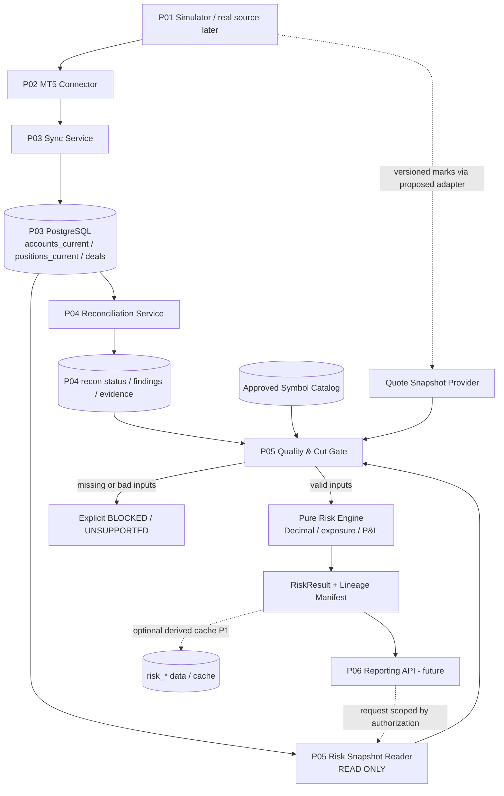
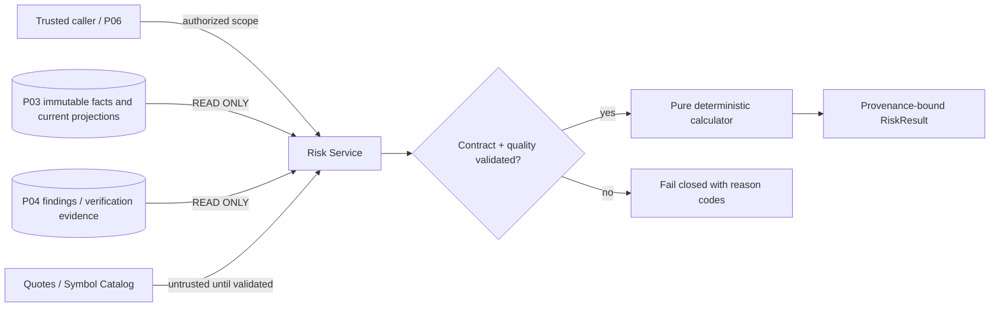
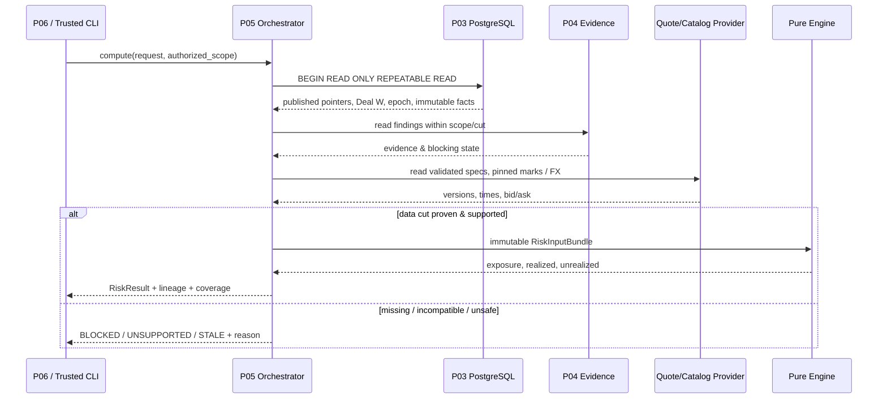
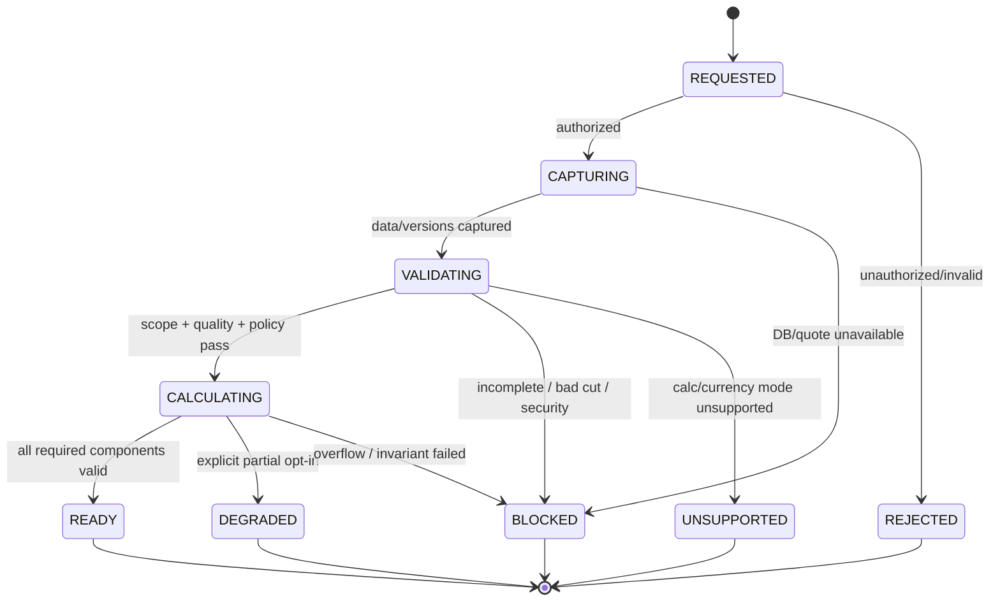
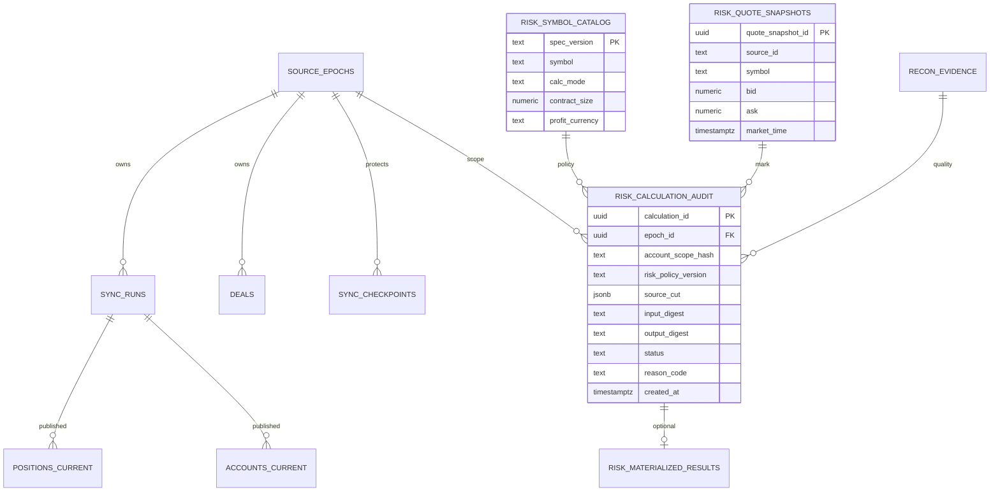

# Project 05 — Broker Risk Calculation Engine

**System Design · Financial Correctness · Data-Lineage · Fault/Threat Model · What-if Verification Plan**  
**Phiên bản:** 1.0 · **Ngày:** 2026-10-30  
**Trạng thái:** **THIẾT KẾ ĐỀ XUẤT — CHƯA TRIỂN KHAI / CHƯA CHẠY TEST / CHƯA BENCHMARK**  
**Lộ trình:** Mini-project **05/09** của *Broker Risk Reporting and MT5 Integration*.  
**Ngôn ngữ:** Tiếng Việt, giữ tên trường, mã lỗi, đoạn mã kỹ thuật bằng tiếng Anh.

> **Nguồn gốc và giới hạn tuyên bố.** CV gốc chỉ xác nhận việc xây dựng các async APIs cho **exposure, realized/unrealized P&L, commission, swap với decimal accounting**. Không có mô tả chi tiết công thức, schema tính rủi ro, FX conversion, phê duyệt valuation policy hay kiến trúc tại công ty cũ. Đây là **thiết kế học tập mới** để tái tạo và kiểm chứng các năng lực liên quan, **không** phải hệ thống thật ở Larion.
>
> **Phụ thuộc:** `Project_01_MT5_Broker_Simulator_System_Design.md` (simulated source), `Project_02_MT5_Integration_Connector_System_Design.md` (adapter), `Project_03_Trading_Data_Synchronization_System_Design.md` (authoritative PostgreSQL projections), `Project_04_Snapshot_Reconciliation_and_Recovery_System_Design.md` (audit, repair, verification). Tất cả là **tài liệu thiết kế**, không ngầm khẳng định chúng đã hoạt động.
>
> **Thế nào là “chịu nổi”?** Hoặc đưa ra **kết quả tài chính đúng trong phạm vi đã chứng minh** kèm currency/cut/policy/freshness; hoặc **từ chối có kiểm soát** (`BLOCKED`, `INCONCLUSIVE`, `STALE`, `UNSUPPORTED`) và bảo lưu nguyên dữ liệu. Trả `200 OK` với số tiền sai, trộn currency hoặc dùng dữ liệu chưa đồng bộ là **FAIL nghiêm trọng**, kể cả latency tốt.
>
> **Không thể liệt kê “mọi” trạng thái thực tế.** Ma trận 360 trường hợp là danh mục kiểm thử có cấu trúc, được bổ sung bằng property-based tests, metamorphic tests, stateful model checking, mutation tests và multi-fault campaigns. **Chưa có case nào được chứng minh PASS** chỉ vì được viết trong tài liệu.

---

## 0. Executive summary

### 0.1 Bài toán

Project 03 lưu `accounts_current`, `positions_current`, `deals`, `sync_runs`, `sync_checkpoints`, nhưng **chưa tự động đảm bảo chúng thuộc một global snapshot chung**. Project 04 cho biết có thể có sai lệch chưa giải quyết. Project 05 phải tính:

- **Exposure:** long/short/gross/net **theo instrument và đơn vị đo**, không cộng bừa số lượng EUR với GBP hoặc cộng hai chiều làm mất gross risk.
- **Realized P&L:** tổng hợp **số tiền thực hiện có nguồn gốc từ Deal đã đồng bộ**, phân biệt gross / commission / swap / fee coverage / net.
- **Unrealized P&L:** định giá **vị thế đang mở** bằng bid/ask đúng chiều, contract metadata và giá/FX rate có provenance.
- **Reporting totals:** metadata thể hiện epoch, Deal watermark, Position scan, mark snapshot, policy version, currency, cutoff, freshness và chất lượng dữ liệu; tránh kết luận sai khi số liệu lệch thời điểm.

**Phương châm:** *Correct-or-explicitly-unknown*, **không** `NULL -> 0`, **không** `missing quote -> previous price silently`, **không** `unknown currency -> USD`, **không** `incompatible cut -> exact portfolio total`.

### 0.2 Mười quyết định kiến trúc

1. **Pure calculation core:** Domain engine độc lập FastAPI/Kafka/MT5 SDK; nhận immutable, typed snapshots và trả `RiskResult`. Project 06 mới expose REST API.
2. **Read-only upstream:** Role Project 05 chỉ `SELECT` bảng P03 và trạng thái/bằng chứng P04; không `UPDATE` deal/balance/positions/checkpoint.
3. **Source epoch isolation:** Mọi query, key, cache và kết quả bắt buộc gắn `source_id + epoch_id` và `tenant/account scope`; reset nguồn không trộn dữ liệu cũ/mới.
4. **Explicit quality gate:** `READY`, `DEGRADED`, `BLOCKED`, `UNSUPPORTED`; tách `calculable`, `fresh`, `cross_entity_aligned`, `reconciled` thay vì gộp thành một boolean.
5. **No fictional global cut:** `Account`, `Position`, `Deal`, `Quote`, FX có cut riêng. Cross-entity exact chỉ khi có **evidence** của cut tương thích; MVCC read trong Postgres chỉ đảm bảo target read nhất quán, không sửa được upstream cut mismatch.
6. **Signed money convention:** Giữ `realized_pnl_gross`, `commission`, `swap` từ P03 bằng `Decimal`; phí có thể âm hoặc dương. `fee` chưa có trong P03 thì kết quả phải ghi `fee_coverage=NOT_AVAILABLE`, không gọi số đó là *all-in net*.
7. **Contract-driven valuation:** P0 chỉ `USD account + USD-profit FX symbols` do P01 định nghĩa và công thức linear đã kiểm chứng; symbol/calc mode khác phải `UNSUPPORTED_CALC_MODE` tới khi có plugin/rule/quote phù hợp.
8. **Version all assumptions:** `risk_policy_version`, `symbol_catalog_version`, `quote_snapshot_id`, `fx_rate_set_id`, `source_data_fingerprint` để tái lập kết quả và cache correctness.
9. **Bounded workload:** Batching, quota và deadline; khi quá tải **fail fast có mã lỗi**, không OOM, không kéo dài DB transaction vô hạn.
10. **Independent oracle:** So sánh golden vectors với reference model độc lập, metadata assertions, SQL invariants và bản ghi audit; một phép tổng đúng nhưng thiếu Deal vẫn là FAIL.

### 0.3 Phạm vi theo giai đoạn

| Mốc | Làm gì | Chủ động không làm |
|---|---|---|
| **P0 MVP** | Một simulator/source epoch; USD accounts; EURUSD/GBPUSD/AUDUSD; netting đơn giản; linear quote-currency USD; realized Deal theo P03; commission/swap signed; unrealized theo bid/ask; exposure theo symbol; on-demand read; validation/quality gates; deterministic tests | Giao dịch tiền thật, real SDK, đa currency/calc mode, tính margin/VaR, tax, reconciled accounting ledger hoàn chỉnh |
| **P1** | Versioned conversion rates, hedging, nhiều loại deal phi giao dịch, adjustment/fee, historical as-of/cut manifest, batch cache/materialization, cost-aware rate selection | Tự ý suy profit theo một công thức cho mọi instrument |
| **P2** | Multi-broker policy variants, cross-region replication, sophisticated stress portfolio analytics, broker-specific instrument plugins, prospective real MT5 parity testing | Cam kết parity thực tế trước khi có dữ liệu/reference SDK và giấy phép phù hợp |

### 0.4 Điều kiện bắt buộc để bắt đầu code

- [ ] Chốt **`risk_policy_v1`** và fixture expected outputs bằng review độc lập.
- [ ] Chốt mapping P03 `entry_kind`, `side`, money fields; không giả định `entry_kind='OUT'` nếu Simulator trả kiểu khác.
- [ ] Có `symbol_catalog_v1` cung cấp contract size, currency, tick size, price digits, mode và effective version.
- [ ] Có `QuoteSource` hoặc immutable `mark_fixture` có `bid/ask`, timestamp và snapshot identity; P03 **hiện chưa persist** quotes.
- [ ] Có metadata cut: P03 `published_scan_id`, Deal watermark `W`, epoch status; P04 findings/blocking status. Nếu thiếu → fail closed.
- [ ] Định nghĩa `fee_coverage` vì schema P03 **chưa lưu `DEAL_FEE`**. Không tuyên bố all-in net.

---

## 1. Requirements, quality attributes và non-goals

### 1.1 Functional requirements

| ID | Requirement | P | Acceptance test |
|---|---|---|---|
| FR05-01 | Pure functions `compute_exposure`, `compute_realized`, `compute_unrealized` | P0 | Golden vectors & no I/O in domain module |
| FR05-02 | Input/read model có `source_id`, `epoch_id`, `account_id`, data cut | P0 | Cross-epoch/account negative test |
| FR05-03 | `Decimal` end-to-end, reject nonfinite/implicit float and invalid scale | P0 | Precision & error-injection matrix |
| FR05-04 | Linear USD-profit FX pricing: BUY→bid, SELL→ask | P0 | Bid/ask spread vectors |
| FR05-05 | Realized gross + signed commission/swap separate; fee coverage explicit | P0 | Partial close/open fee vs realized/net tests |
| FR05-06 | Exposure signed/gross/net by symbol + units | P0 | Hedging/netting & aggregation checks |
| FR05-07 | Coverage, freshness và completeness status với structured reason code | P0 | Missing/corrupt data never produces `READY` |
| FR05-08 | `as_of` and historical request semantics honest, no fake backtest | P0 | Historical cut without source proof blocked |
| FR05-09 | Read-only PG access, bounded queries, repeatable target snapshot | P0 | DB permission & concurrent writer tests |
| FR05-10 | Audit manifest/metrics/traces and deterministic result hashes | P0 | Reproduce result from inputs, versions and seed |
| FR05-11 | Policy-versioned FX conversion, side-aware rate use | P1 | Multi-currency golden fixtures |
| FR05-12 | Versioned cache, epoch/repair/quote invalidation | P1 | Stale cache/repair race tests |
| FR05-13 | Adjustments, fee and MT5 deal types with approved mapping | P1 | Deal classification oracle |
| FR05-14 | Explicit rate limiting/deadline/resource limits | P0 | Load/stress and fail-fast tests |
| FR05-15 | Controlled plugin for non-linear calc modes | P2 | Unsupported profile blocked until plugin parity tests |

### 1.2 Non-functional requirements

- **Correctness:** zero *silent wrong money* events trong toàn bộ fixtures P0; bắt buộc currency/cut/provenance metadata trong mọi result; reconciliation `BLOCKING` không bị che bởi success path.
- **Determinism:** cùng domain inputs + policy/version → cùng normalized output hash; không phụ thuộc hash-map iteration order hoặc timezone hệ thống.
- **Isolation:** workload của account A không đọc dữ liệu hoặc cache của account B; role đọc không có quyền thay đổi database gốc.
- **Bounded memory/CPU:** streaming aggregation cho Deal, batch scanning cho Position; không `.all()` 1 triệu Deal vào RAM.
- **Backpressure:** quá tải → trả lỗi có cấu trúc và retry advice, không để hàng chờ vô hạn.
- **Auditability:** tính toán nào cũng có `calculation_id`, source ID, epoch, input fingerprints, policy version và reason codes.
- **Security:** dữ liệu synthetic cho local; secrets không ghi log; nếu chạy multi-tenant phải có tenant-bound auth context.

### 1.3 Non-goals (phân định với các Project khác)

- Không thực thi lệnh giao dịch, đặt risk limit pre-trade, tính VaR, liquidation, margin call, capital requirement hay regulatory reporting.
- Không trực tiếp gọi MT5 Manager SDK (P02), ghi/sửa Deal (P03), sửa lỗi dữ liệu (P04), triển khai HTTP endpoint public (P06), outbox/Kafka (P07), ClickHouse (P08).
- Không tính lại **account balance** từ trade log khi P03 đã có balance nguồn; không lấy chênh lệch balance làm P&L.
- Không tái hiện tất cả phép tính MT5: symbol có mode, tick value và currency conversion khác nhau. **`OrderCalcProfit` và `SYMBOL_TRADE_CALC_MODE` phải được dùng làm tham chiếu chức năng khi mở rộng**, không copy một công thức FX cho mọi CFD/future.
- Không phát biểu thực thi được 1M deals/4 phút hoặc exposure API p95 120ms chỉ dựa vào CV — đó là kết quả dự án gốc, không chứng minh cho mini-project.

---

## 2. Data contracts giữa Project 01–05

### 2.1 Chính xác những gì đã thiết kế ở Project 01–04

| Nguồn | Đã có trong **thiết kế trước** | P05 có thể tin khi | Chưa được bảo đảm; cần contract change |
|---|---|---|---|
| P01 | Simulator `/v1/meta`, `/v1/accounts`, `/v1/positions`, `/v1/deals`, `/v1/marks`, `run_id/generation/snapshot_seq` và versioned mark | Source profile/capability pass; quote snapshot có thể chứng minh cut | Mark reader P02/P03 end-to-end; real SDK có các seq/cursor đó |
| P02 | Async `MT5Client`, bounded worker và epoch fencing | Response đã validate schema/provenance và source identity | Kết quả API/P02 có global cross-entity atomic cut |
| P03 | `accounts_current`, `positions_current`, immutable `deals`, published scans, unfiltered Deal watermark `W` | P03 epoch ACTIVE, scan PUBLISHED, receipts đầy đủ, query nhất quán | `accounts_current + positions_current + deals` luôn cùng một source snapshot; market quote, fee currency, calc mode |
| P04 | `recon_*` findings/plan, `MATCHED/INCONCLUSIVE/...`, verified post-repair | Status có cùng scope, epoch, cut và còn hiệu lực | P04 lúc nào cũng có latest `VERIFIED`, không có lỗi sau verification |

**Bắt buộc:** Không đổi bảng P03 hoặc contract P01 bằng cách ngầm giả định chúng đã có field mới. Mọi trường ở mục 2.3 là **proposed extension**; thiếu dữ liệu quan trọng thì report phải `UNSUPPORTED`/`BLOCKED` theo policy.

### 2.2 Source-of-truth hierarchy

1. Source synthetic event/snapshot của P01 dùng làm oracle trong integration tests; **không** coi luôn đúng khi bật anomaly injection.
2. Dữ liệu đã commit và published trong P03 là **authoritative target read model** cho P05, không phải trực tiếp source SDK.
3. P04 cung cấp bằng chứng độ tin cậy. `VERIFIED` có ý nghĩa với **scope/cut cụ thể**, không là miễn trừ kiểm tra vĩnh viễn.
4. `symbol_catalog` và `mark/FX snapshot` là valuation inputs do **policy owner** phê duyệt và version, không suy từ tên symbol.
5. P05 tạo **derived facts**, không có quyền sửa source fact. Những derived facts phải trỏ ngược tới các phiên bản source/policy.

### 2.3 Required vs missing fields

| Business object | Required P0 | P03 schema hiện có | Thiếu / biện pháp |
|---|---|---|---|
| Account | `epoch_id`, `account_id`, `currency`, `presence`, `published_scan_id` | Có | Cần đối chiếu status/cut P04 |
| Position | `position_id`, `account_id`, `symbol`, `side`, `volume_lots`, `open_price`, `presence`, `published_scan_id` | Có | `source_status` cần approved mapping `OPEN`; absence không mặc định CLOSED |
| Deal | ID, `source_seq`, `account_id`, `entry_kind`, `side`, `realized_pnl_gross`, `commission`, `swap`, `executed_at`, `payload_hash` | Có | Chưa phân biệt đầy đủ non-trading `deal_type`, correction, fee, money currency của Deal |
| Quote | `symbol`, `bid`, `ask`, `market_time`, `source_seq/mark_id`, source and version | P01 có `mark_versions`; P03 không có | Xây `QuoteSource`/read-only quote-snapshot adapter hoặc immutable fixture; thiếu = block unrealized |
| Instrument | `calc_mode`, `contract_size`, `profit_currency`, `base_currency`, `quote_currency`, `tick_size`, `volume_step`, effective version | Không có | Tạo approved `symbol_catalog_v1` riêng; không đoán từ string `EURUSD` trong real SDK |
| FX conversion | rate pair, bid/ask, timestamp, effective cut, trusted path | Không có | MVP reject non-USD profit; P1 `FxRateProvider` versioned |
| Fee | numeric amount, currency, deal kind, posting policy | Không có `DEAL_FEE` | P0 `fee_coverage=NOT_AVAILABLE`; P1 extension migration + explicit mapping |

### 2.4 Canonical calculation inputs (proposed Python dataclasses)

```python
from dataclasses import dataclass
from decimal import Decimal
from typing import Literal, Protocol, Sequence

Side = Literal['BUY', 'SELL']

@dataclass(frozen=True)
class RiskCut:
    source_id: str
    epoch_id: str
    account_scan_id: str | None
    position_scan_id: str | None
    deal_watermark_seq: int | None
    quote_snapshot_id: str | None
    fx_rate_set_id: str | None
    source_snapshot_seq: int | None  # only if separately PROVEN compatible
    consistency: Literal['COMPATIBLE', 'INDEPENDENT', 'UNPROVEN']

@dataclass(frozen=True)
class InstrumentSpec:
    symbol: str
    base_currency: str
    quote_currency: str
    profit_currency: str
    calc_mode: str
    contract_size: Decimal
    tick_size: Decimal
    volume_step: Decimal
    spec_version: str

@dataclass(frozen=True)
class PositionFact:
    position_id: str
    account_id: str
    symbol: str
    side: Side
    lots: Decimal
    open_price: Decimal
    source_status: str
    presence: str

@dataclass(frozen=True)
class QuoteFact:
    symbol: str
    bid: Decimal
    ask: Decimal
    market_time_utc: str
    quote_id: str
    snapshot_id: str

@dataclass(frozen=True)
class DealFact:
    deal_id: str
    account_id: str
    source_seq: int
    entry_kind: str
    deal_type: str | None     # P1; unavailable in current P03
    gross_profit: Decimal
    commission: Decimal
    swap: Decimal
    executed_at_utc: str

class RiskInputReader(Protocol):
    async def capture(self, *, authorized_scope, cut_request) -> 'RiskInputBundle': ...

# RiskInputBundle: validated tuples/iterable stream, RiskCut,
# symbol catalog + quotes + declared coverage; no floats and no hidden defaults.
```

**Contract boundaries:** `authorized_scope` không đến từ request JSON một cách mù quáng; phải do caller đã xác thực (P06 hoặc CLI trusted) cung cấp. Trong P05, `Protocol` chỉ là **bản đề xuất**, không tuyên bố code hiện đã chạy.

### 2.5 Quy ước tiền tệ, signed amounts và business semantics

- `realized_pnl_gross`: **số tiền profit/loss được P03 bảo toàn từ nguồn**; trong MVP coi là USD nếu và chỉ nếu Simulator+mapping contract cam kết điều đó.
- `commission`, `swap`: signed amounts; `-2.50` là chi phí; `+0.50` có thể là rebate/credit. **Không dùng `abs()`** khi cộng net.
- `gross_realized = SUM(eligible_deal.realized_pnl_gross)`; `commission_total = SUM(eligible_commission)`; `swap_total = SUM(eligible_swap)`.
- `net_realized_excluding_unknown_fee = gross_realized + commission_total + swap_total`; **không** đặt nhãn `net_all_in` khi `DEAL_FEE`/non-trade charges chưa được bao phủ.
- Chỉ số `total_pnl` muốn cộng realized + unrealized **phải** chứng minh period/currency/as-of contract; không tạo một *equity* bằng cách cộng với `account.balance` không cùng cut.
- Dữ liệu tài khoản nguồn có thể có balance/credit/profit theo quy tắc riêng. P05 **không tự reconcile balance** bằng công thức giản lược.

---

## 3. System architecture, modules, data flow

### 3.1 Component architecture



> **Đường nét đứt** là integration **đề xuất** và chỉ tồn tại sau khi implement/contract-test. Kiến trúc không cho P05 quyền đặt lệnh hoặc sửa số liệu nguồn.

### 3.2 Module boundaries / ownership

| Module | Responsibility | Không được làm |
|---|---|---|
| `risk.domain.money` | Decimal validation, precision/rounding policy, Money/currency types | `float`, implicit cross-currency addition |
| `risk.domain.instruments` | Versioned instrument specs và supported calc modes | Guess contract size by symbol name |
| `risk.domain.exposure` | Net/gross long/short theo symbol, units | Sum EUR units with GBP units |
| `risk.domain.realized` | Classify eligible Deal + aggregate gross/fees/swap | Rebuild realized from close price khi authoritative Deal profit có sẵn |
| `risk.domain.unrealized` | Side-aware mark-to-market theo Position | Mark stale/invalid as if current |
| `risk.adapters.p03_reader` | Target consistent read, field validation, account isolation | Write target P03 tables |
| `risk.adapters.quote_reader` | Quote/FX snapshots, freshness, version | Guess rate from latest unrelated tick |
| `risk.gates` | Epoch, cut, reconciliation, completeness, status | Downgrade blocking finding thành READY |
| `risk.service` | Orchestrate capture→gate→compute→manifest | Put business rules into HTTP views |
| `risk.audit` | Output digests, metrics, fault evidence | Log credentials/PII/raw tenant data |

### 3.3 Trust boundaries



### 3.4 End-to-end sequence



**Implementation clarification:** Không giữ DB transaction mở trong toàn bộ thời gian fetch Quote Source qua mạng. Trước hết capture một **manifest/pointers** trong transaction read-only ngắn, rồi đọc dữ liệu bất biến/pinned từ DB và quote provider theo contract; nếu DB chỉ lưu `*_current` mutable không giữ historical projection, phải **đọc vật liệu cần thiết trong cùng PG snapshot bounded** hoặc thêm immutable snapshots. Trên `READ COMMITTED` nhiều SELECT có thể thấy nhiều target revisions. Xem §4.

---

## 4. Snapshot/cut correctness và data quality

### 4.1 Cut vector thay vì một timestamp duy nhất

Đặt `C = (E, A_scan, P_scan, D_W, Q_snap, FX_set, SPEC_ver, RECON_ver)`:

- `E`: source epoch đã được xác nhận ACTIVE.
- `A_scan`, `P_scan`: ID của Account/Position scans đã PUBLISHED; **có thể khác snapshot_seq**.
- `D_W`: global unfiltered Deal event-watermark của P03; `W` có thể vượt `MAX(deals.source_seq)` vì stream có event không phải Deal.
- `Q_snap`: quote versions, không chỉ wall-clock time.
- `FX_set`, `SPEC_ver`: conversion + instrument specification đã phê duyệt.
- `RECON_ver`: trạng thái và findings của P04 có scope/cut tương thích.

**Ba lớp kết quả:**

1. `COMPONENT_EXACT`: tính một component từ một snapshot riêng đầy đủ và supported (ví dụ realized Deal subset theo W, hoặc exposure từ Position scan P đã publish). Đây **không** khẳng định cross-entity exact.
2. `COMPOSITE_ALIGNED`: composite khi upstream và storage **chứng minh** cùng logical cut hoặc có policy alignment đã validate, gồm currency/quotes/FX và P04 evidence. Chỉ khi đó mới gắn nhãn cùng-as-of.
3. `PROVISIONAL / BLOCKED`: cut không phù hợp/thiếu chứng cứ; có thể trả kết quả **tách component với disclaimers rõ ràng** nếu caller cho phép, nhưng không trả all-in net/portfolio combined as exact.

### 4.2 Matrix quality decisions

| Condition | Component result | Composite result | Reason |
|---|---|---|---|
| P03 account/position PUBLISHED, correct epoch, complete; quote snapshot pinned | `READY` cho exposure/unrealized nếu symbol supported | Chỉ READY khi aligned Deal and cut proof | `COMPONENT_COMPLETE` |
| Deal checkpoint W durable, no integrity conflict; account period recognized | `READY` cho realized **as known through W** | Không tự claim daily final | `DEAL_WATERMARK_BOUND` |
| P04 `INCONCLUSIVE` hoặc blocking finding chạm account/symbol/cut | `BLOCKED` affected scope | `BLOCKED` | `RECON_INCONCLUSIVE` |
| Position scan P và quote Q không có consistent binding | Exposure units có thể READY, unrealized `BLOCKED` | `BLOCKED` | `QUOTE_CUT_UNPROVEN` |
| Quote quá cũ (theo policy) | Realized unaffected | Unrealized `STALE` | `STALE_MARK` |
| Currency khác nhưng FX set thiếu | Per-currency subtotals `READY` | Converted total `BLOCKED` | `FX_RATE_MISSING` |
| Unknown calc mode | Signed lots có thể diagnostic, money notional/P&L `UNSUPPORTED` | `UNSUPPORTED` | `CALC_MODE_UNKNOWN` |
| Source epoch reset while compute is running | Reject stale bundle; may retry once with new manifest | Never mix epochs | `EPOCH_CHANGED` |
| API/client yêu cầu `strict=true`, có 2 entity cuts khác nhau | Can provide separated named components only in opt-in mode | `BLOCKED` | `INCOMPATIBLE_CUT` |
| Dữ liệu missing required money (swap/commission) | No silent zero | `BLOCKED` | `MONEY_FIELD_MISSING` |

### 4.3 Consistency state machine



### 4.4 Invariants — test được, không chỉ là lời hứa

| ID | Invariant | Verification oracle |
|---|---|---|
| INV05-01 | Không có cross-epoch or cross-tenant rows in one result | Every fact `(source_id,epoch_id,tenant,account)` matches request |
| INV05-02 | `READY` luôn có provenance: P scan / D W / quote ID tùy component | Non-null lineage and validity flags |
| INV05-03 | Nonzero money không tồn tại dưới dạng Python `float` trong core | Type/property tests + static check |
| INV05-04 | Ineligible/unsupported Deal type không bị âm thầm tính là trading P&L | Classification tests; explicit error |
| INV05-05 | `SUM(commission)` và `SUM(swap)` giữ dấu | Signed golden sum equality |
| INV05-06 | Gross exposure >= abs(net exposure) trong cùng symbol & cùng đơn vị | Property test across random sides/lots |
| INV05-07 | BUY closes mark at bid, SELL closes at ask theo policy | Bid/ask golden tests, spread widening monotonic effect |
| INV05-08 | Result currency và input currency phải đồng nhất hoặc có FX conversion proof | Type-level Money + conversion lineage |
| INV05-09 | Mỗi Deal eligible được tính tối đa một lần theo `(epoch_id, deal_id)` | Distinct ID oracle with duplicate/replay |
| INV05-10 | Same inputs + specs/policy versions → same deterministic result hash | Differential replay with unordered rows |
| INV05-11 | Historical exact report không gắn current P snapshot vào past Deal cutoff | Cut proof oracle |
| INV05-12 | Result phải bị invalidate sau source reset/approved correction/quote revision | Versioned key / recompute tests |
| INV05-13 | Balance nguồn không thay đổi do risk calculation | DB role & before-after hashes |
| INV05-14 | Empty set hợp lệ trả zeros; missing/unknown set không được trả zeros | Completeness proof needed |
| INV05-15 | Rounding được áp **tại reporting boundary** theo currency/policy, không làm tròn từng intermediate rồi cộng | High-precision oracle vs early-round bias |
| INV05-16 | Composite result `COMPATIBLE` chỉ khi có cross-entity cut proof | Negative mixed-snapshot oracle |
| INV05-17 | `quote.market_time <= requested_as_of` cho historical exact | Time-window validation |
| INV05-18 | P04 findings/blocks affecting scope cannot be ignored by cache | Scope-version invalidation test |

---

## 5. Business calculations and reference algorithms

### 5.1 Financial types & decimal policy

- `Decimal` từ string hoặc exact integer; không khởi tạo `Decimal(0.1)` từ `float`.
- `Money(amount, currency, semantic, policy_version)`; chỉ cộng Money cùng currency và cùng semantic aggregation policy.
- `Decimal.is_finite()` bắt buộc; reject `NaN`, `Infinity`, `-Infinity`, invalid digit/scale; `-0` canonical hóa về `0` khi output/hash theo policy.
- `NUMERIC(38,12)` trong P03 là **giới hạn storage của blueprint**; trước khi `INSERT`/projection validation cần quyết định reject trên dữ liệu nhiều precision/scale. P05 không âm thầm làm tròn dữ liệu nguồn bất hợp lệ.
- Internal calculation precision (ví dụ context prec=50) là **policy đề xuất**, không đảm bảo mọi broker/trường hợp. Arithmetic traps/overflow/precision checks theo từng boundary; currency minor-unit round khi **final output** hoặc posting boundary được định nghĩa.
- `ROUND_HALF_EVEN` hay `ROUND_HALF_UP` cần approved broker policy; không mặc định một mode là đúng ở mọi nguồn. P0 fixture chọn HALF_EVEN để có deterministic reference.

```python
from decimal import Decimal, InvalidOperation, ROUND_HALF_EVEN, localcontext

D = Decimal

# Reference sketch. Validation ở ingress phải đảm bảo input là str,
# bounds/scale theo field, không phải float hoặc ngầm đổi từ float.
def parse_decimal(raw: str) -> Decimal:
    if not isinstance(raw, str):
        raise TypeError('DECIMAL_STRING_REQUIRED')
    try:
        value = D(raw)
    except InvalidOperation as exc:
        raise ValueError('INVALID_DECIMAL') from exc
    if not value.is_finite():
        raise ValueError('NONFINITE_MONEY')
    return value


def quantize_display(value: Decimal, scale: int) -> Decimal:
    if not 0 <= scale <= 12:
        raise ValueError('INVALID_DISPLAY_SCALE')
    with localcontext() as ctx:
        ctx.prec = 50
        ctx.rounding = ROUND_HALF_EVEN  # only the approved P0 test policy
        out = value.quantize(D(1).scaleb(-scale))
    return D(0) if out == 0 else out
```

**Quan trọng:** `ctx.prec=50` là lựa chọn test, không thể thay thế validator giới hạn exponent/bits/count của untrusted input. Tính toán `float -> str -> Decimal` sau khi float đã mất chính xác là **không sửa được sai số nguồn**; cần upstream raw decimal/string hoặc một policy chuyển đổi kiểm chứng được.

### 5.2 Exposure semantics — không trộn đơn vị

Với Position `p` và `InstrumentSpec s` hỗ trợ linear FX:

```text
signed_lots(p)  = (+lots if BUY else -lots)
signed_units(p) = signed_lots(p) * contract_size(s)  # unit: base currency
long_units(s)   = sum(units(p) for BUY positions of symbol s)
short_units(s)  = sum(units(p) for SELL positions of symbol s)  # positive magnitude
net_units(s)    = long_units(s) - short_units(s)
gross_units(s)  = long_units(s) + short_units(s)

# Optional quote-notional under an explicitly chosen valuation mark:
net_quote_notional(s, Q)   = net_units(s) * policy_mark_price(s, Q)
gross_quote_notional(s, Q) = gross_units(s) * policy_mark_price(s, Q)
```

- Quy tắc `policy_mark_price` cho **exposure notional** (mid/bid/ask) phải được định nghĩa riêng; không lấy P&L close mark để gọi là notional một cách ngầm định. P0 dùng **mid = (bid+ask)/2** cho *informational quote notional*, với label `valuation_basis=MID` và USD quote currency.
- Không cộng gross EUR base units với gross GBP base units rồi gọi `gross_units`. Muốn cộng về USD phải có approved conversion/valuation policy.
- Hedging: gross của hai vị thế đối chiều vẫn >0 dù net=0. Netting: một vị thế đã netted; không ghi thêm synthetic hedged positions.

### 5.3 Realized P&L từ Deal đã được P03 bảo quản

```text
Eligible(d): deal thuộc đúng epoch/account/scope; deal_type được mapping
            sang trading và accounting scope; source_seq <= D_W;
            timestamp trong half-open interval [start, end);
            data completeness/provenance has been proven.
Gross        = Σ d.realized_pnl_gross
Commission   = Σ d.commission
Swap         = Σ d.swap
Net_excl_fee = Gross + Commission + Swap
Net_all_in   = Gross + Commission + Swap + OtherFees
               ONLY IF all fees/adjustments coverage proven.
```

- **Không tính lại realized từ `(close-open)*lots`** trên Deal đã ghi authoritative gross result, vì partial close, reversal, fees và currency conversion khác broker. Formula giá chỉ dùng làm **independent oracle** trong controlled Simulator fixture.
- `DEAL_ENTRY_IN/OUT/INOUT/OUT_BY`, `DEAL_TYPE_BALANCE/CREDIT/CORRECTION/...` có ý nghĩa riêng theo MT5; P03 hiện mới có `entry_kind` và không có đầy đủ type. P0 chấp nhận **chỉ** data có capability `SIMULATOR_TRADING_ONLY_V1` do fixture chứng minh; khi không chứng minh được, `DEAL_TYPE_UNCLASSIFIED` → BLOCKED.
- Deal P03 là immutable trong **simulator epoch**; MT5 thực có canceled/adjusted deal semantics. P1 yêu cầu append-only accounting adjustments/corrected versions + reviewed mapping, không đổi tiền silently.
- `executed_at` là economic time, `source_seq` là visibility/ingest order. Một Deal đến muộn có timestamp cũ có thể đổi báo cáo của ngày trước; `D_W` không tự chứng minh day đã **sealed**.

### 5.4 Unrealized P&L — P0 linear FX with profit currency USD

Với **supported** `calc_mode=FOREX_LINEAR_P0`, contract size `100000` units/lot (định nghĩa P01), quote timestamp/cut hợp lệ:

```text
units = position.volume_lots * instrument.contract_size
BUY:  unrealized_gross_USD = (bid - open_price) * units
SELL: unrealized_gross_USD = (open_price - ask) * units

unrealized_gross_account_ccy = gross_profit_ccy * approved_fx_rate
                                # only if conversion required and proven
```

- Không tính mark tại bid cho SELL hoặc ask cho BUY trong *liquidation-style mark*; cách định giá khác cần versioned policy.
- `commission`/`swap` trên Deal (đã posted) **không tự cộng vào unrealized gross**. Có thể làm `unrealized_including_accruals` riêng nếu position swap/accrual được đồng bộ và coverage chứng minh; hiện P03 chưa có position swap.
- Nhiều instrument có phương trình khác (futures tick price/tick size, CFD-specific, bonds...). P0 chặn calc mode ngoài whitelist và không tự động dùng `contract_size` để tính P&L mọi thứ.
- Nếu `mark.time` mới hơn `requested_as_of` hoặc mất quote/giá cũ, không có proof snapshot → `BLOCKED/STALE`, không âm thầm trả current P&L.

### 5.5 Multi-currency / FX conversion (P1 design, không áp dụng ngầm ở P0)

| Issue | Design requirement |
|---|---|
| Currency type | Profit currency của symbol; account deposit currency; quote currency là các khái niệm riêng |
| Side-aware conversion | Bid/ask conversion có thể khác cho positive/negative amounts; policy phải xác định cách mua/bán tiền tệ để settle |
| Rate graph | Giới hạn số hops, approved path, cycle detection, liquidity/quote validity, no arbitrary best-rate selection |
| Time | Rate `as_of` theo policy, không lấy rate hiện tại cho historical Deal |
| Version | Rate set ID + provider + quote timestamp + path + policy hash được ghi vào output |
| Missing rate | `FX_RATE_MISSING`; không thay bằng 1 hoặc đảo rate không kiểm chứng |
| Cross-rate | Nhân/divide rates chỉ qua canonical path và signed amount handling; precision/rounding cuối chuỗi |
| Validation | Positive bid/ask, bid<=ask, no NaN/zero, max staleness, per-quote unique version |

### 5.6 Golden worked example from P01 (synthetic, USD only)

| Step | Expected financial facts |
|---|---|
| OPEN BUY 0.50 lot EURUSD @ 1.10000, commission `-2.50` | Deal realized gross `0.00`; posted commission `-2.50`; source account balance `9997.50` in fixture |
| Mark bid `1.10200`, ask `1.10220` | Unrealized gross `+100.00` USD = `(1.10200-1.10000)*50000` |
| CLOSE 0.20 lot @ 1.10300, commission `-1.00`, swap `-0.50` | Gross realized on close `+60.00`, close Deal net excluding fee `+58.50` |
| Remaining position 0.30 lot; bid still 1.10200 | Unrealized gross `+60.00`, only if compatible mark/position cut |
| Open+close Deal records together | Cumulative gross realized `+60.00`; commission `-3.50`; swap `-0.50`; `net_excl_fee=+56.00` |
| Check P01 source balance after close | `10056.00` is **source event-model fact**; P05 does not generate/overwrite account balance |

> Các vector này chỉ có nghĩa khi fixture source, quote, policy cùng version/cut. `balance + unrealized` không được gọi là `equity` của broker thực nếu không có policy/cut đầy đủ.

### 5.7 Calculation pseudocode (bounded, explicit failures)

```python
from collections import defaultdict
from decimal import Decimal

D = Decimal
ZERO = D('0')


def exposure_by_symbol(positions, specs):
    # inputs already validated: same authorized scope, epoch, complete P scan
    out = defaultdict(lambda: {'long_units': ZERO, 'short_units': ZERO})
    for p in positions:
        if p.presence != 'PRESENT' or p.source_status != 'OPEN':
            continue  # only after status mapping and source completeness check
        spec = specs[p.symbol]  # missing spec => reject, not zero
        units = p.lots * spec.contract_size
        if p.side == 'BUY':
            out[p.symbol]['long_units'] += units
        elif p.side == 'SELL':
            out[p.symbol]['short_units'] += units
        else:
            raise ValueError('UNSUPPORTED_POSITION_SIDE')
    for symbol, e in out.items():
        e['gross_units'] = e['long_units'] + e['short_units']
        e['net_units'] = e['long_units'] - e['short_units']
    return out


def unrealized_usd(position, spec, quote):
    if spec.calc_mode != 'FOREX_LINEAR_P0' or spec.profit_currency != 'USD':
        raise ValueError('UNSUPPORTED_CALC_MODE')
    if not (quote.bid > 0 and quote.ask >= quote.bid):
        raise ValueError('INVALID_QUOTE')
    units = position.lots * spec.contract_size
    if position.side == 'BUY':
        return (quote.bid - position.open_price) * units
    if position.side == 'SELL':
        return (position.open_price - quote.ask) * units
    raise ValueError('UNSUPPORTED_POSITION_SIDE')


def realized_usd(deals):
    gross = commission = swap = ZERO
    # deals is a bounded stream from an already authorized + proven W scope
    for d in deals:
        # classification and uniqueness checks are enforced before aggregator
        gross += d.gross_profit
        commission += d.commission
        swap += d.swap
    return {'gross': gross, 'commission': commission,
            'swap': swap, 'net_excluding_fee': gross + commission + swap,
            'fee_coverage': 'NOT_AVAILABLE'}
```

**Cảnh báo về pseudocode:** Cố tình tách validator, uniqueness/eligibility gate, transaction capture và cancellation budget ra khỏi pure functions; **không** copy riêng đoạn `realized_usd()` mà bỏ qua phía trước. Trong production, `position.source_status != 'OPEN'` không được silent skip nếu mapping chưa được khóa; phải validate status set từ đầu trước khi gọi pure engine.

---

## 6. Persistence, SQL, snapshot capture and lifecycle

### 6.1 Database ownership, minimum extensions

| Table / object | Owner | Function |
|---|---|---|
| `P03.accounts_current`, `positions_current`, `deals` | P03 | Canonical committed read model; P05 role SELECT only |
| `P03.sync_runs`, `sync_checkpoints`, `source_epochs` | P03 | Published cut, Deal watermark, epoch ACTIVE/DEGRADED/BLOCKED |
| `P04.recon_*` | P04 | Findings, verification status, impacted scope |
| `risk_symbol_catalog` **proposed** | P05/policy owner | Approved immutable versions of contract metadata |
| `risk_quote_snapshots` **proposed P1** | Quote adapter | Versioned market marks/FX with retention and provenance |
| `risk_calculation_audit` **proposed** | P05 | Input/output digest, policy/cut, status/reason (NOT financial truth) |
| `risk_materialized_results` **optional P1** | P05 | Cache only, never truth; immutable versioned key/TTL |

### 6.2 Logical ERD



> ERD là logical, không phản ánh DDL hiện hữu; P04 evidence table names cụ thể cần map từ P04 document. Quan hệ `RISK_SYMBOL_CATALOG` version trong code dưới có composite key `(catalog_version,symbol)` thay vì sơ đồ giản lược.

### 6.3 Reference DDL (only P05-owned additive objects)

```sql
-- Blueprint only. PostgreSQL/Alembic version, schema ACL và tenant model
-- phải được chốt/kiểm thử trước khi chạy migration.
CREATE TABLE risk_symbol_catalog (
    catalog_version TEXT NOT NULL,
    symbol          TEXT NOT NULL,
    calc_mode       TEXT NOT NULL,
    base_currency   CHAR(3) NOT NULL,
    quote_currency  CHAR(3) NOT NULL,
    profit_currency CHAR(3) NOT NULL,
    contract_size   NUMERIC(38,12) NOT NULL CHECK (contract_size > 0),
    tick_size       NUMERIC(38,12) NOT NULL CHECK (tick_size > 0),
    volume_step     NUMERIC(38,12) NOT NULL CHECK (volume_step > 0),
    approved_hash   CHAR(64) NOT NULL,
    effective_from  TIMESTAMPTZ NOT NULL,
    PRIMARY KEY (catalog_version, symbol)
);

CREATE TABLE risk_calculation_audit (
    calculation_id    UUID PRIMARY KEY,
    epoch_id          UUID NOT NULL REFERENCES source_epochs(epoch_id),
    account_scope_hash CHAR(64) NOT NULL,
    risk_policy_version TEXT NOT NULL,
    cut_manifest      JSONB NOT NULL,
    input_digest      CHAR(64),
    output_digest     CHAR(64),
    status            TEXT NOT NULL CHECK (status IN
       ('READY','DEGRADED','BLOCKED','UNSUPPORTED','REJECTED')),
    reason_code       TEXT,
    duration_ms       BIGINT CHECK (duration_ms >= 0),
    created_at        TIMESTAMPTZ NOT NULL DEFAULT now()
);
CREATE INDEX idx_risk_audit_epoch_time
    ON risk_calculation_audit(epoch_id, created_at DESC);

-- P1 only: risk_quote_snapshots cần versioning/source authority,
-- immutable ingestion, retention, effective-cuts, uniqueness + ACL.
-- P0 dùng pinned synthetic quote fixture / adapter contract-tested.
```

**RLS/GRANT:** DDL không tự cấp role. `risk_reader` chỉ có `SELECT` đúng schema/table, không mặc nhiên là owner hoặc được `CREATE`; `risk_writer` chỉ INSERT vào `risk_calculation_audit` (và các derived cache do P05 sở hữu). Nếu P05 audit cùng DB P03, dùng transaction riêng và không kéo dài transaction read snapshot; failure ghi audit phải được báo bằng trạng thái/retry policy, không tráo `READY` không có trace.

### 6.4 PostgreSQL capture pattern (có bẫy thời gian)

```text
1. Validate caller -> authorized tenant, source_id, account scope.
2. START read-only REPEATABLE READ transaction in P03 DB.
3. Check source epoch status, snapshot scans PUBLISHED and Deal W terminal.
4. Read applicable target facts under SAME DB MVCC snapshot, bounded batched cursor.
5. Record manifest (IDs, hashes, scans, W, row counts); COMMIT/ROLLBACK read tx.
6. Pin external quote/catalog/FX by immutable versions and verify suitable cut.
7. Consult P04 evidence scoped to same source/cut; if separate DB, no false atomicity.
8. Validate all input completeness, currency, calc mode, no disputed rows.
9. Compute pure functions, create result and audit digest.
10. Recheck source epoch/recon/policy versions if strict freshness requires;
    if changed during run, reject/retry bounded and never return stale READY.
```

**Bẫy:** 4 và 5 không thể chỉ đọc `positions_current` rồi đợi vài phút mới đọc Deal trong *đã đóng* transaction. Với P03 current projections, phải **materialize bounded immutable input**, hoặc phát triển P03 immutable snapshot tables (P1) để tái đọc theo cut; không giữ PostgreSQL connection/lock vô hạn cho CPU-bound work. `REPEATABLE READ` bảo đảm target DB snapshot cho transaction, **không** bảo đảm P04 DB và quote provider nhìn cùng instant. Nếu công việc kéo dài, dùng bounded tenant/position scans, hoặc tăng khả năng immutable snapshot; nếu không, reject long request.

### 6.5 Isolation: exactly which accounts

- Request bắt buộc có `authorized source`, `tenant`, `account scope`; account ID là string, có thể trùng giữa hai source epochs.
- Mọi query `WHERE epoch_id = :epoch AND account_id = ANY(:authorized_accounts)` hoặc server-side authorized temp table. Không tin `account_id` do frontend truyền nếu chưa xác thực.
- Multi-account aggregate phải xử lý mỗi currency/group tách biệt, cho đến khi có approved FX. Không aggregate unknown/untrusted accounts.
- Cache key, result audit và metrics không chứa raw account ID ở label cardinality cao; dùng scope hash trong audit và trace-limited sampling.

---

## 7. Reporting contract for Project 06 (P05 library-level)

### 7.1 Proposed request (not an HTTP implementation)

```json
{
  "source_id": "sim-broker-a",
  "epoch_id": "3cecd819-fd61-420b-8e35-019c70203b4e",
  "account_ids": ["00042"],
  "components": ["EXPOSURE", "REALIZED", "UNREALIZED"],
  "period_start_utc": "2026-10-01T00:00:00Z",
  "period_end_utc": "2026-11-01T00:00:00Z",
  "strict_composite": false,
  "risk_policy_version": "risk-policy-v1",
  "symbol_catalog_version": "sim-usd-fx-v1"
}
```

`account_ids` **chỉ là filter yêu cầu**; actual authorization phải do trusted context riêng đảm bảo. `period_start/end` áp cho **realized Deal execution time**; unrealized dùng `valuation_as_of`/quote snapshot riêng, không mặc định mọi component ở cùng thời điểm.

### 7.2 Proposed response with proven components

```json
{
  "calculation_id": "4a47dc4f-dc8f-45b2-a5ed-374e9774c113",
  "status": "DEGRADED",
  "reason_codes": ["INCOMPATIBLE_CUT", "FEE_COVERAGE_UNAVAILABLE"],
  "currency": "USD",
  "risk_policy_version": "risk-policy-v1",
  "scope": {"source_id": "sim-broker-a", "epoch_id": "3cecd819-fd61-420b-8e35-019c70203b4e"},
  "cuts": {
    "account_scan_id": "scan-A",
    "position_scan_id": "scan-P",
    "deal_watermark_seq": 1050,
    "quote_snapshot_id": "quote-S1030",
    "consistency": "INDEPENDENT"
  },
  "components": {
    "exposure": {"status": "READY", "by_symbol": {"EURUSD": {
      "unit_currency": "EUR", "long_units": "50000", "short_units": "0",
      "gross_units": "50000", "net_units": "50000"}}},
    "realized": {"status": "READY", "gross_usd": "60.00",
      "commission_usd": "-3.50", "swap_usd": "-0.50",
      "net_excluding_fee_usd": "56.00", "fee_coverage": "NOT_AVAILABLE"},
    "unrealized": {"status": "BLOCKED", "reason_code": "QUOTE_CUT_UNPROVEN"}
  },
  "composite_total": null,
  "input_digest": "<sha256-of-canonical-input-manifest>",
  "output_digest": "<sha256-of-canonical-result>"
}
```

`DEGRADED` chỉ được phép khi caller **explicitly opt-in partial** như `strict_composite=false` ở request mẫu. Với `strict_composite=true`, service **phải trả `BLOCKED` cho composite** (hoặc lỗi có cấu trúc), không trả `DEGRADED` như thành công toàn bộ. Hai JSON trên là ví dụ định dạng và cần được cụ thể hóa thành fixtures có manifest/hashes thật trong contract tests.

### 7.3 Error taxonomy

| Code | Meaning | Retry? |
|---|---|---|
| `UNAUTHORIZED_SCOPE` | Caller thiếu quyền source/account | Không retry mù |
| `EPOCH_CHANGED` | Source reset/epoch khác giữa capture và finish | Re-capture epoch mới có kiểm soát |
| `SOURCE_NOT_ACTIVE` | P03 source epoch BLOCKED/ARCHIVED | Sau operator/recovery |
| `P03_UNPUBLISHED` | Position/Account scan chưa PUBLISHED | Sau sync hoàn tất |
| `DEAL_WATERMARK_UNPROVEN` | Deal scan chưa terminal hoặc checkpoint invalid | Chờ re-sync |
| `RECON_BLOCKING` | P04 finding chặn scope | Sau repair+verification |
| `INCOMPATIBLE_CUT` | Các component không cùng logical cut | Đọc separated hoặc retry cut compatible |
| `QUOTE_CUT_UNPROVEN` | Quote không thể đối chiếu với Position cut | Bổ sung quote snapshot |
| `STALE_MARK` | Quote quá cũ theo policy | Khi có quote mới |
| `FX_RATE_MISSING` | Thiếu rate/path/currency conversion | Bổ sung FX proof |
| `MONEY_FIELD_MISSING` | Không có trường phí bắt buộc | Thay input có coverage |
| `UNSUPPORTED_CALC_MODE` | Symbol profile ngoài whitelist | Chỉ sau policy/plugin rollout |
| `DEAL_TYPE_UNCLASSIFIED` | Accounting category không có mapping | Review taxonomy |
| `INVALID_DECIMAL` | Input sai numeric/scale/non-finite | Sửa source/mapping |
| `DATA_INTEGRITY_CONFLICT` | Mâu thuẫn duplicate ID/hash/position | P04 audit/repair |
| `OVERLOADED` | Queue/CPU/concurrency quota đạt trần | Retry bounded + jitter |
| `DEADLINE_EXCEEDED` | Vượt time budget | Retry với workload nhỏ/hợp lệ |
| `DB_UNAVAILABLE` | Read snapshot thất bại | Retry bounded |
| `AUDIT_PERSISTENCE_FAILED` | Audit required nhưng không ghi được | Retry/resume; no unaudited READY |
| `POLICY_VERSION_CHANGED` | Risk/spec versions thay giữa compute | Re-pin and recompute |

---

## 8. Operational state, concurrency, caching, safeguards

### 8.1 Suggested runtime limits — **benchmarks chưa chạy**

| Knob | Initial P0 proposal | Safety mechanism |
|---|---|---|
| `MAX_ACCOUNTS_PER_REQUEST` | 100 | Reject request > limit |
| `MAX_POSITIONS_PER_REQUEST` | 10,000 | Paged read/reject/partitioned aggregation |
| `MAX_DEALS_PER_WINDOW` | 1,000,000 | SQL preflight, bounded cursor; report aggregate granularity |
| `READ_BATCH_ROWS` | 1,000 | Streaming, cap ORM objects |
| `MAX_CONCURRENT_RISK_JOBS` | 4 per instance | Semaphore/admission controller |
| `MAX_QUEUED_RISK_JOBS` | 16 | 429/503 on overflow |
| `WALL_CLOCK_DEADLINE` | 30 seconds on-demand | Deadline monotonic, cancellation propagation |
| `MAX_QUOTE_AGE_SECONDS` | 5 for live-like synthetic test only | Mark stale; historical policy separate |
| `MAX_RISK_INPUT_BYTES` | 32 MiB/request in memory | Spill/stream, fail early |
| `MAX_FX_HOPS` | 2 in P1 | Approved paths only, cycle reject |
| `CPU/MEMORY` | Reference machine 4 vCPU / 8 GiB; process budget 512 MiB RSS test | Resource metrics, adaptive concurrency |

Các giá trị trên **không phải default an toàn cho production**, không được coi là bằng chứng throughput. CPU-bound Decimal compute **không nên chạy trực tiếp trong async event loop của P06**; dùng sync worker/process executor có quota hoặc optimized DB grouping. Executor không tự động cứu quá tải nếu queue không bounded.

### 8.2 Cache correctness (P1)

```text
cache_key := SHA256(
  authorized_source_id | tenant_scope_hash | epoch_id |
  account_scope_hash | requested_components | time_window |
  account_scan_id | position_scan_id | deal_watermark_W |
  quote_snapshot_id | fx_rate_set_id | symbol_catalog_version |
  risk_policy_version | recon_status_version | rounding_policy_version
)
```

- `recon_status_version` không nên là timestamp tùy tiện mà là **monotonic evidence revision/immutable digest**; nếu P04 hiện chưa có cần mở contract.
- Cache hit vẫn phải kiểm epoch active và revocation/repair nếu security/financial correctness yêu cầu; không `stale-while-revalidate` cho strict financial totals.
- Idempotent calculation request không có nghĩa trường hợp **input thay đổi** phải trả kết quả cũ; cache key luôn có cut identity.
- Không cache `BLOCKED` vô hạn; negative cache TTL ngắn, reason-aware.

### 8.3 Observability

| Metric / field | Purpose | Labels cardinality policy |
|---|---|---|
| `risk_calculation_total{component,status,reason_family}` | Success vs blocked vs degraded | Bounded enums |
| `risk_calculation_duration_seconds{component,status}` | Performance SLO | Histograms |
| `risk_component_freshness_seconds{component}` | Freshness, stale vs ready | Buckets; no account labels |
| `risk_cut_incompatible_total{entity_pair}` | Discover upstream cut mismatch | Low cardinality |
| `risk_quote_stale_total{symbol_group}` | Mark issues | Grouped, no raw IDs |
| `risk_decimal_validation_reject_total{field_class}` | Numeric errors | Allowlist |
| `risk_db_snapshot_duration_seconds` | Lock/time budget | Histograms |
| `risk_inflight_jobs`, `risk_queue_depth`, `risk_peak_rss_bytes` | Backpressure/RSS | Instance labels only |
| `risk_result_input_digest`, `risk_policy_version` | Audit trace | Structured **logs**, not Prometheus labels |

Log `calculation_id`, scope hash, masked source_id, epoch, cut/policy versions and `reason_code`. Không ghi account balance/deal profit thô trong error logs/metrics; evidence cần quyền xem và retention policy.

---

## 9. Risk register, FMEA and fail-safe behavior

| Failure mode | Severity | Cause | Guardrail | Residual risk |
|---|---|---|---|---|
| Silent wrong P&L due to mixed cuts | Critical | P03 projections different S | Cut vector + strict composite gate | Real SDK may not provide global cut |
| Wrong currency aggregation | Critical | Quote/account currencies assumed USD | Currency types + supported profile whitelist | Future symbol metadata mapping errors |
| Omitted fees falsely called all-in | High | `DEAL_FEE` not in P03 | `fee_coverage` mandatory; net-excluding-fee label | Non-trade commission posts need P1 |
| Stale/wrong-side quotes | High | BID/ASK selection or quote lag | Side-aware fixtures + freshness/cut checks | Price gap during volatility |
| 1M Deal memory blowup | High | `.all()` + ORM hydration | DB streaming/bounded batches | Poor SQL plan can still overload DB |
| Read-only permission regression | Critical | Broad DB grants | Negative SQL permission test | Insider/config changes |
| Retry after epoch reset | Critical | Cache/worker runs across source identity | Epoch/versioned manifest + final fence | Time-of-check/time-of-use race |
| Cached result after P04 repair | Critical | Missing invalidation | Scoped recon revision in cache key | Invalid recon evidence propagation |
| Model formula wrong for CFD/future | Critical | Reusing linear forex rule | Mode whitelist + `UNSUPPORTED_CALC_MODE` | Incomplete symbol metadata |
| Crash during result audit | Medium/High | Audit sink failure | Fail closed when audit mandatory | Availability reduction |
| Unsigned accounting adjustments | High | Incorrect `DEAL_TYPE` classification | Classification table + quarantine | Broker-specific semantics |
| Source missing rows mistaken as zero | Critical | Partial scan/pagination | W terminal + scan receipts + P04 evidence | Source itself lying; oracle quality |

### 9.1 Fault containment principle

`DATA_UNKNOWN`/`CURRENCY_UNKNOWN`/`CUT_UNPROVEN` must **never** be converted to an ordinary `Decimal('0')`. In dashboards, missing should render as “unavailable/incomplete” and never as a flat line at zero. Partial results only with explicit `allow_partial=true`, component statuses and no combined `READY`.

---

## 10. Test evidence contract, pass/fail and oracle design

### 10.1 Every test scenario must produce evidence

| Field | Definition |
|---|---|
| `case_id` | `WF5-NNN`; stable unique identifier |
| `spec_version` | This document/test harness version and expected oracle version |
| `environment` | OS/Python/PostgreSQL image, CPU/memory quota, dataset seed |
| `input_manifest` | Epoch, scan IDs, Deal W, Quote/FX/spec versions, account scope hash |
| `injection` | Deterministic fault trigger or synthetic data mutation |
| `expected_status` | READY / BLOCKED / DEGRADED / UNSUPPORTED with reason code |
| `expected_values` | Decimal strings when calculable; missing/null otherwise |
| `observed_values` | Actual output, latency, errors, CPU/RSS, DB query |
| `oracle` | Independent reference model/SQL/state-machine, not reusing engine function |
| `pass_fail` | PASS only when values, status, security and resource limits all satisfy spec |
| `artifact_uri` | Redacted logs, hashes, metrics, trace, SQL explain, fault schedule |

### 10.2 Four independent classes of oracle

1. **Golden vectors:** Human-reviewed arithmetic on small synthetic fixtures using exact decimals; do not reuse production engine implementation.
2. **State oracle:** Simulator fixture/provenance + P03 `scan_id/W` + P04 findings state; expected set of IDs (not count alone).
3. **Property/metamorphic oracle:** algebraic symmetries, double count, monotonic exposure, spread effects, repeatability and input permutations.
4. **Operational oracle:** no crashes/OOM/leaked DB connections, bounded wait/queue, no unauthorized reads, no silent `READY` and audit trace completeness.

### 10.3 Pass/fail severity

- **P0:** block release if any test FAIL or unexecuted P0 mandatory (unless documented exception approved for explicit unsupported feature). Zero tolerance silent wrong money/security leakage.
- **P1:** gate the specific extended feature; do not misrepresent feature as complete.
- **P2:** advanced resilience scale/edge research; track result, separate MVP release from unsupported advanced guarantees.
- **Harness failure:** a flaky/invalid oracle is **INVALID TEST** and cannot be counted as PASS.

---

## 11. What-if coverage strategy before the test matrix

The matrix in §12 lists **360 distinct scenarios across 30 failure domains**. Each row has 1) injection/trigger, 2) expected reaction, 3) observable oracle. The priority is a **proposed triage** by scope; an advanced P2 feature can still be P0 for the exact behavior **reject unsupported inputs safely**.

**Coverage dimensions:**

- *Data axis:* valid, empty, duplicate, missing, stale, conflicting, wrong epoch, wrong time, wrong currency, unsupported calc mode, non-finite/huge money.
- *Lifecycle axis:* before capture, during PG read, after read before compute, mid-compute, after compute before audit, after audit before response, during deploy/rollback.
- *Scale axis:* 0, 1, 1k, 10k positions; 0, 1, 100k, 1M deals; 1, 100 concurrent requests; fresh/stale marks; cache cold/warm.
- *Fault axis:* one fault, pairwise, triple faults, chained cascades; deterministic seed and crash kill points.
- *Security axis:* tenant/account auth, DB grants, secret redaction, replay/caching across scopes.
- *Correctness axis:* expected exact amount **and** capability/quality metadata; correctness without sound lineage is not acceptance.

**How to interpret PASS:** An unsupported real-MT5 case that returns `UNSUPPORTED_CALC_MODE` with no misleading money may **PASS safety**, but it does **not** mean the requested business feature is supported. Mark capability separately.

---
## 12. What-if test matrix — 360 cases / 30 failure domains

**Priority totals:** **240 P0**, **90 P1**, **30 P2**. Mỗi case cần được thực thi trên fixture/harness có trace; bảng dưới là **test specification**, không phải test result. Khi phát sinh yêu cầu ngoài P0, test PASS nếu đúng **controlled rejection**, không được diễn dịch là đã hỗ trợ tính năng đó.

| Group | Domain | P0 | P1 | P2 | Cases |
|---|---|---:|---:|---:|---:|
| A | Upstream contract, schema handshake and provenance | 8 | 3 | 1 | 12 |
| B | Epoch, source reset, identity fencing and scope | 8 | 3 | 1 | 12 |
| C | Cross-entity cuts, MVCC and snapshot completeness | 8 | 3 | 1 | 12 |
| D | Deal types, eligibility and financial classification | 8 | 3 | 1 | 12 |
| E | Position state, direction, netting, hedging and lifecycle | 8 | 3 | 1 | 12 |
| F | Quote quality, bid/ask, time and market anomalies | 8 | 3 | 1 | 12 |
| G | Symbol specifications, units and calculation modes | 8 | 3 | 1 | 12 |
| H | Decimal precision, rounding, overflow and canonical money | 8 | 3 | 1 | 12 |
| I | FX conversion, currency precision and conversion graph | 8 | 3 | 1 | 12 |
| J | Realized P&L aggregation and accounting windows | 8 | 3 | 1 | 12 |
| K | Unrealized P&L and valuation correctness | 8 | 3 | 1 | 12 |
| L | Commission, swap, deal fees and sign conventions | 8 | 3 | 1 | 12 |
| M | Exposure units, gross/net, grouping and concentration | 8 | 3 | 1 | 12 |
| N | Time ranges, historical reports and late arrivals | 8 | 3 | 1 | 12 |
| O | Corrections, backfills, reconciliation and repair races | 8 | 3 | 1 | 12 |
| P | Staleness, quote reliability and volatile markets | 8 | 3 | 1 | 12 |
| Q | Security, tenant isolation, authorization and privacy | 8 | 3 | 1 | 12 |
| R | Concurrency, caching, races and request dedup | 8 | 3 | 1 | 12 |
| S | Database MVCC, read anomalies and consistency | 8 | 3 | 1 | 12 |
| T | PostgreSQL availability, errors and resource exhaustion | 8 | 3 | 1 | 12 |
| U | CPU, RAM, backpressure, cancellation and runtime | 8 | 3 | 1 | 12 |
| V | Arithmetic algorithm, invariants and metamorphic bugs | 8 | 3 | 1 | 12 |
| W | Versioning, rollout, schema migrations and rollback | 8 | 3 | 1 | 12 |
| X | Metrics, logging, audit, health semantics and evidence | 8 | 3 | 1 | 12 |
| Y | Test harness, goldens, mutation and false confidence | 8 | 3 | 1 | 12 |
| Z | Property-based, fuzz, adversarial and differential tests | 8 | 3 | 1 | 12 |
| AA | Throughput, load, stress, soak and scaling | 8 | 3 | 1 | 12 |
| AB | Lifecycle, crash recovery, backups and disaster runbooks | 8 | 3 | 1 | 12 |
| AC | Compound failure campaigns and correlated what-if | 8 | 3 | 1 | 12 |
| AD | P06 handoff, API semantics, consumer misuse and presentation | 8 | 3 | 1 | 12 |

### Quy tắc đọc bảng

- **Injection/trigger:** hành động làm thay đổi input, trạng thái, mã lỗi hoặc lịch chạy, phải có `injection_receipt`/seed và nguồn xác định.
- **Expected behavior:** hành vi an toàn của P05. Nếu input vượt ngoài P0, hệ thống **chặn có kiểm soát** có thể được tính là PASS safety.
- **PASS oracle:** chứng cứ độc lập. Test phải so sánh cả số học, trạng thái/coverage, lineage, và giới hạn thời gian/tài nguyên; thấy `200 OK` không đủ.

### A. Upstream contract, schema handshake and provenance — 12 cases

| ID | Priority | What if / Injection | Expected system behavior | PASS oracle / evidence |
|---|---|---|---|---|
| WF5-001 | P0 | P03 missing epoch_id on one Deal | Reject capture with CONTRACT_MISSING_FIELD | No result digest or READY; field-level error points to deal_id |
| WF5-002 | P0 | P03 account currency empty string | Block currency-dependent calculations | Authorized source row and error classify INVALID_ACCOUNT_CURRENCY |
| WF5-003 | P0 | P03 positions scan still STAGED | Refuse exposure and unrealized | No rows consumed as published, reason P03_UNPUBLISHED |
| WF5-004 | P0 | P03 Deal W from filtered account scan | Refuse claiming global completeness | Check filter_hash != UNFILTERED causes DEAL_WATERMARK_UNPROVEN |
| WF5-005 | P0 | P03 Deal lacks required swap value | Block realized, not default zero | Expected MONEY_FIELD_MISSING and no net number |
| WF5-006 | P0 | P02 supplies malformed source identity string | Reject ingestion path and risk snapshot | Provenance validator fails before compute |
| WF5-007 | P0 | Simulator run_id same but generation changes | Select new epoch or block old report | No cross-generation row IDs in manifest |
| WF5-008 | P0 | P01 `/v1/marks` response without mark version | Block unrealized strict | quote_snapshot_id required; exposure units independently calculable |
| WF5-009 | P1 | P04 status returns only latest global status without scope | Do not treat it as scoped verification | Gate reports RECON_EVIDENCE_SCOPE_UNKNOWN |
| WF5-010 | P1 | P03 adds new enum `entry_kind=PARTIAL_OUT` unrecognized | Quarantine classification until mapped | No silent P&L inclusion, enum-version alarm |
| WF5-011 | P1 | One P03 payload field renamed during rolling migration | Versioned DTO adapter or contract fail | Old/new contract tests and unmapped reject |
| WF5-012 | P2 | Source is real Manager SDK without simulator `source_seq` | Reject W-based completeness assumptions | Capability matrix says UNSUPPORTED_SOURCE_COMPLETENESS |

### B. Epoch, source reset, identity fencing and scope — 12 cases

| ID | Priority | What if / Injection | Expected system behavior | PASS oracle / evidence |
|---|---|---|---|---|
| WF5-013 | P0 | Source resets after reader pins epoch E but before fetch | Abort or re-capture E2 | No result contains source_epochs from both E1/E2 |
| WF5-014 | P0 | Source status ACTIVE turns BLOCKED mid-compute | Final fencing rejects READY if strict | Status version/epoch recheck logged |
| WF5-015 | P0 | Two broker sources share account_id `00042` | Isolate by source and epoch | Exactly authorized source data in output oracle |
| WF5-016 | P0 | Same epoch reused with different run generation | Detect identity collision and block | Unique epoch identity contract consistency failure |
| WF5-017 | P0 | Result cache keyed only by account_id | Negative test must fail security gate | Cache isolation test reveals no cross-source hit |
| WF5-018 | P0 | Old P03 worker writes stale Position after new run published | P03 fencing incident blocks risk scope | Latest published_scan_id and lease version match |
| WF5-019 | P0 | P04 repair approves new source epoch while risk read in-flight | Cancel stale risk bundle | Return EPOCH_CHANGED; no old money as current |
| WF5-020 | P0 | Source epoch ARCHIVED has historical request | Only allow if immutable historical evidence and authorization | Historical label; never current READY |
| WF5-021 | P1 | Source epoch DEGRADED with stale quotes only | Component gate separates realized from unrealized | Realized may be ready; mark-dependent status STALE |
| WF5-022 | P1 | Request explicitly picks epoch not owned by user | Reject before touching DB facts | Authorization oracle 403/REJECTED |
| WF5-023 | P1 | Epoch row deleted by test corruption while Deals remain | Fail referential/integrity validation | No numeric zero fallback and integrity incident |
| WF5-024 | P2 | Multiple regions publish epoch updates out of order | Reject without agreed leader/monotonic fencing | Split-brain test shows no composite READY |

### C. Cross-entity cuts, MVCC and snapshot completeness — 12 cases

| ID | Priority | What if / Injection | Expected system behavior | PASS oracle / evidence |
|---|---|---|---|---|
| WF5-025 | P0 | Accounts at seq 200, Positions at seq 210, Deals W=220 | Component-only results; strict composite BLOCKED | INCOMPATIBLE_CUT even if arithmetic plausible |
| WF5-026 | P0 | Same scan ID but one Position row has older payload_hash | Detect scan provenance violation | All rows must match published scan manifest |
| WF5-027 | P0 | Deal watermark set before terminal page receipt | Reject realized completeness | DB receipts incomplete => DEAL_WATERMARK_UNPROVEN |
| WF5-028 | P0 | Two consecutive SELECTs at READ COMMITTED straddle P03 publish | Require transaction snapshot or immutable source | Negative test detects hybrid hash |
| WF5-029 | P0 | Repeatable-read transaction reads coherent target at T1 but quote T2 | Do not claim logical global cut | quote binding proof absent => QUOTE_CUT_UNPROVEN |
| WF5-030 | P0 | P01 freeze at S, Account/Position/Deal/Mark all pinned to S | Permit COMPOSITE_ALIGNED after verify | Output cut manifest shows matching proof ID |
| WF5-031 | P0 | Positions scan empty but published and snapshot complete | Exposure zero is valid | Presence count=0 plus terminal proof |
| WF5-032 | P0 | Positions scan empty because page 4 timed out | Block, not zero | Scan not PUBLISHED and missing terminal receipt |
| WF5-033 | P1 | Source mark seq newer than requested historical as_of | Refuse historical unrealized | No look-ahead timestamp/snapshot leak |
| WF5-034 | P1 | Deals W=250, Position as-of 240, no historical snapshots stored | Reject claiming as-of 250 portfolio value | Need immutable positions as-of cut or re-capture |
| WF5-035 | P1 | P04 VERIFIED for Deal at W=100, current P03 W=150 | Do not overextend evidence scope | Verification proof bound W; refreshed finding evaluation |
| WF5-036 | P2 | Global event sequence has many non-Deal gaps | Do not flag gap as lost Deal | W may exceed MAX(deal.source_seq), source-set oracle |

### D. Deal types, eligibility and financial classification — 12 cases

| ID | Priority | What if / Injection | Expected system behavior | PASS oracle / evidence |
|---|---|---|---|---|
| WF5-037 | P0 | Opening BUY Deal has realized gross 0 but commission -2 | Include signed commission, no fabricated realized profit | Golden gross=0, commission=-2 |
| WF5-038 | P0 | Closing OUT Deal has gross loss -20 and zero commission | Sum negative realized exactly | Golden result -20 |
| WF5-039 | P0 | INOUT reversal Deal contains both closure and new position effect | Use authoritative Deal profit once and supported classifier | No duplicate realized or synthetic close calculation |
| WF5-040 | P0 | OUT_BY close-by two hedged positions | Use explicitly approved source semantics or BLOCKED | Net outcome verified vs reference fixture |
| WF5-041 | P0 | DEAL_TYPE_BALANCE cash deposit with +1000 | Exclude from trading realized, report separate category if supported | Gross realized unaffected |
| WF5-042 | P0 | DEAL_TYPE_CREDIT broker credit with +500 | Do not report as trade profit | Classified non-trading and no P&L inflation |
| WF5-043 | P0 | DEAL_TYPE_COMMISSION_DAILY with -3 | Require approved fee posting mapping before claiming net all-in | Coverage status not silent success |
| WF5-044 | P0 | DEAL_TYPE_CORRECTION fixes prior trading result | Require correction linkage and policy; P0 BLOCKED | Original deal immutable and incident evidence |
| WF5-045 | P1 | `DEAL_TYPE_BUY_CANCELED` after previous BUY exists | P0 reject unsupported mutation semantics | No use stale buy profit as corrected history |
| WF5-046 | P1 | Unknown reason `DEAL_REASON_VMARGIN` | Do not infer business category from reason alone | Type/entry classifier tested independently |
| WF5-047 | P1 | One deal_id duplicated with identical payload after retry | Count exactly once | Distinct epoch/deal ID oracle |
| WF5-048 | P2 | Synthetic 1M deals mix trading, deposit, commission adjustments | P1 classification pipeline with coverage report | Category totals reconcile source golden ledger |

### E. Position state, direction, netting, hedging and lifecycle — 12 cases

| ID | Priority | What if / Injection | Expected system behavior | PASS oracle / evidence |
|---|---|---|---|---|
| WF5-049 | P0 | BUY 0.50 lot, open price 1.1000 | Signed units positive | net_units=50000 EUR for contract=100000 |
| WF5-050 | P0 | SELL 0.50 lot, same price | Signed units negative | net_units=-50000 EUR |
| WF5-051 | P0 | BUY 0.50 plus SELL 0.50 in hedging scope | Gross=100000 and net=0, not gross 0 | Per-position aggregation oracle |
| WF5-052 | P0 | Position `presence=ABSENT` and no close Deal | Do not call it closed or include as open | Missing state never invented from absence |
| WF5-053 | P0 | Position source_status `UNKNOWN` with PRESENT | Block affected exposure/unrealized | Unsupported state must not be silently skipped |
| WF5-054 | P0 | Partially closed Position 0.50→0.30 lot | Use published residual 0.30 once | Compare P01 position projection at scan S |
| WF5-055 | P0 | Netting reversal SELL 0.20 to BUY 0.10 via reversal | Use current Position final side and volume | No double open units when replaying Deals |
| WF5-056 | P0 | Zero lots Position with PRESENT/OPEN | Reject invalid invariant | INVALID_POSITION_VOLUME instead of zero success |
| WF5-057 | P1 | Two Position rows share position_id inside one scan | Reject duplicate ID/corrupted snapshot | Seen-set / DB unique oracle |
| WF5-058 | P1 | Position belongs to account outside authorized account set | Reject or skip before aggregation by authorized query | No outside account money/IDs emitted |
| WF5-059 | P1 | Hedging many positions same symbol with distinct ticket IDs | Preserve ticket-level gross, aggregate by symbol | Gross>=abs(net) property across random sides |
| WF5-060 | P2 | P03 changes position accounting mode netting↔hedging mid epoch | Require policy change/cut and replay | Prevent mixed-mode aggregate without version proof |

### F. Quote quality, bid/ask, time and market anomalies — 12 cases

| ID | Priority | What if / Injection | Expected system behavior | PASS oracle / evidence |
|---|---|---|---|---|
| WF5-061 | P0 | BUY open=1.10000, bid=1.10200, ask=1.10220 | Unrealized uses bid only | +100 USD for 0.5 lot |
| WF5-062 | P0 | SELL open=1.10000, bid=1.09880, ask=1.09900 | Unrealized uses ask only | +50 USD for 0.5 lot |
| WF5-063 | P0 | Quote has bid > ask | Reject inverted spread outside explicit test policy | INVALID_QUOTE no money |
| WF5-064 | P0 | Quote bid=0 or ask=-1 | Reject nonpositive price | INVALID_QUOTE before multiplication |
| WF5-065 | P0 | Quote timestamp older than allowed 5 seconds for live-like mode | Mark STALE, do not claim live unrealized | Freshness check and reason STALE_MARK |
| WF5-066 | P0 | Quote market_time is after historical as_of | Reject look-ahead | Time-lineage check blocks future data |
| WF5-067 | P0 | Feed sends same quote_id with changed bid | Immutable quote conflict; quarantine source | Input hash disagreement detected |
| WF5-068 | P0 | Two symbols share quote ID but different symbol prices | Require composite key and reject malformed mapping | No cross-symbol price assignment |
| WF5-069 | P1 | Wide spread becomes 10 times wider with same mid | Both liquidation-valued P&L non-increasing for held BUY/SELL | Metamorphic spread-widening oracle |
| WF5-070 | P1 | Trading market halted for 24h with last quote | Report as stale under defined policy | Do not change status merely because API reachable |
| WF5-071 | P1 | Quote says market_time UTC but malformed offset +99:00 | Reject timestamp | Strict timezone-aware ISO parse proof |
| WF5-072 | P2 | Out-of-order quote sequence arrives after newer committed quote | Pinned snapshot/version determines valuation | No late stale quote replacing newer mark |

### G. Symbol specifications, units and calculation modes — 12 cases

| ID | Priority | What if / Injection | Expected system behavior | PASS oracle / evidence |
|---|---|---|---|---|
| WF5-073 | P0 | P01 EURUSD catalog contract=100000 USD-profit linear | Supported with reference formula | Golden units and P&L exact |
| WF5-074 | P0 | Catalog says contract size 0 | Reject invalid spec before compute | INVALID_INSTRUMENT_SPEC |
| WF5-075 | P0 | Volume lot=0.015 with allowed step=0.01 | Reject or apply broker approved policy, never round silently | Volume quantization fixture expected failure |
| WF5-076 | P0 | Quote symbol mapped to wrong catalog instrument | Reject mismatch in normalized symbol ID | Same-symbol proof required |
| WF5-077 | P0 | Spec version changes contract=100000→10000 | Versioned result changes, old cache invalid | Recompute and compare 10x exposure change |
| WF5-078 | P0 | Tick size 0.00010 while quote 1.10005 off grid | Validate chosen price tick policy | Reject off-tick price in strict fixture |
| WF5-079 | P0 | CFD with exotic multiplier not in P0 whitelist | Return UNSUPPORTED_CALC_MODE | No linear FX P&L shown |
| WF5-080 | P0 | Future contract with TickPrice/TickSize formula | P0 blocks until appropriate plugin | No claim parity from FX formula |
| WF5-081 | P1 | Symbol contract mode missing but name looks EURUSD | Block; do not guess from symbol spelling | Catalog policy required |
| WF5-082 | P1 | Symbol renamed across historical cuts | Resolve effective historical spec by ID/version | Never apply today's spec to past data |
| WF5-083 | P1 | Fractional contract size and high precision volume | Supported only if spec bounds & accuracy pass | Golden exact decimal product |
| WF5-084 | P2 | Negative or zero tick value in extension symbol | Reject unsupported metadata | Plugin validators, no divide-by-zero |

### H. Decimal precision, rounding, overflow and canonical money — 12 cases

| ID | Priority | What if / Injection | Expected system behavior | PASS oracle / evidence |
|---|---|---|---|---|
| WF5-085 | P0 | Input Decimal string `0.1` + `0.2` | Exact 0.3 not float artifact | Equality `Decimal('0.3')` |
| WF5-086 | P0 | Commission -0.005 at USD two decimals display | Apply approved final-round policy | HALF_EVEN tie case expected 0.00 display, internal retains -0.005 |
| WF5-087 | P0 | 1000 deals each with 0.005 commission | Sum before final rounding | Final 5.00, not sum of rounded per-deal zeros |
| WF5-088 | P0 | Money field given JSON float 0.1 instead of string | Reject untrusted float numeric transport | DECIMAL_STRING_REQUIRED trace |
| WF5-089 | P0 | Raw amount `NaN` from P03 malformed text adapter | Reject nonfinite number | No NaN in result/hash |
| WF5-090 | P0 | Raw amount `Infinity` and `-Infinity` | Reject both | INVALID_DECIMAL/NONFINITE_MONEY |
| WF5-091 | P0 | Huge exponent `1E+99999999` | Bound digit/exponent before expensive arithmetic | No CPU/RAM blow-up |
| WF5-092 | P0 | Negative zero string `-0.00` | Canonical normalize output only, preserve source evidence | Canonical result hash stable |
| WF5-093 | P1 | USD amount 1.9999999999999 exceeds P03 scale 12 | Reject unauthorized scale/precision | No silent PostgreSQL rounding |
| WF5-094 | P1 | Round HALF_EVEN vs HALF_UP policy change | Versioned distinct output and cache | Test exact tie values per version |
| WF5-095 | P1 | Sum order randomized on 1M Decimal records | Deterministic output for exact sums within domain bounds | Permutation/hash property test |
| WF5-096 | P2 | Special zero-precision commodity currency | Use approved currency scale, not forced cents | P1 policy fixture and report metadata |

### I. FX conversion, currency precision and conversion graph — 12 cases

| ID | Priority | What if / Injection | Expected system behavior | PASS oracle / evidence |
|---|---|---|---|---|
| WF5-097 | P0 | Account USD but profit currency JPY | P0 block unless approved JPYUSD rate set | FX_RATE_MISSING no USD number |
| WF5-098 | P0 | Quote currency USD but account EUR | Separate native USD profit until EUR conversion approved | No currency label mismatch |
| WF5-099 | P0 | Rate JPYUSD 0 or negative | Reject invalid conversion rate | Positive-rate invariant |
| WF5-100 | P0 | FX rate bid greater than ask | Reject rate set | FX_SPREAD_INVALID |
| WF5-101 | P0 | Direct EURUSD absent, inverse USDEUR present | Only allow inverse under reviewed bid/ask inversion rule | No accidental 1/ask vs 1/bid confusion |
| WF5-102 | P0 | Conversion graph has EUR→USD→JPY→EUR cycle | Detect cycle, reject arbitrary route | Stable path audit and max hops |
| WF5-103 | P0 | Same FX pair two providers disagree strongly | Versioned provider policy/quality threshold; block if undecidable | FX_PROVIDER_CONFLICT |
| WF5-104 | P0 | FX path rates have mixed market timestamps 15 minutes apart | Reject for strict historical valuation | Time-consistent rate set required |
| WF5-105 | P1 | Negative realized amount needs reverse currency settlement | Side-aware conversion policy, do not apply positive conversion blindly | Signed golden fixture P1 |
| WF5-106 | P1 | EURJPY profit translated via USD intermediary | Require approved two-hop path, exact intermediate precision | Independent cross-rate oracle |
| WF5-107 | P1 | JPY account with minor-unit scale zero | Quantize per account currency policy | Golden yen no arbitrary cents |
| WF5-108 | P2 | Multi-account EUR and USD portfolio sum without consolidated currency | Return per-currency groups or block total | No scalar portfolio USD without rate proof |

### J. Realized P&L aggregation and accounting windows — 12 cases

| ID | Priority | What if / Injection | Expected system behavior | PASS oracle / evidence |
|---|---|---|---|---|
| WF5-109 | P0 | One Deal gross +60 commission -1 swap -0.5 | Net excluding fee 58.5 | Exact signed golden result |
| WF5-110 | P0 | Two deals gross +10 and -15 | Gross -5 | Exact Decimal sum |
| WF5-111 | P0 | Opening commission -2 before closing realized profit | Include cost in period only when source Deal in scope | Time-window and deal-set oracle |
| WF5-112 | P0 | Deal gross zero commission positive rebate +1 | Net +1 and commission +1 | No `abs` sign flip |
| WF5-113 | P0 | Deal with missing `realized_pnl_gross` required | Block, not use computed price result | MONEY_FIELD_MISSING |
| WF5-114 | P0 | Duplicate same deal_id sent twice by faulty reader | Dedup or reject duplicate boundary, never double count | Unique IDs over source manifest |
| WF5-115 | P0 | Partial close with source realized +40 | Do not re-derive from original lot volume | Sum authoritative Deal profit once |
| WF5-116 | P0 | Reversal changes Position but source Deal already books close P&L | No extra synthetic realized event | Deal ID-set sum oracle |
| WF5-117 | P1 | Data contains fee field but policy has no support | Report unknown fee coverage and P1 gate | Do not present all-in net |
| WF5-118 | P1 | Daily report window includes account cash deposit +1000 | Exclude deposit from trade realized | Category classification check |
| WF5-119 | P1 | One Deal has EUR profit and another USD profit | Block combined USD sum or use FX conversion | No untyped cross-currency addition |
| WF5-120 | P2 | FX broker retroactively modifies realized on old ticket | P0 source integrity conflict, P04 handoff | No last-write-wins of money |

### K. Unrealized P&L and valuation correctness — 12 cases

| ID | Priority | What if / Injection | Expected system behavior | PASS oracle / evidence |
|---|---|---|---|---|
| WF5-121 | P0 | BUY 0.50 lot from 1.10000 to bid 1.10200 | +100.00 USD unrealized gross | Golden FX formula |
| WF5-122 | P0 | SELL 0.50 lot from 1.10000 to ask 1.09900 | +50.00 USD unrealized gross | Golden inverse price sign |
| WF5-123 | P0 | BUY 0.50 lot bid drops to 1.09800 | -100.00 USD unrealized gross | Loss sign correct |
| WF5-124 | P0 | SELL 0.50 lot ask rises to 1.10200 | -100.00 USD unrealized gross | Loss sign correct |
| WF5-125 | P0 | Flat position not PRESENT/OPEN | Do not include P&L; require complete scan proof | Position exclusion oracle |
| WF5-126 | P0 | Open position has `open_price=0` | Reject corrupted input | INVALID_POSITION_PRICE |
| WF5-127 | P0 | Position quote missing for one symbol of portfolio | Affected component BLOCKED or strict all BLOCKED | No incomplete total labelled READY |
| WF5-128 | P0 | Two positions same symbol one BUY one SELL | Compute each at correct bid/ask, not net then mark | Gross P&L matches sum per position |
| WF5-129 | P1 | Price mark changes while engine loops positions | Use pinned immutable quote snapshot | Per-position quote_snapshot_id same |
| WF5-130 | P1 | Partial close after mark update but position P scan old | Reject mismatched cut for exact unrealized | No 0.5 lot valued as 0.3 lot |
| WF5-131 | P1 | Symbol has non-USD profit conversion with negative position P&L | Gate on approved negative amount conversion | No linear USD shortcut |
| WF5-132 | P2 | P1 position-level cumulative swap provided separately | Add only in explicitly named accrual metric | No double count with Deal swap |

### L. Commission, swap, deal fees and sign conventions — 12 cases

| ID | Priority | What if / Injection | Expected system behavior | PASS oracle / evidence |
|---|---|---|---|---|
| WF5-133 | P0 | Commission -2.50 from opening Deal | Aggregate as expense -2.50 | Net decreases by 2.50 |
| WF5-134 | P0 | Swap -0.50 on closing Deal | Aggregate signed -0.50 | Net decreases by 0.50 |
| WF5-135 | P0 | Commission +1.25 rebate | Preserve positive sign | Net increases by 1.25 |
| WF5-136 | P0 | Swap +0.75 credit | Preserve positive sign | Net increases by 0.75 |
| WF5-137 | P0 | Commission -0.005 and -0.005 in separate Deals | Sum exact -0.010 before display | No premature rounding drift |
| WF5-138 | P0 | Fee/commission currency unknown | Block all-in total | fee_coverage=UNKNOWN and reason code |
| WF5-139 | P0 | Source Deal fee exists but P03 drops it in schema | Detect coverage gap at contract handshake | No `net_all_in` field |
| WF5-140 | P0 | Daily fee posted as non-trading Deal type | Require explicit category mapping, no double count with trade commission | Ledger category sum oracle |
| WF5-141 | P1 | Swap is separately accrued on open Position and posted on close Deal | Differentiate accrued vs posted swap | Same cash flow not counted twice |
| WF5-142 | P1 | Broker reversed commission by new adjustment Deal | Apply approved signed correction event mapping | Historical original immutability maintained |
| WF5-143 | P1 | Swap rollover on weekends/triple-swap policy | Do not model broker accrual in MVP | Unsupported rather than fabricated swap |
| WF5-144 | P2 | Fee currency differs from profit currency | Convert each monetary component separately with valid rate set | Converted net oracle with timing proof |

### M. Exposure units, gross/net, grouping and concentration — 12 cases

| ID | Priority | What if / Injection | Expected system behavior | PASS oracle / evidence |
|---|---|---|---|---|
| WF5-145 | P0 | Two BUY positions same EURUSD | Sum long_units and net_units | Linearity per symbol |
| WF5-146 | P0 | BUY 2 lots and SELL 1 lot EURUSD | long=200k short=100k net=100k gross=300k | Exact golden quantities |
| WF5-147 | P0 | BUY 1 lot and SELL 1 lot same symbol | Gross=200k but net=0 | Gross not collapsed to zero |
| WF5-148 | P0 | EURUSD and GBPUSD each long 1 lot | Report separate base units, no combined units | Correct unit_currency labels |
| WF5-149 | P0 | EURUSD quote-notional with mid=1.1001 and base units 100k | Result 110010 USD under MID policy | Decimal notional golden |
| WF5-150 | P0 | MID mark absent although bid and ask present with weird spread | If valid bid/ask compute MID, else reject | Mid formula and spread validator |
| WF5-151 | P0 | Position lots negative -0.2 | Reject, side determines sign | INVALID_POSITION_VOLUME |
| WF5-152 | P0 | Volume exceeds catalog max lot constraint | Reject or flag anomalous contract | No overflow or oversized exposure disguised |
| WF5-153 | P1 | Mixed symbols with same base currency but different specs | Do not merge without agreed unit semantics | Scoped group keys and contract versions |
| WF5-154 | P1 | Exposure grouping loses source epoch in key | Fail invariant on collision | Two epochs same symbol cannot merge |
| WF5-155 | P1 | Large portfolio net near zero but huge long/short gross | Preserve gross and concentration diagnostic | gross>=abs(net) across all symbols |
| WF5-156 | P2 | Future option delta-adjusted exposure requested | P0 UNSUPPORTED; P2 plugin needs Greeks | No vanilla lot exposure labelled risk-adjusted delta |

### N. Time ranges, historical reports and late arrivals — 12 cases

| ID | Priority | What if / Injection | Expected system behavior | PASS oracle / evidence |
|---|---|---|---|---|
| WF5-157 | P0 | Period [Oct1,Nov1) includes Oct1 00:00:00 UTC | Include lower boundary | Half-open window oracle |
| WF5-158 | P0 | Deal exactly at Nov1 00:00:00 UTC | Exclude upper boundary | No day-boundary double count |
| WF5-159 | P0 | Deal with local offset timestamp but valid UTC instant | Normalize to UTC, preserve economic instant | Same report as equivalent Z timestamp |
| WF5-160 | P0 | Naive datetime without timezone | Reject | No local timezone guessing |
| WF5-161 | P0 | DST change for overseas account | Group by explicit account timezone policy or UTC | No duplicated/missing hour |
| WF5-162 | P0 | Deal `executed_at` old but `source_seq` new after W | Include once when W advances; revise historical completeness | Late-arrival fixture & versioned report |
| WF5-163 | P0 | A report marked DAILY_FINAL then a late Deal arrives | Do not preserve false final status | `finality` requires stronger source seal; P0 provisional |
| WF5-164 | P0 | Historical P&L request uses today's mark | Block or label as current-only, not historical exact | No look-ahead pricing |
| WF5-165 | P1 | Weekend closed market has old quote | Historical-as-of valid only if policy and quote timestamp criteria pass | Separate live freshness from historical valuation |
| WF5-166 | P1 | Leap day and year change | Correct half-open time grouping | Calendar oracle Feb29 and Dec31 |
| WF5-167 | P1 | Nanosecond timestamp truncated to PostgreSQL microseconds | Define precision and boundary mapping | No accidental period inclusion/exclusion |
| WF5-168 | P2 | One-million-Deal query for 10-year period exceeds timeout | Controlled bounded chunking or OVERLOADED | No unbounded report job |

### O. Corrections, backfills, reconciliation and repair races — 12 cases

| ID | Priority | What if / Injection | Expected system behavior | PASS oracle / evidence |
|---|---|---|---|---|
| WF5-169 | P0 | P04 finds Deal commission conflict during compute | Block affected realized scope | RECON_BLOCKING and affected Deal ID hash |
| WF5-170 | P0 | P04 finds unrelated account error | Permit unaffected account only if evidence proves scoped independence | No global bypass of unknown scope |
| WF5-171 | P0 | P03 backfill adds missing Deal into prior period | Invalidate prior result by W/data manifest version | Recomputed realized changes correctly |
| WF5-172 | P0 | P04 repair plan APPROVED but not VERIFIED | Do not treat data as corrected | `APPROVED` != `VERIFIED` gate |
| WF5-173 | P0 | P04 repair COMMITTED then verification fails | Block until independent recheck passes | No READY on COMMITTED state |
| WF5-174 | P0 | P04 emits stale repair intent from old epoch | Ignore old repair evidence for new epoch | Epoch scoped findings |
| WF5-175 | P0 | P03 quarantines one Deal in selected account | Block affected realized unless authoritative quarantine exclusion policy exists | Never sum incomplete set as READY |
| WF5-176 | P0 | P04 source/target cuts differ | Treat INCONCLUSIVE, not data corrupted | Reason DIFFERENT_CUT and no misleading result |
| WF5-177 | P1 | Commission correction arrives as separate approved adjustment Deal | Apply explicit adjustment accounting mapping P1 | Original Deal and correction both traceable |
| WF5-178 | P1 | Repeated reconcile scan returns MATCHED for older S | Restrict VERIFIED scope to its exact S | W/position scan comparison prevents overclaim |
| WF5-179 | P1 | Concurrent repair and quote update | Pin both versions, invalidate composite if incompatible | No half-new/historical output |
| WF5-180 | P2 | Bulk historical restatement of 1M Deals | Stream new version and atomically supersede derived results | No partially revised cache marked READY |

### P. Staleness, quote reliability and volatile markets — 12 cases

| ID | Priority | What if / Injection | Expected system behavior | PASS oracle / evidence |
|---|---|---|---|---|
| WF5-181 | P0 | Bid/ask ticks stop for 6 seconds under 5s freshness policy | Unrealized marked STALE | Quote-age monotonic clock oracle |
| WF5-182 | P0 | System wall clock jumps backward | Use monotonic runtime deadlines; UTC market_time validation | No infinite deadlines or negative age bypass |
| WF5-183 | P0 | System wall clock jumps forward | Do not accept future-dated quotes blindly | Time sanity / skew bound |
| WF5-184 | P0 | Quote provider returns `200` but empty body | Block mark-dependent components | No zero-valued quote substitute |
| WF5-185 | P0 | Quote provider returns HTTP 429 | Bounded retry/circuit breaker, degrade per component | Queue and retry-count metrics |
| WF5-186 | P0 | Quote provider returns two conflicting prices for same snapshot ID | Fail immutable snapshot validation | Same quote_id can't carry different hash |
| WF5-187 | P0 | Duplicate quote tick delivered out of order | Deterministic sequence selection | Most recent pinned valid version |
| WF5-188 | P0 | Market price gap 10% on EURUSD synthetic | Compute within supported range or anomaly gate per policy | No NaN/overflow; risk flag if required |
| WF5-189 | P1 | Bid/ask spread expands massively | Report P&L using policy and mark quality status | No fake mid liquidation profit |
| WF5-190 | P1 | Quote timestamp is valid but source feed marked HALTED | Mark quote policy stale/restricted | Source quality flag respected |
| WF5-191 | P1 | Market quote available but contract spec version expired | Block supported valuation until aligned spec | SPEC_VERSION_MISMATCH |
| WF5-192 | P2 | P2 stress test 100k quote updates/sec during 1k calculations | Bounded quote snapshot cache/circuit breaker | No mixed quote IDs, bounded RSS |

### Q. Security, tenant isolation, authorization and privacy — 12 cases

| ID | Priority | What if / Injection | Expected system behavior | PASS oracle / evidence |
|---|---|---|---|---|
| WF5-193 | P0 | User requests account not in approved tenant scope | Reject before querying financial facts | No read of unauthorized account via SQL audit |
| WF5-194 | P0 | Two tenants use identical account IDs | Query includes source/tenant/epoch isolation | Zero cross-tenant records and no cache collision |
| WF5-195 | P0 | Caller tampers with `source_id` in JSON | Trusted auth context prevails | UNAUTHORIZED_SCOPE and security trace |
| WF5-196 | P0 | Service DB role attempts UPDATE deals | PostgreSQL permission denied | DB role negative permission test |
| WF5-197 | P0 | Service DB role attempts DELETE recon findings | PostgreSQL permission denied | No mutation of evidence |
| WF5-198 | P0 | SQL injection via account ID string | Parameterized query only | No expanded result set and no SQL syntax execution |
| WF5-199 | P0 | Huge account ID Unicode/control chars | Bound/validate and safe logging | No log injection or unbounded allocations |
| WF5-200 | P0 | Sensitive account value accidentally used as Prometheus label | Reject metrics build/cardinality test | No personal identifiers in labels |
| WF5-201 | P1 | Error message includes raw connection credentials | Redaction policy blocks leak | Synthetic secret scanning of logs |
| WF5-202 | P1 | Output cache shared between authenticated sessions | Scope hash plus authorization check at read | No cross-tenant cache reads |
| WF5-203 | P1 | Unauthorized audit endpoint exposes realized P&L | Enforce scoped ACL and audit read separation | Audit retrieval denied and logged |
| WF5-204 | P2 | Multi-tenant future deployment with changing RBAC during compute | Final authorization fence or versioned decision | Revoked scope never returns fresh sensitive result |

### R. Concurrency, caching, races and request dedup — 12 cases

| ID | Priority | What if / Injection | Expected system behavior | PASS oracle / evidence |
|---|---|---|---|---|
| WF5-205 | P0 | Two identical compute requests same stable cut | May reuse deterministic result, no mutation | Matching input/output digests |
| WF5-206 | P0 | Two requests differ only quote_snapshot_id | Must not share cached unrealized | Distinct cache keys and expected amounts |
| WF5-207 | P0 | Request A uses epoch E1, B uses E2 concurrently | No shared global mutable current epoch | Each manifest matches its request |
| WF5-208 | P0 | P04 finding appears between cache lookup and response | Revalidate scoped recon revision | Cached READY not returned after blocking finding |
| WF5-209 | P0 | Policy version flips during in-flight calculation | Pin old version with label or retry under new policy | No mixed rounding/spec versions |
| WF5-210 | P0 | Catalog version changes while 1k positions being processed | Immutable catalog pointer per calculation | All positions use same approved catalog |
| WF5-211 | P0 | Simultaneous 50 requests exceed 4 workers and 16 queue | Fail fast overload for extras | Bounded queue/RSS; no growing wait backlog |
| WF5-212 | P0 | Client cancels after DB capture before compute | Stop or discard results, release resources | No leaked DB connections or dangling tasks |
| WF5-213 | P1 | Task times out but CPU worker continues | Discard late result and maintain bounded worker pool | No stale response after deadline |
| WF5-214 | P1 | Two processes compute same report and write audit | Unique calculation IDs; identical values under same input | No uniqueness conflict or destructive overwrite |
| WF5-215 | P1 | In-process cache evicted while request uses item | Immutable captured values remain valid | No use-after-evict or mutating source object |
| WF5-216 | P2 | P2 distributed cache clock skew / stale replicas | Use monotonic versioned cut, not TTL alone | No cross-node stale READY |

### S. Database MVCC, read anomalies and consistency — 12 cases

| ID | Priority | What if / Injection | Expected system behavior | PASS oracle / evidence |
|---|---|---|---|---|
| WF5-217 | P0 | P03 publisher commits new Position scan halfway through risk read | REPEATABLE READ sees coherent target revision | Per-row published scan pointer consistent |
| WF5-218 | P0 | P03 Deal append in second transaction while Risk scans | Pin W and row range; ignore beyond W | Included set matches captured watermark |
| WF5-219 | P0 | Risk holds read tx for 35 seconds > 30s budget | Cancel and release transaction | DB connection not retained beyond deadline |
| WF5-220 | P0 | READ COMMITTED paging without stable order changes records | Contract test fails; use bounded snapshot/cursor | No silent missing/dup rows |
| WF5-221 | P0 | P03 `positions_current` updated while streaming without snapshot | Reject design or use immutable snapshot table | Cannot call mixed result READY |
| WF5-222 | P0 | Query joins `deals` to `positions_current` dropping closed Position IDs | Avoid inner join that loses historical Deal | Historical deal set unchanged |
| WF5-223 | P0 | Missing index causes full scan for one account | Enforce query budget/EXPLAIN review | DB latency/resource limits observable |
| WF5-224 | P0 | PostgreSQL cursor fetch returns duplicate row due to faulty adapter | Detect or dedup by canonical key | Unique Position/Deal set oracle |
| WF5-225 | P1 | P04 evidence stored in separate DB with lag | Do not claim atomic joint snapshot | Quality gate notes evidence age and scope |
| WF5-226 | P1 | Reader forgets `epoch_id` filter in one SELECT | Fail query contract and isolation tests | No cross-epoch fact set |
| WF5-227 | P1 | Server kills long-running read-only transaction | Controlled DB_UNAVAILABLE or DEADLINE_EXCEEDED | No partial READY and pool cleanup |
| WF5-228 | P2 | P2 multi-DB replicas have different replication positions | Require LSN/manifest proof or block | No mixed replica cut as exact |

### T. PostgreSQL availability, errors and resource exhaustion — 12 cases

| ID | Priority | What if / Injection | Expected system behavior | PASS oracle / evidence |
|---|---|---|---|---|
| WF5-229 | P0 | Database refuses new connections | Fail bounded DB_UNAVAILABLE | Connection retry budget and health status |
| WF5-230 | P0 | PostgreSQL failover drops connection mid-aggregate | Abort/retry full capture with same pinned cut if possible | No partial sums returned |
| WF5-231 | P0 | DB deadlock 40P01 on audit write | Retry audit tx with idempotent calculation_id | No duplicate or missing audit |
| WF5-232 | P0 | DB serialization failure 40001 during read transaction | Retry bounded whole snapshot | Input manifest remains valid or replaced intentionally |
| WF5-233 | P0 | Statement timeout during 1M Deal scan | Controlled deadline, no partial READY | Timeout code and no numeric total |
| WF5-234 | P0 | Database disk full when risk audit insert runs | Do not return unaudited READY if audit mandatory | AUDIT_PERSISTENCE_FAILED |
| WF5-235 | P0 | PG temp file spills to full disk during sort | Bounded query and error | No OOM or indefinite wait |
| WF5-236 | P0 | Network drops after query server finishes but before client receives | Treat outcome unknown and retry clean read | No stale partial data |
| WF5-237 | P1 | Connection pool max reached under concurrency | Admission throttles to pool capacity | Peak connections bounded |
| WF5-238 | P1 | Read replica falls 20 seconds behind primary | Mark stale or route to authoritative cut | Replication LSN/age gate |
| WF5-239 | P1 | Malformed NUMERIC from DB adapter returns float | Reject before core | DECIMAL_STRING_REQUIRED/DECIMAL_TYPE_INVALID |
| WF5-240 | P2 | P2 schema migration locks hot table for minutes | Delay/abort risk reads; no dirty fallbacks | Migration/DB wait observability |

### U. CPU, RAM, backpressure, cancellation and runtime — 12 cases

| ID | Priority | What if / Injection | Expected system behavior | PASS oracle / evidence |
|---|---|---|---|---|
| WF5-241 | P0 | 100k Deals loaded with `.all()` increases RSS over cap | Test must fail; adopt streaming batches | RSS peak <= approved limit |
| WF5-242 | P0 | 1M Deals streamed in 1000-row batches | Complete within bounded memory | Stable RSS and exact result oracle |
| WF5-243 | P0 | One account with 100k open positions > policy cap | Reject/partition according to contract | No event loop stall or OOM |
| WF5-244 | P0 | 100 concurrent CPU-bound Decimal jobs on 4 vCPU | Worker pool limits concurrency | Event loop responsiveness maintained |
| WF5-245 | P0 | Unbounded logging of each Deal under load | Rate-limit/sample safe logs | No disk exhaustion from logs |
| WF5-246 | P0 | Adversarial 10MB decimal string repeated 1k times | Ingress length guard before Decimal parse | CPU/RSS within budget |
| WF5-247 | P0 | Input contains deeply nested JSON metadata 1000 levels | Schema and depth limit | No stack overflow or recursion bomb |
| WF5-248 | P0 | Long request cancelled during chunk aggregation | Check cancellation and clean temporary state | No orphan audit or leaked cursor |
| WF5-249 | P1 | Thread worker blocks forever on quote adapter | Deadline + process isolation where needed | No queue of unkillable tasks grows |
| WF5-250 | P1 | P1 accelerated native extension produces non-Decimal outputs | Reject changed precision contract | Differential oracle vs pure Decimal |
| WF5-251 | P1 | P1 hot loop contends GIL slowing P06 HTTP response | CPU work isolated from async server | p95 service health not blocked |
| WF5-252 | P2 | P2 memory fragmentation after 12h soak | Detect plateau/leaks, recycle bounded workers | Peak RSS stable in soak report |

### V. Arithmetic algorithm, invariants and metamorphic bugs — 12 cases

| ID | Priority | What if / Injection | Expected system behavior | PASS oracle / evidence |
|---|---|---|---|---|
| WF5-253 | P0 | Swap BUY and SELL sides with symmetric prices around open | P&L signs match formula for each | Algebraic golden property |
| WF5-254 | P0 | Reorder positions arbitrarily within same symbol | Exposure and P&L invariant | Permutation outputs and digest equal |
| WF5-255 | P0 | Split one BUY position 1 lot into two BUY 0.5 lots same open | Exposure/unrealized unchanged before fees | Additive metamorphic test |
| WF5-256 | P0 | Duplicate one Position fact accidentally | Detect unique-ID mismatch, never double exposure | Seen-set and source proof |
| WF5-257 | P0 | Move EURUSD bid upward by 0.0001 with BUY 1 lot | Unrealized increases by 10 USD | Price sensitivity analytic oracle |
| WF5-258 | P0 | Move EURUSD ask upward by 0.0001 with SELL 1 lot | Unrealized decreases by 10 USD | Price sensitivity analytic oracle |
| WF5-259 | P0 | Add a Deal with gross 0, commission 0, swap 0 | Realized sum unchanged, count/provenance changes | Output fields and input digest tested |
| WF5-260 | P0 | Split Deal gross 10 into 7 and 3 different IDs same time | Realized gross remains 10 | Aggregation additivity oracle |
| WF5-261 | P1 | Multiply valid lots by 2 (under volume constraints) | Exposure/unrealized multiply by 2 | Linear policy property |
| WF5-262 | P1 | Negative position lots accidentally treated as SELL | Reject instead of side reinterpretation | INVALID_POSITION_VOLUME evidence |
| WF5-263 | P1 | Include a Deal twice in SQL join with quote table | Detect duplication before aggregate | Unique ID oracle and sum cross-check |
| WF5-264 | P2 | P2 fuzz 1M arbitrary valid position/Deal tuples | No crashes/false READY; compare independent model | Seeded property/mutation results |

### W. Versioning, rollout, schema migrations and rollback — 12 cases

| ID | Priority | What if / Injection | Expected system behavior | PASS oracle / evidence |
|---|---|---|---|---|
| WF5-265 | P0 | Risk policy v1 HALF_EVEN deployed alongside v2 HALF_UP | Each result pins one policy version | No mixed rounding output |
| WF5-266 | P0 | P03 changes `entry_kind` mapping in schema revision | Compatibility gate fails until adapter updated | Contract regression test |
| WF5-267 | P0 | New symbol added without approved catalog entry | No fallback to generic contract=100000 | UNSUPPORTED_SYMBOL |
| WF5-268 | P0 | Symbol catalog updated but old results remain cached | Versioned invalidation required | Old vs new cache key distinction |
| WF5-269 | P0 | Deploy new code while 100 jobs executing | Drain or complete pinned version | No partial deployment formula mixing |
| WF5-270 | P0 | Rollback code but DB risk_audit has new optional column | Compatible migration/rollback plan | Audit write passes both schemas |
| WF5-271 | P0 | P04 recon API adds new blocking status | Unknown status blocked by default | No ignored future enum |
| WF5-272 | P0 | Deserializer ignores new currency field in P03 | Contract test fails semantic shape | No untyped sum/ambiguous coverage |
| WF5-273 | P1 | Unrecognized QuoteSource plugin version | Refuse mark calculation | Quote provider capability handshake |
| WF5-274 | P1 | Historical requests after catalog migration | Resolve effective version at historical as_of | No retroactive new contract size silently |
| WF5-275 | P1 | Reconciliation policy changes from strict to lenient | Explicit version and authorized approval | Audit shows which policy produced numbers |
| WF5-276 | P2 | P2 blue-green multi-region deployments use different policies | Route/pin version, no mixed composite | Cross-region identical version golden proof |

### X. Metrics, logging, audit, health semantics and evidence — 12 cases

| ID | Priority | What if / Injection | Expected system behavior | PASS oracle / evidence |
|---|---|---|---|---|
| WF5-277 | P0 | Calculation succeeds numerically but has no input_digest | Mark result invalid for strict release gate | Audit envelope schema and hash required |
| WF5-278 | P0 | Blocked result logged as successful 200-only metric | Report status in metrics, no fake success | Counter reasons and statuses correct |
| WF5-279 | P0 | High cardinality account_id appears in metric label | Reject instrumentation config | Cardinality/PII scanner |
| WF5-280 | P0 | Audit sink down after calculation finished | Fail closed if audit mandatory | AUDIT_PERSISTENCE_FAILED status |
| WF5-281 | P0 | Audit log records raw account balance/Deal amounts | Redact/harden restricted evidence store | No raw sensitive money in ordinary log |
| WF5-282 | P0 | Two identical inputs produce different output hashes across hosts | Investigate canonical serialization bug | Cross-host digest oracle |
| WF5-283 | P0 | Error reason code omitted for stale quote | Reject status contract | Every non-READY includes reason code |
| WF5-284 | P0 | Metrics clock change causes negative duration | Use monotonic duration | Histogram nonnegative |
| WF5-285 | P1 | Runtime READY endpoint responds despite failed symbol catalog load | Readiness false or component UNAVAILABLE | Health and actual calc contract align |
| WF5-286 | P1 | P03 sync source blocked but P05 health green | Infrastructure liveness may green; business readiness false | Health dimensions documented and tested |
| WF5-287 | P1 | P04 findings webhook lost but DB state changed | Poll/change-version gate; cache invalidated | Reconciliation polling proves latest revision |
| WF5-288 | P2 | P2 log/metrics backend degraded for 48h | Bounded in-memory buffering with failure policy | No unbounded buffer or untraceable READY |

### Y. Test harness, goldens, mutation and false confidence — 12 cases

| ID | Priority | What if / Injection | Expected system behavior | PASS oracle / evidence |
|---|---|---|---|---|
| WF5-289 | P0 | Golden expected amount computed using production engine function | Reject circular oracle | Independent reference implementation required |
| WF5-290 | P0 | Fixture generated with random seed not recorded | Mark test INVALID, not PASS | Dataset seed/config captured |
| WF5-291 | P0 | Test passes value but ignores currency label | Test must FAIL | Assert status, currency and value together |
| WF5-292 | P0 | Test asserts only count of Deals, not ID set | Test marked insufficient | Set/hash equality proof needed |
| WF5-293 | P0 | Fixture changes contract size without changing fixture version | Detect immutable manifest hash mismatch | Versioned fixture hash check |
| WF5-294 | P0 | Test retries until success and hides first error | Keep attempt timeline/evidence | Fail if unexplained nondeterminism |
| WF5-295 | P0 | Network fault injector fails to activate | Mark case NOT_EXECUTED/INVALID | Injection event trace required |
| WF5-296 | P0 | Fault injector kills wrong process | Invalid test, not system PASS | PID/epoch matching injection receipt |
| WF5-297 | P1 | Test output stores secret from synthetic config | Redact artifacts before upload | Secrets scanner |
| WF5-298 | P1 | Comparison oracle rounds each Deal instead of aggregate | Differential reference catches mismatch | Hand-calculated 1000x0.005 fixture |
| WF5-299 | P1 | Mutation deletes `if quote.stale` guard | P0 stale quote test must fail mutant | Mutation score records killed mutant |
| WF5-300 | P2 | P2 model checker explores arbitrary interleavings beyond hand-coded cases | Track uncovered states with reproducible seed | State-space report and minimized counterexample |

### Z. Property-based, fuzz, adversarial and differential tests — 12 cases

| ID | Priority | What if / Injection | Expected system behavior | PASS oracle / evidence |
|---|---|---|---|---|
| WF5-301 | P0 | Generate 10k valid random Decimal amounts within scale | No crashes, sums exact | Python independent big-precision reference |
| WF5-302 | P0 | Generate random `NaN/Inf/-Inf` tokens | Reject all | No nonfinite outputs |
| WF5-303 | P0 | Randomly permute Deal and Position order 100 times | Output hashes stable | Determinism property |
| WF5-304 | P0 | Randomly duplicate 1% Deal IDs | Detect/handle dedup without inflation | Distinct ID set oracle |
| WF5-305 | P0 | Randomly omit one required source row | Block affected scope instead of false zero | Completeness manifest detection |
| WF5-306 | P0 | Randomly perturb bid/ask into invalid spreads | Reject invalid quote subset | Quote invariant oracle |
| WF5-307 | P0 | Randomly change account currency for a Position scope | Block mismatched account/catalog | Typed Money validation |
| WF5-308 | P0 | Randomly generate source_seq gaps of 1-100 | No false missing Deal allegations | Sequence gap allowed with W proof |
| WF5-309 | P1 | Randomized month/timezone boundaries with UTC normalization | Half-open windows remain partition-consistent | No overlap/gap property for adjacent windows |
| WF5-310 | P1 | Randomized exposure sets of BUY/SELL | gross >= absolute net | Algebraic property across 10k samples |
| WF5-311 | P1 | P1 differential compare reference Python vs optimized SQL aggregator | Exact result match under same eligibility/cut | Same IDs/signed sums with policy version |
| WF5-312 | P2 | P2 adversarial grammar fuzz of serialized DTOs | Bounded parser rejects malformed structures | No crash, no leakage, time budget |

### AA. Throughput, load, stress, soak and scaling — 12 cases

| ID | Priority | What if / Injection | Expected system behavior | PASS oracle / evidence |
|---|---|---|---|---|
| WF5-313 | P0 | Initial load 1000 accounts 10k positions 100k Deals | Complete reference workload without correctness loss | Values, duration, peak RSS, CPU captured |
| WF5-314 | P0 | Repeated 1M Deal realized aggregation in single account | No OOM and accurate sum or controlled rejection | Memory cap and distinct Deal oracle |
| WF5-315 | P0 | 100 simultaneous requests target 10k positions | Controlled concurrency without data leaks | p50/p95/p99 + status mix + oracle |
| WF5-316 | P0 | 50% queries ask unsupported symbols under load | Fail cheaply; prevent expensive fake computation | Error latency and CPU budget |
| WF5-317 | P0 | Mixed query set 70% exposure 20% realized 10% full | Measure weighted workload, no cherry-picking | Exact mix manifest and histograms |
| WF5-318 | P0 | One hot account takes 90% traffic | Per-account fairness/admission | Other accounts still receive service |
| WF5-319 | P0 | Batch size lowered from 1000 to 10 | Correctness unchanged, performance recorded | Same result hashes across batch settings |
| WF5-320 | P0 | Batch size raised from 1000 to 100000 | Memory quota protects process | No OOM; reject invalid config or stream safely |
| WF5-321 | P1 | Request p95 meets target but 5% report incorrect | Release FAIL | Correctness gate precedes latency gate |
| WF5-322 | P1 | Warm-cache benchmark claims p95 without cold-cache results | Report separately and label invalid comparison | Cold/warm runs recorded |
| WF5-323 | P1 | P1 simultaneous P03 writer and P05 reader benchmarks | Measure DB lock/load without violating cut | Source write rate, latency, correctness both tracked |
| WF5-324 | P2 | P2 24h soak plus fault bursts and log rotation | No gradual leak/starvation, recover within target | RSS/FD/queue trend and recovery histograms |

### AB. Lifecycle, crash recovery, backups and disaster runbooks — 12 cases

| ID | Priority | What if / Injection | Expected system behavior | PASS oracle / evidence |
|---|---|---|---|---|
| WF5-325 | P0 | SIGTERM while DB read transaction open | Stop accepting requests and release connection | No orphan transactions after grace |
| WF5-326 | P0 | SIGKILL in middle of pure calculation | No upstream mutation, retry safe | P03/P04 hashes unchanged |
| WF5-327 | P0 | Crash after compute but before audit insert | Retry/recompute with same input manifest or fail safe | No unaudited result reported READY |
| WF5-328 | P0 | Crash after audit COMMIT but before caller response | Idempotency key/lookup handles unknown ACK | One audit receipt, consistent result hash |
| WF5-329 | P0 | Audit table full while inputs still healthy | Fail closed for audit-required path | AUDIT_PERSISTENCE_FAILED and bounded retry |
| WF5-330 | P0 | Container restarts with different TZ/locale | Decimal and UTC results deterministic | Cross-container digest equality |
| WF5-331 | P0 | PostgreSQL restore creates older snapshot vs current quote | Block mixed stale cut, re-bootstrap version proof | No READY across inconsistent restore |
| WF5-332 | P0 | Disaster recovery loses risk-derived cache only | Recompute from authoritative source facts | No data loss of P03/P04 truth |
| WF5-333 | P1 | Operator removes catalog version still referenced by historical reports | Block/restore immutable version | No silent use of latest spec |
| WF5-334 | P1 | Archive epoch while long risk calculation runs | Fence result at finish | No old epoch labelled current |
| WF5-335 | P1 | P1 restore P03 database to earlier LSN and replay sync | Risk audit marks old results superseded | Version provenance and replay consistency |
| WF5-336 | P2 | P2 region-wide outage with only async replica available | Clear RPO/RTO and degraded mode | No false fresh financial totals |

### AC. Compound failure campaigns and correlated what-if — 12 cases

| ID | Priority | What if / Injection | Expected system behavior | PASS oracle / evidence |
|---|---|---|---|---|
| WF5-337 | P0 | Quote feed stale while P03 source epoch resets | Reject both stale and epoch mismatch | No result from mixed E/Q manifests |
| WF5-338 | P0 | P04 repair starts as cache hits old computed gross | Final recon revision fence prevents READY | Result uses repaired cut or BLOCKED |
| WF5-339 | P0 | PostgreSQL failover mid-read plus client cancels | Clean cancellation and bounded retry | No connection/worker leak |
| WF5-340 | P0 | Huge decimal exponent while 100 requests saturate CPU | Ingress guard + overload protect | No CPU exhaustion or runaway queue |
| WF5-341 | P0 | Currency conversion rate missing while current quote is stale | Keep both reasons, no partial USD composite | No fallback rate and no stale mark |
| WF5-342 | P0 | Deal backfill arrives while month-end report is computing | Snap to W, mark preliminary/revalidate final | No mixing pre/post W rows |
| WF5-343 | P0 | Position scan partial while source quote snapshot is fresh | Reject position component despite good quote | Completeness outranks freshness |
| WF5-344 | P0 | P04 VERIFIED on old cut while P03 publishes new scan and P05 cache hits | Block composite until recon scope revised | Triple-version invariant test |
| WF5-345 | P1 | Audit DB disk full while P05 calculation timer expires | Bounded failure with durable status only if possible | No untraceable numerical READY |
| WF5-346 | P1 | Market spread inverted while symbol spec version rolls out | Input validation catches both | No accidental positive unrealized |
| WF5-347 | P1 | Source reset, old worker replies late, and FX rate set changes | Epoch/worker fencing and versioned FX reject stale results | No mixed source/FX output |
| WF5-348 | P2 | P2 parallel multi-region split brain, stale cache and auth revocation | Return controlled unavailable, not leaked READY | Security+lineage oracle under triple fault |

### AD. P06 handoff, API semantics, consumer misuse and presentation — 12 cases

| ID | Priority | What if / Injection | Expected system behavior | PASS oracle / evidence |
|---|---|---|---|---|
| WF5-349 | P0 | P06 requests strict composite with independent Account/Position/Deal cuts | Return composite BLOCKED, no fake total | Service contract test with INCOMPATIBLE_CUT |
| WF5-350 | P0 | P06 requests partial results explicitly | Return only READY component values with DEGRADED envelope | Composite null and reasons present |
| WF5-351 | P0 | P06 serializes Decimal to binary JSON number | Contract test rejects; serialize decimal strings | No precision loss over wire |
| WF5-352 | P0 | P06 frontend treats null unrealized as 0 | UI contract test displays unavailable | No zero line chart or numeric fallback |
| WF5-353 | P0 | P06 returns HTTP 200 with `status=BLOCKED` and hides reason | API consumer test fails | Structured error semantics documented |
| WF5-354 | P0 | P06 response cached after quote changes | Cache uses quote_snapshot_id / freshness policy | No stale exposure P&L presented as live |
| WF5-355 | P0 | P06 server uses `async def` to run 1M Decimal loop inline | Reject event-loop blocking in architecture test | P95 ping remains responsive under compute |
| WF5-356 | P0 | P06 logs raw account IDs and P&L in URL query | Require safe POST/body and redaction | Sensitive fields absent from access logs |
| WF5-357 | P1 | P06 client retries non-idempotent audit request | Use calculation_id/idempotency token | One canonical audit receipt |
| WF5-358 | P1 | P06 paginates account report but sums from partial page | Total must derive complete authorized scope | Full manifest/continuation proof |
| WF5-359 | P1 | P06 shows `net_excluding_fee` as full net P&L | Rename/label coverage; strict contract rejects mislabel | UI snapshot and schema assertion |
| WF5-360 | P2 | P2 P06 exports XLS/CSV with formula injection via account label | Escape spreadsheet formula cells and secure exports | Injection fixture does not execute expressions |

---

## 13. Test implementation blueprint — from arithmetic to chaos

### 13.1 Test pyramid

| Layer | Objective | Example case IDs | Tools (proposed) | Evidence |
|---|---|---|---|---|
| Unit / pure-domain | Decimal, signed sums, bid/ask, exposure grouping | WF5-085, 086, 121, 145, 253 | `pytest`, standard `decimal` | Exact expected Decimal string, unit/currency |
| Contract | DTO/capabilities, enum version, quote/spec schemas | WF5-001–012, 073–084 | Pydantic, JSON schema, recorded fixtures | Schema hash, version, invalid-input rejection |
| DB integration | Snapshot read, Deal W, P04 findings, read-only ACL | WF5-025–036, 217–240 | Testcontainers/PostgreSQL, P03 test migrations | SQL trace, row-set hash, permissions |
| E2E P01→P05 | Simulator event replay to risk report | WF5-013–072, 109–180 | Docker Compose; synthetic scenario generator | End-to-end input/cut and result digest |
| Property/metamorphic | Algebra invariants, symmetries, ordering, randomized data | WF5-265–312 | Hypothesis + independent reference | Reproducible failing seed/shrink |
| Performance | 100k–1M Deal streaming, 1k–10k positions, concurrency | WF5-313–324 | `pytest-benchmark`, Locust/k6 at P06 | p50/p95/p99, RSS, correctness |
| Chaos/recovery | Crash timing, outage, stale cache/quote, combined faults | WF5-325–348 | Fault injector with deterministic kill points | Kill receipt, final state/invariant |
| Security/compliance | Tenant isolation, read-only role, redaction | WF5-193–204, 349–360 | Negative ACL tests, scanners | Denied queries, no leak evidence |

**Release testing order:** pure arithmetic first → controlled input errors → P03/P04 integration → synthetic full end-to-end → performance → chaos composition. Không chạy chaos làm mất bằng chứng reference trước khi có golden test độc lập.

### 13.2 Golden fixture catalog

| Fixture ID | Data | Expected / key observation |
|---|---|---|
| `R05-empty-complete` | Published empty Position scan; terminal W and no Deals | Exposure/realized = 0 with COMPLETE proof; unrealized empty = 0 if Position scan valid |
| `R05-empty-incomplete` | Position page 2 missing | BLOCKED; no fake zeros |
| `R05-buy-mark` | BUY 0.5 EURUSD @1.10000, bid1.10200 | Unrealized gross +100.00 USD |
| `R05-sell-mark` | SELL 0.5 EURUSD @1.10000, ask1.09900 | Unrealized gross +50.00 USD |
| `R05-signed-fees` | Gross +60.00, commission -3.50, swap -0.50 | Net-excluding-unknown-fee +56.00 |
| `R05-hedged-gross` | BUY 1 lot and SELL 1 lot EURUSD | Gross 200k EUR units; net 0 EUR units |
| `R05-cut-mismatch` | Account S200, Position S210, W220, quote S210 | No exact composite; separated components only if policy allows |
| `R05-source-reset` | Same account ID in generation 1 and 2 | Strict epoch segregation |
| `R05-late-deal` | Deal executed_at in Oct but source_seq committed in Nov | October report revised after watermark advances; not falsely FINAL |
| `R05-unknown-deal-type` | `DEAL_TYPE_BALANCE` +1000 mixed with close Deal +30 | Balance operation not counted as realized trading profit |
| `R05-invalid-decimal` | swap NaN, extreme exponent, float | Reject before compute with bounded resources |
| `R05-mixed-currency` | USD account plus JPY profit without rates | BLOCKED for converted money; native amount clearly labelled |
| `R05-concurrent-publish` | P03 Position scan publish while P05 reads | Coherent target read, no hybrid projection |
| `R05-recon-conflict` | P04 blocking commission mismatch for a Deal | No READY for impacted financial scope |
| `R05-quote-stale` | Quote 20s old against 5s live-like threshold | STALE_MARK rather than zero P&L |
| `R05-spread-widening` | Mid constant, spread increases | Liquidation-valued unrealized non-increasing |
| `R05-triple-fault` | Epoch reset, quote stale, audit sink down | Bounded failure; no mixed/unaudited READY |

### 13.3 Example independent reference test (`pytest`, standalone illustration)

```python
# tests/golden/test_risk_reference.py
# Reference arithmetic; does not import project risk.engine.
from decimal import Decimal as D


def test_buy_unrealized_reference():
    lots = D('0.50')
    contract = D('100000')
    open_price = D('1.10000')
    bid = D('1.10200')
    expected = (bid - open_price) * lots * contract
    assert expected == D('100.00')


def test_signed_realized_reference():
    gross = [D('0.00'), D('60.00')]
    commissions = [D('-2.50'), D('-1.00')]
    swaps = [D('0.00'), D('-0.50')]
    assert sum(gross) == D('60.00')
    assert sum(commissions) == D('-3.50')
    assert sum(swaps) == D('-0.50')
    assert sum(gross) + sum(commissions) + sum(swaps) == D('56.00')


def test_hedged_exposure_reference():
    long_lots, short_lots, contract = D('1'), D('1'), D('100000')
    gross = (long_lots + short_lots) * contract
    net = (long_lots - short_lots) * contract
    assert gross == D('200000')
    assert net == D('0')
```

Bộ này là **test của reference arithmetic**, chưa phải test đang thực thi sản phẩm. Khi tích hợp phải gọi `risk.domain` thực và so kết quả với oracle độc lập trong cùng một test.

### 13.4 Property-based strategies (pseudocode)

```python
# Illustrative Hypothesis strategy, add bounds and shrinks by policy.
from hypothesis import given, strategies as st
from decimal import Decimal as D

money_text = st.decimals(
    allow_nan=False, allow_infinity=False,
    min_value=D('-10000000'), max_value=D('10000000'), places=2
).map(str)

@given(st.lists(money_text, max_size=1000))
def test_realized_aggregation_is_permutation_invariant(raw_amounts):
    values = [D(s) for s in raw_amounts]
    expected = sum(values, D('0'))
    # Replace with production aggregator in real test.
    assert sum(reversed(values), D('0')) == expected
```

**Không** chỉ dừng ở property hiển nhiên `sum(reversed)==sum`. Phải bổ sung metamorphic relation thay đổi đầu vào của engine thực, kiểm tra status, coverage và hashes; shrink failing examples thành fixture mới. Giá trị property test chỉ ở chỗ có thể **kill** bug đã được cố tình cài vào engine.

### 13.5 SQL-level independent oracles (blueprint)

```sql
-- Validate exact set of authorized Deal IDs under captured W. This checks
-- membership/provenance, not complete trading classification by itself.
SELECT count(*) AS n,
       count(DISTINCT deal_id) AS distinct_n,
       min(source_seq) AS min_seq,
       max(source_seq) AS max_seq
FROM deals
WHERE epoch_id = :epoch_id
  AND source_seq <= :captured_W
  AND account_id = :account_id;

-- Financial aggregate only AFTER eligibility/currency/period contract
-- has been independently checked by an approved fixture or mapping.
SELECT COALESCE(sum(realized_pnl_gross), 0) AS gross,
       COALESCE(sum(commission), 0) AS commission,
       COALESCE(sum(swap), 0) AS swap
FROM deals
WHERE epoch_id = :epoch_id
  AND account_id = :account_id
  AND source_seq <= :captured_W
  AND executed_at >= :period_start
  AND executed_at < :period_end;

-- Check per-scan Position provenance, but published_scan_id alone
-- DOES NOT prove a globally aligned Account+Position+Deal snapshot.
SELECT published_scan_id, count(*),
       sum(CASE WHEN presence='PRESENT' THEN 1 ELSE 0 END)
FROM positions_current
WHERE epoch_id = :epoch_id
  AND account_id = :account_id
GROUP BY published_scan_id;
```

**Cảnh báo:** `COALESCE(SUM(...),0)` hợp lệ **chỉ khi** upstream scan đã chứng minh complete; SQL không biết liệu một Deal bị bỏ sót ở source hay không. Với real MT5 adjustments, query ví dụ này **không đủ** để tuyên bố financial accounting coverage; cần classifier và currency mapping như §5.3.

### 13.6 Suggested deterministic fault campaign YAML

```yaml
# tests/scenarios/wf5-208-epoch-cache-recon.yaml
# SPECIFICATION: runner chưa được tạo.
case_id: WF5-208
seed: 4205
risk_policy_version: risk-policy-v1
source_profile: simulator-usd-fx-v1
initial_state:
  source_id: sim-broker-a
  epoch_generation: 1
  account_ids: ['00042']
  deals: 100000
  positions: 1000
  recon_status: VERIFIED
trigger:
  type: p04_status_change
  when: after_cache_lookup_before_response
  set_recon_status: INCONCLUSIVE
expected:
  global_status: BLOCKED
  reason_codes: [RECON_BLOCKING]
  invariants:
    - no_stale_cached_ready
    - no_cross_epoch_rows
    - no_unaudited_ready
  evidence:
    - p04_revision_before_after
    - risk_input_digest
    - risk_output_status
```

> `WF5-208` tương ứng case phát hiện finding của P04 sau cache lookup. YAML là **specification**, chưa phải fixture executable: runner phải chứng minh injection xảy ra đúng barrier và scope trước khi đánh dấu PASS.

### 13.7 Test result record format

```json
{
  "case_id": "WF5-001",
  "spec_version": "1.0",
  "test_status": "NOT_EXECUTED",
  "injection_confirmed": false,
  "expected_status": "BLOCKED",
  "observed_status": null,
  "expected_oracle_hash": null,
  "observed_hash": null,
  "elapsed_ms": null,
  "rss_peak_mib": null,
  "evidence_artifacts": [],
  "environment_id": "linux-python312-pg-reference"
}
```

Legal statuses: `NOT_EXECUTED`, `PASS`, `FAIL`, `INVALID_TEST`, `SKIPPED_WITH_APPROVED_EXCEPTION`. **Không được** tạo bảng PASS giả khi chưa có execution evidence.

---

## 14. Crash points, fault injection schedule and recovery contracts

| Kill point | Exact moment | Safe behavior after restart | Evidence |
|---|---|---|---|
| K05-01 | Before authorization | No query/audit leak | No DB query for unauthorized input |
| K05-02 | After authorization, before DB capture | Retry from scratch | No result; no leaked connection |
| K05-03 | After epoch identity read | Recheck identity or retry | Epoch unchanged in output |
| K05-04 | During P03 `positions_current` stream | Abort result | No partial exposure READY |
| K05-05 | After Position scan, before Deal W read | Re-capture consistent manifest | No mixed MVCC revisions |
| K05-06 | During Deal stream page 50 | Abort/restart from pinned W | No partial realized result |
| K05-07 | After all Deal rows read, before P04 evidence | P04 status must still be checked | No bypass of findings |
| K05-08 | After P04 VERIFIED read, before quote pin | Revalidate evidence if updated | No unverified composite |
| K05-09 | After quote pin, before spec pin | No hybrid version | Catalog and quote versions logged |
| K05-10 | In middle of 10k Position aggregation | Deterministic recompute | No partial audit READY |
| K05-11 | In middle of 1M Deal sum | Discard partial state | No zero/partial fallback |
| K05-12 | After engine computes, before final epoch fence | Detect changed epoch/policy | Rejected late result |
| K05-13 | After result hash, before audit transaction | No unaudited READY | Retry or fail closed |
| K05-14 | Audit INSERT before COMMIT | Rollback atomic | No incomplete committed audit |
| K05-15 | Audit COMMIT returned to server, ACK lost to caller | Resolve receipt by calculation ID | No blind duplicate audit |
| K05-16 | After audit COMMIT, before P06 response | Idempotent replay or cached receipt | Same output hash and status |
| K05-17 | During SIGTERM graceful shutdown | Bounded drain / cancellation | No leaked DB connection/worker |
| K05-18 | After source reset while async work still running | Fence old work | No stale READY for new epoch |
| K05-19 | At policy/catalog deployment switch | Pin one version or restart | No mixed arithmetic policy |
| K05-20 | Quote provider failure during mark retrieval | Fail only dependent components | Unrealized BLOCKED, realized independently tracked |

**Injection technique:** code-level barriers around boundaries, source/DB proxy faults, deterministic process kill after exact event receipt. Chạy cả `SIGTERM` và `SIGKILL` riêng. Test phải ghi wall-clock timeline, monotonic timeline, input manifest, last committed audit ID và post-restart DB snapshot hash.

### 14.1 Crash recovery is mostly *recompute*, not mutation

P05 có **read-only source of truth**; do đó recovery chủ yếu là làm lại phép tính trên **phiên bản input đã xác nhận**. Không cần replay transaction tài chính hay sửa Deal. Tuy nhiên, **audit write** là stateful và có cửa sổ `COMMIT`/ACK không rõ kết quả; cần idempotency key & query receipt. Nếu không thể pin lại các dữ liệu cũ (P03 projection mutable, quote snapshot expired), phải `BLOCKED/STALE`, **không tái tạo cùng `calculation_id` với input khác rồi nói như cùng kết quả**.

---

## 15. Performance, capacity planning and falsifiable SLOs

### 15.1 Reproducible reference environment (proposal)

```text
Host          Linux x86_64
CPU           4 dedicated vCPU or fixed quota
RAM           8 GiB host; P05 process limit 512 MiB baseline
Storage       Local SSD; record device/model and fs
Python        3.12 baseline; 3.14 compatibility extension (if available)
PostgreSQL    Version pinned by docker image digest
Dataset       P01 seed 4205, 1k accounts, 10k positions, 100k Deals
Stress set    1M Deals, 100k positions (run separately)
Network       Same-host first, then explicit injected RTT/loss test
Policy        risk-policy-v1; sim-usd-fx-v1
Data mode     SQL/caches/cut pinning recorded; cold & warm separated
```

### 15.2 Provisional budgets — NOT benchmark results

| Workload / metric | Proposed target | Required correctness and disclosure |
|---|---|---|
| 1,000 Position exposure + unrealized, in-process prevalidated fixture | p95 ≤ 200 ms | 100% exact amount/currency/cut assertions; output hash |
| 10,000 Position pure calculation | p95 ≤ 1 s | CPU/RSS measured; include all supported symbols |
| 100,000 Deal streaming aggregation including read | ≤ 15 s on reference host | Exact IDs/signed sums, no large materialization |
| 1,000,000 Deal offline batch | ≤ 120 s | Explicit offline deadline (not 30s on-demand); bounded RSS |
| RAM of P05 under 1M Deal streaming | peak RSS ≤ 512 MiB | Process metric + cgroup hard cap |
| On-demand report | deadline ≤ 30 s | Controlled `DEADLINE_EXCEEDED`, no silent partial result |
| Overload beyond 4 running + 16 queued | reject promptly ≤ 2 s | Queue and errors observed; no OOM |
| Latency benchmark under 100 clients at P06 | Report p50/p95/p99, achieved concurrency | Not automatically compare with CV's 120ms, workload differs |
| P0 correctness gate | **0 silent wrong-money errors** | 100% P0 executed/passed with independent oracles |

**Diễn giải:** Pure function time khác DB + authorization + quote + reconciliation + network. Không lấy p95 của pure core rồi gọi là p95 HTTP. Nếu thiếu 512 MiB, fail benchmark thay vì tự động đổi giới hạn; cải thiện bằng streaming, indexing, preaggregation hoặc workload control rồi chạy lại với versioned benchmark spec.

### 15.3 Resource and capacity math (method, not invented throughput)

Đo thật các tham số `B`=rows per fetch, `r`=sustained rows/s, `s`=average serialized/decoded bytes per row, `c`=concurrent in-flight jobs.

```text
approx_incremental_reader_RAM ≈ B × s × c × decode_multiplier + bounded metadata
read_time_lower_bound       ≈ total_rows / measured_sustained_rows_per_sec
risk_total_latency          ≈ capture + IO + decode/validate + compute + audit + queue
```

Không áp một số cố định cho `decode_multiplier` hoặc throughput vì Python ORM vs native cursor khác nhau. Snapshot retention/quote history phải đủ cho max read + retry margin nếu muốn cung cấp historical exact result; không thì trả `SNAPSHOT_EXPIRED`/`QUOTE_CUT_UNPROVEN`.

### 15.4 Benchmark plan (no cheating)

1. **Pin** source seed/epoch and fact row count, policy/spec version, quote IDs, DB version/schema/indexes, host CPU/RAM/cgroup.
2. Capture **reference expected values, status, ID sets** *trước* load test. Không tính success nếu sai tiền dù status `READY`.
3. Warm-up rồi chạy **cold cache** và **warm cache** tách biệt, tối thiểu ba runs/condition; công bố phân phối kết quả và outliers.
4. Mixed workload: 70% exposure, 20% realized, 10% strict composite; thêm 10% faulty inputs trong một **campaign riêng**, không trộn fault latency vào clean SLO mà không ghi rõ.
5. Đo p50/p95/p99, throughput/ops, total time, success/blocked/error proportions, DB query count, buffer/cache, RSS peak, CPU, FD count, queue depth, GC pause và input cardinalities.
6. Inject P03 publish while reading, quote updates, P04 findings, DB failover và overload; verify **data correctness before performance**.
7. Report `PASS`, `FAIL`, `INVALID_TEST` tách biệt; lưu benchmark raw JSON/CSV, query plans và reproducible command.

### 15.5 Performance bottlenecks by layer

| Symptom | Diagnose | Proposed remedy | Regression risk |
|---|---|---|---|
| p99 DB slow | `EXPLAIN ANALYZE`, index hit, WAL/IO, connection waits | Composite indexes `(epoch_id, account_id, executed_at)` and stable W filter; test plans | Overindex hurts P03 sync writes |
| High RSS for 1M Deals | Object counts, profiler, max batch size | Server-side cursor, row tuples, bounded batches | Long tx and cursor retention |
| Event loop stalling P06 | Loop lag/CPU profiling | Move CPU-bound work off loop; bounded executor | Worker pool saturation |
| Money wrong after caching | Key/provenance/log hash diff | Versioned cache/invalidation | Lost cache performance, but correctness first |
| Stale quote P&L | Quote age/version metrics | Pin better quote source; refuse strict valuation | Lower availability, correct behavior |
| Cross-account parallelism causes DB spikes | Per-tenant concurrency, query plans | Fair queue, quota, preaggregation only with lineage | Cache/materialization consistency complexity |

---

## 16. Failure modes, alerts and incident runbooks

### 16.1 Mandatory response patterns

| Incident | Symptom | Immediate safe action | Recovery/verification |
|---|---|---|---|
| Wrong realized amount | Independent Deal sum mismatch | Block affected account/epoch scope, preserve inputs/audit | Compare source ID sets and P03 W; P04 audit/repair then recompute |
| Unrealized flips sign unexpectedly | Possible side/quote/mode mapping bug | Block price-dependent metrics | Verify bid/ask, side, contract size, pinned quote, golden fixture |
| Monetary sum uses two currencies | `FX_RATE_MISSING` or mismatched typed Money | No consolidated scalar result | Obtain approved FX rate set, version/cut proof |
| P03 current projections not aligned | INCOMPATIBLE_CUT | Return only independently proven components with explicit opt-in | Re-sync at common cut or immutable historical snapshots |
| P04 verification revoked | RECON_BLOCKING / INCONCLUSIVE | Invalidate cache, block impacted scope | Repair via P03 + P04 verified recheck |
| Source reset | EPOCH_CHANGED | Fence stale calculations, clear old epoch cache namespace | Bootstrap new epoch; reauthorize and capture new manifest |
| Stale quote | STALE_MARK | Stop live-like unrealized, preserve realized if safe | Restore quote provider, pin new mark with freshness proof |
| Audit DB outage | AUDIT_PERSISTENCE_FAILED | No strict READY output without audit | Recover audit store, verify idempotent calculation receipt |
| Full worker pool | OVERLOADED | Reject early with backoff advice, no infinite queue | Reduce workload/cost, scale with DB capacity checks |
| SQL lock/slow cursor | DEADLINE_EXCEEDED | Cancel, close transaction, preserve source data | Review indexing/transaction strategy, retry with bounded scope |
| Report older than late Deal | Changed source W/Deal set | Supersede provisional report | Recompute period with new W; do not claim daily FINAL without seal |
| Security violation suspected | Cross-tenant data visible | Disable affected endpoint/cache, revoke credentials | Incident audit, fix query/ACL, rerun isolation suite |

### 16.2 Example operator runbook: inconsistent P&L

```text
1. Identify calculation_id, authorized tenant/source scope and policy version.
2. Read cut manifest: epoch, P scan ID, Deal W, quote/rate versions, P04 status.
3. Compare component status: exposure vs realized vs unrealized, no guessed zeros.
4. Reproduce from archived synthetic fixture or pinned immutable input manifest.
5. Validate exact Deal IDs and authoritative signed fields; compare independent sums.
6. Check correction/late-arrival policy and reconciliation findings for scope/cut.
7. If source data suspect: request P04 audit/recovery; P05 must NOT edit Deals.
8. If formula/policy suspect: quarantine affected risk policy version and cache.
9. Recompute under reviewed policy after data/cut evidence passes.
10. Store before/after digests, impact count, root cause, and replay test seed.
```

### 16.3 Business readiness versus process liveness

- `liveness=UP` means process running; **does not** mean all risk figures safe.
- `readiness=UP` for supported computation if P03 read dependencies, policy catalog, quote provider and auth services satisfy policy; use per-component readiness when feasible.
- `risk_data_quality` reports READY/DEGRADED/BLOCKED per source/account scope, **not global boolean** hiding failures.
- On operational incident, preserving correctness via unavailability is preferred over returning a fabricated risk value.

---

## 17. Implementation roadmap — 20 engineering tickets

| Ticket | Scope | Dependencies | Definition of Done / acceptance |
|---|---|---|---|
| T05-01 | Confirm contracts of P01–04, source capability matrix | P01–P04 design docs | Written schema/mapping gaps, contract tests fail on missing required fields |
| T05-02 | Define `risk-policy-v1`: precision, signs, supported scope | T05-01 | Reviewed goldens including fees/currency/time semantics |
| T05-03 | Implement Decimal/Money/Unit domain primitives | T05-02 | Type-safe sum, NaN/float/scale rejects, property tests |
| T05-04 | Implement approved Symbol Catalog v1 | T05-02,03 | EURUSD/GBPUSD/AUDUSD immutable specs, negative tests |
| T05-05 | Define Position/Deal DTO adapters and classification map | T05-01,03 | No unknown Deal type silently classified |
| T05-06 | Pure Exposure Engine | T05-03,04,05 | Long/short/gross/net oracles and no cross-unit sum |
| T05-07 | Pure Realized P&L Engine | T05-03,05 | Signed commission/swap coverage, duplicate-aware golden tests |
| T05-08 | Quote Provider simulator adapter with versioned bid/ask | P01/P02 contract extension, T05-04 | Quote ID/as-of/freshness validation and faults |
| T05-09 | Pure Unrealized P&L Engine | T05-03,04,05,08 | BUY/SELL bid/ask, stale, unsupported mode tests |
| T05-10 | P03 PostgreSQL read-only reader | T05-01,05 | ACL, snapshot capture, W scoping, bounded streaming |
| T05-11 | P04 evidence/quality gate | T05-01,10 | MATCHED/INCONCLUSIVE/BLOCKED scoped tests |
| T05-12 | `RiskCut` / data lineage manifest / canonical hashes | T05-02,10,11 | Proves component vs composite cut; no mixed S |
| T05-13 | Orchestrator with status taxonomy / partial behavior | T05-06–12 | Strict vs partial contract, no fake 0, deterministic results |
| T05-14 | Risk audit persistence with idempotent receipts | T05-12,13 | Crash/ambiguous COMMIT tests, no unaudited READY |
| T05-15 | Unit/contract/golden suite and independent oracle | T05-03–09 | All P0 pure/math cases executed with evidence |
| T05-16 | P01→P04→P05 integration harness and synthetic fixtures | T05-10–15 | Reconcile recovery, Deal W and quote cut scenarios reproducible |
| T05-17 | Bounded CPU/DB scheduler, deadlines, security controls | T05-10,13 | No event loop stalls; resource/tenant limits pass |
| T05-18 | Benchmark and profiling + PR acceptance gates | T05-15–17 | 100k Deal, 10k Position, concurrency results archived |
| T05-19 | P1 FX, fee/deal-type upgrades, cache/versioned materialization | P0 release, reviewed specs | Scope-specific P1 tests and independent money oracle |
| T05-20 | P06 interface handoff, chaos drills, runbooks, release | T05-14–18 | All P0 release gates and P06 boundary contracts pass |

### 17.1 Suggested repository structure

```text
broker-risk-platform/
├── packages/
│   └── risk-engine/
│       ├── pyproject.toml
│       └── risk/
│           ├── domain/
│           │   ├── money.py
│           │   ├── instruments.py
│           │   ├── exposure.py
│           │   ├── realized.py
│           │   └── unrealized.py
│           ├── policies/
│           │   ├── risk_policy_v1.yaml
│           │   └── symbol_catalog_v1.yaml
│           ├── adapters/
│           │   ├── p03_reader.py
│           │   ├── p04_evidence.py
│           │   └── quotes.py
│           ├── gates.py
│           ├── service.py
│           ├── manifest.py
│           └── audit.py
├── tests/
│   ├── golden/
│   ├── property/
│   ├── contract/
│   ├── integration/
│   ├── chaos/
│   │   └── scenarios/
│   └── performance/
├── database/
│   └── migrations/
├── infrastructure/
│   └── docker-compose.yml
└── docs/
    └── Project_05_Broker_Risk_Calculation_Engine_System_Design.md
```

### 17.2 Required CLI commands (targets to implement, NOT existing)

```bash
# These describe desired developer experience after T05 tickets exist.
python -m pytest tests/golden tests/property -q
python -m pytest tests/contract tests/integration -q
python -m pytest tests/chaos -m p0 -q
python -m risk_tools.benchmark --profile reference-100k --seed 4205
python -m risk_tools.benchmark --profile offline-1m --seed 4205
python -m risk_tools.report --run-id <a-real-run-id-created-by-harness>
```

Không chạy các lệnh này rồi kỳ vọng thành công trước khi tạo package `risk_tools` và test harness. Ticket Definition of Done phải bao gồm source, test, CI, evidence artifact và README.

---

## 18. Release gates, migration criteria and integration checklist

### 18.1 P0 release gates (hard blocks)

| Gate | Required result | FAIL if |
|---|---|---|
| G05-01: Financial correctness | All P0 golden Decimal results match independent oracle | Wrong amount, sign, unit, currency or rounding |
| G05-02: Data completeness | P03 published receipts/Deal W and authorized ID set proven | Missing records silently treated as zero |
| G05-03: Cut/lineage | Every READY has correct epoch/scans/quotes/policy version | False global cut, mixed snapshots or fake as-of |
| G05-04: Reconciliation | Affected blocking finding prevents READY | P04 `INCONCLUSIVE` ignored or stale VERIFIED reused |
| G05-05: Unsupported modes | Unknown symbol/deal/currency has explicit UNAVAILABLE/BLOCKED | Generic FX formula used for all assets |
| G05-06: Fee coverage | `net_excluding_fee` clearly labelled; no all-in until proven | All-in net while `DEAL_FEE` missing |
| G05-07: Authorization | Zero unauthorized financial reads/cache leaks | Cross-tenant/account/source data exposure |
| G05-08: Database permissions | P05 cannot mutate P03/P04 tables | Any UPDATE/DELETE/DDL allowed on source-of-truth |
| G05-09: Fault handling | All P0 cases executed and PASS or explicitly approved capability exclusion | Not-executed incorrectly counted PASS; unbounded hang/OOM |
| G05-10: Resource budgets | Reference performance campaign measured and reviewed | No resource/latency evidence, unbounded queue |
| G05-11: Audit | Every strict READY has replayable lineage digest and durable receipt | No input hash or ambiguous audit not handled |
| G05-12: P06 contract | Decimal strings, component statuses, no fake zeros | Downstream displays BLOCKED as 0 or READY |

**Release rule:** **240 P0 tests must be executed and PASS** under declared MVP contract, except explicitly approved unsupported profiles where the **correct rejection** test itself must PASS. P1/P2 results do not block a deliberately scoped MVP, but no unsupported capability may be advertised as implemented.

### 18.2 Integration readiness by upstream project

- **P01:** test data seed, source version, 1k accounts, 10k positions, 100k Deal, `/v1/marks` and quote pinning contract, invalid data injection.
- **P02:** typed capability/error taxonomy and source identity; quote endpoint adapter only after contract change.
- **P03:** `source_epochs`, `sync_runs`, `accounts_current`, `positions_current`, `deals`, durable unfiltered Deal W, scan publish receipts, read-only role. P03 current tables alone cannot answer arbitrary historical as-of.
- **P04:** scope/cut-bound findings and revisions/verification; without an authoritative evidence contract, P05 cannot claim independently verified global correctness.
- **P05:** typed pure domain calculators, versioned policy, status taxonomy and results with provenance.
- **P06 future:** authentication/authorization, API error mapping, background worker isolation for CPU-bound work, formatting Decimal strings, strict/partial contract.

### 18.3 Definition of Done checklist

- [ ] Schema/capabilities for supported Simulator profile locked and contract tested.
- [ ] Business examples for exposure, realized, unrealized and signed fees reviewed.
- [ ] `Decimal` type/scale/nonfinite and currency validation complete.
- [ ] P03 read is bounded, authorized and transaction-snapshot consistent.
- [ ] P04 status/scoped evidence gate blocks compromised data.
- [ ] Historical/cross-entity cut unproven cases return honest statuses.
- [ ] Every READY result includes full lineage and fee coverage.
- [ ] Correctness fixtures + what-if P0 executed and archived, no invented PASS.
- [ ] Performance, concurrency, stale quotes and chaos campaigns collected.
- [ ] No write privilege to P03/P04 source facts.
- [ ] P06 interface integration, structured errors and no fake zero verified.

---

## 19. Architecture Decision Records (ADRs)

| ADR | Decision | Rationale | Future re-evaluation trigger |
|---|---|---|---|
| ADR05-001 | Separate pure risk engine from API | Deterministic unit testing and multiple callers | Need native/GPU high-performance compute with parity |
| ADR05-002 | `Decimal` + typed Money | Avoid silent binary floating-point rounding for financial values | Approved fixed-point integer implementation proven equivalent |
| ADR05-003 | Read-only from P03 and evidence from P04 | Source ownership and repair safety | New authoritative financial ledger architecture |
| ADR05-004 | Cut vector + component-level exactness | Upstream does not yet promise global Account+Position+Deal cut | Proven global snapshots/immutable past projections added |
| ADR05-005 | P0 USD/linear FX whitelist | Match Simulator, avoid wrong universal MT5 formulas | Broker/currency/calc-mode plugin validated with independent oracle |
| ADR05-006 | Signed commission/swap, explicit fee coverage | Prevent omitted fee becoming fabricated all-in P&L | P03 adds fee/non-trading deal taxonomy with reviewed semantics |
| ADR05-007 | Versioned Symbol Catalog and quotes | P&L depends on instrument properties and market state | Reference upstream metadata with globally proven cut |
| ADR05-008 | On-demand compute first, derived cache later | Avoid invalidation complexity during correctness build | Measured workload proves need for materialization |
| ADR05-009 | Fail closed if cut/currency/data uncertain | Wrong risk value is more harmful than explicit unavailability | An approved business contract supports bounded provisional estimates |
| ADR05-010 | Benchmark only after oracle assertions | Fast incorrect computation is not success | Never; permanent release discipline |

---

## 20. External technical references and source boundaries

The following **public technical references** clarify MT5 semantics and Python Decimal. They are **not** evidence of the private system described in the CV, and public MQL5 terminal functions do not prove that a specific MT5 Manager API license/wrapper exposes identical methods.

1. **MetaQuotes — Deal Properties:** <https://www.mql5.com/en/docs/constants/tradingconstants/dealproperties> — `DEAL_PROFIT`, `DEAL_COMMISSION`, `DEAL_SWAP`, `DEAL_FEE`, `DEAL_TYPE_*`, `DEAL_ENTRY_*`, canceled/correction cases. Used to justify **not** assuming every Deal is a trading profit record.
2. **MetaQuotes — Position Properties:** <https://www.mql5.com/en/docs/constants/tradingconstants/positionproperties> — position volume, current profit, cumulative swap and trade direction. Used to distinguish open-position valuation from historical Deal realized profit.
3. **MetaQuotes — Symbol Properties:** <https://www.mql5.com/en/docs/constants/environment_state/marketinfoconstants> — `SYMBOL_TRADE_CALC_MODE`, contract size, tick size/value, profit/base/quote currency, bid/ask; demonstrates metadata dependence of calculations.
4. **MetaQuotes — OrderCalcProfit:** <https://www.mql5.com/en/docs/trading/ordercalcprofit> — profit prediction API, calculation based on instrument/current account; public API reference, **not** substitute for Manager SDK parity.
5. **Python Standard Library — decimal:** <https://docs.python.org/3/library/decimal.html> — decimal contexts, rounding, nonfinite values and traps; use explicit precision policy, never silently float-convert.
6. **Previous design artifacts:** `Project_01_MT5_Broker_Simulator_System_Design.md`, `Project_02_MT5_Integration_Connector_System_Design.md`, `Project_03_Trading_Data_Synchronization_System_Design.md`, `Project_04_Snapshot_Reconciliation_and_Recovery_System_Design.md`. Their contract shapes are the **local design baseline**; no implied deployment or test result.

### 20.1 Remaining questions requiring an explicit policy decision, not assumptions

| Question | Safe P0 stance | Required extension evidence |
|---|---|---|
| Are Deal monetary fields guaranteed account currency for this source? | Only Simulator USD signed fields under fixture contract | Mapping from real Manager SDK + currency-specific golden tests |
| Are non-trading Deals recorded by P03? | No assumed coverage; reject unsupported categories | Full `deal_type`, commission types, correction and fee ingestion |
| Can we exactly value historical positions after P03 current data changed? | No, unless immutable as-of source/position snapshots exist | P01/P03 historical replay contract and tests |
| Can we claim Account+Position+Deal atomic equality at any given S? | Only if upstream exposes and we validate a common logical cut | Snapshot freeze/manifest protocol + P03 publication alignment |
| Which quote conversion rate/bid/ask is authoritative? | P0 USD-profit only, no conversion | Approved provider, side-aware conversion, versioned FX rates |
| Is `commission` already posted into balance, P&L or both? | Do not recompute balance; report components separately | Broker-specific accounting spec and independent ledger oracle |
| Should missing quote allow last-known-good? | Not for strict live unrealized | Reviewed stale/indicative estimate policy and explicit label |
| Does P04 `VERIFIED` guarantee no later correction? | No, bound to evidence scope and version | Monotonic reconciliation revision + cache fencing |
| How should deals canceled/reversed by broker appear? | P0 blocked, no silent overwrite | Correction event versioning and financial accounting policy |

### 20.2 Final engineering principle

> **“Không chứng minh được dữ liệu cùng phạm vi và cùng cut” → không tuyên bố kết quả chính xác.**
>
> **“Không chứng minh được đơn vị tiền tệ / type / formula” → không tạo số tiền bằng phỏng đoán.**
>
> **“Hệ thống còn chạy nhưng trả tiền sai” → FAIL, không phải resilience.**

**End of Project 05 design — all test scenarios remain `NOT_EXECUTED` until implemented and observed.**
