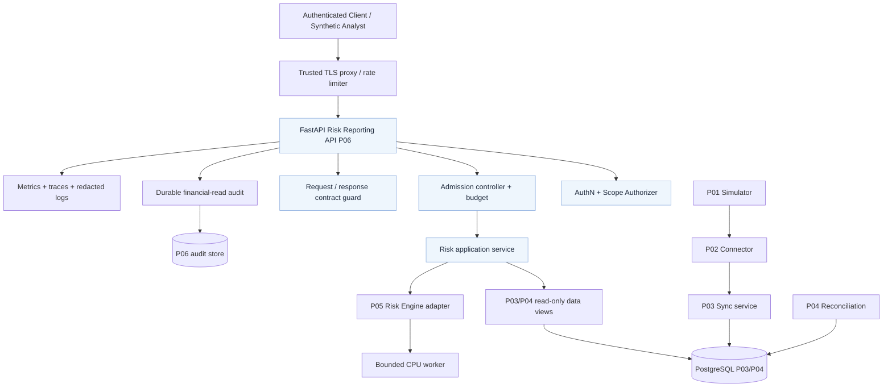
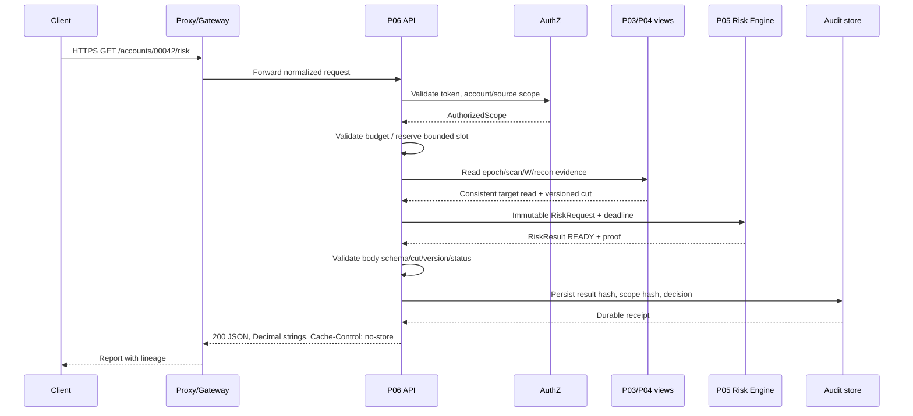
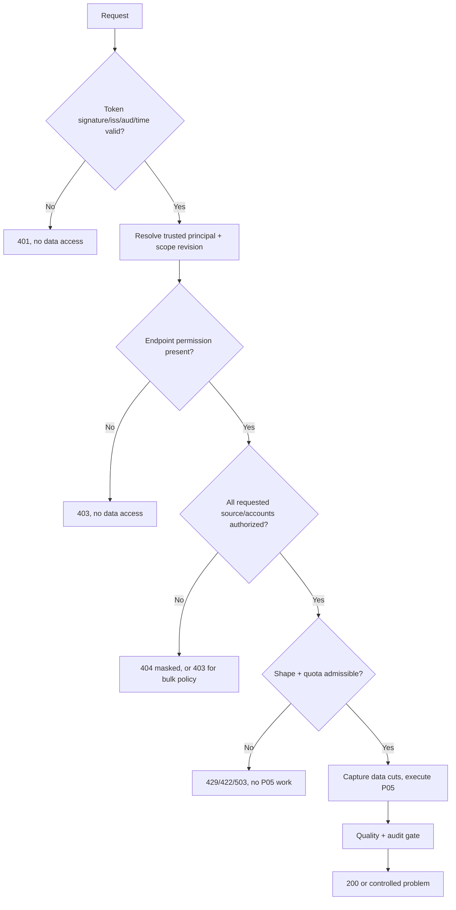
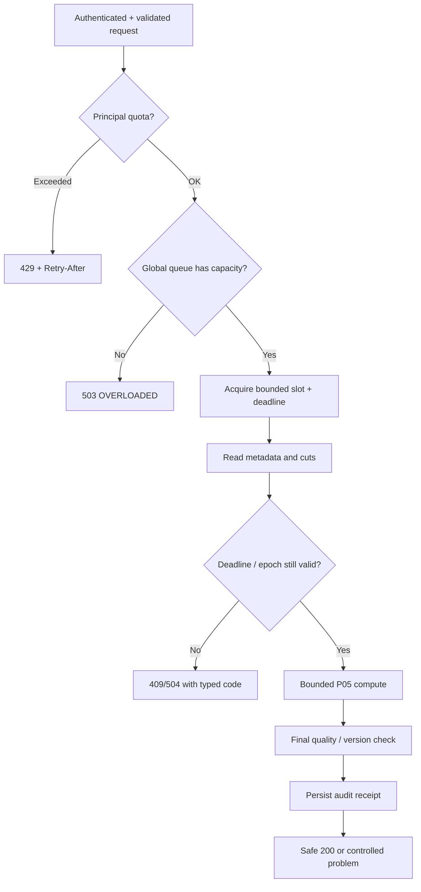
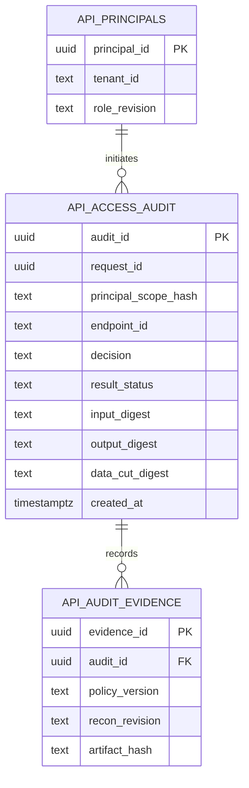
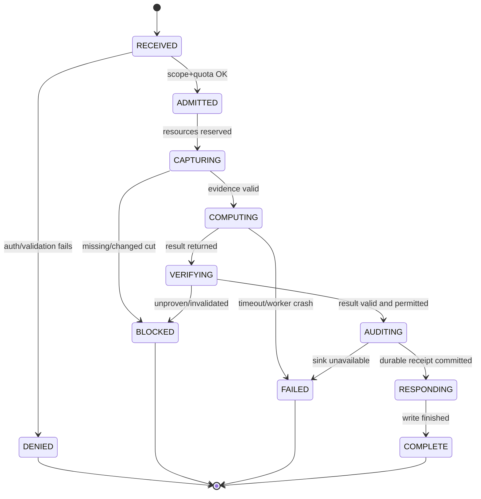
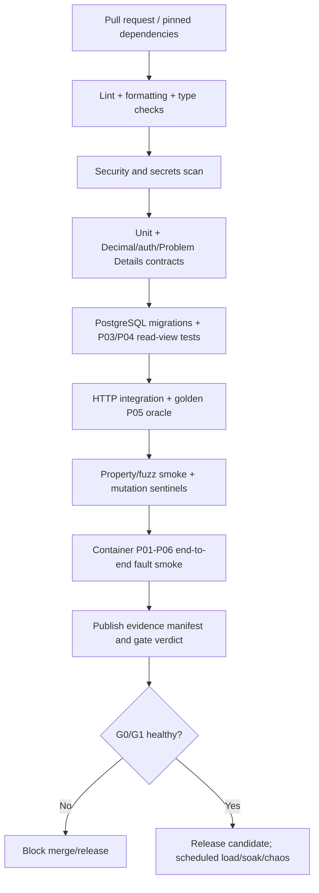

# Project 06 — Risk Reporting REST API

**System Design · HTTP API Contracts · Financial Correctness · Security · Resilience · What-if Verification**  
**Version:** 1.0 · **Date:** 2026-10-30  
**Status:** **DESIGN PROPOSAL — NOT IMPLEMENTED / NOT TESTED / NOT BENCHMARKED**  
**Roadmap:** Mini-project **06/09** — *Broker Risk Reporting and MT5 Integration*.

> **Provenance.** The original CV describes asynchronous APIs for exposure, realized/unrealized P&L, commission and swap, with Python/asyncio/FastAPI, MT5 Manager API, Kafka, PostgreSQL, ClickHouse, and a reported *p95 exposure API 120 ms at 100 concurrent clients*. It does **not** specify the HTTP routes, authorization model, DB schema, formula, or deployment of the original company project. Everything below is a proposed educational implementation, not a reconstruction of proprietary company architecture. The 120-ms figure is a **CV reference**, not an achieved result for this project.
>
> **Dependencies, all currently designs rather than deployed systems:**
> - `Project_01_MT5_Broker_Simulator_System_Design.md` — deterministic synthetic source, `run_id/generation/snapshot_seq`, fault injection.
> - `Project_02_MT5_Integration_Connector_System_Design.md` — bounded adapter, normalized errors, source identity.
> - `Project_03_Trading_Data_Synchronization_System_Design.md` — `accounts_current`, `positions_current`, `deals`, source epochs, published scans, Deal watermark and lease fencing.
> - `Project_04_Snapshot_Reconciliation_and_Recovery_System_Design.md` — findings, blocking status, approved repair/verification, evidence revision.
> - `Project_05_Broker_Risk_Calculation_Engine_System_Design.md` — **pure financial Risk Engine**, cut-aware component results, Decimal accounting, symbol/quote provenance, quality taxonomy.
>
> **Definition of “chịu nổi”:** Correct authorized data with currency and reproducible cut/provenance, delivered within an explicit resource budget; **otherwise** a predictable, non-leaking, auditable rejection/partial response allowed by contract. Fast HTTP responses with wrong money, cross-tenant data, unproven cuts or hidden partial data are **critical failures**.
>
> **Limits:** No finite matrix can enumerate *all* possible system states. The **432 scenario catalog** is augmented by state-machine, property-based, adversarial, mutation, soak and multi-fault testing. **Every scenario is NOT RUN** until backed by real test evidence.

---

## 0. Executive summary and six non-negotiables

1. **Thin HTTP layer, no parallel financial formulas:** Project 06 parses, authorizes, budgets, calls Project 05 and serializes validated results. It never reimplements exposure/P&L in endpoint handlers.
2. **Authorization before any data access, on every scope:** `source_id`, `epoch_id`, account filters, aggregate groups and cursor all derive from/are bounded by trusted identity claims; no client-controlled tenant selector can widen access.
3. **Result truth over HTTP success:** `READY` vs `DEGRADED` vs `BLOCKED` must survive transport without becoming “success by omission”. Strict composite is default.
4. **Cut and version correctness:** Every successful financial payload carries source/epoch, position/account scan, Deal watermark, quote snapshot, risk policy, catalog version, reconciliation evidence and digest, where relevant. No synthetic global cut.
5. **Bounded end-to-end costs:** Body size, query complexity, account count, DB pool, queue, CPU, timeout, response size and per-principal quota have independent budgets; retries must not multiply overload.
6. **Fail closed on sensitive audit and inconsistent state:** If mandatory audit cannot be persisted, no financially sensitive `READY` report is sent. A P04 blocking finding or active epoch change cannot be ignored by cache.

### 0.1 Minimum end-user flow

A tester authenticates as a simulated broker analyst, requests an exposure report for account `00042`, and receives a JSON result with Decimal **strings**, currency/unit metadata, `status`, `cuts`, versions, hashes and a unique `request_id`. When Project 01 injects a reset or Project 04 opens a blocking conflict, the API emits an explicit, correctly mapped problem response without leaking another account's data.

### 0.2 Phased capability map

| Stage | Supported | Explicitly unsupported or gated |
|---|---|---|
| **P0 — MVP** | Simulated single broker/source, scoped account access, read-only synchronous GET/POST, exposure and P&L components from P05 for USD linear FX profile, snapshot/version validation, Problem Details, no-store responses, rate limits, bounded execution, durable required audit, pagination with fail-on-change | Real trading, MT5 Manager direct call, production identity integrations, multi-currency conversion, strict cross-entity global cut without proof, mutable background jobs, export of all broker data |
| **P1** | External OIDC/JWKS, tenant-aware roles, optional scope-safe versioned cache, downloadable completed reports, robust historical cut querying, asynchronous report jobs with their **own** ownership/retention contracts | Silent historical reconstruction, global consistency where source cannot prove it |
| **P2** | Multi-broker policy plugins, multi-region DR, advanced data analytics and automated risk-review integrations | Claiming 120-ms SLO for any workload without benchmark |

---

## 1. Requirements, NFRs and boundaries

### 1.1 Functional requirements and acceptance

| ID | Priority | Requirement | Acceptance condition |
|---|---|---|---|
| FR06-01 | P0 | `GET /api/v1/accounts/{account_id}/risk` | Calls P05 once through a typed service; no route-level money arithmetic |
| FR06-02 | P0 | `GET /api/v1/accounts/{account_id}/pnl` | Returns explicitly labeled gross/commission/swap/**net excluding unavailable fee** |
| FR06-03 | P0 | `GET /api/v1/positions` | Bounded keyset pagination with source/epoch/scan guard |
| FR06-04 | P0 | `GET /api/v1/exposure` | Scopes aggregate to authorized accounts, groups by compatible symbol units |
| FR06-05 | P0 | `GET /api/v1/reports/daily` | Explicit UTC [start,end), coverage, cut semantics; rejects expensive plans |
| FR06-06 | P0 | `POST /api/v1/risk-calculations` | Rich read-only compute request, strict composite default, server-side scope intersection |
| FR06-07 | P0 | `GET /health/live` and `/health/ready` | Liveness independent of DB; readiness checks bounded critical dependency state |
| FR06-08 | P0 | Trusted authentication and per-resource authorization | BOLA/BFLA negative tests; unauthorized scopes produce no data/compute |
| FR06-09 | P0 | Structured `application/problem+json` errors | Error taxonomy/status documented and contract tested |
| FR06-10 | P0 | End-to-end Decimal string serialization | No money or lot sizes as JSON binary floats |
| FR06-11 | P0 | Status, lineage, freshness and provenance in every report | Missing proof blocks or explicitly degrades only under opt-in |
| FR06-12 | P0 | Concurrency/size/deadline and backpressure | Reject before OOM/pool collapse; queued work bounded |
| FR06-13 | P0 | Durable sensitive-read audit | No authorized `READY` data response when required audit is unavailable |
| FR06-14 | P0 | OpenAPI versioning and consumer-driven tests | Contract pinned, examples validated against schema |
| FR06-15 | P0 | Adversarial/fault-injection test harness | Reproducible inject/assert/evidence and rollback of fixtures |
| FR06-16 | P1 | Versioned, scope-safe response cache | Revocation, epoch, repair and quote update invalidate eligible entries |
| FR06-17 | P1 | Async report jobs for long-running historical workloads | Ownership, expiry, cancellation and cut pinning proven |
| FR06-18 | P1 | Production OIDC and fine-grained permissions | JWT/JWKS rotation, least privilege and auditing tested |

### 1.2 Quality attributes, in order

**Priority 1: Financial correctness + confidentiality.** Never return arithmetic that is unverifiable; never leak unauthorized account identifiers, sums or existence. **Priority 2: Availability under bounded degradation.** Return explicit 4xx/5xx with retry hints when dependent systems are unhealthy. **Priority 3: Observability and reproducibility.** Make `request_id`, `calculation_id` and immutable input digests traceable without exposing financial data in metrics. **Priority 4: Latency.** Achieve provisional workload-specific targets only after correctness gates pass. **Priority 5: Evolvability.** Explicitly version new fields and API routes.

### 1.3 What Project 06 does *not* own

- Does not connect to MT5 SDK (P02), write synchronized deals/positions (P03), perform repair (P04), define financial formulas (P05), publish Kafka business events (P07), or store ClickHouse analytics (P08).
- Does not expose broker-admin mutation endpoints on public `/api/v1`.
- Does not promise that a PostgreSQL MVCC snapshot equals a globally aligned MT5/quote/account cut.
- Does not infer a missing `DEAL_FEE` or FX conversion rate; absence remains explicitly represented.
- Does not authorize requests using user-supplied `X-Tenant-ID` or account IDs alone.

### 1.4 Design assumptions to lock with ADRs

| ID | Proposed assumption | If untrue |
|---|---|---|
| A06-01 | P03 and P04 provide read-only **versioned status/evidence** views | Block financial APIs until additive contracts available |
| A06-02 | P05 offers typed `RiskRequest -> RiskResult` and deterministic exceptions | Add adapter + consumer-driven tests; do not guess return fields |
| A06-03 | USD-profit linear FX symbols only for P0 | `UNSUPPORTED_CALC_MODE`, not fallback formula |
| A06-04 | Authenticated analyst can read a configured subset of account/source pairs | Always intersect with policy; deny missing policy |
| A06-05 | Local development uses signed test tokens from test issuer | Never accept `alg=none`, unsigned tokens or arbitrary debug headers |
| A06-06 | P03 `positions_current` represents *latest published scan* and can be overwritten | A cursor pinned to old scan must return `409 SCAN_CHANGED`, not invent historical rows |
| A06-07 | Auditing financial reads is mandatory for this educational reference | If audit sink unavailable: `503` and no financial payload |
| A06-08 | All performance numbers are targets on specified hardware/dataset | Collect a baseline before treating as SLO |

---

## 2. Contracts with Projects 01–05

| Source | Established design concept | P06 expected behavior | Change request required? |
|---|---|---|---|
| P01 | `run_id`, `generation`, `snapshot_seq`, source reset, deterministic fault rules | Integration tests trigger source failure indirectly through P02/P03; P06 **does not** directly talk to simulator | No for P0 tests |
| P02 | `SourceEpochChangedError`, `UpstreamTimeoutError`, bounded worker | P06 reads P03/P04 state; does not retry the SDK itself | No |
| P03 | `source_epochs(epoch_id, status)`, `accounts_current`, `positions_current`, immutable `deals`, Deal `W`, `published_scan_id` | Read-only scope filtering and repeatable target snapshot; never mistake unpublished scans for usable data | Add stable public read contract/views if not available |
| P04 | reconciliation run/finding, `BLOCKING`, verification, repair evidence | Refuse unsafe components; include monotonic `recon_revision`/digest in result | **Yes**, if no stable read-side revision exists |
| P05 | `READY/DEGRADED/BLOCKED/UNSUPPORTED`, `RiskCut`, risk policy/catalog, reason codes, component outputs, input/output digests | Preserve value and meaning precisely in HTTP; forward reasons according to safe disclosure policy | Version contract as `risk-result-v1` |

**No contract laundering:** `P03 data published` does **not** imply `P04 reconciled`, `P04 no current finding` does **not** prove quote alignment, and `P05 component READY` does **not** imply composite READY. If any required field/proof is missing, surface a structured blocker.

### 2.1 Canonical request mapping

```text
HTTP request + verified principal
  -> validate shape, resolve tenant/source/authorized account set
  -> validate source epoch/recon publication and report policies
  -> construct immutable P05 RiskRequest (with versions, real UTC interval)
  -> bounded P05 execution
  -> P05 RiskResult (no recalculation in P06)
  -> verify P05 contract/status/provenance
  -> record durable audit if required
  -> serialize money strings + no-store headers / or Problem Details
```

**Scope derivation:** Client fields `source_id`, `account_ids` are *requested filters*. The server derives canonical `tenant_id`, permissible `source_id`, and account set from trusted token and backend policy; then intersects, with explicit denial for any outside account. Use separate `principal_id`, `source_id`, `epoch_id`, `account_id` in internal type-safe context. `account_id` retains leading zeros.

### 2.2 P05 quality statuses and HTTP boundary

| P05 result | Caller requests | HTTP result | Meaning |
|---|---|---|---|
| `READY`, required components proven | Strict or partial | `200` financial JSON | Complete **for the declared cut and coverage** |
| `DEGRADED`, some components unproven | **Explicit** `allow_partial=true` | `200`, body `status=DEGRADED`, `composite_total=null` | Never disguise as full success |
| `DEGRADED` | Strict/default (`allow_partial=false`) | `409` problem `COMPOSITE_UNPROVEN` | Does not emit incomplete sum |
| `BLOCKED` / `UNSUPPORTED` | Any | `409`/`422`/`503` by stable reason mapping | No money payload fabricated |
| `READY` but missing `cuts`/`currency`/digest | Any | `502 INVALID_RISK_RESULT` + security/audit event | P05 contract violation; no `200` |
| P05 throws or times out | Any | `503`/`504` + bounded retry advice | No partial result unless already explicitly proven |

**Important:** `206 Partial Content` is not the transport for P05 degraded components: `206` has byte-range semantics. `200 DEGRADED` exists only for opt-in responses with status/reasons clearly present. HTTP success is **not** itself evidence of P05 data quality.

---

## 3. Architecture and threat boundaries

### 3.1 C4-like container diagram



**Data-plane and control-plane separation:** Public report endpoints never expose simulator fault injection, raw SQL, broker reset, reconciliation approval or repair. Internal `/internal/metrics`/admin features bind to a restricted listener or sidecar with separate identity, not public routing.

### 3.2 Boundary matrix

| Boundary | Trusted input | Untrusted input | Failure policy |
|---|---|---|---|
| Edge → API | Verified TLS client route/mTLS proxy identity only if explicitly configured | All HTTP headers, body, path, query, `X-Forwarded-*` from arbitrary internet client | Validate normalization + budget before expensive work |
| Token issuer → principal | Validated signature, issuer, audience, expiry, permitted algorithm and scopes | User-pasted token, custom tenant header, unsigned JWT | `401`/`403`; no DB read |
| Principal → data | Server-computed allowed account/source IDs | URL account ID, POST account list, cursor owner | Intersection and per-resource authorization; default deny |
| API → P05 | Type-checked immutable input and policy versions | Unknown currencies, partial cuts, stale quotes | `BLOCKED`/`UNSUPPORTED` explicit |
| API → PostgreSQL | Parameterized read-only views and transaction-scoped read role | Raw SQL names or `sort` from client | Allowlisted query builders only |
| API → audit store | Sanitized, structured access record | User-supplied raw identifiers as labels or arbitrary JSON | Mandatory durability or controlled no-data failure |

### 3.3 Modules and responsibility

| Module | Does | Does not |
|---|---|---|
| `api/routers/` | HTTP routing and OpenAPI | Arbitrary SQL, financial math |
| `authn/` | Verify bearer identity and key rotation | Trust client-supplied tenant |
| `authz/` | Scope-policy resolution, object-level check | Infer access from account ID existing |
| `contracts/` | Pydantic schemas, shape limits, Decimal-string output | Normalize invalid finance values to zero |
| `app/risk_service.py` | Map request to P05, coordinate cut/budget | Own P03 data or P04 repair |
| `admission/` | Limits, budgets, fairness, overload | Infinite in-memory queue |
| `repositories/` | Read-only queries and stable capture | Blind long-lived global AsyncSession |
| `execution/` | Isolate CPU work and cancellation semantics | Claim killed a native CPU task because await timed out |
| `auditing/` | Durable request/result evidence | Log raw tokens, P&L, full account lists in public logs |
| `observability/` | Low-cardinality metrics, traces and alerts | Put account ID in metric labels |

### 3.4 Request sequence: valid financial report



### 3.5 Sequence: concurrent repair while a report computes

```mermaid
sequenceDiagram
  participant A as API
  participant PG as P03/P04 evidence views
  participant R as P05
  participant P4 as P04 repair
  A->>PG: Pin epoch, published scans, recon revision R10
  A->>R: Compute with immutable RiskCut R10
  P4->>PG: Commit repair/verification; revision R11
  R-->>A: Result for R10
  A->>PG: Final contract validity check (R10 vs R11)
  PG-->>A: Revision changed
  A-->>A: Mark original result obsolete; no READY emission
  Note over A: Retry at most once if budget allows, else 409 CUT_CHANGED
```

**Race disclaimer:** The final check cannot guarantee the *world stops changing* before the HTTP bytes reach the client. The service guarantees a result for its **declared immutable cut**, and may refuse a result invalidated before the final check. True linearizable “current now” semantics across source, P03, P04 and quotes require a stronger coordinated protocol **not provided** by these designs. Always include `as_of/cuts` and measured age.

---

## 4. HTTP API specification v1

### 4.1 Base, authentication and representation

- Base path `/api/v1`; use HTTPS in every non-local environment. External authorization is `Authorization: Bearer <token>` for P0 simulated identity and P1 validated OIDC; never accept raw MT5 login/password on reporting API.
- Request/report data is JSON; `Content-Type: application/json` for POST, `Accept: application/json`. Public errors use `Content-Type: application/problem+json` per RFC 9457.
- Set `Cache-Control: private, no-store`, `Pragma: no-cache` (legacy intermediaries), `X-Content-Type-Options: nosniff`, a server-generated `X-Request-ID`, `Vary: Authorization` if any intermediary could cache. Prefer disable intermediary caching entirely for financial endpoints. `no-store` is not a substitute for TLS/access control.
- Treat all currency amounts and precise lots as **decimal strings**. IDs are strings; UTC times are RFC3339 strings with `Z`; intervals are half-open `[start,end)`.
- Unsupported query keys / unknown JSON members are rejected (`422`) rather than silently ignored on risk-changing requests.

### 4.2 Endpoint table

| Method/path | Purpose | Parameters | Response | Workload policy |
|---|---|---|---|---|
| `GET /api/v1/accounts/{account_id}/risk` | Scoped exposure, realized and unrealized summaries | `source_id`, `components`, `allow_partial=false`, `epoch_id?`, `valuation_as_of?` | `200 RiskResponse` or problem | P0 limited synchronous |
| `GET /api/v1/accounts/{account_id}/pnl` | P&L components + fees coverage | `source_id`, `period_start`, `period_end`, `allow_partial=false` | `200 PnlResponse` | Reject unsupported/huge history |
| `GET /api/v1/positions` | Position list, **not** a historical as-of snapshot | `source_id`, `account_id?`, `symbol?`, `limit<=100`, `cursor?` | `200 PositionsPage` | Keyset pagination with scan-fence |
| `GET /api/v1/exposure` | Exposure by symbol for authorized scope | `source_id`, `account_ids?`, `symbol?`, `allow_partial=false` | `200 ExposureResponse` | Bound group count/accounts |
| `GET /api/v1/reports/daily` | Realized Deal summary over UTC day | `source_id`, `date=YYYY-MM-DD`, `account_id?` | `200 DailyReport` | Coverage visible; no fake historical positions |
| `POST /api/v1/risk-calculations` | Typed complex read-only report | `RiskCalculationRequest` | `200 RiskResponse` | Body cap and concurrency quota |
| `GET /health/live` | Process liveness | None | `200` when event loop servicing, else fail | No DB dependency; private if possible |
| `GET /health/ready` | Instance readiness | None | `200/503` minimal details | Bounded, cached health checks; no full broker scans |
| `GET /internal/metrics` | Metrics scrape | Internal authenticated listener | Prometheus text | Not publicly routable |

**Recommended deliberate separation:** `GET /reports/daily` only aggregates Deal activity in a day; it **must not** imply it knows the historical end-of-day Position snapshot if P03/P05 cannot prove it. `GET /exposure` is a scoped, symbol-compatible units report, not universal USD notional risk.

### 4.3 Validation limits (starting proposals, NOT benchmarks)

| Input/limit | P0 maximum | On violation |
|---|---:|---|
| POST body compressed/uncompressed | 32 KiB / 64 KiB | `413 REQUEST_TOO_LARGE`; reject compression in MVP unless safely handled |
| URL length / query chars | 2 KiB / 1 KiB | `414 URI_TOO_LONG` or `422` |
| JSON nesting depth | 12 | `422 INVALID_PAYLOAD` |
| Accounts per rich request | 100 | `422 ACCOUNT_SCOPE_TOO_LARGE` |
| Positions per query page | 100 | `422 LIMIT_EXCEEDED` |
| Aggregate symbols per response | 200 | Explicit bounded failure or pagination, never silent truncation |
| Requested daily interval | Exactly one UTC calendar day for daily endpoint | `422 INVALID_TIME_WINDOW` |
| Direct P&L realized time span | 31 days (P0) | `422 HISTORICAL_WINDOW_TOO_LARGE`; P1 job alternative |
| CPU budget for interactive request | 3 s compute, end-to-end 5 s | `504 DEADLINE_EXCEEDED`; work isolation still required |
| Max queued heavy jobs / instance | 16 | `503 OVERLOADED`; retry jitter |
| Max executing heavy jobs / instance | 4 | Admit within policy or reject |
| Per-tenant interactive rate (initial) | 20 req/s sustained, 40 burst, weight high-cost requests | `429 RATE_LIMITED` |
| JSON response body | 1 MiB | `422 RESULT_TOO_LARGE`, never truncate Decimal/data |
| Cursor expiry (P0) | 2 min | `409 CURSOR_EXPIRED`, start new scan |

These numbers are **design starting points** to be tuned with evidence; limits must be tested at `L-1`, `L`, `L+1`, negative values, overflow and concurrency. Edge proxy, app, P05 and PG must share compatible budgets.

### 4.4 GET risk example — successful componentized response

```http
GET /api/v1/accounts/00042/risk?source_id=sim-broker-a&components=EXPOSURE,REALIZED,UNREALIZED&allow_partial=true HTTP/1.1
Host: broker-api.example.test
Authorization: Bearer <redacted-test-token>
Accept: application/json
```

```json
{
  "request_id": "req-8e21",
  "calculation_id": "4a47dc4f-dc8f-45b2-a5ed-374e9774c113",
  "status": "DEGRADED",
  "reason_codes": ["INCOMPATIBLE_CUT", "FEE_COVERAGE_UNAVAILABLE"],
  "currency": "USD",
  "scope": {"source_id": "sim-broker-a", "epoch_id": "3cecd819-fd61-420b-8e35-019c70203b4e", "account_ids": ["00042"]},
  "cuts": {
    "account_scan_id": "scan-A", "position_scan_id": "scan-P",
    "deal_watermark_seq": 1050, "quote_snapshot_id": "quote-S1030",
    "recon_revision": "recon-R10", "consistency": "INDEPENDENT"
  },
  "versions": {"risk_policy": "risk-policy-v1", "symbol_catalog": "sim-usd-fx-v1", "api_schema": "risk-response-v1"},
  "components": {
    "exposure": {"status": "READY", "by_symbol": {"EURUSD": {"unit_currency": "EUR", "long_units": "50000", "short_units": "0", "gross_units": "50000", "net_units": "50000"}}},
    "realized": {"status": "READY", "gross_usd": "60.00", "commission_usd": "-3.50", "swap_usd": "-0.50", "net_excluding_fee_usd": "56.00", "fee_coverage": "NOT_AVAILABLE"},
    "unrealized": {"status": "BLOCKED", "reason_code": "QUOTE_CUT_UNPROVEN"}
  },
  "composite_total": null,
  "input_digest": "<digest-of-canonical-manifest>",
  "output_digest": "<digest-of-canonical-result>",
  "audit_id": "audit-0001"
}
```

**Example warning:** IDs/hashes above are illustrative placeholders derived from P05's proposed example, **not real validated digests**. Tests must build digests from canonical fixtures. A response with `DEGRADED` is legal **only because this request explicitly set** `allow_partial=true`. P05's proposed `strict_composite=false` maps to P06's `allow_partial=true`; never invert silently.

### 4.5 Rich POST request

```json
{
  "source_id": "sim-broker-a",
  "account_ids": ["00042"],
  "components": ["EXPOSURE", "REALIZED", "UNREALIZED"],
  "period_start_utc": "2026-10-01T00:00:00Z",
  "period_end_utc": "2026-10-30T00:00:00Z",
  "allow_partial": false,
  "risk_policy_version": "risk-policy-v1",
  "symbol_catalog_version": "sim-usd-fx-v1"
}
```

`epoch_id` may be accepted only as an **authorized pinned historical/read epoch** under a separately tested policy; by default, server resolves active authorized epoch and refuses archived/blocked epochs. Client cannot select an old epoch to bypass new findings. `risk_policy_version`/`symbol_catalog_version` must be allowlisted and verified against installed versions; never load arbitrary implementation code by user-controlled version string.

### 4.6 Problem Details shape (RFC 9457)

```http
HTTP/1.1 409 Conflict
Content-Type: application/problem+json
Cache-Control: private, no-store
X-Request-ID: req-badcut-01
```

```json
{
  "type": "https://docs.example.test/problems/composite-unproven",
  "title": "Consistent composite result unavailable",
  "status": 409,
  "detail": "Required financial components cannot be proven at a compatible data cut.",
  "instance": "urn:request:req-badcut-01",
  "code": "COMPOSITE_UNPROVEN",
  "request_id": "req-badcut-01",
  "retryable": false,
  "reason_codes": ["INCOMPATIBLE_CUT"]
}
```

**Do not expose** SQL fragments, stack traces, tokens, account existence, raw P04 sensitive findings or production hostnames in error details. The `docs.example.test` URI is illustrative and must be changed to a controlled real documentation origin before release.

### 4.7 Stable HTTP error mapping

| Condition | Status | Public code | Retry policy |
|---|---:|---|---|
| Missing/invalid/expired credential | 401 | `UNAUTHENTICATED` | Refresh/re-auth, no blind retry |
| Authenticated but role denied | 403 | `ACCESS_DENIED` | Never brute-force |
| Account outside scope or nonexistent, when existence must be hidden | 404 | `RESOURCE_NOT_FOUND` | Do not reveal which |
| Invalid date/enum/size/format | 422 | `INVALID_REQUEST` | Change request |
| Body exceeds limit | 413 | `REQUEST_TOO_LARGE` | Shrink body |
| Unsupported content type | 415 | `UNSUPPORTED_MEDIA_TYPE` | Use documented type |
| `INCOMPATIBLE_CUT`, `RECON_BLOCKING`, `EPOCH_CHANGED` | 409 | `COMPOSITE_UNPROVEN` / `DATA_NOT_READY` / `EPOCH_CHANGED` | Only after data changes or retry if specifically advised |
| Unsupported calculation/profile | 422 | `UNSUPPORTED_CALC_MODE` | Requires different product capability |
| Repeated conflicting cursor/pinned scan | 409 | `SCAN_CHANGED` | Restart pagination |
| Per-principal request rate or policy quota | 429 | `RATE_LIMITED` | `Retry-After` bounded, client jitter |
| Service admission full | 503 | `OVERLOADED` | `Retry-After` bounded, jitter; no storm |
| P03/P04 DB down or audit sink unavailable | 503 | `DB_UNAVAILABLE` / `AUDIT_UNAVAILABLE` | Retry bounded |
| P05 result invalid/missing metadata | 502 | `INVALID_RISK_RESULT` | Server fix; no auto replay storm |
| Server deadline exceeded | 504 | `DEADLINE_EXCEEDED` | Client may retry idempotent reads after delay |
| Unexpected fault | 500 | `INTERNAL_ERROR` | Redacted incident + no financial payload |

`STALE_MARK`, `QUOTE_CUT_UNPROVEN`, `DEAL_WATERMARK_UNPROVEN`, `P03_UNPUBLISHED` are domain blockers; map using **typed cause and retry advice**, not blanket 500. Return `200` only with a `READY` result, or a specifically requested partial `DEGRADED` result. Status/body/code must agree.

---

## 5. Financial response semantics, invariants and read consistency

### 5.1 Mandatory invariants

| ID | Invariant (P0 unless otherwise noted) | Oracle |
|---|---|---|
| INV06-01 | No unauthorized account/source/epoch appears in query, cache key, output or audit detail | Trace query binds + auth matrix + response scan |
| INV06-02 | `200 READY` carries matching `source_id`, epoch, policy/spec versions, valid component cuts, currency and digests | Schema + source manifest oracle |
| INV06-03 | `200 DEGRADED` **requires explicit opt-in** and `composite_total=null` when cross-cut proof missing | Status/partial contract tests |
| INV06-04 | `BLOCKED`, `UNSUPPORTED` and `INCONCLUSIVE` are never silently converted to `READY`/0 | Injection + truth-table tests |
| INV06-05 | Every financial amount is a string encoding a finite Decimal under field-specific bound/scale policy | JSON token-type and Decimal parser assertions |
| INV06-06 | `net_excluding_fee_usd` is not labeled `net_usd` if fee coverage is missing | Schema golden fixture |
| INV06-07 | One account/epoch produces one stable cut manifest per response; no mixed target transaction reads | DB snapshot + version assertions |
| INV06-08 | No old epoch/finding revision can be served after revocation is seen by final check | Concurrent repair/reset tests |
| INV06-09 | Cross-symbol quantities are never summed without compatible unit/currency | Risk engine golden oracle |
| INV06-10 | Every position page is from same verified published scan or fails with `409` | Cursor/scan mutation tests |
| INV06-11 | Cursor cannot increase scope or leak raw account IDs; is signed and expiry checked | Tamper/leak test |
| INV06-12 | Unauthorized/invalid request has **zero P05 invocations** and no expensive P03 read | Counters/mocks assertions |
| INV06-13 | Work-in-flight and queue lengths remain bounded under load/cancellation | Resource max and queue metrics |
| INV06-14 | App never holds shared `AsyncSession` across concurrent tasks | Static analysis + connection tests |
| INV06-15 | P05 CPU-bound work does not indefinitely stall event loop, even if client drops connection | Heartbeat p99 under test |
| INV06-16 | Required durable audit receipt exists **before** returning sensitive report bytes | Audit fault-injection tests |
| INV06-17 | `Cache-Control: no-store` for sensitive success, error and partial bodies | Proxy integration tests |
| INV06-18 | Request id is server-generated, not forged by caller, and observable across audit/traces | Spoofed-header test |
| INV06-19 | A successful result can be reconstructed from `input_digest` + cut/policy or audit explains missing evidence | Reproducibility fixture |
| INV06-20 | P06 code never mutates P03/P04 financial/projection tables | DB grants + before/after hash |

### 5.2 Read snapshot and cut protocol

1. After auth/admission, begin **read-only** P03/P04 evidence capture using an isolated DB session; for multiple target reads use an appropriate snapshot boundary such as PostgreSQL `REPEATABLE READ READ ONLY` (implementation verified with SQLAlchemy/driver).
2. Pin `source_id+epoch_id`, published Account/Position scan IDs, terminal Deal watermark W, reconciliation revision/digest, symbol/quote/catalog versions and requested component semantics.
3. Project 05 computes on evidence-rich immutable inputs; do not hold a DB transaction across an unbounded CPU job or network wait. If streaming needed, have a bounded input plan with a finite read budget.
4. Validate P05 output cut/version/digest. Perform a bounded **final validity check** for revocation, epoch and P04 blocking revision before releasing sensitive report. A change returns `409 CUT_CHANGED` or a **single** re-capture within deadline; no endless retry.
5. Record durable audit, then serialize and send headers/body. No unproven `READY` result can escape through streaming before this check. For large responses, materialize bounded body prior to first byte or employ a protocol that proves a complete manifest before streaming.

**PostgreSQL limitation:** One target DB snapshot does not magically prove synchrony of P01's Accounts/Positions/Deals/quotes. A historical read of `positions_current` after a newer publication is not possible unless immutable historical projection snapshots have been explicitly retained. With only `positions_current`, fail on scan change rather than invent historical data.

### 5.3 Pagination design, defensively

- Use keyset ordering on `(position_id)` (string-preserving stable collation agreed in contract); never OFFSET for a changing large table.
- Signed opaque cursor contents (server-side encrypted/indirected if sensitive): `{v,tenant_scope_hash,auth_scope_revision,source_id,epoch_id,published_scan_id,last_position_id,filter_hash,exp,key_id}`. HMAC signing **does not encrypt**; do not expose raw account lists in base64 cursor.
- On every page: verify signature and key, expiry, authenticated scope hash, filters, epoch and `published_scan_id`, and re-read `positions_current` under one DB target snapshot. If scan changed, return `409 SCAN_CHANGED`; never stitch pages across scans.
- When scan remains same, fetch `limit+1` matching rows and emit next cursor only after response/manifest checks. If scan changes after page emission, the **next** page is rejected, not mixed silently.
- Full unbroken enumeration across arbitrary source changes requires **immutable retained snapshots** in P03 (P1 additive contract). P0 makes no such guarantee.

### 5.4 Historical, fee and FX rules

- `daily` report needs proof of complete Deals for the selected UTC day **and** known classification/fee coverage; missing Deal interval is `BLOCKED`, not zero.
- `period_start/end` applies to realized Deal execution times; `valuation_as_of` pertains separately to current/historical Unrealized and cannot default to `end` to fake a common cut.
- `commission`, `swap` retain their signed amounts; P05's `fee_coverage=NOT_AVAILABLE` must remain visible; never label partial net as all-in.
- USD FX P0 only; if account or profit currency unsupported, reject `UNSUPPORTED_CALC_MODE` / `FX_RATE_MISSING`, not convert to USD silently.

---

## 6. Authentication, authorization and security controls

### 6.1 Identity policy

For P0, create a deterministic, **signed** local JWT test issuer with an allowlisted algorithm, keys outside source control, `iss`, `aud`, `exp`, `nbf`, `sub`, scoped permissions and a stable server-side policy record. For a real deployment, replace with a configured OIDC issuer/JWKS and documented rotation; do not invent a custom crypto algorithm or trust `kid` as a URL to fetch. Validate `iss/aud/alg` strictly and bound clock skew.

Roles (proposals): `risk_viewer` may query individual authorized accounts; `risk_analyst` can request authorized aggregates; `risk_admin` manages policy **outside this API**, not P03/P04 repair; `service_reporter` uses server-to-server credentials. The least privileged role cannot call internal `/metrics`, simulator fault controls or P04 repair APIs.

### 6.2 Authorization decision sequence



- **Never** use `WHERE account_id = :id` without both source epoch and authorized tenant/account scope; best add tested database row-level security if the deployment becomes multi-tenant.
- Aggregate requests must not accept an empty account list as “all broker accounts” unless the principal has an explicit audited aggregate permission. Prefer explicit authorized set with a hard maximum.
- Read-only APIs are not free of abuse: data exfiltration, computational denial of service and probing account existence are primary threats.
- Choose 404 for an out-of-scope individual account if hiding existence; keep consistent latency/body as feasible. Bulk scope mismatch can be 403 with no unauthorized IDs returned.

### 6.3 Security test baseline

Threat model covers OWASP API Security Top 10 2023, especially object-level authorization (BOLA), broken authentication, property-level authorization, resource exhaustion, function authorization, unsafe upstream consumption. Evaluate both external HTTP and internal service-to-service identity, data-store grants, SSRF surfaces in any future export mechanism, log redaction and TLS/proxy trust.

---

## 7. Async, CPU isolation, connection pooling and overload

### 7.1 Two workloads, two execution budgets

**I/O-bound:** Auth policy lookups and PG reads use `async` without blocking the event loop. Use `AsyncSession` **per concurrent task**; no module-global shared session. Plan P03/P04 queries with strict SQL timeouts and read-only grants. **CPU-bound:** Decimal aggregation/serialization can consume CPU; offload expensive P05 jobs to a **bounded** worker/executor, ideally isolated processes for large workloads. A Python `asyncio.wait_for` timeout does **not** necessarily stop a worker thread/process already doing CPU work; enforce queued/executing limits and ignore late results with a request generation token; recycle a truly wedged isolated worker as operational policy.

### 7.2 Admission and deadline flow



**Budget example (to tune):** 5,000-ms interactive deadline consisting of edge/auth 200, read/evidence 1,000, compute 3,000, final-check/audit 500, network/serialization 300. These are *sub-budgets*, not guarantees. Reject upfront if projected workload obviously exceeds time/size cap; no infinite pending futures.

### 7.3 Dependency/resource budgets (P0 draft)

| Resource | Draft ceiling | Exhaustion response |
|---|---:|---|
| DB connections per API instance | `pool_size=5`, `max_overflow=0`, `pool_timeout=0.3s` | `503 DB_POOL_BUSY`; no connection fan-out |
| Concurrent heavy compute / instance | 4 | bounded queue (16) or `503` |
| Concurrent cheap reads / instance | 32 | `503 OVERLOADED` after quota |
| Event loop max expected scheduling delay | p99 under 50 ms on acceptance workload | Fail performance gate, inspect blocking CPU |
| P03/P04 read statement timeout | 1,000 ms (per SQL statement, draft) | Cancel/rollback and typed error |
| Public report byte cap | 1 MiB | fail before sending partial JSON |
| Client-side request timeout | Recommendation >= API 5 s plus network margin | Document retry for idempotent requests |
| Executor RSS and overall memory | 512 MiB per API instance **test ceiling** on 4vCPU/8GiB reference host | Admission reject / process circuit break |

Use a **global** policy across app replicas for tenant quotas in P1 when local-only counters are insufficient. Distinguish *rate* (429 per principal) from *capacity* (503 service-wide) and do not run hidden retries on 429/503 without backoff/jitter.

---

## 8. Data ownership and persistence design

P06 owns only its API audit/optional job state. It has **no UPDATE/DELETE/INSERT grants** on P03/P04 financial or reconciliation tables. P05 remains a pure core and is not modified by HTTP business handlers.

### 8.1 P06-owned durable audit (new schema; migration proposal)



```sql
-- P06-owned schema blueprint, not an executed Alembic migration.
CREATE SCHEMA IF NOT EXISTS risk_api;
CREATE TABLE IF NOT EXISTS risk_api.api_access_audit (
  audit_id uuid PRIMARY KEY,
  request_id uuid NOT NULL,
  principal_scope_hash text NOT NULL,
  endpoint_id text NOT NULL,
  decision text NOT NULL CHECK (decision IN ('ALLOW','DENY','BLOCK','ERROR')),
  result_status text,
  input_digest text,
  output_digest text,
  data_cut_digest text,
  risk_policy_version text,
  recon_revision text,
  created_at timestamptz NOT NULL DEFAULT now(),
  CHECK (length(principal_scope_hash) >= 16)
);
CREATE INDEX IF NOT EXISTS ix_api_audit_created_at
  ON risk_api.api_access_audit (created_at DESC);
-- Append-only grants + retention partitioning to be handled in migrations.
```

- Request ID on wire may be human-readable, while database `request_id` uses generated UUID; define reversible safe correlation map in log/evidence, **not** by treating arbitrary client header as UUID.
- `input_digest`, `output_digest` should refer to deterministic canonical manifests, not raw secrets/PII. The audit store may be separate PostgreSQL to isolate availability/failure domains.
- Durable audit-before-response is **not** atomic with delivery of HTTP bytes. A client timeout after audit commit may result in multiple audit records upon retry; reporting GET is safe to repeat because it changes no financial state. Do not claim exactly-once HTTP delivery.
- Keep retention/access restrictions and deletion policy explicit. Sensitive data in audit should be hashes/minimal metadata and avoid account IDs if not needed.

### 8.2 Suggested source read views (must be coordinated with P03/P04)

```sql
-- Illustrative shape only. These views DO NOT exist yet in P03/P04 designs.
-- Make them additive, versioned interfaces; never grant arbitrary table writes.
-- v_risk_epoch_status_v1(source_id, epoch_id, status, revision)
-- v_risk_published_cut_v1(epoch_id, account_scan_id, position_scan_id, deal_W, publication_revision)
-- v_risk_reconciliation_v1(epoch_id, scope_hash, recon_revision, blocking_reason_family)
```

No SQL string concatenation from `sort`, `group_by`, account IDs, dates or path. Use parameter binds and explicit enum allowlists, with query plans/EXPLAIN on test data. Commit a schema capability handshake before deploy to detect P03/P04 drift.

---

## 9. Error propagation, audit, cancellation and response lifecycle

### 9.1 Request lifecycle state machine



A timeout or TCP disconnect is **not a commit rollback guarantee** for remote reads/audit. Maintain a request generation ID and late-result fence. For streaming HTTP response, once headers/body bytes sent, status cannot be rewritten; P0 therefore forbids streaming financial bodies before verification and audit.

### 9.2 Cancellation matrix

| When cancel occurs | What server must do | What it cannot claim |
|---|---|---|
| Before admission | Release token/quota bookkeeping | That P05 executed |
| Waiting for DB pool | Cancel wait and release queue slot | That backend DB transaction existed |
| During read snapshot | Rollback/close AsyncSession, discard incomplete cut | That upstream P03 scan was cancelled |
| During CPU worker | Fence/discard late result; release only when worker truly exits or is isolated/terminated safely | `wait_for()` killed CPU work |
| After audit persisted but before response delivered | Keep durable audit, safe client retry | Exactly-once delivery |
| Between response headers and end of body | Log aborted delivery; don't change HTTP status | That client received a complete report |

---

## 10. Observability, health, alerts and privacy

### 10.1 Metrics (bounded cardinality)

| Metric | Labels (allowed) | Alert/symptom |
|---|---|---|
| `api_http_requests_total` | route template, status_class, method | Error or denial spike |
| `api_http_duration_seconds` | route, status_class | p50/p95/p99 per workload |
| `api_scope_denials_total` | denial_family, route | BOLA probing |
| `api_financial_status_total` | READY/DEGRADED/BLOCKED, reason_family | Wrong partial / block spike |
| `api_cut_revalidation_failures_total` | source_kind, failure_family | Repair/reset races |
| `api_admission_rejections_total` | per_tenant/global, reason | Capacity pressure |
| `api_inflight_requests`, `api_heavy_queue_depth` | instance | Queue growth |
| `api_db_pool_wait_seconds`, `api_db_errors_total` | cluster, type | Pool/failover trouble |
| `api_worker_cpu_seconds`, `api_worker_heartbeat_lag` | worker_kind | Event loop/CPU stalls |
| `api_audit_receipts_total`, `api_audit_failures_total` | result | Audit availability |
| `api_response_payload_bytes` | endpoint class | Leakage/response bloat |
| `api_unauthorized_data_access_total` | test-only critical signal | **Must remain 0** |

**Never** label metrics with raw account ID, principal ID, exact source epoch or financial values; high cardinality and privacy leakage. Prefer hashed scope only in protected audit with strict retention and access controls. Traces can carry request/calculation IDs with redaction; sampling must never be a precondition for audit.

### 10.2 Health semantics

- `/health/live`: only process/event-loop health; MUST NOT wait on full PostgreSQL query, MT5 SDK or reconciliation. A transient DB issue must not cause infinite restart loops.
- `/health/ready`: independent bounded checks for credentials/config, DB connectivity/schema capability, audit sink, and worker/admission availability; may return `503` with **coarse** internal reason, no secrets. A source epoch blocked for one broker should affect per-report quality, not necessarily disable all tenants globally.
- Metrics and diagnostics exposed separately, behind internal access controls.

### 10.3 Operational runbooks

| Signal | First action | Safety check | Recovery confirmation |
|---|---|---|---|
| 401 spike | Inspect issuer/audience/time/rotation | No auth bypass debug flag | Golden token matrix passes |
| 403/404 probing | Tighten per-principal quota, inspect sampled logs | No account enumeration in responses | BOLA test replay blocked |
| 409 `CUT_CHANGED` | Verify P03 publication and P04 revision churn | Never serve old cache as READY | Stable cut and recon status |
| 503 overloaded | Reduce admissions, inspect queue/CPU/DB | No retry storm, no unbounded work | Queue drains and error budget recovers |
| 503 audit unavailable | Stop sensitive successful responses, restore sink | No unaudited READY leaks | Durability test and backlog inspected |
| 502 invalid P05 | Compare schema/version/digests, disable faulty release | Never coerce malformed result | Contract and golden vectors green |
| High p95 with low CPU | Inspect DB pool/lock/query plan | Don't increase connections blindly | Traces show root cause gone |
| High p95 with high CPU | Profile decimal grouping and executor queue | Keep event loop responsive | Benchmark reproducible |

---

## 11. What-if testing approach and grading

**Coverage formula:** 36 failure domains × 12 concrete scenarios = **432 cases**. Within every domain, **8 P0**, **3 P1**, **1 P2**: **288 P0**, **108 P1**, **36 P2**. The category priority is a *test rollout priority*; P1/P2 features are not implicitly in P0. A P1/P2 case against an unavailable feature is recorded `NOT_APPLICABLE_BY_GATE` with signed capability evidence, **not PASS**. A security regression in a P1 feature that is actually exposed immediately becomes release-blocking regardless of label.

**Every matrix row provides:** a deterministic trigger/injection, expected behavior and core PASS oracle. The global harness adds evidence fields: source fixture seed, run/epoch, principal/scope, P05 fixture version, HTTP request/response (with redacted token), status/body assertions, P03/P04 before/after table checksums, P05 invocation count, wall/CPU/memory metrics, audit receipt, trace IDs, and test outcome. **No assertion means not a test.**

**Priority grading:** `P0` is a release-blocking invariant for the supported MVP scenario. `P1` covers hardening or an explicit later capability; `P2` covers optional scale/edge research. `PASS` requires both correctness and containment; mere `HTTP 200`, no crash, or fast latency are not sufficient. Any cross-tenant exposure or silently wrong financial amount is **CRITICAL FAIL**.

### 11.1 Fault injection controls

Test injection points are **test-only** configuration of P01 simulator and P06 test harness, never public API. Examples: `auth.jwt_invalid_signature`, `auth.policy_revision_change`, `db.pool_exhausted`, `db.fail_after_snapshot`, `p05.return_bad_currency`, `p05.delay_ms`, `p04.recon_revision_bump`, `edge.disconnect_after_headers`, `audit.fail_before_commit`, `worker.kill_after_compute`, `source.rotate_generation`, `clock.freeze`, `response.corrupt_decimal_type`. Each scenario records exact seed, trigger and rollback.

### 11.2 General oracle conditions (applies to all cases)

1. **HTTP** matches documented stable status/headers; no accidental 500 for expected domain failure, no leaked stack/secrets.
2. **Financial truth** matches P05 independent golden fixtures where expected; otherwise money output is suppressed or clearly partial with explicit reasons.
3. **Scope/privacy:** returned rows and aggregates are a subset of authorized inputs; per-tenant DB hash unaffected; no unauthorized P05 invocation.
4. **Audit:** allowed/rejected decision logged per policy; financial success only with durable required receipt; correlation IDs consistent.
5. **Resources:** bounded queue/memory/CPU/deadline and no leaked connections/futures across recovery; no retry storm.
6. **Reproducibility:** same seed/cut/policy/permissions yields same canonical financial payload (aside from intentionally volatile request/audit identifiers).

---
## 12. What-if matrix — 432 concrete scenarios across 36 domains

**Test IDs:** `WF06-{group}-{01..12}`. In every domain, cases `01..08=P0`, `09..11=P1`, `12=P2`; see Section 11 for global and per-row PASS evidence. Cases describing a disabled P1/P2 feature test a denial/capability gate in P0 and are separately tested for functional behavior only after enablement.

### A. Routing, HTTP methods, query shape and negotiation — 12 cases
| Case | Priority | Trigger / injection (what-if) | Expected behavior + PASS oracle |
|---|---|---|---|
| `WF06-A-01` | P0 | GET /api/v1/accounts/00042/risk with the documented minimal valid query | 200 with RiskResponse v1 and no-store; P05 called exactly once |
| `WF06-A-02` | P0 | GET /api/v1/accounts/00042/risk with unknown query key `bypass_cut=true` | 422; key is not silently ignored and no P05 invocation |
| `WF06-A-03` | P0 | GET risk with `components=EXPOSURE,BOGUS` | 422 enumeration error; no partial compute |
| `WF06-A-04` | P0 | POST rich endpoint with `Content-Type: text/plain` and JSON bytes | 415 and no deserialization/engine work |
| `WF06-A-05` | P0 | POST rich endpoint with malformed JSON (truncated bracket) | 422 Problem Details and bounded CPU |
| `WF06-A-06` | P0 | GET /risk with a body that tries to override account scope | body ignored/rejected by declared contract; cannot change authorized scope |
| `WF06-A-07` | P0 | PUT /api/v1/accounts/00042/risk | 405 with `Allow`; no state mutation |
| `WF06-A-08` | P0 | GET route with path account `00042` vs `42` | preserves exact string ID, never coerces IDs and no accidental cross-account match |
| `WF06-A-09` | P1 | GET with `Accept: application/xml` only | 406 or documented constrained content-negotiation response; never silently serve XML with financial floats |
| `WF06-A-10` | P1 | POST JSON containing duplicate `allow_partial` keys with opposing values | reject ambiguous payload at strict parser boundary; no policy bypass |
| `WF06-A-11` | P1 | HTTP HEAD and OPTIONS through edge routing | behavior matches documented method policy, no financial body/auth bypass via preflight |
| `WF06-A-12` | P2 | API v2 consumer calls a retired v1 alias during migration | either explicit supported version contract or 404/410 with no implicit unversioned fallback |

### B. JWT authentication, issuer validation, key lifecycle — 12 cases
| Case | Priority | Trigger / injection (what-if) | Expected behavior + PASS oracle |
|---|---|---|---|
| `WF06-B-01` | P0 | No Authorization header on financial endpoint | 401 with `WWW-Authenticate` policy and zero DB/P05 calls |
| `WF06-B-02` | P0 | Bearer token with modified payload and unchanged signature | 401, signature verification prevents elevated scopes |
| `WF06-B-03` | P0 | JWT `alg=none` | 401; no unsigned-token debug acceptance |
| `WF06-B-04` | P0 | JWT issued by untrusted `iss` with plausible `aud` | 401 and issuer allowlist recorded |
| `WF06-B-05` | P0 | JWT with wrong intended API audience | 401; token for P04 admin is not risk API credential |
| `WF06-B-06` | P0 | Expired `exp` token at frozen clock | 401 even if signature valid |
| `WF06-B-07` | P0 | Token with `nbf` 10 minutes in future | 401 under bounded approved skew |
| `WF06-B-08` | P0 | JWT with unexpected signing algorithm/key type combination | 401; algorithm confusion impossible |
| `WF06-B-09` | P1 | JWKS key rotation removes old `kid` after overlap window (P1) | old signature denied at cutoff, new key accepted, no auth gap |
| `WF06-B-10` | P1 | IdP/JWKS transient outage with already validated cached keys (P1) | bounded cached-key grace policy, never fetch arbitrary URL from token |
| `WF06-B-11` | P1 | Token revoked via policy revision while long request computes (P1) | final auth revision gate invalidates result before data emission |
| `WF06-B-12` | P2 | Compromised signing key incident with forced emergency invalidation (P2) | emergency denylist/issuer-disable drill blocks reads despite cached worker sessions |

### C. Tenant, account and source object-level authorization — 12 cases
| Case | Priority | Trigger / injection (what-if) | Expected behavior + PASS oracle |
|---|---|---|---|
| `WF06-C-01` | P0 | Viewer A requests account belonging only to viewer B | 404 masked or declared denial, no P05 call or account existence leak |
| `WF06-C-02` | P0 | Viewer A queries aggregate with account_ids `[A,B]` where B unauthorized | whole request denied, never partial aggregate that hints B |
| `WF06-C-03` | P0 | Client injects `X-Tenant-ID: privileged-tenant` while JWT says tenant A | trusted tenant stays A; header ignored/rejected |
| `WF06-C-04` | P0 | Account IDs collide across two sources and client changes `source_id` | bound source+epoch authorization prevents wrong account read |
| `WF06-C-05` | P0 | User selects archived epoch by URL/query to avoid current P04 finding | unauthorized or 409; no policy bypass |
| `WF06-C-06` | P0 | Viewer role attempts internal `/internal/metrics` over public listener | 404/403; no metrics exposed |
| `WF06-C-07` | P0 | Viewer role calls large broker-wide exposure without aggregate privilege | 403 before any DB grouping |
| `WF06-C-08` | P0 | Principal with allowed accounts zero submits empty `account_ids=[]` | no 'all accounts' fallback; explicit empty/denial behavior |
| `WF06-C-09` | P1 | Auth policy revision changes while cached aggregate is queued | new scope applied before execution, old cache cannot widen access |
| `WF06-C-10` | P1 | P1 role policy grants read only to some symbols | forbidden symbol omitted only with explicit policy, never reveal prohibited symbol through aggregate |
| `WF06-C-11` | P1 | P1 delegated role expires in middle of paginated session | next cursor denied on new authorization revision |
| `WF06-C-12` | P2 | P2 cross-organization federated identity maps same `sub` value in two issuers | namespace issuer+subject; no cross-org row exposure |

### D. Field-level security, data minimization and privacy — 12 cases
| Case | Priority | Trigger / injection (what-if) | Expected behavior + PASS oracle |
|---|---|---|---|
| `WF06-D-01` | P0 | Account risk view is requested by viewer without raw Deal permission | response excludes raw deals while showing only permitted aggregates |
| `WF06-D-02` | P0 | Unauthorized account lookup returns different underlying 404/403 DB causes | standardized external body does not reveal existence |
| `WF06-D-03` | P0 | Client requests `include_raw_payload=true` undeclared option | 422; source JSON blobs never leak |
| `WF06-D-04` | P0 | P05 returns internal `input_debug` containing full positions in extra field | P06 schema rejects/strips by explicit policy; no data leak |
| `WF06-D-05` | P0 | P04 failure includes sensitive dispute evidence and account balance | public error returns reason family only, protected audit carries safe hash |
| `WF06-D-06` | P0 | GET positions omits protected account identifiers for insufficient role | explicit response schema/access control, not naive ORM serialization |
| `WF06-D-07` | P0 | Logging middleware observes Authorization bearer | log scrubber redacts token; evidence search finds no secret fragments |
| `WF06-D-08` | P0 | Audit writes raw principal and account lists by misconfigured debug mode | test fails privacy gate; only required hashes/minimal fields stored |
| `WF06-D-09` | P1 | P1 report CSV export enabled with formula-like symbol values | escape spreadsheet formula interpretation and restrict download scope |
| `WF06-D-10` | P1 | P1 privacy deletion/retention request covers audit data | retention workflow redacts/deletes per policy without breaking required legal audit record |
| `WF06-D-11` | P1 | P1 field-level entitlements altered while report running | final permission check blocks incompatible response |
| `WF06-D-12` | P2 | P2 multitenant differential inference through aggregate min/max queries | query-budget and k-anonymity/business policy research gate before enablement |

### E. P05 typed contract, adapter and exception propagation — 12 cases
| Case | Priority | Trigger / injection (what-if) | Expected behavior + PASS oracle |
|---|---|---|---|
| `WF06-E-01` | P0 | P05 returns contract-compliant READY with matching request scope/cut | P06 serializes without recalculation; exact golden values preserved |
| `WF06-E-02` | P0 | P05 returns READY but missing `currency` | 502 INVALID_RISK_RESULT; no amounts reach HTTP client |
| `WF06-E-03` | P0 | P05 returns unknown top-level status `MAYBE` | 502 contract error with audit incident |
| `WF06-E-04` | P0 | P05 response contains `source_id` different from authorized request | 502/security incident; no cross-source report |
| `WF06-E-05` | P0 | P05 returns `input_digest` with wrong size or format | result rejected by schema/semantic validator |
| `WF06-E-06` | P0 | P05 throws documented `UNSUPPORTED_CALC_MODE` | 422 documented problem, not 500 or fabricated zero |
| `WF06-E-07` | P0 | P05 throws `DATA_INTEGRITY_CONFLICT` | controlled blocker, no auto-recompute with bad data |
| `WF06-E-08` | P0 | P05 returns unknown component without negotiated schema version | reject or explicitly version-gate; no silent mixed enum |
| `WF06-E-09` | P1 | P1 P05 adds optional compatible metadata field | tolerant reader only if contract extension is approved, outputs schema pinned |
| `WF06-E-10` | P1 | P1 deploy P05 new policy version while API still old | compatibility handshake fails closed or routes to supported version |
| `WF06-E-11` | P1 | P1 P05 worker returns after request generation timed out | late result discarded and never delivered to next request |
| `WF06-E-12` | P2 | P2 P05 plugin crashes in native extension | process isolation and circuit-open prevent API process death |

### F. Risk status, coverage and financial truth propagation — 12 cases
| Case | Priority | Trigger / injection (what-if) | Expected behavior + PASS oracle |
|---|---|---|---|
| `WF06-F-01` | P0 | All required components READY with compatible proven cut | HTTP 200 READY and declared `composite_total` only if P05 provides valid sum |
| `WF06-F-02` | P0 | P05 reports `DEGRADED` and caller did not set allow_partial | HTTP 409 COMPOSITE_UNPROVEN; no money body |
| `WF06-F-03` | P0 | P05 reports DEGRADED and caller explicitly opts in | HTTP 200 DEGRADED, reasons present, no false composite sum |
| `WF06-F-04` | P0 | P05 reports BLOCKED due recon conflict and partial is allowed | blocked component cannot be relabeled READY or zero |
| `WF06-F-05` | P0 | P05 reports no deals in a **proven complete** interval | legitimate realized zero with coverage evidence |
| `WF06-F-06` | P0 | P05 reports no deals but watermark not terminal | 409 DATA_NOT_READY, never realized zero |
| `WF06-F-07` | P0 | P05 returns `fee_coverage=NOT_AVAILABLE` | label remains `net_excluding_fee`, no advertised all-in P&L |
| `WF06-F-08` | P0 | P05 exposure sums EUR units and GBP units in one field | output contract/independent oracle catches incompatible units; no 200 READY |
| `WF06-F-09` | P1 | P1 caller requests portfolio strict gross across mixed currencies | explicit FX conversion proof or 422 unsupported |
| `WF06-F-10` | P1 | P1 partial result has 2 READY components and 1 stale quote | only ready components emitted with explicit statuses and null composite |
| `WF06-F-11` | P1 | P1 realized prior-period correction arrives after report cached | invalidation/version marker prevents outdated READY result |
| `WF06-F-12` | P2 | P2 new margin/VaR component unintentionally defaults to zero | unsupported component blocked until independent policy/golden oracle exists |

### G. Source epoch, generation, cut provenance and reset — 12 cases
| Case | Priority | Trigger / injection (what-if) | Expected behavior + PASS oracle |
|---|---|---|---|
| `WF06-G-01` | P0 | P03 active epoch `E1` at capture and still active at final check | output contains E1 and all matching cut IDs |
| `WF06-G-02` | P0 | P01 generation increments while P06 response computes and P03 epoch blocks | final check returns 409 EPOCH_CHANGED; no stale READY |
| `WF06-G-03` | P0 | Request explicitly asks E0 archived epoch without historical capability | 409/422, no downgrade to current E1 silently |
| `WF06-G-04` | P0 | Position scan `scan-P` is unpublished STAGING | output blocked with P03_UNPUBLISHED |
| `WF06-G-05` | P0 | Deal watermark W is provisional / scanner still running | realized component blocked, no unsupported last-page shortcut |
| `WF06-G-06` | P0 | P05 returns cut without quote_snapshot_id for unrealized READY | contract check refuses response |
| `WF06-G-07` | P0 | Cached old epoch report receives hit after reset | invalidation/final epoch check rejects hit |
| `WF06-G-08` | P0 | Reported `source_id` matches but epoch UUID differs due ID reuse | reject and audit epoch collision |
| `WF06-G-09` | P1 | P1 historical pinned epoch becomes archival-only under retention policy | deterministic 409 if immutable evidence no longer accessible |
| `WF06-G-10` | P1 | P1 source policy/catalog version rotates mid-calculation | pinned mismatch rejects or bounded recompute, never mix versions |
| `WF06-G-11` | P1 | P1 `recon_revision` advances while old P05 result arrives | final check 409 CUT_CHANGED and no audit success |
| `WF06-G-12` | P2 | P2 uncoordinated two-region epoch clocks disagree | avoid timestamp-only resolution; fail closed until authoritative epoch revision proven |

### H. P03 published projections and MVCC capture — 12 cases
| Case | Priority | Trigger / injection (what-if) | Expected behavior + PASS oracle |
|---|---|---|---|
| `WF06-H-01` | P0 | P03 publishes a complete Position scan via atomic switch | risk read sees old or new published scan, never half-scan rows |
| `WF06-H-02` | P0 | P03 sync worker crashes with staging tables populated | API excludes staged rows; published projection unchanged |
| `WF06-H-03` | P0 | Read queries Accounts then Positions using different target snapshots | invariant test catches mismatch; use one transaction or compatible manifest |
| `WF06-H-04` | P0 | Deal query begins when W increases concurrently | result pinned to declared terminal W; no half-imported page |
| `WF06-H-05` | P0 | P03 current rows have leading-zero account ID | SQL filter compares string ID correctly |
| `WF06-H-06` | P0 | P03 read role attempts accidental UPDATE from endpoint helper | database denies it; projection hash unchanged |
| `WF06-H-07` | P0 | P03 data model evolves with `presence=ABSENT` | positions API does not claim ABSENT means closed without P03 semantic proof |
| `WF06-H-08` | P0 | P03 scan metadata absent but rows available | fail closed; no 'we have rows therefore published' shortcut |
| `WF06-H-09` | P1 | P1 large account array triggers unsafe `ANY` plan and slow query | plan review or temp authorized table; request bound still enforced |
| `WF06-H-10` | P1 | P1 PostgreSQL replica lag behind cut marker in primary | validate read replica's LSN/cut availability or fallback/block |
| `WF06-H-11` | P1 | P1 read transaction lives beyond statement deadline during client disconnect | rollback closes resources; no idle-in-transaction leak |
| `WF06-H-12` | P2 | P2 failover during prepared repeatable-read snapshot while risk job running | discard snapshot, recapture under new primary, no silent continuation |

### I. P04 reconciliation gating and repair races — 12 cases
| Case | Priority | Trigger / injection (what-if) | Expected behavior + PASS oracle |
|---|---|---|---|
| `WF06-I-01` | P0 | P04 has blocking finding for account 00042 | affected strict risk/P&L request returns blocker without sensitive financial payload |
| `WF06-I-02` | P0 | P04 has nonblocking finding unrelated to requested account | valid scoped report may proceed; no global false outage |
| `WF06-I-03` | P0 | P04 revision is missing for requested scope | report cannot be READY by absence-as-success |
| `WF06-I-04` | P0 | Repair plan approved but not verified | API remains BLOCKED until verification evidence satisfies P05 policy |
| `WF06-I-05` | P0 | P04 worker repairs Deal during P05 calculation | before-send revision check invalidates pinned result |
| `WF06-I-06` | P0 | P04 finding becomes BLOCKING during queued request | admission refresh/revalidation denies stale request |
| `WF06-I-07` | P0 | P04 resolved finding but P03 new published scan not reflected | requires coherent rev+published cut, not only RESOLVED label |
| `WF06-I-08` | P0 | Client supplies `skip_reconciliation=true` query | 422 unrecognized key or denied; no bypass |
| `WF06-I-09` | P1 | P1 P04 revision service times out transiently | bounded retry only, 503 unavailable, no cached permit by default |
| `WF06-I-10` | P1 | P1 two reconciliations overlap with one finishing older revision later | monotonic revision prevents stale-green winning |
| `WF06-I-11` | P1 | P1 repaired account evidence update triggers scope-specific cache eviction | recompute or explicit invalidate, never serve old hash |
| `WF06-I-12` | P2 | P2 disaster recovery restores P04 evidence older than P03 financial tables | cross-system revision fence blocks all affected READY reports |

### J. Quotes, FX rates, freshness, timezone and market time — 12 cases
| Case | Priority | Trigger / injection (what-if) | Expected behavior + PASS oracle |
|---|---|---|---|
| `WF06-J-01` | P0 | BUY open position uses valid bid quote via P05 | P06 preserves unrealized golden result and quote_snapshot_id |
| `WF06-J-02` | P0 | SELL position uses valid ask quote | report matches P05 golden; no route-level inversion |
| `WF06-J-03` | P0 | Quote exceeds approved MAX_QUOTE_AGE_SECONDS | blocked/stale mark, not silent previous price |
| `WF06-J-04` | P0 | Quote timestamp is after requested historical valuation_as_of | reject future mark for historical result |
| `WF06-J-05` | P0 | Unrealized requested without any quote provider | quote missing blocker, not zero |
| `WF06-J-06` | P0 | Wrong quote symbol `GBPUSD` tagged to `EURUSD` position | P05 contract/identity validation blocks |
| `WF06-J-07` | P0 | Client requests 2026-10-30 local midnight without offset | 422; never assume machine timezone |
| `WF06-J-08` | P0 | UTC interval `[start,end)` has equal boundaries | 422 invalid window (or explicit zero-length documented semantics) |
| `WF06-J-09` | P1 | P1 currency conversion path missing one leg | FX_RATE_MISSING and no improvised USD total |
| `WF06-J-10` | P1 | P1 mark source revises quote snapshot after exposure cache created | versioned cache invalidated or recomputed |
| `WF06-J-11` | P1 | P1 negative stale duration caused by clock skew | mark validation flags clock inconsistency, no READY |
| `WF06-J-12` | P2 | P2 DST transition historical daily portfolio valuation | use UTC explicit intervals and independent calendar policy; never double-count Deal by local wall clock |

### K. Decimal, JSON types, rounding and monetary serialization — 12 cases
| Case | Priority | Trigger / injection (what-if) | Expected behavior + PASS oracle |
|---|---|---|---|
| `WF06-K-01` | P0 | P05 returns Decimal('0.10') | JSON token is string "0.10", client exact parse equals 0.10 |
| `WF06-K-02` | P0 | P05 returns Decimal('1E+10') in allowed range | canonical plain decimal string per policy, not binary float |
| `WF06-K-03` | P0 | P05 returns `NaN` | 502 contract violation, never JSON nonstandard `NaN` |
| `WF06-K-04` | P0 | P05 returns positive Infinity or negative Infinity | refuse financial payload; no `Infinity` JSON |
| `WF06-K-05` | P0 | P05 returns `-0.00` | normalization follows declared signed-zero money policy and golden fixtures |
| `WF06-K-06` | P0 | P05 returns value exceeding field precision/scale | reject instead of truncate or scientific-notation surprise |
| `WF06-K-07` | P0 | Negative signed commission `-3.50` | API retains sign and `fee_coverage` semantics |
| `WF06-K-08` | P0 | P05 returns `0.1 + 0.2` from accidental float | type-policy test fails; no 200 finance result |
| `WF06-K-09` | P1 | P1 cross-currency aggregation without conversion | preserve per-currency components, never total numeric string without unit |
| `WF06-K-10` | P1 | P1 client requests rounding precision via query not in policy | 422; server-pinned rounding only |
| `WF06-K-11` | P1 | P1 schema serialization uses Pydantic custom Decimal serializer emitting floats | contract/golden test detects and blocks release |
| `WF06-K-12` | P2 | P2 extremely long arbitrary-precision decimal input generated by fuzzer | ingress upper bound rejects before CPU exhaustion and avoids parsing DoS |

### L. Single-account risk and P&L endpoint semantics — 12 cases
| Case | Priority | Trigger / injection (what-if) | Expected behavior + PASS oracle |
|---|---|---|---|
| `WF06-L-01` | P0 | GET `/accounts/00042/risk` with authorized USD account and small positions | same values as direct P05 golden call |
| `WF06-L-02` | P0 | GET risk with account_id whitespace or normalized alias ` 00042` | path validated; no fallback to 00042 without explicit contract |
| `WF06-L-03` | P0 | GET risk with numeric-only ID larger than 64-bit | treat as bounded string; never parse to int overflow |
| `WF06-L-04` | P0 | GET `/accounts/00042/pnl` for period with one realized Deal and signed fee | gross/commission/swap output exactly matches P05 |
| `WF06-L-05` | P0 | GET P&L with period_end earlier than start | 422 before DB/P05 |
| `WF06-L-06` | P0 | GET P&L for account that exists in other epoch | hidden/not found under current authorized scope |
| `WF06-L-07` | P0 | GET risk with unsupported non-USD account | 422 UNSUPPORTED_CALC_MODE; not guessed USD conversion |
| `WF06-L-08` | P0 | GET risk while account scan unpublished | 409 DATA_NOT_READY, no stale account snapshot reused |
| `WF06-L-09` | P1 | P1 GET P&L includes special adjustment Deal not classified in P05 | explicit DEAL_TYPE_UNCLASSIFIED, not silently excluded |
| `WF06-L-10` | P1 | P1 GET P&L wants current unrealized and past realized total under strict cut | block composite without compatibility proof |
| `WF06-L-11` | P1 | P1 request with explicit unsupported `risk_policy_version` | 422/POLICY_UNAVAILABLE, never silently choose latest |
| `WF06-L-12` | P2 | P2 massive synthetic account with millions of positions under single GET | cost estimator rejects or routes to controlled async job, never unlimited synchronous read |

### M. Exposure grouping, aggregation, symbol filters — 12 cases
| Case | Priority | Trigger / injection (what-if) | Expected behavior + PASS oracle |
|---|---|---|---|
| `WF06-M-01` | P0 | GET `/exposure?symbol=EURUSD` | returns only authorized EURUSD positions with EUR unit fields, matches P05 fixture |
| `WF06-M-02` | P0 | Client omits account_ids without broker-wide permission | no implicit 'entire broker' aggregate |
| `WF06-M-03` | P0 | Authorized list contains duplicate account ID | de-duplicate or reject deterministically; never count twice |
| `WF06-M-04` | P0 | Symbol value differs only in case from canonical symbol naming | strict canonical mapping or 422, no accidental wrong-group join |
| `WF06-M-05` | P0 | Exposure has long + short positions in same symbol | gross >= abs(net) in same units, verified by independent oracle |
| `WF06-M-06` | P0 | Request asks portfolio total across incompatible base units | separate symbols, no nonsensical cross-unit numeric sum |
| `WF06-M-07` | P0 | Filter symbol not in allowed catalog | 422; never interpret as wildcard SQL pattern |
| `WF06-M-08` | P0 | Request asks hundreds of symbols beyond cap | bounded reject or documented pagination, never silent truncation |
| `WF06-M-09` | P1 | P1 account aggregation spans two currencies with approved conversion rates | results include FX rate-set identity and rounding policy |
| `WF06-M-10` | P1 | P1 permission changes for one account during aggregate | final check rejects prior aggregate before output |
| `WF06-M-11` | P1 | P1 `group_by` query attempts arbitrary SQL expression | reject unallowlisted dimension, no SQL injection |
| `WF06-M-12` | P2 | P2 real-market symbol aliases/contract revisions overlap | each group pins symbol catalog version, no merged incompatible units |

### N. Position pagination, cursor integrity and scan changes — 12 cases
| Case | Priority | Trigger / injection (what-if) | Expected behavior + PASS oracle |
|---|---|---|---|
| `WF06-N-01` | P0 | First `/positions?limit=50` returns 50 deterministic rows and signed cursor for remaining rows | stable keyset order, no duplicates |
| `WF06-N-02` | P0 | Second page uses intact cursor with unchanged scan | returns strictly greater ID keys, no duplicates/omissions within fixed scan |
| `WF06-N-03` | P0 | Modify one byte in signed cursor | 422 INVALID_CURSOR and no SQL beyond cheap verification |
| `WF06-N-04` | P0 | Use valid cursor from tenant A in tenant B | 403/404 INVALID_CURSOR_SCOPE, no row leak |
| `WF06-N-05` | P0 | Change account/symbol filter while supplying prior cursor | 422 CURSOR_FILTER_MISMATCH, no stitched pages |
| `WF06-N-06` | P0 | P03 publishes new Position scan between pages | 409 SCAN_CHANGED; client must restart |
| `WF06-N-07` | P0 | Cursor expires at boundary (frozen clock) | 409 CURSOR_EXPIRED, no attempt to resume old scan |
| `WF06-N-08` | P0 | P03 source epoch changes but cursor scan ID collides | epoch guard rejects cursor and old rows |
| `WF06-N-09` | P1 | P1 signing key rotation with old key in configured overlap | old cursor accepted only within TTL and scope, new cursors use new key |
| `WF06-N-10` | P1 | P1 make cursor payload base64-decoded publicly | no raw account list/financial info appears (encrypt/indirect if needed) |
| `WF06-N-11` | P1 | P1 concurrent row insert/delete while current scan ID unchanged due upstream bug | invariant checks detect protocol violation, incident not mixed report |
| `WF06-N-12` | P2 | P2 cursor crafted to amplify O(n^2) filters across 10k pages | page/rate/work budget caps resource cost |

### O. Daily reporting, date windows and historical coverage — 12 cases
| Case | Priority | Trigger / injection (what-if) | Expected behavior + PASS oracle |
|---|---|---|---|
| `WF06-O-01` | P0 | Daily report for 2026-10-29 UTC with complete Deal W | only Deals in `[00:00Z,next 00:00Z)` and matching golden sum |
| `WF06-O-02` | P0 | Deal executed exactly at next-day 00:00Z | excluded from previous day and included next day once |
| `WF06-O-03` | P0 | Deal executed exactly at start-day 00:00Z | included once in that UTC day |
| `WF06-O-04` | P0 | Daily report with latest Deal checkpoint before end-of-day required source coverage | DATA_NOT_READY, not zero revenue |
| `WF06-O-05` | P0 | Daily report contains missing fee field while net requested | explicit fee coverage, never all-in net claim |
| `WF06-O-06` | P0 | Request date `2026-02-30` | 422 calendar validation before DB |
| `WF06-O-07` | P0 | Request daily date with future UTC day | 422 unsupported future report, no current snapshot stand-in |
| `WF06-O-08` | P0 | Historical Date request for Position-end-of-day not persisted | 422 HISTORICAL_POSITION_UNAVAILABLE |
| `WF06-O-09` | P1 | P1 late arriving Deal after report generation | versioned historical report invalidated/recomputed with newer Deal W |
| `WF06-O-10` | P1 | P1 adjustment Deal executed in old day but ingested today | event-time rule and revised report provenance documented |
| `WF06-O-11` | P1 | P1 export daily report > synchronous row/byte budget | 202 async job only if feature enabled, else 422 with explicit capability |
| `WF06-O-12` | P2 | P2 backfill several years across daylight saving and FX holidays | independent calendar/currency coverage oracle before report release |

### P. Partial results, strict composite and consistency decision — 12 cases
| Case | Priority | Trigger / injection (what-if) | Expected behavior + PASS oracle |
|---|---|---|---|
| `WF06-P-01` | P0 | Default request omits `allow_partial` with P05 DEGRADED | 409 COMPOSITE_UNPROVEN, no partial body |
| `WF06-P-02` | P0 | Explicit `allow_partial=false` with one blocked component | 409 and no sums from other components |
| `WF06-P-03` | P0 | Explicit `allow_partial=true` with one blocked and two ready | 200 DEGRADED, blocked reason and `composite_total=null` |
| `WF06-P-04` | P0 | P05 returns READY components but composite cross-cut proof absent | strict request still BLOCKED; independent components don't imply global sum |
| `WF06-P-05` | P0 | P05 returns `UNSUPPORTED` for all requested components | 422/409, not 200 DEGRADED empty object |
| `WF06-P-06` | P0 | Partial response omits `reason_codes` by serializer bug | response schema gate fails; no silent partial result |
| `WF06-P-07` | P0 | P05 `DEGRADED` status but `composite_total` erroneously nonnull | reject result before 200 |
| `WF06-P-08` | P0 | Partial results contain unauthorized component data | authorization gate removes/disallows whole response, never status-based bypass |
| `WF06-P-09` | P1 | P1 per-component optional valuation mark stale but separate realized READY | only explicit partial policy allows realized response |
| `WF06-P-10` | P1 | P1 client retries strict request as partial after 409 | re-auth/re-budget/revalidate cut, not reuse unchecked old result |
| `WF06-P-11` | P1 | P1 partial result becomes READY after P04 verification | new version/cut and distinct digest, not overwritten audit |
| `WF06-P-12` | P2 | P2 machine-learning client ignores partial status field | schema integration contract tests enforce client acknowledgement of `status` in UI/workflow |

### Q. HTTP errors, Problem Details, retries and headers — 12 cases
| Case | Priority | Trigger / injection (what-if) | Expected behavior + PASS oracle |
|---|---|---|---|
| `WF06-Q-01` | P0 | Invalid JWT error | 401 with correct WWW-Authenticate and sanitized Problem Details code |
| `WF06-Q-02` | P0 | Out-of-scope account error | masked 404; error detail does not disclose account existence or source metadata |
| `WF06-Q-03` | P0 | Unsupported calculation mode | 422 with UNSUPPORTED_CALC_MODE, no ambiguous generic 500 |
| `WF06-Q-04` | P0 | P04 blocker during strict compute | 409 with stable reason code and request_id |
| `WF06-Q-05` | P0 | P03 DB down | 503 DB_UNAVAILABLE and bounded Retry-After only if retry is safe |
| `WF06-Q-06` | P0 | P05 compute exceeds deadline | 504 DEADLINE_EXCEEDED; CPU work cancellation/fencing verified separately |
| `WF06-Q-07` | P0 | Per-principal quota exhausted | 429 RATE_LIMITED with `Retry-After` bounded to policy |
| `WF06-Q-08` | P0 | Global queue capacity exhausted | 503 OVERLOADED; no return of 429 pretending tenant abuse |
| `WF06-Q-09` | P1 | P1 client sends `Accept-Language` malicious/long header | sanitized default title and bounded header processing |
| `WF06-Q-10` | P1 | P1 `Retry-After` header from dependency contains invalid/nonfinite value | API normalizes or omits, no header injection |
| `WF06-Q-11` | P1 | P1 proxy overwrites HTTP status to 200 while body is problem+json | integration test detects mismatched status and blocks proxy config |
| `WF06-Q-12` | P2 | P2 future custom problem type lacks stable documentation URI | compatibility governance rejects release, not random ad-hoc error strings |

### R. Principal quota, abuse prevention and request weighting — 12 cases
| Case | Priority | Trigger / injection (what-if) | Expected behavior + PASS oracle |
|---|---|---|---|
| `WF06-R-01` | P0 | One principal bursts 41 requests against burst limit 40 | overflow returns 429 with no P05 work |
| `WF06-R-02` | P0 | Steady requests exceed per-principal 20/s budget | 429 but other principal's budget unaffected |
| `WF06-R-03` | P0 | Cheap `/health/live` probes share no expensive financial rate bucket | health remains lightweight under report load |
| `WF06-R-04` | P0 | Large report consumes weighted quota > tiny exposure | cost weighting prevents circumventing budget through expensive endpoints |
| `WF06-R-05` | P0 | Multi-account filter repeated with different ordering | normalized account set prevents quota or cache key bypass |
| `WF06-R-06` | P0 | User rotates JWT tokens while same stable principal identity | quota remains principal/tenant bounded, not token-string bounded |
| `WF06-R-07` | P0 | Unbounded requests from one tenant saturate global CPU | fair admission reserves capacity for other tenants |
| `WF06-R-08` | P0 | Revoked principal continues retrying | auth rejects before any quota-expensive financial work |
| `WF06-R-09` | P1 | P1 global quota state store unavailable | fail closed or limited local degraded policy documented; no unlimited fallback |
| `WF06-R-10` | P1 | P1 multi-replica requests evade per-instance rate count | shared quota/counter or conservative per-replica partitioning verified |
| `WF06-R-11` | P1 | P1 `Retry-After` combined with client retries | jittered client simulation produces no synchronized retry storm |
| `WF06-R-12` | P2 | P2 distributed botnet opens many identities under one tenant | tenant-wide resource ceiling and anomaly detection cap compute burn |

### S. Admission, bounded queue, fairness and resource caps — 12 cases
| Case | Priority | Trigger / injection (what-if) | Expected behavior + PASS oracle |
|---|---|---|---|
| `WF06-S-01` | P0 | 4 heavy computations in flight with 16 queued, next arrives | 503 promptly without enqueueing 21st |
| `WF06-S-02` | P0 | Queued request is cancelled before worker slot | removed from queue and capacity restored |
| `WF06-S-03` | P0 | Arrival order of short and long jobs causes starvation | fairness/weighted scheduling test caps short request waiting |
| `WF06-S-04` | P0 | A request estimated >1M Deals cost budget | reject before DB full materialization or route to enabled async jobs |
| `WF06-S-05` | P0 | Input requests 101 account IDs over max 100 | 422 without P05 or DB query |
| `WF06-S-06` | P0 | Result would exceed 1 MiB due to symbol breakdown | abort before first response byte and return bounded problem |
| `WF06-S-07` | P0 | Many client requests slow-read responses | proxy/app response output buffers capped; no unlimited memory growth |
| `WF06-S-08` | P0 | Admission token leaked after exception | invariant in-flight/queue returns zero after all requests complete |
| `WF06-S-09` | P1 | P1 reduce compute slots under overload from 4 to 2 | queued items respect new limit without deadlock |
| `WF06-S-10` | P1 | P1 priority service accounts share queue with interactive viewers | explicit fairness prevents arbitrary privileged starvation |
| `WF06-S-11` | P1 | P1 per-tenant burst across 3 replicas exceeds global concurrent budget | shared admission or conservative caps enforce ceiling |
| `WF06-S-12` | P2 | P2 simulated 10x traffic spike plus slow audit writes | system sheds requests and remains recoverable without OOM |

### T. Asyncio scheduling, blocking CPU, cancellation and worker lifecycle — 12 cases
| Case | Priority | Trigger / injection (what-if) | Expected behavior + PASS oracle |
|---|---|---|---|
| `WF06-T-01` | P0 | P05 CPU loop intentionally takes 500 ms | event-loop heartbeat endpoints still meet latency threshold via isolation |
| `WF06-T-02` | P0 | Code accidentally executes `time.sleep(1)` in async route | CI event-loop blocking detector fails deployment |
| `WF06-T-03` | P0 | 200 lightweight concurrent I/O reads | sessions independent and event loop remains responsive |
| `WF06-T-04` | P0 | P05 `asyncio.wait_for` expires while worker keeps running | late worker fenced; executing count not incorrectly decremented twice |
| `WF06-T-05` | P0 | Client disconnects immediately after P05 starts | request cancellation recorded and bounded worker state eventually reclaimed |
| `WF06-T-06` | P0 | Worker throws ordinary Python exception | API returns sanitized 500/502 without leaving slot held |
| `WF06-T-07` | P0 | Worker process crashes mid-compute | 503/502 and new requests routed to healthy worker after controlled restart |
| `WF06-T-08` | P0 | Executor queue fills while event loop has capacity | admission rejects, no invisible second unbounded queue |
| `WF06-T-09` | P1 | P1 CPU worker deadlocks on internal lock | external watchdog and isolated process termination/recycle, no API-wide hang |
| `WF06-T-10` | P1 | P1 cancellation arrives exactly while worker finishes | at-most-one terminal response, release slot once |
| `WF06-T-11` | P1 | P1 application shutdown with long worker tasks | bounded drain/abort; late result cannot escape after shutdown |
| `WF06-T-12` | P2 | P2 native extension corruption in optional pricing plugin | process boundary isolates memory fault from API ingress |

### U. AsyncSession usage, DB pool and SQL transaction safety — 12 cases
| Case | Priority | Trigger / injection (what-if) | Expected behavior + PASS oracle |
|---|---|---|---|
| `WF06-U-01` | P0 | Two concurrently running endpoint tasks share same AsyncSession instance by bug | instrumentation/assertion catches unsafe sharing |
| `WF06-U-02` | P0 | All 5 DB pool connections busy and a 6th request waits beyond 300 ms | returns 503 DB_POOL_BUSY; no infinite hang |
| `WF06-U-03` | P0 | SQL statement receives unknown `sort_by` from request | query builder rejects, not string interpolation |
| `WF06-U-04` | P0 | DB read transaction begins and a second target read is executed | same snapshot isolation when required, verified by concurrent commit |
| `WF06-U-05` | P0 | Client cancels while DB cursor open | AsyncSession rollback/close and pool checked-in |
| `WF06-U-06` | P0 | One slow report holds transaction open > budget | statement timeout/cancel prevents idle-in-transaction leak |
| `WF06-U-07` | P0 | Read-only role attempts write to P03 table from accidental helper code | permission denied and DB data hash unchanged |
| `WF06-U-08` | P0 | ORM implicit lazy relationship load in async handler | forbidden surprise I/O detected by test/explicit eager loading |
| `WF06-U-09` | P1 | P1 PgBouncer transaction-pooling mode changes session-level SET behavior | use `SET LOCAL`/compatible settings and verify semantics |
| `WF06-U-10` | P1 | P1 DB connection recycled after failover with stale prepared statement | typed retry of entire safe read, not partial result |
| `WF06-U-11` | P1 | P1 repeatable-read snapshot spans too much historical Deal data | cost cap aborts rather than exhausting MVCC vacuum budget |
| `WF06-U-12` | P2 | P2 read replica serves stale `recon_revision` relative to primary | LSN fence/read route prevents revocation bypass |

### V. PostgreSQL outage, failover, locks and disk/network faults — 12 cases
| Case | Priority | Trigger / injection (what-if) | Expected behavior + PASS oracle |
|---|---|---|---|
| `WF06-V-01` | P0 | PostgreSQL DNS fails before acquiring connection | 503 DB_UNAVAILABLE within deadline, no fake READY |
| `WF06-V-02` | P0 | DB TCP connection drops halfway through result streaming | discard cut and no partial JSON response |
| `WF06-V-03` | P0 | Primary failover occurs after first metadata SELECT | session invalidated and full read retried at most once if budget remains |
| `WF06-V-04` | P0 | PostgreSQL reports disk full on P06 audit insert | 503 AUDIT_UNAVAILABLE; no sensitive report bytes |
| `WF06-V-05` | P0 | Database connection resets after read commit but before final revision check | block result or recapture, no skip of safety gate |
| `WF06-V-06` | P0 | DB raises serialization/deadlock error on read flow | bounded retry whole transaction, no duplicate half-result |
| `WF06-V-07` | P0 | DB lock blocks P04 evidence view longer than statement timeout | 503 typed timeout; resources released |
| `WF06-V-08` | P0 | Postgres returns malformed/nullable field that violates versioned projection view | 502 DATA_CONTRACT_INVALID, not zero |
| `WF06-V-09` | P1 | P1 read replica lag 10 seconds with new epoch reset | block/hit primary if policy permits; no old-epoch READY |
| `WF06-V-10` | P1 | P1 DB max_connections reduced during deploy | app sheds load instead of connection storm |
| `WF06-V-11` | P1 | P1 fault injector adds 20% packet loss between API and DB | retry budget respected; no 10x query amplification |
| `WF06-V-12` | P2 | P2 region-wide PostgreSQL outage with audit store independent | no financial data served without trustworthy source; restore drill requires cut proof |

### W. Cache partitioning, versions and invalidation (P1-gated) — 12 cases
| Case | Priority | Trigger / injection (what-if) | Expected behavior + PASS oracle |
|---|---|---|---|
| `WF06-W-01` | P0 | P0 deployment has caching disabled | tests prove no shared proxy/browser caching of sensitive financial bodies |
| `WF06-W-02` | P0 | P0 `Cache-Control: no-store` accidentally removed on GET success | header contract gate fails before release |
| `WF06-W-03` | P0 | P0 client sends `If-None-Match` to try unauthorized cache revalidation | authentication remains mandatory; no 304 financial leak |
| `WF06-W-04` | P0 | P0 reverse proxy ignores auth header in cache key | configuration test ensures no cross-principal cache hits |
| `WF06-W-05` | P0 | P0 cache library installed but not enabled | no undeclared stale-while-revalidate path active |
| `WF06-W-06` | P0 | P0 P05 response uses `output_digest` as ETag even when token scopes differ | validator refuses unsafe ETag policy |
| `WF06-W-07` | P0 | P0 P04 state changes while an in-process memoized object exists | correctness test rejects unversioned memo use |
| `WF06-W-08` | P0 | P0 server restart clears accidental in-memory cache but next request still validates full cut | no loss of correctness |
| `WF06-W-09` | P1 | P1 cache key includes scope hash, epoch, account/position scans, W, quote, policy, catalog and recon revision | two different cuts never collide |
| `WF06-W-10` | P1 | P1 P04 repair advances revision but cached payload hit occurs | cache invalidated or revalidated before output |
| `WF06-W-11` | P1 | P1 stale negative cache BLOCKED persists after verified recovery | short TTL/versioned invalidation allows fresh READY |
| `WF06-W-12` | P2 | P2 multi-region cache replication reorder after epoch reset | epoch/recon fencing prevents old financial READY resurrection |

### X. HTTP proxy, client disconnects, transport framing and delivery — 12 cases
| Case | Priority | Trigger / injection (what-if) | Expected behavior + PASS oracle |
|---|---|---|---|
| `WF06-X-01` | P0 | Client disconnects before response headers | request cancellation frees queue/DB resources within bounded time |
| `WF06-X-02` | P0 | Proxy strips Authorization header | API 401, never anonymous fallback |
| `WF06-X-03` | P0 | Proxy injects trusted `X-Forwarded-For` from arbitrary client | only known proxy hops trusted; quota identity not spoofed |
| `WF06-X-04` | P0 | TLS terminated at proxy but backend forwarded insecurely across untrusted network | deployment security test rejects configuration |
| `WF06-X-05` | P0 | HTTP/2 stream reset during compute | cancellation and late-result fencing, no orphan CPU leak |
| `WF06-X-06` | P0 | Client reads response slowly for 5 minutes | proxy backpressure/output cap and no unbounded buffered body |
| `WF06-X-07` | P0 | Chunked POST sends payload beyond 64 KiB after many chunks | streaming size guard rejects before parsing full body |
| `WF06-X-08` | P0 | Proxy retries non-idempotent-looking POST `/risk-calculations` after lost ACK | read-only calculation remains safe; audit may have two receipts |
| `WF06-X-09` | P1 | P1 gateway returns 502 while app completed and audited | client retry safe; dedupe does not assume exactly-once HTTP delivery |
| `WF06-X-10` | P1 | P1 client sends very long `traceparent`/request-id header | validate bounded header and use generated ID instead of trusting input |
| `WF06-X-11` | P1 | P1 transparent compression changes response length/hash | body digest refers to canonical financial payload, not wire gzip bytes |
| `WF06-X-12` | P2 | P2 intermediary has inconsistent HTTP status/body after partial failure | canary end-to-end proxy test blocks rollout and emits incident |

### Y. Malformed input, parsers, Unicode and adversarial payloads — 12 cases
| Case | Priority | Trigger / injection (what-if) | Expected behavior + PASS oracle |
|---|---|---|---|
| `WF06-Y-01` | P0 | POST malformed UTF-8 bytes within JSON string | 422 and bounded parser CPU; no stack trace |
| `WF06-Y-02` | P0 | JSON nesting depth 1000 exceeds configured 12 | reject before recursive memory/stack blowup |
| `WF06-Y-03` | P0 | JSON key containing Unicode confusable for `allow_partial` | reject unknown field; cannot bypass strict default |
| `WF06-Y-04` | P0 | Account ID path contains percent-encoded slash `%2F` | routing/normalization test rejects or preserves safe literal without route confusion |
| `WF06-Y-05` | P0 | Query repeats `account_id` 10000 times | bounded query parser rejects before DB read |
| `WF06-Y-06` | P0 | Date string with leap second `23:59:60Z` unsupported by parser | 422 explicitly, no timezone coercion |
| `WF06-Y-07` | P0 | POST contains null byte or control characters in source_id | invalid ID, no log injection or SQL injection |
| `WF06-Y-08` | P0 | POST has 100000 duplicate account IDs compressing to few unique | raw input size and count checked before dedup |
| `WF06-Y-09` | P1 | P1 content-encoding gzip bomb inflates from 1 KiB to >64 MiB | decompression ratio and size cap rejects safely |
| `WF06-Y-10` | P1 | P1 malicious `Accept` header with millions of media types | edge/header bound rejects before complex parsing |
| `WF06-Y-11` | P1 | P1 JSON numeric money parameter uses 1e1000000 | reject non-string/bounded numeric without huge Decimal CPU work |
| `WF06-Y-12` | P2 | P2 property-based Unicode fuzz across path/query/header/body encodings | no bypass of auth, parser cap, schema or data integrity |

### Z. Response schema, OpenAPI evolution and client compatibility — 12 cases
| Case | Priority | Trigger / injection (what-if) | Expected behavior + PASS oracle |
|---|---|---|---|
| `WF06-Z-01` | P0 | READY response missing required `recon_revision` for strict cut | validator blocks result, not silently omits field |
| `WF06-Z-02` | P0 | Decimal amount serialized as JSON number `56.0` | response contract test fails; only string allowed |
| `WF06-Z-03` | P0 | Exposure symbol map exceeds authorized symbol allowlist | response sanitizer rejects/leak alert rather than filter silently |
| `WF06-Z-04` | P0 | Unexpected extra `account_balance` field appears from ORM model | explicit response schema forbids exposure by default |
| `WF06-Z-05` | P0 | Published OpenAPI schema claims `status` enum excludes BLOCKED but runtime can send it | contract tests catch drift |
| `WF06-Z-06` | P0 | RiskResponse error uses 200 with `error` string in body | HTTP/error semantics test rejects |
| `WF06-Z-07` | P0 | Request_id generated by client and reflected verbatim into logs/headers | sanitize/re-generate bounded server ID |
| `WF06-Z-08` | P0 | Schema supports optional `fee_usd` with no fee coverage semantics | compatibility gate requires explicit coverage field |
| `WF06-Z-09` | P1 | P1 P05 returns additive optional metadata in newer schema | API v1 ignores only if approved and non-security-sensitive |
| `WF06-Z-10` | P1 | P1 old Pydantic schema coerces account_id `00042` to int | golden JSON and leading-zero tests fail |
| `WF06-Z-11` | P1 | P1 backwards-incompatible rename `net_excluding_fee_usd` to `net_usd` | consumer contract CI blocks v1 release |
| `WF06-Z-12` | P2 | P2 API v2 and v1 run simultaneously in canary | both preserve equivalent P05 financial amounts and properly versioned provenance |

### AA. Durable audit, access receipts, append-only integrity — 12 cases
| Case | Priority | Trigger / injection (what-if) | Expected behavior + PASS oracle |
|---|---|---|---|
| `WF06-AA-01` | P0 | READY report produced and audit insert succeeds | audit receipt exists with request/calc/cut digest before 200 bytes |
| `WF06-AA-02` | P0 | Audit insert times out before commit | 503 AUDIT_UNAVAILABLE, no financial payload even if P05 computed READY |
| `WF06-AA-03` | P0 | Audit transaction commits but app loses DB ACK | receipt lookup by audit_id confirms before release or fails closed; no duplicate sensitive response assumption |
| `WF06-AA-04` | P0 | Audit sink is read-only due to misconfigured role | readiness fails; financial report blocked with 503 |
| `WF06-AA-05` | P0 | Audit SQL accidentally includes raw bearer token | secret-scanner/evidence test fails; token not persisted |
| `WF06-AA-06` | P0 | Audit `principal_scope_hash` is blank/null | DB constraint denies and API fails closed |
| `WF06-AA-07` | P0 | Audit log references input/output digest different from sent JSON | deterministic digest assertion blocks release |
| `WF06-AA-08` | P0 | Auditing DENY result accidentally reveals full requested account list | redact audit metadata to prevent insider data leak |
| `WF06-AA-09` | P1 | P1 retention deletes old audit records ahead of minimum policy | retention test fails; no early deletion |
| `WF06-AA-10` | P1 | P1 audit store full induces retry storm from all API replicas | bounded circuit/backoff and fail-closed read service |
| `WF06-AA-11` | P1 | P1 two identical retries create two audit rows | allowed at-least-once semantics with correlated independent deliveries, no financial mutation |
| `WF06-AA-12` | P2 | P2 tamper with old append-only audit segment after report delivery | hash-chain/external integrity evidence detects alteration during audit drill |

### AB. Secrets, TLS, network configuration and software supply chain — 12 cases
| Case | Priority | Trigger / injection (what-if) | Expected behavior + PASS oracle |
|---|---|---|---|
| `WF06-AB-01` | P0 | Database password appears in container environment dump | secret-scanning/deployment hardening fails and rotation procedure exercised |
| `WF06-AB-02` | P0 | JWT signing private key stored in Git repo | CI secret scanner blocks release; use injected secret storage |
| `WF06-AB-03` | P0 | Missing TLS at public endpoint outside localhost | deployment policy rejects traffic or forces HTTPS with safe redirect |
| `WF06-AB-04` | P0 | Reverse proxy trusts arbitrary forwarded client certificate header | spoofed header cannot grant mTLS service role |
| `WF06-AB-05` | P0 | Container process runs as root with writable source tree | hardening gate rejects nonleast-privilege image |
| `WF06-AB-06` | P0 | CORS configured `*` with credentials to browser consumers | config tests reject permissive cross-origin financial reads |
| `WF06-AB-07` | P0 | Verbose FastAPI docs expose internal P04 repair schema in public OpenAPI | internal schemas/routes absent in public build |
| `WF06-AB-08` | P0 | Dependency vulnerability in pinned FastAPI/auth lib | scanner + remediation gate, no blind automatic untested upgrade |
| `WF06-AB-09` | P1 | P1 TLS certificate rotation mid-long request | in-flight request handled by proxy policy; no plaintext downgrade |
| `WF06-AB-10` | P1 | P1 secret rotation causes PostgreSQL reconnect failures | staged overlap/reconnect and no long-lived invalid credentials in logs |
| `WF06-AB-11` | P1 | P1 OIDC JWKS fetch allows token-provided URL/kid path | SSRF test proves allowlisted issuer URL only |
| `WF06-AB-12` | P2 | P2 attacker supplies poisoned dependency artifact during image build | signed provenance/SBOM verification blocks release |

### AC. Metrics, tracing, logging, alerts and incident evidence — 12 cases
| Case | Priority | Trigger / injection (what-if) | Expected behavior + PASS oracle |
|---|---|---|---|
| `WF06-AC-01` | P0 | 500 unexpected exception occurs | log contains request_id/error class, not stack in public JSON |
| `WF06-AC-02` | P0 | Financial result logs include raw P&L by debug formatter | privacy test detects and fails release |
| `WF06-AC-03` | P0 | Prometheus labels include per-account ID in request metric | cardinality/privacy scan rejects metric config |
| `WF06-AC-04` | P0 | P05 calculation id missing in trace after successful response | observability contract fails, cannot reproduce report |
| `WF06-AC-05` | P0 | Overloaded requests do not increment `api_admission_rejections_total` | monitoring assertion fails |
| `WF06-AC-06` | P0 | Event-loop lag spikes while CPU tests run | alert/test threshold fires; code path profiled |
| `WF06-AC-07` | P0 | Source reset triggers sudden 409 increase | metric reason-family distinguishes reset from auth denial |
| `WF06-AC-08` | P0 | Sampling rate set to 0.01 for traces | required audit remains complete independently of tracing sample |
| `WF06-AC-09` | P1 | P1 OTel exporter unavailable | reporting path remains bounded and no silent financial changes |
| `WF06-AC-10` | P1 | P1 log storage becomes full | noncritical telemetry is backpressured/dropped safely while durable required audit still gates |
| `WF06-AC-11` | P1 | P1 high-cardinality account IDs injected into tags through user-Agent | sanitized allowlist prevents metrics OOM |
| `WF06-AC-12` | P2 | P2 alert fatigue injection fires 1000 identical incidents | dedup/paging policy still surfaces critical cross-tenant or wrong-money signal |

### AD. Configuration, schema migration, canary, rollback and deployment — 12 cases
| Case | Priority | Trigger / injection (what-if) | Expected behavior + PASS oracle |
|---|---|---|---|
| `WF06-AD-01` | P0 | App starts with absent required P05 risk-policy version | readiness 503 and no serving financial READY |
| `WF06-AD-02` | P0 | App starts against P03 view version not matching declared capability | readiness failure before live traffic |
| `WF06-AD-03` | P0 | Two app replicas use different API schema versions behind same route | canary contract detects disagreement and rollout stops |
| `WF06-AD-04` | P0 | Container receives SIGTERM with requests in progress | bounded drain and no early close of audit in-flight |
| `WF06-AD-05` | P0 | Config `allow_partial_default=true` appears by environment mistake | startup validation rejects unsafe change from strict default |
| `WF06-AD-06` | P0 | HTTP route unintentionally exposes `/internal/metrics` through gateway | gateway smoke test detects public accessibility |
| `WF06-AD-07` | P0 | DB migration removes `recon_revision` view column while old API still active | backward-compatible expand/contract migration gate catches |
| `WF06-AD-08` | P0 | Readiness returns 200 before audit store connection check | rollout probe test fails fail-closed policy |
| `WF06-AD-09` | P1 | P1 blue/green rotation switches signer keys and worker queues simultaneously | overlap/cut/version gate preserves service and auth |
| `WF06-AD-10` | P1 | P1 rolling deployment changes CPU worker message schema | versioned handshake blocks incompatible worker task |
| `WF06-AD-11` | P1 | P1 rollback attempts to read newer P05 response schema | downgrade contract tested or explicitly blocked |
| `WF06-AD-12` | P2 | P2 multi-region failover config has different tenant policy database | deny until policy/cut synchronization is verified |

### AE. Load, throughput, p50/p95/p99 and realistic service SLOs — 12 cases
| Case | Priority | Trigger / injection (what-if) | Expected behavior + PASS oracle |
|---|---|---|---|
| `WF06-AE-01` | P0 | Warm single-account exposure requests at 100 concurrent clients on reference host | p95 measured with **correct READY results**, target recorded; no claim until run |
| `WF06-AE-02` | P0 | Baseline 1 concurrent request compared with 10/50/100 clients | throughput/latency curves and failure rate captured per endpoint |
| `WF06-AE-03` | P0 | 100 concurrent clients request varying account IDs but same source | authorization and P05 golden outputs remain correct |
| `WF06-AE-04` | P0 | 100 concurrent clients all request same account | no stale unsafe response or unbounded duplicate compute |
| `WF06-AE-05` | P0 | 10 concurrent clients each request maximal 100-account report | admission limits CPU/work; tail latency bounded by rejection |
| `WF06-AE-06` | P0 | Mixed 80% exposure, 10% P&L, 10% positions traffic | report per-class p95 and tail, not aggregate hiding slow class |
| `WF06-AE-07` | P0 | Load ramps from 10 to 500 virtual users | identifiable knee before OOM; 429/503 dominate after safe overload point |
| `WF06-AE-08` | P0 | DB pool size reduced from 5 to 2 under 100-client test | service sheds with typed errors, no pool exhaustion crash |
| `WF06-AE-09` | P1 | P1 compare no-cache vs approved versioned-cache load profile | cache hit improves only correctly scoped/versioned requests |
| `WF06-AE-10` | P1 | P1 compare 100k vs 1M Deals on daily report | expensive workloads rejected or async, no silent latency SLA conflation |
| `WF06-AE-11` | P1 | P1 distributed clients use two API replicas with synchronized spike | cross-replica quotas and saturation metrics agree |
| `WF06-AE-12` | P2 | P2 10x target steady-state production-like synthetic read traffic for 30 minutes | zero unauthorized/wrong money and resource limits maintained |

### AF. Soak tests, leaks, memory, CPU, file descriptors and GC — 12 cases
| Case | Priority | Trigger / injection (what-if) | Expected behavior + PASS oracle |
|---|---|---|---|
| `WF06-AF-01` | P0 | Run 2-hour low-rate mixed read soak | memory/RSS slope stabilizes and connection count returns to baseline |
| `WF06-AF-02` | P0 | Long soak with 10% cancelled client requests | no leaked AsyncSessions, task references or worker slots |
| `WF06-AF-03` | P0 | Repeated large Decimal aggregation and GC cycles | memory cap observed; no unbounded object accumulation |
| `WF06-AF-04` | P0 | Repeated broken cursor requests at 100 req/s | cheap rejection and no DB/worker resource growth |
| `WF06-AF-05` | P0 | Many authenticated invalid payloads flood parser | bounded CPU/memory with no expensive P05 calls |
| `WF06-AF-06` | P0 | Slow audit sink at low but sustained rate | explicit backpressure, queue bounded, no memory growth |
| `WF06-AF-07` | P0 | Open/close thousands of HTTP keep-alive connections | FD counts bounded and no socket leak |
| `WF06-AF-08` | P0 | Worker process repeatedly restarts after injected crash | no zombie processes and eventual capacity recovery |
| `WF06-AF-09` | P1 | P1 24-hour cache-enabled soak through policy changes | old scopes/cuts are evicted; memory and stale-read count bounded |
| `WF06-AF-10` | P1 | P1 24-hour OIDC rotation and JWKS refresh soak | no credential memory leak and no auth bypass window |
| `WF06-AF-11` | P1 | P1 time-controlled cursor expiration churn | expired cursor storage (if server side) is cleaned and not unbounded |
| `WF06-AF-12` | P2 | P2 multi-day chaos soak with rotating DB primary and API replicas | audit continuity and financial data integrity verified after recovery |

### AG. Crashes, kill points, restart and durable effects — 12 cases
| Case | Priority | Trigger / injection (what-if) | Expected behavior + PASS oracle |
|---|---|---|---|
| `WF06-AG-01` | P0 | SIGKILL before auth decision persisted | no financial data emitted; retry safe |
| `WF06-AG-02` | P0 | SIGKILL after auth but before DB capture | no partial response or source writes; request can retry |
| `WF06-AG-03` | P0 | SIGKILL after P03 read but before P05 compute | incomplete cut discarded; no unaudited report |
| `WF06-AG-04` | P0 | SIGKILL while P05 CPU worker running | API supervisor contains crash and reclaims worker after restart |
| `WF06-AG-05` | P0 | SIGKILL immediately after P05 returns READY before final revision check | no report byte emitted |
| `WF06-AG-06` | P0 | SIGKILL after final revision check before durable audit commit | no financial payload |
| `WF06-AG-07` | P0 | SIGKILL after audit commit before response headers | audit receipt exists; retry creates valid separate request evidence |
| `WF06-AG-08` | P0 | SIGKILL after headers but mid-response body | client detects truncated body, cannot treat as complete report |
| `WF06-AG-09` | P1 | P1 restart with waiting report jobs P1 feature disabled | no phantom 'completed' jobs created from old transient requests |
| `WF06-AG-10` | P1 | P1 process recovers with auth policy changed while down | new policy enforced; stale in-memory permissions gone |
| `WF06-AG-11` | P1 | P1 K8s rolling restart kills two replicas at once | readiness/capacity policy sheds load without unauthorized fallback |
| `WF06-AG-12` | P2 | P2 whole-host power loss while audit storage disk syncing | crash-consistency drill validates committed receipts and recovery procedure |

### AH. Compound failures, race schedules and cascading outages — 12 cases
| Case | Priority | Trigger / injection (what-if) | Expected behavior + PASS oracle |
|---|---|---|---|
| `WF06-AH-01` | P0 | Source generation reset + P04 revision bump during a P05 computation | 409 EPOCH_CHANGED/CUT_CHANGED; no old READY |
| `WF06-AH-02` | P0 | DB connection drop + P05 timeout concurrently | one terminal 503/504, no double response or slot leak |
| `WF06-AH-03` | P0 | JWT revoked + cache hit pending + P04 repair | authorization/revision gates block cross-scope stale data |
| `WF06-AH-04` | P0 | DB pool exhausted + 100-client burst + slow audit | 503 shedding, queue stable, liveness remains responsive |
| `WF06-AH-05` | P0 | Client disconnect + CPU worker finishes late + ID reused | late result cannot be attached to another request |
| `WF06-AH-06` | P0 | P03 Account scan publishes + Position scan publishes moments later | no fabricated global cut across reports |
| `WF06-AH-07` | P0 | P04 repair + quote refresh + catalog rollout | combined version mismatch blocks unless all required proof aligns |
| `WF06-AH-08` | P0 | 429 rate limit + proxy automatic retries + many clients | retry budget/jitter prevents exponential overload |
| `WF06-AH-09` | P1 | P1 canary P05 version mismatch + OIDC rotation | 502 contract blocks while valid clients receive safe failures, no bypass |
| `WF06-AH-10` | P1 | P1 failover to lagging DB replica + source epoch reset | epoch/rev fence refuses old READY |
| `WF06-AH-11` | P1 | P1 audit sink flaps + worker restarts + circuit breaker opens | no unaudited data, system recovers after sink healthy |
| `WF06-AH-12` | P2 | P2 three simultaneous regions differ in auth policy, quote cut and P04 revision | strict global portfolio report disabled until agreed authoritative cut |

### AI. Independent test harness, golden oracles and CI reliability — 12 cases
| Case | Priority | Trigger / injection (what-if) | Expected behavior + PASS oracle |
|---|---|---|---|
| `WF06-AI-01` | P0 | Golden fixture has `net_excluding_fee_usd=56.00` but API returns 56.01 | exact Decimal equality assertion fails |
| `WF06-AI-02` | P0 | Test only asserts `status_code==200` and omits body/cut checks | quality gate flags insufficient assertion coverage |
| `WF06-AI-03` | P0 | Inject wrong currency while numeric amounts unchanged | oracle catches mismatch; no false PASS |
| `WF06-AI-04` | P0 | Inject unauthorized account into P05 mocked result | security oracle detects leak before serialization |
| `WF06-AI-05` | P0 | Test run uses nondeterministic wall clock for cursor TTL | freeze clock and seed for reproducible boundary cases |
| `WF06-AI-06` | P0 | Fault injection trigger never fired but test passed | evidence requires injection activation receipt; mark INVALID_TEST |
| `WF06-AI-07` | P0 | Chaos test leaves stale DB fixtures after completion | teardown hash/test isolation check fails run |
| `WF06-AI-08` | P0 | Mutate code to remove P04 revision check | mutation suite must fail at least one P0 test |
| `WF06-AI-09` | P1 | P1 API schema auto-generated from loose ORM and changes without review | OpenAPI diff/contract test fails |
| `WF06-AI-10` | P1 | P1 fuzzer finds a crash without minimal reproduction | persist shrinking seed, request and version metadata before bug closure |
| `WF06-AI-11` | P1 | P1 test harness mistakenly counts 503 as 'success' under stress | report separate acceptance errors and correctness, no misreported p95 |
| `WF06-AI-12` | P2 | P2 formal stateful model explores cut/policy/epoch interleavings | model checker finds no path to unauthorized READY under stated abstractions |

### AJ. P1/P2 extensions: async jobs, exports, historical, multi-source — 12 cases
| Case | Priority | Trigger / injection (what-if) | Expected behavior + PASS oracle |
|---|---|---|---|
| `WF06-AJ-01` | P0 | P0 client calls undocumented `/api/v1/risk-jobs` | 404/feature-disabled; no half-built background execution |
| `WF06-AJ-02` | P0 | P0 client asks direct risk API to stream 1M Deal rows | bounded 422/413, no hidden CSV route |
| `WF06-AJ-03` | P0 | P0 multi-source request combines incompatible epochs | 422 unsupported; no silent cross-broker merge |
| `WF06-AJ-04` | P0 | P0 historical P&L request requires unavailable P03 archived cut | 422 historical unsupported, no current-positions substitution |
| `WF06-AJ-05` | P0 | P0 client asks to submit trade or change leverage via reporting API | 404/405; read-only DB grants prove no mutation |
| `WF06-AJ-06` | P0 | P0 request for non-USD profit conversion without approved rates | UNSUPPORTED_CALC_MODE/FX_RATE_MISSING |
| `WF06-AJ-07` | P0 | P0 request for unversioned broker-specific risk plugin | 422, no dynamic import of client-named code |
| `WF06-AJ-08` | P0 | P0 client requests all accounts or all deals with no explicit scope | auth/cost checks deny by default |
| `WF06-AJ-09` | P1 | P1 async report job is submitted then owner role revoked | job result retrieval denied, job cannot leak previously authorized data to new owner |
| `WF06-AJ-10` | P1 | P1 async job finishes under a new source epoch | job retains declared immutable cut or terminal BLOCKED, never silently switches epoch |
| `WF06-AJ-11` | P1 | P1 signed downloadable export URL expires and is replayed by another tenant | 403/404; no shared public object-store URL leak |
| `WF06-AJ-12` | P2 | P2 cross-source multi-currency analytics request | require approved conversion, temporal-cut and tenant proof before ever returning composite READY |


---

## 13. Test strategy: test pyramid and independently verifiable oracles

### 13.1 Pyramid and ownership

| Layer | Tools (proposed) | Main responsibility | Examples |
|---|---|---|---|
| Domain contract tests | pytest, P05 golden fixtures | P06 passes correct inputs and transports exact proven results | Money strings, bid/ask lineage, gross/net units |
| Unit tests | pytest, Pydantic v2, deterministic fake clock | Validation, authz, cursor codec, error mapping, audit serialization | Bad JWT, duplicate filters, invalid Decimal |
| HTTP in-process integration | `httpx.AsyncClient` + ASGI transport, pytest-asyncio | Router, middleware, errors and async lifecycle | 401/422/409/503 and response schemas |
| DB integration | Real PostgreSQL in Docker, migrations | Read-only grants, MVCC, P03/P04 views, audit transaction | Concurrent publication, pool timeout, crash after audit COMMIT |
| Full-system integration | P01 + P02 + P03 + P04 + P05 + P06 | End-to-end source reset/reconciliation truth | Source repair racing HTTP reads |
| Adversarial/fuzz | Hypothesis, JSON/header fuzz, threat harness | Input boundaries, BOLA, schema, Decimal | Untrusted cursor, Unicode/ID parsing, JWT tampering |
| Load/stress | k6 or Locust, OS metrics, tracing | User pacing, admission, tail latencies and overload | 100 clients, heavy bursts, 10x spike |
| Chaos/crash | SIGKILL proxy, Toxiproxy for DB/network, deterministic hooks | Failure isolation, retry, audit and resource recovery | Kill before/after cut/audit/headers |
| Soak/DR | Long-running test env, backups, health probes | Leaks, recovery, controlled regional failure | Repeated failover, stale cache under repair |

**Test oracle hierarchy:** (1) independently derived finance golden reference; (2) authorized account-set oracle; (3) source/cut lineage oracle; (4) HTTP transport/schema oracle; (5) deterministic resource/cancellation oracle; (6) audit evidence oracle. **An HTTP status assertion alone is inadequate.** Every test records which oracle versions were used.

### 13.2 Golden fixtures to commit before implementing handlers

| Fixture ID | Synthetic input | Expected observable | Gate |
|---|---|---|---|
| `FX-READY-001` | USD account `00042`; EURUSD long 50,000 EUR units, quote snapshot, consistent proven cut | 200 READY exposure, unit EUR, positive long/gross/net and exact P05 golden value | P0 |
| `FX-REALIZED-002` | One known realized Deal, gross +60.00, commission -3.50, swap -0.50, no Deal fee field | JSON strings `60.00`, `-3.50`, `-0.50`, `56.00`; `fee_coverage=NOT_AVAILABLE` | P0 |
| `FX-PARTIAL-003` | `EXPOSURE` and `REALIZED` READY; `UNREALIZED` blocked for quote cut | 409 strict; 200 DEGRADED only with opt-in, composite null | P0 |
| `FX-RECON-004` | P04 blocking finding for account 00042 at R11 | 409 blocked; never stale result from R10 | P0 |
| `FX-EPOCH-005` | P01 source generation reset from E1 to E2 | Mid-flight request for E1 rejected after final check | P0 |
| `FX-AUTH-006` | User A `00042`, user B `00043`, account IDs overlap across two sources | Both direct and aggregate IDOR attempts fail | P0 |
| `FX-EMPTY-007` | Fully proven no Deals in UTC day | Explicit zero realized and verified coverage, distinct from unknown data | P0 |
| `FX-CURSOR-008` | Published scan P100 (120 positions), then P101 on second-page request | P100 page 1 valid; subsequent scan-mismatched request 409 | P0 |
| `FX-DECIMAL-009` | Source Decimal `0.10000000000000001` at allowed scale + invalid NaN mutation | Precise string valid or controlled reject; no float mutation | P0 |
| `FX-TOO-LARGE-010` | 101 requested accounts, 1.1 MiB would-be response | 422 before expensive computation or response bytes | P0 |
| `FX-OUTAGE-011` | Audit store fails before/after commit | No unauthorized financial success; deterministic decision/receipt | P0 |
| `FX-LOAD-012` | 100 virtual clients, seeded data, constant policies | Workload-qualified p95, error, correctness, resource evidence | P0 |

**Goldens must be versioned:** each fixture has `fixture_version`, `source_seed`, `source_run_id`, `epoch_id`, `risk_policy_version`, `symbol_catalog_version`, P05 reference data, expected JSON projection (minus request-specific IDs), and a committed expected SHA256 digest. Example IDs are illustrative and require actual fixture creation.

### 13.3 Complete acceptance tests — Given / When / Then

#### IT06-01 — HTTP success is not the correctness oracle (`WF06-E-01`, `WF06-F-01`, `WF06-K-01`)

**Given:** P05 returns a verified READY result for `00042` with known exact Decimal strings and cut manifest. **When:** authorized `GET /api/v1/accounts/00042/risk` is issued. **Then:** `200`; all expected strings and currencies match exactly; policy/cut/input/output digest present; P05 called once; audit receipt committed; sensitive cache headers set. **FAIL:** a body with an omitted cut or float even if p95 is 5 ms.

#### IT06-02 — BOLA and source collisions (`WF06-C-01`, `WF06-C-04`)

**Given:** two synthetic principals, overlapping account IDs in different sources. **When:** A directly requests B's account, changes source ID and tries a mixed aggregate. **Then:** denied with consistent masked response, no unauthorized P03 read/P05 invocation; no account data in audit/public logs. **Evidence:** policy decision trace, SQL bind parameters, sanitized response and DB checksum.

#### IT06-03 — Strict vs partial (`WF06-P-01`, `WF06-P-03`, `WF06-F-07`)

**Given:** P05 has READY exposure/realized and BLOCKED unrealized because quotes cannot be aligned. **When:** same authenticated caller issues two requests, default strict then `allow_partial=true`. **Then:** strict `409 COMPOSITE_UNPROVEN`, opt-in `200 DEGRADED` with blocked reason and `composite_total=null`, while fees remain `fee_coverage=NOT_AVAILABLE`. **Evidence:** two captured response schemas and P05 golden result.

#### IT06-04 — P04 repair invalidates report (`WF06-I-05`, `WF06-G-11`, `WF06-AH-01`)

**Given:** P03 epoch E1 with P04 revision R10. **When:** route captures R10, P05 pauses, P04 finishes a repair and increments to R11, then P05 returns. **Then:** P06 revalidates before sending data, rejects/recomputes under bounded budget, never emits R10 READY as current. **Evidence:** injected barrier activation log, rev readings, response and final database hash. **Edge:** test source reset simultaneously (see campaign MC-01).

#### IT06-05 — Cursor page changes (`WF06-N-01`, `WF06-N-06`, `WF06-N-08`)

**Given:** P03 published Position scan P100, 120 rows, page 50. **When:** page 1 fetched, then P101 published before page 2. **Then:** valid signed cursor still contains P100 fence, next request returns `409 SCAN_CHANGED`; no P100/P101 mixed result. **Negative:** tamper signed cursor and reuse in other tenant, both rejected before SQL.

#### IT06-06 — `AsyncSession` is not shared (`WF06-U-01`, `WF06-U-05`)

**Given:** 32 concurrent reads, a request cancellation during cursor iteration. **When:** run under real PostgreSQL with task instrumentation. **Then:** no concurrent operation on same session, pool checked in after cancellation, 0 idle-in-transaction leaks; source tables unchanged. **Evidence:** task/session map, PG activity snapshots and test assertion.

#### IT06-07 — Audit lost ACK after COMMIT (`WF06-AA-03`, `WF06-AG-07`)

**Given:** audit transaction commits; fault proxy drops commit ACK. **When:** API tries to determine durability. **Then:** verifies receipt by assigned immutable audit ID if within budget, otherwise fails closed; no success emitted without proof. **On client retry:** may append independent second audit receipt; no financial state mutation and no exactly-once claim.

#### IT06-08 — CPU timeout not worker cancellation (`WF06-T-04`, `WF06-S-08`)

**Given:** CPU worker hangs just beyond 3-second compute budget. **When:** deadline is exceeded and a second request arrives. **Then:** first gets 504; worker remains accounted for until truly ended/killed under isolation policy; late result cannot leak into request 2; heartbeat remains healthy and worker cap maintained.

#### IT06-09 — DB outage after cut acquisition (`WF06-V-03`, `WF06-V-05`)

**Given:** first target SELECT succeeds. **When:** network is cut before final P04 revision check. **Then:** no response with P05 READY; return safe 503 or bounded recapture, no partial malformed JSON; sessions cleaned up. **Evidence:** fault proxy timeline and DB/HTTP traces.

#### IT06-10 — Strict historical coverage (`WF06-O-01`, `WF06-O-04`, `WF06-O-08`)

**Given:** a known deal exactly at UTC midnight and a day whose Deal watermark lacks end-of-day source completeness. **When:** ask for previous day, next day, then incomplete day. **Then:** event-time boundary correct exactly once; incomplete day returns `DATA_NOT_READY`, not zero; no historical Position values invented.

#### IT06-11 — Malformed P05 data (`WF06-E-02`, `WF06-K-03`, `WF06-Z-02`)

**Given:** injectable P05 fake returns `NaN`, a JSON numeric float, wrong currency or missing `input_digest` in separate runs. **When:** API serializes. **Then:** contract validator blocks 200 (expected `502 INVALID_RISK_RESULT`) with no sensitive amount output. **Evidence:** exact invalid fixture, response and audit error record.

#### IT06-12 — Rate limits and saturation (`WF06-R-01`, `WF06-S-01`, `WF06-AE-07`)

**Given:** tenant A gets more than its 40 burst tokens, while 4 heavy jobs execute and 16 wait. **When:** more A and B requests arrive. **Then:** A quota returns 429, global exhaustion 503; B within quota remains able to use any reserved fair capacity; queue/RSS bounded; no unexpected 500. **Evidence:** admitted/rejected counts and worker state.

#### IT06-13 — Client disconnect during response (`WF06-X-01`, `WF06-AG-08`)

**Given:** a valid financial result has passed audit gate and body preparation. **When:** client closes connection after receiving only first half of response. **Then:** client cannot parse complete JSON, server records aborted transfer; audit still exists; retry is safe, and application makes no claim of delivered exactly-once report.

#### IT06-14 — Upgrade and rollback contract (`WF06-AD-03`, `WF06-Z-11`)

**Given:** old API build with P05 contract v1 and a canary build using v1 plus additive fields. **When:** gradual deployment and rollback occur under concurrent requests. **Then:** all supported clients see exact v1 financial field semantics and blocked unsupported versions; no `net_excluding_fee` renamed to an unqualified `net`.

### 13.4 Property-based and metamorphic tests

| Property | Input generation | Invariant |
|---|---|---|
| Idempotent read semantics | Same request, same immutable cut, different request IDs | Same normalized financial payload/input+output digest, audit IDs may differ |
| Scope monotonicity | Random subset of allowed accounts, random unauthorized additions | Unauthorized set cannot increase visible results; denied before P05 |
| Account permutation | Shuffle permitted account_ids | Same P05 aggregation/digest after canonical sorting |
| Position page partition | Divide fixed published scan into pages 1..100 | Union equals snapshot set once; order independent of page size |
| Source epoch separation | Reuse account IDs across random source epochs | No cross-epoch data or cached result |
| Decimal representation | Generate finite values with field limits | JSON strings parse exactly to expected Decimal, never float tokens |
| Concurrency invariance | Parallelize identical independent requests | Values match serial oracle; no shared-session corruption |
| Fault containment | Inject arbitrary one of known faults at each boundary | No unauthorized READY or unaudited sensitive report |
| Version invalidation | Bump P04 revision/catalog/mark under random schedule | Old `READY` not served after detected revocation |
| Load monotonicity | Increase work rate until queue full | Resource use stays bounded; rejection starts before OOM |

Example model-based test sketch (**pseudocode, not drop-in runnable**):

```python
# This is a stateful specification. Implement with Hypothesis RuleBasedStateMachine.
class RiskApiModel:
    epoch = "E1"
    recon_revision = 0
    active_scan = "P1"
    allowed_accounts = {"00042"}
    in_flight = {}

    def start_request(self, req_id, principal, accounts):
        if not accounts <= self.allowed_accounts:
            return "DENY"
        self.in_flight[req_id] = (self.epoch, self.recon_revision, self.active_scan)
        return "ADMIT"

    def change_source_epoch(self):
        self.epoch = "E2"

    def publish_new_position_scan(self):
        self.active_scan = "P2"

    def add_blocking_finding(self):
        self.recon_revision += 1

    def complete_request(self, req_id):
        pinned = self.in_flight.pop(req_id)
        if pinned != (self.epoch, self.recon_revision, self.active_scan):
            return "BLOCKED"
        return "ELIGIBLE_FOR_P05_VERIFICATION"

# Run random interleavings. Additional financial/oracle checks are mandatory.
```

### 13.5 Adversarial suite and mutation score

- Fuzz path IDs, date/time RFC3339 formats, duplicate JSON members, encoded slashes, Unicode normalization, JWT alg/kid values, signed cursors, high-rate malformed requests, HTTP framing and Decimal serialization.
- Mutate out checks deliberately: remove `scope intersection`; remove final recon check; change `allow_partial` default; cast Decimal to float; omit epoch from cursor; skip audit receipt; swallow exception as `[]`. **Each mutation must cause at least one P0 test to FAIL**. If not, the suite gives false confidence.
- Maintain a dedicated *silent-wrong-money sentinel*: inject P05 values +0.01, wrong currency, mixed cut, or missing Deal fee coverage. Any path to a `200 READY` is a release-blocking result.

---

## 14. Runnable test harness design (examples, require implementation)

### 14.1 Fault recipe YAML proposal

```yaml
recipe_id: IT06-04-repair-race-v1
run_seed: 20261030
services:
  p01_simulator: {source_id: sim-broker-a, initial_generation: 1}
  p03_sync: {published_position_scan: P100, deal_watermark: 1050}
  p04_reconciliation: {initial_revision: R10, blocking: false}
  p05_engine: {fixture: FX-READY-001}
  p06_api: {strict_composite_default: true, max_heavy_jobs: 4}
principal:
  subject: analyst-a
  source_ids: [sim-broker-a]
  account_ids: ['00042']
action:
  method: GET
  path: /api/v1/accounts/00042/risk
  query: {source_id: sim-broker-a}
injections:
  - at: after_p05_riskcut_capture
    action: barrier_hold
    name: hold_result
  - at: while_barrier_held
    action: p04_set_revision
    new_revision: R11
    blocking: true
  - at: after_p04_commit
    action: barrier_release
    name: hold_result
expected:
  http_status: 409
  public_code: [CUT_CHANGED, DATA_NOT_READY, COMPOSITE_UNPROVEN]
  response_has_financial_amounts: false
  allowed_p05_invocations: {min: 1, max: 2}
  source_data_unchanged_by_p06: true
  required_evidence: [injection_fired, audit_decision, rev_read_before, rev_read_after, http_capture]
```

The YAML above is **a proposed runner contract**, not an existing supported command. Use deterministic barriers instead of flaky sleeps. The initial revision and `R11` values are fixture examples. Only the test harness can enable injection; production router has no hook.

### 14.2 Minimal `pytest`/HTTPX shape

```python
# Reference acceptance-test shape. App factory, services, fixtures are to be implemented.
# `pytest.mark.anyio` can be used when your installed test stack supports it.
import pytest
from httpx import ASGITransport, AsyncClient

@pytest.mark.anyio
async def test_strict_blocks_incompatible_cut(app_factory, valid_token, p05_fake):
    p05_fake.return_partial_with_incompatible_cut()
    app = app_factory(p05=p05_fake, allow_partial_default=False)
    async with AsyncClient(
        transport=ASGITransport(app=app), base_url="http://test"
    ) as client:
        res = await client.get(
            "/api/v1/accounts/00042/risk",
            params={"source_id": "sim-broker-a"},
            headers={"Authorization": f"Bearer {valid_token}"},
        )
    assert res.status_code == 409
    assert res.headers["content-type"].startswith("application/problem+json")
    assert res.json()["code"] == "COMPOSITE_UNPROVEN"
    assert "composite_total" not in res.text
    assert p05_fake.calls == 1
```

`p05_fake`, `app_factory` and `valid_token` do not exist until created. Full integration tests must additionally verify durable audit receipt and that unauthenticated or unauthorized calls invoke P05 zero times.

### 14.3 Strict Decimal string schemas, not coercion by accident

```python
# Illustrative Pydantic v2 schema fragment. Field-specific bounds/scale still needed.
import re
from pydantic import BaseModel, ConfigDict, field_validator

_DECIMAL = re.compile(r"-?(?:0|[1-9][0-9]{0,17})(?:\.[0-9]{1,10})?\Z")

class MoneyStringOut(BaseModel):
    model_config = ConfigDict(extra="forbid", strict=True)
    currency: str
    amount: str

    @field_validator("amount")
    @classmethod
    def precise_amount(cls, value: str) -> str:
        if type(value) is not str or _DECIMAL.fullmatch(value) is None:
            raise ValueError("decimal string required")
        return value

# Never convert `Decimal` to float in a JSON serializer. For real money fields,
# validate negative zero, precision, currency scale and canonicalization policy.
```

Note: Pydantic's built-in Decimal JSON serialization generally emits strings, but strict Decimal parsing semantics differ between Python and JSON modes; this project intentionally adds explicit string-only wire types. Tests must inspect **raw JSON token types**, not just parsed numeric equality.

### 14.4 AuthZ source/epoch binding (reference pseudocode)

```python
async def authorized_risk_request(raw, trusted_principal, policy_repo):
    allowed = await policy_repo.resolve_scope(trusted_principal)
    if raw.source_id not in allowed.sources:
        raise MaskedNotFound()
    requested = set(raw.account_ids)
    # For a single-account route, set contains exactly path account string.
    if not requested or not requested <= allowed.accounts_for(raw.source_id):
        raise MaskedNotFound()
    # Active epoch chosen by server; historical override separately authorized.
    epoch = await policy_repo.active_epoch(raw.source_id)
    return AuthorizedRiskRequest(
        tenant_id=allowed.tenant_id,
        source_id=raw.source_id,
        epoch_id=epoch,
        accounts=tuple(sorted(requested)),
        auth_scope_revision=allowed.revision,
    )

# This is API-to-domain intent, not executable without concrete classes.
# Enforce policy again as needed at final report emission.
```

---

## 15. Crash injection plan: 20 deterministic kill points

**Rule:** Introduce `SIGKILL` only in isolated integration/chaos environment; each point records whether HTTP bytes, P03/P04 state, P05 work and audit receipt exist before/after kill. An HTTP endpoint has no financial transaction to roll back; it may have already persisted an **audit read receipt**.

| Kill ID | Precise point | Expected after restart | Main cases |
|---|---|---|---|
| K06-01 | Before JWT parsing | No report/audit success, safe retry | B-01, AG-01 |
| K06-02 | After JWT verification, before scope lookup | No unverified data read | C-01, AG-02 |
| K06-03 | After scope allowed, before quota reserve | No lost quota token | R-01, S-08 |
| K06-04 | After token reserve, before DB session open | Token reclaimed or process restart resets ownership | S-08, AG-02 |
| K06-05 | Waiting for pool checkout | No orphan pool waiter | U-02, AG-03 |
| K06-06 | After epoch SELECT, before published scan SELECT | No partially pinned cut served | H-03, AG-03 |
| K06-07 | After published scan read, before Deal W read | Incomplete manifest discarded | H-04, AG-03 |
| K06-08 | After P04 revision captured, before P05 start | Revalidation required on retry | I-05, AG-03 |
| K06-09 | Mid P05 CPU worker | No API ingress crash; worker reclaimed | T-07, AG-04 |
| K06-10 | After P05 completes, before output schema validation | No unaudited financial success | E-02, AG-05 |
| K06-11 | After schema validation, before final epoch check | No old epoch output | G-02, AG-05 |
| K06-12 | After final epoch check, before final P04 revision check | Must not skip last safety gate | I-05, AG-05 |
| K06-13 | After final P04 check, before audit record prepared | No financial response yet | AA-01, AG-06 |
| K06-14 | Before audit INSERT | No financial bytes emitted | AA-02, AG-06 |
| K06-15 | After audit INSERT, before audit COMMIT | Transaction rollback or uncertain until receipt proved | AA-03, AG-06 |
| K06-16 | After audit COMMIT, before ACK delivered | Lookup receipt by audit_id or fail closed | AA-03, AG-07 |
| K06-17 | After audit ACK, before HTTP headers | Durable audit exists; retry may add new receipt | AG-07, X-09 |
| K06-18 | After headers, before first body chunk | Client detects incomplete delivery; audit remains | AG-08, X-12 |
| K06-19 | Mid response body | Broken JSON; never claimed delivered exactly once | AG-08, X-01 |
| K06-20 | During graceful shutdown with queued + executing reports | Bounded drain; no stale late result after restart | AD-04, T-11 |

**Unknown ACK rule:** If the audit transaction outcome is ambiguous, use immutable `audit_id` to check durable state **before** any success emission. If unable to prove commit within deadline, fail closed. Test both cases: insert actually committed and insert not committed. Never blindly retry a financial state change (P06 performs no such change); repeating an audit insert with unique key can be handled idempotently.

---

## 16. Compound chaos campaigns — beyond 432 standalone cases

| Campaign | Concurrent faults | Invariant under test | End evidence |
|---|---|---|---|
| MC-01 | Source generation reset + P04 blocking revision + 100 HTTP clients | No stale epoch/unauthorized READY | epoch/rev traces + all responses |
| MC-02 | Audit lost COMMIT ACK + client timeout + proxy retry | No unaudited sensitive report; at-least-once receipt allowed | audit IDs and delivery capture |
| MC-03 | P03 position publish + Deal W update + quote refresh | No fictional global cross-entity total | cut vectors and golden oracle |
| MC-04 | DB failover + exhausted connection pool + P05 timeout | bounded queue; no resource leak/retry storm | PG activity, CPU/RSS, terminal statuses |
| MC-05 | Token revocation + P1 cache hit + page cursor reuse | No revoked/account-crossing data read | scope revision, cache/cursor traces |
| MC-06 | Malformed payload flood + 100 compliant requests | Parsing isolation/fairness; legitimate traffic within budget | admission and auth counters |
| MC-07 | P05 schema drift + app canary + audit degradation | No malformed READY through compatibility split | sampled OpenAPI/contract traces |
| MC-08 | Network partial failure + worker crash + client disconnect | no double response or orphan compute | request state machine and worker counts |
| MC-09 | Historical late Deal correction + P04 verification + cache | no stale daily report, exact revised coverage | report digests before/after |
| MC-10 | 10× rate burst + retrying clients + rotating JWT keys | safe overload, no auth bypass and eventual recovery | 429/503 budgets and p99 recovery |

For each campaign, run at least three deterministic schedules: fault **before** cut capture, **during** compute, and **after** final check/before response. Add randomized schedules with persisted seeds and shrink minimal reproductions on failure. Do not equate “server stayed up” with PASS if any financial/auth invariant fails.

---

## 17. Capacity, SLO, load/stress/soak methodology

### 17.1 Reference environment — **proposal for repeatable experiments**

| Component | Test allocation / constraint | Notes |
|---|---|---|
| Host | 4 vCPU, 8 GiB RAM, SSD-backed Linux | Record CPU model, governor, kernel, Docker limits and memory pressure |
| P06 FastAPI | 1 or 2 ASGI worker processes, total 4 heavy compute slots across **instance** limit, 512 MiB RSS experimental cap | Explicitly log actual process count and per-process limit; don't multiply unaccounted queue sizes |
| PostgreSQL | Tested container with pinned DB version, 5 client-pool connections per P06 instance | Keep read-only financial role and separate audit grants |
| P05 Risk Engine | Versioned golden data, isolated bounded CPU workers | Record results by component complexity |
| P01–04 | Synthetic publisher/connector/sync/recon in Docker Compose | Pin epoch, scan, Deal W, quote fixtures and fault schedule |
| Network | Loopback baseline and a separate latency/loss profile | Never compare unpinned LAN to remote production latency |
| Dataset A | 1,000 Accounts, 10,000 Positions, 100,000 Deals, quoted USD FX symbols | Synthetic with known correct report oracle |
| Dataset B | Same Accounts and up to 1,000,000 Deals | Intended for heavy-report cost/rejection test, **not** same as low-latency exposure |

**Important benchmark distinction:** 100 virtual clients with think time and a controlled arrival rate are not the same as **100 simultaneous in-flight requests**. At draft heavy capacity `4 executing + 16 queued`, a sudden 100-heavy-request burst should **reject** excess with predictable 503 rather than fulfill all 100 inside 120 ms. Report both profiles and accepted/error counts; never cherry-pick p95 of 20 successful requests while hiding 80 rejections.

### 17.2 Provisional acceptance targets — not measured

| Profile | Request shape | Traffic | Proposed PASS thresholds |
|---|---|---|---|
| LP-01 cheap exposure | One authorized account, <=50 positions, complete cut, warmed DB | 100 virtual clients paced to **20 RPS total** distributed over enough permitted principals | `p95 <= 300 ms`, `p99 <= 1 s` for **admitted READY**, >=99.5% completed without 5xx, zero wrong money/data leaks; tune hardware |
| LP-02 realized small | One account, <=1,000 eligible Deals | 20 virtual clients, 5 RPS | `p95 <= 750 ms`, exact golden output, no hidden fee coverage |
| LP-03 positions paging | limit=100, fixed published scan | 50 clients, 20 RPS | `p95 <= 250 ms`, zero duplicate/missing rows across unaffected scan |
| LP-04 daily medium | One UTC day, <=10,000 Deal rows eligible | 10 clients, 2 RPS | `p95 <= 1.5 s`, complete and coverage-proven, no mismatched cut |
| LP-05 sudden saturation | 100 **simultaneously in-flight** heavy jobs | One-time burst | Queue <=16, executing <=4, no OOM, typed 503/429, eventual drain; no latency promise for rejected requests |
| LP-06 10x stress | Arrival ramp 20 to 200 RPS | 15 min ramp plus recovery | Clear saturation knee, bounded RSS/FD/DB pool, liveness responsive, controlled rejects, no financial/auth breach |
| LP-07 soak | Mixed authorized, denied and cancelled requests | 2 h P0, 24 h P1 | Resource usage reaches stable envelope; no unclosed sessions, worker slots or audit gaps |
| LP-08 CV reference/stretch | Exposure API at **100 concurrent clients** | Explicitly choose closed-loop or in-flight semantics before test | **120 ms p95 from CV is reference only**, not P06 PASS requirement; publish honest workload and measured result |

All thresholds above are experiments/acceptance proposals. **Do not claim they are production SLOs.** The system's first hard gates are financial/security correctness, bounded overload and audit integrity. Benchmark math must capture retries, rejected requests and high-percentile tails.

### 17.3 Measurements to collect (mandatory for each run)

- Environment: git SHA, image digest, CPU/OS/PG versions, config, ASGI workers, pool sizes, P05 policy/catalog, source seed, cut/epoch, data counts.
- Workload: request mix, endpoints, parameters, principal distribution, allowed accounts, arrival rate vs concurrency, warmup, sustained duration, fault schedule.
- Accuracy: request count, authorized READY count, DEGRADED opt-in count, 4xx/5xx/429/503 rates, data discrepancy count, raw Decimal JSON token counts.
- Timing: DNS/TLS/proxy overhead if tested, HTTP end-to-end latency p50/p95/p99/max by endpoint **and status**, admission wait, DB checkout/query, P05 compute, final check, audit commit and send.
- Resources: peak/steady RSS, virtual memory, CPU seconds, event-loop scheduling delay, process and FD counts, DB pool checked-out/wait, queue length, audit sink pending/commit time.
- Traceability: request_id/calculation_id/audit_id, benchmark profile ID, signed manifest hashes, injection receipts and failing seeds.

**Sampling discipline:** Use a warmup phase that is excluded from the steady-state latency sample but still logs correctness incidents; run at least 3 repeatable trials with independent seeds, publish median and worst per-trial percentiles and confidence range where feasible. Do not average p95 across runs without raw samples.

### 17.4 Simple capacity model — use before scaling

Let `λ` be admitted request arrival rate (requests/s), `S` mean CPU worker service time (s), and `k` total CPU workers available. Approximate CPU traffic intensity `ρ = λ × S / k`. When `ρ` approaches 1, queues and tail latency can rise sharply. This is an initial planning model, not a proof for mixed arrival distributions. For cost classes `j`, estimate `λ_j × S_j`; reject or split heavy classes before they monopolize short interactive reads.

**Queue memory bound:** `M_queue ≈ max_queued_jobs × max_request_envelope_bytes` plus library overhead. Do not queue full 1-million-Deal result payloads; queue only small immutable request descriptors. **DB pressure bound:** `replicas × (pool_size + max_overflow)` must be below safe PostgreSQL connection capacity after reserving P03/P04, health checks, admin and migrations.

### 17.5 Benchmark example commands — template only

```bash
# Expected future repository layout; these commands are NOT executable yet.
docker compose -f infrastructure/docker-compose.yml up -d --build
python scripts/seed_synthetic.py --accounts 1000 --positions 10000 --deals 100000 --seed 20261030
python scripts/assert_golden.py --fixture fixtures/FX-READY-001.json
pytest -q tests/unit tests/contracts tests/integration
k6 run -e PROFILE=LP-01 -e TARGET_RPS=20 tests/performance/risk_exposure.js
k6 run -e PROFILE=LP-05 -e BURST_INFLIGHT=100 tests/performance/risk_burst.js
python scripts/collect_evidence.py --profile LP-01 --output artifacts/LP-01/
```

The k6 script must generate **valid signed test identities** using the local test issuer; do not hard-code real tokens, secrets or account PII into repository fixtures. The test runner must validate financial responses, not only timing/status.

---

## 18. FMEA — highest-risk failure modes

Scoring is illustrative: **Severity 1..5**, **Occurrence 1..5**, **Detection difficulty 1..5**; `RPN=S×O×D` is prioritization only, never a substitute for mandatory P0 financial/security controls. Validate scores against actual incidents/test evidence.

| Failure mode | Effect | S/O/D (draft) | Guard | Detector and release gate |
|---|---|---|---|---|
| BOLA cross-account read | Confidential financial data exposed | 5/3/3 | Trusted scope + object auth on every endpoint | BOLA oracle, query bind trace, G0 |
| Silent wrong P&L serialization | Financial decision uses wrong amount | 5/3/4 | Decimal strings + golden and response validator | Raw JSON token oracle, G0 |
| Wrong epoch/cache scope | Stale or other-source risk report | 5/3/4 | Epoch + recon revision + scope cache key | Reset/repair race test, G0 |
| `DEGRADED` presented as complete | Composite falsely assumed reliable | 5/4/3 | Strict default + explicit partial flag + null composite | Status truth-table tests, G0 |
| Audit DB unavailable | No evidence of sensitive read | 4/3/2 | Durable audit-before-response gate | K06-14..17, G1 |
| DB pool exhaustion | Large latency spikes and errors | 3/4/2 | Pool timeout, admission and 503 | LP-05/06, G2 |
| CPU work executed in event loop | All concurrent endpoints stall | 4/4/3 | Bounded worker isolation/heartbeat | IT06-08, G2 |
| Cursor across changed scan | Missing/duplicate positions | 4/3/3 | Scan-fenced signed cursor | IT06-05, G0 |
| Source reset during computation | Wrong source-generation lineage | 5/3/4 | Epoch revision final validity check | IT06-04, G0 |
| Malformed P05 result sent as 200 | Incorrect schema/financial claim | 5/3/4 | Strong output contract guard | IT06-11, G0 |
| Proxy accidentally caches reports | Cross-principal financial leak | 5/3/3 | No-store + proxy cache tests | WF06-W-02/04, G0 |
| Retry storm after overload | Cascading multi-service failure | 4/4/3 | Retry budget/jitter/fast 503 | MC-04/10, G2 |
| Unbounded historical report | OOM/DB I/O collapse | 4/4/2 | Cost estimate + async feature gate | LP-06, G2 |
| API deploy incompatible with P03/P04 view | Mixed or missing proof | 5/3/3 | Capability handshake + expand/contract migrations | IT06-14, G0 |

**Avoid “fixing” a data correctness blocker by raising a latency threshold, disabling reconciliation checks, or returning cached old values.** Such changes may improve availability metrics while increasing financial risk.

---

## 19. Repository structure and implementation boundaries

```text
broker-risk-platform/
├── apps/
│   └── risk-reporting-api/
│       ├── pyproject.toml
│       ├── src/risk_api/
│       │   ├── main.py
│       │   ├── settings.py
│       │   ├── lifespan.py
│       │   ├── api/
│       │   │   ├── v1/accounts.py
│       │   │   ├── v1/positions.py
│       │   │   ├── v1/exposure.py
│       │   │   ├── v1/reports.py
│       │   │   ├── v1/calculations.py
│       │   │   ├── health.py
│       │   │   └── errors.py
│       │   ├── contracts/
│       │   │   ├── requests.py
│       │   │   ├── responses.py
│       │   │   ├── problem_details.py
│       │   │   ├── money.py
│       │   │   └── versioning.py
│       │   ├── authn/
│       │   │   ├── jwt_verifier.py
│       │   │   └── test_issuer.py
│       │   ├── authz/
│       │   │   ├── scope_policy.py
│       │   │   └── principal_context.py
│       │   ├── app/
│       │   │   ├── risk_service.py
│       │   │   ├── cut_capture.py
│       │   │   ├── report_quality.py
│       │   │   └── pagination.py
│       │   ├── repositories/
│       │   │   ├── read_views.py
│       │   │   └── audit_store.py
│       │   ├── admission/
│       │   │   ├── quotas.py
│       │   │   ├── budgets.py
│       │   │   └── scheduler.py
│       │   ├── execution/
│       │   │   ├── cpu_worker.py
│       │   │   └── cancellation.py
│       │   └── observability/
│       │       ├── metrics.py
│       │       └── logging.py
│       ├── migrations/versions/
│       ├── openapi/risk-reporting-v1.yaml
│       ├── tests/
│       │   ├── unit/
│       │   ├── contracts/
│       │   ├── integration/
│       │   ├── adversarial/
│       │   ├── chaos/
│       │   └── performance/
│       ├── fixtures/
│       ├── scripts/
│       └── README.md
├── packages/
│   └── risk-engine/                   # P05 domain library; NO FastAPI imports
├── infrastructure/
│   └── docker-compose.yml
└── docs/
    ├── Project_05_Broker_Risk_Calculation_Engine_System_Design.md
    └── Project_06_Risk_Reporting_REST_API_System_Design.md
```

### 19.1 Contract test ownership between P05 and P06

- P05 owns **calculation fixture semantics, Decimal policies, RiskCut, error taxonomy, correct financial result hashes**.
- P06 owns **HTTP input shape, identity/scope, deadlines, status-to-HTTP mapping, response serialization, audit, cursor, resource budgets**.
- For each P05 contract version, publish fixtures P06 consumes without copying formulas into P06 tests. Independent reference oracle should still detect synchronized wrong assumptions in both implementations.
- P03/P04 read views and revision contracts must be versioned and tested as *external dependencies*. Avoid importing repository's internal ORM models directly into public response schemas.

---

## 20. Implementation roadmap — 22 technical tickets

| Ticket | Dependency | Deliverable | Done / verification |
|---|---|---|---|
| T06-01 | P03/P04/P05 contract review | ADR on API boundaries, P05 adapter, missing revision fields | Diff against five project documents; unknown fields marked change request |
| T06-02 | T06-01 | Project skeleton, FastAPI lifespan/settings | `/health/live` and `/health/ready` semantics tested |
| T06-03 | T06-02 | Pydantic strict input/output schemas and OpenAPI | Decimal is JSON string, extra fields blocked; golden schemas validated |
| T06-04 | T06-03 | Problem Details mapper and typed errors | 401/403/404/409/413/415/422/429/502/503/504 tested |
| T06-05 | T06-02 | Signed local test issuer and token verifier | Wrong alg/iss/aud/exp/nbf/signature denied before expensive reads |
| T06-06 | T06-05 | Object/tenant/epoch scope authorization | BOLA matrix A vs B; direct and aggregate denied |
| T06-07 | T06-01 | Versioned P03/P04 read-side capability views | Read-only role + DDL contract + dependency fixtures |
| T06-08 | T06-07 | Snapshot/cut capture + revocation revalidation | Concurrent P03 publish + P04 repair negative tests |
| T06-09 | T06-03/T06-08 | P05 RiskResult adapter and semantic output guard | All P05 golden components and blocked cases map correctly |
| T06-10 | T06-09 | Single account risk + P&L routers | Authorized READY/degraded/blocked end-to-end |
| T06-11 | T06-08 | Signed keyset cursor + Position listing | Tamper, expiry, cross-tenant and scan-change tests |
| T06-12 | T06-09 | Exposure grouped API | Unit-compatible aggregation and broker-wide permission tests |
| T06-13 | T06-09 | Daily Deal-only reporting API | UTC boundary and watermark coverage proofs |
| T06-14 | T06-10 | Rich POST compute endpoint | Strict default, bounded account/window/body caps |
| T06-15 | T06-02 | Admission/rate quotas/deadlines and fairness | 4/16 caps, typed 429/503, no leaked tokens |
| T06-16 | T06-15 | CPU isolation and worker cancellation fences | Event-loop heartbeat with 500ms+ CPU load, kill tests |
| T06-17 | T06-04 | P06-only durable audit schema and receipts | Lost COMMIT ACK and audit-down fail-closed tests |
| T06-18 | T06-10..17 | Observability, no-store, internal health/metrics | Privacy/trace/audit/header assertions |
| T06-19 | T06-18 | Full stack P01–P06 Docker integration | Source reset, P04 repair, golden risk and auth negative tests |
| T06-20 | T06-19 | 432-case scenario index + fault harness | Every supported P0 case mapped to executable test IDs and evidence |
| T06-21 | T06-20 | Load, stress, soak and benchmark profiles | LP-01..08, no fabricated claims, resource and correctness evidence |
| T06-22 | T06-21 | CI, ADR register, incident runbooks, release gates | G0–G3 verdict and reversible test deployment |

**Dependency order (practical):** `T06-01→02→03/04→05/06→07/08→09→10/11/12/13/14→15/16/17→18→19→20/21/22`. Do not begin performance tuning by weakening the P05 or P04 quality contracts.

### 20.1 MVP milestone breakdown

- **Milestone M1 — Correct contract:** App skeleton, schemas, route list, Problem Details, local auth. Output: all negative input/auth tests pass with no P05 calls.
- **Milestone M2 — Financial semantics:** P03/P04 read views, P05 adapter, `/risk` and `/pnl`, strict vs partial, Decimal. Output: direct HTTP goldens match P05 fixture and report lineage.
- **Milestone M3 — Operational reporting:** Positions pages, exposure grouping, daily Deal report. Output: cursor scan fence, authorization and historical coverage tests.
- **Milestone M4 — Safe under fault:** Bounded concurrency, audit store, CPU worker isolation, timeout/cancel. Output: 20 crash points and key compound failures reproducible.
- **Milestone M5 — Release candidate:** CI, full P01–P06 integration, priority-based 432-case tracking, load/soak evidence. Output: G0/G1/G2 PASS on frozen environment, with P1/P2 clearly tagged not implemented.

---

## 21. CI and evidence reporting contract

### 21.1 Proposed CI pipeline (not yet configured)



**Python matrix:** P0 environment on Python 3.12; add 3.14 compatibility when all pinned dependencies and wheels are verified. The CV mentions a Python 3.12/3.14 GitHub Actions matrix; this reference design adopts that as a **test goal**, not proof all dependencies support it yet.

### 21.2 Scenario-to-test mapping manifest

```json
{
  "scenario_id": "WF06-I-05",
  "test_id": "IT06-04",
  "priority": "P0",
  "feature_gate": "risk-read-v1",
  "status": "NOT_RUN",
  "run_seed": 20261030,
  "source_epoch": "E1",
  "p05_fixture_version": "FX-READY-001@v1",
  "injection_id": "after_p05_riskcut_capture",
  "expected_http": 409,
  "assertions": [
    "rev_before=R10",
    "rev_after=R11",
    "no_financial_bytes_sent",
    "audit_has_block_reason",
    "no_p03_p04_writes_by_p06"
  ],
  "evidence": {
    "http_capture_sha256": null,
    "audit_receipt_sha256": null,
    "trace_sha256": null,
    "injection_receipt_sha256": null
  }
}
```

**Status enum:** `NOT_RUN`, `PASS`, `FAIL`, `BLOCKED_ENV`, `INVALID_TEST`, `NOT_APPLICABLE_BY_GATE`. `NOT_APPLICABLE_BY_GATE` needs a signed capability reason and is **not PASS**. Report separate counts of *tests designed*, *tests implemented*, *tests actually executed*, *tests passed* and *tests failed*. Never quote the 432 catalog count as achieved reliability.

### 21.3 Minimal evidence directory

```text
artifacts/
└── run-20261030T000000Z/<git-sha>/
    ├── environment.json
    ├── image-digests.json
    ├── frozen-source-manifest.json
    ├── risk-policy-and-catalog.json
    ├── http-requests-redacted.jsonl
    ├── http-responses-redacted.jsonl
    ├── authorization-decisions.jsonl
    ├── p05-golden-diff.json
    ├── cut-and-recon-revisions.jsonl
    ├── audit-receipts.jsonl
    ├── injections-fired.jsonl
    ├── app-metrics.prom
    ├── postgres-metrics.json
    ├── performance-percentiles.json
    ├── scenario-results.json
    └── checksums.sha256
```

Every evidence artifact containing financial/account identifiers should be synthetic, access-controlled, and retained by a declared test data policy.

---

## 22. Release gates, go/no-go and scorecard

### G0 — Financial and security correctness (**hard blocker**)

- [ ] P0 auth/authz/BOLA and source/epoch scope test suite **100% PASS** for supported behavior.
- [ ] No silently wrong money, no JSON floating currency values, no missing proven cut data marked READY.
- [ ] Strict default; `DEGRADED` only explicit opt-in; unavailable fee never presented as all-in net.
- [ ] P03 publication and P04 blocking/revocation respected; validated P05 contracts and golden fixtures.
- [ ] Positions cursor scope/epoch/scan fence correct under changes and tampering.
- [ ] Read-only DB grants verified against P03/P04 before/after digests; no unauthorized account leakage.
- [ ] Any failure in above is **NO-GO regardless of measured latency**.

### G1 — Failure containment and audit durability (**hard blocker**)

- [ ] No financially sensitive READY response without durable required audit receipt.
- [ ] All 20 crash injection points tested with before/after evidence in supported environment, or unresolved P0 points explicitly block release.
- [ ] Timeout/cancellation fences late P05 work; no orphan sessions or unbounded queue.
- [ ] DB failover, source epoch reset, P04 repair race and audit lost-ACK integration campaigns verified.
- [ ] Public problem responses contain no secrets/stack traces; no-store semantics verified through proxy.

### G2 — Bounded performance and operations (**required for P06 MVP handoff**)

- [ ] Reference dataset and hardware frozen; LP-01..LP-07 reports contain attempted/success/failure distributions and correctness checks.
- [ ] Target `p95 <=300 ms` under **specific LP-01 100-virtual-client/20-RPS pacing** passes or is honestly rebaselined after documented measured baseline and review.
- [ ] Under overload, queue/executing/DB connections/RSS bounded; 429/503 predictable; no hidden retry storms.
- [ ] Event-loop responsiveness, request deadlines, connection cleanups and health semantics pass.
- [ ] OpenAPI schema, README, runbooks, migrations and Python 3.12/3.14 compatibility outcomes documented.

### G3 — P1/P2 advanced capabilities (**optional, separately gated**)

- [ ] Production OIDC/JWKS and rotation security tests if feature is enabled.
- [ ] Cache correctness and authorization/epoch/recon invalidation if caching is enabled.
- [ ] Historical immutable cut and async report job ownership/cancellation/retention if implemented.
- [ ] Multi-broker/multi-currency plugin parity and DR tests if enabled.

### Final scorecard template

| Metric | Planned | Measured | Verdict |
|---|---|---|---|
| Scenario catalog | 432 (`288 P0 / 108 P1 / 36 P2`) | **0 executed at design time** | NOT RUN |
| Implemented executable P0 tests | 288 scenarios mapped as code | To fill | NOT RUN |
| P0 failures | 0 target | To fill | NOT RUN |
| Cross-tenant disclosure | 0 incidents | To fill | NOT RUN |
| Silent wrong money | 0 incidents | To fill | NOT RUN |
| Unaudited financial success | 0 incidents | To fill | NOT RUN |
| LP-01 p95 at admitted READY, 100 clients paced to 20 RPS | <=300 ms (proposal) | To fill | NOT BENCHMARKED |
| LP-05 queue and in-flight caps | <=16 queued, <=4 executing (proposal) | To fill | NOT BENCHMARKED |
| Memory leak / pool leak after soak | 0 unbounded growth | To fill | NOT RUN |
| Release gates G0, G1, G2 | All PASS required | To fill | NO RELEASE CLAIM |

**“Chịu nổi” is earned by evidence, not by the existence of a design file or a green health endpoint.**

---

## 23. ADR register and open questions

| ADR | Proposed decision | Why | Alternative / condition for revision |
|---|---|---|---|
| ADR06-001 | Separate P05 pure calculation core and P06 API | Clear financial oracle, no duplicated math | Microservice P05 only if scale/isolation evidence warrants |
| ADR06-002 | Strict composite default | Prevent false-ready financial portfolio figures | Explicit partial opt-in by informed client |
| ADR06-003 | `Decimal` JSON **strings** | Protect exact amounts in JavaScript and other clients | Documented client BigDecimal-compatible encoding |
| ADR06-004 | Durable audit-before-financial-payload | Traceable sensitive reads and fail-closed behavior | If changed, document legal/security retention and availability impact |
| ADR06-005 | DB read-only views with P03/P04 capability versions | Avoid coupling to private tables, enforce read grants | Approved read-model service with equivalent provenance |
| ADR06-006 | Reject Position cursor after published scan change | Current projection not immutable historical snapshot | Immutable retained P03 snapshots + versioned cursor protocol |
| ADR06-007 | No financial response cache in P0 | Cache risk exceeds initial benefit | P1 proven scope/cut/recon/quote invalidation |
| ADR06-008 | Bounded separate CPU worker | CPU Decimal aggregation must not block event loop | In-DB preaggregation for proven small workloads |
| ADR06-009 | `409` for inconsistent cut, `503` for unavailable service | Distinguish data/readiness vs h/w failures | Change only in versioned public error contract |
| ADR06-010 | 100-client benchmark measured by explicit arrival model | Prevent misleading concurrency claims | Any test can supplement but not replace specified profile |
| ADR06-011 | Keep historical Position valuation blocked in P0 | No proven historical immutable position snapshots | Add P03 cut retention + quote/FX evidence |
| ADR06-012 | HTTP body prepared before first financial byte | Final validity/audit gate cannot modify already streamed bytes | Versioned streaming protocol with proved complete manifest |

**Questions to answer before coding:**

1. Which fields can P03 publish as a **stable read contract** (source/epoch/Account/Position scan, terminal Deal W, publication revision)? Which remain internal only?
2. Which P04 fields form authoritative `recon_revision`/scope blocking status, and can P06 read them atomically with the P03 cut? If not, what explicit evidence protocol bridges them?
3. Does P05 expose Python library calls, a service RPC, or a worker process protocol? Exactly which fields and exception classes are guaranteed in `risk-result-v1`?
4. Is the local MVP single-tenant or broker-multi-tenant? How do we populate the **trusted** account/source policy without deriving it from user input?
5. What is the actual fee/accounting coverage accepted by risk users (P05 `net_excluding_fee` vs true broker all-in net)?
6. How are quotes sourced, versioned and captured? What does a valid `valuation_as_of` mean in this synthetic system?
7. Is required financial-read audit a hard local policy? If it is, should failure affect all endpoints or only sensitive reports? Which retention/legal rules apply?
8. What are the precise overload budgets after profiling? How will **100 virtual clients** be paced to avoid artificially measuring only quota rejections?
9. What delivery guarantees does the client require on lost response ACK? Does client want an idempotency/correlation query, or is GET safe re-execution sufficient?
10. Which P1 feature is actually needed after MVP: OIDC, cache, async reports, historical immutable snapshots, or exports? Implement only when justified by usage.

---

## 24. Reference material and verification notes

**Documentation reviewed for general technical behavior (not evidence that P06 has implemented it):**

1. FastAPI — *Concurrency and async/await*: https://fastapi.tiangolo.com/async/ . Distinguishes `async def` and normal `def`/threadpool behavior.
2. SQLAlchemy 2.0 — *Asynchronous I/O*: https://docs.sqlalchemy.org/en/20/orm/extensions/asyncio.html . **One AsyncSession per concurrent task**; avoid unexpected ORM implicit I/O.
3. SQLAlchemy 2.0 — *Session Basics*: https://docs.sqlalchemy.org/en/20/orm/session_basics.html . Sessions represent mutable transaction state and must not be shared unsafely.
4. Pydantic v2 — *Strict Mode*: https://docs.pydantic.dev/latest/concepts/strict_mode/ . Validate coercion policy explicitly; Python and JSON mode differ.
5. Pydantic v2 — *Standard Library Types, Decimal*: https://docs.pydantic.dev/latest/api/standard_library_types/ . Decimal JSON serialization and strictness; this project additionally enforces string-only wire money.
6. RFC 9457 — *Problem Details for HTTP APIs*: https://www.rfc-editor.org/rfc/rfc9457.html . Media type `application/problem+json` and error response fields.
7. RFC 9111 — *HTTP Caching*: https://www.rfc-editor.org/rfc/rfc9111.html . `no-store` rules and their limits as a privacy mechanism.
8. OWASP — *API Security Top 10 2023*: https://api-security.owasp.org/editions/2023/en/0x11-t10/ . BOLA, broken authentication, resource exhaustion and related threat categories.
9. Prior design docs in this monorepo: Project 01, 02, 03, 04 and 05 System Design Markdown. **They are proposals, not a functioning production contract.**

**Versioning discipline:** Pin FastAPI, Starlette, Pydantic, SQLAlchemy, async DB driver, cryptography/JWT library, HTTPX and test tools in a lockfile **after** installing and executing the contract suite. Do not claim any specific dependency combination is supported on Python 3.14 until a CI matrix demonstrates it. Documentation reflects review at design time; retest on upgrades.

---

## 25. Recommended build order and next handoff

**First deliverable:** A secure `/api/v1/accounts/{account_id}/risk` and `/pnl` implementation with synthetic principal, P05 golden result, cut/fee/Decimal preservation, strict default, full error contract and mandatory audit. **Second:** P03/P04 revision and source reset races. **Third:** paginated Positions, scoped exposure, UTC daily Deal report. **Fourth:** bounded CPU/DB workers and deterministic kill tests. **Fifth:** 100-client benchmarks with honest accepted/rejected reporting and CI release gates.

**Handoff to Project 07:** Do not emit Kafka broker events from report GET endpoints by default. Project 07 owns PostgreSQL outbox publication of **business events**; P06's access audit is a separate security/traceability concern. If an explicit P06 report-completed event is needed later, define idempotent outbox contract and authorization semantics separately; never let a Kafka failure silently invalidate money reported as READY.

**Current state at document creation:** Design complete; source/project contracts cross-checked at design level; **0 of 432 what-if cases executed, 0 of 20 crash points exercised, 0 performance runs completed**. The claims above are acceptance requirements to prove through implementation, not test results.
