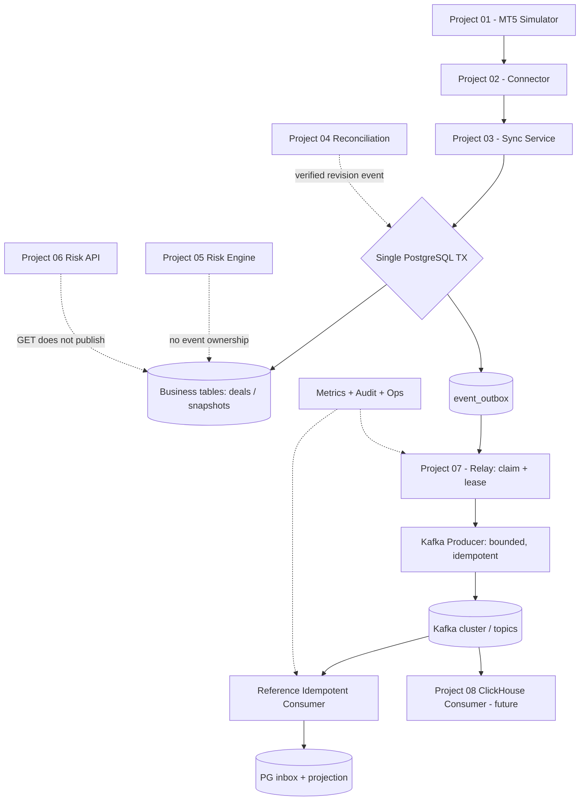
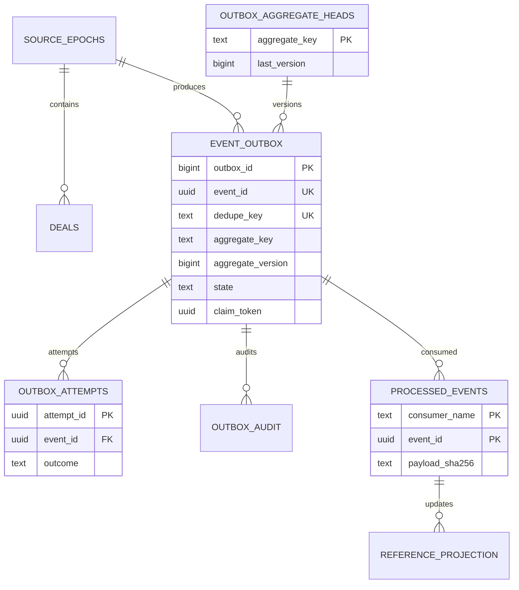
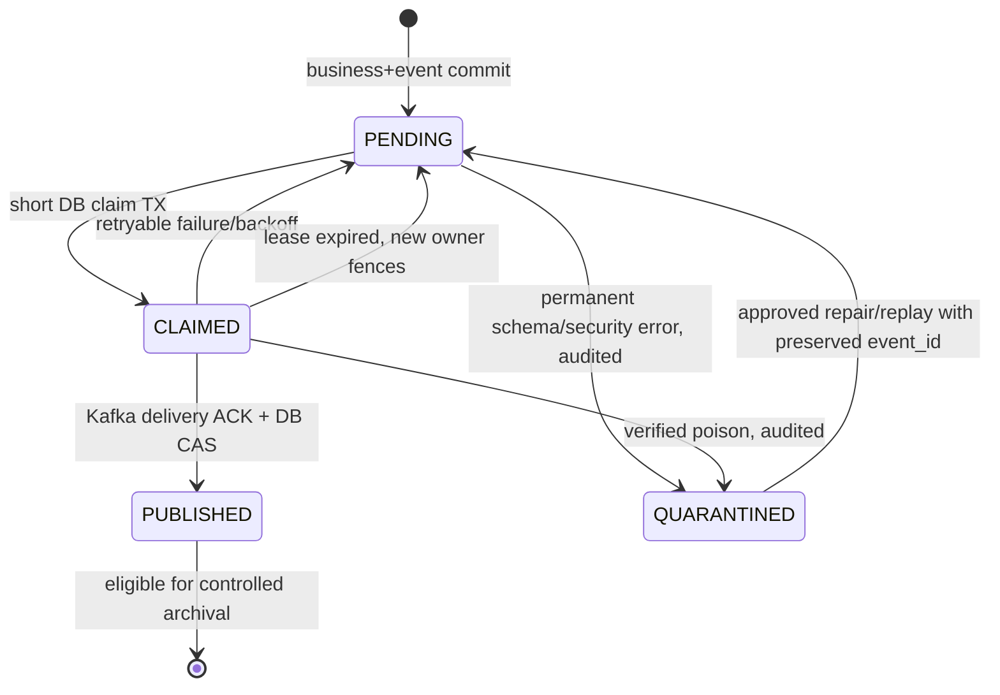

# Project 07 — PostgreSQL Outbox & Kafka

**System Design · Transactional Outbox · At-least-once Messaging · Consumer Idempotency · Chaos & What-if Verification**  
**Version:** 1.0 · **Date:** 2026-10-30  
**Roadmap:** Mini-project **07/09** — Broker Risk Reporting & MT5 Integration  
**Status:** **DESIGN PROPOSAL — NOT IMPLEMENTED / NOT TESTED / NOT BENCHMARKED**

> **Provenance / phạm vi khẳng định.** CV gốc chỉ nêu đã xuất bản broker events từ PostgreSQL outbox sang Kafka bằng idempotency keys. CV **không công bố** schema, event types, transaction choreography, broker settings, topology hay SLA thực tế. Các thiết kế và ví dụ dưới đây là **đề xuất triển khai phục vụ học tập**, không phải kiến trúc nội bộ đã được chứng thực. Kết quả hiệu năng của các dự án khác trong CV không được áp sang Project 07.
>
> **Dependencies đang ở mức design:** `Project_01_MT5_Broker_Simulator_System_Design.md` (synthetic source), `Project_02_MT5_Integration_Connector_System_Design.md` (typed connector), `Project_03_Trading_Data_Synchronization_System_Design.md` (PostgreSQL sync ownership), `Project_04_Snapshot_Reconciliation_and_Recovery_System_Design.md` (verified reconciliation), `Project_05_Broker_Risk_Calculation_Engine_System_Design.md` (financial correctness), `Project_06_Risk_Reporting_REST_API_System_Design.md` (HTTP exposure/P&L; GET không tự phát business event).
>
> **“Chịu nổi” nghĩa là:** Không có event cho transaction đã rollback; không âm thầm mất event đã COMMIT trong các điều kiện bền vững đã công bố; không áp dụng sai dữ liệu tài chính khi retry, replay, reorder, reset nguồn, lỗi bảo mật hoặc failure kết hợp. Quá tải có thể làm tăng lag hoặc từ chối có kiểm soát, nhưng không được biến thành **silent data loss**, unbounded resource growth, hoặc financial corruption.
>
> **Giới hạn của kiểm thử:** Không có danh sách hữu hạn nào bao phủ *mọi* liên kết lỗi và interleaving. Ma trận 480 tình huống bên dưới là bộ khởi đầu; phải bổ sung stateful/property-based/fuzz/mutation/soak/compound faults. **0/480 tình huống đã thực thi tại thời điểm viết tài liệu.**

---

## 0. Executive summary — 10 quyết định không thể đánh đổi

1. **Business data + outbox row phải COMMIT cùng một PostgreSQL transaction.** Không bao giờ `DB commit` rồi mới best-effort `Kafka produce` trong request xử lý Deal.
2. **At-least-once trên biên PostgreSQL → Kafka.** Kafka có thể chứa cùng event nhiều lần do crash hoặc ACK mơ hồ; không tuyên bố end-to-end exactly-once.
3. **Một event ID/semantic key ổn định.** Retry không được tạo sự kiện nghiệp vụ khác cho cùng một thay đổi; payload khác dưới cùng semantic key là **integrity incident**.
4. **Claim và ACK có lease token/fencing.** Chỉ owner đúng lease được cập nhật outbox status trong DB; dữ liệu đã lên Kafka sau failover vẫn có thể đến muộn → consumer cần version/idempotency guard.
5. **Không phát Account/Position “row-changed” từ staging.** Chỉ phát marker `AccountSnapshotPublished`/`PositionSnapshotPublished` sau **atomic publish** của Project 03.
6. **Deal `source_seq` chỉ là source event order, không phải Kafka offset, cũng không liên tục.** Deal mới có `executed_at` cũ nhưng `source_seq` mới vẫn phải được phát một lần theo semantic ID.
7. **Tài chính không dùng JSON floating-point.** Money/lot/price truyền dưới dạng decimal strings và có units/currency rõ ràng; dấu commission/swap không tự đổi.
8. **Kafka durability cần cấu hình thật.** `acks=all`, idempotent producer, replication factor và `min.insync.replicas` thích hợp, bảo mật TLS/SASL/ACL; một broker local chỉ để demo, không chứng minh HA.
9. **Consumer phải tự bảo vệ.** Dedup `event_id` và bảo vệ business version trong cùng transaction với downstream PostgreSQL side effect; ClickHouse của P08 có cơ chế riêng, không mượn “exactly-once” từ P07.
10. **Không coi `PUBLISHED` là `CONSUMED`.** PUBLISHED chỉ là ACK broker theo cấu hình; consumer lag, poison record, retention expiry và mất downstream vẫn phải theo dõi riêng.

### 0.1 MVP outcome

Có thể chạy Simulator → Connector → P03 sync → `event_outbox` → Relay → Kafka → **reference consumer** → `projection` trên PostgreSQL, rồi thực hiện 3 demo: (i) COMMIT data+outbox và thấy event; (ii) crash sau Kafka ACK trước DB `PUBLISHED`, thấy duplicate nhưng projection vẫn đúng; (iii) Kafka mất kết nối, thấy backlog tăng trong giới hạn, recovery phát hết backlog sau khi Kafka trở lại.

### 0.2 Phạm vi theo giai đoạn

| Stage | Included | Explicitly excluded / gated |
|---|---|---|
| P0 MVP | 1 source/epoch tại một thời điểm, 1 relay owner, append-only Deal event, 2 snapshot markers, durable outbox, retries có giới hạn, Kafka local, reference idempotent consumer, fault harness | Exactly-once xuyên PG/Kafka; per-account perfect ordering trong mọi lần failover; real MT5 Manager SDK; auto-fix Deal sai tiền; Event từ GET endpoint |
| P1 | Nhiều relay shard **có chứng minh ordering/fencing**, tenant ACL, schema registry, multi-broker, consumer inbox, production-like broker cluster, CDC feasibility study | Switch từ polling sang Debezium không migration hay dual-run plan |
| P2 | Debezium CDC trên **append-only CDC outbox riêng**, cross-region DR, event replay service, schema compatibility program, replay/hot-cold tiers | Multi-region exactly-once mà không chứng minh được durability/failover model |

---

## 1. Yêu cầu và điều kiện chấp nhận

### 1.1 Functional requirements

| ID | Priority | Requirement | Acceptance / observable proof |
|---|---|---|---|
| FR07-01 | P0 | P03 insert Deal + outbox in same PostgreSQL transaction | `ROLLBACK` cả Deal và outbox; `COMMIT` cả hai |
| FR07-02 | P0 | Phát `DealRecorded` đúng payload và immutable provenance | Consumer thấy chính xác `epoch_id/deal_id/source_seq/payload_hash` |
| FR07-03 | P0 | Snapshot publish marker chỉ sau P03 atomic publish | Không có marker cho `STAGED`, `ABORTED`, `BLOCKED_EPOCH` |
| FR07-04 | P0 | Relay poll rows, claim và retry | Tự tiếp tục sau `SIGKILL`, broker outage |
| FR07-05 | P0 | Stable event ID, semantic key, payload hash | Retry/replay không đổi nội dung hoặc tạo business event mới |
| FR07-06 | P0 | Bounded queue/in-flight/backoff | RSS, open connections, DB locks có giới hạn trong overload |
| FR07-07 | P0 | Kafka topic routing và partition key rõ ràng | Key ổn định theo nguồn/epoch/aggregate; partition order được test |
| FR07-08 | P0 | Consumer idempotent | Duplicate không thay đổi projection / money lần thứ hai |
| FR07-09 | P0 | DLQ/quarantine policy không âm thầm bỏ event | Poison event làm dừng đúng key/partition hoặc quarantine có người xử lý |
| FR07-10 | P0 | Metrics, audit và readiness trung thực | Có source commit → broker ACK latency, backlog age, consumer lag, error classes |
| FR07-11 | P0 | Tenant isolation | Không route event broker A sang topic/consumer của broker B |
| FR07-12 | P1 | Controlled replay and retention | Replay không phá downstream idempotency; test retention horizon |
| FR07-13 | P1 | Schema evolution | Consumer v1 xử lý event theo compatibility policy; incompatible bị chặn |
| FR07-14 | P1 | Scale throughput under fixed resources | Load test report accepted, published, duplicate, lag, RSS, CPU |
| FR07-15 | P2 | CDC option | Chứng minh INSERT-only contract, WAL/slot/connector failure recovery |

### 1.2 Non-functional **targets đề xuất, chưa đo**

| Signal | Proposed initial target | Measurement, not shortcut |
|---|---|---|
| Data loss | **0 silent losses** for committed outbox with durable PG, retriable Kafka, non-expired retention | Source commit set vs consumer unique IDs |
| Duplicate effects | **0 duplicate business effects** | Consumer projection oracle; duplicate Kafka records are allowed |
| Normal end-to-end publish delay | p99 `COMMIT → Kafka ACK` < 5 s at reference 100 events/s | Separate DB commit timing from consumer finish; no outage during baseline |
| Sustained relay throughput | ≥ 200 events/s with 1 KB mean value (single relay baseline) | 30-minute steady load after warm-up; constrained Docker host |
| Burst | 1,000 events/s for 60 s without memory growth | Measure backlog drainage; do not demand instant Kafka ACK |
| Recovery | Drain 100k-event backlog within measured capacity; report time | Derive duration from measured rate, no promise beforehand |
| Memory | Relay RSS ≤ 512 MiB at proposed workload | Alert and fail controlled on local buffer full |
| Database | DB pool ≤ 8 connections for relay; short claim transactions | DB lock time and pool usage from traces |
| Critical correctness | All P0 what-if + invariant/property oracles PASS | CI evidence artifacts, no skipped P0 |

Reference hardware is deliberately specified in benchmark section; these are **design objectives only**. P06 p95=120 ms mentioned in CV **is not** Project 07 latency target.

### 1.3 Out-of-scope

- Không giao dịch thị trường/đặt lệnh và không sửa trực tiếp MT5 source.
- Không tự tính P&L/exposure; không biến event thành bằng chứng `READY` nếu P04/P05 chưa xác minh.
- Không dùng Kafka để thay durable PostgreSQL system of record.
- Không thiết kế/khẳng định full ClickHouse sink semantics: P08 chịu trách nhiệm sink-specific idempotence, dedup, analytics.
- Không cho phép republish Deal có tiền khác dưới cùng identity như là correction ngầm; phải có correction contract/version riêng.

---

## 2. Hợp đồng với P01–P06 (contract-first)

| Source/owner | Existing design capability | P07 consumption rule | Must not infer |
|---|---|---|---|
| P01 Simulator | `run_id`, `generation`, `snapshot_seq`, `source_seq`; synthetic REST cursor | Provenance được P02/P03 chuyển thành `epoch_id` | Native MT5 SDK cũng có `source_seq` |
| P02 Connector | Typed validation, isolate blocking SDK, worker fencing | P07 **không** gọi P02/SDK trong publisher | Kafka receipt xác nhận source sync đúng |
| P03 PostgreSQL | `source_epochs`, `deals`, `sync_runs`, `sync_checkpoints`, `accounts_current`, `positions_current`; DB lease/fencing | P03-owned TX thêm outbox, giữ semantics scan & `W` | Full cross-entity atomic snapshot |
| P04 Reconciliation | Verified evidence, repair approval, quarantine | Optional `ReconciliationVerified` chỉ từ durable verified state transition | `VERIFIED` chứng minh mọi thời điểm tương lai |
| P05 Risk engine | Cut-aware result, Decimal strings, status `READY/DEGRADED/BLOCKED` | Không xuất risk metric thiếu cut/quality as trusted event | Kafka consumer được phép tính tiền lại tùy ý |
| P06 API | Read-only exposure/P&L endpoints và access audit | Không phát business events từ GET; audit security giữ riêng | API thành công là business state change |
| P08 (next) | ClickHouse analytics, consumer/group | Handoff `event_id`, `aggregate_version`, payload hash, schema version | ClickHouse có PostgreSQL-style atomic inbox mặc định |

**Required integration ADRs:**

- **ADR07-01:** Đồng bộ database migration với P03; không sở hữu `deals`/`positions_current` schema.
- **ADR07-02:** `DealRecorded` chỉ tạo khi P03 **thật sự insert Deal mới** và đã validate immutability; duplicate fetch không tạo event.
- **ADR07-03:** Accounts/Positions chỉ phát `SnapshotPublished` cho scan thành công, không phát hàng loạt `UPDATE` từ staging hoặc khi publish chưa xong.
- **ADR07-04:** `source_seq` có gap; không dùng `MAX(deals.source_seq)` để suy ra completeness; Deal watermark `W` thuộc P03.
- **ADR07-05:** P04 verified marker nếu có cần transaction cùng revision verified và audit, đọc `reconciliation_revision` để fence.
- **ADR07-06:** Event chứa dữ liệu đủ dùng cho P08 hoặc đánh dấu rõ `notification_only`; consumer không được nhầm marker với dữ liệu position chi tiết.
- **ADR07-07:** Cấu hình topic name, key, schema và retention bị pin trước khi benchmark; bất kỳ thay đổi partition count cần migration plan.

---

## 3. System architecture, trust boundary và luồng dữ liệu

### 3.1 Container-level overview



**Network/trust zones:** P02 source credentials; PG service credentials; Kafka broker TLS/ACL; P06 HTTP principals; P08 analytics consumers are separate trust boundaries. Producer must not reuse P06 user access tokens or have privileges to alter Deal amounts. Relay DB role can SELECT/UPDATE outbox lifecycle fields but **cannot** UPDATE `deals` or source epochs.

### 3.2 Event creation & ACK sequence

```mermaid
sequenceDiagram
    participant S as P03 Sync Worker
    participant DB as PostgreSQL
    participant R as P07 Relay
    participant K as Kafka Broker
    participant C as Idempotent Consumer
    S->>DB: BEGIN; fenced Deal INSERT / scan publish
    S->>DB: INSERT event_outbox in same transaction
    S->>DB: COMMIT
    DB-->>S: Commit success (or ambiguous ACK)
    R->>DB: Claim PENDING (short TX)
    DB-->>R: event_id + claim_token + payload
    R->>K: produce(key, event_id, payload)
    K-->>R: delivery ACK (broker durability semantics)
    R->>DB: CAS CLAIMED->PUBLISHED by claim_token
    C->>K: poll event
    C->>DB: BEGIN; dedup event_id + projection update
    C->>DB: COMMIT
    C->>K: commit offset after DB transaction
```

### 3.3 ACK-lost ambiguity, duplicate is legal

```mermaid
sequenceDiagram
    participant R as Relay A
    participant K as Kafka
    participant DB as PostgreSQL
    participant R2 as Relay B
    participant C as Consumer
    R->>K: Produce E (event_id stable)
    K-->>R: ACK accepted
    Note over R: SIGKILL before DB PUBLISHED
    R2->>DB: Expired claim takeover
    R2->>K: Produce E again (same event_id)
    K-->>R2: ACK
    R2->>DB: Mark PUBLISHED by new claim_token
    K->>C: E copy #1
    K->>C: E copy #2
    Note over C: Dedup event_id; apply once
```

### 3.4 Module ownership

| Module | Owns | Must not own |
|---|---|---|
| `OutboxWriterPort` (P03/P04 call-site) | Atomic create, immutable event payload, semantic idempotency | Network Kafka send within business TX |
| `OutboxRepository` | DB claims, tokens, retries, CAS and archival | Financial calculation or repairing Deals |
| `EventSerializer` | Deterministic JSON canonicalization, schema/checksum, validation | Naive floating-point conversion |
| `RelayScheduler` | Bounded polling and fairness | Assuming SQL identity == global commit order |
| `ProducerAdapter` | Kafka delivery callbacks, producer configuration, controlled flush | Claiming ACK for local enqueue only |
| `ReferenceConsumer` | Inbox dedup, business version policy, offset after DB COMMIT | Trusting Kafka to dedup across relay restart |
| `Ops/Quarantine` | Poison handling, audit-safe replay, incident escalation | Drop committed event silently |

---

## 4. Correctness model — formal invariants and guarantees

Let `B` be a business mutation committed at PostgreSQL transaction `T`, `O(B)` be the outbox row in that **same T**, and `K(e)` be zero or more Kafka records carrying `event_id=e`.

| Invariant | Precise requirement | Proof/oracle |
|---|---|---|
| INV07-01 Atomicity | `COMMIT(T)` implies `B` and `O(B)` visible together; rollback implies neither visible | Read after every P03 kill point |
| INV07-02 No premature event | A `STAGED/ABORTED/BLOCKED` snapshot does not yield `SnapshotPublished` | Join `sync_runs.status` and outbox keys |
| INV07-03 Stable identity | Same semantic mutation → same `dedupe_key/event_id/payload_hash`; conflicting hash → QUARANTINE | Repeat sync/retry and compare |
| INV07-04 No fabricated Deal | Only newly inserted immutable `(epoch_id,deal_id)` → `DealRecorded` | Compare new-deal DB rows vs outbox |
| INV07-05 Durability | A committed unsent row remains discoverable and retriable across relay restart | Kill/restart/retry campaign |
| INV07-06 Ack truth | `PUBLISHED` requires a delivery-success callback and DB CAS by active claim token | Fault before/after callback |
| INV07-07 Monotonic aggregate revision | `aggregate_version` increases for accepted mutations under a DB serialization point | Race test + invariant SQL |
| INV07-08 Consumer idempotence | Applying any `event_id` twice has same result as once | Postgres inbox business-effect oracle |
| INV07-09 Financial fidelity | Decimal strings, currency/sign and `payload_hash` preserved | Independent canonical payload oracle |
| INV07-10 Epoch boundary | Never merge events across `epoch_id` even if `deal_id` reused | Reset simulator + consume both epochs |
| INV07-11 Ordering truth | Consumer rejects/buffers stale or gap versions according to its policy; **physical Kafka order not globally guaranteed during takeover** | Delayed-old-worker + partition test |
| INV07-12 Isolation | An unauthorized topic/consumer cannot read broker events across source scope | ACL and authorization canary |
| INV07-13 Boundedness | Relay queue, in-flight, DB pool and payload size enforce hard caps | Overload RSS and queue measurements |
| INV07-14 Replay safety | Replay changes only delivery count, not business state | Archive/replay with reference sink |
| INV07-15 Observable failures | Undelivered, blocked, poison, ambiguous and retained-but-expiring events are visible | Alert and audit exercise |

### 4.1 What the system **can** and **cannot** guarantee

| Boundary | Design claim | Cannot claim without extra proof |
|---|---|---|
| P03 business transaction → outbox | Atomic write in one PostgreSQL commit | Data survives any permanent PG loss without backups/HA |
| Outbox → Kafka | At-least-once **conditional** on durable PG, replay, recoverable brokers, retention and operations | Exactly one Kafka record per event across crashes |
| Kafka log | Order within a partition for *appended* records | Global ordering across partitions or never-reordered aggregate version after worker failover |
| Kafka → PostgreSQL reference consumer | Effectively once **business effect** via DB transactional inbox and version guard | Exactly once Kafka delivery or exactly once on any arbitrary external sink |
| Kafka → P08 ClickHouse | Event has stable identity and provenance for P08 dedup design | ClickHouse write + Kafka offset atomic by default |

**Critical subtlety:** A DB lease/fencing token prevents a stale relay from marking `PUBLISHED` in PostgreSQL. It **cannot recall a produce request already in-flight at Kafka**. During takeover, old and new producers can append copies in surprising order. This design explicitly tolerates that with consumer `event_id` dedup and `aggregate_version` checking; it does not make a false universal ordering claim.

### 4.2 What is *not* a “gap”

- Simulator Deal source sequences `8, 13, 21` can be valid because non-Deal events consume source sequence values. Do not synthesize Deal `9..12`.
- PostgreSQL `GENERATED IDENTITY` / sequence numbers are **not** commit-order certificates and may have gaps on rollback; do not use `outbox_id` as global economic ordering.
- Event timestamps (`executed_at`, `occurred_at`, `created_at`) do **not** define a reliable replay/order watermark under clock skew or late Deal delivery.

---

## 5. Event taxonomy, schema and compatibility

### 5.1 P0 event classes and topic map

| Event | Trigger (inside DB TX) | Key / ordering scope | Payload type | Consumer |
|---|---|---|---|---|
| `DealRecorded.v1` | New immutable Deal persisted by P03 | `source_id:epoch_id:account_id` | Self-contained Deal financial fact + provenance | P08 analytics / test consumer |
| `AccountSnapshotPublished.v1` | Complete P03 account scan atomically made current | `source_id:epoch_id:accounts` | **Notification + manifest metadata**; not full account rows | Internal refresh consumer |
| `PositionSnapshotPublished.v1` | Complete P03 position scan atomically made current | `source_id:epoch_id:positions` | **Notification + manifest metadata**; not positions list | Internal refresh consumer |
| `SourceEpochChanged.v1` | Controlled P03 epoch transition with durable source identity | `source_id:source-lifecycle` | Epoch-change notification and safe prior/new epoch refs | Downstream epoch lifecycle controller |
| `ReconciliationVerified.v1` | Optional: P04 durable verification/revision commit | `source_id:epoch_id:reconciliation` | Verification summary with scope/evidence ID, no raw findings | Ops / risk invalidation consumer |

**MVP rollout:** `DealRecorded` and the two snapshot markers mandatory; `SourceEpochChanged` optional until epoch transition ownership is integrated with P03; `ReconciliationVerified` remains P1 until P04's atomic transaction hook is implemented.

### 5.2 Kafka topic strategy

| Topic (example) | Content | Partition key | P0 partitions | Retention |
|---|---|---|---|---|
| `broker.deals.v1` | `DealRecorded.v1` | `(source_id,epoch_id,account_id)` | 6 (example) | 7 days (example) |
| `broker.snapshots.v1` | Account/Position published markers | `(source_id,epoch_id,entity)` | 3 (example) | 14 days (example) |
| `broker.lifecycle.v1` | Source epoch/recon verified | `(source_id, lifecycle_scope)` | 3 (example) | 14 days (example) |
| `broker.poison.v1` | Sanitized poison metadata only | Event ID, not raw private payload | 3 (example) | Operations policy |

**Notes:** Topic names/counts/retention are initial proposals; production requires ACLs, `replication.factor` and `min.insync.replicas` configured against the actual broker count. Avoid increasing partitions of an existing topic without verifying key remapping and order; use topic version migration or per-aggregate rebootstrap if strong order matters. For P0, ordering is defined **per aggregate revision**, not across topic or global event stream.

### 5.3 Message envelope v1 (money always strings)

```json
{
  "event_id": "00000000-0000-4000-8000-000000000701",
  "dedupe_key": "DealRecorded:00000000-0000-4000-8000-000000000001:442d31303031",
  "event_type": "DealRecorded",
  "schema_version": 1,
  "source_id": "sim-broker-01",
  "epoch_id": "00000000-0000-4000-8000-000000000001",
  "aggregate_type": "account",
  "aggregate_id": "A-42",
  "aggregate_version": 7,
  "event_time": "2026-10-30T06:00:00.000000Z",
  "created_at": "2026-10-30T06:00:01.000000Z",
  "payload_sha256": "<64-char-hex-sha256-of-canonical-payload>",
  "provenance": {"source_seq": 1013, "deal_id": "D-1001", "scan_id": "scan-123", "deal_payload_hash": "<64-char-hex-sha256>"},
  "payload": {
    "account_id": "A-42",
    "position_id": "P-9",
    "symbol": "EURUSD",
    "side": "BUY",
    "entry_kind": "OUT",
    "volume_lots": "0.10",
    "price": "1.10500",
    "realized_pnl_gross": "12.30",
    "commission": "-0.50",
    "swap": "-0.10",
    "money_currency": "USD",
    "executed_at": "2026-10-30T05:59:59.000000Z"
  }
}
```

The above is a **schema illustration**. `money_currency` is **not guaranteed by P03's existing Deal table**; financial event emission must be gated until P05's accounting/symbol currency classification is explicitly supplied and validated, or the payload must expose a truthful `money_currency_status=UNPROVEN` and **P08 must not aggregate money**. Never invent USD for actual MT5 data because the simulator is using USD. The example uses `created_at` as **row creation time**, not proof of actual COMMIT timestamp: PostgreSQL `now()`/`clock_timestamp()` inside the transaction is **not** the DB COMMIT time. A true commit-to-ACK latency SLO needs end-to-end instrumentation from the observed commit boundary. When the COMMIT acknowledgement is ambiguous, report its uncertainty rather than fabricating a precise timestamp. `scan_id` shown as illustrative ID; production schema must use validated UUID when mapped to P03.

**Wire-level required fields:** `event_id`, `dedupe_key`, `event_type`, `schema_version`, source identity/epoch, aggregate key/version, `created_at`, `payload`, `payload_sha256`, `provenance`. Producers reject NaN/Infinity, float monetary fields, unknown enum, invalid IDs, unapproved schema change or oversized payload. Avoid schema with both payload hash and unverified public values; compute SHA-256 on **one documented canonical encoding**.

### 5.4 Compatibility rules

- **Schema v1:** Additive optional field may be backward-compatible only after old consumers are tested; never silently change sign, unit, ID meaning or money currency.
- Consumer must have a **supported versions allowlist**; unknown major/incompatible schema → quarantine/pause, not guess/ignore.
- Envelope and payload canonicalization are versioned independently where relevant; hash uses schema-defined field ordering/encoding, not incidental Python `str(dict)`.
- When using Protobuf later, store schema ID in envelope/header, pin compatibility policy, and test unknown field behavior; JSON canonical baseline is adequate for MVP.
- Never include raw auth credentials, full MT5 credentials, personal identifiers not needed for analytics, or unsanitized exceptions in Kafka values, headers or DLQ.

---

## 6. Persistence — PostgreSQL schema and ownership

### 6.1 Logical ERD



The relationships are conceptual. `processed_events` is the **reference consumer's own schema**, logically separate from publisher DB ownership; implement on a dedicated schema/role or separate PostgreSQL instance as needed. Do **not** add a FK across different physical databases.

### 6.2 Reference DDL — blueprint, NOT executed migration

```sql
-- Extend the P03 PostgreSQL database using a coordinated migration.
CREATE TABLE outbox_aggregate_heads (
    source_id TEXT NOT NULL,
    epoch_id UUID NOT NULL,
    aggregate_key TEXT NOT NULL,
    last_version BIGINT NOT NULL DEFAULT 0 CHECK (last_version >= 0),
    PRIMARY KEY (source_id, epoch_id, aggregate_key)
);

CREATE TABLE event_outbox (
    outbox_id BIGINT GENERATED ALWAYS AS IDENTITY PRIMARY KEY,
    event_id UUID NOT NULL UNIQUE,
    source_id TEXT NOT NULL,
    epoch_id UUID NOT NULL REFERENCES source_epochs(epoch_id),
    dedupe_key TEXT NOT NULL,
    aggregate_type TEXT NOT NULL,
    aggregate_key TEXT NOT NULL,
    aggregate_version BIGINT NOT NULL CHECK (aggregate_version > 0),
    event_type TEXT NOT NULL,
    schema_version INTEGER NOT NULL CHECK (schema_version > 0),
    topic TEXT NOT NULL,
    partition_key TEXT NOT NULL,
    payload JSONB NOT NULL,
    payload_sha256 CHAR(64) NOT NULL,
    state TEXT NOT NULL DEFAULT 'PENDING'
       CHECK (state IN ('PENDING','CLAIMED','PUBLISHED','QUARANTINED')),
    created_at TIMESTAMPTZ NOT NULL DEFAULT clock_timestamp(),
    next_attempt_at TIMESTAMPTZ NOT NULL DEFAULT clock_timestamp(),
    attempt_count INTEGER NOT NULL DEFAULT 0 CHECK (attempt_count >= 0),
    claim_owner TEXT,
    claim_token UUID,
    claim_version BIGINT NOT NULL DEFAULT 0,
    lease_until TIMESTAMPTZ,
    published_at TIMESTAMPTZ,
    kafka_partition INTEGER,
    kafka_offset BIGINT,
    last_error_code TEXT,
    UNIQUE (source_id, epoch_id, dedupe_key),
    UNIQUE (source_id, epoch_id, aggregate_key, aggregate_version),
    CHECK ((state <> 'CLAIMED') OR (claim_owner IS NOT NULL AND claim_token IS NOT NULL AND lease_until IS NOT NULL)),
    CHECK ((state <> 'PUBLISHED') OR (published_at IS NOT NULL))
);
CREATE INDEX idx_outbox_due
  ON event_outbox (next_attempt_at, outbox_id)
  WHERE state IN ('PENDING','CLAIMED');
CREATE INDEX idx_outbox_agg_state
  ON event_outbox (source_id, epoch_id, aggregate_key, aggregate_version, state);
CREATE INDEX idx_outbox_ack_time
  ON event_outbox (published_at) WHERE state = 'PUBLISHED';

CREATE TABLE outbox_attempts (
    attempt_id UUID PRIMARY KEY,
    event_id UUID NOT NULL REFERENCES event_outbox(event_id),
    claim_version BIGINT NOT NULL,
    outcome TEXT NOT NULL,
    error_code TEXT,
    attempted_at TIMESTAMPTZ NOT NULL DEFAULT clock_timestamp()
);
CREATE INDEX idx_outbox_attempts_event ON outbox_attempts(event_id, attempted_at);

-- Reference consumer-owned objects: keep them in a different schema/role.
CREATE TABLE consumer_processed_events (
    consumer_name TEXT NOT NULL,
    event_id UUID NOT NULL,
    payload_sha256 CHAR(64) NOT NULL,
    source_id TEXT NOT NULL,
    epoch_id UUID NOT NULL,
    aggregate_key TEXT NOT NULL,
    aggregate_version BIGINT NOT NULL,
    processed_at TIMESTAMPTZ NOT NULL DEFAULT clock_timestamp(),
    PRIMARY KEY (consumer_name, event_id)
);
CREATE TABLE consumer_aggregate_versions (
    consumer_name TEXT NOT NULL,
    source_id TEXT NOT NULL,
    epoch_id UUID NOT NULL,
    aggregate_key TEXT NOT NULL,
    last_applied_version BIGINT NOT NULL DEFAULT 0,
    PRIMARY KEY (consumer_name, source_id, epoch_id, aggregate_key)
);
```

**DDL caveats:**

- DDL above is a reference for schema ownership and constraints; transactional query/lock execution and roles must be tested with the pinned PostgreSQL version. The `source_id`/`epoch_id` integrity relationship should additionally be enforced (e.g. composite unique key/FK or a database trigger under a stable schema) so an event cannot claim the wrong source for an epoch.
- `UNIQUE (source_id, epoch_id, aggregate_key, aggregate_version)` and `outbox_aggregate_heads` provide a **per-key revision certificate**, not a global ordering guarantee. Do not assume `outbox_id` allocates at COMMIT time.
- A `PUBLISHED` event might still exist while Kafka retention expires; consumers require independent catch-up and replay strategy.
- Append-only business contents should be immutable: restrict database grants; DB trigger can forbid mutation of identity, payload, hash, version/topic after insert while still allowing lifecycle columns to change.
- Audit/attempt table retention is separate from event retention, subject to forensic requirements, privacy policy and storage capacity. Do not delete unacknowledged events based on age.

### 6.3 Transactional creation, P03 Deal INSERT path

```mermaid
sequenceDiagram
    participant W as P03 Sync Worker
    participant PG as PostgreSQL
    W->>PG: BEGIN; check epoch + lease fencing
    W->>PG: INSERT deals (...) ON CONFLICT DO NOTHING RETURNING deal_id
    alt New deal
      W->>PG: Lock aggregate head (source, epoch, account)
      W->>PG: Increment aggregate_version; INSERT event_outbox
    else Existing identical immutable deal
      W->>PG: Validate existing hash; NO new event
    else Existing same ID with different money/hash
      W->>PG: ROLLBACK / P03 quarantine process
    end
    W->>PG: COMMIT business changes + outbox + existing checkpoint receipts
```

**Detailed transaction protocol (P0):**

1. Validate P03 source epoch/lease, immutable Deal data, Decimal strings, allowed payload size and event schema **before** beginning a lengthy transaction.
2. Begin the same DB transaction P03 already uses for Deal page commit; insert deals deterministically ordered by source sequence and ID.
3. For **each newly inserted Deal**, serialize a canonical event and reserve its aggregate head lock (create head if absent); check semantic key under lock; allocate `aggregate_version = last_version + 1` only for a new immutable event; write outbox row; advance head; all in one TX.
4. For existing Deal, compare full canonical hash; if equal, **do not emit again**. If unequal, quarantine the conflicting source item through P03's controlled protocol, not outbox replay.
5. Commit P03 page receipt / checkpoint changes according to P03 protocol, with its own fencing. No Kafka network I/O inside the DB transaction.
6. Under transaction retry/ambiguous ACK, read durable Deal+outbox row by deterministic semantic key and verify the hash. Do not issue a new logical event with a new identity.
7. Lock order must be stable across Deal/account heads to reduce deadlocks; one aggregate head per account can become a hot spot. Throughput benchmark must include skewed account distribution.

**Atomicity qualification:** If P03's current implementation instead commits Deal and creates outbox in a *second* transaction, the invariant fails and Project 07 must block integration until P03 code is modified. An outbox writer separate HTTP service **cannot** provide atomicity with P03 without coordinated transaction semantics.

### 6.4 Snapshot marker creation (P03 atomic publish)

Only after a **complete** staging scan has passed P03 checks, the same DB transaction that changes `sync_runs.status` to `PUBLISHED`, updates `accounts_current`/`positions_current`/`sync_checkpoints` and protects lease token adds a single `*SnapshotPublished` event keyed by `(epoch_id, entity, scan_id)`. Payload includes `scan_id`, `snapshot_seq`, `published_at` (if trustworthy), entity, `record_count` and scan manifest/hash if defined; it does not pretend that unrelated Account and Position scans form a universal cut. An incomplete scan never creates a marker.

### 6.5 Event lifecycle state machine



`QUARANTINED` is **not** success. For ordered aggregates, a poison event blocks higher versions from being **applied** until a documented repair, reconciliation/rebootstrap or explicit waiver with audit. Do not let DLQ mean “skip and move on with potentially false balances”.

---

## 7. Relay: polling, ownership, locking and bounded concurrency

### 7.1 MVP dispatcher discipline

Use **one active relay owner** per P0 deployment to simplify correctness. A standby may take over after an authoritative DB lease expires; a token/version fencing CAS protects outbox state. A single relay still may have concurrent produce requests unless constrained; P0 sets **one outstanding request per aggregate key**, and a small bounded global in-flight limit. Claim/produce/ACK are never inside one DB transaction.

For P1 multi-relay, add deterministic aggregate ownership/sharding, hotspot handling and consumer version guards; **do not assume** `FOR UPDATE SKIP LOCKED` alone preserves same-key order when several workers claim arbitrary rows.

### 7.2 Claim query — blueprint with lease/ordering guards

```sql
-- illustrative single-owner / bounded claim; use DB clock and short TX.
WITH next_rows AS (
    SELECT o.outbox_id
    FROM event_outbox o
    WHERE (
      (o.state = 'PENDING' AND o.next_attempt_at <= clock_timestamp())
      OR (o.state = 'CLAIMED' AND o.lease_until < clock_timestamp())
    )
    AND NOT EXISTS (
      SELECT 1
      FROM event_outbox prior
      WHERE prior.source_id = o.source_id
        AND prior.epoch_id = o.epoch_id
        AND prior.aggregate_key = o.aggregate_key
        AND prior.aggregate_version < o.aggregate_version
        AND prior.state <> 'PUBLISHED'
    )
    ORDER BY o.outbox_id
    LIMIT :batch_size
    FOR UPDATE OF o SKIP LOCKED
)
UPDATE event_outbox o
SET state = 'CLAIMED',
    claim_owner = :owner,
    claim_token = :new_token,
    claim_version = o.claim_version + 1,
    lease_until = clock_timestamp() + (:lease_seconds * interval '1 second'),
    attempt_count = o.attempt_count + 1
FROM next_rows n
WHERE o.outbox_id = n.outbox_id
RETURNING o.*;
```

**Important limitations of this illustrative SQL:**

1. It serializes **eligibility by aggregate** only against not-yet-`PUBLISHED` earlier versions; an earlier Kafka ACK plus DB ACK ambiguity can still yield late duplicate records. Consumer version protection is mandatory.
2. PostgreSQL's `SKIP LOCKED` may return an inconsistent view and is appropriate for queue-like tables, **not** general snapshots. Test this query under concurrent claims, lock waits, partial retries and high cardinality.
3. `:batch_size`, `:owner`, `:new_token`, `:lease_seconds` are application bind parameters; a different unique claim token **per claimed row or claim batch** must be tracked. A single batch-wide token can be used only if the UPDATE CAS and callback mapping are exact.
4. Do not select/lock rows while making Kafka calls. A 30-second broker timeout must not hold PostgreSQL row locks for 30 seconds.
5. `PENDING` rows with older versions in `QUARANTINED` block later versions deliberately. Recovery requires an operator-approved decision.

### 7.3 Broker produce, callback and DB CAS

Pseudocode sketch (Python/confluent-kafka, not production-ready executable module):

```python
async def publish_claim(claim, producer, repository, limits):
    # payload and partition key have been validated at write time.
    async with limits.global_inflight, limits.for_key(claim.aggregate_key):
        # produce_and_wait_delivery must SERVE callback/poll; produce() alone only enqueues.
        result = await producer.produce_and_wait_delivery(
            topic=claim.topic,
            key=claim.partition_key.encode("utf-8"),
            value=claim.canonical_wire_bytes,
            headers={"event_id": str(claim.event_id), "schema_version": str(claim.schema_version)},
            deadline=limits.delivery_deadline,
        )
        if result.broker_acked:
            # CAS guards claim owner/token/version and active lease in authoritative PG.
            changed = await repository.mark_published_if_owner(
                outbox_id=claim.outbox_id,
                claim_token=claim.claim_token,
                claim_version=claim.claim_version,
                kafka_partition=result.partition,
                kafka_offset=result.offset,
            )
            if not changed:
                # Do NOT reclassify as not-delivered: Kafka can already contain event.
                await repository.record_stale_ack_metric(claim.event_id)
        else:
            await repository.reschedule_if_owner(claim, bounded_backoff_with_jitter())
```

**Client detail:** The synchronous `confluent_kafka.Producer.produce()` is **asynchronous enqueue**, not a Kafka delivery ACK. Delivery callbacks are serviced through `poll()`/`flush()`; not invoking poll can stall the lifecycle. If choosing Confluent's asyncio client, validate exact installed version and callback/header capabilities via integration tests; otherwise wrap the synchronous client safely in a dedicated producer thread, not blocking the FastAPI event loop. P07 is a **background relay**, so standalone worker process is the default.

### 7.4 Retry policy & error taxonomy

| Class | Action | Key guard |
|---|---|---|
| Kafka unreachable / leader unavailable / transient timeout | Keep durable outbox; exponential backoff+jitter; circuit open | Bounded attempts per window, backlog gauge |
| Broker ACK ambiguous / process died after ACK | Leave/reclaim and retry **same event_id** | Consumer dedup; no new logical event |
| Serialization or unsupported schema | Quarantine/pause; alert and require controlled repair | Do not change payload silently |
| ACL/auth/permission denied | Circuit open, block publication; urgent alert | Do not loop 1000x per second |
| Message too large | Quarantine, publish sanitized incident only if allowed | No auto-truncate financial fields |
| Producer queue full | Backpressure: stop DB claiming; serve callbacks; retry later | Memory bound and no data drop |
| PostgreSQL unavailable when ACK arrives | Broker may already have event; do not mark DB published | Stable ID + replay + CAS |
| Source epoch BLOCKED | Gate **new** outbox writes per P03/P04 policy; already committed events must be quarantined/annotated per explicit policy, not silently deleted | Preserve history and provenance |
| Unrecoverable sink conflict | Quarantine consumer, halt affected aggregate | No double money side effect |

### 7.5 Failure containment & fairness

- Per-key ordering means a poison event can block one aggregate. A global single publisher should continue unrelated keys where allowed, but never silently skip a poisoned event within the same key.
- Busy accounts can starve quiet accounts under naive oldest-first. Use a tunable schedule with per-account in-flight quotas and latency caps, measure fairness, and maintain per-key gap enforcement.
- When producer buffer is full, **stop claiming new events** and let claimed ones expire safely. Avoid claiming 100k rows into memory then waiting Kafka outage.
- The publisher should not publish source-specific events before authorization/policy gates are applied in the source DB transaction. A stalled Kafka broker must not block P03's durable Deal synchronization indefinitely; instead enforce outbox capacity guards and explicit safe admission threshold (e.g. suspend new imports when store near full, operator alert).

---

## 8. Consumer design: deduplication, replay, offset correctness

### 8.1 Reference PostgreSQL sink algorithm

For an event from Kafka partition `p` with offset `o`:

1. Validate topic, schema version, source authorization, event ID/semantic key, payload hash, money scale/currency and allowed event types **before side effects**.
2. Start a PostgreSQL transaction on the **consumer-owned DB**; insert `consumer_processed_events(consumer_name,event_id,payload_sha256,...)` using unique identity.
3. If duplicate **with identical hash**, do nothing to business projection; finish transaction; commit Kafka offset after DB commit.
4. If duplicate **with different hash**, quarantine/audit and **do not** apply or advance offset as successful processing.
5. Lock `consumer_aggregate_versions`; if version is exactly `last + 1`, apply projection and update version in same transaction. If version <= last, only allow *documented* duplicate/replay semantics with verified identity. If version > last + 1, pause this aggregate/partition or buffer within strict limits and request missing versions/rebootstrap. For new key first event may use version 1; migration/bootstrap must supply a known base version.
6. COMMIT consumer DB transaction, then commit Kafka offset (manual `enable.auto.commit=false`). Ambiguous DB ACK → query processed table before retry; crash before offset commit → duplicate fetch is harmless.
7. Rebalance/revocation must finish or cancel in-flight processing safely and only commit contiguous successfully applied offsets; one poison record can block a partition unless documented quarantine protocol exists.

**Subtlety:** Consumer record processing may not follow `aggregate_version` order during failover. A version gap is real for **the aggregate revision stream** even though `source_seq` gaps are normal. If events of the same aggregate may be routed to different topics/partitions, do not require a single version sequence across those independently ordered streams unless a coordinator exists.

### 8.2 Consumer crash model

| Crash point | Safe behavior |
|---|---|
| Before DB begin | Kafka redelivers; no effect |
| After inbox insert, before projection update, before DB COMMIT | Entire DB TX rolls back; retry applies once |
| After projection DB COMMIT, before Kafka offset commit | Redelivery dedups; no double effect |
| Kafka offset commit succeeds, consumer crashes | Previous DB commit already durable |
| Kafka commit succeeds **before** DB commit (implementation bug) | Potential silent data loss; **P0 test must fail** |
| Rebalance during processing | Partition ownership fencing/pause and contiguous offset commit policy |

### 8.3 What ClickHouse Project 08 must do differently

ClickHouse is not assumed to share an atomic database transaction with Kafka's committed offsets. P08 needs a separately specified architecture (idempotent tables, event IDs, batching, replay behavior, materialized view effects, late Deal corrections, Kafka consumer offsets), validated under crash and duplication. The reference PostgreSQL inbox demonstrates logical business-effect idempotence **only for a sink with atomic inbox+projection**. It is a handoff contract, **not** proof of correctness for P08.

---

## 9. CDC / Debezium alternative — carefully separated

For the **MVP, polling relay** is preferred because it is inspectable and avoids a CDC connector stack. A later Debezium approach can read PostgreSQL WAL and route outbox `INSERT`s via the Outbox Event Router, but **do not simply point Debezium's default outbox SMT at the polling table**: the polling table updates `state`, `claim_token`, `published_at`, whereas the Debezium Outbox Event Router expects INSERT-oriented outbox events and handles UPDATEs as invalid/ignored/error depending configuration. CDC also has its own replication slot retention, WAL growth and offset checkpoint recovery conditions.

**Safe switch options:**

- **Option A (recommended investigation):** New immutable `cdc_outbox_events` insert-only table, immutable `event_id`/key/payload, CDC projector, one exclusive publication path per event; consumer dedup required during cutover.
- **Option B:** Replace polling lifecycle design entirely and migrate with a snapshot/LSN fence, coordinated consumer cutover, rollback plan, and verified zero-loss/acceptable-duplicate oracle.

**Cannot combine blindly:** Running both poller and Debezium on the same event population makes duplicates normal and may alter order. If dual-run as shadow mode, only one path writes to production topics; other uses isolated canary topic and monitors manifests.

**CDC-specific hazards to test:** replication slot inactive for days and WAL fills disk, connector restart after LSN commit ambiguity, WAL failover, schema/DDL drift, Debezium SMT routing misconfiguration, connector secrets, duplicate snapshots, `UPDATE` on outbox table ignored, and old CDC consumer receiving data from prior source epoch.

---

## 10. Security, privacy and multi-broker isolation

1. **Kafka TLS** in production-like integration; SASL/mTLS as chosen; ACL by producer/consumer identity; strict topic allowlist. No credentials in topic values, SQL error strings, DLQ, trace or logs.
2. **PostgreSQL least privilege:** Relay can read outbox and update only delivery lifecycle columns (function/column-grant design), no Deal mutation; P03 writer uses controlled routine to create outbox in same TX.
3. **Source/tenant routing:** `source_id` assigned server-side from P03 epoch, never from untrusted client-supplied metadata. Check `epoch_id → source_id` mapping before emission; broker ID is not a user-provided Kafka topic suffix without validation.
4. **PII:** Kafka payload only minimum needed fields, use opaque account IDs; logs and DLQ omit raw account/customer details. Apply retention, encryption and access policies to raw events and backups.
5. **Schema validation:** payload size bounds, unknown schema rejection, UUID/UTF-8 validation, JSON strictness (no NaN/Infinity), no string interpolation in SQL queries, no topic traversal.
6. **Operator replay:** audited, role-gated, optional two-person approval for financially sensitive replays; dry-run counts/manifest first; replay never changes `event_id` for the same fact.
7. **Threat model:** malicious tenant input → outbox → broker; worker credential leak; rogue consumer group; Kafka ACL changed while relay runs; log leakage; compromised image; event poisoning; malicious mismatch of epoch and source; replay denial-of-service.

---

## 11. Observability, SLO and incident runbooks

### 11.1 Metrics (bounded cardinality)

| Metric | Type | Alert / interpretation |
|---|---|---|
| `outbox_pending_total` | gauge | Backlog count (not same as age) |
| `outbox_oldest_pending_age_seconds` | gauge | > 60 s baseline investigate, if Kafka normally healthy |
| `outbox_claimed_expired_total` | counter | Stale owners/worker crash trend |
| `outbox_created_to_ack_seconds` | histogram | Measured from outbox creation time to broker ACK (not exact COMMIT→ACK). An additional trace-based COMMIT→ACK metric is valid only where the COMMIT boundary is observed and correlated |
| `outbox_publish_attempts_total{outcome}` | counter | RETRY/ACK/QUARANTINE; no event_id labels |
| `outbox_ack_ambiguous_total` | counter | Post-ACK DB COMMIT uncertainty |
| `producer_buffer_used_bytes` | gauge | Bound/quota; halt claim near full |
| `producer_errors_total{code}` | counter | low-cardinality error classes |
| `kafka_consumer_lag_records{group,topic}` | gauge | Consumer offset behind high watermark |
| `consumer_duplicates_total` | counter | Expected in crash campaigns, monitor baseline |
| `consumer_version_gap_total` | counter | Missing order / stream correctness incident |
| `outbox_quarantined_total` | gauge | **Not success**, owner/action needed |
| `pg_outbox_storage_bytes` | gauge | Disk/WAL pressure and retention |
| `source_epoch_publication_block_total` | counter | Invalid epoch/lease/policy gate |

Avoid high-cardinality `deal_id`, `event_id`, `account_id`, `claim_token` labels. Use opaque event ID only in sampled structured logs/traces with controlled access and retention.

### 11.2 Health semantics

- `/health/live`: process event loop/executor alive, no external dependency required.
- `/health/ready`: writable/readable authoritative PG for claims + Kafka producer metadata/authorization check (bounded timeout) + migrations compatible + no critical config blocks. During Kafka outage relay should be **not ready** or explicitly `DEGRADED` per operational policy, but liveness stays true for recovery.
- `/health/drain`: do not claim new rows; allow bounded callback flush; persist no false `PUBLISHED` status on timeout; reconcile ambiguous acknowledgments on next owner.
- HTTP/API P06 readiness and P07 relay readiness are **separate**; a Kafka failure must not automatically turn already verified read-only P06 risk result false.

### 11.3 Four runbooks

**RB07-1 — Kafka down:** Verify broker/ACL/ISR, open relay circuit, stop claiming, preserve rows, compute remaining DB capacity, alert ingestion owner if durable outbox near storage budget. Restore broker, resume with rate-limited drain; compare event sets with consumer inbox. No manual deletion of PENDING.

**RB07-2 — Producer ACK ambiguous:** Examine worker claim state and callbacks; assume Kafka may contain event; retry **same event_id** after expiry; validate consumer dedup and payload hash. Do not invent success or dispatch a new identity.

**RB07-3 — Poison schema/payment mismatch:** Quarantine and halt affected aggregate; capture sanitized payload hash, responsible schema version, source epoch, run/recon evidence; require approved schema/data repair or versioned correction event. Do not skip/alter money.

**RB07-4 — Backlog after PG failover:** Check PG primary correctness/replica lag, lease expiration, outbox count, application fence, broker producer state, and complete set oracle. Reclaim rows once; drain with rate caps; investigate if Kafka offset exists for event already PUBLISHED. If WAL/backup restore loses acknowledged commits, declare disaster boundary and rebootstrap from authoritative source, not falsely claim no loss.

---

## 12. FMEA — failures with high consequence

| Failure mode | Effect | Severity | Prevention / detection |
|---|---|---|---|
| P03 DB COMMIT Deal but no outbox | Silent missing analytics | Critical | Same TX + invariant join oracle, migration integration test |
| Kafka ACK, relay dies before DB ACK | Duplicate Kafka event | High but expected | Stable event ID + consumer dedup + crash test |
| Source reset reuses Deal ID | Cross-epoch merged money | Critical | Composite `(epoch_id,deal_id)` identity and key |
| Wrong currency/sign | False financial reporting | Critical | Typed Decimal strings, currency contract and P05 cross-check |
| Parallel workers reorder version | Wrong aggregate projection | Critical | Per-key version lock + consumer version guard; no global ordering claim |
| One poison event blocks all traffic | Availability/fairness loss | High | Per-key blockers, graceful quarantine/fair scheduling |
| Kafka ISR below durability threshold | Acknowledged records at risk | Critical | RF/minISR/unclean election policy and broker chaos tests |
| Kafka retention expires before consumer recovers | Unrecoverable consumer gap | Critical | Retention horizon/lag alerts, replay from durable outbox/archive |
| Polling outbox hot table bloats PG | Sync outage | High | Index/partition/retention strategy, vacuum/storage monitoring |
| CDC replication slot stalls | WAL disk exhaustion | Critical | Slot/WAL alerts and tested alternate read path |
| Compromised relay credentials | Broker data exfiltration | Critical | Topic ACL, least privilege, TLS, secrets rotation |
| Unbounded retries during outage | DB/Kafka storm | High | Exponential backoff+jitter, circuit breaker, admission |

---

---

## 13. What-if verification methodology — evidence, not marketing

### 13.1 Mức độ ưu tiên và nguyên tắc đánh giá

| Priority | Meaning | Release disposition |
|---|---|---|
| **P0** | Integrity, money/identity, mandatory reliability/security/crash boundaries | **Must PASS**, no skip or INCONCLUSIVE |
| **P1** | Expanded robustness, operations and production-like failure/capacity | Must PASS before production-like deployment; deferrals documented |
| **P2** | Multi-region, advanced CDC/replay, long-term capabilities | Gated by ADR and measured evidence before claiming support |

**Case format:** `What-if / injection` là tình huống tái hiện được; `Expected` là phản ứng bắt buộc; `PASS evidence` là bằng chứng độc lập cần thu. Mặc định mỗi case còn phải đáp ứng **5 global gates**: (i) no unauthorized cross-tenant disclosure, (ii) no financial amount alteration, (iii) no committed-business/outbox split, (iv) all changes either visible or explicitly blocked/audited, (v) resource bounds under the case's declared reference environment. `PASS` chỉ khi hệ thống chạy thật và evidence đủ; `NOT RUN` không được tính PASS.

**Default priorities:** 8 P0, 3 P1, 1 P2 trong từng nhóm (các case P2 là chức năng mở rộng/cross-region). Tổng cộng **480 case / 40 nhóm = 320 P0 + 120 P1 + 40 P2**. Các case dùng “mutant” là cố ý tạo implementation sai để chứng minh test suite phát hiện được regression. Không trộn điểm benchmark với correctness.

### 13.2 Matrix — 480 scenarios, 40 failure domains

### A. P03 transaction boundaries — Deal + outbox atomicity — 12 cases

| Case | Priority | What-if / fault injection | Expected behavior | Required PASS evidence |
|---|---|---|---|---|
| `WF07-A-01` | P0 | P03 INSERT Deal thành công, inject ROLLBACK ngay trước outbox INSERT | Không có Deal lẫn outbox được commit | Read committed hai bảng cho ID đó đều bằng 0 |
| `WF07-A-02` | P0 | Outbox INSERT thành công, kill P03 trước COMMIT | Cả Deal và event rollback | Snapshot kết quả không có cả hai record |
| `WF07-A-03` | P0 | COMMIT xong nhưng client không nhận PostgreSQL ACK | Retry kiểm tra identity, không tạo Deal/event khác | Deal=1, outbox semantic key=1, payload hash giống |
| `WF07-A-04` | P0 | P03 commit Deal ở transaction 1 và outbox ở transaction 2 (mutant) | Reject thiết kế/migration không atomic | Fault test chứng minh mutant bị giết |
| `WF07-A-05` | P0 | Retry toàn transaction vì lỗi serialization 40001 | Một transaction thắng; một logical event | `COUNT(event_outbox WHERE dedupe_key)=1` |
| `WF07-A-06` | P0 | P03 deadlock 40P01 sau khi cấp aggregate_version | Rollback version và outbox đồng thời | Không có orphan version từ aborted TX |
| `WF07-A-07` | P0 | Source Deal trùng ở page sau với cùng hash | Không phát sự kiện mới | Deal count và outbox count giữ nguyên |
| `WF07-A-08` | P0 | P03 INSERT Deal mới nhưng outbox CHECK constraint lỗi | Cả Deal insert không được commit | Deal=0, outbox=0, error surfaced |
| `WF07-A-09` | P1 | P03 ghi 1.000 Deal/page rồi reject Deal cuối | Transaction rollback hoặc phân đoạn atomic có receipt rõ | Không có checkpoint vượt phần đã commit |
| `WF07-A-10` | P1 | P03 batch 2 trang cùng commit nhưng tạo outbox ngoài TX | Release gate fail-fast | Independent join oracle phát hiện orphan Deal |
| `WF07-A-11` | P1 | Account hot-spot làm lock aggregate head chậm | Deadline abort an toàn, không partial commit | Transaction trace, no leaked locks, eventual retry |
| `WF07-A-12` | P2 | P03 được triển khai ở region thứ hai với transaction manager khác | Không claim atomic PG multi-region nếu không chung commit domain | Cross-region design gate rejects unsupported topology |

### B. Source identity, epoch reset and P03 fencing — 12 cases

| Case | Priority | What-if / fault injection | Expected behavior | Required PASS evidence |
|---|---|---|---|---|
| `WF07-B-01` | P0 | Simulator reset rồi dùng lại `deal_id=D-1` | Event mới có epoch mới, không overwrite epoch cũ | Hai event khác epoch cùng Deal ID tồn tại |
| `WF07-B-02` | P0 | P03 worker epoch cũ tiếp tục insert sau `BLOCKED` | Lease/source fencing từ chối business+outbox | Không thấy event epoch cũ sau block fence |
| `WF07-B-03` | P0 | Outbox event có `source_id` không khớp epoch FK | Reject tại DB hook/validator | Invariant epoch-source join mismatch bằng 0 |
| `WF07-B-04` | P0 | P03 chuyển epoch active giữa transaction tạo outbox | CAS/fence fail hoặc commit theo policy đã pin, không mixed epoch | Trace và row epoch nhất quán |
| `WF07-B-05` | P0 | Source_seq của Deal mới nhỏ hơn event trước do reset | Không dùng seq toàn cục xuyên epoch | Consumer lưu hai namespace epoch |
| `WF07-B-06` | P0 | Old producer ACK đến sau khi source epoch mới active | Event giữ epoch provenance; consumer không gộp tiền | Projection phân tách epoch |
| `WF07-B-07` | P0 | Hai broker dùng cùng Deal ID và account ID | Routing/source khóa nhận diện chính xác | Dedup không trộn hai broker |
| `WF07-B-08` | P0 | Source reset trong khi 5.000 event đang PENDING | Preserve và xử lý theo explicit old-epoch policy, không tự delete | Manifest trước/sau reset đầy đủ |
| `WF07-B-09` | P1 | `source_seq` có gap vì quote events xen giữa | Không sinh fake Deal cho gap | Oracle source Deal set bằng outbox Deal set |
| `WF07-B-10` | P1 | P03 retry scan với khác `run_id` cùng generation bất hợp lệ | Source identity validator chặn | No new outbox under invalid epoch |
| `WF07-B-11` | P1 | Epoch archived, approved replay event cũ | Consumer chỉ vào historical scope cho phép | Active projection không hồi sinh epoch cũ |
| `WF07-B-12` | P2 | Multiple SDK brokers thiếu simulator source_seq | Không ép W/seq-based event completeness | Capability negotiation test blocks unsupported adapter |

### C. Deal immutability, duplicate and correction policy — 12 cases

| Case | Priority | What-if / fault injection | Expected behavior | Required PASS evidence |
|---|---|---|---|---|
| `WF07-C-01` | P0 | Cùng `(epoch_id,deal_id)` được fetch hai lần, payload giống | Exactly one logical DealRecorded | Deal=1, outbox=1; Kafka có thể >1 |
| `WF07-C-02` | P0 | Cùng Deal ID nhưng commission đổi từ -1 thành -2 | Quarantine conflict, không tự xuất correction | No second DealRecorded; incident contains hashes |
| `WF07-C-03` | P0 | Cùng Deal ID nhưng realized_pnl đổi | Chặn và bàn giao P04 | Persisted Deal không bị ghi đè |
| `WF07-C-04` | P0 | Deal có `executed_at` cũ nhưng `source_seq` mới | Emit khi thật sự insert, không dùng time watermark | Event đúng 1 cho late-arrival |
| `WF07-C-05` | P0 | Hai Deal khác ID cùng source_seq bất thường so với simulator | P03 contract gate; không tự quyết identity | Bad-source quarantine, no silent merge |
| `WF07-C-06` | P0 | Hai Deal cùng account nhưng source_seq không liên tục | Không báo lost Deal vì seq gap | Source oracle set matching |
| `WF07-C-07` | P0 | Deal bị NULL account_id do dữ liệu lỗi | Reject before outbox TX | No event with missing key |
| `WF07-C-08` | P0 | Deal thuộc epoch khác nhưng reused payload hash | Tách semantic identity bằng epoch | 2 valid business events separate |
| `WF07-C-09` | P1 | Deal price là `1e-30` ngoài declared scale | Reject không làm tròn tiền ngầm | Validation failure; DB no Deal/outbox |
| `WF07-C-10` | P1 | Deal source payload có trường non-trading fee mới chưa được phân loại | Gate financial fact type hoặc thêm versioned contract | No misleading Money event |
| `WF07-C-11` | P1 | P04 yêu cầu backfill Deal chưa có trong DB | P03 insert + outbox như Deal thường, dedup theo ID | One logical event after repair |
| `WF07-C-12` | P2 | Broker gửi retroactive correction với record version field (future) | Chỉ publish new correction type sau signed-off ADR/version | Unknown correction blocked on P0 |

### D. Accounts/Positions snapshot atomic publication — 12 cases

| Case | Priority | What-if / fault injection | Expected behavior | Required PASS evidence |
|---|---|---|---|---|
| `WF07-D-01` | P0 | Account staging đang dở trang 2/5 | Không emit AccountSnapshotPublished | No marker for scan STAGED |
| `WF07-D-02` | P0 | Position staging hoàn tất nhưng validation fail | Không emit PositionSnapshotPublished | No marker for ABORTED/QUARANTINED |
| `WF07-D-03` | P0 | Snapshot DB publish commit xong, relay chưa chạy | Marker đã durable trong outbox | Join `sync_runs PUBLISHED` to outbox |
| `WF07-D-04` | P0 | Source reset sau staging trước publish | P03 fencing chặn update và marker | No marker with blocked epoch |
| `WF07-D-05` | P0 | P03 published scan id lặp do retry sau ACK mất | Marker semantic key unique, payload hash đồng nhất | One marker `(epoch,entity,scan_id)` |
| `WF07-D-06` | P0 | Hai snapshot Account liên tiếp S=100, S=200 | Version của key accounts tăng; consumer stale guard | No regression to S100 |
| `WF07-D-07` | P0 | Position snapshot mới 0 rows hợp lệ | Emit marker count 0, không xóa nhầm theo presence semantics | `record_count=0` and scan complete |
| `WF07-D-08` | P0 | Account scan S=50 và Position scan S=70 | Marker tách biệt, không diễn giải global cut | Consumer exposes two distinct cuts |
| `WF07-D-09` | P1 | Publish transaction cập nhật accounts_current rồi outbox INSERT fail | All rollback; old snapshot vẫn current | Rows still old scan ID |
| `WF07-D-10` | P1 | Marker có manifest hash khác dữ liệu published scan | Reject mark/publish; audit mismatch | Hash oracle fails, no fabricated marker |
| `WF07-D-11` | P1 | Publish 1M positions và snapshot marker làm transaction kéo dài | Pressure test, no partially visible snapshot | MVCC readers see all old or all new |
| `WF07-D-12` | P2 | Nhiều entity types published trong cùng transaction (P1) | Separate event IDs and versioned cut contract | Consumer must verify explicit multi-entity cut |

### E. Reconciliation, repair, verification and financial trust — 12 cases

| Case | Priority | What-if / fault injection | Expected behavior | Required PASS evidence |
|---|---|---|---|---|
| `WF07-E-01` | P0 | P04 finding `BLOCKED` tồn tại khi P03 cố emit verified event | Không có ReconciliationVerified | Event count=0, P04 status remains blocked |
| `WF07-E-02` | P0 | P04 repair mới APPROVED chưa EXECUTED | Không emit verified marker sớm | No verified event for plan |
| `WF07-E-03` | P0 | P04 VERIFY xong nhưng transaction rollback | No verified event | Verified status/event both absent |
| `WF07-E-04` | P0 | P04 COMMIT verified revision rồi relay mất mạng | Event durable và được retry | Event remains pending, later delivered |
| `WF07-E-05` | P0 | P04 revoke verified revision trong lúc consumer xử lý marker | Consumer version fencing, no stale READY restore | Revision guard test |
| `WF07-E-06` | P0 | P03 backfill thêm Deal trong khi báo cáo historical sealed | Phát DealRecorded, downstream invalidate day completeness | Historical report version changed |
| `WF07-E-07` | P0 | P04 sửa sai source mismatch bằng approved replay | Same immutable Deal event identity nếu Deal tồn tại; no duplicate business fact | Event set compares corrected DB |
| `WF07-E-08` | P0 | P04 phát nhiều lần verified cho cùng revision | Semantic dedup and same hash | One outbox event per revision |
| `WF07-E-09` | P1 | P04 báo VERIFIED nhưng evidence hash thiếu | Gate event creation, reject incomplete proof | No high-trust marker |
| `WF07-E-10` | P1 | P05 status BLOCKED và Kafka backlog hết | Không đánh đồng Kafka healthy với finance READY | P06 still blocks financial response |
| `WF07-E-11` | P1 | P04 verified event thừa P08 không tiêu thụ | Ops consumer can skip by explicit schema policy, Deal stream unaffected | No false P08 financial projection |
| `WF07-E-12` | P2 | Future P04 retract/revoke event ordering với verified marker | Versioned lifecycle policy required; no implicit delete | P1 design test requires revocation type |

### F. Financial Decimal, fees, currency and units — 12 cases

| Case | Priority | What-if / fault injection | Expected behavior | Required PASS evidence |
|---|---|---|---|---|
| `WF07-F-01` | P0 | Deal commission là âm, producer serialize thành dương | Fail canonical oracle, reject event | String equals DB Decimal sign |
| `WF07-F-02` | P0 | Swap `-0.000000000001` | Giữ exact defined scale, không convert float | Exact decimal string round-trip |
| `WF07-F-03` | P0 | `realized_pnl_gross=0.10+0.20` | Không sinh `0.30000000000004` | Canonical expected `0.30` or policy scale |
| `WF07-F-04` | P0 | Volume 0.001 lot vượt policy scale của schema | Reject hoặc explicit higher version | No silent rounding |
| `WF07-F-05` | P0 | Price có 12 chữ số sau dấu chấm | Preserve precisely within NUMERIC(38,12) | DB:event Decimal equality |
| `WF07-F-06` | P0 | Commission NULL khi schema bắt buộc | Reject Deal event/declare unavailable, không thay 0 | Financial gate reason captured |
| `WF07-F-07` | P0 | Money currency khác account currency | Event phải chỉ rõ calculation currency và source | No consumer implicit USD assumption |
| `WF07-F-08` | P0 | P03 schema không lưu deal currency nhưng publisher hardcode USD | Test failure: unsupported provenance blocked | No READY analytics aggregate |
| `WF07-F-09` | P1 | NaN hoặc Infinity xuất hiện trong JSON payload | Validator rejects before durable outbox | No malformed event inserted |
| `WF07-F-10` | P1 | Negative realized PnL lớn hơn limit ngân sách | Accept valid signed Decimal within precision, no overflow | Independent Decimal oracle |
| `WF07-F-11` | P1 | Decimal payload khác biểu diễn `1.0` vs `1.00` trong semantic retry | Canonicalization policy stable, hash consistent | Deterministic SHA256 for equivalent allowed format |
| `WF07-F-12` | P2 | Multi-currency net exposure recomputation requested by consumer | Scope outside P07, must route to P05/approved conversion contract | No unverified money total |

### G. Envelope, canonicalization, serialization and event size — 12 cases

| Case | Priority | What-if / fault injection | Expected behavior | Required PASS evidence |
|---|---|---|---|---|
| `WF07-G-01` | P0 | Envelope thiếu event_id | Reject before insert/publish | Validating writer raises schema error |
| `WF07-G-02` | P0 | Payload hash sai khi Kafka consumer nhận | Quarantine tamper/corruption; no effect | Inbox unchanged and incident visible |
| `WF07-G-03` | P0 | Unknown schema_version=99 | Consumer pause/quarantine, not default parser | No projection writes |
| `WF07-G-04` | P0 | Field order JSON đảo nhưng semantic payload như nhau | Canonical encoder yields same hash | Golden SHA256 equality |
| `WF07-G-05` | P0 | UTF-8 tên symbol chứa surrogate invalid | Reject invalid encoding, no poison Kafka record | Serializer test returns typed error |
| `WF07-G-06` | P0 | Nested unknown PII field lẻn vào event | Allowlist strips/rejects per schema; no leak | Regex/content security scan |
| `WF07-G-07` | P0 | Oversized Deal event 10 MB | Reject/quarantine rather than queue-buffer explosion | Memory bound and error code |
| `WF07-G-08` | P0 | Kafka headers event_id khác body event_id | Reject tamper/integrity mismatch | Consumer no effect |
| `WF07-G-09` | P1 | Producer uses scientific notation unexpectedly for money | Golden serialization rejects unapproved format | Decimal string format unchanged |
| `WF07-G-10` | P1 | Timestamp không timezone nhưng event_time required UTC | Reject ambiguity or canonical normalize explicit source policy | Round-trip UTC fixture |
| `WF07-G-11` | P1 | Replay reserializes payload with new hash due library upgrade | Compatibility gate; immutable wire payload reused | Byte-hash same across release |
| `WF07-G-12` | P2 | Protobuf schema registry introduced (P1) but client uses old schema ID | Reject or compatible adapter per registered contract | Schema CI matrix prevents silent sign change |

### H. Semantic identity, aggregate version and dedup keys — 12 cases

| Case | Priority | What-if / fault injection | Expected behavior | Required PASS evidence |
|---|---|---|---|---|
| `WF07-H-01` | P0 | Retry same Deal inserts new random event_id | Unique semantic key points to existing logical ID; reject duplicate | Same persisted event_id is resent |
| `WF07-H-02` | P0 | Same dedupe_key but different payload hash | Block and quarantine collision | No overwrite, high severity audit |
| `WF07-H-03` | P0 | Two writers simultaneously create first aggregate head | Unique PK/locking serializes version=1 | Exactly one head, versions unique |
| `WF07-H-04` | P0 | Concurrent same account Deal insert from two P03 workers | P03 lease plus head row lock enforces ordering | Revisions unique and monotonic |
| `WF07-H-05` | P0 | Separate account ids accidentally use same aggregate_key string | Qualified key encoding includes source/epoch/account boundaries | No cross-account collision |
| `WF07-H-06` | P0 | Aggregate version advanced by aborted transaction | Rollback head increment | Next committed version is contiguous |
| `WF07-H-07` | P0 | Duplicate fetch causes gap in aggregate_version | Existing semantic row read before bump; no gap | Sequence contiguous for committed events |
| `WF07-H-08` | P0 | Source epoch changed while aggregate head reused | New epoch starts separate namespace | Version not mixed across epochs |
| `WF07-H-09` | P1 | Same aggregate revision used by two different event IDs | DB UNIQUE rejects second transaction | Conflict error, no publish |
| `WF07-H-10` | P1 | Key contains separator character `/` in account_id | Length-prefix/escaped encoding remains injective | Fuzz collision test zero |
| `WF07-H-11` | P1 | Source lifecycle marker uses same key namespace as Deal event | Separate aggregate_type / key / version streams | No fake cross-topic version gap |
| `WF07-H-12` | P2 | Cross-region independent writers assign same aggregate_version (P2) | Gate unsupported without authoritative coordinator | No multi-region active-active claim |

### I. Outbox schema, permissions, migration and constraints — 12 cases

| Case | Priority | What-if / fault injection | Expected behavior | Required PASS evidence |
|---|---|---|---|---|
| `WF07-I-01` | P0 | Outbox table missing unique dedupe index | Migration check blocks service startup | Readiness=not ready and schema checksum fail |
| `WF07-I-02` | P0 | DB role relay attempts UPDATE deals.amount | Denied by grants/RLS/function boundary | SQL privilege test error |
| `WF07-I-03` | P0 | Relay UPDATE event payload after insert | Trigger/privilege policy denies mutation | Immutable hash unchanged |
| `WF07-I-04` | P0 | Unexpected NULL topic or partition_key | DB constraint rejects business commit atomically | No Deal-only commit |
| `WF07-I-05` | P0 | Malformed `state=PUBLISHED` without published_at | CHECK rejects | Cannot forge published state |
| `WF07-I-06` | P0 | Migration adds required field while old worker running | Expand/contract rollout prevents incompatible write | Old/new CI matrix shows no corruption |
| `WF07-I-07` | P0 | Outbox index dropped, poll query degenerates to full scan | Perf gate alert; backpressure not OOM | EXPLAIN and RSS threshold |
| `WF07-I-08` | P0 | Autovacuum lag produces millions dead rows | Alert bloat, maintenance plan; no DB outage under target load | Table stats and tail latency evidence |
| `WF07-I-09` | P1 | Retention job deletes `PENDING` rows accidentally | Safeguard forbids, test must fail rollback | Pending set immutable under GC |
| `WF07-I-10` | P1 | Partitioned outbox table expires partitions with unACKed rows | Partition detach blocked by pending/claim checks | Oracle no missing event IDs |
| `WF07-I-11` | P1 | Event `source_id` mismatch `epoch_id` despite separate valid FKs | Composite relationship validator rejects | Mismatch join result 0 |
| `WF07-I-12` | P2 | Multi-tenant database move to separate PG instances | Cross-DB atomicity not presumed; per-tenant ownership migration plan | ADR gate and atomicity tests per DB |

### J. Claim SQL, SKIP LOCKED, leases and fencing — 12 cases

| Case | Priority | What-if / fault injection | Expected behavior | Required PASS evidence |
|---|---|---|---|---|
| `WF07-J-01` | P0 | Two relay sessions run claim query same 100 rows | No same live claim token for one row | Claim unique ownership at DB commit |
| `WF07-J-02` | P0 | Claimed worker freezes past lease and standby takes over | New claim_version wins; old CAS fails | Row status owned only by new token |
| `WF07-J-03` | P0 | Worker extends lease after expiry without rechecking owner | CAS denies stale heartbeat | No lease resurrection |
| `WF07-J-04` | P0 | Kafka produce blocks while DB claim transaction open | Test rejects holding locks over I/O | DB lock duration bounded |
| `WF07-J-05` | P0 | `SKIP LOCKED` skips older row for one key and claims later version | NOT EXISTS eligibility blocks later version | No higher version claimed first |
| `WF07-J-06` | P0 | Deadlock while claiming 100 rows | DB rollback, bounded jitter retry, no lost pending rows | All IDs rediscoverable |
| `WF07-J-07` | P0 | DB clock shifts backwards while app wall clock drifts | Lease uses DB clock and monotonic version, not app time | Ownership test stable |
| `WF07-J-08` | P0 | Client cancels after claim COMMIT before producer enqueue | Lease expires; event recovered | New owner publishes same event_id |
| `WF07-J-09` | P1 | Claim query LIMIT=1000 while in-flight limit=10 | Admission binds claims to capacity, not memory queue | Claimed outstanding <= cap |
| `WF07-J-10` | P1 | Large `QUARANTINED` event blocks later versions indefinitely | Per-key held and alerted; unrelated keys progress | Blocking key report and fairness metrics |
| `WF07-J-11` | P1 | Relay failover triggers two valid owner tokens in different DB regions | Authoritative primary fencing rejects split brain | Only one DB claim authority |
| `WF07-J-12` | P2 | Read replica lag used for claims (P2) | Disallow stale read-replica ownership; primary-only claims | Config validation refuses replica claim |

### K. Kafka ACK and PostgreSQL ACK ambiguous windows — 12 cases

| Case | Priority | What-if / fault injection | Expected behavior | Required PASS evidence |
|---|---|---|---|---|
| `WF07-K-01` | P0 | Kafka accepts E, relay SIGKILL before `PUBLISHED` CAS | Retry same E, duplicate Kafka allowed | Inbox business effect exactly 1 |
| `WF07-K-02` | P0 | Kafka accepts E, DB connection times out during CAS | Treat DB outcome ambiguous, query after reconnect | Event not falsely lost nor reidentified |
| `WF07-K-03` | P0 | Kafka ACK callback delayed past claim lease expiry | Stale owner CAS rejected; callback audited | New token remains authoritative |
| `WF07-K-04` | P0 | Kafka send timed out but broker actually appended E | Retry same E; dedup downstream | Two records possible, effect 1 |
| `WF07-K-05` | P0 | Kafka producer only enqueued locally, relay marks PUBLISHED early (mutant) | Must fail release gate | On broker loss no PUBLISHED row |
| `WF07-K-06` | P0 | DB COMMIT PUBLISHED success, client sees connection reset | Restart reads state, does not re-emit unnecessarily | PUBLISHED persists, no new logical event |
| `WF07-K-07` | P0 | Broker ACK arrives and DB is read-only failover state | Do not mark PUBLISHED; retry after primary recovery | Event discoverable, stable hash |
| `WF07-K-08` | P0 | Publisher receives ACK for E2 but callback maps to E1 | Per-message correlation rejects cross-event CAS | E1/E2 DB statuses match actual callbacks |
| `WF07-K-09` | P1 | Broker ACK returns partition/offset inconsistent topic | Fail metadata validation, quarantine callback | No forged published receipt |
| `WF07-K-10` | P1 | Producer callback fires twice for same event | CAS idempotent and ack audit normalized | One PUBLISHED transition |
| `WF07-K-11` | P1 | Ack arrives after approved replay process starts | Same event ID; downstream dedup; race logged | No duplicate financial effect |
| `WF07-K-12` | P2 | Multi-region broker failover loses ACKed data despite claimed `acks=all` (P2) | Durability boundary incident; reconcile with source+outbox archive | Loss detected by manifest and DR gate |

### L. Producer enqueue, callbacks, polling, buffer and cancellation — 12 cases

| Case | Priority | What-if / fault injection | Expected behavior | Required PASS evidence |
|---|---|---|---|---|
| `WF07-L-01` | P0 | `produce()` succeeds but no callback due to missing `poll()` | Watchdog/backpressure triggers, never mark PUBLISHED | Row remains claimed/pending |
| `WF07-L-02` | P0 | Local producer buffer raises BufferError | Stop claim, serve callbacks and backoff | RSS bounded; no dropped committed event |
| `WF07-L-03` | P0 | Process exits with pending delivery queue | Drain until bounded deadline; remaining rows retried after lease expiry | No false `PUBLISHED` |
| `WF07-L-04` | P0 | Producer background thread deadlocks | Watchdog notices, kills/restarts isolated relay, no data loss | Pending recover via DB |
| `WF07-L-05` | P0 | Asyncio thread calls sync flush synchronously for 60 s | Test reveals event-loop block; design uses worker process/thread | API P06 latency unaffected |
| `WF07-L-06` | P0 | Delivery callback throws exception | Callback dispatcher catches/audits and row remains retriable | No crash loop losing E |
| `WF07-L-07` | P0 | Publisher callback for already expired claim | Ignore DB CAS, increment stale callback metric | No overwrite of current owner |
| `WF07-L-08` | P0 | Producer queue accepts 1M events before ACK drain (mutant) | Hard in-flight budget stops DB claims | Queue size <= configured cap |
| `WF07-L-09` | P1 | Metadata request stalls while stopping | Shutdown deadline returns controlled incomplete state | Rows durable and recoverable |
| `WF07-L-10` | P1 | Compressed batch exceeds broker max request size | Error classified; reduce batch or quarantine bounded event | No endless retry storm |
| `WF07-L-11` | P1 | SASL token refresh blocks producer callback loop | Credential refresh isolated with deadline | Backlog grows safely, alerts fire |
| `WF07-L-12` | P2 | Alternate async Kafka client version drops per-message headers (P2) | Version/capability test detects missing header before rollout | Envelope remains valid and consumer can read ID |

### M. Kafka broker availability, ISR, elections and durability — 12 cases

| Case | Priority | What-if / fault injection | Expected behavior | Required PASS evidence |
|---|---|---|---|---|
| `WF07-M-01` | P0 | All Kafka brokers stopped for 5 minutes | Relay opens circuit, retains outbox, no memory blowup | Backlog count/age grows; later fully drains |
| `WF07-M-02` | P0 | Partition leader killed during produce | Idempotent producer retries; ACK semantics respected | Event eventually delivered or remains pending |
| `WF07-M-03` | P0 | Insync replicas drop below configured `min.insync.replicas` | Write fails safely, not ACKed as durable | Outbox still pending |
| `WF07-M-04` | P0 | `acks=1` accidentally set in production config | Startup/config gate fails | Config snapshot shows `acks=all` |
| `WF07-M-05` | P0 | Unclean leader election enabled accidentally | Infrastructure audit blocks release | Broker config test records unsafe setting |
| `WF07-M-06` | P0 | Three brokers but topic replication factor 1 | HA readiness false, fault test sees loss risk | RF assertion per topic |
| `WF07-M-07` | P0 | Network partition between broker nodes | Producer times out/backoffs, no inconsistent outbox status | After heal source/consumer sets equal |
| `WF07-M-08` | P0 | Broker controller migration causes metadata churn | Retry with bounded delay, no duplicate business effects | Error classes and throughput trace |
| `WF07-M-09` | P1 | Kafka disk full on one broker | No false ACK; backlog retained; actionable alert | Event remains durable in PG |
| `WF07-M-10` | P1 | Topic deleted accidentally and auto.create enabled (mutant) | Disable auto-create, block publish, alert | No unexpected topic silently created |
| `WF07-M-11` | P1 | Broker cluster fails during 1M backlog catch-up | Safe stop/restart with checkpoints; no missing IDs | Independent manifests compare |
| `WF07-M-12` | P2 | Multi-datacenter broker mirroring reorders/fails back (P2) | Declare unsupported exact order without DR design; consume version fence | Reorder campaign detects and blocks inconsistent projection |

### N. Idempotent producer config, retries and record ordering — 12 cases

| Case | Priority | What-if / fault injection | Expected behavior | Required PASS evidence |
|---|---|---|---|---|
| `WF07-N-01` | P0 | `enable.idempotence=false` enabled with retries | Config validator rejects baseline | No release with unsafe producer setting |
| `WF07-N-02` | P0 | `acks=0` set accidentally | Reject; no zero-ack broker confirmation claim | Config matrix fail |
| `WF07-N-03` | P0 | `max.in.flight.requests.per.connection=10` with idempotence | Reject incompatible combination per client/broker config | Startup fails with actionable reason |
| `WF07-N-04` | P0 | Producer restarts, new producer identity, retries old event | Stable application event_id ensures consumer dedup | One effect regardless producer PID |
| `WF07-N-05` | P0 | Batch E1 temporarily fails while E2 succeeds on same aggregate | Version guard prevents wrong applied order | Applied versions contiguous |
| `WF07-N-06` | P0 | Broker receives retried batch twice in single producer session | Idempotent producer may dedup broker retry; inbox still verifies | Source ID set correct |
| `WF07-N-07` | P0 | Idempotence enabled but application recreates message with new event_id | Semantic unique writer stops logical duplicate | Consumer version/test catches mutant |
| `WF07-N-08` | P0 | Infinite client retries during hours-long outage | Application circuit and event budgets bound resources | Publish attempt rate capped |
| `WF07-N-09` | P1 | Delivery.timeout shorter than request.timeout+linger configuration | Config validation rejects invalid timeout relation | Startup errors before production |
| `WF07-N-10` | P1 | Producer transactional.id configured but database commit outside Kafka tx | Documented no PG/Kafka atomic guarantee, tests still require dedup | No misleading exactly-once status |
| `WF07-N-11` | P1 | Sending same aggregate across two producers concurrently | Ownership/version gate required, physical append may reorder | Consumer gap/stale tests pass |
| `WF07-N-12` | P2 | Kafka protocol upgrade with producer default changes (P2) | Explicitly pinned config and compatibility CI | Same delivery assertions after upgrade |

### O. Topic routing, partition keys, schema and isolation — 12 cases

| Case | Priority | What-if / fault injection | Expected behavior | Required PASS evidence |
|---|---|---|---|---|
| `WF07-O-01` | P0 | Same account events use unstable random partition key | Reject key strategy, required deterministic key | All sample records map same partition at fixed count |
| `WF07-O-02` | P0 | Account ID with UTF-8 slash/unicode causes key encoding collision | Canonical length-prefixed key prevents collision | Fuzz injective-key oracle |
| `WF07-O-03` | P0 | Source A attempts to publish to source B restricted topic | Routing policy/ACL rejects | Broker denies unauthorized write |
| `WF07-O-04` | P0 | Unexpected new event_type routed to old deals topic | Schema/router rejects unapproved type | No consumer misparse |
| `WF07-O-05` | P0 | Topic does not exist and auto-creation disabled | Relay backs off with explicit configuration error | No silent alternate topic |
| `WF07-O-06` | P0 | Topic partition count increased from 6 to 12 midstream | Block unapproved migration or rebootstrap version sequencing | No order claim across key remapping |
| `WF07-O-07` | P0 | Same account changes epoch, key accidentally reuses epochless value | Epoch included; consumer separates streams | Projection not mixed |
| `WF07-O-08` | P0 | Snapshot marker placed on Deal topic by mistake | Contract validation routes only known types | No mixed-schema silent acceptance |
| `WF07-O-09` | P1 | Partitioner library upgraded, hash changes | Conformance fixtures detect key-to-partition movement | Order migration required |
| `WF07-O-10` | P1 | Cross-broker account A-42 with same ID maps to one key by accident | Qualified source ID prevents collision | Two distinct partition keys |
| `WF07-O-11` | P1 | Broker retention config changed from 7 days to 1 hour | Config/lag policy alerts before truncation | Consumer replay horizon test fails |
| `WF07-O-12` | P2 | Large account sharding across two Kafka clusters (P2) | Explicit ordering/bridge design needed; P0 rejects unsupported split stream | No claimed per-key guarantee |

### P. Per-aggregate ordering and relay takeover race — 12 cases

| Case | Priority | What-if / fault injection | Expected behavior | Required PASS evidence |
|---|---|---|---|---|
| `WF07-P-01` | P0 | A v1 pending, B v2 same account due to concurrent claim | Do not claim/send v2 before v1 PUBLISHED normally | No normal v2-before-v1 |
| `WF07-P-02` | P0 | A v1 ACKed but DB CAS not committed; standby resends v1 | Duplicates allowed; consumer applies v1 once | Version and inbox assertions |
| `WF07-P-03` | P0 | Old producer v1 ACK arrives after new owner sends v2 | Physical Kafka order may be v2,v1; consumer buffers/blocks v2 | Never apply v2 before v1 |
| `WF07-P-04` | P0 | Producer A paused after acquiring DB claim, B takes over | Old owner DB CAS fails, B version guard holds | No stale status overwrites |
| `WF07-P-05` | P0 | Single hot account sends 10k events, another account sends 10 | Fairness ensures second progresses within configured time | Per-key lag histogram |
| `WF07-P-06` | P0 | Two events share aggregate_version due to bug | Unique index stops transaction | No ambiguous consumer order |
| `WF07-P-07` | P0 | Deal event and snapshot marker use different topics but same aggregate name string | Independent version namespace declared | No fabricated missing version |
| `WF07-P-08` | P0 | Ack callback returns out of order for different accounts | Allowed, each account version remains correct | Account-wise oracle PASS |
| `WF07-P-09` | P1 | Ordering checked by Kafka offset globally across all partitions (mutant) | Test rejects invalid comparison | Partition-scoped evidence used |
| `WF07-P-10` | P1 | Consumer receives stale v1 after v2 applied because replay | Reject already-applied version by inbox/version guard | Projection unchanged |
| `WF07-P-11` | P1 | Aggregate key migrated to a different Kafka partition after scale | Stop/rebootstrap or key migration protocol; no silent continuation | Gap marker detected |
| `WF07-P-12` | P2 | Strict total order across all broker events requested (P2) | Requires separate sequencer/throughput tradeoff ADR; P0 refuses claim | Capability gate fails when requested |

### Q. Backoff, retry budgets, circuit breaker and outage recovery — 12 cases

| Case | Priority | What-if / fault injection | Expected behavior | Required PASS evidence |
|---|---|---|---|---|
| `WF07-Q-01` | P0 | Broker DNS lookup fails repeatedly | Exponential backoff+jitter prevents busy loop | Bounded attempts/min and CPU |
| `WF07-Q-02` | P0 | 10k relay replicas restart at same time after outage | Jitter distributes retries and global rate limits | No thundering herd spikes |
| `WF07-Q-03` | P0 | Temporary Kafka timeout 2 s | Retry same event_id after eligible delay | Event eventually acknowledged |
| `WF07-Q-04` | P0 | Permanent ACL authorization error | Open circuit, alert; do not retry thousands times | Attempt rate very low and cause visible |
| `WF07-Q-05` | P0 | Schema incompatible event repeatedly fails | Quarantine with bounded attempts | No endless head-of-line CPU spin |
| `WF07-Q-06` | P0 | Retry budget exhausted but data still pending | Keep durable, require operator decision; never delete | State audited and recoverable |
| `WF07-Q-07` | P0 | Worker resumes with next_attempt_at in past due to clock skew | Use DB clock for eligibility, no all-at-once storm | Rate limiter stable |
| `WF07-Q-08` | P0 | Circuit breaker opens while 100 claimed messages exist | Stop new claims, let existing expire/resolve without loss | Manifest preserved |
| `WF07-Q-09` | P1 | After Kafka recovers, relay drains so fast PG goes unhealthy | Rate-based drain, DB pool/lag stays bounded | Backlog falls without cascading failure |
| `WF07-Q-10` | P1 | Two error classes mixed: auth fail plus transient leader fail | Permanent auth dominates until config fixed | No useless retry storm |
| `WF07-Q-11` | P1 | One poison key blocks 10k later events, other keys healthy | Isolate per key and keep progress/fairness | Unrelated key lag under target |
| `WF07-Q-12` | P2 | Cross-region storm across isolated tenants (P2) | Per-tenant budgets/independent circuits keep other tenant usable | Chaos evidence by tenant |

### R. Poison messages, DLQ, quarantine and repair safety — 12 cases

| Case | Priority | What-if / fault injection | Expected behavior | Required PASS evidence |
|---|---|---|---|---|
| `WF07-R-01` | P0 | Outbox event schema_version unknown to producer | Quarantine/audit, no arbitrary transformation | Event ID in quarantine with reason |
| `WF07-R-02` | P0 | Consumer rejects valid signed commission due bug | Stop affected stream, do not DLQ then silently skip | No false P&L projection |
| `WF07-R-03` | P0 | Broker returns MessageTooLarge for one event | Quarantine that event; no automatic money truncation | Original payload hash retained |
| `WF07-R-04` | P0 | Corrupt event SHA-256 at consumer | No projection side effect; security incident | Consumer inbox absent |
| `WF07-R-05` | P0 | Quarantine row still retried automatically | State machine forbids unless approval | No unexpected re-publish |
| `WF07-R-06` | P0 | Operator approves replay but payload hash changed silently | Reject; require versioned correction event identity | Audit policy prevents same-ID mutation |
| `WF07-R-07` | P0 | Poison E1 blocks account E2; operator manually advances version watermark | Approval and verifiable rebootstrap required | No silent aggregate gap |
| `WF07-R-08` | P0 | DLQ includes account private information in raw exception | Redaction tests fail insecure payload | Security scanner detects leak |
| `WF07-R-09` | P1 | Multiple poison events fill quarantine storage | Quota/retention capacity alerts; never delete pending blindly | Controlled backpressure |
| `WF07-R-10` | P1 | Unknown critical event dropped by consumer handler default branch | Fatal or quarantine with visibility, not offset success | Mutation test catches drop |
| `WF07-R-11` | P1 | DLQ topic unavailable while primary consumer quarantines | Persist local quarantine or block offset; no loss | Poison remains recoverable |
| `WF07-R-12` | P2 | Automated machine-learning repair suggested for trade money (P2) | Explicitly disallow auto financial changes; require human-approved protocol | No autonomous mutation of financial fact |

### S. Consumer inbox idempotency and atomic projection — 12 cases

| Case | Priority | What-if / fault injection | Expected behavior | Required PASS evidence |
|---|---|---|---|---|
| `WF07-S-01` | P0 | Same Kafka event_id received twice with same hash | Only one inbox row and projection mutation | Projection delta applied once |
| `WF07-S-02` | P0 | Same event_id received with different payload hash | Reject as tamper/conflict, no second effect | Incident and no projection change |
| `WF07-S-03` | P0 | Consumer inserts inbox then process dies before updating projection | DB transaction rollback entirely | On retry inbox/projection applied together |
| `WF07-S-04` | P0 | Consumer updates projection then dies before inbox commit | Rollback both operations | No one-sided business effect |
| `WF07-S-05` | P0 | Consumer DB COMMIT succeeds then ACK lost | Requery inbox, retry offsets idempotently | One projection effect |
| `WF07-S-06` | P0 | Two consumer processes process duplicate simultaneously | Unique inbox key/row locks serialize | One mutation despite race |
| `WF07-S-07` | P0 | Consumer applies signed commission twice due duplicate event | Dedup prevents double subtraction | Golden money amount remains correct |
| `WF07-S-08` | P0 | Consumer schema migration changes processed ID storage format | Cross-version unique ID check intact | Old IDs still dedup after rollout |
| `WF07-S-09` | P1 | Consumer inbox retention shorter than Kafka replay horizon | Policy rejects dangerous TTL or uses durable version guard | Historical duplicate has no extra effect |
| `WF07-S-10` | P1 | Consumer amount computed from JavaScript binary float | Independent Decimal oracle flags discrepancy | Exact money string equality |
| `WF07-S-11` | P1 | Consumer creates inbox row for event but doesn't verify source ACL | Security test fails; untrusted source blocked before DB | No foreign source projection |
| `WF07-S-12` | P2 | Processing same event into two external stores with no shared TX (P2) | No global once claim; saga/idempotency per sink required | Capability documentation and tests distinguish sinks |

### T. Consumer offsets, group rebalance and partition ownership — 12 cases

| Case | Priority | What-if / fault injection | Expected behavior | Required PASS evidence |
|---|---|---|---|---|
| `WF07-T-01` | P0 | Consumer commits Kafka offset before DB projection COMMIT | Test must expose permanent skip, implementation rejected | Missing event after crash mutant detected |
| `WF07-T-02` | P0 | Consumer DB COMMIT then crashes before offset commit | Redelivery dedup, no double projection | Event effect count=1 |
| `WF07-T-03` | P0 | Consumer pauses partition during poison E1 | Offset beyond E1 not committed as complete | After recovery E1 reprocessed |
| `WF07-T-04` | P0 | Rebalance revokes partition during long DB transaction | Fence old owner, do not commit unprocessed offsets | New owner resumes without gap |
| `WF07-T-05` | P0 | Consumer batch has offsets 1 success, 2 fail, 3 success | Commit only contiguous applied prefix | Offset checkpoint <=2 |
| `WF07-T-06` | P0 | Manual `enable.auto.commit=true` changed by config | Startup gate rejects consumer configuration | No unsafe auto commit |
| `WF07-T-07` | P0 | Consumer poll exceeds max.poll.interval due long processing | Bounded work / pause heartbeat strategy; no lost processing | Rebalance test and idempotency oracle |
| `WF07-T-08` | P0 | Consumer processes same partition in parallel without offset coordination | Serial or contiguous commit coordinator required | No offset beyond unfinished lower one |
| `WF07-T-09` | P1 | Consumer group changed to new group ID during deploy | Rebootstrap policy and dedup; no double money | Old/new group replay evidence |
| `WF07-T-10` | P1 | Kafka consumer offset out of retention range | Alert and explicit replay/rebootstrap from source; never jump to latest silently | Lost offset incident recorded |
| `WF07-T-11` | P1 | Consumer receive transactional aborted records with read_uncommitted (future) | Configuration must match producer tx semantics | Aborted record not applied in transactional mode |
| `WF07-T-12` | P2 | Multi-region consumer group coordination failover (P2) | Fence old region, seed base versions/offsets and verify projection hash | DR test no dual-apply |

### U. Consumer aggregate_version, stale delivery and gap detection — 12 cases

| Case | Priority | What-if / fault injection | Expected behavior | Required PASS evidence |
|---|---|---|---|---|
| `WF07-U-01` | P0 | Consumer nhận v3 trong khi last_applied=1 | Không apply v3 trước v2; pause/buffer trong giới hạn | Applied watermark vẫn=1 |
| `WF07-U-02` | P0 | Consumer nhận v2 sau đó v1 duplicate đã xử lý | Ignore stale duplicate with matching identity | Projection giữ v2 |
| `WF07-U-03` | P0 | Consumer nhận v2 với event_id mới nhưng same version đã dùng cho v2 khác | Conflict/quarantine, no silent LWW | Version+hash mismatch incident |
| `WF07-U-04` | P0 | Consumer nhận v1 của epoch khác với current epoch | Store in proper epoch namespace, no cross merge | Per-epoch head states separate |
| `WF07-U-05` | P0 | Version=0 trái CHECK của protocol | Reject invalid event | No inbox apply |
| `WF07-U-06` | P0 | Version overflow BIGINT near maximum | Gate before overflow and require rekey/version migration | No wraparound negative version |
| `WF07-U-07` | P0 | Consumer restart mất volatile gap buffer | Re-fetch from Kafka / durable gap protocol, no false offset commit | Missing version still detected |
| `WF07-U-08` | P0 | v1 Quarantined nhưng v2 arrives | Block affected aggregate and alert | No apply v2; unrelated keys progress |
| `WF07-U-09` | P1 | Different event types share same aggregate_version stream unexpectedly | Contract mismatch rejected/rekeyed | No false 'gap' suppressed |
| `WF07-U-10` | P1 | Consumer applies version as string lexicographic sort (`10` before `2`) | Numeric comparison only | Random 1..100 sorted oracle |
| `WF07-U-11` | P1 | Kafka partition changes and old v9 arrives after v10 | Duplicate/stale guard prevents regression | State remains v10 |
| `WF07-U-12` | P2 | Aggregate rename/merge in future v2 protocol (P2) | Migration/rebootstrap with lineage ID mandatory | No automatic merge of unrelated account states |

### V. Project 08 ClickHouse analytics handoff — 12 cases

| Case | Priority | What-if / fault injection | Expected behavior | Required PASS evidence |
|---|---|---|---|---|
| `WF07-V-01` | P0 | P08 consumes same Deal twice and raw MergeTree appends twice | P08 idempotency design/gate must detect; no exactly-once claim | Duplicate count from event_id oracle |
| `WF07-V-02` | P0 | ClickHouse sink writes batch then Kafka offset commit fails | Replay happens; P08 dedup/rebuild policy required | Materialized totals match unique event set |
| `WF07-V-03` | P0 | ClickHouse offset commits but batch durability uncertain | Explicit fail test; don't ack early | Event missing detected by source set comparison |
| `WF07-V-04` | P0 | P08 groups PnL by executed_at only, late Deal arrives | Historical reports revised/marked not sealed | Late-arrival fixture updates day |
| `WF07-V-05` | P0 | P08 treats snapshot marker as all account rows | Consumer must recognize notification_only type | No empty/fabricated account projection |
| `WF07-V-06` | P0 | P08 drops currency unit then sums EUR and USD | Reject mixed currency aggregation | Units oracle fails if currency lost |
| `WF07-V-07` | P0 | Kafka event schema v2 reaches old P08 consumer | Quarantine/compatible reader, no silent parse | P08 contract CI test |
| `WF07-V-08` | P0 | P08 ClickHouse partition TTL deletes data before Kafka replay horizon | Retention mismatch alert, rebootstrap plan | Historical set recoverable or explicit gap |
| `WF07-V-09` | P1 | P08 materialized view double counts replayed rows | Event-ID aware model and rebuild test | Unique-event total exact |
| `WF07-V-10` | P1 | P08 table sort key omits source epoch | Cross-epoch Deal duplicate merged | Composite source/epoch identity in query |
| `WF07-V-11` | P1 | P08 ingestion latency spikes while P07 relay healthy | Separate lag dashboards; P07 PUBLISHED != consumed | Alert with consumer lag |
| `WF07-V-12` | P2 | Future multi-ClickHouse shard replication and dedup TTL (P2) | Test independently; no implicit distributed exactly-once | DR replay and clickhouse proof required |

### W. Admission, backpressure and resource limits — 12 cases

| Case | Priority | What-if / fault injection | Expected behavior | Required PASS evidence |
|---|---|---|---|---|
| `WF07-W-01` | P0 | Kafka outage, P03 keeps creating 100k events | Outbox durable grows; relay queue remains bounded | Relay RSS under cap, DB backlog visible |
| `WF07-W-02` | P0 | Producer local queue reaches configured capacity | Stop DB claim until callback drain | In-flight+queued counts <= max |
| `WF07-W-03` | P0 | 1000 clients indirectly trigger business events via P03 | Enforce P03 batch/admission and outbox capacity policy | No unbounded DB connections |
| `WF07-W-04` | P0 | Event payload 100 KB vs 1 KB baseline | Weighted admission based on bytes, not count only | Bytes/inflight <= budget |
| `WF07-W-05` | P0 | One account sends 80% of events | Per-key cap avoids monopolizing relay | Quiet accounts meet fairness latency |
| `WF07-W-06` | P0 | DB connection pool exhausted by P06 traffic | Relay obtains reserved/limited pool or degrades safely | No uncontrolled session creation |
| `WF07-W-07` | P0 | Memory allocator pressure during canonical serialization | Reject payload/stream serialization with bounds | RSS remains bounded |
| `WF07-W-08` | P0 | CPU 100% from JSON encoding | Adaptive batch/rate limit and metrics; no event loss | Throughput degrades within budget |
| `WF07-W-09` | P1 | Upstream event writer sees outbox DB near quota | Explicit pause/import policy; no Deal-only commit | Atomic check/alert and safe backpressure |
| `WF07-W-10` | P1 | Retry storm increases PG update traffic dramatically | Circuit breaker limits claim/update rate | DB QPS within configured envelope |
| `WF07-W-11` | P1 | Producer compression causes CPU spikes and long GC | Tune compression/batch bounded; observe p99 | No heap leak in soak |
| `WF07-W-12` | P2 | Multiple tenants with different QoS tiers (P2) | Per-tenant quotas without compromising ordering/isolation | Isolation fairness chaos proof |

### X. Outbox backlog, GC, storage, retention and archival — 12 cases

| Case | Priority | What-if / fault injection | Expected behavior | Required PASS evidence |
|---|---|---|---|---|
| `WF07-X-01` | P0 | Outbox has 1M PENDING rows, app restarts | Indexed claim paginates without full table memory load | Stable RSS, bounded query latency |
| `WF07-X-02` | P0 | Archive job deletes `CLAIMED` row with live lease | Prevent by state/age policy | Claimed set unchanged |
| `WF07-X-03` | P0 | Archive job deletes PUBLISHED event before audit/replay window | Policy retains provenance and manifest until horizon | Replay requirements fulfilled |
| `WF07-X-04` | P0 | Oldest PENDING event approaches Kafka retention horizon | Alert before event can't be consumed/replayed | Age and lag thresholds fire |
| `WF07-X-05` | P0 | Event row is PUBLISHED but consumer not yet caught up | Archive allowed only per declared replay/consumer policy | No unrecoverable consumer gap |
| `WF07-X-06` | P0 | PostgreSQL WAL grows during burst inserts | Monitor WAL/disk; throttle P03 before disk full | DB write admission responds safely |
| `WF07-X-07` | P0 | Outbox bloat after millions UPDATEs states | Partitioning/autovacuum strategy; latency budget measured | Disk + query plans remain bounded |
| `WF07-X-08` | P0 | Long-running transaction pins vacuum for hours | Detect aged transaction, terminate safely per runbook | Row bloat stops growing uncontrollably |
| `WF07-X-09` | P1 | DB backup contains only half logical state due wrong restore point | Restore single consistent PG snapshot/WAL | B+O same transaction preserved |
| `WF07-X-10` | P1 | Replicas fall behind due outbox churn | Claim from primary; monitor replication lag | No stale claim from replica |
| `WF07-X-11` | P1 | Retention cleanup runs while replay tool scanning archive | Snapshot/pin prevents disappearance mid-replay | Complete ID manifest before GC |
| `WF07-X-12` | P2 | Cross-region cold archive with eventual consistency (P2) | Replay manifests/checksums and delayed visibility modeled | No silent missing events due listing lag |

### Y. PostgreSQL outages, locks, WAL, failover and corruption — 12 cases

| Case | Priority | What-if / fault injection | Expected behavior | Required PASS evidence |
|---|---|---|---|---|
| `WF07-Y-01` | P0 | PostgreSQL primary stops before P03 COMMIT | No business or outbox committed | After restart counts both zero |
| `WF07-Y-02` | P0 | Primary stops immediately after durable COMMIT but before ACK | Ambiguous caller dedup, B+O both exist | One logical event no split |
| `WF07-Y-03` | P0 | PG failover during claim UPDATE | Retry short transaction with current primary; no double owners permanently | Claim token fencing on new primary |
| `WF07-Y-04` | P0 | PG failover after Kafka ACK before PUBLISHED UPDATE | Keep/replay same event_id | Consumer projection correct once |
| `WF07-Y-05` | P0 | Read-only failover window | Relay temporarily not ready, backlog remains | No writes on read-only replica |
| `WF07-Y-06` | P0 | Deadlock between aggregate head rows under multi-account batch | Stable lock order and retry whole TX | No partial event versions |
| `WF07-Y-07` | P0 | Serialization conflict 40001 on source epoch CAS | Abort entire TX and retry safely | No stale epoch event |
| `WF07-Y-08` | P0 | Storage full during Deal+outbox transaction | Rollback both, alert and stop upstream writes | No one-sided data |
| `WF07-Y-09` | P1 | WAL corruption/DB cannot recover last committed data | Declare DR boundary; no unconditional lossless guarantee | Recovery from backup/source verified |
| `WF07-Y-10` | P1 | Connection pool saturated by idle-in-transaction sessions | Timeout/monitor; service backpressure | No unbounded wait/locks |
| `WF07-Y-11` | P1 | DB user credentials rotated mid-session | Reconnect safely with least privileges; pending events retained | Recovery count matches source manifest |
| `WF07-Y-12` | P2 | Synchronous PG replication lost quorum (P2) | Policy trades availability/durability explicitly; fail safe | Chaos records chosen RPO/RTO behavior |

### Z. Kafka retention, replay horizon and offset reset — 12 cases

| Case | Priority | What-if / fault injection | Expected behavior | Required PASS evidence |
|---|---|---|---|---|
| `WF07-Z-01` | P0 | Consumer offline 8 days, topic retention 7 days | Alert/mark impossible direct replay; rebootstrap from PG/archive | No silent skip to latest |
| `WF07-Z-02` | P0 | Consumer offset out of range, auto.offset.reset=latest | Config/policy blocks silent financial loss | Missing-ID manifest produces incident |
| `WF07-Z-03` | P0 | Replay PUBLISHED events with same event_id into recovery topic | Consumer dedup; authorized replay record | Projection unchanged unless rebuilding |
| `WF07-Z-04` | P0 | Replay from archive has same event_id but different wire schema encoding | Canonical checksum/version check, no mutation | Hash or version evidence |
| `WF07-Z-05` | P0 | Kafka record expired but event_outbox archived not queryable | Retention plan declared insufficient; release gate fails | Consumer recovery drill fails explicitly |
| `WF07-Z-06` | P0 | Consumer starts fresh with empty inbox but old projection persisted | Require consistent checkpoint/inbox bootstrap | No duplicate effect |
| `WF07-Z-07` | P0 | Replay 1M events while live traffic continues | Rate cap and distinct workflow; live stream not starved | Lag/fairness evidence |
| `WF07-Z-08` | P0 | Kafka compacted topic configured for immutable Deal stream | Config gate rejects compaction if full history required | Event ID-set preserved |
| `WF07-Z-09` | P1 | Retention.ms changes without operations approval | Drift detection alerts/rejects deployment | Broker config conformance snapshot |
| `WF07-Z-10` | P1 | Replay tool injects out-of-order event versions | Consumer holds gaps and never rewinds state | Applied version monotonic |
| `WF07-Z-11` | P1 | Historical corrections require new version event (not overwrite old) | Versioned correction policy and P05 revaluation | No hidden financial rewrite |
| `WF07-Z-12` | P2 | Region-to-region replay with different timestamp order (P2) | Applied version/epoch guards, not timestamp sort | Cross-region projection oracle |

### AA. Kafka/PostgreSQL credentials, ACL and transport security — 12 cases

| Case | Priority | What-if / fault injection | Expected behavior | Required PASS evidence |
|---|---|---|---|---|
| `WF07-AA-01` | P0 | Producer TLS certificate expires | Stop publishing, preserve outbox, alert cert expiry | No plaintext fallback |
| `WF07-AA-02` | P0 | SASL password invalid after rotation | Fail closed, no endless auth retry storm | Error class and bounded attempts |
| `WF07-AA-03` | P0 | Producer identity attempts write to unauthorized topic | Broker ACL denies, source backlog remains | Unauthorized event absent from topic |
| `WF07-AA-04` | P0 | Consumer B subscribes to broker A private topic | ACL denies access | Cross-tenant fetch returns authorization error |
| `WF07-AA-05` | P0 | Relay DB role attempts SELECT users/secrets tables | Least privilege denies | SQL privilege test passes |
| `WF07-AA-06` | P0 | Malicious source_id includes topic-control chars | Route allowlist and normalization rejects | No topic injection |
| `WF07-AA-07` | P0 | Kafka broker hostname spoofed with wrong TLS cert | Connection rejects by trust chain | No data transmitted |
| `WF07-AA-08` | P0 | Secret printed to exception stack/metrics exporter | Redaction policy test fails if present | Secret scanner across logs |
| `WF07-AA-09` | P1 | Consumer writes forged offset without proper group permissions | Broker ACL denies admin/group write | No unauthorized group takeover |
| `WF07-AA-10` | P1 | Replay operator lacks required role | 403/denied, audit entry | No replay initiated |
| `WF07-AA-11` | P1 | OAuth/SASL refresh while broker outage continues | No plaintext fallback and bounded reconnect | Credential logs clean |
| `WF07-AA-12` | P2 | Cross-region KMS key rotation with old encrypted archives (P2) | Archived events still decryptable under retention policy | DR read proof and key history |

### AB. Privacy, data minimization and broker isolation — 12 cases

| Case | Priority | What-if / fault injection | Expected behavior | Required PASS evidence |
|---|---|---|---|---|
| `WF07-AB-01` | P0 | Producer serializes full trader name/email not required for analytics | Schema allowlist blocks PII field | Privacy scanner finds none |
| `WF07-AB-02` | P0 | MT5 Manager password accidentally included in `payload` | Reject hard secret pattern/field, quarantine | No secret in Kafka/DLQ/logs |
| `WF07-AB-03` | P0 | Topic key exposes raw customer phone number | Opaque stable IDs required | No PII in key bytes |
| `WF07-AB-04` | P0 | Cross-tenant event with valid schema but wrong tenant claim | Source/epoch authorization gate denies | No broker B projection updates |
| `WF07-AB-05` | P0 | Debug logging enabled under load prints whole Deal payload | Production log policy truncates/redacts | Log sampling scan passes |
| `WF07-AB-06` | P0 | Kafka retention exceeds privacy deletion policy | Policy conflict flagged; controlled redaction/replay plan | Retention compliance check |
| `WF07-AB-07` | P0 | Archived outbox backups accessible to relay runtime role | Storage ACL separates access | Unauthorized list/read denied |
| `WF07-AB-08` | P0 | DLQ poison event contains signed amount with customer identifiers | Send sanitized metadata only, restricted role | DLQ security test passes |
| `WF07-AB-09` | P1 | Analyst requests audit event for account outside their scope | Operator API scope checks (future) | No cross-account audit leak |
| `WF07-AB-10` | P1 | Schema registry public ACL allows reading private event schema metadata | Harden access according to threat model | ACL audit report |
| `WF07-AB-11` | P1 | Local Docker example publishes default passwords on public bind | Secure example binds localhost and uses generated secrets | Port scan/policy CI |
| `WF07-AB-12` | P2 | Multi-broker regulatory data residency (P2) | Require region routing controls and validated storage policy | No event crosses forbidden region |

### AC. Metrics, traces, alerts, health and audit evidence — 12 cases

| Case | Priority | What-if / fault injection | Expected behavior | Required PASS evidence |
|---|---|---|---|---|
| `WF07-AC-01` | P0 | Kafka down but `/health/ready` returns OK | Readiness contract fail, stays live but not ready | Health integration asserts degraded |
| `WF07-AC-02` | P0 | Oldest PENDING age grows past alert threshold | Fire actionable alert, not just rate chart | Alert event with runbook link |
| `WF07-AC-03` | P0 | Event ACKed but count dashboard counts only outbox PUBLISHED | Distinguish broker ACK vs consumer applied | Separate metrics match oracles |
| `WF07-AC-04` | P0 | High-cardinality labels include deal_id | Metrics lint rejects label | Cardinality bounded under 1M events |
| `WF07-AC-05` | P0 | Kafka ISR below min, no alert | Broker infra alert required | Chaos triggers detection |
| `WF07-AC-06` | P0 | Producer error logs include raw password | Redaction test rejects sensitive output | Log scanner finds zero secrets |
| `WF07-AC-07` | P0 | Trace request_id lost from P03 TX to relay ACK | Correlation via event_id/scan_id survives async boundary | Trace join successful |
| `WF07-AC-08` | P0 | Ack ambiguity invisible in dashboard | Increment ambiguity metric and audit | Fault test observes alarm/metric |
| `WF07-AC-09` | P1 | Dead-letter key blocked but overall backlog falling | Per-key blocked count alert, no false healthy summary | Quarantine gauge >0 |
| `WF07-AC-10` | P1 | Consumer lag=0 but gap in source event IDs | Independent source/outbox/consumer set reconciliation alarms | Set difference visible |
| `WF07-AC-11` | P1 | Clock skew makes commit_to_ack latency negative | Metric uses sensible timestamp provenance/monotonic duration | No impossible negative histogram |
| `WF07-AC-12` | P2 | Telemetry collector outage (P2) | Core publication continues with bounded local logging and later evidence recovery | No data loss or infinite telemetry buffer |

### AD. Deployments, startup, graceful shutdown and rollback — 12 cases

| Case | Priority | What-if / fault injection | Expected behavior | Required PASS evidence |
|---|---|---|---|---|
| `WF07-AD-01` | P0 | SIGTERM during claim before producer send | Stop new work; lease recovers pending event | No lost row |
| `WF07-AD-02` | P0 | SIGKILL immediately after Kafka ACK | Retry duplicate and dedup reference consumer | Projection exactly one effect |
| `WF07-AD-03` | P0 | Startup migration version newer than code supports | Refuse readiness, no partial processing | Schema compatibility error |
| `WF07-AD-04` | P0 | Old relay pod and new relay pod overlap in rolling deploy | Lease/token fences DB state; consumer tolerates duplicates | No stale PUBLISHED overwrite |
| `WF07-AD-05` | P0 | Producer shutdown flush deadline expires | Leave ambiguous rows retriable, not force PUBLISHED | Outbox lifecycle consistent |
| `WF07-AD-06` | P0 | Pod OOMKilled under 1M backlog | Restart reclaims safely; **fails performance gate** if memory cap exceeded | Correctness preserved, resource gate marked failed |
| `WF07-AD-07` | P0 | Deploy changes topic mapping without migration | Config diff blocks rollout | No event routed to wrong topic |
| `WF07-AD-08` | P0 | Rollback binary reads event schema written by newer version | Compatible-or-block policy, no silent skip | Old worker refuses unsafe event |
| `WF07-AD-09` | P1 | Clock skew between Kubernetes nodes | DB-clock lease and monotonic version unaffected | No dual DB ownership |
| `WF07-AD-10` | P1 | Blue/green both produce to same topics without key ownership plan | Deployment gate disallows uncoordinated dual writers | No duplicates beyond allowed retry |
| `WF07-AD-11` | P1 | Canary consumer reads live topic but writes production projection | Restrict canary to isolated group/sink | No extra side effects |
| `WF07-AD-12` | P2 | Regional blue/green with disaster failback (P2) | Requires fencing and source-of-truth restore campaign | No implicit zero-RPO claim |

### AE. Schema evolution, message compatibility and policy gates — 12 cases

| Case | Priority | What-if / fault injection | Expected behavior | Required PASS evidence |
|---|---|---|---|---|
| `WF07-AE-01` | P0 | Add optional field to DealRecorded v1 with default semantics | Old consumer ignores compatibly after CI approval | Golden v1/v1+field both apply same |
| `WF07-AE-02` | P0 | Rename `commission` to `fee` without version bump | Compatibility gate rejects rollout | Old decoder test fails as expected |
| `WF07-AE-03` | P0 | Change sign convention for swap while retaining schema version | Fatal contract violation, versioned event needed | Golden money suite detects |
| `WF07-AE-04` | P0 | Change `account_id` from string to int silently | Reject incompatible producer schema | Consumer parsing fails closed |
| `WF07-AE-05` | P0 | Remove `epoch_id` field from new event | Cannot produce, security/integrity fail | Schema validation error |
| `WF07-AE-06` | P0 | Introduce enum `entry_kind=ADJUSTMENT` unsupported in v1 | Quarantine or versioned mapping, never guess | Unknown-type fixture blocks |
| `WF07-AE-07` | P0 | Large numeric values encoded JSON number instead of Decimal string | Schema validator rejects | No float money accepted |
| `WF07-AE-08` | P0 | Consumer v1 and v2 deployed together during rolling update | Compatibility matrix ensures both safe or isolates topics | Mixed-version CI passes only approved cases |
| `WF07-AE-09` | P1 | Schema registry unreachable at startup | Cached verified schema vs fail-closed policy, no untrusted schema | Version proof available or ready=false |
| `WF07-AE-10` | P1 | Schema ID reused maliciously for changed definition | Hash/registry compatibility guard rejects | Descriptor digest mismatch incident |
| `WF07-AE-11` | P1 | Protobuf unknown fields are dropped by old reserialization | Immutable source bytes/event IDs preserved; no silent financial omission | Round-trip fixture includes unknowns |
| `WF07-AE-12` | P2 | Multi-year legacy version migration (P2) | Separate adapters/rebuild manifest needed before deleting old schemas | Historical replay test across versions |

### AF. CDC/Debezium and WAL replication alternative (P1/P2) — 12 cases

| Case | Priority | What-if / fault injection | Expected behavior | Required PASS evidence |
|---|---|---|---|---|
| `WF07-AF-01` | P0 | Debezium SMT pointed at polling table with UPDATE state transitions | Block unsupported config; INSERT-only CDC schema required | Connector config static check |
| `WF07-AF-02` | P0 | Replication slot stops consuming, WAL grows for 24h | Alert WAL pressure and stop/repair connector | Capacity plan prevents disk exhaustion |
| `WF07-AF-03` | P0 | Debezium connector restarts after offset checkpoint ambiguity | Duplicate expected, same event_id and consumer dedup | Once business effect |
| `WF07-AF-04` | P0 | CDC snapshot emits rows already delivered via polling path | Exclusive cutover fence or shadow topic | No double business effect |
| `WF07-AF-05` | P0 | DDL adds column not supported by Debezium mapping | Schema evolution gate holds connector | No malformed event silently routed |
| `WF07-AF-06` | P0 | Debezium SMT topic routing by wrong aggregate type | Canary event fails expected-topic assertion | No broker A data in broker B topic |
| `WF07-AF-07` | P0 | Outbox UPDATE interpreted as ignored by Debezium SMT | Document/guard INSERT-only semantics | No assumption about lifecycle UPDATE CDC |
| `WF07-AF-08` | P0 | Replication slot removed while consumer offline | Declare data gap, rebootstrap from DB/outbox source | Missing event identified |
| `WF07-AF-09` | P1 | CDC connector loses authorization to WAL/table | Fail closed, WAL/slot metrics and incident | No false consumed progress |
| `WF07-AF-10` | P1 | Failover to PG replica without logical slot continuity | CDC readiness false until slot/LSN restoration validated | No silent LSN skip |
| `WF07-AF-11` | P1 | Poller and CDC accidentally both publish same records to production topic | Policy prevents dual-active; inbox dedups as last defense | Duplicates flagged and effect once |
| `WF07-AF-12` | P2 | Multi-region CDC fan-out via two slots (P2) | Distinct sink epochs and fencing/replication policy required | DR replay/latency oracle |

### AG. Throughput, p50/p95/p99 and baseline load benchmarks — 12 cases

| Case | Priority | What-if / fault injection | Expected behavior | Required PASS evidence |
|---|---|---|---|---|
| `WF07-AG-01` | P0 | 100 events/s steady for 30 min, 1 KB each | Meet provisional p99 publish latency target if healthy | Raw histogram + count includes rejected |
| `WF07-AG-02` | P0 | 200 events/s for 30 min at reference environment | Throughput target only if verified, no correctness errors | Delivered unique IDs per second and resource trace |
| `WF07-AG-03` | P0 | Burst 1000 events/s 60 s | Backlog grows temporarily then drains without OOM | Queue bound and drain time measured |
| `WF07-AG-04` | P0 | Consumer rate lower than producer for 30 min | Consumer lag visible; no P07 PUBLISHED implies consumed | Two separate rate charts |
| `WF07-AG-05` | P0 | Average payload 64 KB instead of 1 KB | Byte-budget backpressure and memory budget respected | Throughput report by message size |
| `WF07-AG-06` | P0 | 1% transient Kafka timeouts under sustained load | Retry storm bounded, correctness maintained | Duplicate rates and set equality |
| `WF07-AG-07` | P0 | 10% hot-account skew, many aggregate versions | Per-key lock bottleneck measured; other accounts progress | Fairness percentile/lock trace |
| `WF07-AG-08` | P0 | 10M pending outbox rows with proper index | Claim latency remains within measured budget or controlled degraded | EXPLAIN/pg_stat and tail latency |
| `WF07-AG-09` | P1 | Producer batch linger varied from 0 to 100 ms | Capture latency-throughput tradeoff, not assume defaults | Benchmark comparison reproducible |
| `WF07-AG-10` | P1 | PostgreSQL on low IOPS disk | Throughput target may miss, but no incorrect states | Correctness gate passes, perf gate fails |
| `WF07-AG-11` | P1 | 3-broker RF3 vs 1-broker RF1 same benchmark | Do not compare as equivalent durability config | Environment metadata attached |
| `WF07-AG-12` | P2 | Multi-tenant 10x event rate/price tiers (P2) | Capacity/shard plan and weighted fairness proven before claiming SLO | Multi-tier benchmark report |

### AH. Soak, memory leaks, CPU, queues and resource exhaustion — 12 cases

| Case | Priority | What-if / fault injection | Expected behavior | Required PASS evidence |
|---|---|---|---|---|
| `WF07-AH-01` | P0 | 24h steady 100 events/s with healthy Kafka | RSS/FD/queue stable after warm-up | Memory slope near zero with sampling |
| `WF07-AH-02` | P0 | 24h Kafka outage with bounded DB storage | Relay memory flat, outbox growth predicted, risk alert | No queue-only hidden memory growth |
| `WF07-AH-03` | P0 | Producer callbacks hold references to every event forever (mutant) | Leak detection fails build | Tracemalloc/RSS trend exceeds cap |
| `WF07-AH-04` | P0 | DB connection leaks on retry exceptions | Pool remains within max; eventual return to baseline | Open connections count bounded |
| `WF07-AH-05` | P0 | Dead-letter payload persists in in-memory retry cache indefinitely | Enforce durable quarantine and bounded cache | Cache cardinality <= limit |
| `WF07-AH-06` | P0 | File descriptors leak per new broker reconnect | Soak fails if FD slope positive | FD samples across 10k reconnects |
| `WF07-AH-07` | P0 | Logging at ERROR per retry produces multi-GB log files | Rate-limit/summarize; bounded log volume | Disk usage plateau/rate cap |
| `WF07-AH-08` | P0 | GC pause spikes p99 under oversized batch | Batch sizing within p99/CPU budget | Tail latency correlation |
| `WF07-AH-09` | P1 | Large PG batch transaction blocks autovacuum and API reads | Limit TX duration, reduce batch, observe locks | Query latency and vacuum telemetry |
| `WF07-AH-10` | P1 | CPU affinity/thread starvation of producer callback | Delivery watchdog and bounded fallback | Pending events recover on restart |
| `WF07-AH-11` | P1 | OOMKill during pending claim recovery loop | No lost event; resource test still FAIL until fixed | Correctness and performance verdict separate |
| `WF07-AH-12` | P2 | Cross-region failure for 72h with archive spillover (P2) | Defined capacity limits and admission stop; no infinite backlog claim | Explicit storage budget and incident runbook |

### AI. Test harness, oracle, determinism, mutation and CI evidence — 12 cases

| Case | Priority | What-if / fault injection | Expected behavior | Required PASS evidence |
|---|---|---|---|---|
| `WF07-AI-01` | P0 | Fault injector kills relay before Kafka enqueue | Same event later published after expiry | Source set equals consumer unique IDs |
| `WF07-AI-02` | P0 | Fault injector kills relay after broker ACK before DB CAS | Kafka duplicate tolerated, projection once | Event ID appears 1+ Kafka, 1 inbox |
| `WF07-AI-03` | P0 | Test framework uses consumer output itself as expected oracle (mutant) | Reject circular oracle; independent source DB/hash oracle | Mutation test catches false pass |
| `WF07-AI-04` | P0 | Test suite retries failed P0 until green without reporting flake | CI must record first failure, forbid hidden flake | Test metadata shows all attempts |
| `WF07-AI-05` | P0 | Seed changes between baseline and rerun | Store deterministic seed, fixture hashes and env | Replay reproduces schedule |
| `WF07-AI-06` | P0 | CI passes because load generator silently drops 30% requests | Count sent/accepted/rejected/completed separately | Conservation equation holds |
| `WF07-AI-07` | P0 | Fault injected at wrong point due instrumentation drift | Validate kill hook observed/triggered; otherwise INCONCLUSIVE | Evidence includes hook ACK |
| `WF07-AI-08` | P0 | Kafka broker in CI accidentally 1 RF but HA test expects RF3 | Validate env before test | Test refuses wrong topology |
| `WF07-AI-09` | P1 | Independent SHA oracle and production serializer share same buggy helper | Use separate reference encoder/golden fixed vectors | Mutation test detects shared bug |
| `WF07-AI-10` | P1 | Clock jump test executed with simulated only app clock, not DB clock | Label scope correctly; DB-clock test separate | Coverage evidence honest |
| `WF07-AI-11` | P1 | Poison case marked PASS because service remained alive despite wrong money | Three-part pass: correctness, containment, recovery | Financial oracle must pass |
| `WF07-AI-12` | P2 | Fuzz of malformed headers/payload over 100k seeds (P2) | Minimize failing seeds, reject invalid without leaking resources | Reproducers and corpus saved |

### AJ. Compound failures and adversarial interleavings — 12 cases

| Case | Priority | What-if / fault injection | Expected behavior | Required PASS evidence |
|---|---|---|---|---|
| `WF07-AJ-01` | P0 | Kafka ACK lost + relay SIGKILL + standby takeover | Replay stable event ID, one business effect | End-to-end oracle and stale token audit |
| `WF07-AJ-02` | P0 | Source reset + old P03 worker + outbox relay retry | Epoch fencing protects data, consumer separates epochs | No cross-epoch projection |
| `WF07-AJ-03` | P0 | PG failover + Kafka leader failover in same second | Retry safely, lag increases but no silent loss | Source/outbox/consumer ID set after heal |
| `WF07-AJ-04` | P0 | Poison Deal v2 + account v3 arrives + DLQ unavailable | Keep aggregate blocked and trace, no wrong total | Applied version <=1 and incident visible |
| `WF07-AJ-05` | P0 | 1M backlog + disk 95% full + 100 client reports | Controlled admission; no Deal-only commit/cascading OOM | Invariants pass, readiness degraded |
| `WF07-AJ-06` | P0 | ACL rotation + DNS failure + retry storm | Circuit opens, credentials safe, no infinite CPU | Attempts/sec bounded and no leaks |
| `WF07-AJ-07` | P0 | Ack callback delayed + worker lease expiry + GC pause | Old DB CAS rejected; duplicate delivery safe | One PUBLISHED owner, effect once |
| `WF07-AJ-08` | P0 | Schema v2 rollout + old consumer + replayed v1 event | Compatibility policy handles/quarantines appropriately | No accidental sign/currency change |
| `WF07-AJ-09` | P1 | Topic partition increase + hot account + consumer rebalance | Version/gap guard and migration gate; no silent order claim | Projection monotonic |
| `WF07-AJ-10` | P1 | Clock moved backward + DB failover + lease takeover | DB primary fencing and monotonic claim_version preserve ownership | Stale worker cannot mark ACK |
| `WF07-AJ-11` | P1 | Kafka down while GDPR/retention deletion request pending | Separate policy; no silent PII re-emission on replay | Security audit and approved redaction |
| `WF07-AJ-12` | P2 | Entire region lost + recovery from stale backup + new source epoch (P2) | Reconcile authoritative source, publish only verified events | RPO gap explicitly reported |

### AK. Disaster recovery, backups, manifests and RPO/RTO truth — 12 cases

| Case | Priority | What-if / fault injection | Expected behavior | Required PASS evidence |
|---|---|---|---|---|
| `WF07-AK-01` | P0 | Restore PG backup taken before last 100 commits | Reconcile source-of-truth, flag lost outbox beyond backup | Loss window explicit, not claimed RPO0 |
| `WF07-AK-02` | P0 | Restore Kafka from older snapshot than PG PUBLISHED statuses | Replay from outbox archive needed, no false delivered assumption | Manifest difference detected |
| `WF07-AK-03` | P0 | Restore consumer DB backup with Kafka offset ahead | Reset/rebootstrap offsets consistently, no invisible skip | Consumer set compared with DB snapshot |
| `WF07-AK-04` | P0 | All Kafka brokers lost while PG intact | Recreate topics with ACL/schema, replay approved events | Unique IDs match source commits |
| `WF07-AK-05` | P0 | All PG backups unavailable while Kafka exists | Declare system-of-record loss; reconstruct only explicitly safe subset | Disaster evidence labels incompleteness |
| `WF07-AK-06` | P0 | Backup contains outbox but not aggregate heads due bad selection | Restore validation fails; don't regenerate versions blindly | Version continuity check |
| `WF07-AK-07` | P0 | Archive checksum mismatch after S3/object store restore | Refuse replay altered events | SHA256 mismatch incident |
| `WF07-AK-08` | P0 | Disaster restores old secrets revoked after breach | Credentials rotated; service must not fall back to revoked tokens | Auth refusal verified |
| `WF07-AK-09` | P1 | RPO/RTO measured with synthetic outage and timestamps | Report observed values, not marketing targets | Drill timeline and hashes |
| `WF07-AK-10` | P1 | Kafka topic config recreated without correct RF/retention | DR readiness false until broker conformance checks pass | Configuration checksum test |
| `WF07-AK-11` | P1 | Audit trail unavailable following partial restore | No automatic financial replay without approved traceable recovery | Replay gate blocked |
| `WF07-AK-12` | P2 | Multi-region synchronous PG and Kafka dual-primary (P2) | Treat as separate architecture requiring consensus/fencing proof | Explicitly unsupported in P0/P1 |

### AL. Time, clocks, timestamps, cut metadata and watermark traps — 12 cases

| Case | Priority | What-if / fault injection | Expected behavior | Required PASS evidence |
|---|---|---|---|---|
| `WF07-AL-01` | P0 | Deal executed_at earlier than P03 checkpoint, source_seq newer | Emit on insert; historical report date may change | Late-deal oracle |
| `WF07-AL-02` | P0 | `created_at` uses DB transaction start but called COMMIT timestamp | Rename and avoid false latency semantics | Documentation/test checks field meaning |
| `WF07-AL-03` | P0 | App clock 30 minutes ahead of DB time | Lease eligibility computed in DB only | No premature claim takeover |
| `WF07-AL-04` | P0 | Kafka broker timestamp earlier than event_time due clock skew | Use provenance and monotonic versions, not wall clock order | Projection remains correct |
| `WF07-AL-05` | P0 | DST transition repeats local 01:30 | All wire times UTC with timezone explicit | Parser deterministic |
| `WF07-AL-06` | P0 | Leap second or invalid ISO date from upstream | Reject/normalize per strict contract, no random sort | Typed time validator report |
| `WF07-AL-07` | P0 | Deal source_seq gaps from quote events are treated as missing Deal | Correct implementation never expects contiguous Deal source_seq | No false incident |
| `WF07-AL-08` | P0 | Kafka offset 0 is valid, code treats it as missing | Offset check uses nullability not truthiness | First event processed correctly |
| `WF07-AL-09` | P1 | PostgreSQL `outbox_id` has transaction sequence gap/commit reversal | Do not interpret as total commit order | Aggregate_version still correct |
| `WF07-AL-10` | P1 | Source epoch has two snapshots at different sequence cuts | Event includes entity-specific cuts, not fake global S | Consumer sees distinct cuts |
| `WF07-AL-11` | P1 | Timestamp precision microseconds truncated to seconds during serialization | Schema-specific precision preserved or explicitly loss-labeled | Canonical golden equality |
| `WF07-AL-12` | P2 | Global historical sealing by wall-time alone requested (P2) | Requires lateness/watermark policy and correction support | P05/P08 test forbids unproven FINAL |

### AM. Transport, broker protocol, malformed frames and network faults — 12 cases

| Case | Priority | What-if / fault injection | Expected behavior | Required PASS evidence |
|---|---|---|---|---|
| `WF07-AM-01` | P0 | DNS intermittently returns unreachable bootstrap server | Retry bounded, retain outbox, recover when resolved | Error metrics and completed event set |
| `WF07-AM-02` | P0 | TLS handshake truncated mid-flight | No plaintext fallback, temporary unavailable | Packet fault test and no data leak |
| `WF07-AM-03` | P0 | Kafka response packet dropped after broker append | ACK ambiguity, stable replay ID | Projection exactly once |
| `WF07-AM-04` | P0 | Connection resets after producer queue accepts events | Producer callbacks classify ambiguous/failed, never local enqueue as success | No false PUBLISHED |
| `WF07-AM-05` | P0 | Network 500ms RTT plus 5% packet loss | Latency target maybe miss, correctness holds | Fault-shaping plus ID-set comparison |
| `WF07-AM-06` | P0 | Broker throttles client quota strongly | Relay slows, backlog visible, no retry storm | Broker throttle metrics and memory cap |
| `WF07-AM-07` | P0 | Kafka response frame malformed by proxy fault | Library rejects safely, no crash/unsafe parse | Controlled errors and retry |
| `WF07-AM-08` | P0 | IPv4-to-IPv6 failover changes endpoint identity | TLS hostname/ACL still verified | No downgrade/leak |
| `WF07-AM-09` | P1 | Large compressed batch exceeds broker's message.max.bytes | Split/retry bounded or quarantine, no truncation | All accepted events match hashes |
| `WF07-AM-10` | P1 | Kafka broker returns authentication error mid-batch | Fail closed, no mixed-authority reroute | Pending row manifest retained |
| `WF07-AM-11` | P1 | Network split allows old worker send but not write PG CAS | Stale DB ACK rejected; consumer dedup/version guard | No double effect |
| `WF07-AM-12` | P2 | Future protocol encryption proxy rewrites key partition mapping (P2) | Conformance test rejects inconsistent key bytes | Ordering contract not silently changed |

### AN. Multi-worker scale, fairness, operations and release decisions — 12 cases

| Case | Priority | What-if / fault injection | Expected behavior | Required PASS evidence |
|---|---|---|---|---|
| `WF07-AN-01` | P0 | Two active relay workers accidentally enabled in P0 | Leader/lease ownership gate prevents both claiming | Exactly one active owner per scope |
| `WF07-AN-02` | P0 | P1 shards by event_id not aggregate key | Reject sharding plan; same-key order not safe | Contract test detects key split |
| `WF07-AN-03` | P0 | P1 account-level shard migration while in-flight event pending | Drain/fence old shard; consumer version guard | No applied version skip |
| `WF07-AN-04` | P0 | Single hot account occupies all Kafka produce slots | Per-key fairness/backpressure keeps other accounts moving | Per-account lag histogram |
| `WF07-AN-05` | P0 | Worker autoscaler adds replicas during Kafka outage | No additional DB retry storm; single leader/admission policy | Attempts/sec stable |
| `WF07-AN-06` | P0 | Operator manually marks 1000 rows PUBLISHED without ACK | Permission blocks action; release test critical fail if allowed | No unverified broker receipts |
| `WF07-AN-07` | P0 | Operator retries poison with new event_id to bypass dedup | Replay tooling forbids identity rewrite | Audit and semantic key unchanged |
| `WF07-AN-08` | P0 | Operator deletes PENDING backlog because disk full | Runbook disallows silent deletion; backpressure/expansion chosen | Pending count preserved |
| `WF07-AN-09` | P1 | Release gate P0 case skips due missing 3-broker cluster | Mark NOT RUN/INCONCLUSIVE; cannot claim production-ready | Coverage report honest |
| `WF07-AN-10` | P1 | Benchmark shows throughput target pass but 3 money mismatches | Release BLOCKED: correctness overrides performance | All mismatch IDs documented |
| `WF07-AN-11` | P1 | New schema/capacity rollout has 1% error rise over baseline | Canary auto-rollback and immutable events still recoverable | No gap in manifests |
| `WF07-AN-12` | P2 | P2 cross-region active-active relay requested | Separate consensus, replication and fencing proof required | Not enabled under this P07 P0 design |

---

## 14. Test strategy — build an independent proof system

### 14.1 Verification layers

| Layer | Tooling (proposed) | Must prove | Example |
|---|---|---|---|
| Pure units | pytest, Hypothesis | Canonical JSON, Decimal strings, key composition, backoff, version classification | Same semantic event hash under equivalent allowed decimal normalization |
| PostgreSQL integration | PostgreSQL container, Alembic, pytest/psycopg | Atomic outbox write, unique constraints, locks, leases, CAS and rollbacks | COMMIT ACK lost / deadlock / P03 lease race |
| Kafka integration | 1-broker developer mode + 3-broker durability mode | Kafka broker ACK vs local enqueue, partition routing, topic ACL, consumer offsets | Broker outage; callback unobserved |
| Contract | P01–P06 fixtures, schema golden vectors | Source epoch mapping, snapshot marker evidence, fee signs and provenance | Source reset / historical Deal |
| Stateful/model-based | Hypothesis state machine / deterministic scheduler | All possible transitions within explored bounded state space | 2 publishers, 2 consumers, 3 events, 4 crash points |
| Chaos | Toxiproxy/netem, process `SIGSTOP/SIGKILL`, broker/network fault injection | Recovery with no silent committed event loss or duplicate effects | PG + Kafka failover concurrent |
| Security | ACL integration, threat suite, secret scanner | Topic/DB least privilege, tenant isolation, DLQ redaction | Broker B unauthorized read |
| Performance | k6/Locust for upstream synthetic load; custom publisher/consumer harness | Counts, p50/p95/p99, CPU/RSS, backlog/lag, throughput | 30 min steady + burst + soak |
| DR | Backups, WAL/slot monitoring, restore drills | RPO/RTO **measured**; manifested data gaps identified | PG restored behind Kafka offsets |

### 14.2 Independent oracles — never use the system under test as its own expected result

**Oracle O1 — Immutable Deal to outbox set equality.** For the deliberately test-scoped active epoch after all P03 scans and business transactions settle, each Deal inserted under an enabled outbox integration must correspond to exactly one **logical** `DealRecorded` outbox row. Do not blindly join old data from before P07 migration: run a **backfill/adoption manifest** or restrict by `integration_enabled_at`/test dataset ID.

```sql
-- Example for a clean test epoch that started after P07 integration.
SELECT d.epoch_id, d.deal_id
FROM deals AS d
LEFT JOIN event_outbox AS o
  ON o.epoch_id = d.epoch_id
 AND o.event_type = 'DealRecorded'
 AND o.dedupe_key = 'DealRecorded:' || d.epoch_id::text || ':' || encode(convert_to(d.deal_id, 'UTF8'), 'hex')
WHERE d.epoch_id = :test_epoch_id
  AND o.event_id IS NULL;
-- Expect 0 rows. Real dedupe_key formatting must be pinned in a shared schema.
```

**Oracle O2 — No orphan outbox Deal.** Decode Deal identity from a **typed mapping** of `dedupe_key`/envelope (not naive string split when IDs contain separators), then ensure linked Deal exists with matching `epoch_id`, `source_seq`, `payload_hash` and amount strings. For malformed keys, reject before persistence.

**Oracle O3 — Committed scan to marker equivalence.** For integration-enabled P03 scans, set of `sync_runs.status='PUBLISHED'` must equal set of matching logical snapshot marker keys; **not** simply `PUBLISHED` scans from the period before this migration. `STAGED`, `ABORTED` and `QUARANTINED` scans have no marker.

**Oracle O4 — Kafka records and consumer business effect.** Kafka may contain event ID more than once, so compare `DISTINCT event_id` plus approved schema hash to outbox committed event IDs within the declared retention/consumption window. The consumer inbox/projection applies exactly once per logical event and version; any unexpected missing ID is a critical failure, **even if Kafka lag gauge says 0**.

**Oracle O5 — Order.** Per `(consumer, source_id, epoch_id, aggregate_key)`, persisted `last_applied_version` is monotonic and never skips a required version without a documented rebootstrap/waiver. Global `source_seq` gaps and PostgreSQL `outbox_id` gaps are **not** grounds for declaring missing financial Deals.

**Oracle O6 — Money identity.** Compare P03 authoritative `NUMERIC` values against independently parsed `Decimal` payload strings, sign and money currency classification. If currency is unavailable or calculation mode unsupported, financial projection must not assert a fully interpreted currency amount.

**Oracle O7 — Boundedness.** Count producer queued bytes, active claims, DB sessions, Kafka in-flight, CPU, RSS and elapsed latency. Correct money with an OOM or unbounded retry loop **does not PASS** resilience test.

**Oracle O8 — Evidence honesty.** A fault was actually triggered and observed. Case reported `PASS` only when fault hook fired, expected state and recovery were verified, and the test window did not expire. Otherwise `FAIL` or `INCONCLUSIVE/NOT RUN`.

### 14.3 Golden fixture catalog (minimum)

| Fixture | Construction | Invariant under replay |
|---|---|---|
| `G07-01` | One valid USD simulated Deal | Exactly 1 Deal/outbox/inbox logical effect |
| `G07-02` | Same Deal delivered to P03 twice with identical hash | No new outbox row |
| `G07-03` | Same Deal ID with changed commission | P03 quarantine; no forged DealRecorded |
| `G07-04` | Source seq 5, 9, 20 (non-Deal events in between) | No invented Deal gap |
| `G07-05` | Deal source seq new, `executed_at` old | Included in historical day correction workflow |
| `G07-06` | Full Account scan S100; only first page staged | No marker |
| `G07-07` | Complete Account scan S100 | One marker with explicit account scan ID |
| `G07-08` | Position scan S101 independent Account S100 | No fabricated common cut |
| `G07-09` | Reset epoch; reused Deal ID | Two separate source epochs |
| `G07-10` | Kafka ACK before DB CAS; kill relay | Two Kafka records possible; one consumer effect |
| `G07-11` | Producer callback never polled | Never marks PUBLISHED |
| `G07-12` | Consumer DB COMMIT then Kafka offset commit crash | Redelivery does not double effect |
| `G07-13` | Consumer receives v3 then v2 for an account | v3 blocked until valid v2 |
| `G07-14` | Commission -0.50, Swap -0.10, precision 12 | Exact strings and units |
| `G07-15` | Unknown version/invalid hash | Visible quarantine without side effect |
| `G07-16` | Topic count changed midstream | Config/migration gate blocks unsafe order claim |
| `G07-17` | Same account ID across two brokers | Isolation both in topic key and reference projection |
| `G07-18` | Backlog of 1M events, broker offline | DB capacity and bounded relay memory proven, no silent deletion |

### 14.4 Given / When / Then contract tests

**IT07-01 — Business TX rollback:** Given a new `deal_id` and a DB fault immediately before outbox INSERT; when P03 transaction aborts; then `deals` and outbox both lack this logical Deal and no Kafka record exists.

**IT07-02 — Atomic commit:** Given a clean P03 test epoch; when new Deal batch completes; then inserted Deal set equals logical `DealRecorded` outbox set; duplicates do not allocate extra aggregate versions.

**IT07-03 — Ambiguous P03 COMMIT:** Given P03 reaches durable COMMIT; when client receives connection reset before ACK; then retry reads persistent identity/hash, does not create a second event.

**IT07-04 — Snapshot incomplete:** Given Account scan fails on terminal page; when P03 aborts; then no published marker exists and prior current Account scan remains authoritative.

**IT07-05 — Snapshot complete:** Given P03 publishes full Position scan under matching lease; when transaction commits; then marker carries exactly that scan and can be consumed as **notification-only**.

**IT07-06 — Relay ACK-then-kill:** Given one committed outbox event; when relay receives Kafka ACK and is SIGKILLed before DB CAS; then standby may publish again but consumer DB records one effect only.

**IT07-07 — Stale relay:** Given relay A holds claim; when A is SIGSTOPed, lease expires and B takes over; then A cannot mark PUBLISHED or overwrite B's DB claim state when resumed.

**IT07-08 — Late Kafka message:** Given v1 is delayed in an old producer while v2 may arrive earlier after takeover; when consumer processes; then it does not apply v2 before v1 and ultimately reaches correct projection or an explicit blocked state.

**IT07-09 — Broker outage:** Given 10k committed rows and Kafka unavailable; when relay runs for 5 minutes; then pending rows remain, memory bounded, alert fires; on restoration set equality holds.

**IT07-10 — Producer only enqueues:** Given Kafka producer queue accepts a record but broker is unreachable; when callback has not delivered success; then event remains non-PUBLISHED and is eligible for retry.

**IT07-11 — Consumer crash before commit:** Given Kafka event E; when consumer dies after inbox insert but before business mutation COMMIT; then DB transaction rolls back and E is applied correctly upon redelivery.

**IT07-12 — Consumer crash after commit:** Given E applied in DB; when consumer dies before Kafka offset commit; then replay sees inbox row and does not reapply financial delta.

**IT07-13 — Currency unknown:** Given a Deal without verified calculation currency; when writer constructs financial event; then it either blocks financial classification or marks it explicitly unproven, and P08 cannot aggregate it as USD.

**IT07-14 — Tenant isolation:** Given producer permission to `broker.deals.v1` and consumer only authorized for broker A scope; when broker B data is requested; then authorization rejects access and no B event is applied to A projection.

**IT07-15 — Poison event:** Given invalid schema/hash E1 and valid E2 for the same aggregate; when consumer sees both; then E1 causes visible quarantine and E2 is not incorrectly applied ahead of E1.

**IT07-16 — Retention expired:** Given consumer inactive beyond Kafka retention; when it returns; then it must not skip lost history to latest and pretend success; rebootstrap/replay requirement is raised.

**IT07-17 — DB failover plus Kafka failover:** Given committed E, when primary PG and Kafka leader transition while E is in flight; then retries converge without event loss/duplicate effect, or a clearly identified DR loss boundary is reported.

**IT07-18 — Schema rollout:** Given mixed old/new consumer versions; when publisher uses approved additive schema change; then both behave according to the compatibility matrix; incompatible change blocks deploy.

**IT07-19 — Resource exhaustion:** Given a 1M event backlog and Kafka offline; when relay stays live for 30 min; then memory/DB sessions/claim count stay within budget and backlog remains durable.

**IT07-20 — Verified source reset:** Given old epoch active with historical events; when P01 resets and P03 adopts new epoch; then old/new events stay separated and financial projections do not merge them.

### 14.5 Example fault recipe and test-result contract

```yaml
# Design specification, not an existing executable test runner.
case_id: WF07-K-01
seed: 20261030
fixture: G07-10
environment: kafka-3-brokers-rf3-postgres-primary
steps:
  - action: p03.insert_deal
    deal_id: D-1001
  - action: relay.start
  - wait_for_hook: producer.delivery_ack_observed
    event_id: 00000000-0000-4000-8000-000000000701
  - inject: process.sigkill
    target: relay-1
    at_hook: before_db_published_cas
  - action: relay-standby.start
  - wait_until: outbox.state_published
    timeout_seconds: 60
assertions:
  - deal_and_outbox_atomic
  - same_event_id_on_replay
  - consumer_business_effect_count_equals_one
  - postgres_outbox_claim_fencing
  - finite_resource_budget
capture:
  - db_snapshot_before_after
  - kafka_topic_offsets_and_event_ids
  - consumer_inbox_projection
  - relay_claim_tokens
  - metrics_and_traces
```

```json
{
  "case_id": "WF07-K-01",
  "status": "NOT_RUN",
  "priority": "P0",
  "fixture_sha256": "<fixture hash>",
  "environment_sha256": "<versioned environment manifest hash>",
  "fault_triggered": false,
  "expected_invariants": ["INV07-01", "INV07-06", "INV07-08"],
  "oracle_results": {},
  "evidence_paths": [],
  "observed_p99_ms": null,
  "run_at_utc": null
}
```

Use `PASS`, `FAIL`, `INCONCLUSIVE`, `NOT_RUN` (and optional `SKIPPED_WITH_APPROVED_SCOPE` only for P2) as mutually exclusive final statuses. Every P0 requires `fault_triggered=true` when fault injection is part of its design, plus nonempty independent evidence.

---

## 15. Crash/kill-point inventory — deterministic fault sites

All points must be instrumented as named hooks in test builds. The harness must wait for each hook to be **entered** before sending `SIGKILL`, disconnect, timeout, PG failover or Kafka broker kill. A test that did not reach its hook is **INCONCLUSIVE**.

| Hook | Placement | Expected durable outcome |
|---|---|---|
| KP07-01 | P03 before `BEGIN` | No new DB state |
| KP07-02 | P03 after `BEGIN`, before Deal insert | No new state |
| KP07-03 | P03 after Deal INSERT, before aggregate head lock | No Deal/outbox commit |
| KP07-04 | P03 after aggregate head version increment, before outbox INSERT | Rollback version and Deal |
| KP07-05 | P03 after outbox INSERT, before page receipt | All P03 TX rollback |
| KP07-06 | P03 immediately before COMMIT | All or nothing |
| KP07-07 | P03 after COMMIT WAL durable but before client receives ACK | Durable identity lookup, no second event |
| KP07-08 | P03 snapshot after staging but before atomic publish | No marker |
| KP07-09 | P03 snapshot after publish update but before outbox marker INSERT | Publish and marker roll back |
| KP07-10 | P03 snapshot after marker insert but before COMMIT | Publish and marker roll back |
| KP07-11 | Relay before claim transaction | Row still eligible |
| KP07-12 | Relay after claim COMMIT before produce | Lease expiry reclaims same event |
| KP07-13 | Relay after local enqueue before callback | Broker may/may not contain record; retry safe |
| KP07-14 | Relay after broker delivery ACK before DB CAS | Duplicate Kafka legal; consumer effect once |
| KP07-15 | Relay after DB CAS COMMIT before observing its ACK | PUBLISHED durable, verify on restart |
| KP07-16 | Relay just after lease expiry with old producer still in flight | DB state fenced; consumer handles late record |
| KP07-17 | Relay during graceful flush near deadline | Unresolved claims remain retriable |
| KP07-18 | Consumer after poll, before DB `BEGIN` | Replay without effect |
| KP07-19 | Consumer after inbox insert, before projection mutation | Whole consumer TX rollback |
| KP07-20 | Consumer after projection update, before DB COMMIT | Whole consumer TX rollback |
| KP07-21 | Consumer after DB COMMIT, before Kafka offset commit | Redelivery dedup |
| KP07-22 | Consumer after Kafka offset commit | Prior DB COMMIT already durable |
| KP07-23 | Consumer during partition revocation/offset commit | No commit beyond contiguous processed records |
| KP07-24 | Source epoch transition after old producer send, before new epoch publication | Identity separation plus consumer version fencing |

### 15.1 Four mandatory compound campaigns

1. **C07-A: Broker outage + relay ACK ambiguity + takeover.** Start 1,000 events, kill leader after ACK on random event, expire claim, start standby, restore broker. PASS if P03/outbox/consumer unique ID-set matches, and duplicate effects are zero.
2. **C07-B: Source reset + stale worker + P04 repair.** P01 reset while old P03 worker frozen; P04 requests controlled backfill; relay still draining old epoch. PASS if old event identities remain historical, new epoch isolated, and repair only under approved fence.
3. **C07-C: PG failover + Kafka leader election + consumer rebalance.** Fault all three at staggered deterministic seeds (not just simultaneous). PASS if no silent logical loss, consumer projection consistent or explicit DR boundary, CPU/queue bounded.
4. **C07-D: Poison schema + Kafka retention pressure + high backlog.** Inject unsupported v2 event for one aggregate while other accounts generate load and consumer lags. PASS if poison key blocked, unrelated keys make progress, retention/replay alarms fire before data becomes unrecoverable.

### 15.2 Stateful model pseudocode

```python
# SPECIFICATION ONLY. Build a RuleBasedStateMachine-style test harness.
model = {
    "committed_business": set(),
    "committed_events": {},       # semantic_key -> (event_id, hash, version)
    "pg_outbox_states": {},        # event_id -> pending/claimed/published/quarantined
    "kafka_records": [],          # duplicate event_id values allowed
    "consumer_inbox": set(),
    "consumer_versions": {},
    "consumer_business_effects": {},
}

# Generated actions include:
#   insert_deal, rollback_deal, complete_snapshot, reset_epoch,
#   claim, expire_claim, send, ack, drop_ack, kill_relay,
#   consumer_poll, consumer_commit_db, drop_offset_commit,
#   duplicate_message, reorder_delivery, Kafka_down, PG_failover.
#
# After EACH action check invariants:
#   committed Deal <=> logical outbox, unless integration scope intentionally excluded;
#   published implies successful delivery callback + valid DB owner CAS;
#   consumer effects exactly once by event_id and contiguous per-aggregate version;
#   epochs never share identity; bounded model queues.
```

Use mutation testing deliberately: disable outbox INSERT, make PUBLISHED before callback, remove consumer unique key, commit offset before DB, change commission sign, remove epoch from dedupe key, skip stale-worker CAS, and reverse application order. The suite **must fail** each mutated implementation.

---

## 16. Capacity planning and benchmark methodology

### 16.1 Reference test environment (proposal)

| Environment | Resources | Purpose |
|---|---|---|
| `DEV` | Laptop / local Docker, 1 Kafka broker, PostgreSQL single instance | Correctness and rapid unit/integration; **not durability proof** |
| `HA-LIKE` | 3 Kafka brokers, RF=3, `min.insync.replicas=2`, `acks=all`, PG primary plus optional standby; relay 2 vCPU/512 MiB; constrained network | Broker election/ISR/ACK/circuit chaos and baseline SLO |
| `FAILOVER` | PostgreSQL primary/standby, scripted failover; 3 brokers; isolated consumer DB | Coupled fault/recovery drills |
| `SOAK` | Same pinned hardware for 24–72 h | Resource leak, long lag, retry and GC stability |

Pin image digests and actual versions of PostgreSQL, Kafka, Confluent Python client, Python, OS/kernel, libraries and Docker. Do not claim Python 3.14 compatibility until its CI job passes with pinned client wheels and ABI.

### 16.2 Throughput and storage estimation — illustrative, not a benchmark

- **1,000,000 Deal events/day** means approximately `1,000,000 / 86,400 ≈ 11.6 events/s` averaged across 24h. Broker peaks can be far higher; sizing on daily average alone is unsafe.
- At **1 KiB mean canonical Kafka value**, raw payload alone is approximately `0.95 GiB/day`; seven days ≈ `6.68 GiB` payload across logical records. Actual broker usage includes keys, framing, indices, segment overhead and **replication** (RF3 stores multiple copies); compression changes the result.
- Outbox `JSONB`, indexes, UPDATE churn, PostgreSQL WAL, bloat, audit/attempts and backups can multiply disk usage. Do not use this payload estimate as a disk quota. Measure size with `pg_total_relation_size` and WAL rate.
- If publisher achieves a **measured** net drain of 200 events/s with no new arrivals, 100k backlog needs at least 500 s before overhead and retries. With concurrent new arrivals, use `drain_rate = publish_rate − ingest_rate` and declare **no convergence** when `drain_rate <= 0`.
- With a **hard** producer in-flight cap of 64 × 128 KiB max envelope, maximum raw in-flight payload is about 8 MiB *before* library buffering and Python object overhead; measure total RSS. Proposed `batch_size=50`, `max_inflight=64`, `max_event_wire_bytes=131072`, `relay_pg_pool_max=8` are configuration proposals subject to benchmark.

### 16.3 Benchmark suites

| Suite | Event pattern | Measurements | Pass meaning |
|---|---|---|---|
| B07-01 | 100 events/s × 30 min, 1 KiB | ACK latency p50/p95/p99, unique throughput, CPU/RSS | Assess 5-second p99 draft target |
| B07-02 | 200 events/s × 30 min, 1 KiB | Sustained throughput, backlog stable/drain | Assess 200/s draft target |
| B07-03 | 1,000 events/s × 60 s then 100/s | Backlog peak/drain, admission and RSS | No unbounded queue, all logical events delivered |
| B07-04 | 10k events one account | Account head lock/ordering, fairness to others | No false version gaps or starvation |
| B07-05 | Kafka down 10 min, then online | Outbox storage growth, circuit behavior, recovery | No silent loss; recovery time reported |
| B07-06 | Kafka leader kill midstream | ISR, retry, duplicate/ACK ambiguity, p99 | Correctness preserved; p99 exception reported |
| B07-07 | PG failover midstream | Fencing, DB pool and commit/ACK ambiguity | Source/outbox/inbox set equality after settle |
| B07-08 | Consumer half publisher throughput | Consumer lag, retention warning, offset | Backlog observable; no pretend consumed |
| B07-09 | 24 h soak | RSS, FD, memory slope, table bloat, CPU | No unbounded growth |
| B07-10 | 1M event replay after DR | Set equality, approval audit, drain rate | No extra business effect |

**Load report must contain:** intended attempts, accepted business commits, rolled-back operations, durable outbox rows, Kafka total record count, Kafka distinct event IDs, consumer processed distinct IDs, quarantined/blocked counts, end-state missing IDs, rejected/error counts, p50/p95/p99, RSS peak, CPU, DB size/WAL rate, Kafka ISR/config, exact hardware, test duration and every fault hook fired. A report with only request latency is insufficient.

### 16.4 Capacity boundary and admission decisions

At 80% of allocated outbox storage budget, issue early warning; at 90%, adopt a documented safe upstream throttle/admission policy; at 95%, fail closed on new business imports if transactional event capture cannot be guaranteed, while keeping recovery/ops operations available. **These percentages are illustrative policy candidates, not validated thresholds.** Truncating outbox PENDING to save disk is forbidden. `P03` should either commit Deal+outbox or postpone the new Deal import; it must never silently perform only one half.

---

## 17. Deployment, operation and rollback strategy

### 17.1 Local deployment structure

```text
broker-risk-platform/
├── apps/
│   ├── mt5-simulator/                 # P01
│   ├── mt5-connector/                 # P02
│   ├── sync-service/                  # P03 transaction hook integration
│   ├── reconciliation-service/        # P04 verified event (later)
│   ├── risk-reporting-api/             # P06; GET emits no business events
│   ├── outbox-relay/                   # P07 worker, claim/ACK/metrics
│   └── reference-kafka-consumer/       # P07 idempotent reference sink
├── packages/
│   ├── broker-events/                 # envelope, canonical JSON, versioned schema
│   ├── outbox-writer/                 # used INSIDE P03/P04 PG transactions
│   └── messaging-contracts/           # keys, error taxonomy, fixtures
├── database/
│   ├── migrations/                    # coordinated P03 schema changes
│   └── consumer-migrations/           # independent inbox/projection schema
├── infrastructure/
│   ├── docker-compose.dev.yml
│   ├── docker-compose.kafka3.yml
│   └── monitoring/
├── tests/
│   ├── unit/
│   ├── contracts/
│   ├── integration/
│   ├── chaos/
│   ├── property/
│   ├── benchmark/
│   └── fixtures/
└── docs/
    └── Project_07_PostgreSQL_Outbox_and_Kafka_System_Design.md
```

### 17.2 Release deployment order

1. **Expand DB migration:** create P07 outbox tables/indexes/grants without changing existing P03 sync behavior; test upgrade/rollback on clone.
2. **P03/P04 writer integration:** release behind feature flag disabled by default. In greenfield use start-of-epoch integration only; legacy Deal backfill requires a separate manifest/provenance plan, not empty assumptions.
3. **Relay canary:** run a single owner with a restricted test source/topic, validate ACK semantics and metrics.
4. **Consumer canary:** independent inbox/projection; verify duplicate/late delivery/offset behavior and source isolation.
5. **Enable transactional writer** for only known P03 sources once atomicity, Deal currency policy and snapshot marker tests pass.
6. **HA-like test cluster:** 3 brokers and real fault injection; verify broker durability configuration plus no silent losses.
7. **Controlled cutover:** begin P08 handoff after source/consumer manifests pass and schema v1 pinned; only then add broader brokers/sources.
8. **Rollback:** stop claiming, preserve committed PENDING rows, restore compatible worker/config; **never** rollback schema by dropping committed outbox data. Use expanding/contracting migrations and explicit replay contract.

---

## 18. Implementation roadmap — 24 technical tickets

| Ticket | Priority | Work package | Dependencies | Definition of Done |
|---|---|---|---|---|
| T07-01 | P0 | ADR: source/epoch/event ownership | P01–P06 docs | Signed scope, guarantees/non-guarantees |
| T07-02 | P0 | Event envelope v1 and Decimal canonicalization | T07-01; P05 currency contract | Golden vectors, strict schema checks |
| T07-03 | P0 | Stable semantic keys / aggregate revision protocol | T07-02 | Collision, race, rollback unit tests |
| T07-04 | P0 | PostgreSQL outbox migrations/indexes/roles | T07-03; P03 schema | Alembic upgrade/rollback + constraint tests |
| T07-05 | P0 | P03 Deal atomic writer integration | T07-04; P03 writer | Deal+outbox invariant under kill points |
| T07-06 | P0 | P03 Account/Position snapshot marker hook | T07-04; P03 publish | No marker for partial scans |
| T07-07 | P0 | Relay DB claim/CAS/fencing repository | T07-04 | Multi-owner claim tests |
| T07-08 | P0 | Kafka producer adapter + callback lifecycle | T07-02, T07-07 | Broker ACK correctly classified, poll callbacks |
| T07-09 | P0 | Retry/backoff/circuit and bounded queue | T07-08 | Kafka outage preserves durable set, RSS bounded |
| T07-10 | P0 | Topic routing/key/ACL config contracts | T07-02 | Correct partition mapping/isolation |
| T07-11 | P0 | Consumer PostgreSQL inbox and projection | T07-02, T07-10 | Duplicate effects zero under crash/replay |
| T07-12 | P0 | Consumer version-gap/rebalance/offset coordinator | T07-11 | No commit beyond contiguous applied offsets |
| T07-13 | P0 | Fault hook framework + deterministic seeds | T07-05–12 | KP07-01..24 triggerable and logged |
| T07-14 | P0 | Invariant SQL, set manifests and independent goldens | T07-05, T07-11 | At least O1–O8 reproducible |
| T07-15 | P0 | Security: PG privileges, Kafka ACL, redaction | T07-07, T07-10 | Adversarial tenant/secret tests |
| T07-16 | P0 | Metrics/tracing/health/ops runbooks | T07-07–12 | Alert drills and truthful readiness |
| T07-17 | P0 | CI integration + broker ACK/kills + source resets | T07-13–16 | All scoped P0 green with evidence |
| T07-18 | P1 | Three-broker durability and PG failover lab | T07-17 | RF3/minISR2/leader/failover campaigns |
| T07-19 | P1 | Load 100/200/1000 events/s & 1M backlog | T07-18 | Raw p99, throughput, lag, resource report |
| T07-20 | P1 | Retention, archive, operator replay | T07-14, T07-19 | Zero silent pending loss; replay manifest |
| T07-21 | P1 | P04 verified marker & blocking policy | T07-04; P04 revision hook | Atomic verified transition and version tests |
| T07-22 | P1 | P08 ClickHouse handoff schema/spec | T07-11, T07-20 | Independent CH sink acceptance contract |
| T07-23 | P2 | CDC/Debezium feasibility and shadow mode | T07-18, T07-20 | INSERT-only option, WAL/slot/cutover proof |
| T07-24 | P2 | Multi-relay scaling/region DR design | T07-19, T07-23 | Stronger order/DR claims gated by evidence |

**Recommended milestones:** M1 (T01–T06) atomic event creation; M2 (T07–T12) reliable Kafka publication and idempotent consumer; M3 (T13–T17) safety + CI release; M4 (T18–T22) resilience/capacity/P08 handoff; M5 (T23–T24) advanced extension only if justified.

---

## 19. Definition of Done and release gates

| Gate | Minimum scope | Exit criteria |
|---|---|---|
| **G07-0 Contract** | P01–P06 integration + schema/ADR | All required source fields/units defined; no implicit fake USD; topic and version policy pinned |
| **G07-1 Atomicity** | PostgreSQL Deal+outbox, snapshot marker, source identity | All relevant KP07-01..10 and atomicity oracles PASS; no Deal-without-outbox |
| **G07-2 Delivery** | Relay Kafka ACK, retry, fencing, consumer inbox | All relevant KP07-11..23, duplicate/reorder/offset oracles PASS |
| **G07-3 Security** | ACL, tenant separation, secrets, read/write roles | No unauthorized event reads/writes, no PII/secret leakage |
| **G07-4 Faults** | **320 P0 cases**, including compound campaigns | 320/320 **executed PASS**; 0 unresolved P0; failures cannot be masked by rerun |
| **G07-5 Performance** | Fixed test hardware, 3-broker topology | Targets assessed honestly, no incorrect event IDs/money even if perf fails |
| **G07-6 Operational readiness** | Quarantine, alerts, storage, backups, replay, runbooks | Independent 100k+ backlog recovery and DR gap detection evidenced |
| **G07-7 Production-like** | 120 P1 cases plus required P2 for chosen features | P1 exceptions documented, chosen P2 features proved, P08 handoff verified |

**Release verdict logic:**

- `PASS`: contractual invariants true, fault actually triggered, independent oracle matches, no uncontrolled resource usage.
- `FAIL`: wrong money, wrong tenant, missing committed event, unapproved silent skip, unbounded resource growth, malformed ACK classification, or any other violated expected behavior.
- `INCONCLUSIVE`: fault not triggered, environment inadequate (e.g. 1 broker for ISR failover), partial evidence, or test aborted without final reconciliation.
- `NOT RUN`: no execution record. The test-count catalog is not itself a reliability result.
- **Any P0 FAIL/INCONCLUSIVE/NOT RUN means not ready for G07-4.** A fast relay that silently loses one committed financial event is not production-ready.

### 19.1 Final acceptance checklist

- [ ] P03 Deal+outbox COMMIT atomic across rollback and ambiguous ACK.
- [ ] P03 snapshot markers created only for complete published scans.
- [ ] Source epoch, Deal identity, canonical payload hash and aggregate revisions are stable.
- [ ] Producer waits for broker delivery ACK; `produce()` enqueue is not mistaken for delivery.
- [ ] Relay takeover fences DB state; consumer handles old in-flight Kafka arrivals.
- [ ] Outbox retry works after Kafka down, PostgreSQL failover and process kills.
- [ ] Kafka topics, producer and consumer configs pinned and verified in 3-broker lab.
- [ ] Consumer inbox/projection atomic and offset commit ordered after DB commit.
- [ ] P08 ClickHouse dedup not asserted without separate P08 evidence.
- [ ] Strict money format, schema version, currency and privacy policies validated.
- [ ] All 320 P0 what-if cases executed with evidence; no inconclusive hidden.
- [ ] Benchmark and DR reports attached with measured environmental facts.

---

## 20. Decisions still to lock before coding

1. Which **P03 source scope** starts with transactional outbox enabled: entirely greenfield test epoch, or legacy database needing controlled backfill?
2. Is each **DealRecorded** payload allowed to include realized P&L/commission/swap if P03 does not yet store an explicit deal currency? If not, emit domain fact with a truthful unproven-currency status, and block financial aggregation at P08.
3. Which aggregate key should preserve business-order for P08: per-account Deal stream (proposed) or per-Deal immutable stream? The selected key changes serialization contention, consumer gap behavior and topic partitioning.
4. Is snapshot marker a **notification** to re-read P03 read model or a **full snapshot image**? Current P0 design explicitly chooses notification only.
5. What source/tenant-level Kafka topic isolation model and retention/privacy policy apply? A shared topic requires stronger per-consumer filtering/ACL constraints than a broker-specific topic.
6. Are there broker maintenance windows or real-time external SLAs beyond educational defaults? Set p99/backlog targets from demand, not from the unrelated P06 120-ms CV figure.
7. How will P08 process replay/duplicate **materialized bars and totals** in ClickHouse? This is a P08 correctness decision, not something Kafka can solve alone.
8. Does P04 verified event enter P07 scope at MVP, or after P04 implements an atomic verified revision hook? Default is P1.
9. Is the target PostgreSQL deployment synchronous replicated or asynchronous? Durability and RPO claims must match the real deployment.
10. Will CDC be introduced? If yes, choose a dedicated insert-only CDC outbox or a full replacement migration, not naive dual-publishing.

---

## 21. Verified technical references and project provenance

**External documentation consulted for architectural facts (reviewed 2026-10-30, URLs subject to later changes):**

1. Apache Kafka — [Message Delivery Semantics and Exactly-Once limitations](https://kafka.apache.org/40/design/design/). Describes at-least-once behavior and conditions for Kafka transactions; external sink atomicity requires cooperation.
2. Apache Kafka — [Producer configuration](https://kafka.apache.org/40/configuration/producer-configs/). Documents `enable.idempotence`, `acks=all`, `max.in.flight.requests.per.connection` and their ordering/durability constraints. Pin actual deployment client/broker versions and verify support in CI.
3. PostgreSQL — [SELECT / `FOR UPDATE SKIP LOCKED`](https://www.postgresql.org/docs/current/sql-select.html). `SKIP LOCKED` supports queue-like workloads but can yield an inconsistent view; do not equate with global order or general snapshot isolation.
4. Debezium — [Outbox Event Router](https://debezium.io/documentation/reference/stable/transformations/outbox-event-router.html). Uses an INSERT-oriented outbox, event ID/key mapping and CDC; UPDATE handling is not equivalent to polling lifecycle states.
5. Confluent — [Python Kafka client overview](https://docs.confluent.io/kafka-clients/python/current/overview.html). `produce()` is asynchronous enqueue; callback delivery requires polling; local buffer-full error and flush behavior must be understood.
6. Apache Kafka — [Consumer configuration](https://kafka.apache.org/42/configuration/consumer-configs/). Consumer visibility for transactional records, `isolation.level` and manual offset policy should be explicitly configured.

**Local project artifacts used as design baselines (not independently executed systems):**

- `Project_01_MT5_Broker_Simulator_System_Design.md`
- `Project_02_MT5_Integration_Connector_System_Design.md`
- `Project_03_Trading_Data_Synchronization_System_Design.md`
- `Project_04_Snapshot_Reconciliation_and_Recovery_System_Design.md`
- `Project_05_Broker_Risk_Calculation_Engine_System_Design.md`
- `Project_06_Risk_Reporting_REST_API_System_Design.md`

These documents define **proposed local contracts**. This design does **not** claim to verify the current behavior of a deployed MT5 Manager SDK, real broker finance semantics, PostgreSQL/Kafka cluster availability or ClickHouse ingestion.

---

## 22. Recommended first vertical slice and handoff to Project 08

**Build one vertical slice first:** P01 generates a deterministic `Deal` → P02 validates → P03 atomically inserts Deal and `DealRecorded` into PostgreSQL → P07 relay produces to `broker.deals.v1` → reference consumer applies via `consumer_processed_events` and a PostgreSQL projection. Inject `SIGKILL` immediately after Kafka delivery ACK and prove the restarted system applies the Deal exactly once **as a business effect**. Then add P03 snapshot markers, source epoch reset, producer failure/backpressure and P08 ClickHouse consumer.

**Handoff packet for P08:** versioned `DealRecorded` schema, typed money/unit provenance, stable `event_id`, `dedupe_key`, `source_id`, `epoch_id`, `aggregate_key`, `aggregate_version`, approved topic/partition and retention policy, allowed-lateness/Deal source_seq semantics, replay manifest, consumer offset rules, poison/gap handling contract and benchmark evidence. P08 must verify ClickHouse-specific idempotence and historical report correctness before claiming end-to-end accuracy.

**Current test status at document creation:** **0/480 what-if scenarios executed; 0/24 kill points executed; 0 benchmark campaigns executed; 0 release gates passed.** All figures and event formats in this Markdown are engineering **proposals and acceptance criteria** until implementation evidence exists.
