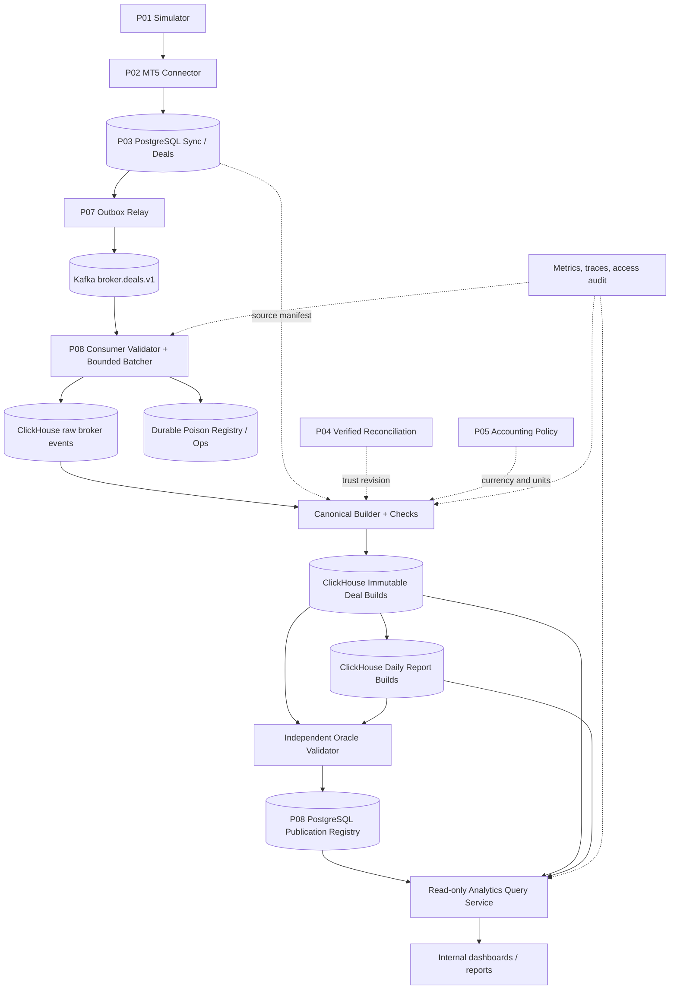
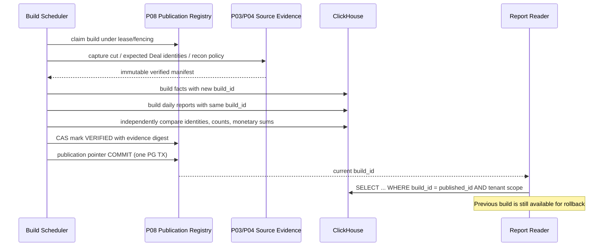
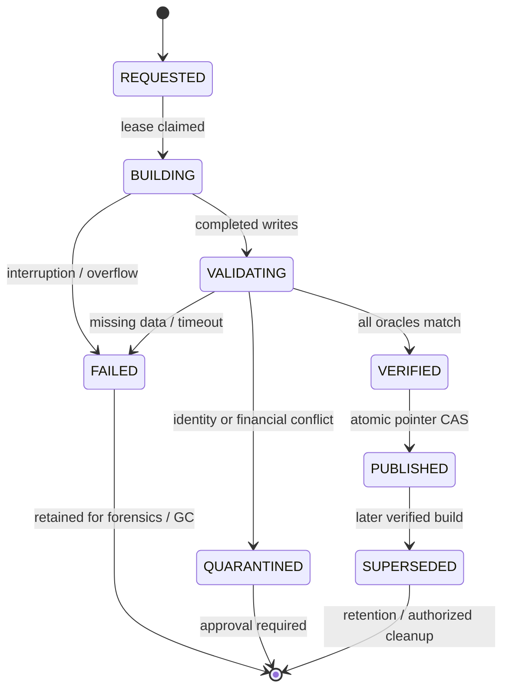
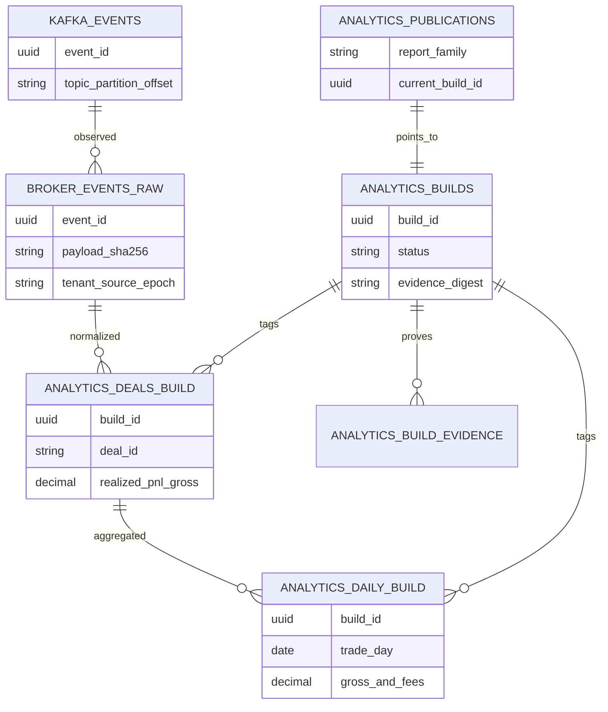

# Project 08 — ClickHouse Broker Analytics

**System Design · Kafka → ClickHouse · Immutable Event Evidence · Deduplicated Financial Analytics · Versioned Publication · Chaos/What-if Verification**  
**Version:** 1.0 · **Date:** 2026-10-30  
**Roadmap:** Mini-project **08/09** — Broker Risk Reporting & MT5 Integration  
**Status:** **DESIGN PROPOSAL — NOT IMPLEMENTED / NOT TESTED / NOT BENCHMARKED**

> **Nguồn và giới hạn:** CV mô tả ClickHouse, Kafka, PostgreSQL, Python và khả năng xử lý dữ liệu broker nhưng **không tiết lộ** kiến trúc ClickHouse của Project 08. Tài liệu này là một **thiết kế thực hành độc lập**, tương thích về ý định với tài liệu Project 01–07 trong thư mục. Thông số, schema, ngưỡng, giao thức publication và lỗi đều là đề xuất, **không phải kết quả của dự án CV**.
>
> **Định nghĩa “chịu nổi”:** Một hệ thống có thể chậm lại, báo cáo `STALE` hoặc từ chối truy vấn khi bị quá tải. Không được âm thầm cộng P&L hai lần, nhập lẫn nguồn/epoch/tenant, coi snapshot dở dang là hoàn chỉnh, hoặc trả số tiền sai như dữ liệu đã kiểm chứng.
>
> **Không thể liệt kê mọi trường hợp:** 528 what-if bên dưới chỉ là *test design inventory*, không phải bằng chứng chịu lỗi. Cần bổ sung stateful tests, fuzzing, mutation, tổ hợp lỗi và số đo thực tế. **0/528 test case đã chạy khi tạo tài liệu.**

---

## 0. Executive summary — 12 quyết định kiến trúc

1. **P07 là nguồn Kafka event, không phải sự thật cuối cùng của các chỉ số tài chính.** `DealRecorded.v1` và provenance dẫn về dữ liệu P03, với trạng thái xác minh P04 và accounting policy P05.
2. **At-least-once Kafka → ClickHouse** cho MVP: ClickHouse INSERT và Kafka commit offset **không** cùng một atomic transaction; Kafka có thể redeliver.
3. **Lưu raw observations append-only** với `event_id`, `payload_sha256`, `(topic,partition,offset)`, `source_id`, `epoch_id` và `ingest_time`. Không `SUM()` trực tiếp từ bảng raw.
4. **Đối chiếu cả `event_id` lẫn semantic Deal key.** Trùng ID và cùng hash là lặp vô hại; một ID nhưng khác hash, hoặc một Deal key nhưng khác payload, là **integrity incident**.
5. **Báo cáo dùng immutable `build_id`.** Không cho reader thấy tập bảng nửa xây dựng. Pointer `PUBLISHED` được đổi bằng một PostgreSQL transaction sau khi build và independent oracle PASS.
6. **Tính money theo chính sách P05** bằng decimal, giữ `currency`, `scale`, dấu commission/swap và thông tin `fee_coverage`. Không cộng USD với EUR; không suy đồng tiền từ symbol.
7. **Không giả định `AccountSnapshotPublished` chứa toàn bộ rows.** Snapshot marker chỉ báo P03 publish; muốn analytics account/position phải có hợp đồng cấp đầy đủ snapshot + provenance riêng.
8. **Không phụ thuộc vào merge của `ReplacingMergeTree` để đúng ngay tại thời điểm query.** Cũng không đưa duplicate raw vào `SummingMergeTree` hay MV rồi cho rằng merge sẽ sửa tổng.
9. **Rebuild/replay là chức năng bắt buộc**, không phải đường cứu hộ thủ công. Kafka retention và PostgreSQL archive phải hỗ trợ độ trễ/khôi phục dự kiến; nếu nguồn lịch sử không đủ → `INCOMPLETE`, không tự bịa lại.
10. **Broker/epoch/tenant là ranh giới cứng.** Không chỉ filter UI: role, query, manifest và data model cùng ràng buộc identity.
11. **Bounded ingestion và bounded queries.** Queue, batch, retry, kết nối, threads, memory, timeouts, query limits, parts và disk đều có giới hạn đo được.
12. **Local single-node ≠ high availability.** Khi mở rộng `ReplicatedMergeTree`/Keeper, Kafka HA, storage/restore, cần test riêng và ghi rõ phiên bản ClickHouse đang sử dụng.

### 0.1 Demo cuối cùng

`Project 01 → 02 → 03 → 07 → Kafka → P08 Consumer → ClickHouse raw → Canonical Build → Verified Daily Analytics → Read-only Query`. Demo tối thiểu: (a) 100.000 Deal với số liệu đúng oracle; (b) phát lại 10% event và vẫn đúng; (c) kill consumer sau ClickHouse ACK nhưng trước offset commit; (d) rebuild ngày quá khứ khi Deal đến trễ; (e) build mới lỗi thì bản report cũ vẫn giữ nguyên.

### 0.2 MVP/P1/P2

| Scope | Bao gồm | Không cam kết |
|---|---|---|
| P0 | `DealRecorded.v1`, synthetic USD/FX profile được P05 phê duyệt, raw log, Kafka manual offsets, quarantine, immutable builds, daily P&L/volume/count, source completeness proofs, one-node ClickHouse | Exactly-once wire delivery, MT5 production parity, full multi-currency conversion, Account/Position full snapshots qua marker |
| P1 | Deal correction protocol **chỉ sau khi P07 schema nâng cấp**, multi-currency with versioned rates, incrementally rebuilt affected dates, read replicas, governed archival | Correction ngầm bằng same Deal ID, auto-repair money |
| P2 | High-volume shard/replication, cross-region restore, asynchronous refresh/advanced MV architectures, retention tiers, dashboard SLA đa tenant | HA chưa được chaos-test, universal in-order event processing |

---

## 1. Requirements & measurable success conditions

| ID | Priority | Requirement | PASS requirement |
|---|---|---|---|
| FR08-01 | P0 | Kafka consumer đọc event P07 bằng allowlist | Event đúng schema/provenance mới vào raw; poison bị cô lập |
| FR08-02 | P0 | Retriable ClickHouse ingestion | Crash sau CH INSERT ACK trước offset ACK không làm double-count money |
| FR08-03 | P0 | Identity & semantic dedup | `event_id` + hash và `(source,epoch,deal_id)` + content fingerprint đều nhất quán |
| FR08-04 | P0 | Publish complete daily reports | Reader chỉ thấy `build_id` đã verified, không thấy partial results |
| FR08-05 | P0 | Financial fidelity | Independent Decimal oracle khớp count, amount, currency, sign, deal-set |
| FR08-06 | P0 | Source cut & reconciliation | Không công bố `READY` nếu thiếu evidence về completeness/P04 policy |
| FR08-07 | P0 | Late events | Giao dịch có `executed_at` cũ được đưa vào kỳ lịch sử đúng sau rebuild |
| FR08-08 | P0 | Resource & fair scheduling | Bounded memory, retry, max connections, write/query concurrency |
| FR08-09 | P0 | Tenant isolation, least privilege | Unauthorized principal không xem event/report broker khác |
| FR08-10 | P0 | Audit, metrics & recovery | Mọi publication có manifest, evidence hash, cut, state transition và owner |
| FR08-11 | P1 | Correction/reversal | Only activated by explicit P07 correction v2 + domain contract, old builds remain reproducible |
| FR08-12 | P1 | Multi-currency valuation | Rate set/as-of/currency and coverage proved, no implicit FX conversion |
| FR08-13 | P1 | Faster incremental rebuild | Same output as full independent rebuild across late/replayed events |
| FR08-14 | P2 | Replicated HA | Failover test validates RPO/RTO and read consistency (not inferred from engine name) |

**Quality gates:** FINANCIAL=0 silent wrong totals, ISOLATION=0 cross-tenant leakage, COMPLETENESS=0 false `READY`, DELIVERY=0 silent record loss within declared source/retention assumptions, BOUNDEDNESS=measured under overload. A timeout/error is permitted and preferable to a believable wrong number.

## 2. Terminology, authoritative boundaries and contracts

| Term | Meaning | Source / caveat |
|---|---|---|
| `source_id` | Logical broker feed identity | P01–P03; cannot assume globally unique across independent tenants |
| `epoch_id` | Durable source identity incarnation | P03/P07; reused `deal_id` across epochs ≠ same Deal |
| `run_id/generation/snapshot_seq` | Simulator provenance | P01/P02 only; real MT5 Manager API does not guarantee these abstractions |
| `source_seq` | Source stream sequence / Deal watermark input | Gaps may be legitimate; **not** Kafka offset and **not** global commit clock |
| `aggregate_version` | P07 per aggregate ordering guard | **Not** Deal revision; not safe as universal time or per-deal correction counter |
| `event_id` | Stable P07 logical event ID | Duplicate P07 relay sends may carry same ID at different Kafka offsets |
| `kafka_offset` | Position in a Kafka partition | Offset ACK cannot prove ClickHouse publication or source completeness |
| `build_id` | Immutable analytics generation of a defined cut | Proposed P08 extension; not in P07 schema |
| `publication_id` | Pointer to verified, queryable build | Stored in isolated P08 control-plane PostgreSQL schema |
| `financial_coverage` | `READY / INCOMPLETE / UNSUPPORTED / BLOCKED` reasons | Derived from P05/accounting contract, not merely non-null value |
| `report_currency` | One well-specified currency of a result row | Per-currency grouping P0; conversion P1 requires FX rate-set |

### 2.1 P07 event handoff: exact existing proposal

**Event topic:** `broker.deals.v1`, event `DealRecorded.v1`; P07 also proposes `broker.snapshots.v1` snapshot markers and optional `broker.lifecycle.v1` epoch/reconciliation events. Kafka key per `(source_id, epoch_id, account_id)` for Deals (subject to P07 routing contract). P08 **must** accept delivery duplicates and possible late old-worker sends after lease takeover.

Required wire-level fields from P07 design: `event_id`, `dedupe_key`, `event_type`, `schema_version`, `source_id`, `epoch_id`, `aggregate_type`, `aggregate_id`, `aggregate_version`, `created_at`, `payload`, `payload_sha256`, `provenance` containing `source_seq`, `deal_id`, `deal_payload_hash`. Money values are **decimal strings** with sign/currency; `money_currency` in P07 example is a **proposed field not proven present in P03 original schema**.

**P08 additions requiring explicit contract agreement (NOT assumed to exist):** `tenant_id/broker_scope`, immutable `deal_revision` for future corrections, `fee_coverage`, `symbol_catalog_version`, `accounting_policy_version`, optional `source_cut_reference`, `event_kind` for reversals, and archive manifest. Until `money_currency` and fee semantics are validated, no monetary aggregate is marked `READY`.

### 2.2 Ownership, prohibited shortcuts

| Component | Owns | Must never do |
|---|---|---|
| P03 | Authoritative persisted Deal source, sync watermark, snapshot publication | P08 mutate `deals` to fix analytics |
| P04 | Reconciliation results and verified cut | P08 equate missing recon evidence with VERIFIED |
| P05 | Accounting policy, money/FX correctness | P08 quietly invent symbol contract or exchange rate |
| P06 | Risk API and auth contracts | P08 masquerade as current live exposure API |
| P07 | Outbox transaction, stable event schema, Kafka publish | P08 treat producer `PUBLISHED` as consumed/report-ready |
| P08 | Raw ingestion, validated analytics builds, publication, historical read model | P08 claim exactly-once across Kafka/CH without protocol proof |

---

## 3. Architecture, components, trust boundaries

### 3.1 Container architecture



**Key isolation:** P08 reads P03/P04 through read-only privileged service roles; `P08_control_db` is a separate ownership schema/database, **not** an invitation to update P03 money. ClickHouse reader has SELECT only on curated tables; Kafka credentials are scoped to P08 consumer group and approved topics.

### 3.2 Ingest sequence: ACK ambiguity and Kafka replay

```mermaid
sequenceDiagram
    participant K as Kafka
    participant C as P08 Consumer
    participant CH as ClickHouse raw
    participant CP as Kafka Group Offset
    K->>C: poll batch at offsets p:42..59
    C->>C: validate, check tenant, schema, hashes
    C->>CH: INSERT raw batch; wait for durable response per setup
    CH-->>C: INSERT ACK
    Note over C: Crash may happen NOW
    C->>CP: commit contiguous processed offsets
    CP-->>C: offset commit ACK
    Note over C: Redelivery after crash is legal; raw may have duplicate rows
    Note over C,CH: Report builder dedups semantic Deal independently of insert retry
```

If CH insertion returns ambiguous timeout: **never commit Kafka offset on uncertainty.** Replay is allowed. Check duplicate/hash invariants in the next build. For strict poison handling, persist a durable quarantine receipt *before* advancing past a rejected event; otherwise pause that partition. **Never skip a record only because parsing failed.**

### 3.3 Build and publish sequence



The manifest/pointer commit is atomic **within PostgreSQL**; it is **not** a distributed ClickHouse transaction. Before pointer change, check rows visible on the approved reader path; during replica failover, if necessary return `STALE/BLOCKED` rather than claim newly published build is visible everywhere.

### 3.4 Reader consistency and rollback



**State transitions must be audited and fenced**: stale build worker cannot publish after losing lease or after source epoch changes.

### 3.5 Why not default `Kafka Engine → SummingMergeTree`?

The direct pipeline is attractive but wrong for this safety model unless all retry/dedup/correction semantics are independently solved. An incremental MV consumes **inserted blocks**, not the final globally deduped truth; a duplicate source event can be counted twice. `ReplacingMergeTree` background merges are asynchronous; query-time `FINAL` or explicit `GROUP BY` is needed for current-state read correctness. Async-insert/MV dedup behavior is **version- and settings-dependent**, including improvements in ClickHouse 26.1; still not a global PostgreSQL↔Kafka↔ClickHouse transaction. See official ClickHouse references §27.

---

## 4. Correctness invariants — formal test oracles

Define `E` = multiset of raw observations in ClickHouse; `L(cut)` = authoritative set of Deal identities P03 has committed through an approved cut; `C(build)` = set of canonical Deal facts in one candidate build; `R(build)` = report rows; `Q(build)` = publication manifest. Every P0 proof must be scoped by `(tenant_id,source_id,epoch_id,cut,policy_version)`.

| ID | Invariant | Independent proof |
|---|---|---|
| INV08-01 | Kafka redelivery changes number of raw *observations*, not canonical Deal effects | Inject duplicate Kafka record; `C` hashes and money equal baseline |
| INV08-02 | Same `event_id` with different hash is quarantined, never `anyLast` resolved | Contradictory duplicate fixture; build BLOCKED |
| INV08-03 | Same `(tenant,source,epoch,deal_id)` with inconsistent hash is quarantined | Oracle compares complete semantic identity groups |
| INV08-04 | Distinct epoch may reuse Deal ID without collision | Simulator reset; both epochs remain separate |
| INV08-05 | `C(build)` contains *exactly one* row for every Deal in selected proven cut | Set equality, not count-only |
| INV08-06 | Sum of reports equals sum of canonical facts per currency and policy | Python `Decimal` oracle and SQL cross-check |
| INV08-07 | No cross-currency arithmetic disguised as a common unit | USD/EUR fixture; separate groups or BLOCKED |
| INV08-08 | Snapshots and Deal cuts are never silently combined across incompatible versions | Manifest review and cut-boundary test |
| INV08-09 | `PUBLISHED` only from VERIFIED with complete proof and visible CH rows | DB CAS + read path probe + evidence ID |
| INV08-10 | An abandoned/incomplete build is never queryable as current | Reader always filters immutable published `build_id` |
| INV08-11 | Losing active owner lease cannot overwrite publication pointer | Fencing CAS and takeover test |
| INV08-12 | Kafka offset committed only after eligible CH insert ACK or durable explicit quarantine | Mock crash windows and contiguous offset proof |
| INV08-13 | No hidden `OFFSET_OUT_OF_RANGE`: missing retention triggers rebootstrap/incomplete | Kafka truncation/recovery test |
| INV08-14 | Event-time period defined by validated UTC `executed_at`, not ingestion timestamp | Late Deal test across month/year boundaries |
| INV08-15 | Missing/unsupported money/fee/FX policy cannot produce monetary `READY` | Validation gate returns structured reason |
| INV08-16 | `AccountSnapshotPublished` marker is not interpreted as complete Account fact | Missing full snapshot contract = unsupported metric |
| INV08-17 | Every reader query has bound tenant, source, epoch and publication constraints | Adversarial query isolation tests |
| INV08-18 | Build rollback restores old verified pointer without mutating history | Publish new then rollback pointer under audit |
| INV08-19 | Retention/GC never deletes the current published build or required audit source | Simulate TTL/cleanup + query correctness |
| INV08-20 | Resource use stays within declared budgets or fails controlled | CPU/RSS/disk/pool budgets under burst/soak |
| INV08-21 | Ingestion does not hide permanent poison as Kafka lag zero | Quarantine ledger + source coverage oracle |
| INV08-22 | Rebuild on identical pinned cut and policy yields identical canonical hash | Deterministic replay and hash-by-sorted-keys |
| INV08-23 | Raw/event/projection row counts distinguished; physical duplicates are expected | Dashboard metric taxonomy with oracle |
| INV08-24 | Production replica claims only after tested cross-replica visibility/restore | Kill primary/read-after-write + RPO/RTO report |

**Completeness is more than Kafka committed offset.** It requires a bounded cut, mapping between P03 persisted Deal and P07 emission, proof of sink coverage (unique sets/hashes, not just counts), accepted source/reconciliation state and no unresolved quarantine record affecting the cut. A high-water offset can only establish stream progress for specific partitions under known broker retention and membership; it is not proof that all PG outbox events are in Kafka.

---

## 5. Data model — ClickHouse storage, PostgreSQL publication registry

### 5.1 Logical ERD (conceptual, no cross-database FK)



**Scope note:** This ERD represents logical relationships, not physical FKs across ClickHouse and PostgreSQL. ClickHouse `ORDER BY` is a sparse-index sort key, **not** a uniqueness guarantee.

### 5.2 Proposed ClickHouse DDL (blueprint; verify against pinned server version)

```sql
CREATE DATABASE IF NOT EXISTS broker_analytics;

-- Bronze: append-only raw observations, including legal Kafka replay duplicates.
CREATE TABLE broker_analytics.broker_events_raw
(
  tenant_id String,
  source_id String,
  epoch_id UUID,
  event_id UUID,
  dedupe_key String,
  kafka_record_key String,
  event_type LowCardinality(String),
  schema_version UInt16,
  payload_sha256 FixedString(64),
  deal_payload_hash FixedString(64),
  deal_id String,
  account_id String,
  source_seq UInt64,
  aggregate_version UInt64,
  event_time DateTime64(6, 'UTC'),
  executed_at Nullable(DateTime64(6, 'UTC')),
  ingested_at DateTime64(6, 'UTC') DEFAULT now64(6),
  kafka_topic String,
  kafka_partition UInt32,
  kafka_offset UInt64,
  payload_json String
)
ENGINE = MergeTree
PARTITION BY toYYYYMM(ingested_at)
ORDER BY (tenant_id, source_id, epoch_id, event_type, ingested_at, event_id)
SETTINGS index_granularity = 8192;

-- Silver: each build_id is immutable; rows are written by a validator-controlled build.
CREATE TABLE broker_analytics.analytics_deals_build
(
  build_id UUID,
  tenant_id String,
  source_id String,
  epoch_id UUID,
  deal_id String,
  account_id String,
  symbol String,
  side LowCardinality(String),
  entry_kind LowCardinality(String),
  source_seq UInt64,
  executed_at DateTime64(6, 'UTC'),
  money_currency LowCardinality(String),
  realized_pnl_gross Decimal(38, 12),
  commission Decimal(38, 12),
  swap Decimal(38, 12),
  fee_coverage LowCardinality(String),
  deal_payload_hash FixedString(64),
  event_id UUID
)
ENGINE = MergeTree
PARTITION BY toYYYYMM(executed_at)
ORDER BY (tenant_id, source_id, epoch_id, build_id, account_id, executed_at, deal_id);

-- Gold: rollups derived from validated, unique facts of exactly one build.
CREATE TABLE broker_analytics.analytics_daily_build
(
  build_id UUID,
  tenant_id String,
  source_id String,
  epoch_id UUID,
  trade_day Date,
  account_id String,
  symbol String,
  money_currency LowCardinality(String),
  deal_count UInt64,
  realized_pnl_gross Decimal(38, 12),
  commission Decimal(38, 12),
  swap Decimal(38, 12)
)
ENGINE = MergeTree
PARTITION BY toYYYYMM(trade_day)
ORDER BY (tenant_id, source_id, epoch_id, build_id, trade_day, account_id, symbol, money_currency);
```

**DDL caveats and hard gates:**

- Example assumes `payload_sha256` is an exactly 64-hex string; **validate before INSERT** (FixedString alone does not prove correct hashing). `deal_payload_hash` is mandatory only for `DealRecorded`; other markers require nullable/separate schema or a validated sentinel. MVP ingest consumer separates event classes and writes Deal raw to this table; snapshot markers are retained in a **separate lightweight event/control log** before enabling their ingestion. This is a **blueprint**, not a tested migration.
- Decimal(38,12) is a chosen bound, **not** proof every instrument fits; validate precision/scale and check sum overflow independently. For monetary reporting, never cast Python money through `float` or emit JSON numeric values.
- `toYYYYMM(ingested_at)` means replay of 2023 Deal in 2026 lands in 2026 raw partition, intentionally. Historical reports partition by **event time** and may need rebuild.
- `PARTITION BY` months is for lifecycle/retention management, while sort key reflects query shapes; monitor parts and compression, don't over-partition by tenant or day.
- The design uses plain `MergeTree` so duplicates stay visible in evidence. `ReplacingMergeTree` would *hide* conflicting event observations after merges without an explicit conflict audit.
- P0 is one-node ClickHouse. For production, adapt DDL to ReplicatedMergeTree/Keeper only with separate replication semantics and test evidence.

### 5.3 Isolated PostgreSQL control-plane (proposed reference DDL)

```sql
CREATE SCHEMA IF NOT EXISTS analytics_control;

CREATE TABLE analytics_control.analytics_builds (
    build_id UUID PRIMARY KEY,
    tenant_id TEXT NOT NULL,
    source_id TEXT NOT NULL,
    epoch_id UUID NOT NULL,
    report_family TEXT NOT NULL,
    cut_id TEXT NOT NULL,
    policy_version TEXT NOT NULL,
    recon_revision TEXT NOT NULL,
    source_manifest_sha256 CHAR(64) NOT NULL,
    state TEXT NOT NULL CHECK (state IN
       ('REQUESTED','BUILDING','VALIDATING','VERIFIED','PUBLISHED',
        'SUPERSEDED','FAILED','QUARANTINED')),
    lease_token UUID,
    lease_version BIGINT NOT NULL DEFAULT 0,
    lease_until TIMESTAMPTZ,
    evidence_sha256 CHAR(64),
    source_coverage JSONB NOT NULL DEFAULT '{}'::jsonb,
    created_at TIMESTAMPTZ NOT NULL DEFAULT clock_timestamp(),
    updated_at TIMESTAMPTZ NOT NULL DEFAULT clock_timestamp(),
    attempt_no INTEGER NOT NULL CHECK (attempt_no > 0),
    UNIQUE (tenant_id, source_id, epoch_id, report_family, cut_id, policy_version, attempt_no)
);

-- One durable active-claim row per scope/cut/policy. New attempt_no and build_id
-- are allowed only after the prior attempt has been fenced/closed.
CREATE TABLE analytics_control.analytics_build_claims (
    tenant_id TEXT NOT NULL,
    source_id TEXT NOT NULL,
    epoch_id UUID NOT NULL,
    report_family TEXT NOT NULL,
    cut_id TEXT NOT NULL,
    policy_version TEXT NOT NULL,
    active_build_id UUID REFERENCES analytics_control.analytics_builds(build_id),
    lease_token UUID,
    lease_version BIGINT NOT NULL DEFAULT 0,
    lease_until TIMESTAMPTZ,
    PRIMARY KEY (tenant_id, source_id, epoch_id, report_family, cut_id, policy_version)
);

CREATE TABLE analytics_control.analytics_publications (
    tenant_id TEXT NOT NULL,
    source_id TEXT NOT NULL,
    epoch_id UUID NOT NULL,
    report_family TEXT NOT NULL,
    current_build_id UUID NOT NULL REFERENCES analytics_control.analytics_builds(build_id),
    publication_revision BIGINT NOT NULL CHECK (publication_revision > 0),
    published_at TIMESTAMPTZ NOT NULL,
    PRIMARY KEY (tenant_id, source_id, epoch_id, report_family)
);

CREATE TABLE analytics_control.analytics_build_evidence (
    build_id UUID NOT NULL REFERENCES analytics_control.analytics_builds(build_id),
    evidence_kind TEXT NOT NULL,
    evidence_sha256 CHAR(64) NOT NULL,
    evidence_json JSONB NOT NULL,
    recorded_at TIMESTAMPTZ NOT NULL DEFAULT clock_timestamp(),
    PRIMARY KEY (build_id, evidence_kind)
);
```

**Retry/build attempt semantics:** `analytics_builds` stores many immutable attempts for one `(tenant,source,epoch,report_family,cut,policy)` using sequential `attempt_no`; `analytics_build_claims` serializes **one active owner** for that logical build. A failed attempt may be replaced with a new `build_id` only after the previous claim is fenced and closed, so an ambiguous partial CH INSERT cannot accidentally be reused. The claim row is updated in a PostgreSQL transaction using an incremented `lease_version`, token and database clock; write/publish CAS verifies both the active claim and build identity. Reference DDL sketches these guards; repository transactions/triggers still need explicit implementation and concurrency tests.

**Upgrade rules:** Build state cannot become `VERIFIED` merely because inserts returned HTTP 200; independent evidence and cut coverage must exist. Pointer transaction serializes per `(tenant,source,epoch,report_family)` and checks tenant match, immutable build attributes, expected `publication_revision`, `verified_at` or equivalent, current source epoch and valid P04 policy. Add CHECK/trigger or repository-level guard with integration tests; the DDL alone is not enough to enforce state transitions. Build mutation, GC and publication require distinct DB roles.

### 5.4 Build manifest example

```json
{
  "build_id": "00000000-0000-4000-8000-000000000801",
  "tenant_id": "lab-tenant",
  "source_id": "sim-broker-01",
  "epoch_id": "00000000-0000-4000-8000-000000000001",
  "report_family": "daily_deal_v1",
  "cut_id": "source-deal-W-154200",
  "deal_watermark": 154200,
  "kafka_cut": {"broker.deals.v1/0": 5300, "broker.deals.v1/1": 4750},
  "policy_version": "usd-fx-synthetic-v1",
  "reconciliation_revision": "recon-verified-42",
  "fee_coverage": "COMMISSION_AND_SWAP_ONLY",
  "currency_policy": "GROUP_BY_MONEY_CURRENCY",
  "expected_unique_deals": 100000,
  "expected_identity_digest_sha256": "<hex SHA-256 over sorted canonical identities>",
  "measured": null,
  "status": "REQUESTED"
}
```

**Do not trust this example manifest as source truth.** `kafka_cut` is partition progress metadata, not evidence every P03 Deal went through outbox, and `fee_coverage` does not claim a full all-in net across unmodeled fees.

---

## 6. Algorithm: ingestion, deterministic canonicalization, publication

### 6.1 Kafka consumer offset discipline

For each `(topic, partition)`:

1. Poll with controlled `max_poll_records`/bounded batch size, validate max envelope bytes and supported schema **before accepting**. An approved `tenant_id`/source mapping must be configured, not trusted from arbitrary payload alone.
2. Compute canonical hash using the **same versioned encoding contract** as P07, or verify a P07 signed/verified immutable fingerprint through trusted transport/producer ACL. Never `hash(str(dict))` and never pass Decimal through binary float.
3. Reject/quarantine malformed or conflicting events; when poison cannot be acknowledged durably, **stop that partition**. Quarantine is an audited disposition, not success by omission.
4. INSERT a batch of typed observations into `broker_events_raw`; for P0 use acknowledged synchronous INSERT. If future async insert is used, set `wait_for_async_insert=1` and test its version-dependent durability/dedup semantics separately.
5. Only after ClickHouse returns the required ACK may consumer commit the **highest contiguous eligible offset per partition**. A success at offset 55 cannot justify skipping an unprocessed poison at 54.
6. On ambiguous INSERT ACK, do not commit offset; Kafka replays and raw may contain duplicates. Dataset builder must be idempotent at **business identity level** regardless of insert-block retry.
7. On rebalance, cancel/fence stale workers and commit only proven contiguous positions. A late worker must not race write publication/control after losing its lease.

**Pseudocode — design sketch, not tested library calls:**

```python
async def process_partition_batch(records, assignment_epoch):
    if not is_current_partition_owner(assignment_epoch):
        raise PartitionRevokedError("stale assignment")
    valid = validate_all_or_quarantine_with_durable_receipts(records)
    if valid.has_unresolved_poison:
        pause_partition(valid.first_unresolved_offset)
        return
    insert_ack = await clickhouse.insert_raw(valid.rows, deadline_ms=5000)
    if not insert_ack.is_proven_success:
        raise RetriableIngestFailure("offset must not be committed")
    if not is_current_partition_owner(assignment_epoch):
        raise PartitionRevokedError("do not commit revoked offsets")
    await kafka.commit_contiguous(valid.offsets)  # implementation must handle rebalance
```

**Important:** This sketch omits actual Kafka client protocol details. Revocation callback and partition membership generation need to guard commits, and a client timeout cannot always cancel a server-side INSERT already underway.

### 6.2 Canonical builder and independent check

**Protocol P0:**

1. Acquire PostgreSQL build lease with fencing token and freeze `(tenant,source,epoch,source_cut,policy_version,recon_revision)`.
2. Obtain independent expected Deal identity + payload-hash **manifest from P03** through a read-only consistent snapshot (or equivalent signed durable artifact). If P03 cannot provide complete set at cut, report `INCOMPLETE`; do not infer from Kafka lag=0.
3. Confirm P07 outbox emission/stream coverage and P08 raw observation set; detect: missing event, duplicate same hash, duplicate conflicting hash, wrong tenant/epoch, unknown money currency, unsupported fee/accounting policy.
4. If contradictions exist, QUARANTINE the build and alert. Do **not** use `any()`/`argMax()` to resolve two conflicting payload hashes arbitrarily.
5. Generate immutable `analytics_deals_build` for a **new `build_id`**, retaining exactly one canonical row per expected Deal. Writes are segmented into deterministic batches. On partial/ambiguous retries, do not publish; abandon the build_id and rebuild safely (GC is controlled).
6. Aggregate `analytics_daily_build` **from the verified Deal build**, group by `(trade_day, account, symbol, money_currency)` and retained report identity. Report net P&L only under P05-approved fee coverage; otherwise show components and an explicit unavailable net status.
7. Execute independent count/identity hashes, per-currency Decimal sums, date-boundary and tenant scope oracles. A sampled check alone is not adequate for a `READY` claim.
8. Validate that the approved reader can see all rows of both tables on the chosen endpoint/replicas; write evidence with hashes and provenance.
9. CAS `BUILDING → VALIDATING → VERIFIED`; then flip `analytics_publications` pointer in one PostgreSQL TX, verifying owner token and current epoch/cut policy. Reader queries must resolve pointer first and bind `build_id` for every query.
10. On any fault: mark failed or quarantined (or allow lease expiration), leave previous publication untouched. Explicitly record `STALE/INCOMPLETE/BLOCKED` status and cut freshness.

**Why full independent rebuild for P0?** It is much easier to prove correct under duplicates, corrections and late arrivals than append-only incremental SUM. This is intentionally a correctness-first MVP for 100k–1M Deal, **not** a claim it scales to millions of events per second. P1 can rebuild just affected time windows with versioned per-window manifest and test equivalence against full rebuild.

### 6.3 Illustrative validation queries (not sufficient as sole oracle)

```sql
-- Duplicate / inconsistent event_id observations within one scope.
SELECT tenant_id, source_id, epoch_id, event_id,
       count() AS physical_observations,
       uniqExact(payload_sha256) AS distinct_hashes
FROM broker_analytics.broker_events_raw
WHERE tenant_id = {tenant:String}
  AND source_id = {source:String}
  AND epoch_id = {epoch:UUID}
  AND event_type = 'DealRecorded'
GROUP BY tenant_id, source_id, epoch_id, event_id
HAVING distinct_hashes > 1;

-- Same logical Deal with conflicting content; requires zero results.
SELECT tenant_id, source_id, epoch_id, deal_id,
       uniqExact(deal_payload_hash) AS distinct_deal_hashes
FROM broker_analytics.broker_events_raw
WHERE tenant_id = {tenant:String}
  AND source_id = {source:String}
  AND epoch_id = {epoch:UUID}
  AND event_type = 'DealRecorded'
GROUP BY tenant_id, source_id, epoch_id, deal_id
HAVING distinct_deal_hashes > 1;

-- Published candidate contains one row per Deal identity (detect bad repeat inserts).
SELECT count() AS physical_rows, uniqExact(deal_id) AS unique_deals
FROM broker_analytics.analytics_deals_build
WHERE tenant_id = {tenant:String}
  AND source_id = {source:String}
  AND epoch_id = {epoch:UUID}
  AND build_id = {build:UUID};

-- Compare independently computed daily sums against facts in the *same build*.
SELECT money_currency, sum(realized_pnl_gross) AS gross,
       sum(commission) AS commission_total, sum(swap) AS swap_total
FROM broker_analytics.analytics_deals_build
WHERE tenant_id = {tenant:String}
  AND source_id = {source:String}
  AND epoch_id = {epoch:UUID}
  AND build_id = {build:UUID}
GROUP BY money_currency;
```

**Warning about `uniqExact` and `count`:** Both can agree with a wrong set if one Deal is missing and another duplicated or substituted. The authoritative identity/hash **set equality** must be compared with the P03 manifest. For very large sets, use sorted chunk hash manifests with independent randomized full audits; design an exact proof before labelling `READY`.

---

### 6.4 SQL example: build per-day totals from one verified canonical generation

```sql
-- Facts must have passed unique-identity and source-set checks first.
-- Never rerun ambiguous INSERT against same immutable build_id without a
-- tested batch-idempotency protocol; prefer abandoning the failed build ID.
INSERT INTO broker_analytics.analytics_daily_build
SELECT
    build_id, tenant_id, source_id, epoch_id,
    toDate(executed_at, 'UTC') AS trade_day,
    account_id, symbol, money_currency,
    count() AS deal_count,
    sum(realized_pnl_gross) AS realized_pnl_gross,
    sum(commission) AS commission,
    sum(swap) AS swap
FROM broker_analytics.analytics_deals_build
WHERE build_id = {build:UUID}
  AND tenant_id = {tenant:String}
  AND source_id = {source:String}
  AND epoch_id = {epoch:UUID}
GROUP BY build_id, tenant_id, source_id, epoch_id,
         trade_day, account_id, symbol, money_currency;

-- Read only the build pinned from the PostgreSQL publication pointer.
SELECT trade_day, symbol, money_currency,
       sum(deal_count) AS deals,
       sum(realized_pnl_gross) AS gross,
       sum(commission) AS commission,
       sum(swap) AS swap
FROM broker_analytics.analytics_daily_build
WHERE tenant_id = {tenant:String}
  AND source_id = {source:String}
  AND epoch_id = {epoch:UUID}
  AND build_id = {published_build:UUID}
  AND trade_day BETWEEN {from_day:Date} AND {to_day:Date}
GROUP BY trade_day, symbol, money_currency
ORDER BY trade_day, symbol, money_currency;
```

This is a **blueprint**, not a ClickHouse execution result. Report net P&L only if P05 confirms complete fee coverage. Queries can read rows only after the build registry verifies the `build_id` is published/allowed, even if raw ClickHouse SELECT would otherwise succeed.

### 6.5 PostgreSQL publication CAS (reference sketch)

```sql
BEGIN;
SELECT current_build_id, publication_revision
FROM analytics_control.analytics_publications
WHERE tenant_id = :tenant AND source_id = :source
  AND epoch_id = :epoch AND report_family = :family
FOR UPDATE;

SELECT state, evidence_sha256, lease_token, policy_version,
       cut_id, recon_revision
FROM analytics_control.analytics_builds
WHERE build_id = :candidate_build_id
FOR UPDATE;

SELECT active_build_id, lease_token, lease_version
FROM analytics_control.analytics_build_claims
WHERE tenant_id = :tenant AND source_id = :source
  AND epoch_id = :epoch AND report_family = :family
  AND cut_id = :cut AND policy_version = :policy
FOR UPDATE;

-- Application or stored procedure verifies VERIFIED, evidence, scope,
-- trusted cut, active lease token and expected revision in this transaction.
UPDATE analytics_control.analytics_publications
SET current_build_id = :candidate_build_id,
    publication_revision = publication_revision + 1,
    published_at = clock_timestamp()
WHERE tenant_id = :tenant AND source_id = :source
  AND epoch_id = :epoch AND report_family = :family
  AND publication_revision = :expected_revision;
-- Require exactly one updated row or ROLLBACK.
COMMIT;
```

For the first publication, use a conflict-safe INSERT guarded by the same build/lease/evidence policy. This sketch **does not implement** all transition checks by itself: immutable evidence, validated ClickHouse read visibility, source policy and cross-service revision checks are application invariants that must be tested.

### 6.6 Independent reference Decimal oracle (illustrative)

```python
from collections import defaultdict
from decimal import Decimal


def expected_daily(source_fixture_rows):
    # Never derive expected values from P08's own daily rollups.
    seen = {}
    for deal in source_fixture_rows:
        key = (deal['tenant_id'], deal['source_id'],
               deal['epoch_id'], deal['deal_id'])
        if key in seen and seen[key]['deal_payload_hash'] != deal['deal_payload_hash']:
            raise ValueError(f'conflicting semantic Deal: {key}')
        seen[key] = deal
    daily = defaultdict(lambda: [0, Decimal('0'), Decimal('0'), Decimal('0')])
    for deal in seen.values():
        key = (deal['executed_at_utc'].date(), deal['account_id'],
               deal['symbol'], deal['money_currency'])
        dst = daily[key]
        dst[0] += 1
        dst[1] += Decimal(deal['realized_pnl_gross'])
        dst[2] += Decimal(deal['commission'])
        dst[3] += Decimal(deal['swap'])
    return dict(sorted(daily.items()))
```

This sample checks deduplicated sums but **not** full business validation by itself. Independent fixture checks must verify an approved P05 currency/fee policy, timezone-aware UTC datetimes, all expected Deal identities, numeric bounds and source-cut membership. A false or circular oracle is a release-blocking failure.

### 6.7 Cross-service trust race (a guarantee we cannot invent)

The P08 PostgreSQL pointer transaction **cannot atomically lock P04 verification in another database/transaction domain**. P04 may revoke a cut after P08's final pre-publish check. Thus `PUBLISHED` means validated **against a pinned, observed trust revision**, not guaranteed instantaneous latest trust across all services. A critical `READY` read must verify compatible current P04 trust (or a proven signed/bounded-staleness invalidation protocol); otherwise return `STALE/BLOCKED`. Add revocation events, periodic reconciliation sweeps and tests for the invalidation window. Without a shared transaction/locking boundary, claiming globally serializable P03/P04/P08 publication would be misleading.

---


## 7. Financial and event-time policy

### 7.1 Which quantities can P08 aggregate?

| Measure | Definition and required data | P0 rule |
|---|---|---|
| `deal_count` | Unique committed Deal at cut, keyed by `(tenant,source,epoch,deal_id)` | Allowed after set/hash completeness |
| `gross_realized_pnl` | Signed `realized_pnl_gross`, currency per Deal | Sum only by one `money_currency` and accepted Deal mapping |
| `commission` | Signed commission from approved P07 event/P05 policy | Keep sign; report separately |
| `swap` | Signed swap from approved event/P05 policy | Keep sign; report separately |
| `net_realized` | Gross + commission + swap under explicitly scoped fee coverage | Label `net_components_covered`, **not** full economic net when other fees excluded |
| `volume_lots` | Decimal lots per supported symbol/instrument policy | Aggregate by symbol/unit only; no cross-instrument total without normalizing |
| `trade_day` | UTC day of Deal `executed_at`, unless reporting TZ explicitly versioned | Late event updates historical day on rebuild |
| `unrealized P&L` | Requires compatible Position snapshot + mark/FX cut | Out of P0, P05/P06 live risk authoritative |
| `risk/exposure` | Requires position, contract-size, price and policy cut | Out of P0; optional historical *derived* analytics, never implicit |

### 7.2 Financial serialization and numerical integrity

- All monetary payloads are **decimal strings** (`"-0.50"`), never JSON floats; test at DB/serializer/API boundaries.
- Require currency as explicit field with trusted provenance; cannot assume FX quote currency equals account currency or broker profit currency.
- Check sign rules from P05; deal type and `entry_kind` must use approved mapping, not string guesses. No double-fee application on replay.
- Validate scale, negative zero normalization, overflow, invalid integer/decimal, extremely small fractions and conversions before ClickHouse cast.
- Report sums per currency; if FX conversion P1 is introduced, store `fx_rate_set_id`, conversion path/side, effective time, policy version, input currency and output currency. Backfill/reprice changes build_id, not raw Deal.
- Do not infer account balance from Deal P&L; deposits/withdrawals/credit adjustments require explicit event classification and coverage.

### 7.3 Corrections/reversals — **P1 gated pending P07 contract**

P07 `DealRecorded.v1` treats Deal as immutable; a same-key conflicting money event is quarantined by default. To support corrected Deals, introduce **explicit** `DealCorrected.v2`/`DealReversed.v2` and immutable `deal_revision`/`supersedes_event_id` semantics; obtain P03/P04 approval before enabling. A per-account `aggregate_version` is **not** a per-deal revision. Query/canonical logic must select the latest **authorized revision for one Deal** and remove/replace prior contribution when rebuilding that day. Tests must reject same revision different payload, unapproved correction, missing predecessor and correction arriving before original.

---

## 8. Query path, freshness states, security and operations

### 8.1 Read-only analytics contract

```http
GET /internal/analytics/v1/daily?source_id=sim-broker-01&from=2026-10-01&to=2026-10-30
GET /internal/analytics/v1/accounts/A-42/deals?limit=100&cursor=...
GET /internal/analytics/v1/publications/current?source_id=sim-broker-01
GET /internal/analytics/v1/publications/{build_id}/evidence
GET /health/live
GET /health/ready
```

All endpoints are *proposed*, not existing P06 public routes. A trusted auth context supplies `tenant_id`, permitted source/epoch/account scope; query parameters may restrict but never expand it. Every response includes `build_id`, `cut_id`, `as_of`, `source_epoch`, `currency`, `policy_version`, `coverage`, and `freshness`. Cursor is tied to one build and tenant; building a new report must not change already-open cursor semantics.

Example response:

```json
{
  "status": "READY",
  "build_id": "00000000-0000-4000-8000-000000000801",
  "source_id": "sim-broker-01",
  "epoch_id": "00000000-0000-4000-8000-000000000001",
  "policy_version": "usd-fx-synthetic-v1",
  "reporting_cut": "source-deal-W-154200",
  "freshness_seconds": 30,
  "currency": "USD",
  "fee_coverage": "COMMISSION_AND_SWAP_ONLY",
  "items": [{"date": "2026-10-30", "deal_count": 100, "realized_pnl_gross": "120.00", "commission": "-12.50", "swap": "-1.30"}]
}
```

**Status meanings:** `READY` verified and within agreed freshness window; `STALE` last verified publication is older than freshness target; `INCOMPLETE` source evidence, retention or sink coverage missing; `BLOCKED` integrity/finance/reconciliation failure; `DEGRADED` partial infrastructure issue with *only explicitly permitted historical verified* results; `UNSUPPORTED` requested metric has no approved source/policy. Never return `READY` from the presence of some rows alone.

### 8.2 Query discipline

- Read publication pointer under one PostgreSQL read transaction and bind the returned `build_id` for the entire request; bind currency/tenant/scope.
- Prepared parameters and allowlisted sort keys, bounded date ranges, cursors tied to immutable build; no unbounded SQL from clients.
- Reader role SELECT only; admin queries/mutations run under a separate authenticated/audited operator role.
- On CH timeout, enforce client deadline; cancellations must be propagated/best-effort and concurrency budget still holds while server query winds down.
- Historical versions can remain queryable with explicit `build_id` until archived. Never reuse build IDs.
- For multi-replica read after publish, avoid claiming global visibility unless tested; route to consistency-proven replica or fail closed.

### 8.3 Monitoring metrics (bounded cardinality)

| Metric | Why | Alert condition (initial proposal) |
|---|---|---|
| `p08_ingest_raw_rows_total` / `unique_event_ids` | Physical vs logical counts | Unexpected ratio increase; investigate P07 retries |
| `p08_conflicting_event_ids_total` | Detect same ID different hash | **Any > 0 critical** |
| `p08_missing_deal_identity_count` | Exact completeness | **Any > 0 blocks READY** |
| `p08_kafka_partition_lag` / `oldest_event_age` | Backlog | Growing across 3 scrape windows + ETA |
| `p08_raw_insert_ambiguous_total` | ACK uncertainty | > 0 triggers replay verification |
| `p08_build_duration_seconds` | Rebuild capacity | Above measured SLO budget |
| `p08_build_validation_failed_total` | Corruption/incomplete evidence | **Any for candidate blocks publish** |
| `p08_publication_age_seconds` | Freshness | Above policy → STALE |
| `p08_query_latency_p50_p95_p99` | Interactive performance | Threshold depends on benchmark profile |
| `p08_ch_parts_active`, `p08_ch_disk_free_bytes`, `p08_ch_memory_peak` | Merge, storage and exhaustion | Capacity headroom threshold breached |
| `p08_quarantine_pending` | Not silently skipping poison | Any critical poison, page owner |
| `p08_unauthorized_access_total` | Security & isolation | Spike or canary leak → incident |

Do not put `deal_id`, `account_id`, `event_id`, `tenant_id` directly as metric labels at high cardinality. Place context in structured logs/traces with access restrictions and redaction.

### 8.4 Failure classes and bounded responses

| Failure | Correct behavior | Incorrect shortcut |
|---|---|---|
| Kafka down | Pause/backoff, resume within retention; report lag/incomplete | Auto-offset-reset latest and declare ready |
| CH disk full | Stop ingest, retain Kafka offset, alert, recovery/replay | Drop batch or skip offset |
| CH ambiguous ACK | Replay; raw duplicate allowed | Mark consumed without proof |
| Duplicate same event | Keep evidence, dedup semantic build | SUM raw rows |
| Conflicting Deal hash | QUARANTINE affected cut | Use arbitrary `anyLast`/merge winner |
| Unsupported currency | Block monetary report, keep count if policy permits | Assume USD |
| Failed build | Keep last published version | Partial overwrite/report READY |
| Stale reconciliation | STALE/BLOCKED by risk policy | Copy old VERIFIED across epochs |
| Resource overload | Bounded queues, reject/slow, fair tenants | Infinite in-flight/retry storm |
| Lost Kafka history | Verified rebootstrap or status INCOMPLETE | Guess missing Deals |
| CH replica lag | Read verified replica or reject recent read | Assume ACK from one node means all readers current |

---

## 9. Test methodology before writing test matrix

### 9.1 Independent oracle (absolute requirement)

Store synthetic golden fixtures outside the P08 implementation: canonical P03 Deal identities/amounts generated with fixed seeds, expected P05 policy outputs computed via standalone Python `Decimal`, P07 event envelope fixtures, a `source_cut_manifest` and expected result hashes. Oracle must not query the P08 rollup as its own expected value. Include independent set equality (every expected `(tenant,source,epoch,deal)` present once, no extras), conflict scans, currency groups, precision and signed amount checks.

### 9.2 Test layers

| Layer | Goal | Examples |
|---|---|---|
| Unit | Parser, hashing, Decimal, policies and statuses | Invalid decimal, event_id collision, currency mismatch |
| Contract | Match P01–P07 fixtures and mock producers | P07 v1 envelope, P04 cut compatibility |
| Component | Kafka reader/CH adapter/PG build registry | ACK lost, SQL retries, CAS fencing |
| Integration | Kafka + CH + PG + P07 seeded events | Duplicate replay, cut completeness, rolling publication |
| Model-based | Generate event/commit/rebalance/rollback interleavings | Prove invariants after each action |
| Chaos | Kill process/broker, disk full, partitions | Recovery and no silent financial corruption |
| Load/soak | 100k/1M rows, sustained traffic, query mix | Resource bounds, lag drainage, p95/p99 |
| DR | Backup restore/version mismatch/retention gaps | RPO/RTO evidence, no false READY |

### 9.3 Golden fixtures (commit with repository)

| ID | Fixture | Independent expected result |
|---|---|---|
| G08-01 | 3 USD BUY/Sell OUT Deals, signed fee/swap | Fixed per-day Decimal totals |
| G08-02 | Same Kafka event twice on different offsets | Same canonical facts as once |
| G08-03 | Same event_id with different payload_sha256 | Quarantine, no new READY |
| G08-04 | Same deal_id, different event_id and money | Quarantine semantic conflict |
| G08-05 | Epoch reset reuses IDs | No cross-epoch merge |
| G08-06 | Multi-currency deals USD and EUR | Separate groups; no USD+EUR sum |
| G08-07 | Valid Deal with executed_at before ingestion date | Historic partition rebuilt |
| G08-08 | Marker-only Account/Position notification | No fabricated snapshot holdings |
| G08-09 | Source P03 100 Deals, raw 99 Deals | Build INCOMPLETE even when Kafka lag=0 |
| G08-10 | Partial build 98% written, process killed | Old publication unchanged |
| G08-11 | Same canonical cut built twice | Identical sorted identity/amount hashes |
| G08-12 | Conflicting P04 revision/policy mid-build | Stale build cannot publish |
| G08-13 | 100k synthetic Deals | Exact sum and set; repeatable benchmark baseline |
| G08-14 | 1M Deals with uneven tenant/account skew | Memory/throughput/resource fairness trace |
| G08-15 | Incorrect timezone/date and DST boundaries | UTC truth and versioned alternate reporting TZ |
| G08-16 | Missing historical Kafka retention | Rebootstrap required, no false READY |
| G08-17 | Poison at offset 10, valid offset 11 | No unsafe commit past unresolved poison |
| G08-18 | Overlapping old/new consumer assignment | No silent offset skip or mixed publication |
| G08-19 | Previously published build deleted by GC attempt | GC denied / report available |
| G08-20 | Fee coverage unknown, revenue-like report asked | UNSUPPORTED/BLOCKED net; component totals labelled |

### 9.4 Reusable fault test specification (illustrative YAML)

```yaml
scenario_id: P08-G08-02
priority: P0
preconditions:
  tenant: lab-tenant
  source_epoch: epoch-1
  reference_fixture: G08-02
faults:
  - at: after_clickhouse_insert_ack_before_kafka_offset_commit
    action: kill_consumer
  - at: restart_consumer
    action: replay_same_event_id_new_kafka_delivery
expected:
  publication_state: READY
  canonical_deal_effect_count: 1
  money_delta_relative_to_baseline: "0.00"
  raw_observation_count_at_least: 2
oracles:
  - kafka_offset_log
  - ch_raw_identity_hash_check
  - pg_source_manifest_set_equality
  - independent_python_decimal_totals
  - publication_history_and_evidence
```

A runner is not provided by this design; YAML is an **interface proposal** for a future `pytest`/Docker chaos harness.


## 10. What-if verification matrix — **528 scenarios / 44 failure domains**

**Read this correctly:** These are **designed test conditions**, not passed test executions. `P0/P1/P2` are design priority levels, not status. In the table, **"Tiêm lỗi / What-if"** is the exact trigger to reproduce, **"Expected"** is the behavior that must happen, and **"Evidence / PASS oracle"** is what proves it. A scenario is **PASS only if the fault actually fires, the expected behavior occurs, the oracle agrees, and no P0 invariant is violated**; otherwise FAIL / BLOCKED / NOT_RUN. A software crash without wrong data can be acceptable if recovery semantics and error reporting are correct.

**Priority totals:** **352 P0 + 132 P1 + 44 P2 = 528 cases**. P0 cases deliberately include *safe rejection* of unsupported P1/P2 behavior; this does not make the unsupported feature operational. Execute stateful/compound/fuzz tests beyond the finite list. The test evidence format is defined in §11.

### 10.1 Index of failure domains

| Group | Failure domain | P0 | P1 | P2 | Total |
|---|---|---:|---:|---:|---:|

| A | Cross-project contract, bootstrap, source of truth | 8 | 3 | 1 | 12 |
| B | Tenant/source/epoch identity and scope fencing | 8 | 3 | 1 | 12 |
| C | Event envelope, encoding, schema versions, hashes | 8 | 3 | 1 | 12 |
| D | Kafka partition routing, ordering, topics | 8 | 3 | 1 | 12 |
| E | Kafka offsets, ACK ambiguity, recovery | 8 | 3 | 1 | 12 |
| F | Rebalance, partition ownership, cooperative cancellation | 8 | 3 | 1 | 12 |
| G | Event idempotency, semantic duplicate and conflict | 8 | 3 | 1 | 12 |
| H | ClickHouse INSERT response and durability boundary | 8 | 3 | 1 | 12 |
| I | Batch sizing, async inserts, retry dedup tokens | 8 | 3 | 1 | 12 |
| J | Raw table schema, physical identity and partitions | 8 | 3 | 1 | 12 |
| K | Poison records, invalid payloads, quarantine | 8 | 3 | 1 | 12 |
| L | Decimal money types, limits, rounding and precision | 8 | 3 | 1 | 12 |
| M | Currency isolation, FX conversion and policy versions | 8 | 3 | 1 | 12 |
| N | Deal semantics, entry type, fees, account ledgers | 8 | 3 | 1 | 12 |
| O | Account/position snapshots versus Deal historical facts | 8 | 3 | 1 | 12 |
| P | Event time, UTC, late data and clock skews | 8 | 3 | 1 | 12 |
| Q | Source-cut completeness, P03 manifests and offsets | 8 | 3 | 1 | 12 |
| R | Canonical dedup and deterministic build | 8 | 3 | 1 | 12 |
| S | Build lifecycle, leases, batch retries and state machine | 8 | 3 | 1 | 12 |
| T | Atomic publication, read consistency and rollback | 8 | 3 | 1 | 12 |
| U | Daily rollup, counts, symbols, report invariants | 8 | 3 | 1 | 12 |
| V | Late events, replay, historical backfill and immutable builds | 8 | 3 | 1 | 12 |
| W | Corrections, reversals and non-monotonic aggregates (P1 gated) | 8 | 3 | 1 | 12 |
| X | Reconciliation, verified trust, source mutation and governance | 8 | 3 | 1 | 12 |
| Y | P05 calculation boundary and P06 reporting handoff | 8 | 3 | 1 | 12 |
| Z | Query API, parameters, dates, pagination and status | 8 | 3 | 1 | 12 |
| AA | ClickHouse query CPU, memory, concurrency and pressure | 8 | 3 | 1 | 12 |
| AB | MergeTree parts, compaction, partition keys and layout | 8 | 3 | 1 | 12 |
| AC | TTL, retention, Kafka horizon and historical reproducibility | 8 | 3 | 1 | 12 |
| AD | Disk, filesystem, corruption, backups and storage exhaustion | 8 | 3 | 1 | 12 |
| AE | ClickHouse process lifecycle, crash, restart and resource starvation | 8 | 3 | 1 | 12 |
| AF | ReplicatedMergeTree, Keeper and reader failover (P1/P2) | 8 | 3 | 1 | 12 |
| AG | Kafka brokers, leader election, retention and group metadata | 8 | 3 | 1 | 12 |
| AH | Network, DNS, TLS, ACLs, proxies and timeouts | 8 | 3 | 1 | 12 |
| AI | RBAC, auth context, tenant access and row isolation | 8 | 3 | 1 | 12 |
| AJ | Privacy, PII, retention, audit and secrets | 8 | 3 | 1 | 12 |
| AK | Query injection, malicious payload and denial-of-service | 8 | 3 | 1 | 12 |
| AL | Schema migration, rollout, version pinning, CI and rollback | 8 | 3 | 1 | 12 |
| AM | Disaster recovery, archive replay, backup restore and RPO/RTO | 8 | 3 | 1 | 12 |
| AN | Observability, alerting, health, incident evidence | 8 | 3 | 1 | 12 |
| AO | Performance, ingestion throughput, query latency and capacity | 8 | 3 | 1 | 12 |
| AP | Soak tests, leaks, queue growth and performance drift | 8 | 3 | 1 | 12 |
| AQ | Scheduler concurrency, build ownership and fair sharing | 8 | 3 | 1 | 12 |
| AR | Compound failures, adversarial schedules and release-gate violations | 8 | 3 | 1 | 12 |
| **Total** | **44 domains** | **352** | **132** | **44** | **528** |

### 10.2 Case-by-case matrix

#### A. Cross-project contract, bootstrap, source of truth — 12 scenarios

| ID | Priority | Tiêm lỗi / What-if | Expected behavior | Evidence / PASS oracle |
|---|---|---|---|---|
| `P08-A-01` | P0 | Launch P08 when P07 topic broker.deals.v1 does not exist | Readiness false; no fallback to fabricated test data | Kafka metadata and readiness audit show missing topic |
| `P08-A-02` | P0 | Emit DealRecorded.v1 without P07 event_id | Quarantine record; never include its Deal in READY build | Poison receipt and no matching canonical row |
| `P08-A-03` | P0 | Emit P07 snapshot marker as if it contained full Account records | Reject Account metrics; keep marker-only metadata | Contract test asserts UNSUPPORTED, zero fabricated accounts |
| `P08-A-04` | P0 | Start while P03 source epoch has BLOCKED state | Refuse new publication for that epoch | P03 status, build audit and pointer unchanged |
| `P08-A-05` | P0 | Start without P05 accounting_policy_version | Count-only may run if allowed; monetary READY blocked | Policy registry failure and API coverage reason |
| `P08-A-06` | P0 | P04 verification for a different cut arrives with same source_id | Do not reuse evidence across cuts | Cut digest mismatch and no VERIFIED publication |
| `P08-A-07` | P0 | P07 relay says PUBLISHED but event absent from Kafka or sink | Build remains INCOMPLETE until identity proof exists | PG outbox/Kafka/CH set-diff demonstrates missing event |
| `P08-A-08` | P0 | P06 asks live exposure from P08 historical endpoint | Return UNSUPPORTED and route to P05/P06 contract | API negative test and no derived risk result |
| `P08-A-09` | P1 | Add previously unseen P07 envelope optional field | Validate compatible optional field and preserve approved hash contract | Cross-version golden event decoded consistently |
| `P08-A-10` | P1 | P03 renames deal entry_kind enum value in migration | Fail contract test until mapping explicitly approved | CI schema diff and rejected unmapped entry_kind |
| `P08-A-11` | P1 | P04 changes reconciliation verification API response shape | Do not publish until compatibility mapping verified | Compatibility tests and unmodified last pointer |
| `P08-A-12` | P2 | Migrate Kafka native MT5 source without simulator sequence guarantee | Disable assumptions about source_seq/cut and require real-source manifest capability | Capability handshake audit and INCOMPLETE for unsupported proof |

#### B. Tenant/source/epoch identity and scope fencing — 12 scenarios

| ID | Priority | Tiêm lỗi / What-if | Expected behavior | Evidence / PASS oracle |
|---|---|---|---|---|
| `P08-B-01` | P0 | Replay Deal ID D-1 in a new epoch with same account | Keep separate epoch identities, no historical merge | Group-by epoch yields two distinct Deals |
| `P08-B-02` | P0 | Inject identical source_id for two tenant_ids | Tenant namespaces stay isolated | Independent hashes and auth canary tests |
| `P08-B-03` | P0 | Kafka payload claims tenant B but consumer identity authorized for A | Quarantine spoofed scope, do not route into B | Auth mapping check and B tables unchanged |
| `P08-B-04` | P0 | Change epoch_id in event but preserve dedupe_key from prior epoch | Reject inconsistent event identity | Envelope canonical identity validator and quarantine log |
| `P08-B-05` | P0 | P03 source reset during running build | Freeze old cut or mark candidate stale; never combine epochs | Build records pinned epoch and pointer CAS denied |
| `P08-B-06` | P0 | Query with missing tenant constraint through internal SQL path | Reject by query layer/role; no unscoped scan response | SQL capture and authorization negative test |
| `P08-B-07` | P0 | Use same event_id in different source/epoch with different payload | Treat scoped identity according to explicit P07 global ID policy; flag collision | Cross-scope event registry finds conflict |
| `P08-B-08` | P0 | Consumer group shares one topic for 100 tenants | Maintain per-tenant bounded ingestion and audit visibility | Throughput/lag and canary isolation trace |
| `P08-B-09` | P1 | Add new source to authorized tenant while another source lags | Source-specific cut and readiness remain independent | Two-source control tests; lag isolated |
| `P08-B-10` | P1 | Query old epoch after new epoch starts | Show explicitly versioned historical report; do not imply current | Response epoch and publication ID match old cut |
| `P08-B-11` | P1 | Client for tenant A attempts to request tenant B build_id | Return not-found/forbidden without revealing B metadata | Black-box enumeration and audit tests |
| `P08-B-12` | P2 | Bulk restore imports same source/epoch under a changed tenant mapping | Revalidation and explicit migration required, no automatic reassignment | Restore manifest identity check and publication block |

#### C. Event envelope, encoding, schema versions, hashes — 12 scenarios

| ID | Priority | Tiêm lỗi / What-if | Expected behavior | Evidence / PASS oracle |
|---|---|---|---|---|
| `P08-C-01` | P0 | Send schema_version=0 or negative | Reject before CH insert | Schema reject metric and no raw accepted event |
| `P08-C-02` | P0 | Send schema_version=999 unknown | Pause/quarantine with compatibility reason | Unknown-version receipt and no READY claim |
| `P08-C-03` | P0 | Change Decimal JSON string into float literal 0.1 | Reject lossy money schema | Type validator and money oracle error |
| `P08-C-04` | P0 | Encode canonical payload with different key order but same logical fields | Honor P07 canonical hash version; do not hash Python dict string | Canonical cross-language fixture verifies matching SHA-256 |
| `P08-C-05` | P0 | Use invalid 64-hex payload_sha256 | Reject as malformed; no fabricated hash | Byte/hex validation test and poison evidence |
| `P08-C-06` | P0 | Set event_type DealRecorded but payload fields for PositionSnapshotPublished | Reject discriminated-union mismatch | Parsed schema negative test |
| `P08-C-07` | P0 | Omit provenance.deal_id while payload has deal data | Reject missing source identity evidence | Audit source mapping and no canonical fact |
| `P08-C-08` | P0 | Send oversized 20 MB event beyond configured max | Bounded reject/quarantine; no memory surge | RSS peak and recorded reason code |
| `P08-C-09` | P1 | Introduce backward-compatible new nullable field | Old consumer processes after field allowlist/compatibility check | Compatibility fixture and event fingerprint proof |
| `P08-C-10` | P1 | Change sign meaning of commission under same version | Block producer/consumer compatibility gate | Golden sign vector mismatch before publish |
| `P08-C-11` | P1 | Change money_currency interpretation while keeping field name | Reject incompatible schema/policy drift | Schema registry compatibility and P05 policy test |
| `P08-C-12` | P2 | Upgrade envelope encoding to Protobuf without schema ID | Reject until registered schema and deterministic hash protocol agreed | Producer/consumer cross-language roundtrip negative test |

#### D. Kafka partition routing, ordering, topics — 12 scenarios

| ID | Priority | Tiêm lỗi / What-if | Expected behavior | Evidence / PASS oracle |
|---|---|---|---|---|
| `P08-D-01` | P0 | Send one account's Deal events to different partitions under old/new key | Dedup by semantic key across partitions; flag ordering contract breach | Kafka metadata and build identity set check |
| `P08-D-02` | P0 | Use source_seq gap 8→13 with valid unrelated source events | Do not invent missing Deals 9..12 | P03 manifest equality and gap-policy test |
| `P08-D-03` | P0 | Receive aggregate_version 5 before 4 | Buffer/pause only if chosen per-account policy needs order; do not publish partial cut | Version trace and final canonical set after reorder |
| `P08-D-04` | P0 | Produce two identical events with same event_id at different Kafka offsets | Dedup logical Deal in build | Raw physical count>1, canonical count=1 |
| `P08-D-05` | P0 | Partition count increases and same key maps to new partition | Trigger order-migration validation/rebootstrap policy | Before/after key routing evidence and no false READY |
| `P08-D-06` | P0 | Route unexpected event_type into broker.deals.v1 | Reject wrong topic-type mapping, quarantine | Topic policy unit test and poison receipt |
| `P08-D-07` | P0 | Kafka record key differs from envelope aggregate_id | Reject or re-route only by approved policy; never trust mismatch | Key/envelope hash proof |
| `P08-D-08` | P0 | Deliver events with same created_at but inverse economic order | Use event identity/cut, not timestamps for ordering | Golden ordering fixture yields same output |
| `P08-D-09` | P1 | Broker reassigns leader causing duplicate delivery/reorder | Keep canonical result unchanged | Faulted Kafka trace and deterministic totals |
| `P08-D-10` | P1 | Receive snapshot marker on deals topic with valid schema | Do not count marker as Deal | Raw classifier and report count oracle |
| `P08-D-11` | P1 | Map unrelated source IDs to shared partition causing head-of-line blocking | Partition lag visible and fairness budget enforced | Per-source queue/lag logs and bound check |
| `P08-D-12` | P2 | Cross-topic aggregate ordering needed for correction event v2 | Require explicit per-Deal revision protocol; refuse timestamp-based reconciliation | Correction contract test and BLOCKED until migrated |

#### E. Kafka offsets, ACK ambiguity, recovery — 12 scenarios

| ID | Priority | Tiêm lỗi / What-if | Expected behavior | Evidence / PASS oracle |
|---|---|---|---|---|
| `P08-E-01` | P0 | Kill consumer before ClickHouse INSERT | Offset stays uncommitted and batch replays | Kafka committed offset unchanged, raw count baseline |
| `P08-E-02` | P0 | Kill consumer after ClickHouse ACK before Kafka offset commit | Replay allowed, canonical money not doubled | CH raw duplicate observed; P03 vs build sums equal |
| `P08-E-03` | P0 | Mock ClickHouse timeout after successful server INSERT | Do not commit offset; retry without double-counted build | CH ambiguity fault trace and set oracle |
| `P08-E-04` | P0 | Commit Kafka offset before ClickHouse INSERT (injected bug) | CI must FAIL: potential silent data loss | Fault harness detects missing ID despite advanced offset |
| `P08-E-05` | P0 | Commit offset 51 while offset 50 is unresolved poison | Block commit beyond 49 for that partition | Contiguous-offset ledger and broker group offset |
| `P08-E-06` | P0 | Kafka commit ACK lost after successful commit | Resume safely from observed assignment; duplicate still harmless | Broker committed offset plus raw hash audit |
| `P08-E-07` | P0 | ClickHouse insert batch returns partial server error | Treat whole affected batch as uncertain; replay and validate | Per-record raw/manifest set checks |
| `P08-E-08` | P0 | Force invalid offset reset policy auto.offset.reset=latest after retention loss | Stop and require verified rebootstrap | Offset-out-of-range incident not READY |
| `P08-E-09` | P1 | Restart consumer with stale local checkpoint behind broker offset | Trust consumer-group committed cursor only with replay policy; validate data | Broker state and coverage manifest match |
| `P08-E-10` | P1 | Network partition causes repeated offset commit failures | Pause/backoff safely; avoid infinite in-flight | Retry budget, RSS and lag bounded |
| `P08-E-11` | P1 | Kafka group offset reset intentionally backward by operator | Replay idempotently; require signed operator audit | Before/after canonical hash unchanged, audit exists |
| `P08-E-12` | P2 | Introduce offset wrap/overflow/negative value in test harness | Reject invalid coordinate; prevent range truncation | Property test and typed integer bounds |

#### F. Rebalance, partition ownership, cooperative cancellation — 12 scenarios

| ID | Priority | Tiêm lỗi / What-if | Expected behavior | Evidence / PASS oracle |
|---|---|---|---|---|
| `P08-F-01` | P0 | Rebalance while batch is validating | Stop previous owner; new owner replays safe boundary | Generation fencing logs and complete identity set |
| `P08-F-02` | P0 | Rebalance after CH INSERT but before Kafka offset commit | New owner replay cannot double canonical rows | Duplicate observations but unchanged report hash |
| `P08-F-03` | P0 | Old consumer finishes slow CH INSERT after partition revoked | Raw duplicate allowed; old cannot advance offset or publish | Assignment epoch validation and broker offset audit |
| `P08-F-04` | P0 | Pause partition 0 for poison while partitions 1–5 healthy | Process healthy partitions without skipping poison | Per-partition lag and poison ledger |
| `P08-F-05` | P0 | Broker moves partition with buffered batches in memory | Discard/revalidate stale buffers, never commit unowned offsets | Worker epoch traces and memory baseline |
| `P08-F-06` | P0 | Consumer process has > max.poll.interval and group eviction | Bound batch time; recover with replay and alert | Rebalance event, processing latency, no loss |
| `P08-F-07` | P0 | Two consumer instances think they own same partition | Broker membership fencing; never trust app-local lock alone | Duplicate delivery accepted; offset safety oracle |
| `P08-F-08` | P0 | Cooperative revoke only subset of partitions | Continue owned partitions; stop revoked only | Assignment tracking and throughput trace |
| `P08-F-09` | P1 | Assignment epoch changes during quarantine receipt DB transaction | Durable quarantine proof before new owner resumes | Quarantine transaction receipt and new-owner fetch |
| `P08-F-10` | P1 | Group membership flaps 20 times/minute | Backoff, bounded restarts and still no money error | Churn metrics, memory, source manifest equality |
| `P08-F-11` | P1 | Deploy blue/green consumers with different parser versions | Version-gated rollout, incompatible reader paused | Compatibility canary and rollback proof |
| `P08-F-12` | P2 | Cross-region consumer takeover with old broker metadata | Require verified cluster identity and offsets before resume | Cluster ID audit; no silent rebootstrap |

#### G. Event idempotency, semantic duplicate and conflict — 12 scenarios

| ID | Priority | Tiêm lỗi / What-if | Expected behavior | Evidence / PASS oracle |
|---|---|---|---|---|
| `P08-G-01` | P0 | Repeat exact event_id, same hash, same Kafka partition/offset via ingest retry | Raw may duplicate; canonical one fact | GroupBy event_id hash count and P03 identity oracle |
| `P08-G-02` | P0 | Repeat exact event_id, same hash, new Kafka offset | Canonical one fact | Event hash/Deal hash and report invariant |
| `P08-G-03` | P0 | Repeat event_id with different payload_sha256 | BLOCK and quarantine all affected builds | Collision fixture, no new READY |
| `P08-G-04` | P0 | Send different event_id for same deal_id with same canonical Deal hash | Deduplicate semantic business effect | Canonical unique `(tenant,source,epoch,deal_id)` |
| `P08-G-05` | P0 | Send different event_id for same deal_id with different money | BLOCK rather than pick latest arbitrarily | Conflict set and pointer unchanged |
| `P08-G-06` | P0 | Same deal ID belongs to different epoch | Both remain valid separate facts | Epoch-key golden fixture |
| `P08-G-07` | P0 | Same event_id reused across different topic or source unexpectedly | Verify global/scoped uniqueness policy and quarantine collision | Event ID registry and topic mapping audit |
| `P08-G-08` | P0 | Same payload hash for two legitimate different deals | Keep both; hash alone not identity | Distinct deal IDs preserved |
| `P08-G-09` | P1 | Duplicate commission side effect in direct raw-SUM implementation | Test catches double-count; disable unsafe path | Injection doubles naive sum but canonical unchanged |
| `P08-G-10` | P1 | Merge eventually removes duplicate RMT row (if P1 added) | Report still correct before merge and after merge | Queries immediately and after background merge equal |
| `P08-G-11` | P1 | Insert replay after dedup window expires | Semantic set dedup still handles repeat | Long-delay replay returns same report hash |
| `P08-G-12` | P2 | Adversarial SHA-256 collision claim with mismatched signed payload | Reject inconsistent provenance and require signed canonical evidence; don't assert crypto impossible | Signed fixture controls and incident record |

#### H. ClickHouse INSERT response and durability boundary — 12 scenarios

| ID | Priority | Tiêm lỗi / What-if | Expected behavior | Evidence / PASS oracle |
|---|---|---|---|---|
| `P08-H-01` | P0 | ClickHouse rejects INSERT due to type mismatch | Keep Kafka offset, quarantine known schema or retry system error | Broker commit unchanged and CH raw unchanged |
| `P08-H-02` | P0 | Kill CH server during INSERT response | ACK ambiguous, offset uncommitted, replay safe | Kill-point logs and source identity set |
| `P08-H-03` | P0 | Drop client connection after CH persisted batch | Replay allowed, no duplicate financial effect | Raw physical count may increase, build sum same |
| `P08-H-04` | P0 | CH returns HTTP 200 with async buffering but not flushed | Do not treat it as durable unless wait-for-async-insert verified | Inject server crash before flush; offset gate remains safe |
| `P08-H-05` | P0 | CH role has INSERT denied | Pause and alert; no offset skip | Permission error and broker committed cursor |
| `P08-H-06` | P0 | CH HTTP proxy returns stale success response | Validate transport/client outcome and downstream coverage; don't publish unproved cut | Fault proxy and manifest mismatch |
| `P08-H-07` | P0 | CH runs out of disk during write | Stop ingest, preserve Kafka retention budget, alert | Disk full log; no offset advancement |
| `P08-H-08` | P0 | CH write succeeds on one replica but reader routes to lagging replica | Publication visibility gate blocks recent READY | Read path probe and replica lag |
| `P08-H-09` | P1 | Batch contains one invalid record among 999 valid | Contain batch, quarantine poison and preserve offset ordering | Exact 999 valid identities eventually ingested, poison receipt |
| `P08-H-10` | P1 | CH server restarts before ACK but data parts survive | Consumer safely retries; validation dedups | Restart trace and canonical correctness |
| `P08-H-11` | P1 | Concurrent writes compete with background merges | Apply resource limits rather than lose data | Insert error budget and no false READY |
| `P08-H-12` | P2 | Use HTTPS keepalive misrouting to different ClickHouse cluster | Cluster identity pinning and block bad target | Cluster UUID/endpoint attestation and zero cross-cluster publication |

#### I. Batch sizing, async inserts, retry dedup tokens — 12 scenarios

| ID | Priority | Tiêm lỗi / What-if | Expected behavior | Evidence / PASS oracle |
|---|---|---|---|---|
| `P08-I-01` | P0 | Insert 1 row per request at 1000 events/s | Batcher consolidates or backpressures to avoid too-many-parts | system.parts count and insertion rate bound |
| `P08-I-02` | P0 | Batch 10k events but exceeds memory cap | Split deterministically without dropping records | RSS bound, unique input/output set equality |
| `P08-I-03` | P0 | Set batch_timeout to huge value with 1 event/s | Cap end-to-end latency or mark stale | Oldest-event age and batch timer proof |
| `P08-I-04` | P0 | Retry same INSERT with changed row ordering | No reliance on block-hash identity; semantic builder remains correct | Physical duplicates possible, canonical hash stable |
| `P08-I-05` | P0 | Set insert_deduplication_token constant for distinct batches | Reject configuration; unique input can be lost | Config test and manifest missing-set detects loss |
| `P08-I-06` | P0 | Enable async_insert without wait_for_async_insert | Prohibit offset ACK before verified flush | Faulted buffer loss scenario fails unsafe mode |
| `P08-I-07` | P0 | Enable async_insert with dependent MV on unverified ClickHouse version | Feature-gate and test version-specific dedup behavior | Recorded server version and duplicate-view fixture |
| `P08-I-08` | P0 | Use insert_dedup window smaller than retry horizon | Rely on business IDs, not only block window | Delayed retry after window leaves unchanged report |
| `P08-I-09` | P1 | Batch spans many event-time months and raw monthly ingestion partition | Bound touched partitions, no excessive part fanout | system.parts growth and ingestion cost measured |
| `P08-I-10` | P1 | ClickHouse rejects oversized packet with HTTP 413 | Split batch under size cap, retain all record IDs | Batch split trace and set equality |
| `P08-I-11` | P1 | Multiple producers send identical `insert_deduplication_token` by mistake | Detect tokens not unique per semantic batch; block ingestion | Config canary and duplicate/missing tests |
| `P08-I-12` | P2 | Enable 26.x new async/MV feature during rolling upgrade | Pin compatible version/settings and replay acceptance suite before enabling | Mixed-version test report and rollback approval |

#### J. Raw table schema, physical identity and partitions — 12 scenarios

| ID | Priority | Tiêm lỗi / What-if | Expected behavior | Evidence / PASS oracle |
|---|---|---|---|---|
| `P08-J-01` | P0 | Use ORDER BY event_id and assume unique rows enforced | Detect counterexample; no uniqueness claim from MergeTree sort key | Insert same event twice and count raw observations |
| `P08-J-02` | P0 | Partition raw by executed_at of 2019 event arriving now | Reject design if old partition retention would delete replay immediately | Historical replay and TTL scenario |
| `P08-J-03` | P0 | Partition raw by account_id (high cardinality) | Fail schema review/benchmark due part explosion | Part count and merge load above threshold |
| `P08-J-04` | P0 | Store amount as Float64 in raw normalization | Reject or keep original JSON; financial casts only Decimal | 0.1 + 0.2 golden precision test |
| `P08-J-05` | P0 | Store kafka_offset as UInt32 near large offset boundary | Type contract requires UInt64; avoid overflow | Boundary schema test and readback equality |
| `P08-J-06` | P0 | Truncate hash to 16 hex digits for performance | Reject loss of fingerprint identity guarantee | Hash schema test and collision fixtures |
| `P08-J-07` | P0 | Store unknown `event_type` without classifier | Preserve raw quarantine with status but not canonical Deal | Classifier and report set check |
| `P08-J-08` | P0 | Use wall clock ingest_time as historical trade day | Report time from executed_at only | Late event crosses month/year day boundary |
| `P08-J-09` | P1 | ALTER raw table adds NOT NULL with wrong default | Migration gated; no silent synthetic value in old records | Backward read test and checksum audit |
| `P08-J-10` | P1 | Apply TTL directly to raw before replay horizon expires | Block retention change until archive/restore proof | GC manifest and replay success test |
| `P08-J-11` | P1 | Lose original payload_json while retaining parsed money only | Reject evidence-destructive transform | Raw payload round-trip and audit test |
| `P08-J-12` | P2 | Switch schema engine to RMT that collapses conflicting event records | Require conflict-safe side ledger before switch or reject | Inject hash conflict and prove detection still possible |

#### K. Poison records, invalid payloads, quarantine — 12 scenarios

| ID | Priority | Tiêm lỗi / What-if | Expected behavior | Evidence / PASS oracle |
|---|---|---|---|---|
| `P08-K-01` | P0 | Inject invalid JSON record at offset 100 | Durable quarantine or halt partition; never skip silently | Poison receipt/offset and broker log |
| `P08-K-02` | P0 | Inject huge decimal exponent "1e100000" | Reject bounded parser, prevent CPU/memory blowup | Parser timing and RSS constraint |
| `P08-K-03` | P0 | Inject invalid Unicode UTF-8 inside metadata | Reject or normalize by versioned policy, preserve evidence | Byte fixture and canonical hash test |
| `P08-K-04` | P0 | Inject invalid timestamp 2026-02-30 | Reject, not silently normalize to March | Timestamp parser and quarantine proof |
| `P08-K-05` | P0 | Inject unexpected financial enum CREDIT as trade OUT | Block unsupported classification | P05 contract and no money aggregation |
| `P08-K-06` | P0 | Inject payload with missing money_currency | Keep nonmoney metadata if allowed; monetary READY blocked | Coverage status and lack of USD assumption |
| `P08-K-07` | P0 | Poison at offset 20 followed by healthy record 21 | No committed offset past unresolved poison | Contiguous offset witness and healthy record disposition |
| `P08-K-08` | P0 | Quarantine service PostgreSQL down during parse error | Pause partition; retain record for retry | No broker offset advance and alert |
| `P08-K-09` | P1 | Repeated poison record creates infinite retry CPU loop | Rate-limited pause and operator incident | Retry count and CPU cap |
| `P08-K-10` | P1 | Operator manually skips poison without signed reason | Reject unauthorized skip, require replay/approval | Audit and authorization test |
| `P08-K-11` | P1 | DLQ contains raw credentials/PII from malformed event | Sanitize and restrict data; block unsafe DLQ publish | Secret canary absent from logs/DLQ |
| `P08-K-12` | P2 | Reprocess quarantined event after schema fix | Approved replay retains event_id, links original incident, reruns completeness proof | Before/after manifests, audit and report diff |

#### L. Decimal money types, limits, rounding and precision — 12 scenarios

| ID | Priority | Tiêm lỗi / What-if | Expected behavior | Evidence / PASS oracle |
|---|---|---|---|---|
| `P08-L-01` | P0 | Send amount "0.1" + "0.2" and compare to "0.3" | Decimal exact aggregate, no float-induced mismatch | Python Decimal golden sum and CH readback |
| `P08-L-02` | P0 | Send amount with 13 fractional digits when accepted scale is 12 | Reject or apply explicit approved rounding at boundary | Scale policy test and rejection record |
| `P08-L-03` | P0 | Send amount outside Decimal(38,12) representable range | Quarantine, never overflow into plausible value | Boundary expected reject and no READY |
| `P08-L-04` | P0 | Send negative-zero "-0.00" for commission | Normalize/retain sign according to canonical v1; no hash drift | Canonical hash and display policy tests |
| `P08-L-05` | P0 | Send NaN/Infinity tokens | Reject as nonfinancial values | Parser negative tests and zero fact rows |
| `P08-L-06` | P0 | Sum 1M large positive numbers near Decimal limit | Detect aggregation overflow and block not wrap | Independent arbitrary-precision Decimal and CH error gate |
| `P08-L-07` | P0 | Mix Float32 bid price with Decimal money in normalization | Reject implicit float cast | Type tracing and golden calculation mismatch |
| `P08-L-08` | P0 | Make rounding once per Deal vs once per report produce different results | Apply approved P05 policy explicitly and reproduce | Independent golden precision vectors |
| `P08-L-09` | P1 | Emit commission as positive refund vs negative fee | Preserve signed semantics; never force abs() | Commission sign fixture and result hash |
| `P08-L-10` | P1 | Serialize CH Decimal value as JSON numeric with rounding | Emit string with full precision and currency | API JSON schema and parsing golden test |
| `P08-L-11` | P1 | Drop fractional zeros in hash-normalized canonical amount unexpectedly | Hash policy versioned; avoid accidental conflict between equivalent decimals | Cross-language canonical fixtures |
| `P08-L-12` | P2 | Test gross+commission+swap where one component missing | Do not present full net; require coverage status | Net status UNSUPPORTED/INCOMPLETE and component totals |

#### M. Currency isolation, FX conversion and policy versions — 12 scenarios

| ID | Priority | Tiêm lỗi / What-if | Expected behavior | Evidence / PASS oracle |
|---|---|---|---|---|
| `P08-M-01` | P0 | Aggregate USD and EUR realized amounts into one SUM without currency group | Block unsafe query; results must be per currency | Two-currency golden fixture has distinct totals |
| `P08-M-02` | P0 | Source money_currency absent and account currency USD | Do not infer deal profit currency from account currency | Contract validator returns UNKNOWN/UNSUPPORTED |
| `P08-M-03` | P0 | EURUSD symbol traded but P&L denominated in different currency | Respect explicit currency per Deal not symbol name | Source policy fixture and report grouping |
| `P08-M-04` | P0 | Currency code lower-case or unsupported 4-letter value | Normalize only by approved standard else reject | Currency allowlist and hash consistency |
| `P08-M-05` | P0 | FX rate arrives 10 minutes late for historical conversion P1 | No report revaluation until versioned rate-set verified | As-of rate-set evidence and readiness |
| `P08-M-06` | P0 | FX conversion rate missing for one Deal | Report original currency or block converted report | Per-deal coverage and currency audit |
| `P08-M-07` | P0 | FX rate timestamp newer than requested historical cut | Reject look-ahead rate usage | Temporal join oracle and rate lineage |
| `P08-M-08` | P0 | Flip conversion side bid/ask under P1 | Golden FX vectors detect wrong converted amount | Independent conversion calculator comparison |
| `P08-M-09` | P1 | Rate provider resets quote version mid-build | Pin rate_set_id or abort candidate | Build manifest version stability proof |
| `P08-M-10` | P1 | Policy upgrade changes precision or currency scale | New build_id; old publication remains reproducible | Old/new immutable report hashes |
| `P08-M-11` | P1 | Combine money with different reporting currency across accounts | Group by effective report_currency or explicitly convert under policy | Cross-account money unit audit |
| `P08-M-12` | P2 | Introduce multi-hop EUR→JPY→USD rate graph with cycle | Bounded approved path selection and no arbitrary cycles | Graph/policy fixture with expected conversion |

#### N. Deal semantics, entry type, fees, account ledgers — 12 scenarios

| ID | Priority | Tiêm lỗi / What-if | Expected behavior | Evidence / PASS oracle |
|---|---|---|---|---|
| `P08-N-01` | P0 | Treat deposit as realized trading profit | Reject unsupported deal_type classification | P05 approved mapping and financial golden test |
| `P08-N-02` | P0 | Treat a BUY entry as a closed position P&L event without proof | Only use given realized_pnl_gross semantics | Entry_kind test and no fabricated realized value |
| `P08-N-03` | P0 | Deal with partial-close volume and same position_id repeated | Each unique deal once, not per position count | P03 deal ID set and volume checks |
| `P08-N-04` | P0 | One economic deal has two execution fill records with distinct IDs | Count each approved Deal record, do not coalesce by timestamp | Fill ID oracle and amount sum |
| `P08-N-05` | P0 | Same position reopened with old position_id after epoch change | Identity tied to epoch and Deal, not position alone | Epoch reset fixture and report counts |
| `P08-N-06` | P0 | Commission charged on entry and exit | Keep each signed charge if each Deal is valid | Independent two-fee fixture |
| `P08-N-07` | P0 | Swap accrual posted as separate non-trade Deal type | Do not attach to random trade; map only approved event types | P05 policy gap and coverage result |
| `P08-N-08` | P0 | Broker adjusts commission after original immutable Deal | Quarantine until explicit correction v2 semantics | Same-key conflicting hash causes BLOCKED |
| `P08-N-09` | P1 | Use account balance delta as realized P&L | Prohibit balance inference; Deal gross facts only | Deposit fixture prevents false profit |
| `P08-N-10` | P1 | Trade symbol changes name between contract versions | Pin versioned instrument metadata for aggregates | Symbol alias fixture and policy lineage |
| `P08-N-11` | P1 | Receive manually imported historical Deal with no source provenance | Do not publish until P03 approves identity/cut | Provenance validation and P03 manifest proof |
| `P08-N-12` | P2 | Support derivatives with non-linear calc mode by copying FX formula | Reject monetary calculation unless approved P05 plugin | Unsupported instrument fixture and coverage BLOCKED |

#### O. Account/position snapshots versus Deal historical facts — 12 scenarios

| ID | Priority | Tiêm lỗi / What-if | Expected behavior | Evidence / PASS oracle |
|---|---|---|---|---|
| `P08-O-01` | P0 | Consume AccountSnapshotPublished marker and assume it is all accounts | Do not create account rows from marker | Schema test and zero fabricated account total |
| `P08-O-02` | P0 | Consume PositionSnapshotPublished marker and sum notional from absent row list | Return UNSUPPORTED for exposure | P05/P03 contract and no synthetic positions |
| `P08-O-03` | P0 | Account snapshot version differs from Position snapshot version | Do not claim coherent cross-entity cut | Cut compatibility validator rejects READY exposure |
| `P08-O-04` | P0 | Snapshot marker delivered before Deal events at same source time | Separate domain readiness; no assumed global Kafka ordering | Offset/topic trace and cut metadata |
| `P08-O-05` | P0 | Account disappears in new complete snapshot | Require P03 published presence/tombstone semantics before excluding account | Snapshot manifest and account coverage audit |
| `P08-O-06` | P0 | Partial snapshot stage marker accidentally emitted | Reject status STAGED as publication | P03/P07 marker invariant and block |
| `P08-O-07` | P0 | Snapshot marker duplicates due P07 resend | Do not re-run backfill infinitely or change business results | Idempotent marker handling and job count |
| `P08-O-08` | P0 | P04 repair publishes revised snapshot while build running | Pin revision, abort if incompatible before publish | Revision CAS/manifest mismatch evidence |
| `P08-O-09` | P1 | Unexpected Position CLOSED status but source snapshot absent | Do not infer actual closure from absence | Domain policy test and blocked exposure |
| `P08-O-10` | P1 | Backfilled Deal references account not in currently published Account snapshot | Historical Deal may still count; flag reference coverage separately | Temporal account existence oracle |
| `P08-O-11` | P1 | Concurrent Account and Position markers arrive reversed | Avoid mixed-cuts on query; require proof before correlation | Version-pinned state test |
| `P08-O-12` | P2 | Source emits consistent snapshot sequence only in simulator mode | Feature-gate cross-entity join for real SDK | Capability flag and real-source UNSUPPORTED test |

#### P. Event time, UTC, late data and clock skews — 12 scenarios

| ID | Priority | Tiêm lỗi / What-if | Expected behavior | Evidence / PASS oracle |
|---|---|---|---|---|
| `P08-P-01` | P0 | Receive event executed_at in UTC but ingested_at next day | Group by executed_at UTC date | Cross-midnight daily counts correct |
| `P08-P-02` | P0 | Receive event executed_at 2025-12-31 but arrival 2026-01-02 | Rebuild historical year/day appropriately | Expected 2025 report updated after publish |
| `P08-P-03` | P0 | Source sends timestamp without timezone | Reject or enforce explicit agreed timezone schema; no host-local guessing | Parser and timezone oracle |
| `P08-P-04` | P0 | Ingest host runs with Asia/Ho_Chi_Minh local TZ | Server time setting must not change UTC trade_day | Run same fixture under UTC/+07 and compare hash |
| `P08-P-05` | P0 | Timestamp has leap second 23:59:60 | Handle according to documented parser policy; no silent day shift | Edge-case validation fixture |
| `P08-P-06` | P0 | Two events with equal executed_at but distinct source_seq | Both remain; no timestamp-based dedup | Unique deal-set oracle |
| `P08-P-07` | P0 | Source clock skew says created_at is earlier than event_time | Keep both timestamps with warning, not infer commit order | Clock-anomaly metrics and source cut proof |
| `P08-P-08` | P0 | Operator changes OS clock backward during ingest | Kafka offsets/IDs remain source of continuity; deadlines use monotonic clock | Faulted time trace and no loss |
| `P08-P-09` | P1 | Event executed_at is far future (+10 years) | Quarantine or policy block until verified | Max timestamp bound and report exclusion |
| `P08-P-10` | P1 | Report timezone changes UTC→New York after initial build | Requires new policy/build; old report unchanged | DST golden fixture with both versions |
| `P08-P-11` | P1 | Events spanning DST skipped/repeated local hours | Stable UTC storage; timezone conversion only under versioned policy | DST day partition test |
| `P08-P-12` | P2 | Retrospective correction changes executed_at month | Require explicit revision protocol and rebuild old/new affected periods | Correction v2 dated golden fixture |

#### Q. Source-cut completeness, P03 manifests and offsets — 12 scenarios

| ID | Priority | Tiêm lỗi / What-if | Expected behavior | Evidence / PASS oracle |
|---|---|---|---|---|
| `P08-Q-01` | P0 | Kafka lag reaches zero while P07 has 10k committed outbox backlog | Report INCOMPLETE until source-to-sink set verified | P07 outbox vs P03 manifest comparison |
| `P08-Q-02` | P0 | Kafka records 100 Deal events but P03 committed 101 | Missing identity identified; no READY | Exact set-diff reports one missing Deal |
| `P08-Q-03` | P0 | Kafka duplicate makes raw row count equal expected P03 count despite one missing Deal | Count-only oracle fails; set equality catches substitution | Unique identity manifest comparison |
| `P08-Q-04` | P0 | Source high-water source_seq has gaps from non-Deal events | Do not treat missing sequence integers as missing Deals | P03 unfiltered watermark and Deal identity proof |
| `P08-Q-05` | P0 | Capture Kafka end offsets then P07 produces older source_seq after capture | Cut must be explicitly frozen/reconciled, not guessed from offsets | P03 outbox status and cut manifest proof |
| `P08-Q-06` | P0 | Kafka partition offsets increase after snapshot but query still reads old publication | Label freshness/as_of honestly | Publication cut and age test |
| `P08-Q-07` | P0 | P03 updates Deal ingestion checkpoint with ambiguous ACK | Require durable P03 receipt, not SDK cursor alone | PG checkpoint proof and no false READY |
| `P08-Q-08` | P0 | P04 verification covers account subset while analytics builds all accounts | Block `READY` for global complete report unless scoped evidence sufficient | Verified scope alignment and coverage metric |
| `P08-Q-09` | P1 | Use probabilistic Bloom filter only to prove full Deal inclusion | Require exact identity proof (or auditable collision-free manifest protocol) | Adversarial missing-ID test |
| `P08-Q-10` | P1 | PG data pruning removes Deal detail but retains trusted manifest chunks | Use signed/verified archival manifest with independently tested restoration | Manifest signature and archive replay test |
| `P08-Q-11` | P1 | Attempt to publish while one Kafka partition is paused for poison | Candidate INCOMPLETE unless affected cut proved safe otherwise | Partition poison ledger and source cut set |
| `P08-Q-12` | P2 | Two P03 snapshots share watermark but differ epoch/generation | Treat as distinct immutable cuts; forbid accidental cross-join | Source manifest digest comparison and pointer CAS |

#### R. Canonical dedup and deterministic build — 12 scenarios

| ID | Priority | Tiêm lỗi / What-if | Expected behavior | Evidence / PASS oracle |
|---|---|---|---|---|
| `P08-R-01` | P0 | Builder receives three identical raw copies of Deal D | Canonical build contains one D | Distinct keys, gross totals and hash |
| `P08-R-02` | P0 | Builder receives same D with two different hashes | QUARANTINE; no arbitrary any()/argMax winner | Conflict query returns D; publication denied |
| `P08-R-03` | P0 | One event_id has same hash but different account_id due malformed normalization | Validate full canonical field equality, not hash-only convenience | P07 canonical payload bytes and field fingerprints |
| `P08-R-04` | P0 | Build SQL accidentally uses count() instead of uniqExact(deal_id) | Release gate catches doubled count | Inject duplicate fixture and compare set oracle |
| `P08-R-05` | P0 | Build uses `any()` on conflicting amount before conflict scan | Forbid publish; zero-conflict precondition checked transactionally | Fault injection toggles conflicts during scan, state BLOCKED |
| `P08-R-06` | P0 | Builder reads new raw row between two SELECTs without pinned cut | Require bounded immutable raw selection/manifest and revalidation | Simultaneous ingest/build race yields deterministic output |
| `P08-R-07` | P0 | Builder partitions by month of ingestion and misses old executed_at | Rebuild scan must include all matching identity/source cut | Late Deal fixture and identity manifest |
| `P08-R-08` | P0 | Two canonical rows have same Deal ID but from distinct tenant | Keep separate; output scoped by tenant | Cross-tenant identity test |
| `P08-R-09` | P1 | Builder's independent Python oracle accidentally uses P08 SQL sums | Oracle independence assertion fails CI | Mutation test makes SQL wrong and Python still catches it |
| `P08-R-10` | P1 | Large 1M Deal grouping runs out of memory | Limit query/spill under planned bounds or fail without publication | CH peak memory and old pointer intact |
| `P08-R-11` | P1 | Changing ORDER BY of raw table modifies physical row order | Canonical hash deterministic via sorted identity keys | Repeated build across table layouts same hash |
| `P08-R-12` | P2 | Builder crash after writing first 90% of facts | Abandon build_id, rebuild with new ID, old publication remains | Partial row presence but not referenced by pointer |

#### S. Build lifecycle, leases, batch retries and state machine — 12 scenarios

| ID | Priority | Tiêm lỗi / What-if | Expected behavior | Evidence / PASS oracle |
|---|---|---|---|---|
| `P08-S-01` | P0 | Kill builder before acquiring lease | Build remains REQUESTED/retryable without publication | PG status and task retry log |
| `P08-S-02` | P0 | Kill builder after lease but before any CH writes | Lease expires; next worker resumes as fresh generation | Lease token and new build trace |
| `P08-S-03` | P0 | Kill builder after half of CH facts rows | No partial candidate published | Pointer unchanged, build state failed/stale |
| `P08-S-04` | P0 | Kill builder after all facts before rollups | Remain BUILDING/FAILED; no reader access | Fact count exists but no READY pointer |
| `P08-S-05` | P0 | Kill builder after rollups but before validation | Old publication remains active; validation rerunnable | PG pointer and independent report oracle |
| `P08-S-06` | P0 | Kill builder after VERIFIED but before PUBLISHED pointer TX | Can safely retry CAS after rechecking cut/policy | PG state transition and one pointer revision |
| `P08-S-07` | P0 | PostgreSQL COMMIT pointer succeeded but ACK lost | Query pointer before retry; avoid double publication history | Publication revision appears exactly once |
| `P08-S-08` | P0 | Worker lease expires during lengthy CH aggregation | Stale worker cannot mark VERIFIED/PUBLISHED | CAS owner mismatch and new-owner status |
| `P08-S-09` | P1 | Two builders select same `(cut,policy)` with distinct build_id | Unique build constraint/claim prevents concurrent publication conflicts | PG unique index and scheduler audit |
| `P08-S-10` | P1 | Automated retry reuses build_id and duplicates fact rows after ambiguous INSERT | Fail uniqueness prepublish or build with fresh immutable ID | Physical-vs-unique counts and no READY |
| `P08-S-11` | P1 | Re-run same manifest after deterministic code upgrade | Require new policy/build version or prove byte-for-byte identical | Build artifact hash and reproducibility test |
| `P08-S-12` | P2 | Long-running build spans P04 integrity downgrade | Final publication gate rechecks P04 scope/cut and refuses unsafe promotion | P04 status timeline and pointer unchanged |

#### T. Atomic publication, read consistency and rollback — 12 scenarios

| ID | Priority | Tiêm lỗi / What-if | Expected behavior | Evidence / PASS oracle |
|---|---|---|---|---|
| `P08-T-01` | P0 | Publish pointer before ClickHouse facts are fully visible | Publication gate fails and old build stays active | Approved reader probe and P03 hash oracle |
| `P08-T-02` | P0 | Read pointer as build A, then builder flips to B mid-API query | Query pinned A for full response | Response build_id and rows all A |
| `P08-T-03` | P0 | Read daily rollups build A but detail facts build B | Reject mixed-build query construction | Query capture shows same build ID everywhere |
| `P08-T-04` | P0 | Old worker retries pointer CAS after newer build B published | Reject stale publication_revision/lease_token | PG CAS conflicts and current B maintained |
| `P08-T-05` | P0 | Publish build B then find source completeness error | Controlled rollback to last VERIFIED A with audit | Pointer revision increments and reader gets A |
| `P08-T-06` | P0 | PostgreSQL fails during pointer commit | Resolve ambiguous COMMIT by reading pointer; no split report | DB transaction log and client recovery |
| `P08-T-07` | P0 | CH reader replica behind writer after B publication | Route to proven reader or serve STALE/UNAVAILABLE | Read visibility probe and response status |
| `P08-T-08` | P0 | GC deletes build A while pinned cursor is still using A | Retention must account for active readers, or cursor fails explicitly, never mixes | Cursor lease/retention tests |
| `P08-T-09` | P1 | API caches pointer across source epoch reset | Invalidate/cache-key by tenant+source+epoch+revision | Stale cache injection and no cross-epoch result |
| `P08-T-10` | P1 | Admin uses manual SQL UPDATE to force FAILED build current | Role denies or invariant trigger blocks mutation | Privilege test and audit |
| `P08-T-11` | P1 | Publish only daily rollups with partial months but call it full-year READY | Cut coverage must state exact range/scope; missing intervals blocked | Date-set oracle and response coverage metadata |
| `P08-T-12` | P2 | Move publication registry to HA PG replica with stale reads | Use consistency-proven leader/LSN policy; no newer pointer with missing CH facts | Failover tests and version/LSN audit |

#### U. Daily rollup, counts, symbols, report invariants — 12 scenarios

| ID | Priority | Tiêm lỗi / What-if | Expected behavior | Evidence / PASS oracle |
|---|---|---|---|---|
| `P08-U-01` | P0 | Aggregate two unique deals same account/day/symbol | Exactly two deals; gross and fee sums correct | Python Decimal vs CH daily result |
| `P08-U-02` | P0 | Kafka replay same deal five times | Rollup total stays unchanged | Physical raw count five; canonical and report one |
| `P08-U-03` | P0 | Aggregate USD and EUR in same day | Emit two currency rows; no combined sum | Currency grouping expected set |
| `P08-U-04` | P0 | Group by ingestion date rather than executed_at | Fail date oracle and rewrite query | Cross-day late Deal fixture |
| `P08-U-05` | P0 | One deal commission -0.50, swap -0.10, gross 12.30 | Components stay signed; partial-net coverage explicit | Golden money vector |
| `P08-U-06` | P0 | Rollup uses ReplacingMergeTree without FINAL and doubles before merge | Disable unsafe query; published immutable builds verify counts | Query before/after merges and totals equal |
| `P08-U-07` | P0 | Rollup SQL changes grouping from account_id to position_id | Reject incompatible report-family version; keep old build | Golden dimension-level grouping check |
| `P08-U-08` | P0 | Null symbol silently mapped to EURUSD | Reject unsupported/null metadata; do not invent symbol | Schema validator and correct source symbol set |
| `P08-U-09` | P1 | Sum Decimal with extreme positive/negative cancellation | Prevent intermediate overflow; bounded type or fail | Independent high-precision oracle and CH error check |
| `P08-U-10` | P1 | Deploy refreshed MV that consumes only new inserts and misses historical rows | Require explicit backfill + subscription cut plan | Full rebuild oracle detects missing history |
| `P08-U-11` | P1 | Rollup contains extra row for quarantined Deal | Block verification if source identity set differs | Exact inclusion/exclusion list |
| `P08-U-12` | P2 | Report year-to-date crosses UTC year boundary | Use date bounds and explicit timezone policy; no double day | Calendar fixtures at midnight/new year |

#### V. Late events, replay, historical backfill and immutable builds — 12 scenarios

| ID | Priority | Tiêm lỗi / What-if | Expected behavior | Evidence / PASS oracle |
|---|---|---|---|---|
| `P08-V-01` | P0 | Arrive a Deal executed three days before last published report | Schedule rebuild affected day and publish new version | New daily sum correct, old build unchanged |
| `P08-V-02` | P0 | Arrive Deal executed six months before raw data partition | Raw persists by ingest time; historical report can regenerate | Rebuild recognizes old executed_at |
| `P08-V-03` | P0 | Kafka replays all prior day's Deals after consumer restart | No new economic change; avoid unnecessary repetitive rebuild storm | Semantic hash unchanged and job count bounded |
| `P08-V-04` | P0 | Backfill 1M Deals while live ingestion continues | Rate-limit rebuild, keep live queue bounded and publication truthful | Lag curves, RSS and completeness records |
| `P08-V-05` | P0 | Two late Deals arrive while daily build validating | Pin explicit cut; either include both in next cut or exclude with visible as_of | Cut manifest and exact set proof |
| `P08-V-06` | P0 | Late Deal belongs to previous epoch already archived | Restore/validate epoch provenance before reopening historical report | Archive manifest and epoch-specific publication |
| `P08-V-07` | P0 | Backfill lacks original payload hashes | Historical report INCOMPLETE, no reconstruction by guesses | Missing hash oracle blocks READY |
| `P08-V-08` | P0 | Replay archived Kafka data with new offsets | Dedup by event/semantic identity independent of offsets | Canonical build hash unchanged |
| `P08-V-09` | P1 | Bad event in older day discovered after report already published | Block future publication for affected cut; revoke or flag old version status | Incident log and report trust label |
| `P08-V-10` | P1 | Backfill changes dimension mapping under same policy version | Block hidden policy drift; require new build/policy | Instrument catalog version and old hash unchanged |
| `P08-V-11` | P1 | Build 180 days of history in one job exceeds CPU budget | Partition/chunk work with bounded scheduler and exact final manifest | Resource proof and no partial READY |
| `P08-V-12` | P2 | Rewind source epoch manually to bypass P07 retention gap | Reject unsigned origin migration, require audit-backed rebootstrap | Source provenance and signed operator approval |

#### W. Corrections, reversals and non-monotonic aggregates (P1 gated) — 12 scenarios

| ID | Priority | Tiêm lỗi / What-if | Expected behavior | Evidence / PASS oracle |
|---|---|---|---|---|
| `P08-W-01` | P0 | Send DealCorrected.v2 before P07 schema contract approved | Quarantine/UNSUPPORTED; no silent overwrite of DealRecorded | Version allowlist and publication blocked |
| `P08-W-02` | P0 | Correct commission of Deal D from -1 to -2 with authorized deal_revision=2 | Latest approved revision replaces prior once | Old/new daily sums differ by -1 and provenance exists |
| `P08-W-03` | P0 | Send same revision number with two different payloads | Quarantine conflicted correction; do not choose arrival time | Revision uniqueness oracle |
| `P08-W-04` | P0 | Send revision 3 before revision 2 | Buffer/gate until predecessor history verified | Revision chain manifest and no partial corrected report |
| `P08-W-05` | P0 | Correction changes executed_at from Monday to Tuesday | Rebuild both daily windows, not only new day | Monday subtraction and Tuesday addition verified |
| `P08-W-06` | P0 | DealReversed.v2 cancels original financial contribution | New version removes contribution under approved rule, raw history remains | Reversal ledger and independent oracle |
| `P08-W-07` | P0 | Reversal event replayed twice | No second subtraction | Semantic reversal ID dedup and invariant |
| `P08-W-08` | P0 | Correction references unknown original Deal ID | Quarantine until source record/provenance verified | Missing predecessor link and blocked build |
| `P08-W-09` | P1 | Account aggregate_version increases but deal_revision stays same | Never infer economic correction from account aggregate alone | Per-Deal revision fixture and unchanged totals |
| `P08-W-10` | P1 | Correction changes currency USD→EUR | Remove USD contribution, add EUR contribution in new build with policy review | Two-currency expected sums |
| `P08-W-11` | P1 | Rebuild P1 incremental rollup disagrees with full-rebuild oracle | Abort optimized publication and fall back to full rebuild | Equivalence test and rollback evidence |
| `P08-W-12` | P2 | Reverse a correction then restore original using explicit revision 4 | Validate ordered revision chain and exact contribution, not naive event SUM | Golden revision graph and build hash |

#### X. Reconciliation, verified trust, source mutation and governance — 12 scenarios

| ID | Priority | Tiêm lỗi / What-if | Expected behavior | Evidence / PASS oracle |
|---|---|---|---|---|
| `P08-X-01` | P0 | P04 marks one Deal inconsistent with canonical hash | Block new money report for affected cut | P04 findings and publication gate |
| `P08-X-02` | P0 | P04 verification status says VERIFIED but for different source epoch | Reject evidence binding mismatch | Source/epoch/revision tuple equality |
| `P08-X-03` | P0 | P04 repair plan exists but not executed | Do not treat plan as completed reconciliation | Repair state and readiness evidence |
| `P08-X-04` | P0 | P04 repair completed but not verified after action | Still BLOCKED/INCOMPLETE per policy | Postrepair verification record absence |
| `P08-X-05` | P0 | P04 retracts verification while P08 building | Candidate invalidated before pointer CAS | Revision latch and CAS denied |
| `P08-X-06` | P0 | P04 verification does not cover older historical period | Historical report coverage labelled limited, cannot claim all history | Scope bounds and response status |
| `P08-X-07` | P0 | P03 Deal row has immutable-hash conflict with P07 event | Quarantine; do not choose CH/P03 arbitrarily | Source-to-event hash set-diff report |
| `P08-X-08` | P0 | P03 source is temporarily unreachable during build verification | Keep last published verified report STALE; no new READY | PG read failure, pointer unchanged |
| `P08-X-09` | P1 | P04 verified revision expires under freshness policy | New READY forbidden until refreshed evidence | SLA policy clock and rev status |
| `P08-X-10` | P1 | P03 repair modifies nonfinancial source metadata after P08 publication | Require policy to decide invalidation/rebuild; no untracked drift | Manifest digest mismatch audit |
| `P08-X-11` | P1 | Replay of formerly quarantined Deal after P04 signoff | Rebuild from approved source, preserve incident lineage | Repair approval ID and corrected manifest |
| `P08-X-12` | P2 | Operator overrides P04 BLOCKING without distinct approval identity | Reject self-approval and audit violation | RBAC separation-of-duties test |

#### Y. P05 calculation boundary and P06 reporting handoff — 12 scenarios

| ID | Priority | Tiêm lỗi / What-if | Expected behavior | Evidence / PASS oracle |
|---|---|---|---|---|
| `P08-Y-01` | P0 | Query unrealized P&L from daily Deal event-only build | Return UNSUPPORTED; requires positions and quote cut | P05 contract and no guessed mark price |
| `P08-Y-02` | P0 | Query current exposure using yesterday's CH report | Do not present historical as live risk | Response type/time and P06 route validation |
| `P08-Y-03` | P0 | P05 raises accounting policy version without rebuilding P08 | Existing publication remains pinned old policy and labelled | Manifest/policy version comparison |
| `P08-Y-04` | P0 | P05 fee coverage excludes `DEAL_FEE` | P08 cannot call gross+commission+swap full net | Coverage indicator and independent fee fixture |
| `P08-Y-05` | P0 | P06 risk API blocks cut for reconciliation while P08 old report is READY historical | Historical may show with explicit as_of, not masquerade current | Status metadata and rev/cut contract |
| `P08-Y-06` | P0 | P05 changes symbol contract size in catalog | If P08 volume normalization uses metadata, require new build/policy | Catalog digest and old/new build hashes |
| `P08-Y-07` | P0 | A user asks for historical mark-to-market P&L with no mark snapshots | Refuse inferred calculation; no fallback to realized P&L label | API semantic negative test |
| `P08-Y-08` | P0 | P05 approves negative commission rebate case | Preserve signed amount and expose fee semantics | Golden rebate fixture |
| `P08-Y-09` | P1 | P08 builder uses P05 current policy for an old cut without historical version | Block or explicitly reprice into a new versioned report | Policy provenance and as-of test |
| `P08-Y-10` | P1 | P06 calls P08 query with a tenant context that differs from published manifest | Authorization denies scope mismatch | Cross-service auth context audit |
| `P08-Y-11` | P1 | P08 cache serves daily report after P04 invalidates cut | Cache key includes trust/publication revision; stale state visible | Invalidation test and response status |
| `P08-Y-12` | P2 | P1 adds risk analytics that require cross-entity snapshot join | Gate feature on compatible P03/P04/P05 `RiskCut` contract | Join coverage and live API parity golden test |

#### Z. Query API, parameters, dates, pagination and status — 12 scenarios

| ID | Priority | Tiêm lỗi / What-if | Expected behavior | Evidence / PASS oracle |
|---|---|---|---|---|
| `P08-Z-01` | P0 | GET daily with from > to | Return validated 4xx, no ClickHouse scan | API schema and query logs |
| `P08-Z-02` | P0 | GET 10-year range exceeding report policy | Reject or switch to approved bounded export job | Range limit and CH query limits |
| `P08-Z-03` | P0 | GET with symbol list containing 1M values | Bound list and query cost; no unbounded memory | Request size and RSS budget |
| `P08-Z-04` | P0 | GET with account ID from another tenant | Return forbidden/not found without leakage | Auth canary and row set empty |
| `P08-Z-05` | P0 | Use cursor from build A after requesting build B | Reject cursor or keep explicitly pinned A if retained; never mix | Cursor signature/version and test fixture |
| `P08-Z-06` | P0 | Use cursor with tampered offset/tenant | Reject signature, no arbitrary scan | Tamper tests and access audit |
| `P08-Z-07` | P0 | Sort by user-provided raw SQL expression | Allowlist sort columns only | SQL capture and injection suite |
| `P08-Z-08` | P0 | Request no currency filter when multiple currencies exist | Return per-currency groups or require currency selection | Two-currency response shape test |
| `P08-Z-09` | P1 | ClickHouse query times out after HTTP gateway canceled | Enforce budget and release/kill best-effort, no response success | Server query log and request timeout record |
| `P08-Z-10` | P1 | Paged request overlaps publication pointer rollover | All pages bind build_id and stable tuple cursor | Page union equals exact build set |
| `P08-Z-11` | P1 | GET publication evidence without operator privilege | Redact sensitive evidence or deny access | Role test and secret canary |
| `P08-Z-12` | P2 | Return stale partial report with HTTP 200 but no explicit status | Fail contract; require STALE/INCOMPLETE with reason | Response JSON status assertions |

#### AA. ClickHouse query CPU, memory, concurrency and pressure — 12 scenarios

| ID | Priority | Tiêm lỗi / What-if | Expected behavior | Evidence / PASS oracle |
|---|---|---|---|---|
| `P08-AA-01` | P0 | Ad hoc query requests all 1M Deals without pagination | Reject/stream bounded export under separate budget | Query rows cap and memory peak |
| `P08-AA-02` | P0 | Run 100 concurrent wide GROUP BY queries | Limit slots, fail/queue within deadline, no OOM | Query concurrency and p99 failure-mode report |
| `P08-AA-03` | P0 | Set max_memory_usage extremely low during valid dashboard query | Fail controlled with structured error, not fake empty result | CH memory exception and API status |
| `P08-AA-04` | P0 | Force external GROUP BY spill on small disk | Detect disk budget exhaustion and stop safely | Temp disk metric, report unchanged |
| `P08-AA-05` | P0 | Query reads 200M rows without proper date filter | Reject expensive access path or route async job | EXPLAIN, read_rows cap and cost test |
| `P08-AA-06` | P0 | Query uses FINAL on very large unpartitioned RMT P1 table | Measure overhead and provide explicit budget; no incorrect fast path | p95 and correctness both measured |
| `P08-AA-07` | P0 | Concurrent writer/reader saturates same CPU pool | Separate quotas/priorities, maintain ingest coverage or honest stale | Lag and latency under mixed workload |
| `P08-AA-08` | P0 | Client disconnects but CH query continues consuming memory | Propagate cancellation and enforce server-side max_execution_time | system.processes/query_log and RSS |
| `P08-AA-09` | P1 | High cardinality GROUP BY deal_id creates giant hash state | Reject unsafe query shape or use sorted bounded scan | Memory peak and query policy |
| `P08-AA-10` | P1 | Use LIMIT without deterministic ORDER BY in pagination | Reject unstable pagination or add stable key | Page union and no duplicates/missing |
| `P08-AA-11` | P1 | Replica returns old published build only due replication lag | Serve verified older version with status or error | Replica read probe and build ID proof |
| `P08-AA-12` | P2 | Benchmark caches hot and reports only best-case latency | Reject misleading SLO proof; include cold/warm and p95/p99 | Recorded benchmark manifest and distributions |

#### AB. MergeTree parts, compaction, partition keys and layout — 12 scenarios

| ID | Priority | Tiêm lỗi / What-if | Expected behavior | Evidence / PASS oracle |
|---|---|---|---|---|
| `P08-AB-01` | P0 | Insert 1000 tiny batches/minute causing too many parts | Increase batch size/backpressure; do not raise global limits blindly | system.parts active count and ingest rate |
| `P08-AB-02` | P0 | Use day-level partitions for 10 years and hundreds of tenants | Redesign by lifecycle profile to limit partition count | Part/partition count before production gate |
| `P08-AB-03` | P0 | Daily rollup rebuild INSERT touches thousands of old partitions | Bound/chunk work and observe write amplification | Part growth and merge queue traces |
| `P08-AB-04` | P0 | Run scheduled OPTIMIZE TABLE FINAL across all raw partitions | Disallow broad maintenance; protect disk/CPU | Ops policy test and perf degradation warning |
| `P08-AB-05` | P0 | Background merges lag behind new inserts | Query remains semantically correct without relying on merges | Canonical oracle before/after merge |
| `P08-AB-06` | P0 | Low disk causes merge scheduler starvation | Admission stops new builds before data corruption | Disk headroom and merge backlog alert |
| `P08-AB-07` | P0 | Change ORDER BY to omit tenant/source identity | Migration blocked until isolation and query tests PASS | Schema review and isolation canary |
| `P08-AB-08` | P0 | Change partitioning of facts such that build IDs span date partitions | Query/build validation uses build ID across all partitions correctly | Cross-month report fixture |
| `P08-AB-09` | P1 | Use `SELECT FINAL` expecting it to fix duplicate raw events in plain MergeTree | Fail test; require semantic dedup builder | Duplicate fixture and count mismatch detected |
| `P08-AB-10` | P1 | Apply MATERIALIZED VIEW directly from raw to SummingMergeTree | Reject unsafe design until per-event dedup upstream proved | Replay doubles MV but canonical unchanged |
| `P08-AB-11` | P1 | Cold parts on slow tier cause p99 spikes | Enforce SLO budget and report stale/fallback according to policy | Cold-tier benchmark and query log |
| `P08-AB-12` | P2 | Optimize monthly partition to huge unmergeable part | Maintenance gate flags irreversible size risk and rollback plan | Part size analysis and operations approval |

#### AC. TTL, retention, Kafka horizon and historical reproducibility — 12 scenarios

| ID | Priority | Tiêm lỗi / What-if | Expected behavior | Evidence / PASS oracle |
|---|---|---|---|---|
| `P08-AC-01` | P0 | Raw TTL expires before max Kafka replay/DR recovery horizon | Block retention policy or extend verified archive | Restore drill fails unsafe TTL; policy gate catches it |
| `P08-AC-02` | P0 | Kafka retains 7 days but CH sink is down 9 days | INCOMPLETE until trusted rebootstrap from durable source | Retention expiry and missing identity set |
| `P08-AC-03` | P0 | Delete old facts build still referenced by publication pointer | GC must refuse and log | FK/control registry check and query still works |
| `P08-AC-04` | P0 | Delete old build while signed audit archive references it | Archive and retention compliance checked before removal | Archive manifest and backup proof |
| `P08-AC-05` | P0 | TTL deletes only some rows of one published build | Prohibit destructive TTL for active builds; no partial READY | Post-TTL set oracle and pointer test |
| `P08-AC-06` | P0 | Archive source raw without preserving original hashes/cut | Reject archive as insufficient for reproducibility | Restore recompute hash verification |
| `P08-AC-07` | P0 | Rehydrate archived raw with changed ingestion timestamp | Preserve stable business identity; report unchanged | Canonical hash and provenance audit |
| `P08-AC-08` | P0 | Operator changes retention in production without simulation | Enforce approvals + impact analysis + dry-run | Change management audit and test gate |
| `P08-AC-09` | P1 | Daylight saving TZ change affects TTL partition date | Raw retention based on UTC ingestion month, not local timezone | Boundary timeline test |
| `P08-AC-10` | P1 | Kafka topic compaction removes old DealRecorded events unexpectedly | Detect unsupported log policy; require source rebootstrap | Topic config diff and identity gap |
| `P08-AC-11` | P1 | P1 archive encryption key rotates, old backups unreadable | Test restore with new/old authorized keys before expiry | DR restore run and key audit |
| `P08-AC-12` | P2 | Multi-year storage cost exceeds quota | Apply governed cold tier/retention; never silently prune protected evidence | Capacity forecast and billing monitor |

#### AD. Disk, filesystem, corruption, backups and storage exhaustion — 12 scenarios

| ID | Priority | Tiêm lỗi / What-if | Expected behavior | Evidence / PASS oracle |
|---|---|---|---|---|
| `P08-AD-01` | P0 | Fill ClickHouse data volume to 99% during insert | Stop ingestion controlled, offsets safe, alert | Disk metrics, committed offset and restore |
| `P08-AD-02` | P0 | Fill temporary spill filesystem while query GROUP BY runs | Query errors without corrupting publication | CH query error, old pointer stable |
| `P08-AD-03` | P0 | CH file permission suddenly read-only | Ingest pauses and operator recovers, no skipped records | Filesystem fault and Kafka offset ledger |
| `P08-AD-04` | P0 | Corrupt one raw data part checksum in lab | Raise incident and restore/replay from trusted source | Scrub/repair audit and report completeness |
| `P08-AD-05` | P0 | Corrupt one published facts part after pointer points to it | Mark report unavailable/BLOCKED; restore tested backup before READY | Query corruption detection and manifest recheck |
| `P08-AD-06` | P0 | Simulate WAL/fsync durability failure after ACK in single-node lab | Document RPO limitations and require source replay/backup | Post-crash identity set and backup restore |
| `P08-AD-07` | P0 | Storage quota differs across tenant partitions | Enforce tenant budgets without deleting others' data | Quota metrics and tenant isolation test |
| `P08-AD-08` | P0 | Delete ClickHouse backup manifest but keep backup files | Restore must verify manifest provenance or refuse | Restore tool negative test |
| `P08-AD-09` | P1 | Backup copy truncated in transit | Verify checksums before considering backup usable | Checksum mismatch and DR proof |
| `P08-AD-10` | P1 | Snapshot backup taken while build writes partial data | Registry pointer + build IDs used to restore only verified report | Restore result and old publication |
| `P08-AD-11` | P1 | Rotate encryption-at-rest key while backups in progress | Test key compatibility and abort unsafe restore chain | Decryption dry-run and audit evidence |
| `P08-AD-12` | P2 | Object storage returns stale listing after archived part upload | Do not mark archival complete before checksum-visible durable receipt | Faulted storage API and archive-manifest completeness |

#### AE. ClickHouse process lifecycle, crash, restart and resource starvation — 12 scenarios

| ID | Priority | Tiêm lỗi / What-if | Expected behavior | Evidence / PASS oracle |
|---|---|---|---|---|
| `P08-AE-01` | P0 | SIGKILL CH before receiving INSERT batch | Consumer offset not advanced, replay recovers | Crash log and exact set check |
| `P08-AE-02` | P0 | SIGKILL CH after INSERT ACK but before offset commit | Replay allowed, canonical unchanged | Event observation and report hash |
| `P08-AE-03` | P0 | OOMKill CH while raw merges run | Restart/replay; report availability reflects outage | OOM evidence and no silent data loss |
| `P08-AE-04` | P0 | Restart CH while daily builder is inserting 1M rows | Candidate remains unpublished; new build can retry | PG state and pointer invariant |
| `P08-AE-05` | P0 | CH cannot start due disk full | Ingest remains paused, Kafka retention incident alert | Startup logs, lag and recovery runbook |
| `P08-AE-06` | P0 | CH query daemon restarts mid-read | API returns retryable error; no partial 200 response | HTTP trace and query cancellation |
| `P08-AE-07` | P0 | CH application logs get enormous and consume disk | Log quota/rotation protects data partition headroom | Filesystem usage and alert |
| `P08-AE-08` | P0 | Upgrade CH process without compatibility tests | Block rollout until schema/driver test matrix passes | CI version compatibility evidence |
| `P08-AE-09` | P1 | CH host loses network only to Kafka but not DB | Consumer stalls; old verified reads remain labelled stale | Lag/ready status and report availability |
| `P08-AE-10` | P1 | CH available but process scheduler overloaded by other jobs | Bounded ingestion/query budgets and degraded mode | CPU/run queue and queue latency |
| `P08-AE-11` | P1 | Host clock jumps while CH default now64() sets ingested_at | Event-time business reports unchanged; log anomaly | Clock fault and report hash |
| `P08-AE-12` | P2 | Linux kernel restart destroys local single-node state without backup | No HA claim; execute source replay/restore RPO protocol | DR exercise and explicit recovery report |

#### AF. ReplicatedMergeTree, Keeper and reader failover (P1/P2) — 12 scenarios

| ID | Priority | Tiêm lỗi / What-if | Expected behavior | Evidence / PASS oracle |
|---|---|---|---|---|
| `P08-AF-01` | P0 | Add a second replica and assume local ACK means all replicas current | Gate READY on tested read-consistency policy | Cross-replica read-after-write probe |
| `P08-AF-02` | P0 | Keeper quorum lost during replicated insert | Pause/alert; retain Kafka data and safe offsets | Keeper outage trace and coverage oracle |
| `P08-AF-03` | P0 | Replica lags source by 10 minutes | Route to current replica or serve stale/error explicitly | Replication queue and reader query evidence |
| `P08-AF-04` | P0 | Leader replica dies after ACK with ambiguous quorum durability | Replay from source and validate per-replica manifest | Failover+consistency test, no false HA statement |
| `P08-AF-05` | P0 | Network split causes two replicas to diverge visibility | Require tested rejoin/read-consistency policy | Partition drill, hashes converge after repair |
| `P08-AF-06` | P0 | Replicated table uses bad ZooKeeper path for two environments | Refuse cross-environment path collision | Cluster config canary and isolation test |
| `P08-AF-07` | P0 | ClickHouse Keeper snapshot corrupted | Restore from verified backup and replay, no speculative data recovery | Keeper DR test with RPO and hashes |
| `P08-AF-08` | P0 | Run distributed query without tenant filter across shards | Reject query and prevent cross-tenant data emission | Distributed query capture and RBAC canary |
| `P08-AF-09` | P1 | Rolling upgrade changes RMT/MV behavior across replicas | Pin versions/settings, test duplicates and query-time correctness | Version matrix, fixture hashes |
| `P08-AF-10` | P1 | Enable quorum insert without configuring enough replicas | Fail safely with retry and no offset commit | Insert exception and broker offset witness |
| `P08-AF-11` | P1 | Failover swaps reader to lagging replica after pointer published | Keep last proven build or return UNAVAILABLE | Reader identity probe and pointer binding |
| `P08-AF-12` | P2 | Cross-region replica suffers 200ms RTT and prolonged partition | Report measured RPO/RTO; no guaranteed zero-loss claim | DR network test and incident evidence |

#### AG. Kafka brokers, leader election, retention and group metadata — 12 scenarios

| ID | Priority | Tiêm lỗi / What-if | Expected behavior | Evidence / PASS oracle |
|---|---|---|---|---|
| `P08-AG-01` | P0 | Kafka broker process down for 30 seconds | Consumer pauses, resumes without source loss | Lag and offset history |
| `P08-AG-02` | P0 | Kafka broker unavailable longer than retention horizon | INCOMPLETE and rebootstrap, not auto.offset.reset latest | Offset-out-of-range and source manifest mismatch |
| `P08-AG-03` | P0 | Kafka leader election after polling batch | Duplicate/reorder tolerated; report canonical same | Kafka trace and set equality |
| `P08-AG-04` | P0 | Broker returns timeout but records were delivered | Redelivery safe, no double money | Raw duplicates and report hash |
| `P08-AG-05` | P0 | Kafka partitions moved to different brokers mid-consumption | Correct assignment/offset handling | Group state and completeness |
| `P08-AG-06` | P0 | Kafka ISR below min.insync.replicas on producer side | P07 may accumulate backlog, P08 does not assume progress | Outbox lag and report freshness |
| `P08-AG-07` | P0 | Kafka topic retention config unexpectedly reduced | Alert and archive policy gate; reconstruct lost source | Topic config drift audit |
| `P08-AG-08` | P0 | Kafka consumer group offset accidentally deleted | Require verified rebootstrap from earliest or archive | Offset metadata incident and identity set |
| `P08-AG-09` | P1 | Kafka broker disk full causes low throughput | Bounded backpressure, metrics and no false READY | Kafka storage error and lag trend |
| `P08-AG-10` | P1 | Broker returns malformed wire frame from network fault | Parser fails contained, no unsafe offset commit | Fault proxy and crash-free negative test |
| `P08-AG-11` | P1 | Kafka partition count changes while P08 running | Revalidate ordering and cut/offset manifest mapping | Partition migration fixture |
| `P08-AG-12` | P2 | Kafka cluster failover to new bootstrap endpoints with different cluster ID | Require explicit migration approval, never merge logs blindly | Cluster ID pin and recovery audit |

#### AH. Network, DNS, TLS, ACLs, proxies and timeouts — 12 scenarios

| ID | Priority | Tiêm lỗi / What-if | Expected behavior | Evidence / PASS oracle |
|---|---|---|---|---|
| `P08-AH-01` | P0 | DNS failure resolving Kafka bootstrap | Retry bounded; readiness false, no tight loop | DNS fault and backoff trace |
| `P08-AH-02` | P0 | TLS certificate expired for ClickHouse | Reject insecure downgrade, pause consumer, alert | TLS handshake and connection audit |
| `P08-AH-03` | P0 | Kafka SASL password rotated without rolling deploy coordination | Recover with secret refresh, no offset skip | Auth error and broker cursor state |
| `P08-AH-04` | P0 | Network latency spikes to 5s for CH INSERT | Deadlines/backpressure; ambiguous ACK means replay | Latency-injection trace and canonical oracle |
| `P08-AH-05` | P0 | Packet loss 30% between consumer and Kafka | Bounded retry and rebalance handling | Network metrics, no lost IDs |
| `P08-AH-06` | P0 | Proxy responds 502 after forwarding successful CH INSERT | Treat as ambiguous, never commit offset from 502 | Raw may duplicate but canonical stable |
| `P08-AH-07` | P0 | MTU mismatch fragments large Kafka record | Max message size validation/quarantine and no OOM | Transport fault reproduction |
| `P08-AH-08` | P0 | Kafka advertises unreachable broker hostname after bootstrap | Detect and alert metadata/network config, no silent skip | Connection metadata and lag |
| `P08-AH-09` | P1 | Corporate proxy truncates ClickHouse HTTP response | Treat incomplete response as error; no verified publish | Content length/checksum validation |
| `P08-AH-10` | P1 | TLS hostname validation disabled by developer flag in prod | Configuration gate rejects insecure mode | CI security policy test |
| `P08-AH-11` | P1 | Two environments share secret through copied Docker env file | Credential isolation check fails before deployment | Secret scanner and config diff |
| `P08-AH-12` | P2 | Inject network partition simultaneously Kafka and P08 PostgreSQL control plane | No offset skip or pointer publish; recover after both return | Compound timeline and publication hash |

#### AI. RBAC, auth context, tenant access and row isolation — 12 scenarios

| ID | Priority | Tiêm lỗi / What-if | Expected behavior | Evidence / PASS oracle |
|---|---|---|---|---|
| `P08-AI-01` | P0 | Query user for tenant A requests tenant B source_id | Reject at authorization layer and database read role | API 403/404 and empty CH audit |
| `P08-AI-02` | P0 | Consumer account authorized for topic A subscribes to broker B topic | Kafka ACL blocks; no B data ingested | ACL negative test and Kafka auth logs |
| `P08-AI-03` | P0 | Read-only dashboard role attempts DROP TABLE | Denied by ClickHouse grants | Privilege test logs |
| `P08-AI-04` | P0 | P08 ingestion role tries UPDATE P03 deals | P03 DB denies; cannot alter authoritative money | SQL permission negative test |
| `P08-AI-05` | P0 | Service admin changes tenant mapping mid-build | Build invalidated or pinned to signed mapping; no mixed rows | Tenant-map revision and pointer CAS |
| `P08-AI-06` | P0 | Cross-tenant cache key collision from same account_id | Cache key includes full identity/build; isolation preserved | A/B canary and cache trace |
| `P08-AI-07` | P0 | Kafka event payload contains broker B but Kafka topic authorized for A | Broker scope mismatch quarantined | Envelope/topic contract and raw table separation |
| `P08-AI-08` | P0 | Operator reuses shared CH default user on production | Fail deployment security gate; dedicated roles required | Role inventory and CI policy |
| `P08-AI-09` | P1 | Read publication manifest by guessing UUID for different tenant | Deny metadata enumeration | Authorization tests and audit |
| `P08-AI-10` | P1 | Analyst requests raw payload containing customer PII not necessary for reports | Restrict raw access, expose curated fields only | Role-based column access and privacy canary |
| `P08-AI-11` | P1 | P1 multi-region replication exports restricted tenant data to disallowed region | Block residency policy violation | Region policy and replication destination audit |
| `P08-AI-12` | P2 | Privilege escalation through misconfigured role inheritance | Periodic effective-grants test catches privilege superset | RBAC diff and red-team test |

#### AJ. Privacy, PII, retention, audit and secrets — 12 scenarios

| ID | Priority | Tiêm lỗi / What-if | Expected behavior | Evidence / PASS oracle |
|---|---|---|---|---|
| `P08-AJ-01` | P0 | Synthetic dataset accidentally contains real broker account email | Quarantine sensitive payload and scrub according to policy | PII detector and manual classification |
| `P08-AJ-02` | P0 | Log full MT5 credential in exception stack trace | Redact logs/alerts, secret scan must fail unsafe build | Seeded fake-secret canary absent from logs |
| `P08-AJ-03` | P0 | Store raw account name when analytics needs only account_id | Apply data minimization policy, reject unnecessary field | Schema/privacy inventory review |
| `P08-AJ-04` | P0 | Expose payload_json to unauthenticated metrics exporter | Deny exporter raw record access | RBAC canary and monitoring payload audit |
| `P08-AJ-05` | P0 | Audit trail updated in place without immutable history | Reject untraceable mutation or record append-only audit log | Before/after audit hash chain |
| `P08-AJ-06` | P0 | User data deletion request conflicts with retained financial audit records | Apply approved legal policy and segregated deletion/anonymization | Policy decision record and test |
| `P08-AJ-07` | P0 | TTL purges data under active legal hold | Deny GC, record legal-hold reference | Retention/hold constraint test |
| `P08-AJ-08` | P0 | Backup to unencrypted object bucket | Fail backup security check | Bucket encryption/ACL validation |
| `P08-AJ-09` | P1 | Rotate Kafka credentials while verbose debug logging enabled | Ensure no secrets in logs during retries | Log canary and rotation trace |
| `P08-AJ-10` | P1 | Report exports include internal reconciliation findings with PII | Minimize/redact based on role | Export schema test and access logging |
| `P08-AJ-11` | P1 | Test fixtures use production account IDs in public repository | Secret/PII scanner blocks commit | Repo scan and fixture provenance |
| `P08-AJ-12` | P2 | Forensic replay needs raw poison payload access | Require break-glass scoped approval with complete audit | Approval trace and time-limited role test |

#### AK. Query injection, malicious payload and denial-of-service — 12 scenarios

| ID | Priority | Tiêm lỗi / What-if | Expected behavior | Evidence / PASS oracle |
|---|---|---|---|---|
| `P08-AK-01` | P0 | Pass `'; DROP TABLE` in symbol filter | Parameterized query rejects injection, no DDL executed | Database schema intact and query log |
| `P08-AK-02` | P0 | Inject JSON with deeply nested 10000-level arrays | Parser depth/size bounded and record quarantined | Parser CPU/RSS budget |
| `P08-AK-03` | P0 | Use Unicode homograph source_id to bypass tenant check | Canonical identifiers/allowlist prevents spoof | Negative auth fixture and source ID match |
| `P08-AK-04` | P0 | Supply account_id with 10 MB text | Input size validation rejects before CH scan | API request limit and memory trace |
| `P08-AK-05` | P0 | Use query parameter to override `max_memory_usage` to unlimited | Ignore client settings, enforce server profile | Query settings capture |
| `P08-AK-06` | P0 | Use custom `FORMAT` parameter to export hidden columns | Allowlist formats/fields; sensitive columns inaccessible | Export negative test and grants |
| `P08-AK-07` | P0 | Create 100k concurrent HTTP requests from one tenant | Rate limit/admission fairness and bounded connections | Load attack metrics and no cross-tenant impact |
| `P08-AK-08` | P0 | Submit adversarial regex causing catastrophic backtracking | Avoid unsafe regex or impose time budget | Fuzz harness and latency cap |
| `P08-AK-09` | P1 | Inject invalid UTF-8 into SQL client binding | Reject before CH query and log safe digest | Parser error without crash/leak |
| `P08-AK-10` | P1 | Try SSRF through user-controlled ClickHouse/Kafka host URL | No arbitrary host override; approved config only | Request does not connect to attacker endpoint |
| `P08-AK-11` | P1 | Submit malicious compressed payload with decompression bomb | Check decompressed max bytes and ratio | Compression fuzz test and RSS bound |
| `P08-AK-12` | P2 | Supply identifier with path traversal in archive export name | Sanitize paths, write only under allowed directory | Temp sandbox audit and no outside file creation |

#### AL. Schema migration, rollout, version pinning, CI and rollback — 12 scenarios

| ID | Priority | Tiêm lỗi / What-if | Expected behavior | Evidence / PASS oracle |
|---|---|---|---|---|
| `P08-AL-01` | P0 | Deploy ClickHouse schema adds NOT NULL column without default/backfill | Migration gate fails before reader impact | Old rows read test and schema diff |
| `P08-AL-02` | P0 | Deploy new consumer that expects P07 v2 while producer still v1 | Backward compatibility canary or controlled pause | Mixed-version fixture and lag behavior |
| `P08-AL-03` | P0 | Update materialized view using POPULATE without version test | Require pinned server-specific MV backfill correctness proof | Concurrent inserts during POPULATE fixture |
| `P08-AL-04` | P0 | Roll back application but not PostgreSQL control table migration | Use expand-contract strategy and compatibility matrix | Old app/new DB integration test |
| `P08-AL-05` | P0 | Recreate source table with changed ORDER BY and lose old raw observations | Block destructive migration without immutable backup/checksum | Before/after raw identity hash set |
| `P08-AL-06` | P0 | Switch sync ClickHouse INSERT to async default after version upgrade | Offset durability gate and async insert tests rerun | Crash before flush and no-offset-advance proof |
| `P08-AL-07` | P0 | Deploy simultaneous broker/Kafka/ClickHouse upgrades | Enforce staged rollout and rollback checkpoints | Compatibility gates and rollout order audit |
| `P08-AL-08` | P0 | Rename Kafka topic without migrating committed offsets | Require controlled offset/identity migration, not silent new start | Topic migration manifest and set equality |
| `P08-AL-09` | P1 | Enable speculative P1 correction reader before P07 event contract | Feature flag defaults off; acceptance suite blocks enablement | Version allowlist and unsupported payload test |
| `P08-AL-10` | P1 | Run migrations while builder holds lease | Schema version pin or drain builder; no partial publication | Build job version and migration audit |
| `P08-AL-11` | P1 | Change Decimal precision/scale in CH without updated P05 policy | Release blocked until golden vectors PASS and new build version | Boundary Decimal fixture and schema policy report |
| `P08-AL-12` | P2 | Revert from 26.x to older ClickHouse with incompatible parts/MV semantics | Test actual downgrade/restore path; otherwise forward-fix only | DR dry run and support matrix evidence |

#### AM. Disaster recovery, archive replay, backup restore and RPO/RTO — 12 scenarios

| ID | Priority | Tiêm lỗi / What-if | Expected behavior | Evidence / PASS oracle |
|---|---|---|---|---|
| `P08-AM-01` | P0 | Delete P08 raw ClickHouse tables but retain P03/P07 source | Rebuild raw/canonical from verified archive with INCOMPLETE until proof | Source set equality and restored publication hash |
| `P08-AM-02` | P0 | Delete P08 publication registry only | Recover signed registry backup with build IDs; no untrusted CH row auto-publish | Control-plane restore evidence and pointer consistency |
| `P08-AM-03` | P0 | Restore ClickHouse snapshot from one hour ago but PG pointer newer | Mark unavailable, rehydrate missing build or rollback pointer | Cross-store consistency sweep |
| `P08-AM-04` | P0 | Restore PostgreSQL registry from future relative to CH data | Reject dangling publication until CH facts verified | Read path probe and missing build alert |
| `P08-AM-05` | P0 | Backup includes raw but omits schema version/policy catalog | Treat backup incomplete for financial proof | Restore cannot get READY; manifest validation |
| `P08-AM-06` | P0 | Kafka retention expired during multi-day DR | Use P03/outbox archive or report INCOMPLETE | Gap fixture and rebootstrap decision audit |
| `P08-AM-07` | P0 | Bring up recovered cluster with different tenant mapping | Require identity reconciliation before reader access | Tenant canary and source/epoch check |
| `P08-AM-08` | P0 | Backup encrypted but decryption key lost | Declare unavailable; no guessed data; record actual recovery limit | DR exercise and RPO/RTO report |
| `P08-AM-09` | P1 | Run disaster restore while live consumer continues writing | Fence old environment and freeze identity publication | Ownership tokens and no double-active publisher |
| `P08-AM-10` | P1 | Check restored CH daily totals but not Deal identity set | Test must FAIL incomplete proof; require exact source set | Fault fixture equal sum/different identities caught |
| `P08-AM-11` | P1 | Perform PITR PG to before last publication but CH has newer build | Registry pointer known older READY; reconcile orphan builds and audit | Restored publication revision and GC plan |
| `P08-AM-12` | P2 | Simulate site loss and cross-region failover with 15-min data gap | Report measured RPO/RTO and explicit missing cut; no zero-loss claim | Signed timeline, gap count and read status |

#### AN. Observability, alerting, health, incident evidence — 12 scenarios

| ID | Priority | Tiêm lỗi / What-if | Expected behavior | Evidence / PASS oracle |
|---|---|---|---|---|
| `P08-AN-01` | P0 | Kafka group lag=0 but report age=6h | Readiness/status STALE and alert publication backlog | Publication timestamp and lag metrics disagree visibly |
| `P08-AN-02` | P0 | Duplicate physical raw events spike after P07 relay takeover | Alert retry anomaly without treating duplicates as money errors | Raw/unique ratio and report unchanged |
| `P08-AN-03` | P0 | Conflict event_id count becomes 1 | Critical incident and new publication blocked | Conflict metric and quarantine ticket |
| `P08-AN-04` | P0 | `/health/live` success while CH unwriteable | `/health/ready` false; distinguish liveness/readiness | Health endpoint/insert canary tests |
| `P08-AN-05` | P0 | Log all deal IDs as Prometheus metric labels | Reject high cardinality metric instrumentation | Series cardinality threshold CI test |
| `P08-AN-06` | P0 | Alert threshold configured below known normal late-event rate | Tune by measured baseline, keep integrity alerts hard | Synthetic load and alert precision test |
| `P08-AN-07` | P0 | P08 build fails but scheduler marks SUCCESS due swallowed exception | Invariant/status monitor catches mismatch | Job status vs manifest evidence audit |
| `P08-AN-08` | P0 | Quarantine backlog hidden from dashboards | Readiness cannot be green; missing alert triggers test failure | Poison ledger vs dashboard comparison |
| `P08-AN-09` | P1 | Audit trace loses build_id across PG and CH queries | Require trace/correlation ID propagation | Distributed trace reconstruction test |
| `P08-AN-10` | P1 | Sampled logs miss unique financial conflict | Mandatory persistent incident/evidence event beyond sampling | Conflict fixture and durable audit |
| `P08-AN-11` | P1 | Metrics exporter unavailable during stress test | Preserve minimal local operational evidence and test result should note blind spot | Telemetry outage and report annotation |
| `P08-AN-12` | P2 | Operator overrides alert without incident ID | Alert suppression requires time-bound audited rationale | On-call audit trail and alert resurgence test |

#### AO. Performance, ingestion throughput, query latency and capacity — 12 scenarios

| ID | Priority | Tiêm lỗi / What-if | Expected behavior | Evidence / PASS oracle |
|---|---|---|---|---|
| `P08-AO-01` | P0 | Sustain 100 events/s for 30 minutes on fixed 8-vCPU lab | Measure lag, CH inserts, parts, RSS; no correctness violation | Signed benchmark run and independent oracle |
| `P08-AO-02` | P0 | Burst 1000 events/s for 60 seconds | Backlog grows within resource bounds and drains after burst | Queue/lag/RSS graphs and drain proof |
| `P08-AO-03` | P0 | Ingest 100k Deals with 1KB average Kafka payload | Track throughput and actual compressed storage, not assume estimate | DB size and bytes-per-row measurement |
| `P08-AO-04` | P0 | Rebuild 1M Deals while 100 readers query daily report | Query p95 and correctness reported; no OOM/partial publish | Mixed workload benchmark traces |
| `P08-AO-05` | P0 | Run heavy 200M historical range scan | Route bounded async workload or fail by budget, never unbounded request | CH query log read_rows and memory |
| `P08-AO-06` | P0 | Broker account distribution 90% on one account key | Skew monitored, parallelism capacity explained | Partition balance and hottest key lag |
| `P08-AO-07` | P0 | Increase Kafka partitions from 6 to 24 and expect linear scaling | Benchmark bottlenecks (DB, CH merges, CPU, hot accounts) before claim | Scaling curve and utilization |
| `P08-AO-08` | P0 | Set ClickHouse max_threads extremely high under 8 vCPU | Tune by measured contention, not thread count alone | p95/p99 and CPU oversubscription metrics |
| `P08-AO-09` | P1 | Measure cached query p95 only after one warm-up | Include cold, warm, mixed and failure test modes | Separate latency distributions and query plans |
| `P08-AO-10` | P1 | Publish p95 500ms with 20% errors dropped from sample | Fail benchmark validity; error rate and tails included | Raw result records and histogram check |
| `P08-AO-11` | P1 | Long-term throughput lower than Kafka inflow for 2 hours | Surface growing lag and capacity deficit; do not fake freshness | Arrival/service rate and lag trend math |
| `P08-AO-12` | P2 | Scale multi-tenant to 1000 sources and 1M/day each | Capacity model or overload rejection; no untested HA/throughput claim | Scenario load plan and admission thresholds |

#### AP. Soak tests, leaks, queue growth and performance drift — 12 scenarios

| ID | Priority | Tiêm lỗi / What-if | Expected behavior | Evidence / PASS oracle |
|---|---|---|---|---|
| `P08-AP-01` | P0 | Run consumer 24h steady rate with periodic Kafka rebalance | RSS/file descriptors bounded, canonical unchanged | Soak memory/FD graphs and identity audit |
| `P08-AP-02` | P0 | Run builder every 5 minutes for 24h with no changes | Avoid endless duplicate builds/CH orphan growth | Build count, storage bytes and history |
| `P08-AP-03` | P0 | Create 10k failed builds via repeated fault injection | Govern orphan GC; protect active build IDs | Disk usage and registry cleanup audit |
| `P08-AP-04` | P0 | Repeated CH timeouts cause HTTP connection pool leak | Connection count bounded after recovery | Pool metrics and process FD count |
| `P08-AP-05` | P0 | Repeated poison messages cause quarantine table growth | Apply quotas/retention and alert without losing forensic evidence | Quarantine cardinality and disk limits |
| `P08-AP-06` | P0 | Giant inactive source stops producing for 7 days | Report STALE, don't keep readiness green | Freshness age test and operator alert |
| `P08-AP-07` | P0 | Memory fragmentation increases RSS despite stable workload | Record trend and enforce service recycle strategy without dropping offsets | Soak RSS time series and restart correctness |
| `P08-AP-08` | P0 | Kafka broker repeatedly flaps up/down every minute | Retry budgets and no storm; recover when stable | Kafka reconnect counters and CPU bound |
| `P08-AP-09` | P1 | Sustained CH merge backlog increases p99 after 8 hours | Alert/retune batch/parts; SLO measured over full soak | Part counts and rolling latency |
| `P08-AP-10` | P1 | Daily partition rollover causes sudden CPU/disk spike | Budget and schedule mitigation, no incomplete publication | Midnight load graph and report hash |
| `P08-AP-11` | P1 | Resource quotas vary due noisy neighbor workload | Isolate analytics writes/reads or degrade visibly | Mixed process telemetry and fairness |
| `P08-AP-12` | P2 | Audit/log storage leaks over 30-day simulation | Retention + rotation policy protects primary data | Filesystem trend and legal hold test |

#### AQ. Scheduler concurrency, build ownership and fair sharing — 12 scenarios

| ID | Priority | Tiêm lỗi / What-if | Expected behavior | Evidence / PASS oracle |
|---|---|---|---|---|
| `P08-AQ-01` | P0 | Two schedulers claim same build at once | PG lease/unique constraints allow one active owner | Competing CAS and one pointer update |
| `P08-AQ-02` | P0 | Old builder continues SQL after lease stolen | Orphan writes isolated by stale build_id; cannot publish | Lease token log and pointer unchanged |
| `P08-AQ-03` | P0 | Builder A for day 1 and B for day 2 share ClickHouse query budget | Fair quotas prevent starvation | Per-job CPU/queue metrics |
| `P08-AQ-04` | P0 | A build waits behind 1000 low-priority exports | Priority budget guarantees bounded scheduling delay or reports degraded | Queue waiting distributions |
| `P08-AQ-05` | P0 | Operator cancels active build mid-validation | Cancel safely, leave old report, audit partial artifact | Build state and pointer unchanged |
| `P08-AQ-06` | P0 | Builder restarts with same task ID but different policy version | Reject identity mismatch, create new build tuple | Manifest compare and unique key |
| `P08-AQ-07` | P0 | Lease heartbeat delayed by CH CPU saturation | Safe fencing, controlled takeover, no stale publish | Lease expiry and concurrent worker test |
| `P08-AQ-08` | P0 | Reconciliation service changes source epoch while scheduler queues old job | Dequeue revalidates epoch before resource allocation | P03/P04 revision comparison |
| `P08-AQ-09` | P1 | Late-event rebuild storms trigger 100 builds for same day | Coalesce/debounce by cut and horizon under bounded policy | Job dedup and publication freshness |
| `P08-AQ-10` | P1 | One tenant floods build requests to starve all others | Per-tenant rate limits and admission fairness | Fairness benchmark and queue caps |
| `P08-AQ-11` | P1 | Change scheduler clock backward so lease expires incorrectly | Use PostgreSQL clock for leases; monotonic local deadlines only | Time fault and no dual publish |
| `P08-AQ-12` | P2 | Distributed scheduler network partition leaves two leaders | External DB fencing wins; loser can't commit pointer | Dual-leader chaos and pointer revision count |

#### AR. Compound failures, adversarial schedules and release-gate violations — 12 scenarios

| ID | Priority | Tiêm lỗi / What-if | Expected behavior | Evidence / PASS oracle |
|---|---|---|---|---|
| `P08-AR-01` | P0 | Kafka ACK lost plus CH INSERT ACK lost plus consumer crash | Replay eventually yields unique correct facts or INCOMPLETE, never double money | Crash timeline and independent P03 set proof |
| `P08-AR-02` | P0 | P07 relay takeover duplicate plus P08 rebalance plus CH delayed INSERT | All copies remain physical evidence but one canonical Deal | Event/semantic hash and money oracle |
| `P08-AR-03` | P0 | Source epoch reset plus late Deal plus old build publishing | Pointer fencing blocks old epoch, late old Deal retained historical only | Epoch manifest and pointer CAS records |
| `P08-AR-04` | P0 | P04 financial BLOCKING plus stale P08 cache plus client retry storm | No new READY money, caches invalidate, load remains bounded | Status/response canary and RSS graph |
| `P08-AR-05` | P0 | CH disk full plus Kafka retention expiry plus P03 unavailable | Explicit INCOMPLETE/UNAVAILABLE and restore runbook; no guessed numbers | Gap set and incident timeline |
| `P08-AR-06` | P0 | ClickHouse replica lag plus registry failover plus reader pagination | No mixed build/snapshot despite retries | Page set equality and pointer binding logs |
| `P08-AR-07` | P0 | Unapproved correction v2 plus duplicate event_id plus FX policy drift | QUARANTINE correction and existing verified build unchanged | Revision/policy checks and report hash |
| `P08-AR-08` | P0 | Massive account skew plus query load plus P07 backlog surge | Bound lag/CPU/RAM, return stale/error not corrupt numbers | Load chaos graphs and oracle |
| `P08-AR-09` | P1 | Malicious tenant injection plus raw PII leak attempt plus logging outage | RBAC blocks cross-tenant; mandatory audit remains available or service fails closed | Security canary and audit store test |
| `P08-AR-10` | P1 | Backup restore old raw plus new registry pointer plus missing Kafka retention | Detect incompatible restore cut, fallback verified version or BLOCKED | DR set comparison, pointer history |
| `P08-AR-11` | P1 | Host clock jump plus DST boundary plus late Deal correction | Event-time reporting follows pinned timezone/correction policy only | Cross-time golden vectors and build hash |
| `P08-AR-12` | P2 | Mutation test disables hash conflict check while p95 benchmark passes | Release gate FAIL despite speed; financial correctness hard blocker | Mutation score, conflict fixture and gate report |


---

## 11. Test strategy — from scenarios to executable evidence

**Priority convention:** Each of the 44 categories has 12 cases: cases 01–08 are **P0**, cases 09–11 **P1**, case 12 **P2**. Some P1/P2 cases describe intentionally gated future functionality; for MVP, the PASS condition is often *correctly rejecting the unsupported feature*. A feature is never marked supported solely because the rejection test passed.

**PASS for one case** requires all of the following: (i) fault injected at the intended site and proved by trace/fixture; (ii) expected state transition and response matched; (iii) independent oracle PASS for relevant Deal identity/money/tenant/cut; (iv) resource budgets met or controlled failure observed; (v) evidence artifacts saved. If fault did not actually trigger, status is **NOT_RUN**, not PASS. **FAIL** if any hard invariant breaks. **BLOCKED** if environment/source prerequisites are absent; do not count as passed.

### 11.1 Minimum 18 Given/When/Then integration tests

| ID | Given / When | Then / required evidence |
|---|---|---|
| IT08-01 | G08-01 normal 3 Deals published through P07 | Raw ≥ 3 observations; canonical exactly 3; daily P&L equal Python Decimal oracle |
| IT08-02 | G08-02 duplicate one Kafka event before/after consumer restart | `event_id` physical duplicate allowed; immutable Deal count and gross unchanged |
| IT08-03 | G08-03 same `event_id` different hash | Current build pointer unchanged; candidate QUARANTINED; incident persistent |
| IT08-04 | G08-04 same Deal, distinct `event_id`, conflicting money | Semantic conflict discovered; cannot publish money READY |
| IT08-05 | Kill P08 after CH ACK before offset commit | Kafka redelivery; zero duplicate financial effect; replay audit |
| IT08-06 | Inject poison at offset 10 then valid 11 | No unsafe contiguous commit; poison durable or partition paused |
| IT08-07 | P03 expected source 100 IDs, raw has 99 | No publication READY; independent missing-ID oracle finds exact D |
| IT08-08 | Late Deal executed in earlier month arrives | New build updates historical date; old build remains immutable |
| IT08-09 | Account/Position marker consumed without full snapshot contract | Exposure and account holdings unsupported; no fabricated money |
| IT08-10 | Builder killed after facts before rollups | No new pointer; old reader remains consistent |
| IT08-11 | PG pointer COMMIT succeeds but ACK drops | Recover by reread; exactly one pointer revision intended |
| IT08-12 | Two builders compete, old owner loses lease | Only active lease can verify/publish; stale writes harmless orphan |
| IT08-13 | Source epoch reset while old build validates | Old build cannot become current for new epoch |
| IT08-14 | Money USD and EUR mixed | Separate currency totals; combined unconverted sum prohibited |
| IT08-15 | P04 blocking finding appears before publish | Candidate invalidated; prior verified report remains historical with state |
| IT08-16 | CH disk full, Kafka alive, then restore space | Bounded pause and resume, source set equals sink after recovery |
| IT08-17 | 100k Deals and 100 concurrent query clients | No wrong totals, queue bounded, latency/error distribution recorded |
| IT08-18 | Restore CH old backup with newer PG pointer | Readiness blocks inconsistent report until verified recovery/rollback |

### 11.2 Model-based/stateful test definition

Model state: `P03_deals[tenant,source,epoch]`, `P07_events`, Kafka partition logs/committed offsets, `CH_raw_multiset`, `P08_build_rows[build_id]`, build statuses/leases, publication pointer, P04 trust, policy versions. Generate actions like:

```python
# Specification for a future stateful property test; not working code by itself.
actions = [
    'append_deal_and_outbox', 'commit_or_rollback_pg', 'publish_kafka',
    'drop_kafka_ack', 'duplicate_delivery', 'mutate_payload_conflict',
    'poll_partition', 'revoke_partition', 'insert_clickhouse',
    'drop_clickhouse_ack', 'commit_offset', 'kill_consumer',
    'start_build', 'write_partial_facts', 'finish_rollup',
    'verify_manifest', 'change_reconciliation', 'expire_lease',
    'publish_pointer', 'read_page', 'reset_source_epoch',
    'advance_retention', 'restore_backup', 'inject_poison'
]
# After every action, assert P0 invariants wherever applicable.
# Generate intentional illegal actions to prove the production guard rejects them.
```

**Metamorphic properties:** add any number of exact Kafka duplicate deliveries → invariant canonical hash; reorder independent accounts → invariant per-source day sums; split/recombine ingest batch → same outputs; restart after any kill point → no false READY; changing only ingestion time → does not change UTC trade-day; two tenants with same account/deal IDs → no combined money; rebuilding identical pinned inputs → identical sorted canonical digest.

### 11.3 Test evidence bundle format

```text
artifacts/p08/<run_id>/
├── environment.json            # versions, git SHA, image digests, CPU/RAM, time
├── scenario_manifest.json       # ID, injected fault, expected states, source cut
├── fault_timeline.jsonl         # point-of-failure and evidence it actually triggered
├── kafka_offsets.json          # partition offsets, assignment generations
├── p03_source_manifest.json    # authoritative IDs / hashes / cut / provenance
├── p04_verified_cut.json       # verified revision / blocking findings
├── ch_raw_summary.json         # physical/unique/conflict counts
├── ch_build_summary.json       # canonical build + rollup counts / hashes
├── pg_publication_history.json # owner fencing / pointer transitions
├── decimal_oracle.json         # independent Python Decimal expected values
├── performance.json            # p50/p95/p99, throughput, errors, RSS, disk
└── verdict.json                # PASS/FAIL/BLOCKED/NOT_RUN, reason, review
```

**Source oracle set hashing:** Hash *sorted* tuples of `(tenant,source,epoch,deal_id,payload_hash)` with length-prefix canonical serialization (to avoid concatenation ambiguity). For million-row fixtures compute chunk manifests and verify all chunks; for P0 local MVP also perform exact source-target SQL ID diff. Do not rely only on sum/count/cardinality sketches.

---

## 12. Crash/kill-point inventory — 28 deterministic injection sites

| ID | Injection point | Expected recovery |
|---|---|---|
| KP08-01 | After Kafka poll, before schema validation | No CH effect, no offset commit |
| KP08-02 | After validation, before CH INSERT request | Replay, no lost IDs |
| KP08-03 | CH INSERT sent, server has not acknowledged | Ambiguous; replay and dedup semantic build |
| KP08-04 | CH persist success, response packet dropped | Replay; raw may duplicate, money unchanged |
| KP08-05 | After CH ACK, before Kafka offset commit | Duplicate delivery safe |
| KP08-06 | During Kafka offset commit | Reread group state, no missing IDs |
| KP08-07 | After Kafka offset ACK, before consumer local receipt | No requirement for extra local checkpoint |
| KP08-08 | After poison detect, before durable quarantine receipt | Pause partition; no skip |
| KP08-09 | After quarantine COMMIT, before offset ACK | Idempotent quarantine, controlled replay |
| KP08-10 | During rebalance while insert in flight | Old assignment cannot commit offset |
| KP08-11 | Build requested, before lease claim | Scheduler retries safely |
| KP08-12 | After lease claim, before source manifest fetch | New owner can retry |
| KP08-13 | After source cut manifest captured, before CH raw scan | Pin cut, retry or expire |
| KP08-14 | Halfway through raw semantic conflict scan | No partial publish, candidate incomplete |
| KP08-15 | After conflict scan, before fact build | Must recheck pinned cut validity |
| KP08-16 | After 10% of facts INSERTs | Incomplete build remains unpublished |
| KP08-17 | After 90% of facts INSERTs | No accidental count-based READY |
| KP08-18 | After facts complete, before facts identity proof | No publish without oracle |
| KP08-19 | After facts VERIFIED, before rollup INSERT | Old pointer still active |
| KP08-20 | After partial rollup INSERT | Abandon generation; old report valid |
| KP08-21 | After rollup SQL completes, before money oracle | Cannot publish without independent totals |
| KP08-22 | After all oracles PASS, before evidence saved | No publish without durable evidence |
| KP08-23 | After evidence saved, before VERIFIED status | Retry CAS under active fencing |
| KP08-24 | After VERIFIED, before pointer TX | Safe retry or abandon upon changed cut |
| KP08-25 | During PG pointer COMMIT with ACK lost | Read current pointer/revision before retry |
| KP08-26 | After PG publish COMMIT, before reader cache invalidation | Cache bound to revision/epoch; no mixed version |
| KP08-27 | CH node killed during active read against published build | Retry/error; never fabricate partial 200 |
| KP08-28 | GC starts deleting orphan build while new build acquired | GC must exclude referenced and in-use rows; safe cleanup |

### 12.1 Compound campaigns requiring actual chaos orchestration

| Campaign | Simultaneous failure set | Hard assertion |
|---|---|---|
| CC08-01 | Kafka duplicate + P08 rebalance + CH delayed ACK | Exact canonical amount; no incorrect committed offset |
| CC08-02 | P07 outbox backlog + Kafka lag 0 + source manifest change | No false completeness |
| CC08-03 | P04 BLOCKING + stale reader cache + pointer publish race | No READY report for invalid cut |
| CC08-04 | CH disk full + archive retention expiry | INCOMPLETE and explicit rebootstrap |
| CC08-05 | PG pointer failover + CH replica lag + API pagination | One build per response/cursor; no torn read |
| CC08-06 | Backfill past month + late events + old epoch reset | Source/epoch/date identities correct |
| CC08-07 | Commission correction + FX rate drift + replay | Correction gated and no unapproved conversion |
| CC08-08 | Malicious tenant query + audit service outage + load surge | No cross-tenant data; fail closed if required audit unavailable |
| CC08-09 | Source ID collision + reused Deal ID + Kafka partition migration | No semantic cross-contamination |
| CC08-10 | CH restart + ambiguous INSERT + consumer group offset reset | Reconstructed sink matches P03 manifest |
| CC08-11 | Build orphan GC + active reader on previous build + pointer rollback | Previous verified build survives until no references |
| CC08-12 | Test oracle mutated + fast p95 benchmark + all integration tests green except financial conflict | Release gate rejects corrupted oracle despite performance |

---

## 13. Capacity, resource budgets, SLO and benchmark protocol

### 13.1 Reference environment (proposal; record actual machine)

- One Docker host: **8 vCPU / 16 GiB RAM / SSD** as a reproducible lab reference; allocate ClickHouse 6–8 GiB, Kafka 2–3 GiB, consumer/builder bounded separately, allow OS cache and PostgreSQL headroom. **This is a target profile, not a verified minimum.**
- Synthetic profiles: 100k and 1M unique Deals; 1 KiB average Kafka value for capacity estimates; 1/2/6 partitions; 1/2 consumers; 10%, 100%, 1000% duplicate replay; uneven tenant distributions.
- Pin real versions of Kafka, ClickHouse, Python, Java, client SDK and container image digests in each report. ClickHouse features in 26.x are not assumed on older servers.

### 13.2 Capacity arithmetic — estimates, not empirical measurements

At 100 events/s sustained: `100 × 86400 = 8,640,000 events/day`; at assumed 1 KiB/event, Kafka uncompressed input is ~8.85 GB/day (~8.24 GiB/day), **before replication and metadata**. At 1000 events/s this becomes 86.4M events/day and ~88.47 GB/day (~82.4 GiB/day) uncompressed. ClickHouse actual compression, raw JSON, indexes, replication, failed builds and archives must be measured, not guessed.

Backlog drain: if arrival `λ=100/s` and proven consumer capacity `μ=250/s`, a backlog of 100k events needs at least `100000 / (250−100) ≈ 667 s` to drain while traffic continues, not 400 s; this ignores merge/backoff/overhead. If `μ≤λ`, backlog will not drain without intervention. Keep Kafka retention and free-space plans ahead of worst credible outage duration.

### 13.3 Proposed acceptance targets — all UNMEASURED

| Signal | Proposed initial goal | Test method |
|---|---|---|
| Silent missing unique Deal identities | **0** within declared source and retention model | Exact source↔build identity set diff |
| Duplicate monetary effects | **0** | Replay 1%, 10%, 1000% injection; Decimal oracle |
| Daily-money numeric mismatch | **0** in P0 golden corpus | Python Decimal exact at approved scale |
| Wrong tenant/source/epoch exposure | **0** | Authorization canaries and cross-epoch set diff |
| Ingest sustained | ≥ 100 events/s on reference host | 30-min steady after warm-up, include ACK/lag/errors |
| Ingest burst | 1000 events/s for 60 s, bounded | Backpressure, spill/queue and drain graphs |
| Build 100k Deals | Target ≤ 2 min, contingent on disk and query budget | Exact source manifest + p95 resource log |
| Build 1M Deals | Target ≤ 15 min, contingent on lab host | End-to-end validated publish, not just SQL duration |
| Read daily report (100k Deals source) | p95 ≤ 500 ms in warm baseline; p99 reported | 100 concurrent clients mixed queries; include failures |
| Reader result freshness | Target ≤ 5 min under normal ingestion | P03 source cut → verified pointer timestamp |
| Consumer RSS | ≤ 512 MiB target under defined batch/queue | OS RSS 30m + rebalance + failure spike |
| No uncontrolled CH parts growth | Parts stabilize after baseline and bounded maintenance | system.parts and system.merges graphs |
| Read failure behavior | No partial 200, no unbounded query | CH failover/disconnect/cancellation drills |

**P05/P06 original CV p95=120 ms (Exposure API)** is not a claim for P08 historical analytics, and **P03 market-data p95 query** is not a P08 benchmark. Benchmark acceptance depends on machine, dataset distribution, query shape, policy/cut and measured error rates.

### 13.4 Benchmark campaigns

| Benchmark | Workload | Required output |
|---|---|---|
| B08-01 steady ingest | 100/s × 30 min, six partitions | Accepted vs committed, lag p95/p99, CPU/RSS, CH parts |
| B08-02 burst drain | 1000/s × 60s → 100/s | Peak lag, drain time, resource bounds, no ID loss |
| B08-03 duplicate storm | Send 1M valid + 1M repeated delivery | Raw vs canonical rows, dedup time, money hash |
| B08-04 100k build | Full verified cut and independent oracle | Build wall time, memory, disk, identity-set proof |
| B08-05 1M build | As above with late events and 2 currencies | Times per stage, query costs, correctness |
| B08-06 mixed read/write | 100 readers + sustained ingest/build | query p50/p95/p99, error rate, ingestion lag |
| B08-07 skew | 90% source records assigned one account | Partition hot key and resource fairness |
| B08-08 outage recovery | CH down 15 min, return | Retention budget, actual drain rate, oracle equality |
| B08-09 cold/warm query | Same query after restart vs repeated warm runs | Separate cold/warm histograms, query plans |
| B08-10 soak | 24–72 hours with scheduled faults | No unbounded RSS/parts/orphan builds; no false READY |
| B08-11 correction P1 | Rebuild old/new days vs full rebuild | Equivalent daily sums and provenance |
| B08-12 DR | Restore PG control and CH snapshots at different times | RPO/RTO measured, pointer and manifest safe |

**Never cherry-pick success latencies**: report errors, 429/503 rates, timeout/excluded traces, p50/p95/p99, test duration, client concurrency model (closed vs open loop), cold/hot cache, CPU stealing, memory, disk IOPS and confidence interval where feasible. Include 100 simultaneous arrivals **and** 100 concurrent clients with paced arrivals, as separate tests.

### 13.5 Representative SQL observability probes

```sql
-- Parts and storage pressure (requires monitoring privileges).
SELECT database, table,
       count() AS active_parts,
       sum(rows) AS physical_rows,
       formatReadableSize(sum(bytes_on_disk)) AS bytes
FROM system.parts
WHERE active AND database = 'broker_analytics'
GROUP BY database, table
ORDER BY active_parts DESC;

-- Slow query baseline (query_log collection and privileges required).
SELECT normalized_query_hash,
       count() AS query_count,
       quantile(0.95)(query_duration_ms) AS p95_ms,
       max(read_rows) AS max_read_rows
FROM system.query_log
WHERE type = 'QueryFinish'
  AND event_time >= now() - INTERVAL 1 HOUR
GROUP BY normalized_query_hash
ORDER BY p95_ms DESC
LIMIT 20;
```

---

## 14. Failure Mode & Effects Analysis (FMEA)

| Failure mode | Severity | Likelihood (qualitative) | Detection | Default containment |
|---|---|---|---|---|
| Double-counting Kafka redelivery | Critical | High | Duplicate fixture + sums oracle | Immutable unique canonical build, no raw SUM |
| Same Deal ID with changed money | Critical | Medium | Semantic hash conflict scan | Quarantine, stop monetary publication |
| Source/tenant/epoch mix | Critical | Medium | Identity scope oracle and RBAC canary | Deny query/publication |
| Missing money currency | Critical | Medium | Contract validation, P05 coverage | No monetary READY |
| Offset commit before CH durable read | Critical | Medium | Crash/commit fault tests | Commit-after-ACK discipline |
| Kafka history expired during CH outage | High | Medium | Offset-out-of-range + source-set diff | Rebootstrap or INCOMPLETE |
| Build pointer to incomplete CH data | Critical | Medium | Read-path probe + independent oracle | Verify before CAS; rollback |
| Raw evidence erased by TTL | High | Medium | Retention horizon checker | Pin archive/hold; deny GC |
| CH OOM/too many parts | High | Medium | system.parts, memory, lag | Batch/admission + budget |
| Replica lag after publish | High | Medium | Read-after-write probe | Read proven replica / stale/error |
| Wrong timezone shifts report day | High | Medium | UTC/DST golden tests | Versioned timezone policy |
| P04 trust status changed mid-build | Critical | Medium | Version/CAS gate | Block candidate, preserve prior report |
| Incorrect financial oracle | Critical | Low/unknown | Mutation tests, dual independent implementations | Release blocked |
| Backup cannot restore manifest | High | Unknown | DR dry-run | Do not claim HA or RPO |

---

## 15. Runbooks — reproducible operational response

### RB08-01: Kafka consumer lag grows / loss of retention horizon

1. Freeze affected tenant/source cut and capture Kafka partition offsets, oldest message times, group assignment, P07 outbox backlog and P03 Deal watermark.
2. Measure arrival `λ` and proven consume `μ`; if `μ≤λ`, adjust bounded capacity or stop nonessential builds; do not merely increase retries.
3. If offset-out-of-range or retention loss occurs, mark affected scope `INCOMPLETE`, initiate validated rebootstrap from P03/outbox/archive.
4. Recompute exact identity/hash equality and P05 money oracle before any `READY` publication.
5. Document actual missed window, RPO/RTO and evidence.

### RB08-02: Conflicting Deal payload

1. Suspend publication of affected source/epoch/cut; preserve raw original bytes and hashes in restricted evidence.
2. Correlate `(tenant,source,epoch,deal_id)` across P03, P07, Kafka and CH; determine whether conflicting source or serializer/tenant breach.
3. Do not use `MAX(created_at)` or `argMax` without explicit correction protocol to choose winning money.
4. Escalate to P04 approval and P07 schema owner for controlled correction/repair; regenerate build under new verified cut.
5. Re-run golden oracle and archive incident lineage.

### RB08-03: ClickHouse full disk / too many parts

1. Halt ingestion/rebuild appropriately and retain Kafka offsets; measure time to retention expiry.
2. Inspect `system.parts`, merge backlog, insert rate and disk headroom; do not run blind `OPTIMIZE TABLE FINAL`.
3. Drain/scale within measured bounds, adjust batching/partitioning after verification; do not prune raw/protected builds without policy.
4. Resume batch replay, validate unique source set, rebuild and report freshness.

### RB08-04: Failed/partial build

1. Identify `build_id`, status, lease owner, last verified cut and CH rows; preserve incomplete attempt for bounded forensics.
2. Do not retry ambiguous writes to the **same** immutable published candidate blindly. Mark failed, start a new attempt ID under an active claim, or use a tested idempotent batch protocol.
3. Leave current publication pointer untouched; verify P03/P04/P05 cut still eligible.
4. Rebuild, rerun all oracles, then atomically publish via PG CAS.

### RB08-05: P08 reader returns mixed/torn snapshot

1. Disable affected query route and reject READY response for that request.
2. Inspect pointer acquisition, build_id binding, cursor claims and replica visibility.
3. Roll back to previous verified build if safe and necessary; invalidate caches by publication revision.
4. Add regression test for same read interleaving before redeployment.

### RB08-06: Financial mismatch on historical daily report

1. Flag `BLOCKED` for affected cut; retain incident evidence.
2. Compare sorted Deal identity/hash sets with P03; then Decimal sums by currency, symbol, entry_kind and fee coverage with independent oracle.
3. Investigate duplicate replay, incorrect time boundaries, unsupported Deal type, currency mapping, missing correction or P05 policy drift.
4. Rebuild under approved policy and publish only after independent verification.

### RB08-07: Replication/restore failure

1. Mark dependent reports `UNAVAILABLE/INCOMPLETE` if queryable data is not verifiably present. Preserve PG pointer history.
2. Reconcile CH backup cut, Kafka replay availability, P03 manifests and P04 verified revision.
3. Restore to isolated environment, validate row hashes and report reproduction before switching readers.
4. Document measured recovery point/time; do not claim production HA based on one successful local restart.

### RB08-08: Tenant privacy/security incident

1. Revoke suspected credentials; stop affected topic/query routes and protect forensic evidence.
2. Audit tenant mapping, Kafka ACL, ClickHouse roles, PostgreSQL publication registry and cache keys.
3. Check logs/exports/DLQ for escaped PII/credentials; remediate per policy and notify accountable stakeholders as applicable.
4. Run cross-tenant canary regression tests, secrets rotation and independent review before restoring access.

---

## 16. Deployment, repository layout and configuration

### 16.1 Monorepo module boundaries (proposal)

```text
broker-risk-platform/
├── apps/
│   ├── mt5-simulator/                  # P01
│   ├── mt5-connector/                  # P02
│   ├── sync-service/                   # P03
│   ├── reconciliation-service/         # P04
│   ├── risk-reporting-api/             # P06
│   ├── outbox-publisher/               # P07
│   ├── analytics-kafka-consumer/       # P08 Kafka → ClickHouse
│   ├── analytics-build-worker/         # P08 immutable build + oracle
│   └── analytics-query-service/        # P08 read-only internal API
├── packages/
│   ├── domain-models/
│   ├── risk-engine/                    # P05
│   ├── p07-event-contract/
│   └── analytics-contract/
├── database/
│   ├── postgres/migrations/
│   └── clickhouse/migrations/
├── infrastructure/
│   ├── docker-compose.yml
│   ├── clickhouse/
│   ├── kafka/
│   └── observability/
├── tests/
│   ├── fixtures/p08/
│   ├── unit/p08/
│   ├── integration/p08/
│   ├── chaos/p08/
│   ├── stateful/p08/
│   ├── performance/p08/
│   └── dr/p08/
├── benchmarks/p08/
└── docs/
    └── Project_08_ClickHouse_Broker_Analytics_System_Design.md
```

### 16.2 Config sample — **not an executable production configuration**

```yaml
analytics_p08:
  kafka:
    topic_allowlist: [broker.deals.v1]
    group_id: broker-analytics-v1
    auto_offset_commit: false
    auto_offset_reset: none # fail and rebootstrap if no trusted offset
    max_batch_records: 2000
    max_inflight_batches_per_partition: 1
  clickhouse:
    raw_table: broker_analytics.broker_events_raw
    synchronous_insert_ack_required: true
    server_version_pin: "SET_ME_TO_TESTED_VERSION"
    max_write_connections: 4
    max_read_queries: 16
    max_query_duration_ms: 5000
  builds:
    max_concurrent_per_source_epoch: 1
    source_manifest_required: true
    reconciliation_policy: REQUIRE_COMPATIBLE_CUT
    fail_on_money_currency_unknown: true
    fail_on_semantic_hash_conflict: true
    publication_strategy: PG_FENCED_ATOMIC_POINTER
  metrics:
    redact_pii: true
    no_high_cardinality_deal_labels: true
```

**Deployment order:** validate P07 event contract and P03 cut manifest → migrate P08 control registry with no reader traffic → deploy ClickHouse raw tables and parsers → shadow consumer replay into isolated tenant test → build golden corpus and oracle → enable read-only query on verified build → run chaos/gates → enable scheduled builds. For rolling upgrade, keep previous publication available and allow immediate route rollback.

---

## 17. Implementation roadmap — 28 independently testable technical tickets

| Ticket | Priority | Work item | Dependency | Concrete done criteria |
|---|---|---|---|---|
| T08-01 | P0 | Freeze P07 v1 schema and fixtures | P07 | Contract tests for every mandatory field, hash, tenant mapping |
| T08-02 | P0 | Define source cut manifest and completeness proof | P03/P04 | Independent expected set/hash artifact per cut |
| T08-03 | P0 | Set P05 USD synthetic currency/fee policy | P05 | P05 review, golden money vectors |
| T08-04 | P0 | Docker ClickHouse plus constrained resources | Infra | Reproducible pinned local environment |
| T08-05 | P0 | SQL migrations for CH raw/curated tables | T08-04 | DDL in clean database; schema-version tests |
| T08-06 | P0 | PG P08 publication/control schema and roles | P03/PG infra | Lease, CAS, authorization tests |
| T08-07 | P0 | Kafka event parser and immutable identity validator | T08-01 | Reject malformed/unknown schema, signed hash test |
| T08-08 | P0 | Consumer group, rebalance and contiguous-offset manager | T08-07 | ACK/timeout/rebalance kill points PASS |
| T08-09 | P0 | Bounded ClickHouse raw inserter | T08-05/08 | Backpressure, insert ambiguity, retry tests |
| T08-10 | P0 | Durable poison/quarantine ledger and pause policy | T08-06/08 | No silent skip; operator audit/replay |
| T08-11 | P0 | Raw dedup/conflict scan and identity set builder | T08-02/09 | Same ID/hash duplicates okay, conflicts block |
| T08-12 | P0 | Immutable canonical `analytics_deals_build` loader | T08-11 | 100k exact once per build, no partial publish |
| T08-13 | P0 | Daily monetary rollup generator with currency grouping | T08-03/12 | Decimal golden fixtures PASS |
| T08-14 | P0 | Independent source & financial oracle | T08-02/13 | Mutation tests catch missing/duplicate/money error |
| T08-15 | P0 | P08 build lifecycle, lease, fencing, state audit | T08-06 | Two-worker race and crash tests PASS |
| T08-16 | P0 | Publication pointer CAS + reader binding | T08-14/15 | No torn reads, safe rollback, one revision |
| T08-17 | P0 | Read-only internal analytics endpoints | T08-16 | Auth scope, cursor/build binding, statuses |
| T08-18 | P0 | Late-event, rebuild and invalidation scheduler | T08-12/16 | Past-date tests update new build only |
| T08-19 | P0 | Metrics/alerts and operational runbooks | T08-08/16 | Poison/lag/false-READY alerts proven |
| T08-20 | P0 | Integration harness + 18 acceptance tests | T08-17/19 | Evidence bundles for happy/fault cases |
| T08-21 | P0 | 28 deterministic kill points + 12 compound campaigns | T08-20 | CI records actual injection and invariant proofs |
| T08-22 | P0 | Load/soak framework 100k/1M and 100 readers | T08-20 | Metrics/hardware/version reproducible |
| T08-23 | P0 | Backup/restore, retention and publication GC guard | T08-06/16 | Restore mismatch blocks READY; protected build survives |
| T08-24 | P1 | Per-day incremental rebuild with full-rebuild parity | T08-18 | Equivalence oracle including late and replayed events |
| T08-25 | P1 | Correction/reversal v2 protocol with P07/P04 | P07 contract upgrade | Same-revision conflict blocked, old/new totals proven |
| T08-26 | P1 | Multi-currency conversion with versioned FX rates | P05 policy upgrade | Approved conversion oracle, as-of/coverage tests |
| T08-27 | P2 | Replication/Keeper/HA and read-consistency drills | T08-23 | Measured RPO/RTO and replica read-after-write proof |
| T08-28 | P2 | Cross-region/archive tier and large-scale 200M tests | T08-27 | Independent restore and query/resource benchmarks |

**Suggested vertical slices:**

- **Slice A — evidence ingestion (T01–T10):** Kafka events appear as raw observations, loss/poison/ACK semantics proven.
- **Slice B — correct analytics (T11–T18):** Build one verified immutable report from 100k Deals and serve safely.
- **Slice C — resilience (T19–T23):** Kill tests, overload/soak, retention/DR and rollback.
- **Slice D — gated extensions (T24–T28):** Corrections, currency conversion, HA, big-data scale only after prerequisites.

### 17.1 Definition of Done for each ticket

A ticket is DONE only when it has: typed interface and ownership boundary; versioned schema; unit/negative tests; observability; meaningful fault test; independent oracle where relevant; rollback or failure semantics; documented data/tenant handling; review of open risks. A checklist without executable evidence does not close a financial correctness ticket.

---

## 18. Release gates — evidence-based, not case count alone

| Gate | Scope | Required before advance | Blocker |
|---|---|---|---|
| G0: Contract + financial safety | Identity, epoch, hash, Decimal, currency, authorized scope, P03/P04/P05 cut | **All in-scope P0** fixtures/invariants, 0 silent money/tenant errors | Any same-key hash conflict unhandled, missing currency hidden |
| G1: Delivery and publication correctness | Kafka offsets, duplicates, poison, build states, pointer CAS, crash | 28 kill points and critical P0 integration tests PASS with evidence | Skipped offset, partial publication, stale owner publish |
| G2: Performance and operability | 100k/1M builds, load, backpressure, soak, alerting, retention/restore | Measured SLO report, bounded memory/parts, full source set parity | OOM/unbounded queue, false READY, unrecoverable data gap |
| G3: P1/P2 extension acceptance | Corrections, multi-currency, replication, cross-region | Separate feature-specific contract + golden oracle + DR/chaos proof | Unsupported v2 accepted silently, untested HA claims |

**Minimum MVP release gate:** All **P0 design cases** relevant to enabled features must be implemented and pass, and no P0 may be marked PASS if the fault never triggered. Cases depending on unenabled functionality must prove a safe rejection and be separately tracked; all known hard blockers are zero. Being able to benchmark fast while incorrect is a **NO-GO**.

### 18.1 Scorecard template (blank, no fabricated pass results)

| Metric | Required | Current status at design handoff |
|---|---:|---|
| What-if designed | 528 | DESIGNED |
| P0 cases | 352 | 0 executed |
| P1 cases | 132 | 0 executed |
| P2 cases | 44 | 0 executed |
| Scenario categories | 44 | DESIGN ONLY |
| Deterministic kill points | 28 | 0 executed |
| Compound campaigns | 12 | 0 executed |
| Golden fixture definitions | 20 | 0 implemented |
| Detailed acceptance-test plans | 18 | 0 executed |
| Engineering tickets | 28 | 0 implemented |
| Actual throughput / p95 / RPO / RTO | N/A | NOT MEASURED |

---

## 19. Architecture decision records (ADRs) and open design risks

| ADR | Decision | Reason / revisit trigger |
|---|---|---|
| ADR08-01 | External bounded consumer, not direct Kafka Engine P0 | Easier to explicitly control offset ACK and poison evidence; revisit after version-specific proof |
| ADR08-02 | Raw `MergeTree` append-only | Do not hide conflicting events under background replacement |
| ADR08-03 | Build-based canonicalization, not MV raw-SUM | Correct under duplicates/corrections with independent proof |
| ADR08-04 | PostgreSQL pointer for versioned publication | Atomic pointer CAS and readable rollback without distributed transaction claim |
| ADR08-05 | Pin cut/policy/epoch/tenant on each build | Prevent mixed financial snapshots and stale worker racing |
| ADR08-06 | P0 single currency profile, per-currency groups | No invented conversions; upgrade after P05 contract |
| ADR08-07 | Only verified historical Deal analytics P0 | Account/Position marker does not carry full snapshot; live risk remains P05/P06 |
| ADR08-08 | P0 batch rebuild, P1 incremental affected windows | Correctness before premature incremental optimization |
| ADR08-09 | No Kafka offset commit on ambiguous CH INSERT | Replay acceptable; silent loss not |
| ADR08-10 | No universal HA claim for one-node deployment | DR claims require measured multi-replica failover and restore |

**Open decisions before production code:** exact P07 `tenant_id` trust mapping; P03 cut/source manifest export; completeness cost at 1M+ Deal; P04 trust-scope policy; accounting fee/currency coverage; P08 control DB topology/backup; Kafka retention source archive; SQL/ClickHouse server version; exact reader visibility requirements; business-time timezone; P1 correction event contract; data retention/PII/legal constraints.

---

## 20. Technical references and provenance (reviewed 2026-10-30)

**Earlier project designs used as local contract sources:**

- `Project_01_MT5_Broker_Simulator_System_Design.md` — synthetic data, source provenance.
- `Project_02_MT5_Integration_Connector_System_Design.md` — typed connector, SDK isolation.
- `Project_03_Trading_Data_Synchronization_System_Design.md` — PostgreSQL Deal source, watermark, snapshot publication.
- `Project_04_Snapshot_Reconciliation_and_Recovery_System_Design.md` — cut-scoped verification, safe repair.
- `Project_05_Broker_Risk_Calculation_Engine_System_Design.md` — Decimal and financial coverage, valuation policies.
- `Project_06_Risk_Reporting_REST_API_System_Design.md` — risk cut, authorization and live API semantics.
- `Project_07_PostgreSQL_Outbox_and_Kafka_System_Design.md` — `DealRecorded.v1`, stable event ID/hash, at-least-once, consumer handoff and Kafka topics.

**External technical references (official ClickHouse resources; applicability depends on server version and settings):**

1. ClickHouse, *Getting started issues / deduplication and MergeTree behavior*: https://clickhouse.com/blog/common-getting-started-issues-with-clickhouse
2. ClickHouse, *When to use OPTIMIZE TABLE ... FINAL*: https://clickhouse.com/resources/engineering/clickhouse-optimize-table-final
3. ClickHouse, *Building a Medallion Architecture with ClickHouse*: https://clickhouse.com/blog/building-a-medallion-architecture-with-clickhouse
4. ClickHouse, *ClickHouse 26.1 release — asynchronous INSERT dedup and dependent materialized views*: https://clickhouse.com/blog/clickhouse-release-26-01
5. ClickHouse, *ClickHouse 24.8 LTS — experimental new Kafka Engine*: https://clickhouse.com/blog/clickhouse-release-24-08
6. ClickHouse, *ClickHouse concurrency sizing for analytics*: https://clickhouse.com/resources/engineering/high-concurrency-sizing-user-analytics
7. ClickHouse, *ClickHouse query optimization and system.query_log*: https://clickhouse.com/resources/engineering/clickhouse-query-optimisation-definitive-guide
8. ClickHouse, *Common schema/index/partitioning pitfalls*: https://clickhouse.com/blog/ai-generated-clickhouse-schemas-mistakes-and-advice
9. ClickHouse, *Asynchronous data inserts*: https://clickhouse.com/blog/asynchronous-data-inserts-in-clickhouse
10. ClickHouse, *Building resilient large data loads*: https://clickhouse.com/blog/supercharge-your-clickhouse-data-loads-part3
11. ClickHouse, *26.8 release notes: atomic POPULATE feature*: https://clickhouse.com/blog/clickHouse-release-26-08
12. ClickHouse, *26.3 LTS release*: https://clickhouse.com/blog/clickhouse-release-26-03

**Scope note:** External sources inform technology-specific behavior; the proposed architecture, test-case inventory and throughput targets are **our design**, not documented implementation facts about the user's previous employment. Official product behavior can change; the project must pin ClickHouse/server/client versions and re-run compatibility tests before implementation.

---

## 21. Final handoff to Project 09 — Integration Testing & Performance

P09 receives: deterministic P01 fixture manifests; P03 Deal/source-cut evidence; P04 verified revisions; P05 accounting vectors; P07 Kafka event/replay tooling; P08 raw/fact/rollup schemas, publication state machine, the **528-case what-if catalog**, 28 crash points, 12 compound fault campaigns, 20 golden fixture plans, 18 integration scenario plans, performance workloads, and clear GO/NO-GO release criteria.

**Recommended immediate tasks:** `T08-01 → T08-02 → T08-03 → T08-04 → T08-05 → T08-06 → T08-07`, then one vertical test: **P07 DealRecorded → Kafka → P08 raw → independent unique Deal canonicalization → daily report → VERIFIED publication → read-only query**, injected duplicate Kafka delivery at each ACK boundary.

**Final status: DESIGNED, NOT EXECUTED. A resilient system is a claim supported by repeatable results, not by the number of what-if scenarios listed.**
