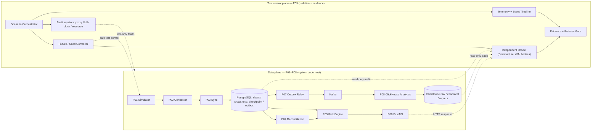
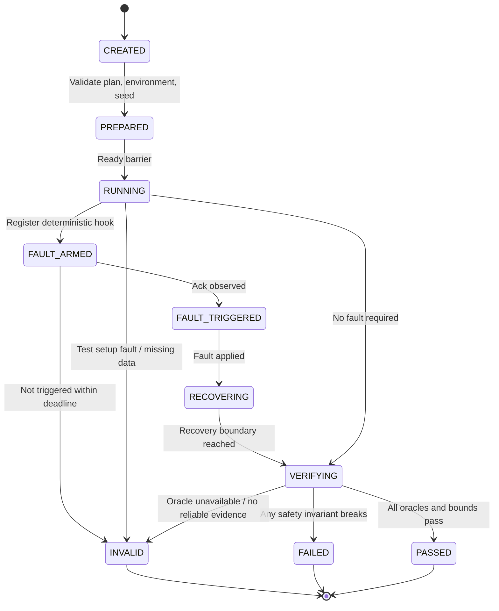
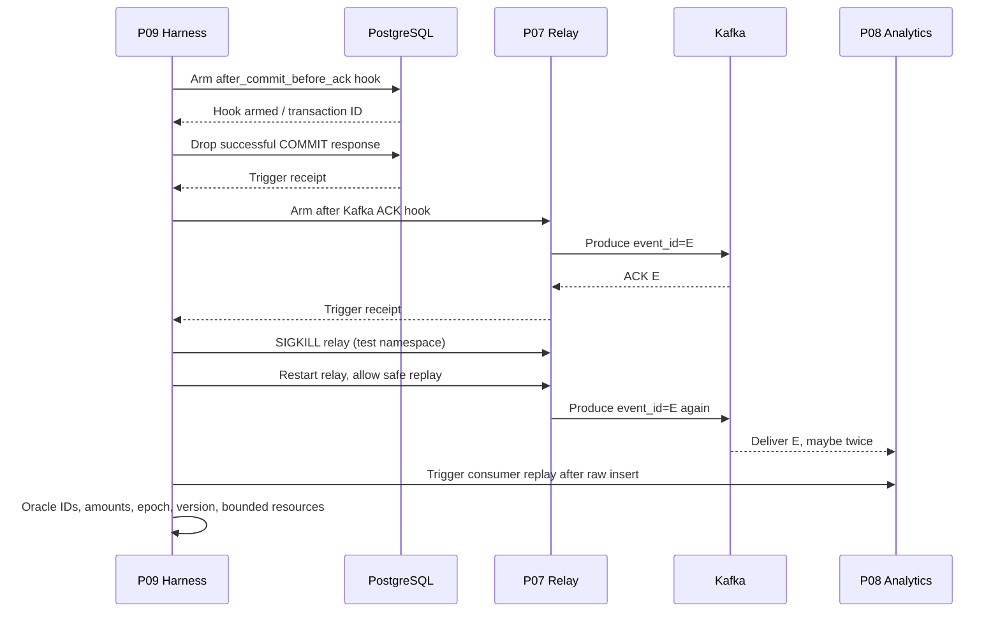
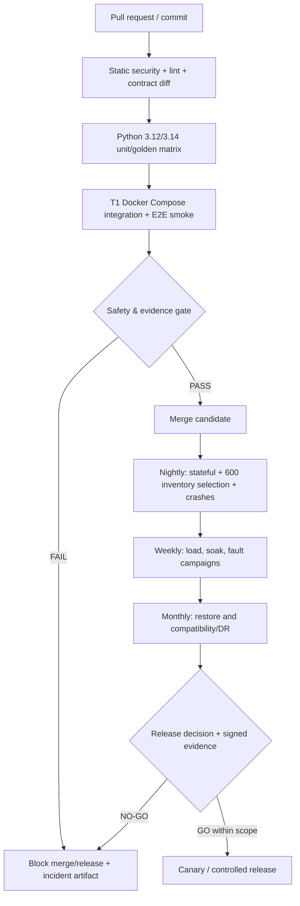
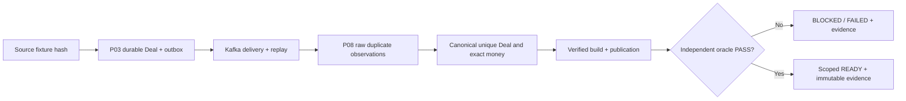

# Project 09 — Integration Testing & Performance

**System Design · End-to-End Verification · Deterministic Fault Injection · CI/CD · Performance & Capacity · Chaos & Disaster Recovery · What-if Matrix**  
**Phiên bản:** 1.0  
**Ngày:** 2026-10-30  
**Dự án:** Mini-project **09/09** — tái dựng *Broker Risk Reporting and MT5 Integration*  
**Trạng thái:** **DESIGN ONLY — 0 test đã thực thi, 0 benchmark đã đo, chưa có bằng chứng production-readiness.**

> **Nguồn thông tin và phạm vi.** CV nêu Docker, GitHub Actions, integration tests, Python 3.12/3.14 matrix; số tham chiếu **reconciliation 1 triệu Deal/ngày từ 18 xuống 4 phút** và **Exposure API p95 120 ms ở 100 concurrent clients**. CV **không nêu** test infrastructure, benchmark workload, topology, SLO hay chi tiết kiến trúc. Tài liệu dưới đây là **thiết kế đề xuất**, dựa trên các tài liệu Project 01–08 trong cùng bộ; không được mô tả là hệ thống đã triển khai tại công ty trước đây.
>
> **Định nghĩa “chịu nổi”.** Hệ thống có thể chậm, từ chối, ghi trạng thái `BLOCKED/INCOMPLETE/STALE` hoặc cần phục hồi có kiểm soát; **không được** trả số tiền sai như đã xác minh, trộn tenant/source/epoch/cut, lặng lẽ mất Deal, áp dụng trùng business effect, vượt tài nguyên không giới hạn, hoặc nhận một test không thực sự tiêm được lỗi làm PASS.
>
> **Giới hạn logic.** Không thể liệt kê “mọi” tổ hợp trạng thái bằng ma trận hữu hạn. Danh mục what-if bên dưới là kiểm thử có chủ đích; bổ sung **property-based, stateful model checking, fuzz, mutation, pairwise/compound faults, soak và DR drills**. Các con số/tỷ lệ PASS hiện tại đều để `NOT RUN`.

---

## 0. Executive summary — 15 nguyên tắc

1. **Financial correctness > latency.** Kết quả nhanh nhưng sai `Decimal`/currency/source là P0 FAIL.
2. **Independent oracle.** Đối chiếu từ manifest simulator và tính toán `Decimal` độc lập; không lấy API hoặc ClickHouse đang kiểm thử làm oracle cho chính nó.
3. **Proof of ingestion.** PostgreSQL Deal identity-set tương ứng chính xác với complete source cut; checkpoint không được vượt quá dữ liệu đã commit.
4. **Proof of reconciliation.** `VERIFIED` phải trùng epoch/cut/evidence revision; repair theo approval/fencing, không tự chỉnh sửa Deal tài chính.
5. **Proof of publication.** P08 chỉ có thể trả `READY` cho immutable verified `build_id` đã được công bố sau khi tập Deal và tổng tiền khớp oracle.
6. **At-least-once, not exactly-once.** PG→Kafka→ClickHouse có thể redeliver; mọi effect nghiệp vụ phải idempotent.
7. **Fail closed.** Thiếu quote, tiền tệ, policy, authorization, cut, source provenance → từ chối/đánh dấu chưa đủ, không đoán số liệu.
8. **Bounded everything.** SDK workers, CPU workers, queue, retry, connection pools, cardinality, memory, disk và concurrency có giới hạn định lượng.
9. **Deterministic faults.** Mỗi fault có trigger, injection acknowledgement, wait barrier và oracle hậu kiểm; không chấp nhận `sleep(10)` làm proof.
10. **Health != readiness != correctness.** Process sống không chứng minh dữ liệu đã đúng hoặc bản báo cáo có thể công bố.
11. **Performance is a distribution.** p50/p95/p99, error/reject %, throughput offered/achieved, workload shape, warm/cold, CPU/RSS/IO đều phải công bố.
12. **No coordinated omission.** Chạy open-loop arrival-rate test song song closed-loop virtual users; đo cả dropped iterations/timeouts.
13. **Reproducibility.** Pin git SHA, container digest, dependency lock, seed, config, test-machine and incident timeline.
14. **Release by evidence.** Case `PASS` chỉ khi fault thật xảy ra và đủ 4 loại evidence: trigger, oracle, resources, recovery. Không được tính skip/xfailed/untested là pass.
15. **Production claims require production-representative environment.** Single-host Docker Compose không thể chứng minh fault tolerance multi-broker Kafka, PostgreSQL HA hoặc cross-region RPO/RTO.

### 0.1 Quy mô kiểm thử kế hoạch

- **50 fault domains × 12 scenarios = 600 what-if cases**, ưu tiên **400 P0 / 150 P1 / 50 P2**.
- **40 deterministic crash/kill points**, xuyên suốt P01–P08, có annotation cho transaction boundaries.
- **20 compound-chaos campaigns** có thứ tự, guard, oracle và recovery.
- **24 golden source fixtures** (synthetic), **20 representative E2E flows**, **32 implementation tickets**, phân theo release gates.
- Benchmark 100k/1M unique Deals, 100-client API, 100–1000 events/s và soak; toàn bộ là **workload/acceptance target đề xuất, chưa đo**.

## 1. Nguồn, dependency và contract cần giữ nguyên

| Project | Thuộc quyền sở hữu | P09 phải chứng minh | Điều KHÔNG được suy diễn |
|---|---|---|---|
| P01 Simulator | Deterministic source, synthetic fault modes | `run_id`, `generation`, `snapshot_seq`, `source_seq`, cursor, original source manifest | Simulator API tương đương MT5 Manager SDK thật |
| P02 Connector | Typed MT5 adapter, bounded isolation | Timeout/cancellation không chặn event loop; worker epoch; late-response fence | `asyncio.wait_for()` có thể kill native SDK call |
| P03 Synchronization | PG Deal truth, watermark, staged current snapshots | `source+epoch+Deal` identity, terminal checkpoint, full account/position publish, lease CAS | `source_seq` không gap; position absence đồng nghĩa close |
| P04 Reconciliation | Findings, verification, approval, recovery | `VERIFIED` có đúng source/cut/revision; repair không sửa tiền trực tiếp | Snapshot khác thời điểm nghĩa là corruption |
| P05 Risk Engine | `Decimal`, policy, symbol/quote, risk cut | Signed commission/swap, P&L correctness, currency grouping, `BLOCKED` khi thiếu basis | Có thể tính chính xác mọi MT5 instrument/FX mặc định |
| P06 REST API | AuthN/AuthZ, allowed risk statuses, bounded API | 200 chỉ khi đủ proof, không rò tenant, validated cursor, admitted load | p95 đẹp ở requests thành công đại diện toàn traffic |
| P07 Outbox/Kafka | Same-transaction outbox, relay, stable event id | Atomic commit, replay/idempotency, per-aggregate version guard, lag/recovery | Kafka producer idempotence = E2E exactly-once |
| P08 ClickHouse | Raw evidence, canonical Deal, immutable builds, verified publication | Raw duplicates không nhân tiền, rollback pointer, historical query coverage | `ReplacingMergeTree` đã merge nên query luôn duy nhất |

### 1.1 Nguồn thẩm quyền, identity và cut

Một phép kiểm thử end-to-end luôn ghi đủ tối thiểu:

```text
(test_run_id, tenant_id, source_id, epoch_id, run_id, generation,
 source_snapshot_seq, deal_watermark, accounts_scan_id,
 positions_scan_id, reconciliation_revision, accounting_policy_version,
 symbol_catalog_version, quote_set_id, event_schema_version,
 analytics_build_id, publication_id, git_sha, fixture_sha256)
```

- `run_id/generation/snapshot_seq/source_seq` là **semantics của P01 simulator**, không mặc nhiên có trên native MT5 SDK.
- `epoch_id` là source incarnation P03; `worker_epoch` của P02 khác source epoch.
- `source_seq` KHÔNG phải Kafka offset, không phải số Deal liên tục hay commit timestamp.
- `aggregate_version` dùng guard ordering trong P07; không là Deal revision hay giờ toàn cục.
- `PUBLISHED` trong outbox chỉ chứng tỏ relay được broker ACK theo protocol đã định, không chứng minh consumer xử lý hoặc P08 published.
- Account/Position có thể thuộc hai scan khác nhau. P05/P06 chỉ tổng hợp khi policy/cut tương thích và có verification.
- P08 `build_id` và `publication_id` khác nhau: build immutable, publication là pointer được phép rollback có audit.
- **Giải quyết khác biệt P03/P07/P08:** `money_currency`, `tenant_scope`, `fee_coverage`, source cut provenance và corrections là các **contract extensions phải chốt**; nếu chưa có, những report phụ thuộc chúng phải `BLOCKED/UNSUPPORTED`, không tự thêm default.

### 1.2 Contract freeze gate trước integration

Tạo `contracts/manifest.yaml` và JSON Schemas versioned; mỗi PR có contract diff. P09 chịu trách nhiệm phát hiện drift chứ không tự sửa schema production:

```yaml
contract_version: 1
source:
  mode: simulator
  fields: [tenant_id, source_id, run_id, generation, snapshot_seq, source_seq]
postgres:
  deal_key: [tenant_id, source_id, epoch_id, deal_id]
  checkpoint_scope: [epoch_id, entity, filter_hash]
relay:
  schema_version: 1
  event_types: [DealRecorded, AccountSnapshotPublished, PositionSnapshotPublished]
analytics:
  publication_states: [BUILDING, VERIFIED, PUBLISHED, BLOCKED]
  money_on_unknown_policy: BLOCKED
```

**Compatibility policy:** producer add optional field → allowed only after consumer tests; rename/remove required field → new schema version and dual-read migration; unknown financial semantics → quarantine or explicit `UNSUPPORTED`. Contract gate phân biệt required fields đã xác minh và extensions đề xuất.

## 2. Kiến trúc System Design P09

### 2.1 Data plane và test control plane



> Mermaid thể hiện logical dependencies; **không** có ý rằng P04 là một bước synchronous trước mọi P05 call, hay ClickHouse là source of truth. Test harness đọc từ các giao diện đã cấp quyền riêng, không thay đổi business state ngoài fixture/fault endpoints test-only.

### 2.2 Thành phần P09

| Service/module | Input | Output | Invariant |
|---|---|---|---|
| Scenario Orchestrator | Declarative scenario YAML, seed, fixed timing/barriers | Run state and step receipts | No silent skip; deterministic replay |
| Environment Manager | Container image digests, Compose profiles, per-run namespace | Ready environment and cleanup manifest | No cross-run/shared DB pollution |
| Fixture Generator | Seed, template, expected accounting vectors | Source manifest + SHA256, data generator | Reproducible identity and canonical money |
| Independent Oracle | Source manifest, read-only DB/Kafka/CH/API observations | ID-set diff, Decimal reconciliation, proof certificate | Never trust tested implementation's `READY` flag |
| Fault Injector | Fault point and safety budget | Acknowledged injection and reversal receipts | Fault must actually fire to PASS |
| Load Generator | Open-loop/closed-loop profiles, tokens | Request records with both errors and success | No coordinated omission in throughput metrics |
| Observability Collector | Traces/metrics/logs, cgroup counters, DB/Kafka queries | Time-correlated timeline, resource graphs | Can diagnose why test passed/failed |
| Evidence Store | Immutable reports, artifact digests, test manifest | Signed/checksummed evidence bundle | No fabrication or overwritten failed result |
| Gate Evaluator | Assertions, coverage rules, perf limits | GO/NO-GO with blocker list | `NOT_RUN`, `SKIP`, `FLAKY` never PASS |

### 2.3 Three independent truth planes

1. **Source truth:** canonical P01 fixture manifest defined before SUT starts, with `(tenant,source,epoch,Deal)` set and Decimal amounts. For random datasets, store exact seed+generator version+manifest SHA.
2. **Persisted truth:** P03 authoritative PG Deal rows, cut and checkpoint history; P04 evidence; P07 outbox status; do not use a mere aggregate count.
3. **Served truth:** P06 outputs and P08 verified published facts, cross-checked against independently calculated expected data for same cut/policy/currency.

An E2E test PASS needs **source=PG identity sets, expected Deal effects=consumer/published canonical effects, oracle money=API/report money**, plus authorization status and proven cut alignment. `pg count=ch count` is inadequate because both could lose the same Deal or both have matched wrong amount.

### 2.4 Critical sequences

```mermaid
sequenceDiagram
  participant O as P09 Orchestrator
  participant S as P01 Fixture Source
  participant C as P02/P03 Sync
  participant DB as PostgreSQL
  participant R as P04/P05/P06
  participant E as P07/Kafka/P08
  participant X as Independent Oracle
  O->>S: Seed deterministic dataset + get source manifest
  S-->>O: seed, generation, fixture_sha, source cut
  O->>C: Start bounded full scan + incremental sync
  C->>DB: COMMIT Deals and checkpoints; publish staged snapshots
  O->>R: Reconcile until eligible VERIFIED cut
  O->>E: Drain outbox; consume; build and verify analytics
  O->>X: Compare IDs, Decimal money, scopes, provenance
  X-->>O: Complete proof or classified mismatch
  O->>R: Query authorized exposure/P&L
  O->>E: Query published historical report
  O->>X: Compare responses with oracle at same cut
  X-->>O: PASS/FAIL plus evidence artifacts
```



**Outcome status taxonomy:** `PASSED`, `FAILED`, `INVALID_SETUP`, `NOT_TRIGGERED`, `SKIPPED_INCOMPATIBLE`, `BLOCKED_DEPENDENCY`, `NOT_RUN`. Chỉ `PASSED` được tính numerator của coverage; một P0 `NOT_TRIGGERED` là **NO-GO** cho gate tương ứng.

## 3. Invariants — luật bất biến xuyên suốt hệ thống

| ID | Luật bất biến | Independent assertion |
|---|---|---|
| INV09-01 | Không có Deal source trong complete approved cut bị bỏ qua âm thầm | `source_ids == pg_ids` scoped exact sets |
| INV09-02 | Deal trùng không tạo hai business effects | Unique logical Deal key và canonical hash |
| INV09-03 | Cùng logical key, khác monetary payload → quarantine | Mutated duplicate, P03/P07/P08 violation probes |
| INV09-04 | Watermark P03 chỉ tiến sau terminal validated scan + commits | DB checkpoint history vs page receipts |
| INV09-05 | Scan/epoch/generation không bị trộn | Provenance equality for each committed scan |
| INV09-06 | Snapshot P03 visible toàn bộ cũ hoặc toàn bộ mới theo entity | Concurrent readers; `published_scan_id` |
| INV09-07 | Worker mất lease không còn quyền publish | Fencing CAS and takeover audit |
| INV09-08 | P04 không âm thầm sửa Deal/tiền | DB triggers/audit/read-only repair scope |
| INV09-09 | P04 verified evidence revision phải tương thích risk cut | Proof digest before/after risk read |
| INV09-10 | Decimal representation end-to-end không qua float | Canonical decimal strings + precision oracle |
| INV09-11 | Không đổi commission/swap sign không có policy | Golden vectors positive/negative/zero |
| INV09-12 | Không cộng tiền khác đơn vị nếu không có FX proven | Per-currency result or `BLOCKED` |
| INV09-13 | Giá Bid/Ask, contract size và quote age đúng policy | Fixture expected P&L + quote provenance |
| INV09-14 | API không thể đọc dữ liệu ngoài tenant/scope | Cross-tenant denial and audit canary |
| INV09-15 | API 200 READY đồng nghĩa mọi prerequisite đã VERIFIED | Risk response status and independent cut cross-check |
| INV09-16 | Tất cả queues, retries, work slots và resource có trần | RSS, FD, queue-depth, pool gauges under overload |
| INV09-17 | Timeout không kill native call một cách giả định | Worker epoch + inflight ownership probe |
| INV09-18 | COMMIT PG business mutation iff matching outbox in same TX | TX failure probes and exact joins |
| INV09-19 | Kafka relay có thể phát lại, không mất DB outbox đã commit | Replay after ACK ambiguity, eventual receipt |
| INV09-20 | Kafka ACK không bị suy diễn là downstream done | Consumer and analytics separate completion markers |
| INV09-21 | Consumer business effect được dedup theo stable event ID | Apply twice vs once equivalence |
| INV09-22 | Aggregate ordering guard chặn version sai | Version gap, stale sender and replay |
| INV09-23 | Kafka replay không làm tăng canonical money effect ClickHouse | Raw count changes; canonical hash fixed |
| INV09-24 | P08 publication chỉ từ build VERIFIED đầy đủ | Immutable `build_id` proof + PG pointer CAS |
| INV09-25 | CH partial build không xuất hiện cho reader | Repeated read around build crash/publish |
| INV09-26 | Offset/lag không là chứng cứ source completeness | Source↔outbox↔Kafka↔canonical set mapping |
| INV09-27 | 0 false READY khi thiếu rates/policy/fee/source cut | Negative-policy and missing-data vectors |
| INV09-28 | `REJECTED/DEGRADED` phải có typed reason không rò dữ liệu | Response envelope and access-control assertions |
| INV09-29 | Source reset không trộn Deal IDs giữa epochs | Reused Deal ID, epoch-qualified comparisons |
| INV09-30 | Retry/restart không giảm durability đã cam kết | Forced crash and cold restart DB proof |
| INV09-31 | Health probe không thể vô tình mở quyền admin/test | Auth and network isolation probes |
| INV09-32 | Run evidence không được ghi đè kết quả FAIL | Manifest digest, append-only report path |
| INV09-33 | Scenario fault thực thi đúng trước khi PASS | Injection receipt correlated trace/time barrier |
| INV09-34 | Không có ẩn lỗi: rejected/timeouts tính trong performance | Offered vs completed vs failed request totals |
| INV09-35 | Recovery không được tăng backlog vô hạn khi μ≤λ | Drain rate math and backlog plot |
| INV09-36 | Failure combinations không dẫn đến silent corruption | Compound sequence + post-recovery oracle |
| INV09-37 | Restore sai cut không được publish verified result | Restore-to-cut evidence/permission guard |
| INV09-38 | Sau rollback binary/schema data vẫn tương thích | Versioned contract and migration rollback replay |
| INV09-39 | Fault endpoint chỉ test namespace, không tạo sự cố ở production | Env allowlist, network ACL and dry run |
| INV09-40 | Golden fixtures và oracle độc lập không thay đổi do SUT mutation | Immutable fixture SHA + mutation controls |

**Oracle rule:** `PASS` yêu cầu (i) đúng tập identity (ii) đúng payload/hash (iii) đúng tiền tệ/Decimal (iv) cut/provenance hợp lệ (v) auth/scope đúng (vi) tài nguyên trong giới hạn (vii) dữ liệu và service phục hồi đúng trạng thái. Với lỗi dự kiến, kết quả `BLOCKED/RETRYING` là hợp lệ nếu được nêu rõ và sau đó hồi phục/đối soát theo budget đã công bố.

## 4. Environments, isolation và cấu hình tái hiện

### 4.1 Test tier / topology

| Tier | Khi chạy | Topology | Được dùng để chứng minh | Không được tuyên bố |
|---|---|---|---|---|
| T0 | Mỗi PR | Unit, schema, static, fuzz nhỏ, no shared I/O | Pure logic, type/contract, money vectors | E2E latency, Kafka/PG durability |
| T1 | PR hoặc merge | Compose P01–P08 test profile, 1 broker Kafka, 1 PG, 1 CH | Local service integration, deterministic crash | Kafka ISR quorum/real HA; production RTO |
| T2 | Nightly | 8 vCPU/16 GiB SSD profile, pinned images, 100k/1M | Measured E2E throughput & fault scenarios | Generalized performance to other hardware |
| T3 | Weekly | 3 broker Kafka, PG replication if deployed, CH replicas if deployed | HA/failover on built topology | Multi-region without multi-region test |
| T4 | Monthly/quarterly | Isolated disaster-restore environment | Measured backup restore, RPO/RTO for tested setup | Untested geographical or operational resilience |
| T5 | Optional | Authorized Windows/SDK runner + Linux backend | Real Manager SDK interop limited by granted API | Simulator proving native SDK support |

**Run namespace:** `test_run_id` unique and recorded; isolated Docker network, volumes, object-prefixes, Kafka topic prefix, DB schema/database, ClickHouse database, tokens, dashboards and run artifacts. Test passwords never production secrets; no real personal account/deal data in fixtures; create dedicated readonly oracle roles. Fault injectors disabled in all non-test deployment images.

### 4.2 Reproducible baseline (illustrative resource budget, not measured)

| Resource | Proposed baseline | Record / caveat |
|---|---|---|
| Host | 8 vCPU / 16 GiB RAM / SSD or NVMe | CPU model, governor, Docker version, kernel, IOPS, clock |
| PostgreSQL | pinned major version + durable volume + `fsync=on` | `synchronous_commit` policy, checkpoints, WAL bytes, locks |
| Kafka | 1-broker for T1/T2; 3-broker for T3 failover | Separate replication vs single-node tests |
| ClickHouse | pinned image + bounded query/insert resources | Parts, merges, memory tracked |
| App total | explicitly sum workers/containers+OS headroom | Avoid claiming 1 GiB per container fits on 16GiB without sum |
| API/P05 | per-instance compute capacity and queue configured | Limit 100-inflight burst; separate from 100 paced users |
| P02/P03/P07/P08 | bounded queues/inflight; 512 MiB baseline per worker target where feasible | Do not copy budgets blindly to CH/DB |
| Observability | dedicated resource/retention limits | Metrics pipeline cannot be invisible workload |
| Test clock | UTC normalized; independent monotonic timers | Host clock sync and frozen logical clocks as applicable |

**Compose readiness:** `depends_on: condition: service_healthy` addresses startup ordering only; cannot establish full cut readiness. A separate **data-readiness barrier** asserts migrated schema, registered source epoch, reachable Kafka topic, initial fixture, consumer assignment and explicit service version metadata.

### 4.3 Docker Compose excerpt (environment module, not complete deploy file)

```yaml
# Compose excerpt — pair with pinned image digests, networks/volumes, Kafka
# configuration, migrations, and app-specific health probes in implementation.
services:
  postgres:
    image: postgres:17
    environment:
      POSTGRES_USER: test_runner
      POSTGRES_PASSWORD: ${TEST_POSTGRES_PASSWORD:?must_set}
      POSTGRES_DB: broker_test
    volumes:
      - pgdata:/var/lib/postgresql/data
    healthcheck:
      test: ["CMD-SHELL", "pg_isready -U test_runner -d broker_test"]
      interval: 3s
      timeout: 2s
      retries: 20
  sync-service:
    build: ./apps/sync-service
    depends_on:
      postgres:
        condition: service_healthy
    environment:
      APP_ENV: integration-test
      SOURCE_MODE: simulator
    restart: "no"
volumes:
  pgdata: {}
```

**Important:** `pg_isready` chứng minh PG chấp nhận connection, không chứng minh migration, WAL durability, Kafka/CH hay business readiness. Không mount volume production; không chạy `docker compose down -v` ngoài test namespace.

## 5. Golden fixtures, deterministic generator và independent oracle

### 5.1 24 golden fixtures (source manifests; not yet implemented)

| ID | Fixture | Oracle focus |
|---|---|---|
| GF09-01 | Một account, một BUY, quote consistent | Unrealized P&L + exposure đúng chiều |
| GF09-02 | Một account, một SELL, bid/ask spread | Bid/Ask policy |
| GF09-03 | Partial fills, signed commissions | Realized accounting and Deal keys |
| GF09-04 | Swap âm/dương/0, fees khác nhau | Signed totals vs premature rounding |
| GF09-05 | 1,000 accounts, 100k unique Deals | Baseline identity + throughput |
| GF09-06 | 1M unique Deals, weighted symbols | Performance dataset and exact sums |
| GF09-07 | Replayed same Deal 10 times | End-to-end dedup effect |
| GF09-08 | Same Deal key, conflicting monetary payload | Quarantine/blocked publication |
| GF09-09 | Same deal_id across two epochs | Source reset isolation |
| GF09-10 | Same deal_id across two tenants | Cross-tenant separation |
| GF09-11 | Two currencies and no valid conversion | No mixed-currency sum |
| GF09-12 | FX rate-set complete and pinned (P1) | Converted report reproducibility |
| GF09-13 | Position full snapshot without tombstones | Absence != closed |
| GF09-14 | Account/Position at different snapshot cuts | Cut incompatibility handling |
| GF09-15 | Source cursor expires on last page | Checkpoint cannot advance |
| GF09-16 | Source missing Deal in one page | Source-set oracle, incomplete status |
| GF09-17 | UTC day/month boundary and leap day | Correct event-time grouping |
| GF09-18 | Out-of-order aggregate versions | Consumer ordering guard |
| GF09-19 | Late Deal for previous UTC month | Historical rebuild and safe publish |
| GF09-20 | Aged quote + missing symbol metadata | P05/P06 reject with typed reason |
| GF09-21 | Kafka poison with unknown required field | Quarantine and offset policy |
| GF09-22 | CH build fail after 99% rows | Reader retains old published build |
| GF09-23 | Maximal precision and magnitude near configured limits | Decimal overflow / quantization policy |
| GF09-24 | Owner lease takeover while old worker resumes | Fencing + delivery idempotence |

### 5.2 Oracle policy

- Manifest generated *before* app reads it; `sha256(sorted canonical JSONL records)`; save file and schema version to object store/CI artifact with access control.
- Identity keys include `(tenant_id, source_id, epoch_id, deal_id)`; `source_seq` provides ordering/watermark reference, **not** uniqueness.
- Money values encoded as decimal **strings** with explicit `currency`, `precision`, `policy_version`, fee coverage; use Python `decimal.Decimal` in separate code path (not import P05 finance module).
- Compute exact hash after canonicalization; compare identity sets and fields as well as per-currency sums. Sampled-only validation cannot be called full reconciliation.
- For financial claims outside MVP USD/FX policies, oracle expects `UNSUPPORTED/BLOCKED`, never guesses formula.
- A test may deliberately corrupt SUT state; keep untouched external oracle manifest. Risk verification must detect even when PG and CH both contain the same corrupted value.

### 5.3 Proof certificate shape (proposed)

```json
{
  "test_run_id": "run-20261030-0001",
  "scenario_id": "W09-145",
  "status": "NOT_RUN",
  "source_cut": {"source_id":"sim-broker-01","epoch_id":"epoch-a","deal_watermark":"100000"},
  "fixture_sha256": "<sha256>",
  "fault": {"planned":"drop-commit-ack","triggered":false,"ack_artifact":null},
  "oracles": {"identity_set":null,"payload_hash":null,"decimal_money":null,"scope_cut":null},
  "performance": {"offered":null,"completed":null,"rejected":null,"p95_ms":null},
  "resources": {"max_rss_mib":null,"max_fd":null,"max_queue_depth":null},
  "artifacts": [],
  "owner": "unassigned",
  "git_sha": "<git-sha>",
  "notes": "Example schema only; no execution occurred."
}
```

## 6. Fault-injection controller: điều kiện để thử nghiệm có giá trị

### 6.1 Test-only fault classes

- **Network:** Toxiproxy/TCP proxy injection: delay, loss, reset, half-open, bandwidth cap, asymmetric upstream/downstream; wrapper fixture for HTTP response truncation.
- **Process:** container `SIGKILL`, graceful termination, freeze/resume, forced OOM in constrained test namespace; reject implicit `SIGTERM` as identical to `SIGKILL`.
- **Database:** kill before/after `COMMIT`; drop ACK **after durable commit**; deadlock, lock timeout, replica failover, WAL pressure and disk full.
- **Kafka:** consumer pause/rebalance, broker stop, leader change on true cluster, retention expiry, duplicate and reorder injected by test producer.
- **ClickHouse:** failed insert ACK, building/publishing crash, stopped merges, parts pressure, query timeout, replica visibility.
- **Time:** fake clock in app via injection boundary, DB clock vs worker clock, timezone offsets; clock manipulation must not affect oracle monotonic timers.
- **Business:** conflicting duplicate IDs, incomplete accounting metadata, stale rates, conflicting schema, bad auth scope, poisoned materializations.

### 6.2 Safe fault execution protocol

```text
PREPARE → CHECK_ALLOWED_ENV → ARM_HOOK → WAIT_FOR_BARRIER →
ACK_FAULT_TRIGGER → OBSERVE_CONTAINMENT → RESTORE_DEPENDENCIES →
WAIT_FOR_RECOVERY_OR_DEADLINE → VERIFY_ORACLES → RECORD_EVIDENCE → CLEANUP
```

1. Verify environment ID is allowlisted and production endpoints absent; disallow real MT5 accounts.
2. Reset specific test namespace only, pin manifest, verify fixtures available.
3. Arm one named hook tied to a transaction/ACK boundary; wait for real hook event and record exact entity/txn ID.
4. Fault injector returns signed/hashed trigger receipt; **if no trigger, result `NOT_TRIGGERED`, never PASS**.
5. Restore fault according to script; record restore timestamp from monotonic test clock and an external event counter.
6. Verify correct rejection during outage where expected, then set equality + money + state + resource bounds after recovery.
7. Cleanup resources; if cleanup fails, mark `INVALID_SETUP` or report infrastructure leak even if business oracle PASS.

### 6.3 Why timeout is insufficient proof

- Async timeout stops *awaiting*, not necessarily native P02 SDK call; test worker `epoch`, in-flight ownership, bounded queue and late response discard.
- HTTP timeout after PG commit may mean commit succeeded; retry must be idempotent, checkpoint and semantic event identity stable.
- Kafka broker ACK can arrive but DB `PUBLISHED` update fail; relay resend is acceptable, consumer double-effect is not.
- ClickHouse ACK and Kafka offset commit are not atomic. Consumer restart may duplicate raw, must not duplicate canonical sums.
- A non-triggered fault behind a `sleep()` is a harness failure, not evidence of resilience.

### 6.4 Test orchestration runner (pseudocode)

```python
# PSEUDOCODE / SPECIFICATION — not executable without fixture APIs and drivers.
async def run_scenario(plan, sut, oracle, injector, evidence):
    await assert_test_namespace_only(sut)
    manifest = await prepare_fixture(plan.seed, plan.fixture)
    await assert_readiness_barriers(sut, manifest)
    arm = await injector.arm(plan.fault.point, plan.fault.trigger)
    await sut.start(plan.workflow)
    receipt = await arm.wait_trigger(plan.fault.deadline)
    if plan.fault.required and not receipt.triggered:
        return evidence.write("NOT_TRIGGERED", manifest, receipt)
    await injector.restore(plan.fault.restore)
    observations = await sut.collect_observations_until(plan.recovery_deadline)
    assertions = oracle.verify_all(manifest, observations, plan.invariants)
    budget_ok = verify_resource_and_latency_budgets(observations)
    return evidence.write("PASSED" if all(assertions) and budget_ok else "FAILED",
                          manifest, receipt, assertions, observations)
```

### 6.5 Case schema

A what-if case below has five fields: **ID/priority; trigger (what if); injection (how); expected containment/recovery; oracle evidence.** `P0` blocks enabled MVP feature; `P1` tests extensions/operability; `P2` stress edge, DR or advanced capabilities requiring extra environment. The named `oracle` field is a concrete assertion/query or artifact, not simply “check logs”.

## 7. Representative 20 E2E acceptance flows

| Flow | Steps | Acceptance evidence |
|---|---|---|
| E2E09-01 Baseline | Seed 100k Deals → P02/03 sync → P04 verify → P05/06 query → P07/08 publish | Equal identity sets; Decimal per currency; correct auth; no hidden incomplete |
| E2E09-02 Retry source read | Inject P01 page timeout → P02 retry → P03 commit | Same PG identity set and terminal W; request budget bounded |
| E2E09-03 Native worker hang | Hold P02 blocking call → API still live → worker rotate | Event loop lag, bounded queue, no late result accepted |
| E2E09-04 Commit ACK loss | PG commits Deal+outbox → ACK dropped → retry | Exactly one Deal/outbox effect, no skipped checkpoint |
| E2E09-05 Snapshot publish crash | Kill P03 at staging/publish boundary | Reader sees old/new whole snapshot only |
| E2E09-06 Source reset | Reuse Deal ID under new generation → sync/recon | Separate epochs and no cross-epoch P&L |
| E2E09-07 Recon discrepancy | Tamper one Deal/commission → reconcile | Finding persists, risk/report BLOCKED, no auto money rewrite |
| E2E09-08 Approval fencing | Two P04 repair workers race | Only approved owner commits; old owner rejected |
| E2E09-09 Missing quote | Omit quote or catalog for P05 | Typed `UNSUPPORTED/BLOCKED`, no fabricated P&L |
| E2E09-10 Cross-tenant attack | Token tenant A requests tenant B account | Deny, no data in body/cache/logs |
| E2E09-11 API overload | 100 simultaneous heavy requests → saturation | 429/503 controlled, no OOM or hidden financial `200` |
| E2E09-12 Outbox atomicity | Rollback business transaction after outbox planned | Neither Deal nor event exists |
| E2E09-13 Relay ACK ambiguity | Kafka accepted but relay DB update killed | Duplicate Kafka records allowed; one downstream effect |
| E2E09-14 Consumer crash | CH inserted raw then consumer killed before offset | Replay raw; canonical and published money unchanged |
| E2E09-15 Build 99% crash | Kill P08 before VERIFIED/pointer publish | Old verified pointer remains; incomplete build invisible |
| E2E09-16 Late historical Deal | Historical event after report published | Rebuild new immutable build, old preserved/rollbackable |
| E2E09-17 Retention gap | Kafka offsets outside retention | Explicit rebootstrap, no `READY` until proven complete |
| E2E09-18 Composite failure | PG failover + Kafka outage + source reset | Bounded; no false READY; eventual valid cut recovery |
| E2E09-19 Restore DR | Restore PG/CH from inconsistent points | Detect mismatch; repair or block, RPO/RTO measured |
| E2E09-20 Rolling version | Deploy N/N+1 event schema then rollback | Compatible reads; no schema drift data loss |

**Quality caveat:** E2E-01 through E2E-20 are **design specifications**, not tests already present in repository. Each must be implemented as `scenario.yaml` + fixtures + code for oracle/trigger + evidence generator.

## 8. Deterministic crash/kill-point inventory — 40 points

| ID | Position | Crash action | Required post-restart check |
|---|---|---|---|
| CP09-01 | P01 before event persist | SIGKILL | Event absent and source manifest consistent |
| CP09-02 | P01 after event persist, before HTTP ACK | Drop ACK + kill | Retry sees same event, no new identity |
| CP09-03 | P01 cursor pagination final response | Kill/reset | P03 does not advance incomplete W |
| CP09-04 | P01 generation reset in mid-scan | Reset source | Epoch mismatch prevents mixed scan |
| CP09-05 | P02 before dispatch blocking native call | Kill worker | Pending admission bounded and replayable |
| CP09-06 | P02 during blocking call | Freeze/kill isolated worker | Event loop live, old result fenced |
| CP09-07 | P02 after call finished before response handed to caller | Kill process | Caller retries without duplicates |
| CP09-08 | P02 reconnect after worker epoch increments | Old worker resume | Old completion discarded |
| CP09-09 | P03 before first Deal page DB TX | Kill | Checkpoint unchanged |
| CP09-10 | P03 after partial Deal page written, before COMMIT | Kill | Entire page rollback |
| CP09-11 | P03 after Deal page COMMIT before ACK | Kill/drop ACK | Replay idempotent |
| CP09-12 | P03 after terminal page COMMIT before W CAS | Kill | W not ahead; retry terminal safe |
| CP09-13 | P03 after W CAS COMMIT before response | Drop ACK | W stable/monotonic, no lost page |
| CP09-14 | P03 during Account snapshot staging | Kill | Published snapshot unchanged |
| CP09-15 | P03 after full staging before atomic publication | Kill | Staging not public |
| CP09-16 | P03 after snapshot publication TX before ACK | Kill | Exactly one visible full snapshot |
| CP09-17 | P03 stale worker after lease takeover | Resume old worker | Fencing CAS rejects publish |
| CP09-18 | P04 after findings computed before evidence DB commit | Kill | No false VERIFIED |
| CP09-19 | P04 after verified revision persisted before ACK | Drop ACK | Retry not increase revision without new evidence |
| CP09-20 | P04 after repair approval before dispatch | Kill | Approval durable but repair not silently assumed done |
| CP09-21 | P04 during P03-controlled repair | Kill | Repair outcome audit/verification required |
| CP09-22 | P05 after source cut read before compute | Kill | No partial `READY` response |
| CP09-23 | P05 after quote/rate revision changes | Invalidate cut | Old calculation fenced or blocked |
| CP09-24 | P06 after auth before DB query | Kill | No leaked payload; clean retry |
| CP09-25 | P06 after DB read before HTTP response | Kill/drop response | No partial misleading 200; audit policy maintained |
| CP09-26 | P06 while heavy CPU workers in flight | Kill/restart | Bounded workers and clean reject/recover |
| CP09-27 | P07 after business+outbox TX before ACK | Drop ACK | Stable event identity |
| CP09-28 | P07 relay after row claim before send | Kill | Claim expires/recover without loss |
| CP09-29 | P07 Kafka ACK before PG `PUBLISHED` CAS | Kill | Replay same event id allowed, no double effect |
| CP09-30 | P07 during `PUBLISHED` update TX | Kill | Status audited; no missing event |
| CP09-31 | P07 old relay after claim takeover | Resume old | DB fencing, consumer dedup |
| CP09-32 | P07 consumer after DB effect before Kafka offset commit | Kill | Effect once after replay |
| CP09-33 | P08 after CH raw insert before consumer ACK | Kill | Canonical stable after replay |
| CP09-34 | P08 during canonical build stage | Kill | Build incomplete not visible |
| CP09-35 | P08 after candidate verify before publication CAS | Kill | Old pointer stays valid |
| CP09-36 | P08 after pointer CAS COMMIT before ACK | Drop ACK | Retry cannot double-publish conflicting builds |
| CP09-37 | P08 during historical correction rebuild | Kill | Old report valid, new version unfinished |
| CP09-38 | P09 harness after fault arm before trigger | Kill harness | Run marked incomplete, not PASS |
| CP09-39 | P09 harness after oracle failed before artifact upload | Kill harness | Failure cannot disappear from summary |
| CP09-40 | Test runner during teardown/volume deletion | Kill | Other test/production namespaces unaffected |

**Kill-point implementation rule:** Hook name must be in compiled test build, armed by run ID, acknowledged before execution resumes. For failures impossible to reproduce at an exact native syscall boundary, use an explicit `NOT_REPRODUCIBLE_IN_THIS_ENV` status and never upgrade that case to PASS.

---

## 9. What-if verification matrix — 600 planned scenarios / 50 failure domains

**Status of every case below: NOT RUN.** Format: `ID | P0/P1/P2 | What-if / fault | Cách tiêm lỗi | Hành vi đúng | Oracle / bằng chứng bắt buộc`. Each test should attach artifact IDs and implementation path after coding. P0 cases from unimplemented features must demonstrate a safe `UNSUPPORTED` boundary and be tracked as deferred; they are not silently marked passed.
### 9.01 — CI determinism, reproducibility và test trust

| ID | Priority | What if — lỗi cần kiểm tra | Cách gây lỗi / trigger | Hành vi kỳ vọng | Oracle / bằng chứng PASS–FAIL |
|---|---|---|---|---|---|
| W09-001 | P0 | CI dùng random seed không lưu lại | Chạy test 3 lần seed khác nhưng xóa seed trong log | Run bị INVALID khi thiếu seed | Manifest chứa seed và fixture SHA |
| W09-002 | P0 | CI test PASS dù không khởi chạy simulator | Chặn container P01 trước ready | Fail prerequisite, không PASS | Container inventory và gate output |
| W09-003 | P0 | CI retry một bài flaky rồi giấu lần FAIL | Cố ý fail lần đầu, green sau retry | Mark FLAKY, lưu cả 2 attempts | Immutable attempt artifacts |
| W09-004 | P0 | CI chỉ kiểm exit code của script wrapper | Script in PASS nhưng oracle trả mismatch | Gate FAIL vì oracle mismatch | Assertion result JSON vs shell exit |
| W09-005 | P0 | CI bị timeout và artifact chưa upload | Kill job trước upload | Gate INCOMPLETE, không green | CI job status + missing artifact detection |
| W09-006 | P0 | CI chỉ chạy tests được chọn, không chạy P0 mới | Thêm P0 test id nhưng bỏ collection | Gate nhận diện coverage gap | Expected registry vs collected IDs |
| W09-007 | P0 | Test data hash được lưu nhưng không kiểm | Mutate source manifest giữa run | Abort test và evidence tamper alert | Pre/post SHA mismatch |
| W09-008 | P0 | Hai PR dùng chung DB gây nhiễu | Chạy 2 CI jobs cùng namespace | Reject collision hoặc isolate | Disjoint run_id/schema inventory |
| W09-009 | P1 | Clock của runner thay đổi giữa scenario | Giả lập wall-time jump | Timeline dùng monotonic, evidence ordered | Monotonic events + wall-time offsets |
| W09-010 | P1 | Artifact report bị overwrite bởi lần green mới | Publish cùng artifact path hai attempts | Preserve both, no erasure | Content-addressed artifact IDs |
| W09-011 | P1 | Git SHA khác nhau nhưng compare benchmark như cùng build | Re-run baseline với commit mới | Report separates builds | Git SHA and image digest in results |
| W09-012 | P2 | Runner bị mất network tới evidence store | Cắt đường upload sau failed oracle | Final status FAIL/INCOMPLETE not PASS | Local durable spool checksum |

### 9.02 — Dependency pinning, Python 3.12/3.14 và binary compatibility

| ID | Priority | What if — lỗi cần kiểm tra | Cách gây lỗi / trigger | Hành vi kỳ vọng | Oracle / bằng chứng PASS–FAIL |
|---|---|---|---|---|---|
| W09-013 | P0 | Python 3.14 không import được native client | Bật matrix 3.14 với simulated import failure | Job FAIL hoặc explicit unsupported lane | Matrix test report |
| W09-014 | P0 | 3.12/3.14 serialize Decimal khác schema | Compare same golden JSON across two runtimes | Same canonical money or reject incompatible | JSON/hash equality |
| W09-015 | P0 | Dependency lock không khớp installed wheel | Thay wheel nội dung cùng tên | Integrity check fails | Lock hash vs installed distribution |
| W09-016 | P0 | Unpinned image tự cập nhật khi rerun | Resolve mutable tag to new digest | Gate detect drift | Digest inventory compare |
| W09-017 | P0 | Kafka client đổi schema handling sau upgrade | Upgrade test client only | Compatibility tests detect break | Event round-trip fixtures |
| W09-018 | P0 | PostgreSQL major upgrade thay query plan/behavior | Upgrade PG in isolated lane | Correctness preserved; perf separated | SQL oracle + plans |
| W09-019 | P0 | ClickHouse engine version thay merge behavior | Switch CH version within supported range | Canonical deterministic; no raw SUM | Facts hash compare |
| W09-020 | P0 | JWT library thay default validation | Toggle library version | Expired/audience invalid still denied | Auth negative-suite report |
| W09-021 | P1 | Pydantic/SQLAlchemy update thay parsing Decimal | Dependency bump candidate | Money vectors unchanged | Decimal property tests |
| W09-022 | P1 | OpenTelemetry SDK mới làm tăng RSS/cardinality | Upgrade telemetry component | Budget/label limits enforced | Memory and time-series counts |
| W09-023 | P1 | Native MT5 SDK unavailable on Linux runner | Enable optional real SDK lane on Linux | Explicit SKIP_INCOMPATIBLE, never fake integration PASS | SDK capability manifest |
| W09-024 | P2 | Supply-chain transitive dependency compromised | Inject canary dependency with unexpected postinstall | Policy blocks update, no secret exposure | SBOM/signature/network deny audit |

### 9.03 — Docker Compose lifecycle, readiness và teardown

| ID | Priority | What if — lỗi cần kiểm tra | Cách gây lỗi / trigger | Hành vi kỳ vọng | Oracle / bằng chứng PASS–FAIL |
|---|---|---|---|---|---|
| W09-025 | P0 | Compose reports container started but PG migrations pending | Delay migrations 60s | Data readiness barrier waits/fails | Schema version query |
| W09-026 | P0 | Kafka process healthy but topic not created | Start SUT before topic bootstrap | No false ready or lost publication | Topic metadata and relay backlog |
| W09-027 | P0 | ClickHouse port open while schema missing | Delay DDL bootstrap | Analytics stays blocked | CH table/version manifest |
| W09-028 | P0 | Healthcheck passes but simulator has wrong generation | Seed alternate generation after ready | Reject run at barrier | Generation equality proof |
| W09-029 | P0 | Service starts before PG credentials mounted | Delay test secret injection | Retry bounded; fail setup | Retry/ready timeline |
| W09-030 | P0 | A service crashes in startup while Compose marked healthy | Kill app after health probe | Barrier fails and captures crash | PID epoch and logs |
| W09-031 | P0 | Network aliases resolve to old container | Reuse volume/network with stale DNS cache | Connection reset/re-resolve, isolated destination | DNS and service identity trace |
| W09-032 | P0 | Graceful shutdown while writes in flight | docker stop P03 under load | No partially published cut | DB transaction and cutoff evidence |
| W09-033 | P1 | SIGKILL entire Compose service | Kill P07 relay container | Outbox durable; resumes after restart | Outbox set and Kafka events |
| W09-034 | P1 | Compose down leaves orphan worker | Stop stack with detached child process | Detect leak, cleanup namespace | PID/network inventory |
| W09-035 | P1 | Service port exposed on host unintentionally | Inspect Compose port map with test secrets | Block stack promotion | Docker inspection ACL |
| W09-036 | P2 | Docker daemon restarted mid-test | Restart daemon in isolated runner | Test marked interrupted, recovery valid if rerun | Daemon events + fresh oracle |

### 9.04 — Environment isolation, tenancy and test-only controls

| ID | Priority | What if — lỗi cần kiểm tra | Cách gây lỗi / trigger | Hành vi kỳ vọng | Oracle / bằng chứng PASS–FAIL |
|---|---|---|---|---|---|
| W09-037 | P0 | Two test runs share Kafka topic prefix | Force same topic name for two run IDs | Guard rejects or creates distinct topics | Topic naming inventory |
| W09-038 | P0 | Fixture tenant A inserted into tenant B schema | Swap bootstrap routing parameter | Fail before apply, no cross-scope rows | Scoped ID set diff |
| W09-039 | P0 | Test source URL accidentally points to staging broker | Replace URL with non-allowlisted hostname | Injector refuses and aborts | Endpoint allowlist log |
| W09-040 | P0 | Production credentials exist in CI environment | Inject sentinel PROD_* secret | Fail safety check without using secret | Env policy report |
| W09-041 | P0 | Cleanup runs before another test's verification | Parallel teardown same Docker project | Namespace ownership fencing | Run owner token checks |
| W09-042 | P0 | Shared ClickHouse database contains old build | Reuse nonempty DB without cleanup | Refuse run or isolate build | CH build inventory |
| W09-043 | P0 | Time-series metrics aggregate across run IDs | Query without run label | Monitoring proof fails | Run-scoped metrics counters |
| W09-044 | P0 | Cold-start benchmark contaminated by warm cache | Run baseline after warm workload | Mark warm; require genuine cold phase | Cache/reset manifest |
| W09-045 | P1 | Fault injector API exposed beyond test network | Bind proxy control port to host 0.0.0.0 | Policy blocks it | Network reachability test |
| W09-046 | P1 | Test DB read-only oracle user granted write | Run privilege probe | Revoke or fail suite | SQL privilege inspection |
| W09-047 | P1 | Partial cleanup of queue topic may delete other run data | Shared prefix deletion command | Deny destructive cleanup | Authorized resource set |
| W09-048 | P2 | Restoring backup from another tenant into test DB | Try cross-tenant archive reference | Block restore and alert | Backup scope signature |

### 9.05 — Fixture generator and golden oracle integrity

| ID | Priority | What if — lỗi cần kiểm tra | Cách gây lỗi / trigger | Hành vi kỳ vọng | Oracle / bằng chứng PASS–FAIL |
|---|---|---|---|---|---|
| W09-049 | P0 | Same seed produces different Deal IDs | Regenerate fixtures with same version/seed | Fail reproducibility | Sorted key and hash diff |
| W09-050 | P0 | One thousand accounts but only 999 fixture entries | Delete one manifest row | Preflight fail completeness | Expected count and exact set |
| W09-051 | P0 | Generator emits invalid Decimal exponent | Produce 1E999999 field | Reject safely, bounded parse | Parsing test and RSS cap |
| W09-052 | P0 | Generator emits binary float 0.1 + 0.2 | Convert random prices through float | Oracle detects mismatch | Exact decimal string compare |
| W09-053 | P0 | Generated Deal refers to missing account | Remove parent account | Quarantine or explicit unsupported fixture | Referential oracle |
| W09-054 | P0 | Generation starts from non-deterministic clock | Freeze/shift clock randomly | Same seed yields pinned times | SHA round-trip |
| W09-055 | P0 | Fixture source mutation after PG sync | Tamper P01 source without version increment | Detect checksum/provenance mismatch | Before/after manifests |
| W09-056 | P0 | Goldens copied from P05 output rather than independent | Intentionally corrupt P05 and golden together | Independence test fails | Separate oracle implementation provenance |
| W09-057 | P1 | Fixture byte order changes SHA but not semantic data | Shuffle JSON fields and ordering | Semantic canonical hash stable | Canonicalization equality |
| W09-058 | P1 | 100k dataset declares 1M metadata count | Corrupt manifest declared row count | Fail preflight; no load claim | Source counts/set proof |
| W09-059 | P1 | Generator hits memory cap on 1M Deal export | Restrict generator to 256MiB | Streaming bounded or controlled fail | Peak RSS and file digest |
| W09-060 | P2 | Oracle implementation has deliberate +1 cent mutation | Apply mutation testing to oracle | Golden canary catches false pass | Mutation kill evidence |

### 9.06 — PostgreSQL DDL migrations, compatibility và locking

| ID | Priority | What if — lỗi cần kiểm tra | Cách gây lỗi / trigger | Hành vi kỳ vọng | Oracle / bằng chứng PASS–FAIL |
|---|---|---|---|---|---|
| W09-061 | P0 | Run migrations twice after CI timeout | Execute Alembic upgrade twice | Idempotent/no destructive changes | Schema version and rows preserved |
| W09-062 | P0 | P03 migration runs while P06 queries active | Lock table during heavy API load | Bounded timeout and safe retry | Lock wait/query/error timeline |
| W09-063 | P0 | Old app reads DB after column rename | Deploy schema first without dual-read | Compatibility gate fails | N/N+1 contract tests |
| W09-064 | P0 | New column nullable but downstream treats required | Add null money_currency fixture | P05/P08 BLOCKED | Policy acceptance assertions |
| W09-065 | P0 | Unique constraint on Deal key omitted | Drop constraint test-only | Data integrity gate fails | Catalog introspection + duplicate insert |
| W09-066 | P0 | Outbox FK incorrect across tenant IDs | Mutate FK join in migration | Oracle finds cross-tenant mismatch | FK and scoped joins |
| W09-067 | P0 | Migration commits half schema changes | Kill migration mid-step | Resume or rollback consistent schema | Catalog diff and revision table |
| W09-068 | P0 | Migration uses unsafe numeric type REAL | Replace DECIMAL column with floating type | DDL lint and money tests fail | pg_type inspection |
| W09-069 | P1 | Index creation saturates IO during sync | Build test index during ingestion | Controlled delays, no data corruption | Latency, WAL and identity oracle |
| W09-070 | P1 | PG default timezone non-UTC | Change database timezone | Stored UTC semantics preserved | Timestamp round-trip |
| W09-071 | P1 | Forward-only migration needs rollback deployment | Downgrade old binary after new schema | Dual compatibility or NO-GO | Rollback compatibility matrix |
| W09-072 | P2 | Retained old migrations contain unsafe secret | Scan migration history with test token | Security gate blocks | Secret scanner and artifact audit |

### 9.07 — P01 simulator faults and source API behavior

| ID | Priority | What if — lỗi cần kiểm tra | Cách gây lỗi / trigger | Hành vi kỳ vọng | Oracle / bằng chứng PASS–FAIL |
|---|---|---|---|---|---|
| W09-073 | P0 | P01 returns duplicate Deal page on retry | Configure repeated page response | P03 dedups no added effect | PG identity exact set |
| W09-074 | P0 | P01 returns HTTP 200 with truncated JSON | Truncate response after half body | Connector parse error, no checkpoint advance | W history and parse result |
| W09-075 | P0 | P01 changes generation during full scan | Trigger reset after page N | Old scan aborted, epoch blocked | Per-page provenance |
| W09-076 | P0 | P01 cursor expires on final page | Force 410 SNAPSHOT_EXPIRED | Retry new full scan; no partial publish | Checkpoint/snapshot publication |
| W09-077 | P0 | P01 skips one legitimate Deal | Omit source record from page but keep manifest | Incomplete flagged by oracle | Manifest-vs-PG set diff |
| W09-078 | P0 | P01 sends out-of-order source_seq | Shuffle pages with stable identity | Stable sort/validate or abort | Ordered scan receipts |
| W09-079 | P0 | P01 returns negative account balance unsupported | Inject balance below policy constraint | Typed invalid/unsupported state | Validator result |
| W09-080 | P0 | P01 rate limits requests with 429 | Reduce request quota | Bounded backoff, no storm | Retry schedule and request counters |
| W09-081 | P1 | P01 returns 503 intermittently | Toggle 503 for 15s | Reconnect and resume without loss | Terminal watermark equality |
| W09-082 | P1 | P01 returns repeated next_cursor | Make cursor cycle | Detect cycle, abort bounded | Seen-cursor state and time budget |
| W09-083 | P1 | P01 generates 10M Deals over available disk | Exceed simulator storage quota | Controlled disk pressure, no false success | Disk/manifest counts |
| W09-084 | P2 | P01 simulator process recovered from damaged SQLite WAL | Corrupt test volume after kill | Detect recovery failure/no incorrect manifest | Integrity check + crash report |

### 9.08 — P02 SDK isolation, timeout and executor lifecycle

| ID | Priority | What if — lỗi cần kiểm tra | Cách gây lỗi / trigger | Hành vi kỳ vọng | Oracle / bằng chứng PASS–FAIL |
|---|---|---|---|---|---|
| W09-085 | P0 | Blocking SDK call hangs indefinitely | Hold adapter call after `wait_for` expires | Awaiter times out, process worker isolated | Event-loop lag and worker PID |
| W09-086 | P0 | Cancelled request returns late response from old worker | Cancel, rotate worker epoch, release stale response | Discard stale result | Epoch and response trace |
| W09-087 | P0 | 200 concurrent MT5 calls exceed worker pool | Fire 200 calls with pool=4 | Bounded admission/reject, no 200 threads | Active worker/queue metrics |
| W09-088 | P0 | SDK requires thread affinity | Execute same handle on two threads fault mock | Serialize or refuse unsupported concurrency | Thread IDs per handle |
| W09-089 | P0 | SDK returns partial account list then error | Inject exception after 30% records | No complete snapshot claim | Scan status and publication proof |
| W09-090 | P0 | SDK reconnect reuses stale native handle | Simulate invalidated handle after reconnect | New actor/session required | Session generation matching |
| W09-091 | P0 | Blocking worker crash while connector heartbeats | SIGKILL actor child | Isolate crash, service recovers | Parent uptime and child epochs |
| W09-092 | P0 | Python event loop blocked by accidental sync call | Insert blocking sleep in endpoint | Event-loop watchdog test fails | Event-loop lag histogram |
| W09-093 | P1 | Request timeout triggers duplicate side effects | Simulate retryable non-idempotent operation | Refuse or idempotency guard | Call count and effect compare |
| W09-094 | P1 | SDK return contains out-of-range integer | Inject 128-bit source deal ID into 64-bit DTO | Reject schema explicitly | Validation error vs no wrap |
| W09-095 | P1 | Long-lived idle worker leaks handles | Soak open/close 10k cycles | FD count stabilizes | /proc FD trend |
| W09-096 | P2 | Zombie subprocess cannot be killed cleanly | Simulate stuck native child ignoring SIGTERM | Escalate SIGKILL in test-only process boundary | PID reap and queue admission |

### 9.09 — Source identity, epoch transitions and provenance

| ID | Priority | What if — lỗi cần kiểm tra | Cách gây lỗi / trigger | Hành vi kỳ vọng | Oracle / bằng chứng PASS–FAIL |
|---|---|---|---|---|---|
| W09-097 | P0 | New generation retains same Deal ID | Reset source and reuse key | Store separate epochs | `(epoch,deal_id)` set check |
| W09-098 | P0 | Reconnect changes P02 worker_epoch only | Restart connector without source reset | P03 epoch must not change | Epoch registry history |
| W09-099 | P0 | Two `source_id` values map to one simulator instance | Misconfigure alias mapping | Reject ambiguous identity | Source binding manifest |
| W09-100 | P0 | Worker old epoch sends last page after new epoch active | Delay old response until reset | Fence stale page | Scan provenance mismatch proof |
| W09-101 | P0 | Source run_id changes but generation same | Force new simulator run with generation reuse | Treat source identity change as reset | Active epoch transition audit |
| W09-102 | P0 | Generation number decreases after restore | Restore older P01 state | Do not reuse prior watermark | Epoch change and source hash |
| W09-103 | P0 | Snapshot_seq goes backward across pages | Inject older page in current cursor | Abort scan with typed error | Per-page seq trace |
| W09-104 | P0 | Account ID is reused under new broker source | Seed same account ID two sources | Tenant/source scoped identities | Exact account key set |
| W09-105 | P1 | Deal source_seq has legitimate gaps | Emit sequences 1,5,9 | No false demand for 2,3,4 | Deal ID coverage vs manifest |
| W09-106 | P1 | Event Kafka key lacks epoch discriminator | Strip epoch from key | Reject contract or quarantine events | Key validation logs |
| W09-107 | P1 | Stale API cache survives epoch change | Hold cache after source reset | No epoch-old READY response | Cache key provenance + API |
| W09-108 | P2 | Two source epochs overlap during manual rebootstrap | Initialize new epoch before retiring old | Only explicit active pointer controls new reads | Active epoch CAS audit |

### 9.10 — Pagination, cursors and scan completeness

| ID | Priority | What if — lỗi cần kiểm tra | Cách gây lỗi / trigger | Hành vi kỳ vọng | Oracle / bằng chứng PASS–FAIL |
|---|---|---|---|---|---|
| W09-109 | P0 | Cursor reused after expiry | Replay cursor after TTL | Typed expiry, restart stable scan | 410 and no W advance |
| W09-110 | P0 | Deal page retried with different limit | Vary page limit within same scan | Reject cursor mismatch or stable contract | Page continuity proof |
| W09-111 | P0 | Cursor points to wrong tenant | Swap pagination token between tokens | Deny without leaking records | Auth and cursor scope check |
| W09-112 | P0 | Last page returns `next_cursor=null` but missing records | Truncate last page while keeping terminal marker | Manifest oracle flags gap | Exact source ID-set diff |
| W09-113 | P0 | Empty final Deal page is valid | Seed zero Deal after checkpoint | Advance W only if unfiltered complete cut | Checkpoint trace |
| W09-114 | P0 | Filtered scan attempts source-global W | Apply account filter then update global watermark | Block watermark advancement | Scope and W audit |
| W09-115 | P0 | Pages contain duplicate row with same hash | Inject repeat from previous page | Idempotent ingestion | Unique PG Deal count + hash |
| W09-116 | P0 | Pages contain duplicate key with conflicting hash | Inject monetary conflict in page 4 | Quarantine, no overwrite | DB hash/history |
| W09-117 | P1 | Cursor includes corrupted signature | Flip token byte | Reject cursor, not crash | Error schema and CPU bounds |
| W09-118 | P1 | Client fetches pages concurrently and reorders | Fire page 2 before page 1 via mock | Preserve completeness checks | Page/order manifest |
| W09-119 | P1 | Source supports only offset pagination under writes | Mutate data between offsets | Reject unsupported consistency or fence snapshot | Gap detection trace |
| W09-120 | P2 | Cursor TTL shorter than million-Deal scan | Set TTL=30s with slow pages | Controlled abort and restart/chunk strategy | No false COMPLETE; elapsed metrics |

### 9.11 — P03 Deal incremental sync and checkpoint correctness

| ID | Priority | What if — lỗi cần kiểm tra | Cách gây lỗi / trigger | Hành vi kỳ vọng | Oracle / bằng chứng PASS–FAIL |
|---|---|---|---|---|---|
| W09-121 | P0 | Deal insert succeeds but watermark not yet saved | Kill before W CAS | Retry idempotent, no missing IDs | W and PG ID sets |
| W09-122 | P0 | Watermark saved without terminal page | Force fraudulent completion state | Gate rejects, no READY | Page receipts vs W |
| W09-123 | P0 | Same Deal fetched three times | Duplicate source pages | Unique row and outbox event | DB key and outbox join |
| W09-124 | P0 | Conflicting payload same Deal ID | Change commission on duplicate | Quarantine instead of overwrite | Conflict record and stable old hash |
| W09-125 | P0 | Source_seq non-contiguous but no Deal missing | Use valid 5,9,20 seq | W advances at complete cut, no false gap | Manifest equality |
| W09-126 | P0 | Checkpoint shared across filtered and unfiltered scans | Reuse filter_hash with changed filter | Reject scope mismatch | Checkpoint key and scan config |
| W09-127 | P0 | Batch of 500 fails at row 499 | Inject DB constraint violation | Roll back batch or quarantine via policy | Transaction row visibility |
| W09-128 | P0 | Rate limiter slows source; scan interrupted | Pause P01 beyond scan deadline | Abort safely without watermark leap | DB W before/after |
| W09-129 | P1 | Long-running sync with limited RAM | Stream 1M deals with 512MiB cap | Bounded memory or controlled failure | Peak RSS and full source IDs |
| W09-130 | P1 | Source sends Unicode/odd deal IDs | Insert special chars and null-like IDs | Normalized identity, no SQL injection | Stored exact IDs |
| W09-131 | P1 | Reconciliation modifies active target during scan | Change P04 verified revision mid-sync | Valid cut not falsely marked verified | Revision comparison |
| W09-132 | P2 | Multi-source fairness under hot source | Flood source A, idle B | B gets progress or explicit per-source budget | Per-source age/backlog metrics |

### 9.12 — P03 Account/Position snapshots and atomic publish

| ID | Priority | What if — lỗi cần kiểm tra | Cách gây lỗi / trigger | Hành vi kỳ vọng | Oracle / bằng chứng PASS–FAIL |
|---|---|---|---|---|---|
| W09-133 | P0 | Crash halfway through account staging | SIGKILL after 40% staged | Published Accounts unchanged | Published scan ID and row set |
| W09-134 | P0 | Crash after full staging before promotion | Kill pre-promotion hook | Old complete snapshot remains | Snapshot manifest hash |
| W09-135 | P0 | Concurrent reader during account publish | Read 1k times while CAS switches | Only old or new set visible | Unique scan IDs per read |
| W09-136 | P0 | Position absence has no explicit close | Remove one position from snapshot | Mark unknown/absent policy not closed | Position status oracle |
| W09-137 | P0 | Account scan succeeds, position scan fails | Inject error in position pages | Do not claim joint cut | RiskCut status and scan IDs |
| W09-138 | P0 | Position scan uses old generation | Return stale P01 page | Abort position publish | Generation checks |
| W09-139 | P0 | Empty account snapshot from source glitch | Return unexpected zero accounts | Block mass deletion without proof | Drop threshold and source manifest |
| W09-140 | P0 | Two publishers race on same entity | Start two P03 workers | Exactly one active published version | Lease CAS ledger |
| W09-141 | P1 | Stale staging data survives container reboot | Restart mid-staging | Staging not visible or reused unsafely | Published pointer and staging table |
| W09-142 | P1 | Account changes after scan start | Mutate source account within snapshot TTL | Snapshot pinning or typed unsupported | Manifest-at-S equality |
| W09-143 | P1 | Position snapshot contains invalid precision | Inject more decimals than policy supports | Reject/flag rather than truncate silently | Decimal round-trip |
| W09-144 | P2 | High cardinality snapshot with slow promote | Stage 500k positions | Publish atomic or bounded rejection | Lock duration and reader results |

### 9.13 — PostgreSQL transaction ACK ambiguity, WAL, rollback

| ID | Priority | What if — lỗi cần kiểm tra | Cách gây lỗi / trigger | Hành vi kỳ vọng | Oracle / bằng chứng PASS–FAIL |
|---|---|---|---|---|---|
| W09-145 | P0 | DB commits Deal then TCP drops COMMIT response | Drop downstream ACK after commit | Retry does not duplicate effect | WAL/row/outbox oracle |
| W09-146 | P0 | DB fails before COMMIT persisted | Kill primary pre-commit | No Deal nor outbox | Exact TX visibility checks |
| W09-147 | P0 | Outbox inserted in separate transaction from Deal | Force second TX rollback | Test detects atomicity violation | Business/outbox join |
| W09-148 | P0 | PG `synchronous_commit` disabled in perf run | Flip DB setting | Benchmark labeled non-durable/unacceptable | pg_settings artifact |
| W09-149 | P0 | WAL volume full during critical COMMIT | Fill test WAL partition | Controlled error, no false success | Disk and DB txn outcome |
| W09-150 | P0 | DB deadlock between sync and recon | Acquire locks reverse order | One rollback/retry bounded | Deadlock stats and correct rows |
| W09-151 | P0 | Serializable transaction aborts under concurrency | Inject serialization conflict | Correct retry with bounded attempts | Commit IDs and no duplicates |
| W09-152 | P0 | Pool connection drops during transaction | TCP reset on BEGIN/COMMIT | Deterministic outcome probe; no lost work | Transaction receipt and row query |
| W09-153 | P1 | Replica read lags primary after commit | Route oracle query to lagging replica | Wait for replay LSN or use primary | LSN and visibility evidence |
| W09-154 | P1 | DB recovers from hard crash and dirty WAL | Kill PG container during write | Required committed rows recovered | Consistency check and WAL logs |
| W09-155 | P1 | Huge transaction exhausts temp disk | Force sort/large batch with small disk | Bounded batch or fail safely | Disk IO, process RSS and rollback |
| W09-156 | P2 | PG restore from stale snapshot after Kafka progressed | Restore mismatched point-in-time copies | Detect provenance gap, block READY | Cross-layer set diff |

### 9.14 — Fencing, leases and concurrent owners

| ID | Priority | What if — lỗi cần kiểm tra | Cách gây lỗi / trigger | Hành vi kỳ vọng | Oracle / bằng chứng PASS–FAIL |
|---|---|---|---|---|---|
| W09-157 | P0 | P03 worker pauses after lease expiration | Freeze old worker, acquire new | Old cannot publish after resume | Lease version CAS failure |
| W09-158 | P0 | P04 repair worker loses approval validity mid-operation | Revoke approval after fetch | Recheck authorization before commit | Approval revision audit |
| W09-159 | P0 | P07 relay sends to Kafka after PG claim stolen | Delay old send until new relay publishes | Consumer dedup protects effect | Event IDs and consumer inbox |
| W09-160 | P0 | P08 old builder finishes after new build active | Resume stale builder | Old publish CAS fails | Pointer version history |
| W09-161 | P0 | Clock skew causes worker to think lease valid | Offset worker wall clock by 10 minutes | DB clock authoritative | Lease_until server-side checks |
| W09-162 | P0 | DB lock contention during lease heartbeat | Block heartbeat row for 45s | Safe loss, bounded takeover | Heartbeat/owner timeline |
| W09-163 | P0 | Two workers acquire lease exactly at expiry | Parallel CAS at boundary | Only one active owner | Count successful CAS=1 |
| W09-164 | P0 | Expired lease row reused with same token | Replay stale token intentionally | Version counter prevents write | Monotonic lease_version |
| W09-165 | P1 | Owner process crashes but child still sends | Orphan subprocess after owner death | Result ignored or idempotent | Child PID+epoch checks |
| W09-166 | P1 | Lease reacquired while pending snapshot staged | Old staged data reused under new owner | Stage ownership checked, not promoted blindly | Stage-owner provenance |
| W09-167 | P1 | Tenant A lease accidentally scopes source B | Remove tenant from lease key | Scope guard blocks cross-tenant work | DB lease and tenant ID match |
| W09-168 | P2 | GC deletes lease record while owner running | Force cleanup at boundary | No unguarded publication; recover safe | CAS failure and audit |

### 9.15 — P04 reconciliation evidence and correctness

| ID | Priority | What if — lỗi cần kiểm tra | Cách gây lỗi / trigger | Hành vi kỳ vọng | Oracle / bằng chứng PASS–FAIL |
|---|---|---|---|---|---|
| W09-169 | P0 | PG missing one Deal while source complete | Delete Deal in test DB via privileged fixture | Finding and no VERIFIED | Exact set diff and finding row |
| W09-170 | P0 | PG Deal hash differs from source | Mutate persisted commission | Quarantine finding; preserve evidence | Hash before/after |
| W09-171 | P0 | Count matches but IDs differ | Remove Deal A and insert fake B | Set comparison catches mismatch | Symmetric set difference |
| W09-172 | P0 | Accounts from S1, Positions from S2 | Publish distinct snapshot cuts | Do not claim joint consistency | Scan provenance check |
| W09-173 | P0 | Source reset during reconciliation scan | Trigger generation bump halfway | Abort evidence for old epoch | Revision status not VERIFIED |
| W09-174 | P0 | Snapshot page misses 1% then auto-retry | Fault page trimming | Only complete consistent revision verified | Manifest/hash equality |
| W09-175 | P0 | Finding marked resolved without recheck | Direct DB status mutation test-only | Gate requires independent re-verification | Verified proof record |
| W09-176 | P0 | Reconciliation hash computed with unstable ordering | Shuffle Deal rows | Same canonical hash | Sorted hash compare |
| W09-177 | P1 | A stale VERIFIED revision remains after new Deal | Commit Deal after verification | RiskCut either pins old cut or re-verifies | Cut plus revision timestamps |
| W09-178 | P1 | Two duplicate findings for one Deal conflict | Replay same discrepancy twice | One logical finding/evidence idempotency | Finding identity counts |
| W09-179 | P1 | Full reconciliation takes 18 mins with 1M Deals | Run synthetic 1M baseline | Report actual time; no fabricated CV match | End-to-end wall time by phase |
| W09-180 | P2 | Large repair plan targets all accounts due to source glitch | Present 90% missing accounts | Block mass repair, escalation required | Repair approval thresholds |

### 9.16 — P04 repair authorization and destructive safety

| ID | Priority | What if — lỗi cần kiểm tra | Cách gây lỗi / trigger | Hành vi kỳ vọng | Oracle / bằng chứng PASS–FAIL |
|---|---|---|---|---|---|
| W09-181 | P0 | Repair executes without approval | Remove approval token | Refuse, no target mutation | Approval ledger and row diff |
| W09-182 | P0 | Approval belongs to different tenant | Swap approval ID | Deny repair and raise alert | Tenant scopes and audit |
| W09-183 | P0 | Approval expires before repair COMMIT | Delay repair until expired | CAS guard rejects | Approval timestamp DB clock |
| W09-184 | P0 | Same repair request retried after ACK loss | Drop response after commit | One applied effect and audit | Repair idempotency key |
| W09-185 | P0 | Operator approves one field, worker changes two | Inject expanded repair payload | Reject mismatch | Approved plan hash vs applied diff |
| W09-186 | P0 | P04 directly overwrites Deal monetary amount | Invoke forbidden write path | DB privilege guard blocks | SQL permission test |
| W09-187 | P0 | Owner loses lease during repair | Pause then takeover | Old worker aborts before commit | Lease CAS result |
| W09-188 | P0 | Re-verify source cut after repair not possible | Deny source reads after repair | State remains unverified/blocked | Status and evidence |
| W09-189 | P1 | Two operators approve conflicting plans | Submit simultaneous approvals | Conflict requires explicit resolution | Plan state transitions |
| W09-190 | P1 | Repair deletes position based only on absence | Missing position without tombstone | No destructive delete | Position history diff |
| W09-191 | P1 | Audit table unavailable during repair | Deny audit INSERT | Repair rejects or atomic rollback | Audit/business transaction trace |
| W09-192 | P2 | Break-glass operator abuses broad repair grants | Try unauthorized bulk repair under elevated test role | Policy denies or records limited, audited scope | RBAC and audit content |

### 9.17 — P05 Decimal, monetary signs and accounting correctness

| ID | Priority | What if — lỗi cần kiểm tra | Cách gây lỗi / trigger | Hành vi kỳ vọng | Oracle / bằng chứng PASS–FAIL |
|---|---|---|---|---|---|
| W09-193 | P0 | Floating-point sum 0.1 + 0.2 differs | Replace Decimal function with float mutation | Golden money test FAIL | Exact Decimal oracle |
| W09-194 | P0 | Commission sign flips positive to negative | Flip signed fee in one Deal | Report mismatch detected | Breakdown by deal/currency |
| W09-195 | P0 | Swap sign incorrectly subtracted twice | Inject swap=-2 vs 2 | Correct signed algebra | Golden realized total |
| W09-196 | P0 | Realized and unrealized P&L mixed | Reclassify one open position as closed | Component separation stays correct | Expected component vectors |
| W09-197 | P0 | Premature quantization at per-Deal level | Round every micro commission before sum | Divergence catches wrong rounding | Precise-before-rounded oracle |
| W09-198 | P0 | Large value over precision limit | Inject 10^40 Decimal | Fail typed range policy, no wrap | Overflow handling + no 200 |
| W09-199 | P0 | NaN/Infinity or exponent parsing attacks | Send `NaN`, `Infinity`, 1e1000000 | Reject before computation | Validation + CPU/RSS bound |
| W09-200 | P0 | Currency missing on fee | Remove commission currency | Block monetary READY | Coverage reason |
| W09-201 | P1 | Zero-volume position has nonzero fee | Seed zero volume, nonzero commission | Handle by explicit policy not inferred | Expected fixtures |
| W09-202 | P1 | Negative volume accepted as position | Seed negative lot volume | Reject or normalize by documented domain type | Domain validation |
| W09-203 | P1 | Symbol pip-size change across versions | Switch catalog version during risk calculation | Cut invalidates or pinned version | Catalog version provenance |
| W09-204 | P2 | Banker rounding differs broker policy | Toggle rounding HALF_EVEN vs HALF_UP | Versioned policy gives correct fixture | Decimal policy/test cross-version |

### 9.18 — P05 quotes, symbol metadata, FX conversion và market-risk policy

| ID | Priority | What if — lỗi cần kiểm tra | Cách gây lỗi / trigger | Hành vi kỳ vọng | Oracle / bằng chứng PASS–FAIL |
|---|---|---|---|---|---|
| W09-205 | P0 | BUY entry wrongly uses Bid instead of Ask | Swap quote side in calculation mutation | Oracle mismatch, gate FAIL | Bid/Ask golden components |
| W09-206 | P0 | SELL close price wrong side | Flip close side to ask/bid incorrectly | Invalid P&L detected | SELL golden fixture |
| W09-207 | P0 | Quote age exceeds freshness policy | Seed quote 2h old, threshold 1m | Risk BLOCKED/STALE | Quote timestamp and response |
| W09-208 | P0 | Symbol contract size missing | Remove contract_size from symbol catalog | UNSUPPORTED, no guessed notional | Symbol catalog validation |
| W09-209 | P0 | P&L currency different from account currency | Seed EUR result on USD account | Separate amounts or pinned rate-set | Per-currency oracle |
| W09-210 | P0 | FX conversion graph has missing edge | Remove EUR/USD rate | Monetary READY prohibited | Rate-set coverage validation |
| W09-211 | P0 | Two rate versions mixed in one report | Rotate FX rates during calculation | Pin one rate set or invalidate | Rate-set version in response |
| W09-212 | P0 | Broker symbol suffix causes ambiguous mapping | Feed EURUSD.a and EURUSD | Reject incorrect merging | Canonical symbol identity checks |
| W09-213 | P1 | Zero or negative bid/ask quote | Inject 0 or -1 and crossed quote | Reject non-valid market data | Quote validation errors |
| W09-214 | P1 | Contract multiplier scale near precision limit | Multiply huge lots with contract_size | Decimal bounded and exact | Independent notional oracle |
| W09-215 | P1 | Historical report uses current FX rate unexpectedly | Recompute older Deal using changed live rate | No change without explicit policy version | Past result hash and rate-set |
| W09-216 | P2 | Market data source sends identical timestamp different quotes | Two quotes same time with different hashes | Deterministic tie-break or blocked ambiguity | Quote provenance conflict |

### 9.19 — P05 RiskCut, reconciliation revision và consistency

| ID | Priority | What if — lỗi cần kiểm tra | Cách gây lỗi / trigger | Hành vi kỳ vọng | Oracle / bằng chứng PASS–FAIL |
|---|---|---|---|---|---|
| W09-217 | P0 | P05 reads old Position but new Deal cut | Advance Deal W between reads | Return pinned valid cut or BLOCKED | Cut tuple in response |
| W09-218 | P0 | P04 revokes VERIFIED while P05 computes | Flip status mid-request | No unproven 200 READY | Revision before/after |
| W09-219 | P0 | Source epoch transitions while exposure API cached | Reset P01 during risk compute | Invalidate stale result | Active epoch vs response metadata |
| W09-220 | P0 | Symbol catalog updated without changing policy ID | Mutate catalog behind same version | Hash mismatch invalidates | Catalog hash evidence |
| W09-221 | P0 | Position snapshot lacks one account | Omit account from P03 snapshot | Incomplete scope not READY | Account/Position cut coverage |
| W09-222 | P0 | Quote set changes during computation | Rotate quotes between positions | Pin single quote_set_id | Response component provenance |
| W09-223 | P0 | Reconciliation verified only partial account subset | Request aggregate across all accounts | Partial only if explicitly supported; else BLOCKED | Evidence scope proof |
| W09-224 | P0 | Risk engine caches result without reconciliation revision | Re-run after new recon finding | Cache miss or invalidation | Cache key revision fields |
| W09-225 | P1 | P05 reads from replica behind P03 checkpoint | Force PG replica lag | Fresh cut not claimed until visible | LSN/replica read proofs |
| W09-226 | P1 | API computes one component unsupported | Missing swap semantics for one Deal | Degraded detail, not misleading total READY | Coverage flags per component |
| W09-227 | P1 | Nested calculation launches excessive async DB queries | Increase accounts to 50k | Bounded concurrency/reject | DB pool and task counts |
| W09-228 | P2 | Reconciliation evidence expires under long query | Delay calculation past TTL | Recheck or pin valid proof policy | Evidence expiry validation |

### 9.20 — P06 authentication JWT, sessions and identity

| ID | Priority | What if — lỗi cần kiểm tra | Cách gây lỗi / trigger | Hành vi kỳ vọng | Oracle / bằng chứng PASS–FAIL |
|---|---|---|---|---|---|
| W09-229 | P0 | JWT missing signature | Send unsigned token with valid-looking payload | 401 and no query | Auth denial and DB query count |
| W09-230 | P0 | JWT signed with wrong key | Rotate key but replay old unauthorized token | Signature rejected | Verify key-id and auth logs |
| W09-231 | P0 | Token expired 1 second ago | Freeze clock just past expiry | 401 with bounded clock skew policy | Token timestamp proof |
| W09-232 | P0 | Token not yet valid | Set `nbf` in future | 401 | Auth middleware trace |
| W09-233 | P0 | JWT audience mismatched | Send token for another service | 401 | Audience validation canary |
| W09-234 | P0 | Issuer spoofed in payload | Modify `iss` without resign | 401 | Claim validation check |
| W09-235 | P0 | `kid` header path traversal | Put `../../keys` in kid | No filesystem/network fetch | File/network telemetry |
| W09-236 | P0 | JWT algorithm confusion | Replace RS256 with HS256 token | Deny disallowed alg | JWT negative suite |
| W09-237 | P1 | Revoked session retains access through cache | Revoke token and request cached endpoint | 401/403 | Revocation policy test |
| W09-238 | P1 | Very large JWT body | Send 2MiB token | Early bounded 400/401/413 | RSS and request-size limits |
| W09-239 | P1 | Auth service unavailable after startup | Block identity/JWKS fetch | Defined cached-key TTL or 503; no fail-open | Auth cache and response status |
| W09-240 | P2 | Concurrent token refresh race | Refresh same credentials from 100 clients | No bypass or leaked token | Token issuance uniqueness and audit |

### 9.21 — P06 authorization, tenant/account policy and data leakage

| ID | Priority | What if — lỗi cần kiểm tra | Cách gây lỗi / trigger | Hành vi kỳ vọng | Oracle / bằng chứng PASS–FAIL |
|---|---|---|---|---|---|
| W09-241 | P0 | Tenant A requests tenant B account by ID | Swap path account ID | 403/404 non-disclosing | Response body and DB access trace |
| W09-242 | P0 | Tenant A supplies source_id belonging to B | Mutate `source_id` query | Deny without cross-scope partials | Scope metadata |
| W09-243 | P0 | User has account read not portfolio aggregate rights | Query `/exposure` all accounts | 403 or scoped response only | Policy decision log |
| W09-244 | P0 | Admin from broker A tries broker B data | Use A broker-admin token on B | Deny | RBAC/ABAC matrix |
| W09-245 | P0 | Pagination cursor from A reused by B | Transfer cursor token | Reject without exposing row | Cursor scope HMAC and denial |
| W09-246 | P0 | Cache key omits tenant ID | Poison shared cache with A then B | B gets no A response | Cache key and payload canary |
| W09-247 | P0 | Error includes raw account ID from other tenant | Trigger nonexistent B account via A request | Sanitized error | Response and logging scan |
| W09-248 | P0 | Bulk endpoint allows unknown account IDs | Mix authorized and unauthorized IDs | All-or-nothing or redacted contract | Set of returned IDs |
| W09-249 | P1 | GraphQL-like nested filter bypass (if added) | Inject nested account filter param | Validation rejects unsupported syntax | Query schema guard |
| W09-250 | P1 | Observability trace attaches full client account PII | Send synthetic sensitive tag | Redacted/span attributes controlled | Telemetry export inspection |
| W09-251 | P1 | Rate limit keyed only by shared proxy IP | Use many tenants behind same NAT | No cross-tenant starvation by policy | Per-tenant fairness charts |
| W09-252 | P2 | DB reporting role has write privileges | Attempt UPDATE via compromised API session | Privilege denies writes | PostgreSQL GRANTS proof |

### 9.22 — P06 HTTP status, financial result semantics and error protocol

| ID | Priority | What if — lỗi cần kiểm tra | Cách gây lỗi / trigger | Hành vi kỳ vọng | Oracle / bằng chứng PASS–FAIL |
|---|---|---|---|---|---|
| W09-253 | P0 | P05 returns BLOCKED but P06 maps to 200 READY | Monkeypatch status mapper | Gate fails critical money truth | HTTP vs engine state mapping |
| W09-254 | P0 | P05 returns DEGRADED but total lacks missing component | Drop commission part | Explicit partial flags or rejection | Component coverage check |
| W09-255 | P0 | Client disconnect while calculation running | Cancel HTTP connection mid-compute | Bounded cleanup, no leaked task | Worker/task count after drain |
| W09-256 | P0 | DB throws timeout and API sends partial 200 | Fault query after first page | Typed 503/504, no partial success | Status/body and query trace |
| W09-257 | P0 | Unsupported currency erroneously converted to USD | Remove FX rate while requesting total | Return unsupported coverage | Money oracle |
| W09-258 | P0 | Response Decimal serialized as JSON float | Force `float(Decimal)` in serializer | Contract test fails | JSON numeric type and exact string |
| W09-259 | P0 | OpenAPI error schema differs actual errors | Generate all failure statuses | Response conforms to versioned schema | Schema validation report |
| W09-260 | P0 | API uses HTTP 500 for client invalid cursor | Send malformed cursor | Consistent 400/422 without stack leak | Error envelope |
| W09-261 | P1 | API request timeout after audit commit | Drop HTTP response after write audit | Retry doesn't duplicate effect | Audit correlation key |
| W09-262 | P1 | Request deadline exceeds upstream SDK deadline | Set nested budgets inverted | Bound total time; policy rejects config | Deadline trace |
| W09-263 | P1 | Background task exception hidden after 202 | Trigger async report task fail | Async status reports failed, not success | Task state endpoint |
| W09-264 | P2 | Verbose error discloses SQL and credentials | Inject DB connection error | Sanitize 5xx and log redaction | Secret canary scan |

### 9.23 — P06 pagination, cache, query scope and API concurrency

| ID | Priority | What if — lỗi cần kiểm tra | Cách gây lỗi / trigger | Hành vi kỳ vọng | Oracle / bằng chứng PASS–FAIL |
|---|---|---|---|---|---|
| W09-265 | P0 | Position page N+1 follows newly published scan | Publish new snapshot between pages | Reject stale cursor/rescan, not mix | Scan IDs per cursor |
| W09-266 | P0 | Cursor not tied to symbol filter | Apply EURUSD cursor to GBPUSD query | Reject | Filter hash comparison |
| W09-267 | P0 | Concurrent GETs reuse mutable cache object | Issue 100 concurrent requests and update cache | No cross-request contamination | Response hash by cut |
| W09-268 | P0 | API caches P&L beyond allowed freshness | Advance Deal W after caching | Stale label or invalidated response | Cut metadata and cache hit |
| W09-269 | P0 | Zero-length page with remaining cursor | Force wrong pagination termination | Detect inconsistency | Page reachability oracle |
| W09-270 | P0 | Sorting by non-unique timestamp only | Seed same timestamp many positions | Stable `(time,id)` ordering | Page set equals source set |
| W09-271 | P0 | Input `limit=10^12` | Fuzz pagination bound | 400/422 fast, bounded CPU/RSS | Validation latency |
| W09-272 | P0 | Filter string triggers SQL injection | Send quoted wildcard/SQL tokens | Parameterized query and scoped results | DB and response tracing |
| W09-273 | P1 | Client sends rapid cancel/retry loop | 100 clients cancel 1k times | No task/FD leak | Active tasks/RSS after drain |
| W09-274 | P1 | Cache poisoning with source epoch old | Warm cache then source reset | Old READY not served | Epoch cache key proof |
| W09-275 | P1 | Position count exceeds configured max page size | Query 1M positions | Pagination bounded, no full materialization | Memory/profile |
| W09-276 | P2 | Path account numeric overflow | Send 1000-digit ID | Reject bounded | Input-size and CPU metrics |

### 9.24 — P07 outbox atomicity, transaction ownership and schema

| ID | Priority | What if — lỗi cần kiểm tra | Cách gây lỗi / trigger | Hành vi kỳ vọng | Oracle / bằng chứng PASS–FAIL |
|---|---|---|---|---|---|
| W09-277 | P0 | Deal COMMIT without matching outbox row | Disable outbox insert during Deal tx | Oracle detects and gate FAIL | Joined logical mutation/event key |
| W09-278 | P0 | Outbox row committed for rolled-back Deal | Split transaction then rollback business | Gate FAIL | Anti-join outbox→deal |
| W09-279 | P0 | Duplicate same Deal causes duplicate logical event_id | Re-sync same Deal 5 times | Stable event identity and one logical outbox | Unique semantic key query |
| W09-280 | P0 | Outbox event contains differing money string | Mutate serialized commission before commit | Hash and Deal match check fails | Canonical payload hash |
| W09-281 | P0 | Outbox event created for staging not published | Emit snapshot marker before promotion | Consumer rejects, no published marker | Staging state and outbox joins |
| W09-282 | P0 | Outbox event created on P04 unchecked repair | Publish before approval/verified | No valid event; flag violation | Approval and outbox audit |
| W09-283 | P0 | Event schema version missing | Strip schema_version | Quarantine, not guessed | Validation failure status |
| W09-284 | P0 | Event uses aggregate key lacking epoch | Remove epoch discriminator | Contract test denies | Kafka key parser and identity |
| W09-285 | P1 | Event timestamp generated from worker clock skew | Shift app clock | Do not use to order commits globally | DB version and source proof |
| W09-286 | P1 | JSON canonicalization changes hash across services | Shuffle property order/Unicode escapes | Same canonical hash or explicit contract fail | Hash compare in P03/P07 |
| W09-287 | P1 | Outbox row expires before publishing | Apply TTL to pending rows | Policy gate catches loss | Pending count vs deleted records |
| W09-288 | P2 | Large outbox payload overloads DB write | Insert oversized event | Validate cap; bounded failure without corrupt tx | TX rollback and byte limits |

### 9.25 — P07 relay ACK ambiguity, claims, retries and publisher crash

| ID | Priority | What if — lỗi cần kiểm tra | Cách gây lỗi / trigger | Hành vi kỳ vọng | Oracle / bằng chứng PASS–FAIL |
|---|---|---|---|---|---|
| W09-289 | P0 | Kafka accepts event then relay SIGKILL before DB update | Kill after delivery callback | Duplicate sends allowed, one logical effect | Event IDs and consumer effects |
| W09-290 | P0 | Relay claims row then dies before send | Kill on claim hook | Claim expires, eventually delivered | Outbox state timeline |
| W09-291 | P0 | Old relay returns after lease takeover | Freeze old process through expiry | Old DB CAS denied; consumer handles duplicate | Claim versions and events |
| W09-292 | P0 | Kafka returns retriable error 100 times | Inject temporary unavailable topic | Exponential bounded retry, no CPU spin | Retry count/backoff/RSS |
| W09-293 | P0 | One poison payload blocks all relay rows | Insert invalid envelope ahead of valid events | Quarantine poison; good rows progress by policy | Row status and lag |
| W09-294 | P0 | Relay queue unbounded during Kafka outage | Block Kafka for 30m with continued writes | Bound queue, DB backlog explicit | Heap/RSS and pending rows |
| W09-295 | P0 | Kafka callback invoked twice due client wrapper bug | Replay delivery callback | CAS update idempotent | Outbox state version |
| W09-296 | P0 | Relay crashes after marking PUBLISHED before Kafka ACK | Force premature DB status mutation | Gate FAIL; event may be missing | Callback evidence and DB status |
| W09-297 | P1 | Claim ownership reused token across restarts | Reinitialize token in new relay | Reject stale version | Claim fencing history |
| W09-298 | P1 | Producer changes partition key on retry | Mutate routing config while pending | Contract validation or sequenced migration | Event-key and aggregate version ordering |
| W09-299 | P1 | Relay works with wrong tenant token | Set producer ACL for tenant B while publishing A | ACL denies and not falsely PUBLISHED | Broker authorization and row state |
| W09-300 | P2 | PG database responds slowly during status updates | Inject 5s DB ACK delay | Bounded in-flight, no false ACK | DB timeout/relay metrics |

### 9.26 — Kafka broker, partitions, retention, topology and operational safety

| ID | Priority | What if — lỗi cần kiểm tra | Cách gây lỗi / trigger | Hành vi kỳ vọng | Oracle / bằng chứng PASS–FAIL |
|---|---|---|---|---|---|
| W09-301 | P0 | Single-broker test claimed 3-broker failover proof | Remove replicas from test topology | Gate marks HA NOT_TESTED | Broker metadata inventory |
| W09-302 | P0 | Kafka leader changes while produce in flight | Force election on 3-broker test cluster | At-least-once and no wrong effect | Producer retries and consumer oracle |
| W09-303 | P0 | ISR count drops below min.insync.replicas | Stop follower brokers | Reject publish per durability policy | ACK/error counts + ISR metrics |
| W09-304 | P0 | Topic partitions expanded after key mapping | Increase 3→6 partitions | Detect ordering contract migration need | Key-partition mapping/provenance |
| W09-305 | P0 | Kafka broker disk full | Fill broker volume in isolated environment | Publisher backlog bounded, no silent drop | Disk metrics and retained event set |
| W09-306 | P0 | Kafka retention deletes unconsumed offset | Lower retention + pause consumer | Explicit `OFFSET_OUT_OF_RANGE`/rebootstrap | Offset gap proof |
| W09-307 | P0 | Consumer group rebalance every 2 seconds | Force churn | No duplicate effects or lost partitions | Per-partition offset ledger |
| W09-308 | P0 | Kafka clock skew changes message timestamps | Skew test broker time | Event-time reports use validated executed_at | UTC report oracle |
| W09-309 | P1 | Compacted topic used for non-compacted event history | Change cleanup.policy | Contract fails or rebootstrap before loss | Topic config gate |
| W09-310 | P1 | Kafka metadata API unreachable but broker data plane works | Block metadata refresh | Bounded retries and readiness downgrade | Metadata/produce traces |
| W09-311 | P1 | Network asymmetric partition from broker | Drop downstream ACK only | Relay resend safety | Stable event_id set |
| W09-312 | P2 | Topic ACL accidentally allows unauthorized reader | Test principal B reads tenant A topic | Deny or route isolation policy | ACL negative test |

### 9.27 — Consumer idempotency, ordering, poison, inbox and offsets

| ID | Priority | What if — lỗi cần kiểm tra | Cách gây lỗi / trigger | Hành vi kỳ vọng | Oracle / bằng chứng PASS–FAIL |
|---|---|---|---|---|---|
| W09-313 | P0 | Same event_id at two offsets | Inject replay with exact payload | One business effect | Inbox and canonical hash |
| W09-314 | P0 | Same event_id with different hash | Publish conflicting payload | Quarantine and no overwrite | ID/hash conflicts ledger |
| W09-315 | P0 | Aggregate version 7 arrives before 6 | Reorder across producer sessions | Gap handling, no apply 7 as contiguous | Version state log |
| W09-316 | P0 | Version 6 arrives after 7 already applied | Replay stale event | Ignore/quarantine per policy | Version guard and effect set |
| W09-317 | P0 | Consumer DB effect commits but offset commit fails | Kill between boundaries | Replay idempotent | Inbox and offset receipts |
| W09-318 | P0 | Consumer offset advances before DB effect | Force unsafe commit order | Test detects missing effect | Offset→effect coverage |
| W09-319 | P0 | Consumer gets permanent schema parse error | Publish malformed Protobuf/JSON | Quarantine durable, controlled progress | Poison ledger and backlog |
| W09-320 | P0 | Consumer creates endless retry for one bad record | Requeue poison without deadline | Bounded retries / flagged blocker | Retry counter and backlog |
| W09-321 | P1 | Consumer restarts with different group ID | Switch group ID and replay all | Canonical effect stays once | Effect hash before/after |
| W09-322 | P1 | Consumer handles epoch reuse of deal_id | Replay IDs across epochs | Distinct logical effects in separate epochs | Scoped identity sets |
| W09-323 | P1 | Large messages beyond max fetch bytes | Inject oversized record | Typed failure/quarantine, no infinite wait | Consumer progress and config |
| W09-324 | P2 | Consumer batch partially writes 99 of 100 | Kill during batch commit | Transaction semantics or idempotent resume | Inbox/deal set equality |

### 9.28 — P08 ClickHouse raw ingestion, Kafka offsets and schema

| ID | Priority | What if — lỗi cần kiểm tra | Cách gây lỗi / trigger | Hành vi kỳ vọng | Oracle / bằng chứng PASS–FAIL |
|---|---|---|---|---|---|
| W09-325 | P0 | CH INSERT succeeds but consumer crashes pre-offset | Kill after raw ACK | Raw duplicates possible, canonical unaffected | Raw vs unique set compare |
| W09-326 | P0 | ClickHouse returns timeout after durable insert | Drop insert ACK | Retry safe, no wrong aggregate | Batch ID and canonical hash |
| W09-327 | P0 | ClickHouse unavailable 15 min | Stop CH while Kafka continues | Kafka lag visible and drainable | Lag/retention graph |
| W09-328 | P0 | One poison event in 500-row batch | Corrupt JSON for event 123 | Quarantine row or whole-batch retry bounded | Poison ledger vs accepted set |
| W09-329 | P0 | CH schema outdated for new event field | Roll producer forward before CH migration | No silent data truncation | Schema compatibility test |
| W09-330 | P0 | CH insert batch too large for memory | Double batch to huge size | Enforce bound, backpressure | Peak RSS and rejected batch |
| W09-331 | P0 | Consumer commits offset ahead of successful CH write | Force faulty offset code | Gate detects missing raw coverage | Kafka offset vs CH receipts |
| W09-332 | P0 | Duplicate event observation different Kafka offset | Replay same ID at offset N+100 | Store evidence, canonical stable | Event/offset mapping |
| W09-333 | P1 | CH replication lag after ACK (if configured) | Read from lagging replica | Publication requires visibility proof | Read-after-write quorum/replica check |
| W09-334 | P1 | Out-of-order event_time and ingest_time | Delay month-old event by week | Partition by validated executed_at | UTC-day canonical report |
| W09-335 | P1 | CH INSERT with invalid Decimal string | Inject `"abc"` money | Quarantine not coerce zero | CH/consumer validation trace |
| W09-336 | P2 | Kafka retention ends while consumer paused | Set short retention window and pause | Rebootstrap/proof gap before READY | Source set reconciliation |

### 9.29 — P08 canonical Deal set, money aggregation, MergeTree behavior

| ID | Priority | What if — lỗi cần kiểm tra | Cách gây lỗi / trigger | Hành vi kỳ vọng | Oracle / bằng chứng PASS–FAIL |
|---|---|---|---|---|---|
| W09-337 | P0 | Raw Kafka duplicate counted twice by SUM(raw) | Replay event 100× | Oracle flags money inflation | Canonical sum and raw count |
| W09-338 | P0 | `ReplacingMergeTree` has not merged duplicate parts | Disable merges while querying | Read returns canonical amount independent of merges | Build hash with/without FINAL |
| W09-339 | P0 | Same Deal key appears twice with conflicting commission | Produce same key mutated | BLOCKED quarantine, not anyLast | Conflict ledger and monetary total |
| W09-340 | P0 | Two currencies aggregated without currency key | Insert USD/EUR deals | No invalid combined sum | Per-currency grouping oracle |
| W09-341 | P0 | Missing fee coverage treated as zero | Strip commission policy | Report INCOMPLETE/BLOCKED | Fee coverage proof |
| W09-342 | P0 | Decimal cast silently loses low-order cents | Convert source Decimal to Float64 | Golden exact-money gate fails | Decimal result and column types |
| W09-343 | P0 | Aggregate query crosses epoch boundary | Reuse deal ID after reset | Reports separated by epoch | Group key inspection |
| W09-344 | P0 | Build uses Kafka latest offset without PG cut | Skip PG proof and build from stream | No VERIFIED publication | Source vs canonical ID-set |
| W09-345 | P1 | ClickHouse TTL drops required evidence row | Force TTL before audit window | Prevent/flag retention violation | Raw evidence retention test |
| W09-346 | P1 | `anyLast` resolves conflicting duplicates non-deterministically | Shuffle CH insert order of conflicts | Consistent BLOCKED result | Order-independent conflict oracle |
| W09-347 | P1 | Late Deal lands in wrong UTC day | Use ingest time instead of executed_at | Fail day-report oracle | UTC boundary golden |
| W09-348 | P2 | Unique Deal count equal but content differs | Swap 2 Deal identities keeping count | Exact ID/hash oracle flags | Symmetric difference set |

### 9.30 — P08 immutable build, verified publication and rollback

| ID | Priority | What if — lỗi cần kiểm tra | Cách gây lỗi / trigger | Hành vi kỳ vọng | Oracle / bằng chứng PASS–FAIL |
|---|---|---|---|---|---|
| W09-349 | P0 | Build 99% done then publisher crashes | Kill before verification gate | Current publication unchanged | Published pointer history |
| W09-350 | P0 | Candidate VERIFIED without all source Deals | Omit last CH batch and mark verified | Gate denies publication | Source-canonical set diff |
| W09-351 | P0 | Two builders publish same cut with conflicting content | Race DB publication CAS | One owner or conflict quarantine | Pointer and build hashes |
| W09-352 | P0 | Old builder resumes after lease expires | Resume after new publisher | Old CAS fails | Fencing version audit |
| W09-353 | P0 | Pointer commit succeeds but ACK lost | Drop ACK after PG pointer tx | Retry reads current state, no double publish | Pointer uniqueness/history |
| W09-354 | P0 | Reader queries mid-pointer switch | Hammer reads during publish | Each response from whole immutable build | Build_id in every response |
| W09-355 | P0 | Manual rollback picks unverified prior build | Point to BLOCKED artifact | Deny rollback | State and approval check |
| W09-356 | P0 | Published build becomes unavailable after CH volume failure | Delete test CH volume | Report blocked/restore, not fabricated READY | Query and rebuild evidence |
| W09-357 | P1 | Report cut/policy changed without build_id changing | Mutate policy reference post-publish | Reject mutation; immutable build | Manifest hash check |
| W09-358 | P1 | Build GC removes active published build | Run aggressive cleanup | Protect pointer and audit dependencies | Live build existence |
| W09-359 | P1 | `PUBLISHED` but reconciliation revision revoked | Trigger new P04 blocking finding | Reader freshness policy invalidates/labels stale | Revision vs query provenance |
| W09-360 | P2 | Reader cache returns old build as latest without stale label | Warm cache then publish new build | Policy-qualified staleness or invalidate | Publication ID in response |

### 9.31 — Historical corrections, replay, late events, safe migrations

| ID | Priority | What if — lỗi cần kiểm tra | Cách gây lỗi / trigger | Hành vi kỳ vọng | Oracle / bằng chứng PASS–FAIL |
|---|---|---|---|---|---|
| W09-361 | P0 | Late Deal for prior month received | Deliver August Deal in October | Rebuild impacted period under new build_id | Per-day identity/money oracle |
| W09-362 | P0 | Corrected deal payload without revision protocol | Send conflict as if new DealRecorded | Quarantine not overwrite | Payload hash conflict |
| W09-363 | P0 | Backfill Kafka archive twice | Replay complete archive 2× | Same canonical report | Before/after canonical hash |
| W09-364 | P0 | Recompute report with new accounting policy | Change policy_version | New build, prior report preserved | Policy-scoped build IDs |
| W09-365 | P0 | Historical quote-set no longer available | Remove archived rates before rebuild | BLOCKED instead of using live rates | Quote provenance |
| W09-366 | P0 | Kafka retention removes needed old Deal but PG has durable record | Force offset gap then rebootstrap | Explicit source-based rebuild | Source set and archive manifest |
| W09-367 | P0 | Build version backfill runs concurrently with new daily build | Start two builds for same period | Publish only valid cut, no mix | Ownership and pointer history |
| W09-368 | P0 | Different report date boundary after timezone config change | Set local timezone to UTC+7 | UTC semantics stable | Day totals before/after |
| W09-369 | P1 | CH storage format migration mid-backfill | Swap table engine during active replay | Guard migration/stop writes; no hidden loss | Migration version and set diff |
| W09-370 | P1 | Correction creates negative settlement reversal | Seed reversal event with signed amount | Accounting policy correct or UNSUPPORTED | Golden reversal oracle |
| W09-371 | P1 | Rebuild uses stale P04 VERIFIED evidence | Update reconciliation mid-build | Pin/recheck; reject unsafe publication | Evidence rev trace |
| W09-372 | P2 | Data retention purge removes historical audit hash | Delete old raw data before proof expiry | Retention gate blocks purge | Manifest/referenced evidence set |

### 9.32 — End-to-end source truth vs PostgreSQL, Kafka, ClickHouse, API

| ID | Priority | What if — lỗi cần kiểm tra | Cách gây lỗi / trigger | Hành vi kỳ vọng | Oracle / bằng chứng PASS–FAIL |
|---|---|---|---|---|---|
| W09-373 | P0 | Source manifest has Deal absent in both PG and CH | Drop same Deal early in P02 | Source-based oracle catches joint loss | Source minus PG/CH set |
| W09-374 | P0 | PG contains fake Deal and CH ingests same fake | Insert false Deal+outbox through test bypass | Oracle detects source-extra identity | Set diff with source truth |
| W09-375 | P0 | PG Deal correct but Kafka event hash mutated | Corrupt relay payload | CH quarantines, E2E NO-GO | Hash join PG/outbox/Kafka |
| W09-376 | P0 | Kafka has event but CH canonical missing | Drop one consumer insert and advance offset | E2E report blocked | Logical event→canonical coverage |
| W09-377 | P0 | PG/CH sums match but both use wrong fee sign | Mutate shared accounting library | Independent Decimal oracle catches both | Golden expected financial sums |
| W09-378 | P0 | All sources equal but P06 returns cached wrong account | Poison P06 cache | API mismatch/cross-scope test fails | Token/account/cut vs response |
| W09-379 | P0 | Snapshot P04 verified different cut than P08 build | Publish build with mismatched reconciliation ref | READY disallowed | Cut tuple join |
| W09-380 | P0 | Two tenant reports have same totals but mixed identity | Swap account labels across tenants | Scope proof catches leakage | Identity and policy comparison |
| W09-381 | P1 | Crash source during full pipeline before checkpoint | Kill P01/P03 at page N | No false end-to-end complete | W + cut status |
| W09-382 | P1 | Kafka lag reports zero while outbox pending 1M | Pause relay before publish | E2E readiness false, backlog visible | Outbox backlog + offset |
| W09-383 | P1 | P08 published but P06 API risk stale | Create new Deal after risk calculation | Distinct cut/freshness disclosed | API vs build provenance |
| W09-384 | P2 | After full recovery all layers report different epochs | Reset source mid-outage | Block until one approved epoch/cut | Epoch across all proof planes |

### 9.33 — Clock skew, UTC event-time, DST, deadlines and timers

| ID | Priority | What if — lỗi cần kiểm tra | Cách gây lỗi / trigger | Hành vi kỳ vọng | Oracle / bằng chứng PASS–FAIL |
|---|---|---|---|---|---|
| W09-385 | P0 | Node wall clock shifts backward 1h | Fake P03/P06 clock jump | Lease uses DB clock, deadlines monotonic | Lease audit and elapsed bounds |
| W09-386 | P0 | Kafka broker clock 5 min ahead | Offset broker clock | Reports use deal executed_at not Kafka timestamp | Event-time report fixture |
| W09-387 | P0 | Deal at 23:59:59.999999Z | Seed boundary timestamp | Correct UTC day and microsecond precision | Day grouping oracle |
| W09-388 | P0 | Leap day Feb 29 timestamp | Seed 2024-02-29 deal | Valid date and partition grouping | Calendar fixture |
| W09-389 | P0 | DST repeated local time in source | Send offset-aware local times around DST | Normalize explicit UTC or reject ambiguous naive | Timestamp canonical equality |
| W09-390 | P0 | Snapshot_seq not correlated with timestamps | Shuffle event times vs sequence | Do not use wall-time as checkpoint | W vs source_seq proof |
| W09-391 | P0 | JWT expired during long API computation | Set expiration mid-request | Defined auth policy consistently enforced | Token/response trace |
| W09-392 | P0 | Lease renewal delayed by system clock anomaly | Fake worker skew and DB pause | No stale publish | DB time and fencing |
| W09-393 | P1 | Clock skew makes telemetry spans appear negative | Skew process wall clock | Monotonic ordering / uncertainty reported | Span duration sanity |
| W09-394 | P1 | NTP correction during 1M benchmark | Inject clock step | Duration measurement stable or invalidate run | Monotonic clock source manifest |
| W09-395 | P1 | P08 late event partitions by ingestion timestamp | Delay August event to October | UTC executed_at decides historical day | Day partition oracle |
| W09-396 | P2 | Historical report generated with different timezone settings | Run same fixture UTC vs Asia/Ho_Chi_Minh | Same contract UTC totals | Canonical report hash |

### 9.34 — Data corruption, checksums, schema drift and evidence tampering

| ID | Priority | What if — lỗi cần kiểm tra | Cách gây lỗi / trigger | Hành vi kỳ vọng | Oracle / bằng chứng PASS–FAIL |
|---|---|---|---|---|---|
| W09-397 | P0 | Flip one byte in persisted Deal JSON field | Change PG payload via privileged fixture | P04/P09 detect hash mismatch | Source vs PG hash |
| W09-398 | P0 | Alter Kafka event payload retaining event_id | Inject conflicting hash | Quarantine and no monetary effect | Event hash conflict proof |
| W09-399 | P0 | Corrupt CH raw event block on disk | Simulate damaged test volume | Detection/rebootstrap, no false published report | CH integrity and oracle |
| W09-400 | P0 | Modify fixture manifest after partial test | Tamper immutable source proof | Test INVALID, never PASS | Fixture sha compare |
| W09-401 | P0 | Corrupt a single outbox row without schema change | Change amount string using test SQL | Producer/consumer validation catches | Deal vs outbox hash join |
| W09-402 | P0 | Drop a subset of required audit rows | Delete approval/evidence rows | No VERIFIED claims without proof | Audit completeness query |
| W09-403 | P0 | Change schema enum to unknown value | Send event_type `UnknownDeal` | Quarantine or schema rejection | Unknown enum trace |
| W09-404 | P0 | Unicode normalization changes logical Deal key | Feed canonically equivalent strings | Stable identity policy or explicit conflict | Key normalization compare |
| W09-405 | P1 | Use NULL to represent missing monetary amount | Insert NULL commission where required | Coverage BLOCKED not zero | Golden coverage test |
| W09-406 | P1 | Hash collision mocked intentionally | Stub hash function constant digest | Independent field comparison catches conflict | Mutation testing evidence |
| W09-407 | P1 | Evidence artifact upload truncates JSON | Cut output halfway through file | Detect checksum mismatch, invalid run | Artifact hash + parser |
| W09-408 | P2 | Operator edits failed result to PASSED manually | Mutate report status after evidence created | Signature/checksum audit detects tampering | Append-only attestation chain |

### 9.35 — Fault harness truthfulness, deterministic injection and safety

| ID | Priority | What if — lỗi cần kiểm tra | Cách gây lỗi / trigger | Hành vi kỳ vọng | Oracle / bằng chứng PASS–FAIL |
|---|---|---|---|---|---|
| W09-409 | P0 | Fault hook never reached but test script reports success | Arm unreachable hook and allow workflow finish | NOT_TRIGGERED, not PASS | Hook counter and trigger ACK |
| W09-410 | P0 | Fault triggered after oracle collection | Delay injector until after assertions | Reject out-of-window injection | Monotonic event ordering |
| W09-411 | P0 | Same scenario rerun cannot reproduce failing sequence | Replay seed and barrier schedule | Mark nondeterministic, store full trace | Seed/run replay comparison |
| W09-412 | P0 | Fault API accidentally available in production build | Run security probe with prod profile | Fault route unavailable | Route inventory and network scan |
| W09-413 | P0 | Injector kills wrong PID due PID reuse | Restart container before signal | Validate cgroup/container ID before kill | PID epoch and target manifest |
| W09-414 | P0 | Proxy fault remains after test teardown | Fail restore on purpose | Cleanup gate FAIL, no contamination | Toxiproxy proxy list after run |
| W09-415 | P0 | CPU quota injection applied to host rather than container | Try wrong cgroup scope | Deny and mark invalid | Cgroup path policy |
| W09-416 | P0 | Fault request is swallowed by middleware | Return 200 from injector without effect | No trigger ACK; NOT_TRIGGERED | Payload correlation in SUT span |
| W09-417 | P1 | Fault injection times out just before transaction commit | Race hook deadline and TX completion | Classify outcome by DB proof not guessed | SQL outcome + hook events |
| W09-418 | P1 | One of two simultaneous faults never activated | Arm Kafka outage + DB failure, activate only one | Compound test NOT_TRIGGERED | Dual independent receipts |
| W09-419 | P1 | Scenario uses sleep timing sensitive to CPU speed | Execute at 1 vs 8 vCPU | Explicit barriers give equivalent transition | State-machine timeline |
| W09-420 | P2 | Harness process crashes while storing FAIL artifact | Kill immediately after FAIL evaluation | Run remains FAIL/INCOMPLETE in recovered ledger | Durable report event and digest |

### 9.36 — Network partitions, asymmetry, DNS and protocol partial failures

| ID | Priority | What if — lỗi cần kiểm tra | Cách gây lỗi / trigger | Hành vi kỳ vọng | Oracle / bằng chứng PASS–FAIL |
|---|---|---|---|---|---|
| W09-421 | P0 | TCP SYN to PostgreSQL blackholed | Toxiproxy timeout upstream | Bounded DB deadline and safe retry | Connection attempt/timeout metrics |
| W09-422 | P0 | PG COMMIT response bytes truncated | Limit downstream bytes after COMMIT | Ambiguous outcome resolved idempotently | Tx receipt and DB state |
| W09-423 | P0 | Kafka client writes but never receives ACK | Block broker→relay direction | Retried event stable, no duplicate effects | Kafka offsets and event IDs |
| W09-424 | P0 | CH connection reset after receiving INSERT | Reset response stream after insert | Replay safe; no inflated report | Raw/canonical sums |
| W09-425 | P0 | DNS lookup intermittently NXDOMAIN | Fault DNS resolver for P01 service | Bounded backoff and re-resolution | DNS log/recovery time |
| W09-426 | P0 | Proxy adds jitter over retry deadlines | Add 50-500ms latency bursts | Queue bounded, deadline respected | Latency histogram and in-flight |
| W09-427 | P0 | Long-lived half-open TCP connection | Drop traffic without FIN/RST | Heartbeat/timeout triggers reconnect | Connection state timeline |
| W09-428 | P0 | TLS cert expires while clients connected | Use test certificate expiring mid-run | New handshake fails closed, alert | TLS errors and auth policy |
| W09-429 | P1 | TLS hostname mismatch on one dependency | Route DB client to wrong cert | Reject connection; no fallback plaintext | Handshake traces |
| W09-430 | P1 | IPv6 preferred while endpoint IPv4-only | Publish AAAA then blackhole | Configured fallback or explicit error within timeout | Resolution and dial duration |
| W09-431 | P1 | Service discovery switches IP mid-connection | Replace container with new IP | Reconnect to correct service identity | DNS TTL and peer ID |
| W09-432 | P2 | Ingress proxy returns 502 after upstream processed GET | Drop API response post-calc | Retry read safe, no unbounded work | Request correlation and worker queue |

### 9.37 — High concurrency, process/thread races and scheduling

| ID | Priority | What if — lỗi cần kiểm tra | Cách gây lỗi / trigger | Hành vi kỳ vọng | Oracle / bằng chứng PASS–FAIL |
|---|---|---|---|---|---|
| W09-433 | P0 | 1,000 API tasks all request 1 DB connection | Saturate pool with 1 connector | Queue/reject bounded without deadlock | Pool waits and task count |
| W09-434 | P0 | P02 native SDK serial actor receives burst of 500 requests | Queue 500 with capacity 32 | Deterministic 429/503/deadline policy | Admission rejects and RSS |
| W09-435 | P0 | P03 and P04 lock tables in opposite order | Force DB deadlock | Retry bounded and money safe | Deadlock count and oracle |
| W09-436 | P0 | Two P08 builders race for same publication cut | Launch simultaneously | One fenced publisher, both builds separately auditable | Publish CAS results |
| W09-437 | P0 | P07 8 relay workers compete same outbox rows | Scale relay replicas 1→8 | No lost event or corrupt claim | Claim ownership and event IDs |
| W09-438 | P0 | Threadpool executor loses worker and does not replace | Kill one child thread/process via safe harness | Capacity recovers or controlled degraded | Worker occupancy and throughput |
| W09-439 | P0 | Client cancellation arrives during P05 Decimal calculation | Abort HTTP 100 times | Worker eventually release resources | CPU tasks and queue drain |
| W09-440 | P0 | Two consumers process same Kafka partition due rebalance overlap | Force rebalance + delayed old worker | Inbox dedup and version guard | Consumer assignment and effects |
| W09-441 | P1 | Highly skewed tenant workload monopolizes CPU | 90% requests for one account | Fairness policy or explicit rate limits | Per-tenant p95/reject distribution |
| W09-442 | P1 | Lock-free container used incorrectly for non-SPSC scenario | Exercise queue with 2 producers and 2 consumers | Test detects corruption or refuses mode | Message sequence and count |
| W09-443 | P1 | Signal handling interrupts DB commit boundary | SIGTERM simultaneous with COMMIT | Safe shutdown/recovery idempotent | TX and process exit trace |
| W09-444 | P2 | CPU scheduler pauses owner longer than lease | SIGSTOP current publisher > lease | New owner takes over; old fenced | Owner version and CAS audit |

### 9.38 — Memory, queues, file descriptors, connection pools and budget

| ID | Priority | What if — lỗi cần kiểm tra | Cách gây lỗi / trigger | Hành vi kỳ vọng | Oracle / bằng chứng PASS–FAIL |
|---|---|---|---|---|---|
| W09-445 | P0 | P06 CPU queue grows without bound under burst | Send 10k heavy requests in 1s | Bounded reject and stable RSS | Queue max and RSS peak |
| W09-446 | P0 | P02 retries hold reference to all past pages | Trigger 100 retries over 1M scan | Memory stays bounded | Heap profile before/after |
| W09-447 | P0 | P07 pending Kafka callbacks grow when broker down | Stop Kafka with continuous event input | Inflight bound and DB durable backlog | Producer buffer metrics |
| W09-448 | P0 | P08 ingestion batches accumulate during CH outage | Stop CH for 30 minutes | Bounded consumer memory; Kafka lag grows visibly | RSS/lag plots |
| W09-449 | P0 | PostgreSQL connection leak each failed HTTP request | Fire 100k failed API requests | Pool returns to baseline | pg_stat_activity and pool counters |
| W09-450 | P0 | Connector leaks one FD per reconnect | Force 10k reconnects | FD trend stable | /proc FD time series |
| W09-451 | P0 | P05 loads 1M Deals into a Python list | Run 1M query under 512MiB cap | Stream/chunk or controlled failure | RSS/OOM and result status |
| W09-452 | P0 | CH query memory limit exceeded | Issue huge GROUP BY | Query terminates with controlled error | CH memory usage and read status |
| W09-453 | P1 | No headroom for OS cache causes swap thrash | Set cgroup memory near sum of processes | Detect and reject benchmark as invalid | Swap, PSI and latency report |
| W09-454 | P1 | Metrics labels use raw account_id unbounded cardinality | Generate 1M accounts | Enforce label cardinality cap | TSDB series count |
| W09-455 | P1 | Kafka producer byte buffer reaches configured cap | Burst large messages | Backpressure, no process OOM | Buffer usage and delivery ledger |
| W09-456 | P2 | Resource exhaustion during cleanup hides test failure | Fill disk before final evidence upload | Preserve FAILED status/partial artifact | Spool and gate ledger |

### 9.39 — Disk, WAL, Kafka logs, ClickHouse parts and filesystem errors

| ID | Priority | What if — lỗi cần kiểm tra | Cách gây lỗi / trigger | Hành vi kỳ vọng | Oracle / bằng chứng PASS–FAIL |
|---|---|---|---|---|---|
| W09-457 | P0 | PostgreSQL WAL volume runs out | Fill WAL partition at 99% | No invalid COMMIT claim, recovery possible | PG WAL and transaction oracle |
| W09-458 | P0 | Kafka segment storage reaches disk cap | Write until broker disk full | Durable backlog and error visibility | Kafka log bytes and pending outbox |
| W09-459 | P0 | ClickHouse active parts explode under tiny inserts | Set batch=1 and high ingest rate | Guard/merge strategy limits failure | system.parts trend |
| W09-460 | P0 | CH disk full halfway through build | Fill CH volume during INSERT | Build BLOCKED and previous pointer valid | Build state and disk usage |
| W09-461 | P0 | Docker log volume fills root disk | Generate verbose errors at 1000/s | Log rotation/quota and alert | File sizes and disk metrics |
| W09-462 | P0 | Filesystem becomes read-only mid-commit | Mount test volume RO after write hook | DB reports error; no false progress | Error + commit proof |
| W09-463 | P0 | Slow disk increases p99 10× | Throttle IOPS via cgroup | Load degrades bounded, no incorrect data | IO latency and reject rates |
| W09-464 | P0 | SSD cache makes performance result incomparable | Run first on tmpfs, then SSD | Benchmark report segregates media | Storage type and IO evidence |
| W09-465 | P1 | Kafka log retention removes pending replay proof | Aggressive segment deletion | Trigger rebootstrap/incomplete | Lost offset detection |
| W09-466 | P1 | PG backup archiving fails silently | Disable WAL archive destination | Alert and DR gate FAIL | archive_status/backup integrity |
| W09-467 | P1 | CH TTL removes published build in use | Trigger TTL with active pointer | Protect active publication | Active build read query |
| W09-468 | P2 | Disk full during artifact capture | Fill evidence volume near finish | Run not marked PASS without evidence | Evidence checksum/upload result |

### 9.40 — Benchmark correctness, data volume 100k/1M and throughput math

| ID | Priority | What if — lỗi cần kiểm tra | Cách gây lỗi / trigger | Hành vi kỳ vọng | Oracle / bằng chứng PASS–FAIL |
|---|---|---|---|---|---|
| W09-469 | P0 | 100k Deal generation time excluded inconsistently | Include generator in one benchmark only | Explicit phase separation, comparable reports | Phase timing manifest |
| W09-470 | P0 | 1M reconciliation reports 4m but omits validation | Stop timer before post-repair oracle | Benchmark INVALID, measure full wall time | Start/end span plus oracle timestamp |
| W09-471 | P0 | Loaded Deal count says 1M but many are duplicates | Create 1M Kafka records with 100k unique | Report unique vs physical counts | Exact unique identity set |
| W09-472 | P0 | Dataset fits RAM completely in one run only | Run warm cache vs cold storage | Separate baselines, no false speedup claim | Cache state and IO footprint |
| W09-473 | P0 | Benchmark host throttled without documenting vCPU | Apply CPU quota 2 vCPU silently | Mark incomparable/invalid | cgroup cpu.max and CPU model |
| W09-474 | P0 | Measurement timer uses wall clock across NTP step | Shift host clock mid-run | Monotonic durations or invalid | Clock source and monotonic events |
| W09-475 | P0 | Baseline and optimized code use different generator seeds | Swap seed in optimized run | Cannot claim improvement | Fixture SHA mismatch |
| W09-476 | P0 | Faster result silently skips last Deal page | Disable page N verification | Oracle rejects despite better throughput | Missing set difference |
| W09-477 | P1 | Benchmark query result cached from previous cut | Reuse P06 cache with different epoch | Fail correctness; record cache state | Cut/provenance in response |
| W09-478 | P1 | Throughput includes failed/rejected writes as accepted | Drop 10% writes but count attempts | Accepted and durable counts separate | Set equality and operation receipts |
| W09-479 | P1 | 1M load exceeds disk budget and stops halfway | Enforce storage quota on test host | Controlled failure; no claim 1M completed | Loaded unique IDs and disk profile |
| W09-480 | P2 | Statistical p95 with only 20 samples | Reduce load to 20 successes | Reject evidence as insufficient | Sample count and confidence report |

### 9.41 — P06 performance: 100 concurrent clients, p95 and overload

| ID | Priority | What if — lỗi cần kiểm tra | Cách gây lỗi / trigger | Hành vi kỳ vọng | Oracle / bằng chứng PASS–FAIL |
|---|---|---|---|---|---|
| W09-481 | P0 | 100 paced clients at 20 RPS total | Run closed-loop 100 VUs with think time | Measure admitted latency/error rates | k6 closed model report |
| W09-482 | P0 | 100 simultaneous heavy request arrivals | Synchronize launch barrier | Enforce queue/reject, no OOM; no 120ms promise | Accepted vs rejected and max RSS |
| W09-483 | P0 | Open-loop 20 RPS for 30 minutes | constant-arrival-rate load | Report dropped iterations and tails | Scheduled vs completed requests |
| W09-484 | P0 | Open-loop ramp 20→200 RPS | Ramp rate while keeping data cut pinned | Find knee and controlled rejection | p95/p99 vs offered rate |
| W09-485 | P0 | Client disconnects after 50ms for every request | Abort all connections | Active tasks drain, service responsive | Task count and FD trend |
| W09-486 | P0 | Warm-cache exposure vs cold-cache exposure | Flush cache between phases | Compare separately | Cache hit stats and p95 |
| W09-487 | P0 | API p95 120ms on 20 successes but 80 errors | Reject 80 of 100 concurrent requests | Do not claim CV comparable | Full denominator + error rate |
| W09-488 | P0 | Large account with 1M Deals queried as cheap exposure | Skew one account high-cardinality | Bound heavy query or explicit policy | DB rows read and timeout |
| W09-489 | P1 | Authentication adds latency at high concurrency | Configure remote JWKS fetching each request | Cache/budget policy, no auth bypass | Auth timings and errors |
| W09-490 | P1 | Load generator saturates before API does | Cap client CPU/FD artificially | Mark benchmark invalid | Generator CPU and dropped iterations |
| W09-491 | P1 | Only p95 collected, p99 has 30s outliers | Inject 1% 30-second delays | Report p99 and deadline failures | Full histogram/raw request logs |
| W09-492 | P2 | 100 tenants share 5 DB connections | Fire mixed tenant workload | Bound waits, preserve isolation, fairness policy | Pool waits and cross-tenant canaries |

### 9.42 — P07 Kafka throughput, bursts, lag and drain dynamics

| ID | Priority | What if — lỗi cần kiểm tra | Cách gây lỗi / trigger | Hành vi kỳ vọng | Oracle / bằng chứng PASS–FAIL |
|---|---|---|---|---|---|
| W09-493 | P0 | Sustained 100 events/s for 30 minutes | Feed deterministic events at 100/s | All durable/replayed, bounded lag | Source/outbox/Kafka counts by ID |
| W09-494 | P0 | Burst 1000 events/s for 60 seconds | Open-loop producer burst | Buffer bounded, later drain verified | Peak lag and drain time |
| W09-495 | P0 | Consumer capacity μ lower than arrival λ | Throttle consumer to 50/s vs 100/s | Backlog grows transparently, alert | Queue slope λ−μ |
| W09-496 | P0 | Consumer capacity μ=250/s and source λ=100/s | Seed 100k backlog then continue arrivals | Drain time uses 150/s net rate | Lag timeline and model compare |
| W09-497 | P0 | Outbox pending at 1M while broker down | Stop Kafka and persist 1M events | PG survives retention and alerts; no memory growth | Pending IDs and disk |
| W09-498 | P0 | Kafka broker ACKs but consumer has zero progress | Pause consumer without publisher outage | Separate published and processed status | Consumer offset and analytics manifest |
| W09-499 | P0 | Partition skew sends 90% events to one key | Single hot account source | Detect hotspot, honest throughput report | Per-partition lag and CPU |
| W09-500 | P0 | Increase partitions mid-test | Resize topic with active aggregates | Gate detects ordering/mapping change | Key→partition history |
| W09-501 | P1 | Producer batch size raised 100× | Change batching config while load steady | Compare latency/throughput properly | Per-event ACK p95 + batch metrics |
| W09-502 | P1 | Broker replication factor misreported | Run 1 broker with replication.factor=1 | Durability claims limited to topology | Cluster metadata output |
| W09-503 | P1 | Kafka lag temporarily zero during no input | Stop source traffic instead of draining backlog | No false backlog clearance | Source and pending outbox counters |
| W09-504 | P2 | Replay 100% of event history after restart | Reconsume all retained offsets | Exactly one business effect per logical event | Inbox/canonical set and totals |

### 9.43 — P08 ClickHouse read/write performance and merge pressure

| ID | Priority | What if — lỗi cần kiểm tra | Cách gây lỗi / trigger | Hành vi kỳ vọng | Oracle / bằng chứng PASS–FAIL |
|---|---|---|---|---|---|
| W09-505 | P0 | Daily report p95 tested warm only | Repeat after server restart cold cache | Report both cold and warm | CH query_log and benchmark phases |
| W09-506 | P0 | ClickHouse query scans all months without pruning | Remove period filter from report | SLA breach detectable, optimize or reject | EXPLAIN and read_rows |
| W09-507 | P0 | CH merges compete with heavy ingestion | Generate tiny inserts and read load | Bound parts, correct result | system.parts/merges and report hash |
| W09-508 | P0 | Concurrent 100 readers and 100 events/s writes | Mixed workload with publication builds | No wrong READY; latency/errors reported | Reader response IDs and query p95 |
| W09-509 | P0 | 1M Deal verified build runs over 15-minute goal | Run build under reference profile | Fail perf target, no fabricated pass | Full stage wall-time breakdown |
| W09-510 | P0 | ReplacingMergeTree background merge not finished | Stop merge during 100 concurrent reads | Financial values still canonical | Query result vs oracle |
| W09-511 | P0 | Large `FINAL` query spikes memory | Force query with FINAL over many parts | Budget/reject or tuned stable plan | Memory peak and query timeout |
| W09-512 | P0 | Historical query under active TTL cleanup | Run GC during report read | Readers do not see partial verified build | Build lock and rows |
| W09-513 | P1 | API and ClickHouse share host; CH steals CPU | Run CH compact while P06 load test | Report interference and tail latencies | cgroup CPU throttling and p95 |
| W09-514 | P1 | Long query canceled by client | Cancel CH read after 100ms | Query resource eventually released | system.processes and RSS |
| W09-515 | P1 | Distributed CH replica serves unpublished build | Delay replication intentionally | Publication visibility guard blocks | Replica read equality |
| W09-516 | P2 | Read query spans multiple FX policy versions | Request aggregated historical data across versions | Separate or BLOCKED, not mixed total | Build policy IDs and money oracle |

### 9.44 — Soak testing, slow leaks, drift, long-term consistency

| ID | Priority | What if — lỗi cần kiểm tra | Cách gây lỗi / trigger | Hành vi kỳ vọng | Oracle / bằng chứng PASS–FAIL |
|---|---|---|---|---|---|
| W09-517 | P0 | 24h test produces growing P02 threads | Reconnect every minute for 24h | Thread count stable | Thread census and recovery |
| W09-518 | P0 | 48h Kafka outage cycles create ever-growing pending relay tasks | Schedule periodic outages | Bounded in-flight, pending backlog drains | Queue/lag trend |
| W09-519 | P0 | CH active parts steadily increase across 72h | Ingest tiny bursts and background merges | Stabilization or alerted capacity issue | Parts/merge plots |
| W09-520 | P0 | P06 HTTP FD count rises 1 per 1k requests | Soak 1M read requests | FD count stable within threshold | FD time-series |
| W09-521 | P0 | Repeated reconciliation creates 1 new audit finding per duplicate | Replay same discrepancy 10k times | Logical finding dedup + bounded history | Finding counts and audit policy |
| W09-522 | P0 | Periodic simulator resets cause epoch table growth | Reset source 1000 times | Retention/fencing and scoped queries remain correct | Epoch registry size vs plan |
| W09-523 | P0 | JWT cache grows with every unique tenant | Run 100k scoped test tokens | Cache bounded by TTL/max | Cache entries and RSS |
| W09-524 | P0 | Metrics labels create million new time series | Synthetic account_id label injection | Cardinality cap/label policy | TSDB cardinality over time |
| W09-525 | P1 | Daily report published but older build GC races | Soak monthly rebuild + cleanup | No active build lost | Pointer/history and existence |
| W09-526 | P1 | Continuous replay changes canonical hash unexpectedly | Rewind Kafka weekly | Stable money/build content for same cut | Daily canonical digest |
| W09-527 | P1 | WAL/archive retention silently stops after long soak | Simulate archive target unavailable 12h | Alerts and backlog budget enforced | Archive lag and disk |
| W09-528 | P2 | Long soak ignores periodic 1% wrong-money responses | Inject rare 1% fault | Oracle sampled+scheduled full proof detects | Failure count and golden canary |

### 9.45 — Telemetry, audit, alerting, evidence and incident correlation

| ID | Priority | What if — lỗi cần kiểm tra | Cách gây lỗi / trigger | Hành vi kỳ vọng | Oracle / bằng chứng PASS–FAIL |
|---|---|---|---|---|---|
| W09-529 | P0 | Tracing disabled while critical P03 crash occurs | Remove tracing exporter | Logs/DB oracle remain; mark reduced evidence | Evidence completeness report |
| W09-530 | P0 | Metrics pipeline overloaded during 1000/s burst | Saturate Prometheus ingestion | Product behavior safe; visibility gap alerted | Scrape drop and ID-set oracle |
| W09-531 | P0 | Outbox lag metric resets to zero on relay restart | Restart relay under backlog | Correct pending SQL monitor overrides bogus metric | DB pending vs metric |
| W09-532 | P0 | API emits HTTP 200 for BLOCKED calculation | Inject status mapping error | SLO/readiness alert catches | Correlated status quality metrics |
| W09-533 | P0 | High cardinality account_id in metrics labels | Enable labels with 1M accounts | Observability policy gate FAIL | Series count vs cap |
| W09-534 | P0 | Trace ID is reused across distinct Deal operations | Duplicate correlation ID injection | Event IDs still distinguish; audit not confused | Correlation cardinality |
| W09-535 | P0 | Secrets appear in exception logs | Throw error containing fake token | Redaction scanner catches | Log canary grep |
| W09-536 | P0 | Alert fires but no runbook route | Simulate sustained Kafka lag | Incident drill fails missing owner/action | Alert metadata/runbook link |
| W09-537 | P1 | SLO success metric excludes all 429/503 | Reject 80/100 requests | Dashboard includes correct denominator | Request outcome histogram |
| W09-538 | P1 | Monitor watches Kafka offsets but ignores outbox pending | Stop relay with healthy Kafka | Alert on durable backlog | Pending queue threshold |
| W09-539 | P1 | Clock skew yields unjoinable distributed traces | Shift worker clocks | Monotonic/trace linkage and skew label | Trace parent spans |
| W09-540 | P2 | Release evidence references deleted log file | Delete artifact referenced by report | Gate rejects incomplete proof | Artifact link and digest verification |

### 9.46 — Compound chaos, cascading failure and fault interaction

| ID | Priority | What if — lỗi cần kiểm tra | Cách gây lỗi / trigger | Hành vi kỳ vọng | Oracle / bằng chứng PASS–FAIL |
|---|---|---|---|---|---|
| W09-541 | P0 | PG failover while Kafka offline and source resets | Inject all at timed barriers | No false READY; recover source cut fully | Multi-layer identity proof |
| W09-542 | P0 | P02 worker hang while P06 receives 100 heavy requests | Freeze worker + load burst | Queue bounded, API controlled responses | RSS/event loop lag and statuses |
| W09-543 | P0 | P03 commit ACK drop followed by duplicate Kafka relay send | Drop ACK + kill relay after broker ACK | One Deal and one consumer effect | PG/outbox/Kafka/inbox join |
| W09-544 | P0 | P04 revision revoked during P08 publication CAS | Flip recon state at pre-commit hook | Pointer not VERIFIED improperly | Revision and pointer proof |
| W09-545 | P0 | CH disk full while retention deletes Kafka history | Fill CH disk + shorten retention | Incomplete state, explicit rebootstrap | Gap and report state |
| W09-546 | P0 | Source reset during P03 lease takeover | Freeze old + reset + new lease | No mixed epoch or stale W publish | Epoch/lease history |
| W09-547 | P0 | Clock skew plus JWT key rotation plus API cache | Skew app clock, rotate key, warm cache | Auth and provenance remain valid | 401/403 vs cache canary |
| W09-548 | P0 | Network half-open plus DB pool saturation | Drop downstream ACK, max pool waits | Bounded deadlines, safe retries | Pool/transaction proof |
| W09-549 | P1 | 1M Deal recon while CH build and Kafka backlog | Concurrent 3 heavy operations | Service isolation, correct money | Resource budgets and all oracle sets |
| W09-550 | P1 | Old relay sends after takeover while consumer rebalance | Delay old relay, force rebalance | One logical business effect | Kafka/inbox/effect IDs |
| W09-551 | P1 | Backup restore during rolling migration | Restore pre-migration DB after new binary deployed | Reject incompatible state or migrate safely | Schema manifest and cut proof |
| W09-552 | P2 | Instrumentation outage during security breach canary | Cut telemetry + test unauthorized request | Deny access, incident evidentiary gap visible | Auth log fallback and scope oracle |

### 9.47 — Backup, restore, replication, RPO/RTO and disaster recovery

| ID | Priority | What if — lỗi cần kiểm tra | Cách gây lỗi / trigger | Hành vi kỳ vọng | Oracle / bằng chứng PASS–FAIL |
|---|---|---|---|---|---|
| W09-553 | P0 | PG backup taken before last 1k Deal commits | Restore older base backup | Measured lost cut; no false recovered watermark | LSN and source set diff |
| W09-554 | P0 | CH snapshot restored older than P08 publication pointer | Restore out-of-sync CH/PG state | Pointer invalidated/rebuild, no READY | Active build existence proof |
| W09-555 | P0 | Kafka restored without producer outbox pending | Restore Kafka to older offsets | Re-publish/backfill from durable PG archive | Event ID coverage |
| W09-556 | P0 | Backup encrypted with unavailable key | Remove test recovery key | Restore fails explicitly; documented key escrow action | Restore logs and key policy |
| W09-557 | P0 | Backup checksum correct but files semantically inconsistent | Mix PG and CH archives from different cut | Cross-cut oracle catches | Manifest cut equality |
| W09-558 | P0 | Restore into wrong tenant namespace | Use tenant A archive for B | Block before serving | Scope and backup signature |
| W09-559 | P0 | Restore starts while old system still accepts writes | Parallel old/new writers during cutover | Fence ownership before primary switch | Lease/role audit |
| W09-560 | P0 | RTO measured from restart, excluding detection | Start timer after 10min outage | DR evidence rejected/relabeled | Fault onset vs recovered-ready times |
| W09-561 | P1 | RPO calculated from Kafka offset only | Restore with missing PG Deal rows | Source-based RPO, not offset | Source cutoff and identity proof |
| W09-562 | P1 | HA failover claimed using one PG container | Run single-node reboot test | Label restart-only, not HA | Topology and replication proof |
| W09-563 | P1 | Restore archived WAL with missing segment | Delete segment before replay | Fail safely, request rebootstrap | Recovery logs and LSN gap |
| W09-564 | P2 | DR recovery works once but fails on second restore | Run restore twice with identical snapshots | Idempotent or explicit isolated new run | Restore manifest and oracle on both |

### 9.48 — Infrastructure security, secrets, least privilege and test perimeter

| ID | Priority | What if — lỗi cần kiểm tra | Cách gây lỗi / trigger | Hành vi kỳ vọng | Oracle / bằng chứng PASS–FAIL |
|---|---|---|---|---|---|
| W09-565 | P0 | Test secrets leak in GitHub Action console | Print fake secret via exception | Redaction/policy gate catches | Log canary scanner |
| W09-566 | P0 | CI job from fork PR can access deploy secret | Simulate untrusted PR workflow | Secrets unavailable, permissions limited | Workflow event/permissions audit |
| W09-567 | P0 | Kafka ACL grants wildcard read | Principal B requests A topic | Deny or documented shared-stream scope controls | ACL and consumption trace |
| W09-568 | P0 | ClickHouse analytical reader can INSERT raw facts | Attempt insert with read-only principal | Deny | Grants/role matrix |
| W09-569 | P0 | PG API role can UPDATE Deal | Execute UPDATE as API principal | Deny at DB | GRANT checks and SQL error |
| W09-570 | P0 | Toxiproxy admin endpoint reachable externally | Scan test host from untrusted network | Refuse test setup | Firewall and port scan |
| W09-571 | P0 | Container runs privileged with host Docker socket | Inspect production Compose security context | Gate blocks unapproved privilege | Container config scan |
| W09-572 | P0 | Test fixture accidentally contains real client PII | Inject synthetic email resembling production token | Data policy scan/quarantine | DLP classifier result |
| W09-573 | P1 | Network egress from test runner reaches broker production | Attempt connection to forbidden hostname | Egress policy denies | Netfilter/deny audit |
| W09-574 | P1 | Supply-chain artifact tampered after signing | Change image layer digest in test registry | Reject deploy by digest/signature | Image attestations |
| W09-575 | P1 | Secrets not rotated after DR test | Replay test credential after intended expiry | Denied, rotation proof | Credential expiry and audit |
| W09-576 | P2 | Malicious payload in API query triggers command injection | Fuzz shell metacharacters in report filter | No shell exec or leaked output | Process spawn and response logs |

### 9.49 — Rolling deployment, schema versions, rollback and progressive release

| ID | Priority | What if — lỗi cần kiểm tra | Cách gây lỗi / trigger | Hành vi kỳ vọng | Oracle / bằng chứng PASS–FAIL |
|---|---|---|---|---|---|
| W09-577 | P0 | P07 v2 producer sends incompatible envelope to P08 v1 | Canary v2 with unknown field/rename | Contract gate blocks until dual-read | Consumer compatibility report |
| W09-578 | P0 | P06 old pods serve stale cache after new P03 epoch | Roll mixed N/N+1 API instances | Uniform active cut/freshness | Per-instance response provenance |
| W09-579 | P0 | P03 schema migration runs while old worker writes | Start blue-green migration with live sync | Dual-write contract or maintenance barrier | Row hashes and DB schema audit |
| W09-580 | P0 | Roll back P08 binary while new build pointer published | Revert app image after v2 publication | Old app blocks unsupported build | Build schema compatibility |
| W09-581 | P0 | Deployment kills relay with in-flight sends | Rolling replace under Kafka load | Eventual one logical effect | Outbox/Kafka/inbox oracle |
| W09-582 | P0 | Two canary versions disagree about rounding policy | Route same account to N/N+1 | Policy versions isolated, no silently inconsistent READY | Response policy IDs |
| W09-583 | P0 | Canary performs faster but drops 0.1% Deals | Benchmark canary ignoring identity diff | NO-GO despite latency gains | Independent source-set diff |
| W09-584 | P0 | Migration adds new non-null money field without backfill | Deploy schema before data migration | Contract gate NO-GO | NULL coverage and response |
| W09-585 | P1 | Traffic shifting 10%→100% causes queue oversubscription | Increase load on canary service | Throttle/rollback, no OOM | Queue and rejected counts |
| W09-586 | P1 | Rollback after P04 repair revision changed | Restore old P04 binary unable to read new approval schema | Block rollback until compatible | Revision model test |
| W09-587 | P1 | Unexpected feature flag toggled during benchmark | Change risk algorithm mid-run | Invalidate result/make separate phases | Flag snapshot per request |
| W09-588 | P2 | Operator force-deploys despite P0 failed test | Simulate manual bypass attempt | Policy requires auditable override/NO-GO | Approval chain and gate status |

### 9.50 — Release gate, coverage mutation, evidence governance and residual risk

| ID | Priority | What if — lỗi cần kiểm tra | Cách gây lỗi / trigger | Hành vi kỳ vọng | Oracle / bằng chứng PASS–FAIL |
|---|---|---|---|---|---|
| W09-589 | P0 | Test registry has 600 planned but 500 executed | Omit 100 test artifacts | Coverage shows NOT_RUN, release gate NO-GO for P0 | IDs expected vs executed |
| W09-590 | P0 | P0 marked SKIPPED because service not enabled but marketed supported | Disable P08 and claim entire platform ready | Scope-limited release only | Feature matrix and blockers |
| W09-591 | P0 | Fault was not triggered but oracle matches baseline | Use unarmed injection | NOT_TRIGGERED, gate FAIL | Trigger ACK absent |
| W09-592 | P0 | False PASS injected by changing test runner comparison | Mutation `==` to `!=` in oracle | Mutation suite detects defect | Mutation kill score |
| W09-593 | P0 | Performance target met but 1 wrong-cent case | Inject one mismatch during load | NO-GO correctness precedence | Financial vector and test status |
| W09-594 | P0 | Security cross-tenant canary leaks one record | Inject cache key collision | NO-GO regardless of p95 | Canary identity leak evidence |
| W09-595 | P0 | 1M benchmark on different machine than baseline | Migrate CI runner and compare times | Incomparable report, no speedup claim | Hardware manifest diff |
| W09-596 | P0 | RPO/RTO not measured during restore | Claim HA based on documentation | NO-GO for DR claim | Missing restore timeline |
| W09-597 | P1 | Signed artifact uploaded without source SHA | Remove fixture reference from evidence | Gate INVALID/NO-GO | Manifest completeness test |
| W09-598 | P1 | A single 72h soak trial passes by luck | Inject intermittent rare failure in next run | Require repetition/coverage/confidence | Multi-run results and seeds |
| W09-599 | P1 | Known P1 risk lacks owner and expiration | Remove risk owner from register | Release decision flags unmanaged risk | Risk register validation |
| W09-600 | P2 | Final release notes assert 120ms p95 already achieved | Remove benchmark proof but keep performance claim | Gate rejects unsubstantiated claim | Benchmark ID and evidence link |
## 10. Biến 600 case thành executable test suites

### 10.1 Phân lớp thực thi

| Test class | Công cụ dự kiến | Khi nào chạy | Proof required |
|---|---|---|---|
| Unit / golden vectors | `pytest`, `Decimal`, schema snapshots | PR | Oracle độc lập; pytest collection report |
| Contract/API | JSON Schema/OpenAPI validators, HTTPX | PR | Versioned request/response, auth negatives |
| Integration T1 | `pytest`, Docker Compose, test-only MT5 Simulator | PR/merge | DB/Kafka/CH state after real I/O |
| Stateful & property-based | Hypothesis RuleBasedStateMachine hoặc equivalent | Nightly | Shrunk minimal counterexample + reproducible seed |
| Negative/mutation | Mutate transaction/serializer/checkpoint/guard code | Nightly/weekly | Mutation must be killed by suite |
| Deterministic crash | Named failpoints, SIGKILL/process supervisor | Nightly | Hook trigger ACK + post-restart oracle |
| Network chaos | Toxiproxy/controlled `tc netem` inside isolated namespace | Nightly | Exact proxy toxic/version, timeline |
| Load/open-loop | k6 `constant-arrival-rate`, process/cgroup telemetry | Nightly/weekly | Scheduled/completed/failed/dropped, latency histogram |
| Load/closed-loop | k6 `constant-vus` with declared think time | Nightly/weekly | VU count, actual achieved RPS, p95/p99 |
| Soak | Same fixture + scheduled fault rotation 24–72h | Weekly | 24h resources, leak slopes, data oracle intervals |
| Disaster recovery | Physical/SQL backups, WAL and CH/Kafka archives if configured | Monthly | Tested restore, RPO/RTO from fault onset |
| Native SDK interoperability | Authorized Windows/SDK runner optional | When access available | Actual API capability/ABI/version and safety evidence |

### 10.2 A scenario YAML specification

```yaml
id: W09-289          # Relay Kafka ACK followed by crash before PG status update
priority: P0
owner: broker-platform
fixture: GF09-05
scope: [P03, P07, PostgreSQL, Kafka, P08]
prerequisites:
  - contract_manifest_pinned
  - source_seed_completed
  - data_readiness_barrier_passed
fault:
  point: relay.after_kafka_ack_before_pg_publish_cas
  action: kill_process
  require_trigger_ack: true
  trigger_timeout_seconds: 30
recovery:
  - restart_relay
  - await_outbox_drain
  - await_analytics_verified_build
  - await_published_cut_or_blocked
assertions:
  - INV09-01
  - INV09-18
  - INV09-19
  - INV09-21
  - INV09-23
  - INV09-24
  - INV09-33
budgets:
  recovery_deadline_seconds: 180  # provisional test budget
  max_relay_rss_mib: 512           # provisional test budget
result: NOT_RUN
```

**Important:** `W09-289` corresponds to the P07 relay scenario in the matrix. The selected fixture and fault-point names remain proposed implementation contracts; the runner must validate the scenario ID, scope and trigger name against the registry. Reject any mismatch at preflight.

### 10.3 Stateful model-checking sketch

Generate sequences of actions:

```text
seed_fixture, source_reset, get_page, lose_page_ack, increment_deal,
commit_business_and_outbox, rollback_transaction, advance_W,
stage_accounts, publish_positions, expire_lease, worker_takeover,
verify_reconciliation, revoke_verification, approve_repair,
request_risk_cut, rotate_quote_set, publish_kafka, duplicate_event,
reorder_aggregate_version, consumer_commit, lose_offset_ack,
build_analytics, publish_build, rollback_build,
kill_worker, restore_worker, network_partition, restore_network
```

After each step assert the safety invariants that should hold immediately (`INV09-02`, `-04`, `-07`, `-14`, `-18`, `-21`, `-24`); after quiescence assert the convergence and completeness invariants. On failure, **shrink** to the smallest reproducing sequence, save seed, state-transition log, and snapshots. No rule should infer success from a 200 status if independent persistence proof is missing.

### 10.4 Mutation targets

| Mutation | Test must detect |
|---|---|
| Remove P03 terminal-page guard before W CAS | Wrong-watermark/incomplete-scan P0 |
| Remove Deal unique constraint/idempotency check | Duplicate business effect P0 |
| Change P05 signed fee to absolute value | Wrong P&L P0 |
| Let P06 cache omit tenant and epoch | Data leak + stale money P0 |
| Split P03 Deal+outbox into 2 DB transactions | Atomicity violation P0 |
| Move Kafka offset commit before CH ACK | Lost-effect P0 |
| Build reports as `SUM(raw_events)` | Duplicate monetary effect P0 |
| Remove P08 pointer CAS ownership fence | Conflicting publication P0 |
| Hardcode `status=READY` on unsupported currency | False financial READY P0 |
| Bypass injector trigger-ack verification | False test PASS P0 |

**Mutation gate:** All ten named critical mutations must be caught by at least one deterministic failing assertion; broader mutation score is a supporting metric, not a substitute for correctness proofs.

## 11. Twenty compound-chaos campaigns

**Rule:** inject faults on named barriers in a dedicated run, not opportunistic arbitrary sleep; keep budget, order, cleanup and all expected oracle outcomes. Each campaign includes at least two independent faults; a campaign cannot PASS unless *each required fault* fires.

| Campaign | Ordered faults / timeline | Required containment and recovery evidence |
|---|---|---|
| CC09-01 | P03 COMMIT ACK loss → relay Kafka ACK loss → P08 consumer replay | One Deal and one canonical money effect; event resends allowed |
| CC09-02 | P01 reset during last source page → P03 worker freeze → P03 lease takeover | Old scan blocked, new epoch clean, no stale W |
| CC09-03 | P02 native call hangs → 100 API clients arrive → P06 timeout storm | Event loop live, queue bounded, no unsupported `200` |
| CC09-04 | P04 VERIFIED revoked → P05 active compute → P06 cache hit | Cut invalidation; stale P&L never READY |
| CC09-05 | P07 Kafka down → outbox builds → PG WAL disk pressure | Durable backlog or safe refusal; no silent event loss |
| CC09-06 | Kafka retention gap → P08 CH outage → consumer resumes | Explicit rebootstrap and no false report completeness |
| CC09-07 | P08 candidate build 99% → CH crash → retry duplicate events | Old pointer intact; rebuilt canonical equals oracle |
| CC09-08 | Old relay sends after lease takeover → consumer rebalance | One application per event ID; aggregate order safe |
| CC09-09 | Tenant token rotated → API cache warm → stale source epoch | No unauthorized or old-epoch READY response |
| CC09-10 | PG failover → Kafka leader election on 3-broker topology → P08 read | Read errors bounded; no false published build |
| CC09-11 | Partial account snapshot → P04 repair plan proposed → approval expires | No destructive repair, no joint-cut READY |
| CC09-12 | Missing FX rate → CH historical rebuild → API demand spike | All affected monetary outputs blocked with reason |
| CC09-13 | 1M Deal sync → high CH merges → 100 paced API clients | Resource fairness, exact data proof, tail metrics |
| CC09-14 | Kafka partition count change → replay old events → 2 relay owners | Aggregate-version gap detected, canonical money stable |
| CC09-15 | Host clock backward jump → lease expires → owner resumes | DB clock/fencing safe; benchmark clock qualified |
| CC09-16 | Operator restores old PG snapshot → CH pointer newer → Kafka outbox differs | Detect incompatible cut, freeze READY, rebootstrap |
| CC09-17 | Disk full on CH → log volume fills → metrics exporter down | Product fails closed; evidence fallback not falsely PASS |
| CC09-18 | New P07 schema deployed → old P08 consumer starts → rollback P07 | Compatibility gate and no event loss |
| CC09-19 | Source manifest corrupted → PG and CH both contain same wrong value | Independent precomputed fixture oracle catches corrupt money |
| CC09-20 | Test injector loses control channel → harness crashes → failed case artifact upload blocked | No hidden PASS; immutable pending/failed ledger survives |

### 11.1 Campaign schedule example



### 11.2 Hazard and recovery budgeting

- Blast radius: **test namespace only**; bound fault duration per dependency; no destructive broker/admin action on real clusters.
- T1: 15–180 s recovery windows for bounded local faults are **initial planning values**; no universal RTO claim.
- A combination is invalid if dependency never recovers and test lacks a well-defined stop/rollback criterion.
- If safety invariant is violated at any time, scenario FAIL even if final sums later happen to match.
- Run 3+ deterministic repetitions for critical race scenarios; retain all results and failing seeds. Do not declare impossible-to-prove interleavings covered because a few samples passed.

## 12. Performance engineering — các phép đo phải thực hiện

### 12.1 Benchmark is a protocol, not a stopwatch

Record per run:

```text
run_id, git_sha, image_digest(s), OS/kernel/CPU model, cpu governor,
cgroup cpu/memory limits, NUMA setting, memory and swap, storage type/IOPS,
network topology, database/ClickHouse/Kafka versions, client versions,
seed, manifest SHA, unique Deal count, event count, duplicate factor,
source cut, policy/quote revisions, concurrency model, arrival rate,
read/write query mix, warm/cold state, startup/shutdown boundaries,
result successes/errors/rejections/dropped iterations/timeouts,
latency p50/p95/p99/max, time-series CPU/RSS/FD/pool/queue/lag,
independent ID-set/money oracles, fault logs, confidence/variance.
```

**Definition of latency:** API test measured at load generator as time from scheduled request arrival (open-loop) or actual send (closed-loop) through full response; end-to-end reconciliation measured from defined source cut availability/start until durable verified reconciliation after final oracle—not only CPU or SQL time. Separate server-side, client-side and queue time.

### 12.2 Workload plans and proposed targets (UNMEASURED)

| Benchmark | Workload | Initial trial acceptance | Critical guard |
|---|---|---|---|
| B09-01 Baseline functional | GF09-01–24 on fixed cut | All applicable P0 golden equal exact oracle | 0 wrong money, 0 cross-scope |
| B09-02 P03 initial 100k | 100k unique Deals, page=500, no faults | Stretch ≤120s per P03 design reference | W only terminal and full sets |
| B09-03 P03 initial 1M | 1M unique, streamed bounded | Measure first; P03 stretch ≤10min | DB unique set complete |
| B09-04 P04 reconciliation 1M | 1M Deals + clean verified snapshot | Compare with CV *aspiration* 4min under defined conditions; never auto-pass based on CV | Include source scan, compare, durable verify |
| B09-05 P06 authorized cheap exposure | 100 paced clients, 20 RPS total, ≤50 positions per account | Initial p95 ≤300ms, p99 ≤1s, admitted READY successes ≥99.5% per P06 proposal | Error/reject counted separately, exact money |
| B09-06 P06 100 burst | 100 requests arrive simultaneously; heavy calc | ≤configured executing/queued, excess typed 429/503 | No OOM; no 120ms blanket promise |
| B09-07 P06 open-loop ramp | 20→200 offered RPS, 15min | Find saturation knee; bounded resource & explicit rejection | No coordinated omission |
| B09-08 Kafka steady | 100 logical events/s × 30min | All durable and accounted by event id | Backlog vs consumer effects separate |
| B09-09 Kafka burst | 1000 logical events/s ×60s then 100/s | No silent loss, backlog eventually drains if μ>λ | μ and λ measured, no infinite queue |
| B09-10 P08 100k build | 100k unique Deal facts, full cut | Trial ≤2min as P08 proposal | Source identity and Decimal proof |
| B09-11 P08 1M build | 1M Deals, verified publication | Trial ≤15min as P08 proposal | Time through pointer publication + oracle |
| B09-12 P08 mixed read/write | 100 read clients + 100/s stream | Trial warm read p95 ≤500ms for defined daily report | No false READY, preserve all failures |
| B09-13 Crash recovery | 40 kill points isolated | Measured RTO and true triggered cases; no data corruption | All failed/untested visible |
| B09-14 24h soak | Mixed API+Kafka+CH read/write+fault windows | No unbounded trend; scheduled golden proof exact | Include P95/P99 error rates |
| B09-15 72h soak | P1 long mixed workload and correction | Stability trend; budget thresholds defined by runner | No skipped P0 invariant checks |
| B09-16 DR restore | PG + CH + Kafka archives or rebuilder | Measured RPO/RTO on tested topology; cut safe | No unverifiable published pointer |

**CV comparability:** `4 min` (1M Deals reconciliation) và `120 ms p95 @100 concurrent clients` là **số ghi trên CV của dự án lớn**, không phải kết quả của mini-project. Để so sánh cần cùng định nghĩa payload, cut, dataset, actual concurrency, load profile, hardware và endpoint. Một mốc nhỏ hơn không được gọi “đã đạt CV” nếu test không tương đương.

### 12.3 Basic capacity arithmetic — estimates, NOT measurements

- `N=1,000,000` Deals, page size `B=500` → **2,000 pages** chưa tính retry, staging, checkpoint hoặc reconciliation.
- 1M Deals trong 4 phút → **4,166.7 unique Deals/s** được đối soát end-to-end. Dùng như năng lực suy ra từ mục tiêu, không phải throughput đã đạt.
- Kafka 100/s liên tục trong 24 h → **8.64 triệu events/ngày**. 1000/s → **86.4 triệu events/ngày**.
- Nếu giả định mỗi Kafka value trung bình 1 KiB, input raw ≈ 8.85 GB/ngày ở 100/s, ≈ 88.47 GB/ngày ở 1000/s **trước** replication factor, compression, indexes và overhead. Không định cấu hình retention bằng những số này khi chưa đo bytes thực.
- Nếu backlog `Q=100,000` events, source arrival `λ=100/s` và consumer proved steady throughput `μ=250/s`, lower-bound drain time = `Q/(μ−λ)` ≈ **667s** khi source tiếp tục chạy. `μ ≤ λ` ⇒ backlog không thể tự giảm bền vững.
- `100 concurrent users` không đồng nghĩa `100 in-flight requests` hoặc `100 RPS`: required throughput depends on request duration and pacing. With 4 CPU slots + 16 bounded queued jobs, 100 heavy requests arriving đồng thời phải có explicit rejection policy, không thể giả định toàn bộ xong trong 120ms.
- Dung lượng PG WAL, CH active parts, raw-event amplification, backup storage và OS file cache phải đo trên host tham chiếu; không đưa “lý thuyết overhead 10%” thành một capacity guarantee.

### 12.4 k6 open-loop vs closed-loop

Closed loop uses 100 virtual users who wait for each response before iteration tiếp theo; server chậm làm arrival rate giảm. Open-loop `constant-arrival-rate` duy trì nhịp phát request theo lịch khi có đủ VU, giúp nhìn thấy saturation và các dropped iterations. Cần thử **cả hai**, cộng thêm burst đồng thời.

```javascript
// Example workload to be customized with authorized test JWT, fixed cut,
// stable datasets and redacted output. Needs k6 installed and TEST_BASE_URL.
import http from 'k6/http';
import { check } from 'k6';

export const options = {
  scenarios: {
    exposed_arrivals: {
      executor: 'constant-arrival-rate',
      rate: 20,
      timeUnit: '1s',
      duration: '5m',
      preAllocatedVUs: 100,
      maxVUs: 150,
      exec: 'queryExposure',
    },
  },
  thresholds: {
    http_req_duration: ['p(95)<300', 'p(99)<1000'],
    http_req_failed: ['rate<0.005'],
  },
};
export function queryExposure() {
  const base = __ENV.TEST_BASE_URL;
  const token = __ENV.TEST_JWT;
  const account = __ENV.TEST_ACCOUNT_ID;
  if (!base || !token || !account) throw new Error('missing test env');
  const r = http.get(`${base}/api/v1/accounts/${encodeURIComponent(account)}/risk`, {
    headers: { Authorization: `Bearer ${token}` },
    timeout: '3s',
  });
  check(r, { '200-or-defined-controlled-response': (x) => [200, 429, 503].includes(x.status) });
  // Financial exactness cannot be decided by this status check: run external
  // source-cut/Decimal oracle over recorded response bodies and provenance.
}
```

**Caveat:** This short script intentionally does **not** implement financial oracle, per-response status checks, all failure denominator calculations or secure token handling beyond reading test env; before any real PASS it must be extended. `http_req_failed` needs the project's expected-response policy to distinguish deliberate overload 429 from ordinary failure; reject rate must be separately reported even when it is a design-allowed response.

### 12.5 Fair comparison, percentile and confidence

1. Same git SHA/fixture/policy/cut when isolating one tuning change. Run baseline and candidate in alternating order to reduce drift; report all trials, not only fastest.
2. Separate startup/seed/ingest/recon/build/verify/query phases; publish both per-stage and true E2E wall-time.
3. Do warm and cold cache tests; label `cold-cache` accurately (restart alone may not clear OS page cache).
4. Report p50, p95, p99, max, timeouts and rejects across complete offered load; use adequate samples, per-second histograms and percentiles across repeated runs, not percentiles of percentiles.
5. Record realized arrival rate and latency including scheduling; test generator must not saturate first. If it does, **invalidate** performance claim.
6. Do not introduce a reliability shortcut (disable fsync, unsafe isolation, bypass authentication or outbox) to optimize performance without explicitly changing the test contract and invalidating comparison.

## 13. Observability: metrics, tracing, logs, SLO and alert verification

| Component | Required telemetry | Critical alert/probe |
|---|---|---|
| P01 | current generation, seed hash, cursor expiry, fault mode | Source identity changed unexpectedly |
| P02 | event-loop lag, actor in-flight, queue depth, worker epoch, reconnect | Hung native worker / late responses |
| P03 | watermark per entity/epoch, last complete scan, publish revision, lease owner | W advanced without full scan, stale owner |
| P04 | finding counts by severity, verification age, repair approval | Missing verification, unsafe repair |
| P05 | calculation outcome READY/BLOCKED, quote age, policy version, money mismatches | False READY / stale FX inputs |
| P06 | HTTP success/rejected/errors, latency by endpoint/status, pool usage, auth denial | Cross-scope attempt, error surge, queue overload |
| P07 | outbox pending oldest age, claimed/published, Kafka callback, consumer inbox progress | Pending outbox grows while Kafka lag appears zero |
| P08 | raw vs canonical counts, conflicts, build verification, published pointer, CH parts/merges | Duplicate money, false published build |
| P09 | fault triggered %, P0 pass %, evidence completeness, oracle mismatch, CI drift | False PASS, missing artifacts, untested P0 |

**Low-cardinality labels:** `service`, `env`, `test_run_id` in dedicated test metrics, scenario class, error category. Avoid high-cardinality `account_id`, full `deal_id`, raw user tokens, secret URLs. Detailed IDs go into secured traces/evidence, with retention and redaction policies.

### 13.1 Evidence bundle structure

```text
artifacts/p09/<run_id>/
├── manifest.json            # all digests, versions and test conditions
├── source_fixture.jsonl.sha256
├── input_contracts.json
├── scenario_receipts.jsonl  # ARM / TRIGGER / RESTORE timestamps
├── oracle/
│   ├── pg_deal_set_diff.json
│   ├── source_pg_ch_event_joins.json
│   ├── decimal_oracle.json
│   └── riskcut_and_publication.json
├── perf/
│   ├── requests.ndjson
│   ├── latencies.hdr or latencies.csv
│   ├── cpu_memory_fd.csv
│   ├── kafka_lag.csv
│   └── clickhouse_parts.csv
├── logs/                    # redacted, access-controlled
├── traces/                  # sampled with trace and run IDs
├── topology.json
├── pass_fail_summary.json   # status is evidence-derived
└── checksums.sha256
```

Store artifacts append-only/content-addressed where possible; fail artifact delivery should cause `INCOMPLETE`, not `PASSED`. For long-running soak, upload periodic signed/checksummed checkpoints to avoid losing all evidence if runner dies.

### 13.2 SLI/SLO language for this lab

- **Correctness SLI:** number of proven money/tenant/identity violations in complete accepted cuts; target **0** in specified golden corpus, not “99% correct money”.
- **Availability SLI:** eligible authorized requests admitted and completed with correct validated data; report `BLOCKED` due to real data unavailability separately from `500`, plus 429/503 saturation.
- **Freshness SLI:** age of *verified* cut at read time, not merely most recent Kafka offset.
- **Recovery SLI:** time from injected fault onset until service correctly **and independently verifiably** recovers, not just process readiness.
- **Latency SLI:** p95/p99 under declared workload model; for `READY`/admitted traffic plus full error breakdown.
- These SLOs are **experimental acceptance criteria** and must be reviewed against real workload and product needs before any external commitment.

## 14. CI/CD pipeline — GitHub Actions and deployment gating

### 14.1 CI stages



**Planned split:** PR suite targets fast deterministic golden/security/contract checks. Nightly expands cross-service deterministic faults; weekly includes heavier P1/P2 multi-fault and soak; monthly restores backups and, if topology available, failover drills. Crucial P0 safety blockers must have a fast deterministic minimal reproducer on PR as soon as implemented.

### 14.2 GitHub Actions matrix skeleton (illustrative, not an existing workflow)

```yaml
name: P09 quality checks
on:
  pull_request:
  push:
    branches: [main]
  workflow_dispatch:
permissions:
  contents: read
jobs:
  unit:
    runs-on: ubuntu-latest
    strategy:
      fail-fast: false
      matrix:
        python-version: ["3.12", "3.14"]
    steps:
      # Pin actions to audited full commit SHAs in a hardened repository.
      - uses: actions/checkout@v4
      - uses: actions/setup-python@v5
        with:
          python-version: ${{ matrix.python-version }}
          cache: pip
      - name: Install test dependencies from lockfile
        run: python -m pip install -r requirements-test.lock
      - name: Run tests
        run: python -m pytest -m "unit and not native" --junitxml=unit.xml
      - name: Upload test report
        if: always()
        uses: actions/upload-artifact@v4
        with:
          name: unit-${{ matrix.python-version }}
          path: unit.xml
```

Notes: `requirements-test.lock` is a proposed repository file; actual install method must enforce hashes/lock semantics. Add `--require-hashes` if using a pip-format lock with hash entries. Action tag numbers here are **illustrative**, not a recommendation to forego SHA pinning; validate current versions and security approvals before implementation. Do **not** expose production secrets to untrusted pull requests; use synthetic test credentials. Docker integration/chaos workflows require a separate controlled runner/permissions model, not all fork PRs.

### 14.3 Proposed CLI contracts (commands are not implemented yet)

```bash
# Design specification; these commands must be built by T09 tickets:
./tools/p09 plan --tier t1 --fixture GF09-05
./tools/p09 up --run-id run-local-001 --compose infrastructure/compose.test.yml
./tools/p09 smoke --run-id run-local-001
./tools/p09 scenario run --id W09-001 --run-id run-local-001
./tools/p09 chaos --campaign CC09-01 --run-id run-local-001
./tools/p09 bench --profile B09-05 --run-id run-local-001
./tools/p09 prove --run-id run-local-001 --strict
./tools/p09 gate --run-id run-local-001 --scope mvp
./tools/p09 down --run-id run-local-001 --preserve-evidence
```

### 14.4 Safe CI permissions and provenance

- Read-only default `GITHUB_TOKEN`; jobs needing artifact write or deploy permissions separate and explicitly authorized.
- Pin container digests, do SBOM/secret scans and authenticate artifact registry; reject mutable tag drift.
- Require Git SHA, schema revision, dataset hash, run ID, environment, fault receipts and oracle evidence in every report.
- Do not publish large raw broker-like data even if synthetic unless verified free of secrets/real identifiers.
- Prohibit automatic chaos against production and avoid secrets in workflow step output.

## 15. Disaster recovery design & incident runbooks

### 15.1 Restore authority and cut selection

1. Stop writes / fence old owners first; do not allow source and restored DB to diverge silently.
2. Select an explicit source epoch/cut and restore point; collect PG LSN, outbox state, Kafka offsets/retention, P08 manifest/pointer.
3. Restore PostgreSQL from verified backup/WAL or rebuild from P01 simulator when the *test mode contract* permits.
4. Restore/rebootstrap Kafka delivery from durable outbox/archive; distinguish broker log durability from source completeness.
5. Restore CH build data or rebuild from approved P03 cut; only publish after identity/money oracle PASS.
6. Reconcile source→PG→event→CH, verify P04 revision and P05/P06 status; **only then** label service fully recovered.
7. Compute **RPO** as the greatest committed cut not reconstructed, **RTO** from fault occurrence through complete verified recovery (include detection).
8. Audit operator actions, provenance and rollback options; keep previous good build until safe garbage collection.

### 15.2 Eight critical operational runbooks

| Incident | Detection | Immediate action | Safe exit criteria |
|---|---|---|---|
| RB09-01 P01 source reset unexpected | Epoch/generation mismatch | Fence scans, stop checkpoint publishing, isolate source | Explicit new epoch bootstrap + PG proof |
| RB09-02 P02 native worker hung | Actor heartbeat/event-loop and queue metrics | Rotate process worker, reject queued requests | Old result fenced, no resource leak |
| RB09-03 P03 checkpoint ahead of source | Set diff and terminal page receipts | Block READY, halt sync, audit/W repair plan | Full verified cut restored, no silent Deal loss |
| RB09-04 P04 material risk finding | High-severity discrepancy | Reject unproven finance; require approval | Re-verification and immutable evidence |
| RB09-05 P06 cross-tenant access | Denial canary/leak alert | Disable affected service/version, revoke cache tokens | No leak in regression and audit complete |
| RB09-06 P07 event backlog/retention threat | Oldest pending, broker retention horizon | Slow upstream, preserve outbox, prepare backfill | Source→Kafka coverage proven |
| RB09-07 P08 published money discrepancy | Golden/production-scope oracle mismatch | Roll pointer back or block historical READY | New VERIFIED build matches oracle |
| RB09-08 PG/CH/Kafka inconsistent restore | Cut manifests disagree | Keep data plane blocked, rebuild verified cut | Restored provenance+money/IDs all equal |

## 16. Security, attack surface & test infrastructure hardening

- Keep **fault injector out of release image**, or behind strongly test-only compile/runtime gate with mutually verified allowlist; endpoints protected with test-only role, localhost/test-network bind and short-lived token.
- GitHub Actions: no production `MT5_MANAGER_PASSWORD` or real account credentials in logs/artifacts; fork PRs cannot run jobs with privileged chaos secrets. Audit `pull_request_target` workflows if ever added.
- Separate privileged read-only oracle vs restricted service DB roles; P06 cannot UPDATE Deal, P08 cannot write P03 tables; Kafka ACL denies cross-tenant/topic access; ClickHouse readers cannot INSERT or mutate published tables.
- Do not make “test auth off” a valid production flag. Benchmark using realistically authorized test tokens where security overhead matters.
- Prevent CI artifact data leakage: redact tokens, personal identifiers, raw broker credentials; set artifact TTL, encryption, scoped reader permissions; use synthetic accounts only.
- Defend test controller against command injection in container names, URLs, path traversal in artifact filenames, deserialization of untrusted event payloads; require `test_run_id` and namespace match for destructive commands.
- Supply-chain controls: lock and hash dependencies, SBOM images, signature/attestation where available, vulnerability policy with exceptions/expiry. Document if native SDK binary provenance unavailable.

## 17. Repository structure for P09

```text
broker-risk-platform/
├── apps/                         # P01, P02, P03, P04, P06, P07, P08
├── packages/risk-engine/         # P05 domain + accounting policy
├── contracts/
│   ├── manifest.yaml
│   ├── source-v1.schema.json
│   ├── deal-recorded-v1.schema.json
│   └── risk-response-v1.schema.json
├── infrastructure/
│   ├── compose.test.yml
│   ├── compose.test-ha.yml       # extra topology, not T1 default
│   ├── networks/
│   └── migrations/
├── test-platform/                # P09 ONLY
│   ├── runner/                   # run state + orchestration
│   ├── fixtures/                 # GF09-01 ... GF09-24
│   ├── oracle/                   # independent Decimal/sets/hashes
│   ├── fault-injectors/          # hook, process, TCP, DB, Kafka, CH
│   ├── scenarios/                # W09-001 ... W09-600 YAML
│   ├── campaigns/                # CC09-01 ... CC09-20
│   ├── crash-points.yaml         # CP09-01 ... CP09-40
│   ├── benchmarks/               # B09-01 ... B09-16
│   ├── reporting/                # evidence and gate evaluation
│   ├── tests/
│   │   ├── unit/
│   │   ├── contract/
│   │   ├── integration/
│   │   ├── e2e/
│   │   ├── stateful/
│   │   ├── chaos/
│   │   ├── load/
│   │   └── dr/
│   └── runbooks/
├── .github/workflows/
│   ├── quality.yml
│   ├── integration.yml
│   ├── chaos-nightly.yml
│   └── performance-weekly.yml
└── docs/system-design/
    ├── Project_01_...md
    ├── ...
    └── Project_09_Integration_Testing_and_Performance_System_Design.md
```

**Separation-of-duty:** Oracle implementation must not import P05 finance computation and must not trust P08 canonical build status. Test harness obtains service state using dedicated read-only connections and verifies independently. Save evidence outside the stack's destructive teardown scope.

## 18. Implementation roadmap — 32 engineering tickets

| Ticket | Deliverable | Depends on | Definition of Done |
|---|---|---|---|
| T09-01 | Freeze P01–P08 contract manifest | P01–08 docs | Field mapping/ownership reviewed; gap flags |
| T09-02 | Run namespace and isolation manager | T09-01 | Unique ports, volumes, topic prefixes, principals |
| T09-03 | Compose T1 topology and health/readiness barriers | T09-02 | Bootstrap and cleanup reproducible |
| T09-04 | CI Python 3.12/3.14 matrix | T09-01 | Unit on both, explicit unsupported native lane |
| T09-05 | Fixture generator with versioned seed | T09-01 | Deterministic source and manifest SHA |
| T09-06 | GF09-01–24 implementations | T09-05 | Golden expectations checked independently |
| T09-07 | Independent identity-set/hash oracle | T09-05 | Source/PG/event/CH exact set comparisons |
| T09-08 | Independent Decimal accounting oracle | T09-06 | Monetary correct by currency, no P05 import |
| T09-09 | Contract tests and compatibility matrix | T09-01 | P01–08 interfaces covered |
| T09-10 | Test-only failpoint SDK and safety gate | T09-02 | Arm/ACK/restore/invalid state verified |
| T09-11 | TCP network injection driver | T09-10 | Timeout/latency/reset tests run in namespace |
| T09-12 | Process/pod/cgroup fault driver | T09-10 | Kill/freeze/restart with PID ownership checks |
| T09-13 | PG TX and WAL fault driver | T09-10 | Before/after COMMIT ACK windows reproduced |
| T09-14 | Kafka broker/consumer fault driver | T09-10 | Replay, rebalance, retention, broker faults |
| T09-15 | ClickHouse insert/build fault driver | T09-10 | Crash/duplicate/rebuild cases repeatable |
| T09-16 | P09 scenario registry and ID validator | T09-01 | Exactly 600 entries, type/schema and source mapping |
| T09-17 | Stateful runner and bounded deadlines | T09-10, T09-16 | Trigger-ack and typed outcome working |
| T09-18 | P01/P02/P03 deterministic integration suite | T09-03, T09-07, T09-17 | Checkpoint/worker/epoch invariants PASS |
| T09-19 | P04/P05/P06 financial + security suite | T09-08, T09-17 | No unproven READY or tenant leak |
| T09-20 | P07 outbox/consumer integration suite | T09-13, T09-14 | One business effect for replay cases |
| T09-21 | P08 raw/canonical/publication suite | T09-15, T09-07 | Complete verified builds only |
| T09-22 | 20 full E2E acceptance flows | T09-18–21 | Source→served proof and status |
| T09-23 | CP09-01–40 crash tests | T09-17, T09-22 | Actual hook ACK + recovery evidence |
| T09-24 | Stateful/property and mutation campaigns | T09-17, T09-22 | Minimal shrink traces and mutation kills |
| T09-25 | k6 API load + data-correctness sampler | T09-22 | Paced/burst/open loops, full denominators |
| T09-26 | Kafka ingest/backlog benchmark | T09-20 | 100/1000/s reports + source ID proof |
| T09-27 | 100k/1M sync/reconciliation benchmark | T09-18–19 | Phase timings + exact oracle + resource budgets |
| T09-28 | ClickHouse 100k/1M build/read benchmark | T09-21 | Build duration through verified pointer |
| T09-29 | Traces, metrics and resource evidence archive | T09-03, T09-17 | Root-cause timeline, low-cardinality labels |
| T09-30 | Weekly soak and compound campaigns | T09-23, T09-29 | CC09-01–20 with recovery or documented block |
| T09-31 | Backup/restore drills + operational runbooks | T09-22, T09-29 | RPO/RTO measured for tested topology |
| T09-32 | Release gate evaluator, scorecard and signed report | T09-07–31 | Blocks false PASS and emits audited GO/NO-GO |

**Suggested build order:** T09-01 → 02 → 03/04 → 05/06/07/08 → 09/10/16 → 11–15/17 → 18–22 → 23/24 → 25–29 → 30/31/32. Validate a **single vertical scenario first** before implementing all 600 cases: GF09-07 + `DealRecorded` duplicate after Kafka ACK ambiguity + P08 verified publication + independent money oracle.

## 19. Release gates — readiness claims must be evidence-bound

| Gate | Name | Pass prerequisites | Hard NO-GO |
|---|---|---|---|
| G0 | Contract / environment / evidence | P01–08 manifest pinned, fixture/oracle immutable, isolated namespace, source SHA, telemetry/evidence pipeline | Missing source cut or unsafe fault endpoint |
| G1 | Financial and security safety | Applicable P0 Decimal/currency, tenant, source epoch, risk cut, outbox atomicity, P08 publication invariants PASS | Any wrong money, data leak, false READY |
| G2 | Recovery correctness | Relevant CP09-01–40 hooks triggered and scoped, post-crash oracles PASS, 20 E2E flows established for enabled features | Checkpoint ahead, partial publish, stale owner overwrite, silent event loss |
| G3 | Performance / boundedness | Offered vs completed metrics, P95/P99/error rates, RAM/CPU/FD/queue/disk budgets, reference host and load generator health | OOM/unbounded queues; performance asserted without full denominator |
| G4 | Security/compatibility/operations | RBAC, secrets, schema N/N+1, restore cut, alert/runbook coverage, signed evidence | Cross-tenant leak, bad rollback, unverifiable restore |
| G5 | Candidate release / scope decision | Coverage registry reconciled with evidence, no unresolved P0 for enabled scope, owners approve residual risks, artifact provenance signed | P0 NOT_RUN/FAIL/NOT_TRIGGERED in advertised supported feature |

### 19.1 Partial release and scope labeling

- MVP may include only P01–P06 initially. Then release label must read **`MVP P01–P06 (Kafka/Analytics unsupported)`**, and not claim P07/P08 end-to-end tests passed.
- `P1/P2` can be deferred only with explicit unsupported feature, risk owner, expiry and no P0 safety compromise.
- A failed P0 cannot be waived by performance improvement. A security or money violation is blocker independent of uptime.
- A test that only reaches `BLOCKED` under a known fault may PASS its **safe failure** acceptance if the contract explicitly requires that response, fault has triggered and recovery is subsequently tested when possible. It must not be counted as a successful functional financial computation.

### 19.2 Initial scorecard — intentionally not fabricated

| Item | Planned | Current execution status |
|---|---:|---|
| What-if cases | 600 | 0 executed |
| P0 cases | 400 | 0 executed |
| P1 cases | 150 | 0 executed |
| P2 cases | 50 | 0 executed |
| Fault domains | 50 | Design complete; no verification |
| Golden fixtures | 24 | 0 implemented |
| Representative E2E flows | 20 | 0 executed |
| Crash/kill points | 40 | 0 triggered |
| Compound campaigns | 20 | 0 executed |
| Benchmarks | 16 | 0 measured |
| Technical tickets | 32 | 0 implemented |
| Real throughput / p95 / p99 | N/A | NOT MEASURED |
| HA / RPO / RTO | N/A | NOT MEASURED |
| Release gate | G0–G5 | NOT EVALUATED |

### 19.3 Per-case PASS/FAIL gates

`PASSED` iff:

1. Fixture integrity, preconditions and topology are valid.
2. Required fault was **actually triggered**, and bounded by control policy.
3. No P0 invariant violated before/during/after fault (including transient leakage/wrong READY).
4. Correct output or controlled failure matches explicit expected contract.
5. Independent identity, payload, money, scope/cut proof passes at required checkpoints.
6. Recovery, queue, resource, timeout budgets are satisfied or documented as a planned blocking status within scope.
7. Evidence artifact complete, immutable, correctly attributed; coverage registry updated.

**All other statuses** (`FAILED`, `INVALID_SETUP`, `NOT_TRIGGERED`, `BLOCKED_DEPENDENCY`, `SKIPPED_INCOMPATIBLE`, `NOT_RUN`) remain distinct and cannot be converted to PASS without execution.


### 19.4 FMEA — những failure modes có hậu quả cao nhất

**FMEA ở đây là định tính:** `Critical/High/Medium` được gán từ hậu quả có thể xảy ra trong hệ thống đề xuất, **không** phải risk score định lượng đã đo trong production. Các mục Critical là release blocker với mọi phạm vi feature liên quan.

| Failure mode | Severity | Detection độc lập | Containment và proof | Primary cases |
|---|---|---|---|---|
| Wrong Deal/P&L money despite all services healthy | Critical | Decimal + source manifest oracle | Block READY, quarantine same-key conflicts | W09-193–204, W09-373–384 |
| Missing Deal copied into both PG and CH | Critical | Source vs PG/CH identity set | Full resync/recon, no false complete | W09-373–384 |
| Cross-tenant exposure through API cache | Critical | Tenant canaries / independent auth oracle | Deny, invalidate cache, emergency rollback | W09-241–264 |
| P03 advanced checkpoint after partial source read | Critical | Terminal-page receipt vs watermark | Fence scan, replay/reconcile | W09-121–132 |
| Stale owner overwrites newer snapshot/build | Critical | Lease version / publication CAS ledger | Reject old owner; protect pointer | W09-157–168, W09-349–360 |
| Kafka ACK ambiguity creates double finance effects | Critical | Stable event_id + inbox/canonical compare | Dedup, replay idempotently | W09-289–324 |
| ClickHouse raw duplicate silently enters SUM | Critical | Raw versus canonical independently | Block build; rebuild from verified cut | W09-337–348 |
| Incomplete analytics build published | Critical | Build manifest + source canonical coverage | Atomic pointer/policy guard | W09-349–360 |
| Source epoch reset crosses cache/risk/publication cut | Critical | Source/epoch tuple from all components | Invalidate and rebootstrap new epoch | W09-097–108, W09-217–228 |
| Incorrect `PASS` from non-triggered injection | Critical | Injection receipt and event timeline | Mark NOT_TRIGGERED, gate NO-GO | W09-409–420, W09-589–600 |
| Kafka retention exhausted during outage | High | Offset retention + outbox/archive coverage | Rebootstrap, report INCOMPLETE | W09-301–312, W09-325–336 |
| Load test meets p95 by excluding 5xx/rejects | High | Offered load denominator + client logs | Invalidate misleading benchmark | W09-481–492 |

FMEA entries must have owners and detection/containment tests tied to CI. If implementation discovers a new Critical failure mode, add a scenario and oracle regardless of the current **600-case baseline**; the test catalog is versioned, not a fixed upper limit.

## 20. Architecture Decision Records — proposed

| ADR | Decision | Rationale / tradeoff |
|---|---|---|
| ADR09-01 | Monorepo P09 test platform | Consistent contract and easy cross-service tests; CI cost increases |
| ADR09-02 | Use simulator-first with optional native SDK lane | Safe reproducibility; cannot prove all native Manager SDK behavior |
| ADR09-03 | Exact set + Decimal oracle separate from products | Avoid correlated wrong implementations; higher test code maintenance |
| ADR09-04 | Kafka at-least-once with consumer idempotence | Correct under ACK ambiguity; physical duplicates expected |
| ADR09-05 | Immutably version analytics report builds | Readers never see partial; extra storage and publication registry |
| ADR09-06 | Named deterministic failpoints + proxy chaos | More setup work than sleep-based chaos; produces stronger evidence |
| ADR09-07 | Open-loop + closed-loop load, report rejected denominator | Avoid false p95 claims; more realistic workload modeling |
| ADR09-08 | Compose for local integration, separate HA test tier | Fast PR suite; no false HA claim from single-host test |
| ADR09-09 | Financial/tenant safety are hard release gates | Correctness supersedes nominal latency |
| ADR09-10 | Immutable evidence and tested restore drills | Prevent false PASS and unverifiable recovery |
| ADR09-11 | P0 first with explicit unsupported scopes | Limited MVP ships truthfully instead of pretend broad coverage |
| ADR09-12 | Pin versions, seeds and hardware for comparisons | Performance comparisons reproducible, operational overhead |

## 21. Outstanding decisions and residual risks

1. **Native MT5 Manager SDK**: real authorization, Windows worker isolation, thread affinity and actual native fault behavior cannot be proven using only Simulator. No real broker operations without explicit account permission.
2. **Money and fee contract**: fee coverage, currency semantics, symbol catalog and Deal correction protocol need agreement across P03/P05/P07/P08 before historical monetary READY claims.
3. **Cross-entity cut**: Accounts, Positions and Deals are not automatically a globally atomic snapshot. Risk API must state accepted alignment semantics.
4. **Kafka retention/replication**: choose actual topology, topic partitions/keys, storage budgets, retention horizon and replay/archive ownership before claiming bounded outage resilience.
5. **PostgreSQL durability vs HA**: tests using one PG container cannot guarantee cross-node failover or zero RPO. Need tested WAL/archive/replica topology.
6. **CH uniqueness/performance**: background merges are not immediate dedup; immutable builds and independent canonical verification remain required.
7. **Capacity**: 8 vCPU/16 GiB is an *experimental reference*, not a promised deployment requirement. Multiple services/observability may exceed resource envelope; tune with actual cgroup metrics.
8. **Security**: tenant and source authorization in P06 and Kafka/CH requires validated identity propagation. A test that skips auth is not production-representative.
9. **Fault coverage**: random chaos cannot establish correctness for interleavings it did not hit. Use deterministic hooks, property testing and mutation plus conservative scope claims.
10. **Ground truth beyond simulator**: if native MT5 SDK lacks monotonic source sequence, source completeness or snapshot semantics, P03–P09 need a different overlap/reconciliation oracle. Do not transplant simulator assumptions.

## 22. Reference reading and provenance

### 22.1 Internal project documents used

- `Project_01_MT5_Broker_Simulator_System_Design.md`: source contract, deterministic provenance and fault API.
- `Project_02_MT5_Integration_Connector_System_Design.md`: SDK blocking-call isolation, worker epoch and typed errors.
- `Project_03_Trading_Data_Synchronization_System_Design.md`: PostgreSQL watermark/checkpoint, snapshots, lease fencing.
- `Project_04_Snapshot_Reconciliation_and_Recovery_System_Design.md`: source/target evidence, approval, recovery.
- `Project_05_Broker_Risk_Calculation_Engine_System_Design.md`: `Decimal` accounting, money coverage, RiskCut.
- `Project_06_Risk_Reporting_REST_API_System_Design.md`: auth, response status, API saturation and performance definitions.
- `Project_07_PostgreSQL_Outbox_and_Kafka_System_Design.md`: atomic outbox, Kafka ACK/replay/idempotency, event identities.
- `Project_08_ClickHouse_Broker_Analytics_System_Design.md`: raw observations, canonical Deal, immutable build publication and 528 what-if cases.

### 22.2 Public technical references consulted, 2026-10-30

1. [GitHub Docs — Building and testing Python](https://docs.github.com/en/actions/tutorials/build-and-test-code/python): `setup-python` and Python version selection/matrix.
2. [GitHub actions/setup-python — advanced usage](https://github.com/actions/setup-python/blob/main/docs/advanced-usage.md): Python matrix and reproducible dependencies.
3. [Docker Compose services — `depends_on`, health checks](https://docs.docker.com/reference/compose-file/services/): service_started vs service_healthy semantics; do not confuse with data readiness.
4. [Apache Kafka — Design, message delivery semantics](https://github.com/apache/kafka/blob/trunk/docs/design/design.md): idempotence, at-least-once and scope of Kafka exactly-once guarantees.
5. [ClickHouse — ReplacingMergeTree](https://github.com/ClickHouse/clickhouse-docs/blob/main/docs/managing-data/updating-data/overview.mdx): duplicate removal is eventual; query semantics require explicit validation.
6. [OpenTelemetry Python docs](https://opentelemetry.io/docs/languages/python/): traces, metrics, logs; apply cardinatity/privacy limits.
7. [Shopify Toxiproxy](https://github.com/Shopify/toxiproxy): deterministic network fault injection, test-network administrative isolation.
8. [Grafana k6 — Open and closed models](https://grafana.com/docs/k6/latest/using-k6/scenarios/concepts/open-vs-closed/): open-loop load and coordinated omission.

**External documents are reference material, not evidence that this implementation works.** Package versions, action SHA pins and CLI shapes must be verified against the final implementation environment before using the examples as production configurations.

## 23. First implementation sprint — the smallest defensible vertical slice

1. **Day 1–2:** T09-01/02/03 — lock contracts and start P01/P03/PG/P07/Kafka/P08 in isolated Compose test environment; declare excluded P04–P06 until enabled, not fake their PASS.
2. **Day 3–4:** T09-05/07/08 — GF09-07 duplicate Deal fixture + independent source identity and Decimal oracle.
3. **Day 5–6:** T09-10/13/14/15 — arm P07 `after_kafka_ack_before_pg_publish_cas`, kill relay, restart and let Kafka redeliver.
4. **Day 7:** Verify exact `source_id+epoch_id+deal_id` identity and hash from source → PG Deal/outbox → Kafka `event_id` → CH canonical facts → P08 verified report. Save trigger ACK, resource metrics and evidence bundle.
5. **Next:** Integrate P04/P05/P06 RiskCut/authorization, then scale to GF09-05 100k and GF09-06 1M, then activate compound chaos CC09-01.



---

## 24. Final acceptance statement

**Project 09 không phải là một “script chạy load test”.** Nó là một hệ thống chứng minh có thể lặp lại được rằng tám mini-project hợp tác đúng trong điều kiện bình thường, lỗi đơn lẻ và tổ hợp lỗi: không sai tiền, không mất Deal âm thầm, không leak tenant, không trộn cut, không public bản dựng thiếu chứng cứ, không sống bằng RAM/queue vô hạn.

**Tình trạng tại thời điểm viết:** `600 WHAT-IF SCENARIOS DESIGNED`, `0 EXECUTED`, `0 PRODUCTION CLAIMS VERIFIED`. Tiếp tục phát triển hệ thống và chạy các acceptance gates với bằng chứng khách quan mới có thể kết luận hệ thống **đã chịu được** những tình huống cụ thể.
